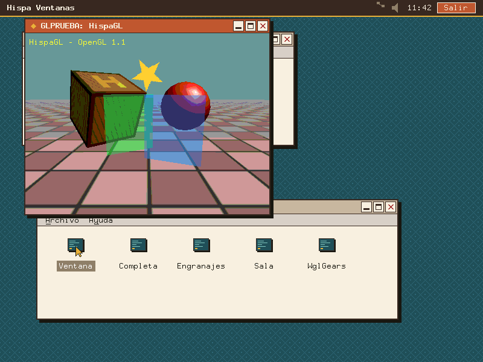
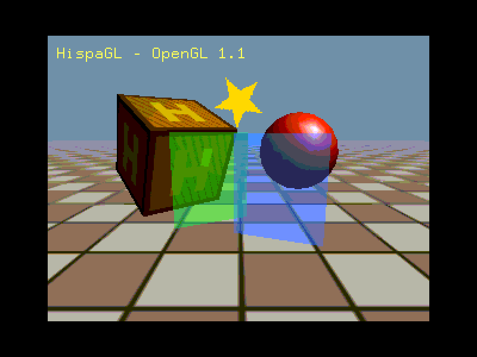
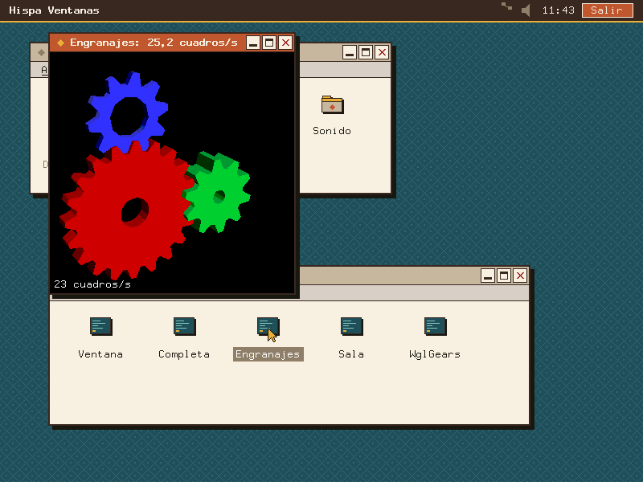
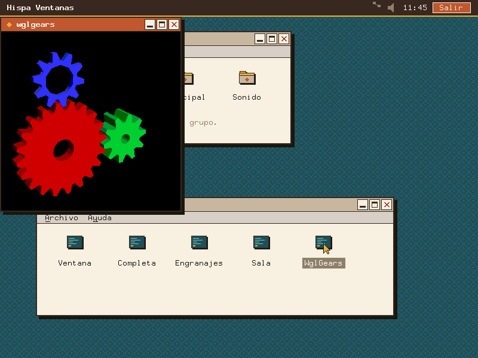
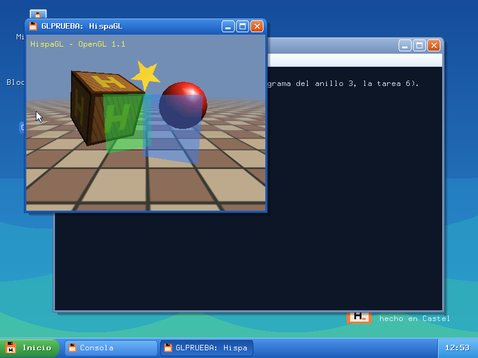
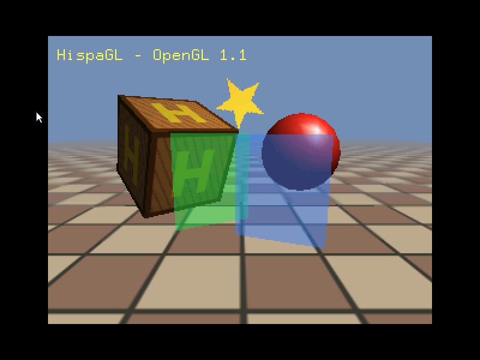
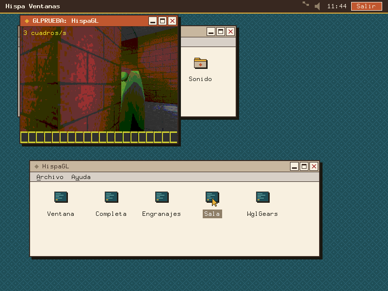
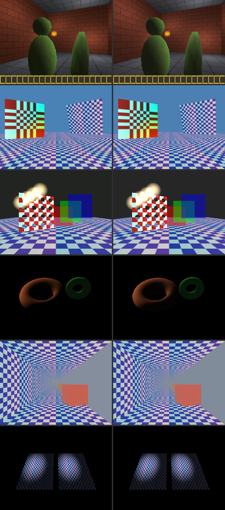

# HispaGL: OpenGL 1.1 por programa (Hispa-486 e Hispa-Pentium)

*Encargo de Carlos (21/11/2026): «Dale caña al OpenGL». Rama `opengl` (sale de
`pentium-084`). Copyright (C) 2026 Carlos Sanz y contribuidores. GPL-2.0 o
posterior.*

| | |
|---|---|
|  |  |
|  |  |
|  |  |
|  |  |

## Qué es

**`OPENGL32.DLL`** con **OpenGL 1.1 dibujado por programa** (sin tarjeta
aceleradora) para los programas de Windows de 32 bits, **la misma DLL** en
Hispa-486 (HW32 dentro de Hispa Ventanas) y en Hispa-Pentium (WIN32.BIN), como
las de DirectX. Con ella van **`GLU32.DLL`** (lo de GLU 1.2 que usaban los
programas de la época), el programa de ejemplo **GLPRUEBA**, los engranajes
**ENGRANA** y el puente con GDI32 y USER32 (`SwapBuffers`, los formatos de
punto, `ChangeDisplaySettingsA`), que en Windows son de GDI32/USER32 y aquí los
tienen Hispa Ventanas y WIN32.BIN.

- Lo de OpenGL 1.1 que usaban los juegos de 1997-2001: matrices, luces y
  materiales (8 luces, dos caras, color del material), texturas 2D de cualquier
  tamaño potencia de 2 (hasta 1024) con **mipmaps y filtros** (punto, bilineal,
  trilineal), **GL_REPEAT y GL_CLAMP/GL_CLAMP_TO_EDGE**, los cinco modos de
  `glTexEnv` (MODULATE, REPLACE, DECAL, BLEND y ADD), **dos unidades de textura**
  (GL_ARB_multitexture y GL_SGIS_multitexture: la pared por su mapa de luz, como
  GLQuake), **mezcla** con todos los factores de 1.1, **prueba de alfa**,
  **profundidad** con cualquier función, `glDepthRange` y `glPolygonOffset`,
  **niebla** (lineal, exponencial y exponencial²), recorte contra el volumen de
  vista y **seis planos del programa**, tijera, máscaras de color y de
  profundidad, punteado de polígonos y de líneas, `glPolygonMode`, caras
  ocultas, **listas de visualización** (todo lo que se puede compilar, también
  imágenes), **matrices de vértices** (`glDrawArrays`, `glDrawElements`,
  `glArrayElement`, `glInterleavedArrays`, `glLockArraysEXT`), generación de
  coordenadas de textura (objeto, ojo y **esfera**: los reflejos de la época),
  la matriz de textura, `glReadPixels`, `glDrawPixels` (con zoom), `glBitmap`,
  `glCopyPixels`, `glCopyTexImage2D`/`glCopyTexSubImage2D`, `glTexSubImage2D`,
  las texturas con paleta (GL_EXT_paletted_texture: `glColorTableEXT`, la de
  cada textura o la compartida), `glPushAttrib`/`glPopAttrib`,
  `glPushClientAttrib`, `glGet*` de casi todo el estado y `glGetError`.
- **Las 336 funciones de OpenGL 1.1 están exportadas** (más las de las
  extensiones y las wgl*): un programa que importa una que no está no llega ni
  a arrancar. Las que no hacen nada están en «Lo que no hace».
- Las wgl: `wglCreateContext`, `wglMakeCurrent`, `wglDeleteContext`,
  `wglGetCurrentContext`, `wglGetCurrentDC`, `wglShareLists` (texturas y listas
  compartidas), `wglGetProcAddress` (las extensiones y cualquier otra función de
  la DLL), `wglUseFontBitmapsA` (la letra del DC en listas con `glBitmap`),
  `wglSwapBuffers`, `wglSwapLayerBuffers`, `wglChoosePixelFormat`,
  `wglSetPixelFormat`, `wglDescribePixelFormat`, `wglGetPixelFormat` (las que
  usan los juegos que cargan una OpenGL de otra marca, como Quake II),
  `wglSwapIntervalEXT`/`wglGetSwapIntervalEXT`, y las de las capas (que dicen
  que no). Y en GDI32, `GetDeviceGammaRamp`/`SetDeviceGammaRamp` (el brillo de
  los juegos de OpenGL): dicen «no se puede» y el juego sigue.
- Extensiones (`glGetString(GL_EXTENSIONS)`): GL_ARB_multitexture,
  GL_SGIS_multitexture, GL_EXT_texture_env_add, GL_ARB_texture_env_add,
  GL_EXT_bgra, GL_EXT_compiled_vertex_array, GL_EXT_texture_edge_clamp,
  GL_SGIS_texture_edge_clamp, GL_EXT_paletted_texture,
  GL_EXT_shared_texture_palette y GL_WIN_swap_hint.

## Por qué una OpenGL propia y no TinyGL

El encargo recomendaba partir de TinyGL. Se miraron las dos: la de Fabrice
Bellard (0.4, licencia tipo zlib) y la que mantiene C-Chads (licencia zlib;
su biblioteca de matemáticas, CC0). Las dos son buenas para lo que son (un
rasterizador pequeño), pero para los juegos de la época se quedan cortas en
lo que más importa, y no es un añadido: es el corazón del rasterizador:

- **un solo tamaño de textura** para todas, fijado al compilar (256×256: todas
  se agrandan o se encogen a ese), **sin mipmaps ni filtros** (solo el punto
  más cercano) y **sin GL_CLAMP** (todo se repite);
- el rasterizador **no tiene alfa**: la mezcla solo con `GL_ONE`/`GL_ZERO` y
  colores (no hay `GL_SRC_ALPHA`), **sin prueba de alfa** (las rejas y los
  sprites de Quake y Half-Life);
- la profundidad siempre `GL_LESS` (GLQuake usa `GL_LEQUAL` y `GL_GEQUAL`),
  sin niebla, un solo `glTexEnv` (DECAL), sin multitextura;
- cada llamada, también fuera de las listas, pasa por la codificación de las
  listas (más lento); y el fork usa OpenMP y color de 32 bits.

Hubiera habido que reescribir el rasterizador, las texturas y la mezcla (lo
grande), y quedarse con la parte de las matrices y la luz (lo fácil). Se ha
hecho **una OpenGL propia, de sala limpia** (de la especificación pública de
OpenGL 1.1), con las ideas de siempre de los motores por programa de la época
(la perspectiva cada 16 puntos, la coma fija). Así **no lleva código de nadie**
(ni licencias de terceros en la DLL) y está escrita para lo que hace falta aquí:
16 bits, x87 sin cambiar su modo, 486 en adelante. Mesa entero (millones de
líneas, sus propios hilos) no tenía sentido para un disquete. PortableGL es
OpenGL 3 (con sombreadores): no es lo que usan los programas de 1997-2001.

## Cómo está hecho

| Archivo | Qué |
|---|---|
| `w32/gl/GL/gl.h` | la cabecera de OpenGL 1.1 (y las extensiones), para los programas; de ella sale también la lista de lo que exporta la DLL |
| `w32/gl/hgl.h` | lo de dentro: el estado de un contexto, los vértices transformados |
| `w32/gl/estado.c` | `glEnable`, lo que se fija con una llamada, `glGet*`, los errores, `glGetString`, `glPushAttrib` |
| `w32/gl/matriz.c` | las matrices y sus pilas, `glViewport`, `glDepthRange` |
| `w32/gl/vertice.c` | `glBegin`/`glEnd`, la transformación, la luz, la niebla y las coordenadas de textura por vértice, el recorte, el montaje de las primitivas, las matrices de vértices |
| `w32/gl/textura.c` | los objetos de textura, la subida a 16 bits, los mipmaps, los parámetros, `glTexEnv`, `glTexGen`, las paletas |
| `w32/gl/raster.c` | el rasterizado: triángulos, líneas, puntos, y todo lo de cada punto (texturas, niebla, alfa, profundidad, mezcla) |
| `w32/gl/pixeles.c` | `glClear`, `glReadPixels`, `glDrawPixels`, `glBitmap`, `glRasterPos`; los contextos |
| `w32/gl/listas.c` | las listas de visualización |
| `w32/gl/mates.c` | seno, coseno, raíz, potencia y exponencial con el x87; las copias de memoria |
| `w32/gl/wgl.c` | las wgl*, el puente con GDI32/USER32, la presentación (ventana o DirectDraw) |
| `w32/gl/hazstubs.py` | las de OpenGL 1.1 que no se hacen (vacías, con sus argumentos) y la lista de exportaciones |
| `w32/gl/glu.c` → `GLU32.DLL` | GLU 1.2: cámaras, proyectar, `gluBuild2DMipmaps`, `gluScaleImage`, cuádricas (esfera, cilindro, disco), los textos; el teselador y las NURBS, vacíos |
| `w32/gl/glprueba.c` → `GLPRUEBA.EXE` | el programa de ejemplo |
| `w32/gl/engrana.c` → `ENGRANA.EXE` | los engranajes, con los cuadros por segundo |
| `w32/gl/sala.c` | la sala de medir (`GLPRUEBA /SALA` y las pruebas del PC) |
| `ventanas/win32gl.inc` | [GL] el puente en Hispa Ventanas (Hispa-486) y `WindowFromDC` |
| `castel/nucleo32/win32/dx.c`, `user32.c` | [GL] el puente en WIN32.BIN (Hispa-Pentium) |

Tamaños: `OPENGL32.DLL` 128.512 octetos, `GLU32.DLL` 10.752, `GLPRUEBA.EXE`
14.848, `ENGRANA.EXE` 7.680. `VENTANAS.COM` crece 512 octetos (el puente: de 184.432 a 184.944).

**Los vértices.** Cada `glVertex` se transforma en el momento: modelo-vista y
proyección (precalculada la matriz de las dos), la luz por vértice en coma
flotante (con el x87: `FSQRT`, y `FYL2X`/`F2XM1` para el brillo), la niebla
por vértice (la lineal sin recortar, para que se pueda interpolar), las
coordenadas de textura (con su generación y su matriz). El código de recorte
lleva **banda de guarda** en x e y (cuatro veces la vista): solo se recorta de
verdad contra el plano cercano y el lejano, los del programa y lo que se sale
mucho; lo demás lo recorta el rasterizador al pintar (en la caja de la vista y
la tijera). Las primitivas se montan sin copiar (tiras, abanicos, cuadros,
polígonos) y el lado (delante o detrás) se mira en la ventana.

**El rasterizado.** Por filas, con la regla de arriba a la izquierda (el centro
del punto). Cada atributo tiene su plano (gradientes en x e y); los bordes van
en 16.16; la profundidad en 16.15 contra un búfer de 16 bits; el color en 8.16.
Las coordenadas de textura (y el color y la niebla, si el triángulo tiene
perspectiva) **se dividen por w cada 16 puntos** (una división por tramo:
`1/Q` se guarda para el principio del tramo siguiente y para la otra unidad), y
en coma fija entre medias; donde 1/w cambia mucho (lo lejano, las paredes de
lado) el tramo baja a 8 o 4 puntos. **El nivel de mipmap se elige por tramo**
(ρ² con las derivadas en x e y; el exponente del número en coma flotante es su
logaritmo). Caminos:

| Camino | Cuándo | Qué hace por punto |
|---|---|---|
| `tramo_color` | sin textura, sin mezcla, niebla ni prueba de alfa | Gouraud o liso, la profundidad |
| `tramo_tex` | una textura 5-6-5, punto más cercano, REPEAT, MODULATE o REPLACE | leer, modular (con un solo producto si la luz es gris: el 5-6-5 abierto en 32 bits, `0x07E0F81F`) |
| `tramo_texb` | lo mismo, bilineal | los cuatro puntos abiertos en 32 bits, dos productos por pareja |
| `tramo_luz` | **dos unidades: la pared y su mapa de luz** (GLQuake, GoldSrc con multitextura) | la pared (punto o bilineal) por la luz, que se toma en los extremos de cada tramo y se interpola (cambia despacio) |
| `tramo_mult` | **la pasada del mapa de luz** de los juegos sin multitextura (`GL_ZERO, GL_SRC_COLOR` o `GL_ONE_MINUS_SRC_COLOR`) | el búfer por la luz (igual que la anterior) |
| `tramo_todo` | lo demás | todo OpenGL 1.1: dos unidades con sus modos y su base, bilineal y trilineal, niebla, prueba de alfa, profundidad con cualquier función, la mezcla con todos los factores, la máscara, el punteado |

**El búfer** es de 16 bits (5-6-5) y la profundidad de 16 bits: lo de las
tarjetas de la época, la mitad de memoria y de ancho de banda que a 32. Las
texturas se guardan **a 16 bits**: 5-6-5 si no tienen alfa, 1-5-5-5 si el alfa
es todo o nada (las rejas), 4-4-4-4 si no; las de luminancia (los mapas de luz)
en 5-6-5 gris. Así caben más en la caché del Pentium (8 KB) y en la memoria.

**Las calidades** (variable `HISPAGL`): la de serie, *normal*, hace los filtros
que pide el programa (bilineal), pero el trilineal (`*_MIPMAP_LINEAR`) lo
cambia por el nivel más cercano, y el mapa de luz se interpola por tramos;
`HISPAGL=RAPIDO` pone **todo al punto más cercano** (los equipos viejos);
`HISPAGL=EXACTO` hace el trilineal de verdad y la luz punto a punto. Además,
`HISPAGL=VENTANA` (nunca a pantalla completa) y `HISPAGL=TRAZA` (lo que pasa,
por la traza: en Hispa-486 por COM1, en Hispa-Pentium por la de WIN32.BIN con
`HISPA32=TRAZA`; cada 5 s, los cuadros por segundo). Se pueden juntar:
`SET HISPAGL=RAPIDO TRAZA`.

**La presentación.** `SwapBuffers` (GDI32) → el puente → `wglSwapBuffers`: el
búfer va a la ventana con `SetDIBitsToDevice` (un DIB de 16 bits 5-6-5 de
arriba abajo, `BI_BITFIELDS`; Hispa Ventanas lo pasa a su pantalla, sea de 8,
16 o 32 bits). Si el programa ha cambiado de modo (`ChangeDisplaySettingsA`,
como hacen GLQuake y Half-Life antes de abrir su ventana sin marco) y su ventana
lo ocupa, va **a pantalla completa por el DirectDraw de HW32** (`DDRAW.DLL`,
cargada cuando hace falta): el modo del juego, agrandado un número entero de
veces y en el centro, como los juegos de DirectDraw; con Alt+Tab o el
Administrador de tareas la pantalla vuelve sola y se recupera al volver.
`EnumDisplaySettingsA` da de 320×200 a 1024×768. Con un solo búfer
(`PFD_DOUBLEBUFFER` no pedido) se presenta en `glFlush`/`glFinish`.

**El puente.** En Windows, `SwapBuffers`, `ChoosePixelFormat`,
`SetPixelFormat`, `DescribePixelFormat` y `GetPixelFormat` son de GDI32 (que
llama a OPENGL32). Aquí `OPENGL32.DLL`, al cargarse, da a GDI32 su función
(`HispaGLPuente`), y esas cinco y `ChangeDisplaySettingsA`/`ExA` (y, en
Hispa-486, `EnumDisplaySettingsA`, que no había) le pasan la llamada:

- **Hispa-486** (`ventanas/win32gl.inc`, marcas `[GL]` en `win32.inc` y
  `ventanas.asm`): la función queda en la ficha del programa (`PE_GL`) y se la
  llama con `pe_llamar` (como el `WndProc` o el «tic» de DirectX). También
  `WindowFromDC` (no estaba). Sin OPENGL32 cargada dicen que no
  (`ChangeDisplaySettingsA` dice «hecho», sin cambiar nada: lo que esperan los
  juegos de DirectDraw que lo llaman).
- **Hispa-Pentium** (`dx.c` y `user32.c` de WIN32.BIN, marcas `[GL]`): lo
  mismo, con una llamada directa (WIN32.BIN, las DLL y el programa comparten
  las direcciones).

## Rendimiento

La sala de medir (`w32/gl/sala.c`): 320×240, una sala de 512×512 con paredes de
ladrillo y suelo de losas con mipmaps, el mapa de luz por la segunda unidad
(multitextura, como GLQuake), tres modelos de unos 200 triángulos con luz por
vértice, dos llamas con mezcla, el arma delante (`glDepthRange`) y la barra de
abajo con prueba de alfa: **567 triángulos y 137.401 puntos por cuadro** (1,8
veces la pantalla, por lo que se pinta encima).

| Dónde | 320×240 rápida | 320×240 normal | 640×480 rápida | 640×480 normal |
|---|---|---|---|---|
| Este PC (AMD EPYC Milan, una hebra, el código de 32 bits con x87) | 245 c/s | 174 c/s | 93 c/s | 65 c/s |
| Instrucciones por cuadro (`perf stat`) | 24,0 M | 38,6 M | 79,2 M | 134,8 M |
| **QEMU** (sin KVM: emula cada instrucción), `GLPRUEBA /SALA`, Hispa-486 / Hispa-Pentium | — | 3,6–4,6 / 4,5 c/s | — | — |
| **QEMU**, ENGRANA (300×300, 3 engranajes con luz, en una ventana), Hispa-486 / Hispa-Pentium | — | 18–24 / 12–17 c/s | — | — |
| **QEMU**, WGLGEARS (de Mesa, 300×300), Hispa-486 / Hispa-Pentium | — | 26 / 42–44 c/s | — | — |
| *Estimación* Pentium 133 (CPI ≈ 2) | ≈ 2,8 c/s | ≈ 1,7 c/s | ≈ 0,8 c/s | ≈ 0,5 c/s |
| *Estimación* Pentium II 300 (CPI ≈ 1) | ≈ 12 c/s | ≈ 8 c/s | ≈ 4 c/s | ≈ 2 c/s |
| *Estimación* Atom N455 1,66 GHz (HP Mini; CPI ≈ 1,5) | ≈ 46 c/s | ≈ 29 c/s | ≈ 14 c/s | ≈ 8 c/s |

En QEMU las cifras varían bastante según lo ocupado que esté el PC (emula el
procesador instrucción a instrucción): sirven para comparar, no para saber cómo
irá un equipo de verdad. Las estimaciones salen de las instrucciones por cuadro y de cuántos ciclos
gasta de media cada una en ese procesador con este tipo de código (enteros y
algo de x87; el Pentium no tiene ejecución fuera de orden, el Atom tampoco), y
no cuentan lo que cuesta llevar el cuadro a la pantalla (`SetDIBitsToDevice`:
otra pasada de 150 KB a 320×240). Son para hacerse una idea: hay que medirlo en
el equipo. Es lo que daba la OpenGL por programa de la época (la de Microsoft
para Windows 95 iba igual o peor): **en un Pentium 133, solo lo sencillo**
(los engranajes, programas de ventanas, juegos con pocos puntos en 320×240 y
`HISPAGL=RAPIDO`); **un Pentium II o el Atom ya mueven un juego de 1997 en
320×240**.

**Un aviso de paso** (no es de HispaGL): las demás DLL de C de HW32
(`MSVCRT`, `DDRAW`, `WINMM`...) se compilan con el `-march` de serie del gcc
de 32 bits de Ubuntu, que es **i686**, y llevan instrucciones `CMOV` y
`FCOMI` (36 en `ddraw.o`, 128 en `msvcrt.o`, 18 en `winmm.o`), que **no tiene
ni un 486 ni un Pentium** (llegan con el Pentium Pro): en esos equipos de
verdad darían «instrucción no válida». QEMU las tiene, por eso las pruebas no
lo ven. OPENGL32 y GLU32 van con `-march=i486 -mtune=pentium`; para las
demás bastaría con añadir `-march=i486` a `CC32` del Makefile (no se ha tocado:
es de todas las ramas).

## Lo que no hace

- **Plantilla (stencil)** y **acumulación**: no hay búferes (los formatos de
  punto dicen 0 bits; las llamadas se aceptan y no hacen nada). Las sombras de
  algunos juegos (las de plantilla) no salen.
- **Evaluadores** (`glMap*`, `glEvalCoord*`...), **selección y realimentación**
  (`glRenderMode(GL_SELECT)` no cuenta nada), **índices de color** y
  **operaciones lógicas**: vacíos.
- **Suavizado** de puntos, líneas y polígonos (`GL_*_SMOOTH`): se pintan sin.
- El borde de las texturas (`border = 1`) se quita y **GL_CLAMP se hace como
  GL_CLAMP_TO_EDGE** (sin el color del borde: lo que hacían las tarjetas de la
  época).
- El color se interpola con perspectiva (como Mesa); la niebla también, pero
  la exponencial se calcula por vértice (la especificación lo admite).
- Las líneas anchas son varias líneas juntas y los puntos anchos, cuadrados.
- Sin **GL_ARB_texture_env_combine** ni nada de OpenGL 1.2 o posterior
  (texturas 3D, `GL_BGRA` empaquetado, mezcla con constante).
- Un hilo: en Hispa-486 no los hay; en Hispa-Pentium `CreateThread` corre el
  hilo entero (ver WIN32.md): un juego con el dibujo en otro hilo no va.

## Half-Life 1 (meta de diseño)

Carlos (21/11/2026) pregunta si será compatible con su Half-Life 1 (su copia
legal; el juego y sus datos no se bajan nunca). El renderizador OpenGL de
GoldSrc es el de GLQuake (GPL: se ha usado como referencia de qué llamadas
hacen falta) con poco más: OpenGL 1.1, `wgl*`, GL_ARB_multitexture o
GL_SGIS_multitexture (`glSelectTextureSGIS`, `glMTexCoord2fSGIS`), `glTexEnv`
con `GL_MODULATE`/`GL_REPLACE`, GL_EXT_paletted_texture (opcional:
`glColorTableEXT`), `GL_CLAMP`, `glDepthRange` y `GL_LEQUAL`/`GL_GEQUAL` (el
truco del cuadro par e impar), la pasada del mapa de luz con mezcla si no hay
multitextura, `glPolygonOffset` para las calcomanías, `glReadPixels` (las
capturas), `ChangeDisplaySettingsA`/`EnumDisplaySettingsA` (la pantalla
completa) y `glGetString(GL_EXTENSIONS)`. **Todo eso lo da HispaGL** (y lo
miran las pruebas: la sala es ese renderizador en pequeño).

Lo que le faltaría a HW32 para Half-Life, **aparte de OpenGL** (no se hace
ahora):

1. **Hilos de verdad** (`CreateThread` que vuelve y corre a la vez): el ratón
   en su hilo (`m_mousethread`), el sonido de algunos módulos, la red. En
   Hispa-486 no hay hilos; en Pentium, `CreateThread` corre el hilo entero.
2. **El registro de Windows** (ADVAPI32 `RegOpenKeyExA`, `RegQueryValueExA`,
   `RegSetValueExA`, `RegCreateKeyExA`): Half-Life guarda ahí el modo de
   vídeo, el renderizador, la clave del CD y la carpeta del juego; hoy el de
   HW32 dice siempre «no está» (haría falta uno en un archivo).
3. **Objetos de sincronización**: `CreateMutexA` (el lanzador mira que no haya
   otro abierto), `CreateEventA`, `WaitForSingleObject`/`WaitForMultipleObjects`
   de verdad, secciones críticas que esperen.
4. **SEH** (las excepciones estructuradas): el código de Visual C++ 6
   (`_except_handler3`, `__CxxFrameHandler` de C++) las usa; hoy un fallo acaba
   el programa en vez de ir a su manejador.
5. **MSVCRT de Visual C++ 6 más completa**: `_controlfp` (Half-Life pone el x87
   en precisión simple), `_beginthreadex`, `_ftol`, `setjmp`/`longjmp`, `qsort`,
   `_stricmp`/`_strnicmp`, `_vsnprintf`, `_findfirst`... (cada una, cuando la
   pida: la traza dice cuál falta).
6. **WinMM**: la música del CD (`mciSendString` con `cdaudio`) y MIDI; sin eso,
   en silencio la música (los efectos van por DirectSound, que ya está).
7. **Winsock**: el juego de un jugador también abre la red (UDP en `localhost`:
   `bind`, `recvfrom` sin bloqueo); escuchar (`listen`/`accept`) para la LAN.
8. **El CD**: la versión de caja comprueba el CD (`GetDriveTypeA`,
   `GetVolumeInformationA`) y la clave; la de Steam necesita el cliente de Steam
   (no hay camino). **La versión de caja (WON, 1.1.x) es la que se puede
   intentar.**
9. Memoria y disco: unos 32 MB de RAM y los 400 MB del juego; las DLL del
   juego (`hw.dll`, `client.dll`, `hl.dll`) grandes, con reubicados (el
   cargador ya los hace).
10. MMX: no hace falta (solo el renderizador por programa de GoldSrc lo usa
    si está; el de OpenGL, no).

El renderizador **por programa** de Half-Life (`sw.dll`) va por DirectDraw:
con lo de arriba, iría también por DDRAW.DLL de HW32.

## Las pruebas

- **En el PC, contra Mesa** (`tests/run_gl_tests.sh`): diez escenas
  (`tests/gl/escenas.c`: triángulos y profundidad, luces, texturas con mipmaps y
  filtros, mezcla y prueba de alfa, niebla, listas y matrices de vértices,
  multitextura y la pasada de luz, recorte, píxeles, trilineal y esfera) y la
  sala, dibujadas con **el mismo código de la DLL** (32 bits, x87, sin
  biblioteca de C: `tests/gl/ejecuta_hgl.c` llama al núcleo de Linux) y
  comparadas con **las de Mesa** (llvmpipe por EGL sin pantalla:
  `tests/gl/ejecuta_mesa.c`), una OpenGL que no es la nuestra: las de
  referencia están en `tests/gl/ref/` y, si hay Mesa en el PC, se dibujan
  también en el momento. Pasan **las 11, en la calidad exacta y en la normal**
  (un punto es distinto si algún color se aparta más de 24 de 255; pasan con
  menos del 3 % distintos y una diferencia media de 4 o menos: lo que dan el
  5-6-5 y un punto de diferencia en algún borde). Después mide la sala.
- **En QEMU con Hispa-486** (`tests/run_gl486_tests.sh`): GLPRUEBA en su
  ventana (la esfera, la estrella, el suelo, los cristales y el texto), a
  pantalla completa (DirectDraw, al doble y en el centro), ENGRANA y la sala,
  con sus cuadros por segundo (por la traza); y vuelve Hispa Ventanas al salir.
- **En QEMU con Hispa-Pentium** (`castel/pruebas.sh`, parte 22, `[GL]`;
  `SOLO=win32`): lo mismo desde la Consola del escritorio.
- **Un programa de otros**: `wglgears.c` de los demos de Mesa (MIT; los
  engranajes de siempre escritos para Windows con WGL, sin GLUT), bajado por
  `tests/thirdparty/fetch_gl.sh` (con su suma SHA-256) y compilado con gcc -m32
  y unas cabeceras mínimas de Windows (`tests/gl/terceros/`) contra
  OPENGL32.DLL y la MSVCRT.DLL de HW32: `make build/WGLGEARS.EXE`. No va en el
  repositorio. Un motor libre derivado de Quake no se ha probado: sin los datos
  del juego (que no se bajan) no arranca, y compilarlo pide las cabeceras de
  Windows de verdad (MinGW).

## En el disco

- **Hispa-486**: `OPENGL32.DLL` y `GLU32.DLL` en `\HISPADOS` (al lado de las de
  DirectX: HW32 busca las DLL en la carpeta del programa, en la suya y en la de
  trabajo); `GLPRUEBA.EXE` y `ENGRANA.EXE` en `\HISPA32`, con sus accesos en el
  grupo «Hispa32» del menú Inicio. Van en la imagen de Hispa-486 (`make usb486`)
  y, como en el disquete «Hispa-486» no caben, en un **disquete nuevo, «3D»**
  (`build/3d.img`), con HW32.COM, MSVCRT, DDRAW y WINMM para que se puedan
  abrir desde él.
- **Hispa-Pentium**: en `\WIN32` (las dos DLL) y `\HISPA32` (los dos
  programas), en el **paquete `win32` 1.1** (`tools/hpq.py`).
