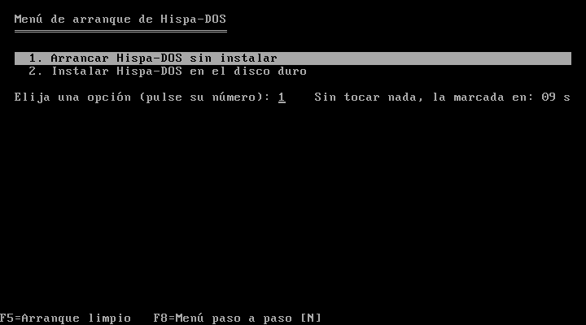
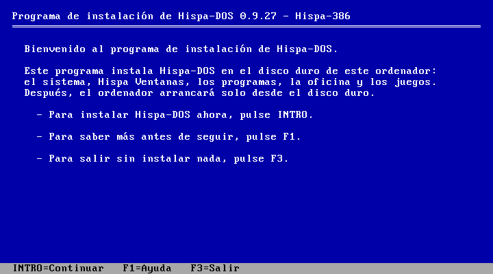
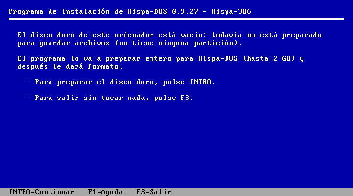
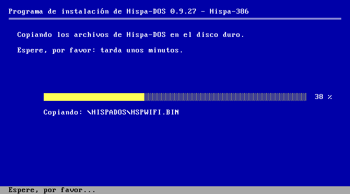
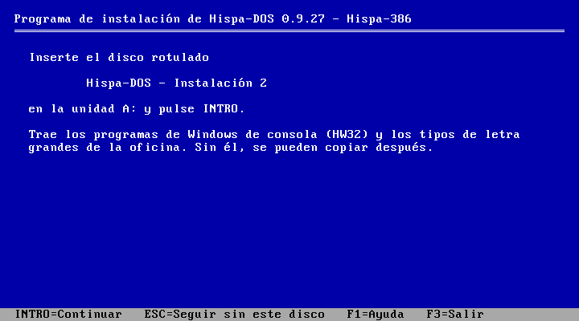
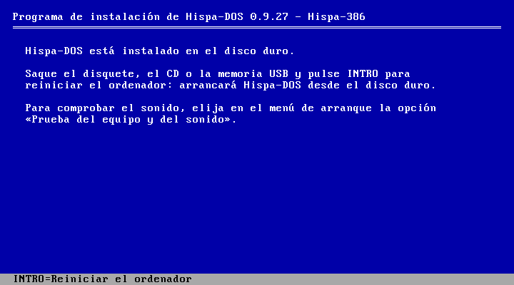
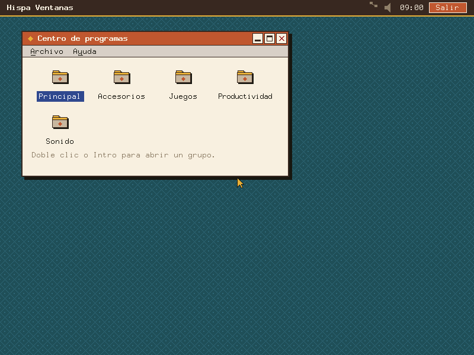
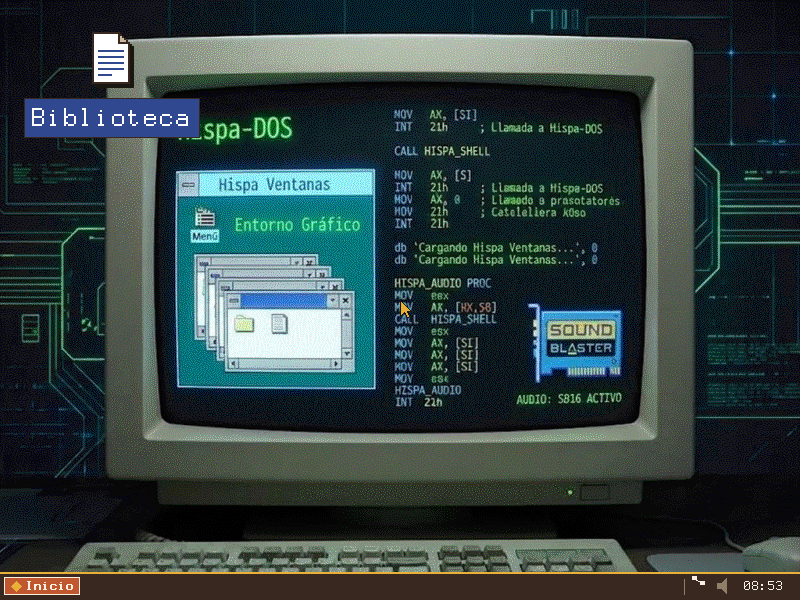

# Hispa-DOS en CD y el programa de instalación

Copyright (C) 2026 Carlos Sanz y contribuidores. GPL-2.0 o posterior.

Muchos ordenadores de los 90 no arrancan desde una memoria USB, pero tienen
lector de CD. Para ellos hay una imagen de CD de cada gama:

| Archivo                   | Gama      | Cómo se hace  |
|---------------------------|-----------|---------------|
| `build/hispados-cd.iso`   | Hispa-386 | `make cd`     |
| `build/hispa486-cd.iso`   | Hispa-486 | `make cd486`  |

El CD lleva **lo mismo que la memoria USB de su gama**: el sistema en
`\HISPADOS` (programas, juegos, Hispa Ventanas, la oficina, HW32 y sus DLL;
en Hispa-486, además, `\HISPA32`, el Navegador en `\HISPADOS\INTERNET` y el
escritorio con el menú Inicio). Se graba con cualquier programa de grabar
CD («grabar imagen»).

## Cómo arranca

- **ISO 9660 nivel 1** (nombres 8.3: los lee el núcleo de Hispa-DOS con
  HSPCD y cualquier MSCDEX) **+ Joliet** (para verlo desde Windows).
- **El Torito en emulación de disquete de 1,44 MB**: lo que mejor arrancan
  las BIOS de 1995-2000. La BIOS ve el disquete de arranque del CD
  (`\ARRANQUE.IMG`) como la unidad A:.
- Ese disquete trae solo el núcleo, el intérprete y los controladores de
  CONFIG.SYS (HSPXMS, HSPEMM, HSPCD y HSPUSB). Su AUTOEXEC.BAT busca el CD
  (la unidad que tiene `\HISPADOS\HISPACD.INI`), lo guarda en la variable
  `CD` y lo usa todo de allí: `PATH` con `%CD%:\HISPADOS` y los
  controladores de AUTOEXEC.BAT (ratón, sonido, mandos...).
- Las letras (docs/UNIDADES.md): si el equipo tiene disco duro, la C: es
  suya (aunque esté vacío, sin partición) y el CD es la D: (o la primera
  libre detrás de las particiones); sin disco duro, el CD es la C:. Una
  memoria USB que lleve HSPUSB sale en la X:.
- `ARRANQUE.IMG` también se puede grabar en un disquete de verdad: es un
  disquete de arranque para usar el CD en los equipos que no arrancan de CD.

## El primer menú (en todos los medios)

El disquete de arranque, la memoria USB (las dos gamas) y el CD empiezan
con el mismo menú, como el de MS-DOS 6.22:

```
  Menú de arranque de Hispa-DOS
  ═════════════════════════════

    1. Arrancar Hispa-DOS sin instalar
    2. Instalar Hispa-DOS en el disco duro
```

- **1** (se elige sola a los 10 segundos, para no instalar sin querer):
  el menú de siempre, *Normal*, *Juegos* y *Prueba del equipo y del
  sonido* (este, a los 5 segundos, *Normal*).
- **2**: el programa de instalación (`INSTALAR /SETUP`).



Está hecho con el menú de CONFIG.SYS del núcleo (`SUBMENU`, como en MS-DOS
6.22). Las líneas de este primer menú y de la opción «Instalar» van entre
dos marcas, `[SOLO-MEDIO` y `SOLO-MEDIO]`, en `floppy/CONFIG.SYS`,
`usb/CONFIG.SYS` y sus AUTOEXEC.BAT: INSTALAR (y ACTUALIZAR) las quitan al
copiar esos archivos al disco duro, que se queda con el menú de tres
opciones de siempre.

## El programa de instalación (INSTALAR /SETUP)

Pantallas azules en modo texto, como el SETUP de MS-DOS 6.22: arriba
«Programa de instalación de Hispa-DOS» con la versión y la gama; abajo, las
teclas de cada pantalla (`INTRO=Continuar  F1=Ayuda  F3=Salir`). F1 enseña la
ayuda de ese paso y F3 pregunta antes de salir.



Los pasos:

1. **Bienvenida.**
2. **El disco duro** (lo mira `PARTIR /SITUACION`, sin tocar nada):
   - vacío (sin particiones): se prepara entero (`PARTIR /INSTALAR /SI`:
     una partición con todo el disco, hasta 2 GB) y se le da formato;
   - con particiones de otros sistemas y sitio libre: INTRO usa el sitio
     libre sin tocar lo demás; **B** borra todo el disco;
   - lleno con particiones de otros sistemas: solo **B** (borrar todo);
   - B siempre pide confirmar con **S** en otra pantalla, en amarillo
     («Se va a BORRAR TODO EL DISCO DURO»); `PARTIR /BORRARTODO` vacía la
     tabla de particiones (nunca la del disco de arranque);
   - ya con una partición DOS: sin formato, se le da (avisando); con
     Hispa-DOS, **A** actualiza (conserva datos y ajustes) o **N** instala de
     nuevo (formatea); con otras cosas, se conservan.
   - Si tras partir el núcleo no ve la unidad nueva, pide reiniciar (y
     volver a elegir «Instalar»). Con Hispa-DOS no suele hacer falta: PARTIR
     hace que el núcleo reparta las letras otra vez sin reiniciar.
   - El disco es el **disco duro interno** (el que el núcleo tiene por
     tal: la C:), nunca el medio del que se ha arrancado: arrancando de la
     memoria USB (que es la X:), la memoria no se toca; si no hay más disco
     que ella, dice que no hay disco duro donde instalar.

   

3. **La carpeta**: `C:\HISPADOS`.
4. **El formato** (`FORMATEA`), si hace falta.
5. **La copia**, con barra de progreso y el nombre de cada archivo
   (primero se cuentan, luego se copian); antes, `SISTEMA` hace el disco
   arrancable y, después, `PARTIR /ARRANQUE` deja la partición activa con el
   MBR de Hispa-DOS.

   

6. **Los demás disquetes**, si se instala desde disquetes y no hay CD:
   «Inserte el disco rotulado *Hispa-DOS - Instalación 2* en la unidad A: y
   pulse INTRO», luego *Oficina* y, si se quiere, *Hispa-486* e *Internet*
   (ESC sigue sin ese disco). Cada uno con su barra.

   
7. **El final**: «Saque el disquete, el CD o la memoria USB y pulse INTRO
   para reiniciar el ordenador».

   

Por debajo es INSTALAR de siempre (PARTIR, FORMATEA, SISTEMA y el motor de
copia de `lib/copiaarbol.inc`): lo que esos programas escriben va a `NUL`
mientras se ve la pantalla del programa. No hace la comprobación del sonido
del final de INSTALAR: se hace con la opción *Prueba del equipo y del
sonido* del menú de arranque. `INSTALAR` sin `/SETUP` (y `INSTALL` en la
memoria USB) sigue como antes, con preguntas en modo texto.

## De dónde copia INSTALAR

- Por omisión, de la unidad de arranque (la de verdad, INT 21h AX=3305h:
  la X: si es la memoria USB y el equipo tiene disco duro).
- **Arrancando de disquete** (el de siempre o el del CD), si hay un CD de
  Hispa-DOS puesto (una unidad con `\HISPADOS\HISPACD.INI`), **copia todo
  del CD** y no pide los disquetes *Instalación 2*, *Oficina*, *Hispa-486*
  ni *Internet*. La gama es la del CD.
- `INSTALAR /ORIGEN:x:` copia de la unidad x: (con o sin `/SETUP`).

## Los 386 que no arrancan de CD

Casi ningún 386 (y muchos 486) arranca desde CD. El camino: arrancar con el
disquete de arranque de siempre (o `ARRANQUE.IMG` grabado en un disquete).
Su CONFIG.SYS ya carga HSPCD (IDE y SATA), y el CD sale como una unidad más
(la primera letra libre). Con *Instalar Hispa-DOS en el disco duro* en el
menú, el programa de instalación encuentra el CD solo.

## Las pruebas

`tests/run_cd_imagen_tests.sh` (en `make test`), en QEMU con una máquina de
los 90 (`-cpu 486`/`pentium`, 16 MB, sin USB):

- `cd`: arranca el ISO como CD (`-boot d`): los dos menús, el CD con su
  letra, DIR del CD, Hispa Ventanas desde el CD;
- `instalar`: la opción 2 en un disco duro vacío (las pantallas azules,
  partir, formato, copia con barra, reiniciar) y arrancar del disco
  instalado (sin el primer menú);
- `disquete`: el disquete de siempre con el CD puesto en un «386» (486 sin
  arrancar del CD, `-boot a`): HSPCD ve el CD y la opción 2 instala desde él
  sin pedir disquetes;
- `disquetes`: la opción 2 desde el disquete de arranque sin CD: pide
  *Instalación 2* y *Oficina* (con el de arranque puesto dice «Ese no es el
  disco pedido») y, con ESC al de *Hispa-486*, queda Hispa-386;
- `usb`: la opción 2 desde la memoria USB (la X:) a un disco duro vacío (el
  2.º disco, la C:): CONFIG.SYS sin letras y la memoria sin tocar;
- `486`: el CD de Hispa-486 arranca el escritorio (Pentium, 16 MB).





Las capturas de este documento salen de esa prueba (`CAPTURAS=docs/cd`).
