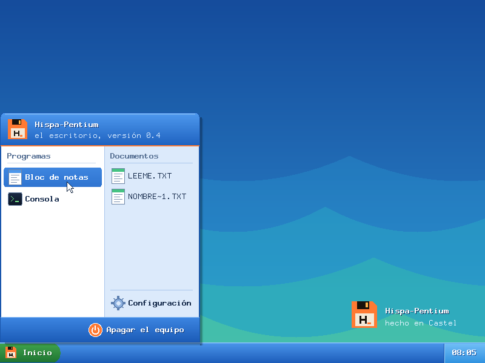
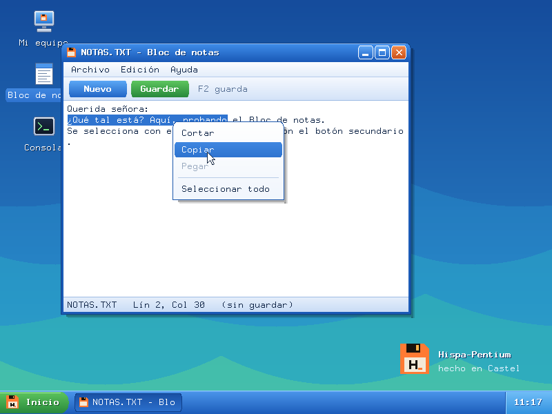
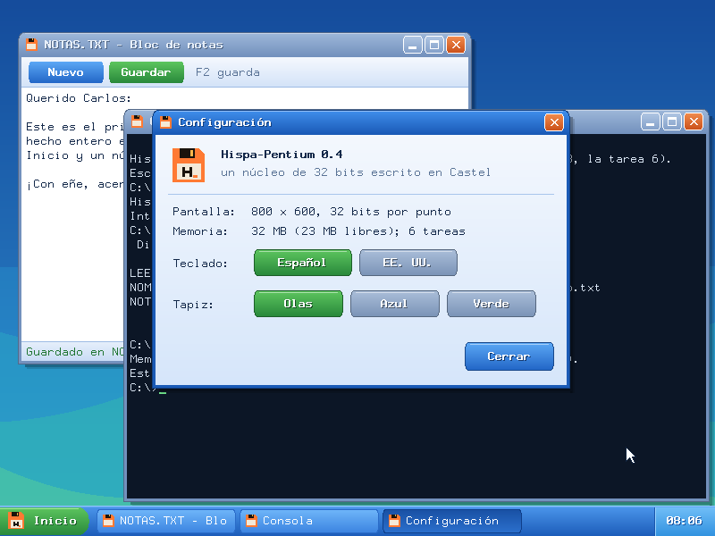
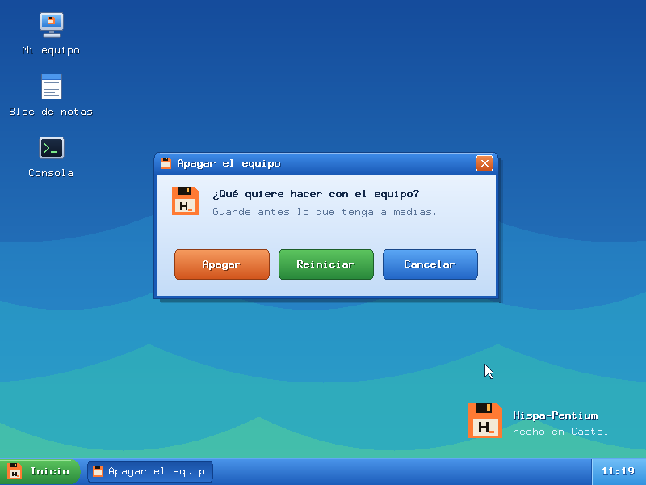
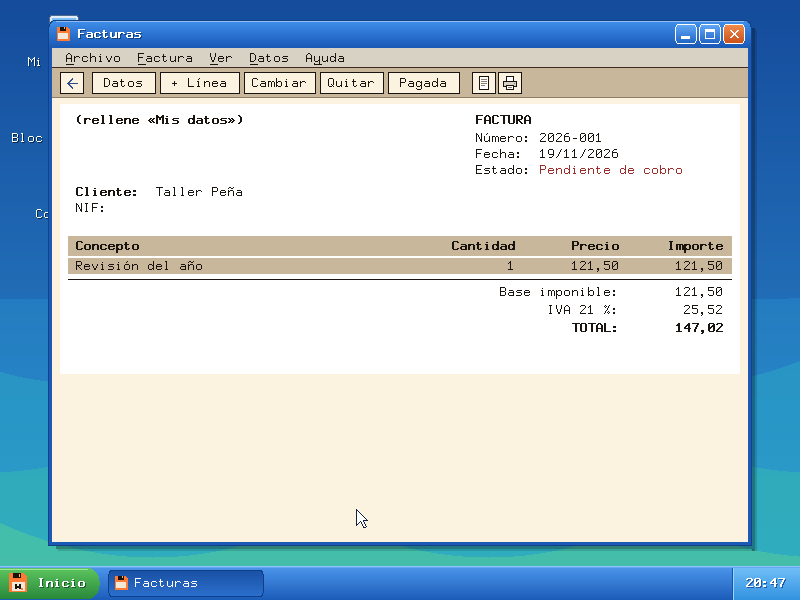
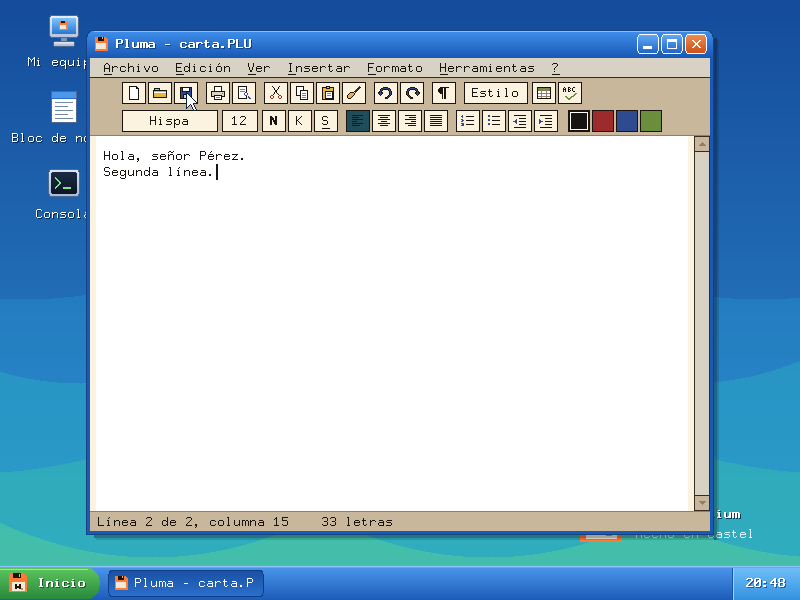
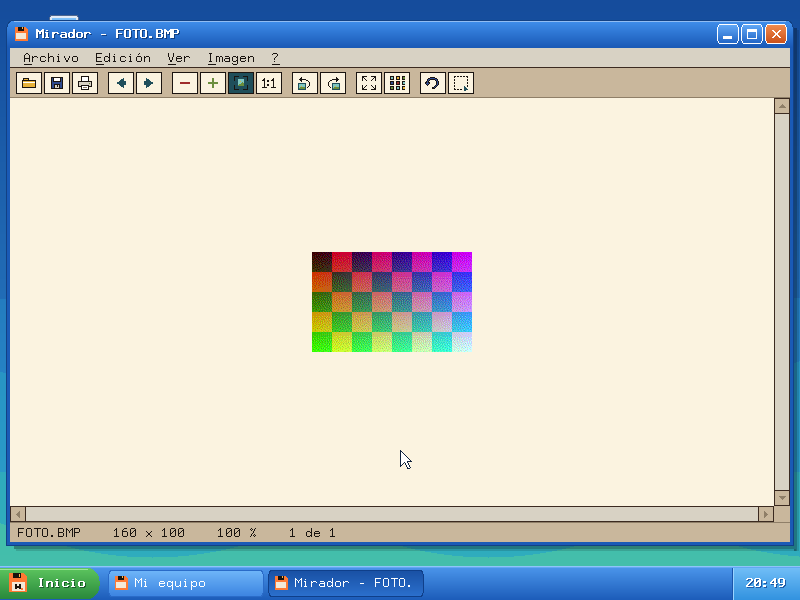

# Hispa-Pentium — el núcleo de la gama XP, escrito en Castel

*18/11/2026; puesto al día el 19/11/2026 (la 0.6: los discos SATA, las unidades con letra y el USB). Hispa-Pentium es el miembro de la
familia Hispa-DOS para los PC de 2000 en adelante (la gama de Windows XP, [ROADMAP](ROADMAP.md)): un **núcleo propio
de 32 bits, sin DOS por debajo**, con memoria virtual, escrito en
[Castel](../castel/README.md). Esta nota cuenta lo que hay hecho: la semilla de la
Fase 5 de Castel (IDT, reloj, teclado, excepciones) ha crecido hasta tener memoria
con paginación, tareas con el reloj repartiendo el procesador y programas en el
anillo 3; y, desde la noche del 18 al 19/11, **disco duro (ATA) y sistema de
archivos (FAT12/16/32)**, programas que **se cargan del disco**, más llamadas al
sistema (teclado, archivos, lanzar y esperar programas, memoria que crece) y un
**intérprete de órdenes en el anillo 3** (DIR, TYPE, VER, CLS, MEM, AYUDA y lanzar
programas por su nombre). En la tanda del 19/11 de madrugada: **se escribe en el
disco** (crear, escribir, alargar, cortar y borrar archivos; carpetas; COPY, DEL,
REN, MD, RD y la redirección `>` y `>>`), el intérprete tiene **carpeta de trabajo
(CD), PATH, archivos .BAT, historia de la línea y Ctrl+C**, el **teclado es el
español** (acentos con tecla muerta, ñ, ç, ¿ ¡) y se leen los **nombres largos**
(VFAT). Y en la del 19/11 por la mañana (la **0.4**): el primer **entorno gráfico**,
un **escritorio** con el aire de los de principios de los 2000 y diseño propio
(modo gráfico de 32 bits, ratón, ventanas con su barra de título redondeada, barra
de tareas con el botón «Inicio», menú Inicio de dos columnas, reloj, un Bloc de
notas y una Consola con el intérprete de órdenes dentro: sección 10); y lo que
hace falta para probarlo en **PC de verdad** (sección 11): una memoria USB con
GRUB, los programas del cargador como **unidad en memoria** cuando no hay disco, y
**no escribir en el disco del PC** si no se pide. Y en la del 19/11 a mediodía (la
**0.5**, después de la primera prueba en un PC de verdad, un Toshiba NB250): el
**botón secundario** del ratón con sus menús, **seleccionar, cortar, copiar y
pegar** con un portapapeles del sistema, **iconos en el tapiz**, «Mi equipo»,
ventanas que **cambian de tamaño** por el borde, **barra de menús** en las ventanas
y el escritorio **a la medida de la pantalla** (1024 x 600 y los demás). Y en la
del 19/11 por la tarde (la **0.6**, el primer paso para poder **instalarlo en el
disco duro**: que el núcleo vea los discos y el USB de los PC de verdad): los
**discos SATA (AHCI)**, una **capa de discos** con el permiso de escritura disco a
disco, la **FAT con varios volúmenes a la vez**, las **unidades con letra** (C: el
disco de dentro, X: la memoria USB de arranque, M: lo que trae el cargador) y el
**USB** (xHCI, EHCI y UHCI): **teclado, ratón y panel táctil**, **concentradores**
y **memorias** (secciones 7 y 11). Todo está en `castel/nucleo32/`.*


Copyright (C) 2026 Carlos Sanz y contribuidores. GPL-2.0 o posterior.

---

## 1. Cómo se arranca

**El escritorio** (sección 10), en QEMU, con su ventana (en un PC con escritorio;
o por VNC con `-display vnc=:1`):

```
cd castel
nucleo32/disco.sh /dev/shm/pentium.img
./compilar.sh nucleo32/semilla.cas /dev/shm/SEMILLA.BIN
qemu-system-i386 -kernel /dev/shm/SEMILLA.BIN -append "escritorio escritura" -m 32 -rtc base=localtime \
  -drive file=/dev/shm/pentium.img,format=raw,if=ide,index=0
```

(`escritorio` arranca el entorno gráfico; `escritura` deja escribir en el disco,
que si no es de solo lectura: sección 7. Con `modo=1024x768`, ese tamaño; con
`tapiz=1` o `tapiz=2`, otro fondo. Desde el intérprete de órdenes, la orden
`ESCRITORIO`; desde la consola del núcleo, `escritorio`.)

**La consola de texto**, con un disco:

```
cd castel
nucleo32/disco.sh /dev/shm/pentium.img            # un disco FAT16 con el intérprete y los programas
DISCO=/dev/shm/pentium.img ARRANQUE=ordenes MODULOS= nucleo32/probar.sh "" dir "type leeme.txt" "eco hola y adios" malo mem salir apagar
ESCRIBE=1 DISCO=/dev/shm/pentium.img ARRANQUE=ordenes MODULOS= nucleo32/probar.sh "" "md cartas" "echo hola > cartas\\una.txt" "dir cartas" salir apagar
fsck.fat -n /dev/shm/pentium.img                  # el disco, visto desde fuera: sano
```

`nucleo32/disco.sh IMAGEN [12|16|32|mbr]` hace la imagen de un disco duro con
`mkfs.fat` y `mtools`: FAT16 (16 MB) si no se dice otra cosa, FAT12 (4 MB), FAT32
(40 MB) o un disco con tabla de particiones y la FAT16 en la primera. Dentro van
`ORDENES.BIN` (el intérprete de órdenes), `HOLA.BIN`, `ECO.BIN`, `MALO.BIN`,
`CLI.BIN`, `PRUEBA.BIN`, `ESCRIBE.BIN`, `BUCLE.BIN`, tres archivos de órdenes
(`LOTE.BAT`, `SINFIN.BAT`, `VISTO.BAT`), `LEEME.TXT` y las carpetas `TEXTOS` y
`LARGOS` (esta, con nombres largos).

`nucleo32/probar.sh` compila el núcleo (`semilla.cas` con sus módulos), arranca
QEMU con `-kernel SEMILLA.BIN`, con la imagen de `DISCO=` como disco IDE (y con
`escritura` en la línea del núcleo, salvo con `SOLO_LECTURA=1`) y le
teclea las órdenes por el monitor de QEMU (como un teclado de verdad: el español,
tecla a tecla, con sus acentos; `:tecla ctrl-c` o `:tecla up ret` pulsan esas
teclas tal cual; y, para el escritorio, `:clic X Y`, `:doble X Y`, `:arrastra X1 Y1
X2 Y2`, `:raton X Y`, `:escribe texto`, `:pausa S` y `:captura NOMBRE`, que deja
la pantalla en `$CAPTURAS/NOMBRE.ppm`). **Lo que se escribe en el disco no llega a la imagen** (se queda
en una copia de QEMU) **salvo con `ESCRIBE=1`**. Lo que se escribe sale por la pantalla y por el puerto serie, y el
script lo enseña con el código con que acaba el núcleo. Con `ARRANQUE=ordenes`
(lo que QEMU pasa con `-append`), el núcleo lanza el intérprete de órdenes nada
más arrancar; sin eso, se queda en su consola (la del núcleo, sección 9), y el
intérprete se lanza con la orden `ordenes`. Sin `DISCO=` el núcleo arranca igual,
con los programas de siempre como módulos de multiboot (`-initrd`; `MODULOS=`
para que no lleve ninguno).

**Para verlo y teclear uno mismo** (en un terminal de texto; se sale con Esc y
luego 2, `quit`; o tecleando `salir` y `apagar`):

```
cd castel
nucleo32/disco.sh /dev/shm/pentium.img
./compilar.sh nucleo32/semilla.cas /dev/shm/SEMILLA.BIN
qemu-system-i386 -kernel /dev/shm/SEMILLA.BIN -append "ordenes escritura" -m 32 -display curses -rtc base=localtime \
  -drive file=/dev/shm/pentium.img,format=raw,if=ide,index=0 -device isa-debug-exit,iobase=0xf4,iosize=0x04
```

(Así, con `escritura`, **sí se escribe en la imagen**: lo que se cree o se borre queda en
`/dev/shm/pentium.img`, y se puede mirar luego con `mdir -i /dev/shm/pentium.img ::`
o comprobar con `fsck.fat -n`. El teclado es el español. **Ojo con `-display
curses`**: ahí QEMU no recibe teclas, sino las letras que le manda el terminal, y
las convierte en teclas de un teclado de EE. UU.: hay que arrancar con
`-append "ordenes escritura teclado=us"` (probado: van todas las letras y signos del ASCII,
con su `\` y su `>`; no la eñe ni los acentos). Con `-k es` QEMU las convierte al
teclado español y la eñe sale, pero no sabe dar las de Alt Gr ni las vocales con
acento. Para ver el teclado español entero, la ventana de QEMU en un PC con
escritorio (sin `-display curses`) o un PC de verdad: ahí cada tecla llega como
es.) Sin QEMU: `SEMILLA.BIN` lo arranca cualquier cargador multiboot
(GRUB: `multiboot /SEMILLA.BIN ordenes`), y el disco es el primero del canal IDE
primario.

```
Hispa-Pentium (semilla), un núcleo de 32 bits escrito en Castel
memoria: 32 MB, 7862 marcos libres; paginación activa; 0 programas de usuario.
disco 0: QEMU HARDDISK, 16 MB, FAT16.
lanzo ORDENES.BIN del disco (la tarea 3, en el anillo 3)

Hispa-Pentium: intérprete de órdenes (un programa del anillo 3, la tarea 3).
Escriba AYUDA para ver las órdenes.
C:\>md cartas
C:\>cd cartas
C:\CARTAS>echo Querida señora: ¿qué tal está? > maría.txt
C:\CARTAS>type \leeme.txt >> maría.txt
C:\CARTAS>copy maría.txt copia.txt
        1 archivo(s) copiado(s).
C:\CARTAS>ren copia.txt otra.txt
C:\CARTAS>dir
 Directorio de C:\CARTAS

.             <DIR>       19/11/2026  03:23
..            <DIR>       19/11/2026  03:23
MARIA    TXT         150  19/11/2026  03:23
OTRA     TXT         150  19/11/2026  03:23
       2 archivos           300 octetos
       2 carpetas      16631808 octetos libres
C:\CARTAS>del otra.txt
C:\CARTAS>cd ..
C:\>lote uno dos
lote: empiezo con uno y dos (y el 100%)
desde el lote
(ECO.BIN ha acabado con el código 3)
lote: una línea
lote: y otra

Pulse una tecla para seguir . . . 
lote: fin
C:\>bucle
bucle: doy vueltas sin fin (Ctrl+C para acabar)
^C
C:\>salir
Hasta luego.
ORDENES.BIN ha acabado con el código 0; marcos libres: 7862 antes y 7862 después
```

(Lo de arriba sale de `ESCRIBE=1 DISCO=/dev/shm/pentium.img ARRANQUE=ordenes MODULOS=
nucleo32/probar.sh "" "md cartas" "cd cartas" "echo Querida señora: ¿qué tal está? >
maría.txt" ... "lote uno dos" ":tecla spc" bucle :espera ":tecla ctrl-c" salir
apagar`; después, `fsck.fat -n /dev/shm/pentium.img` da el disco por sano y `mdir -i
/dev/shm/pentium.img ::CARTAS` enseña `MARIA.TXT`.)

---

## 2. Las piezas

El núcleo son unas 14.500 líneas de Castel en treinta y dos módulos (más la
biblioteca de 32 bits, `castel/biblioteca32/`: Textos32, Mem32 y Formato,
CASTEL32.md §7). Sale un binario de unos 135 K (un tercio, el entorno gráfico; una
cuarta parte, los discos y el USB).

| Módulo | Qué hace |
|---|---|
| `cpu.cas` (Cpu) | La **GDT** nueva: código y datos del anillo 0 (0x08, 0x10), del anillo 3 (0x1B, 0x23) y el **TSS** (0x28, cargado con `ltr`). La **IDT** (`pon_puerta`, con puertas del anillo 0 o llamables desde el 3), los dos **8259** (IRQ en 0x20-0x2F) y el **reloj 8253** a 100 Hz. Lo que solo se dice en ensamblador: CR0, CR2, CR3, `cli`/`sti` (`sin_interrupciones` y `reponer`), `hlt`. |
| `multiboot.cas` (Multiboot) | Lo que cuenta el cargador: la memoria alta, el **mapa de memoria** región a región, los **módulos** que ha cargado y lo que se le ha dicho al núcleo al arrancarlo (`-append`). |
| `marcos.cas` (Marcos) | El **gestor de marcos físicos**: un mapa de bits, un bit por marco de 4 K (hasta 1 GB). Al empezar suelta lo que el mapa dice libre y tapa el primer mega, el propio núcleo, la información del cargador, sus textos (lo que se le dice al núcleo y los nombres de los módulos: QEMU los deja justo detrás del núcleo) y sus módulos. `reservar_marco` (lo da a cero) y `soltar_marco` (no cuenta dos veces). |
| `paginas.cas` (Paginas) | La **paginación**: directorio y tablas de páginas, `mapear`, `desmapear`, `traducir`; el directorio del núcleo (la identidad) y uno por programa (`nuevo_espacio`, `soltar_espacio`); la **zona a la demanda**; y `usuario_puede`, para que la llamada al sistema no toque lo que no es del programa. |
| `monton.cas` (Monton) | El **montón del núcleo**: `reservar` y `liberar`, con cabecera, pie, relleno y comprobación (sección 4). |
| `tareas.cas` (Tareas) | Las **tareas**: fichas, colas, el **reloj que cambia de tarea**, `ceder`, `dormir`, `bloquear`/`despertar_tarea`, `terminar` y `esperar`; los **cerrojos** (`tomar`, `soltar`) y las tareas huérfanas (sección 5). |
| `consola.cas` (Consola) | El **teclado** (el PS/2, por la IRQ 1, o uno USB: el español, con teclas muertas, Alt Gr y Bloq Mayús; su cola de letras, `leer_tecla`; Ctrl+C) y la **pantalla**, cada uno con su cerrojo: `escribir_trozo` (una ristra entera sin que se cuele otra tarea), `borrar_pantalla` (secciones 5 y 9). |
| `pci.cas` (Pci) | El **bus PCI**: leer y escribir la configuración de cada aparato (puertos `0xCF8` y `0xCFC`) y buscar los de una clase (la controladora SATA, las de USB), también detrás de los puentes. |
| `ata.cas` (Ata) | Los **discos duros ATA** del canal IDE primario, en PIO y con LBA de 28 bits: `identificar` (IDENTIFY: modelo y sectores), `leer_sectores`, `escribir_sectores` y `asentar` (sección 7). |
| `ahci.cas` (Ahci) | Los **discos SATA** de una controladora **AHCI**: los puertos, IDENTIFY, leer y escribir por **DMA** con **LBA de 48 bits** (sección 7). |
| `discos.cas` (Discos) | **Los discos, sean de la clase que sean** (IDE, SATA, USB): una tabla, y leer, escribir y asentar sin saber qué hay debajo. Lleva el **permiso de escritura** de cada disco. |
| `fat.cas` (Fat) | El **sistema de archivos FAT12/16/32**, para leer y escribir, con **varios volúmenes montados a la vez**: abrir por la ruta, leer, escribir, cortar, borrar, cambiar de nombre, hacer y borrar carpetas, los nombres largos, los clusters libres (sección 7). |
| `unidades.cas` (Unidades) | **Las unidades y sus letras**: mira las particiones de cada disco (tabla del **MBR** y **GPT**), monta cada volumen FAT y le da su letra (C:, D:... los de dentro; X:, Y:, Z: las memorias USB; M: la unidad en memoria); y cuál es la **unidad del sistema**. |
| `usbbase.cas`, `xhci.cas`, `ehci.cas`, `uhci.cas`, `usb.cas` | **El USB** (sección 11): las controladoras **xHCI** (USB 3), **EHCI** (USB 2.0) y **UHCI** (USB 1.1), quitárselas a la BIOS, y **enumerar** lo que hay enchufado, también detrás de **concentradores**. |
| `usbhid.cas` (Usbhid) | Los **teclados y ratones USB** (y los paneles táctiles que se presentan como ratón): le dan a `consola.cas` y a `raton.cas` lo mismo que los PS/2. |
| `usbalm.cas` (Usbalm) | Las **memorias USB** (almacenamiento «solo a granel», órdenes SCSI): un disco más para `discos.cas`. |
| `registro.cas` (Registro) | El **registro del arranque**: lo que el núcleo dice de los discos y del USB, apuntado para guardarlo en `ARRANQUE.TXT`. |
| `fecha.cas` (Fecha) | La **fecha y la hora** del reloj de pila del PC (la CMOS), como las guarda la FAT. |
| `usuario.cas` (Usuario) | Los **programas del anillo 3**: los carga **del disco** (o de los módulos de multiboot) en su espacio de direcciones y atiende la **llamada al sistema** (`int 0x80`, sección 6). |
| `video.cas` (Video) | El **modo gráfico**: el que haya dejado el cargador (multiboot) o el de la **VBE de Bochs/QEMU**; la memoria de la pantalla, a la vista del núcleo; y, si el modo no es de 32 bits, el volcado a 24 o a 16 (sección 10). |
| `grafico.cas` (Grafico), `letra.cas` (Letra) | **Dibujar**: los lienzos; rectángulos, degradados, esquinas redondas, líneas, círculos, el disquete de la casa, texto con la **letra de 8x16** (la de Hispa Ventanas, hecha por `hazletra.py`) y copiar de un lienzo a otro. |
| `raton.cas` (Raton) | El **ratón** (el PS/2, por la IRQ 12, o uno USB): dónde está la flecha y la cola de clics. |
| `ventanas.cas` (Ventanas) | El **gestor de ventanas**: un lienzo por ventana, el marco, el orden, componer solo lo que cambia con doble búfer, la flecha (y sus formas), mover y **cambiar de tamaño**, y repartir el ratón y las teclas. |
| `emergente.cas` (Emergente) | Los **menús emergentes**: el del botón secundario y el que cuelga de una barra de menús. |
| `terminal.cas` (Terminal) | Los **terminales**: dos tubos para que una ventana tenga dentro al intérprete de órdenes y a sus programas. |
| `escritorio.cas` (Escritorio) | El **escritorio**: el tapiz y sus **iconos**, la barra de tareas, el menú Inicio, el reloj, los cuadros (apagar, configuración, «Acerca de»), los menús del botón secundario, y la tarea que lo mueve todo. |
| `semilla.cas` (Semilla) | El programa: arranca todo lo anterior; las **excepciones** (con el fallo de página, que se atiende) y la **consola del núcleo** con sus órdenes (sección 9). |

Y, para el anillo 3 (`modelo usuario`, CASTEL32.md §1), también en Castel:

| Archivo | En el disco | Qué es |
|---|---|---|
| `llamadas.cas` (Llamadas) | — | El **módulo de las llamadas al sistema** para los programas: `tecla`, `leer_línea` (con su historia), `abrir`, `crear`, `leer`, `escribir_archivo`, `mover`, `cortar`, `cerrar`, `borrar`, `renombrar`, `crear_carpeta`, `cambiar_carpeta`, `redirigir`, `entrada`, `lanzar`, `esperar`, `argumentos`, `dato`, `más_memoria`...; y las **ventanas** (`ventana`, `suceso`, `rectángulo`, `degradado`, `texto`, `mapa`...), los **menús** (`menú`), el **portapapeles** (`al_portapapeles`, `del_portapapeles`) y los terminales. Un programa lo importa y no escribe ni una `int 0x80`. |
| `barramenu.cas` (Barramenu) | — | La **barra de menús** de una ventana (Archivo, Edición, Ayuda): pintarla, saber qué rótulo se ha pulsado y abrir su menú. |
| `ubloc.cas` | `BLOC.BIN` | El **Bloc de notas** del escritorio (sección 10). |
| `uequipo.cas` | `EQUIPO.BIN` | **Mi equipo**: las unidades (con su letra, de qué son y lo que cabe en ellas) y lo que hay dentro (sección 10). |
| `uconsola.cas` | `CONSOLA.BIN` | La **Consola** del escritorio: el intérprete de órdenes dentro de una ventana (sección 10). |
| `uordenes.cas` | `ORDENES.BIN` | El **intérprete de órdenes** (sección 8). |
| `uhola.cas` | `HOLA.BIN` | Escribe, suma, duerme, pide su número de tarea y prueba que la llamada al sistema no le deja enseñar la memoria del núcleo. |
| `ueco.cas` | `ECO.BIN` | Enseña sus argumentos (y acaba con cuántas palabras eran). |
| `umalo.cas`, `ucli.cas` | `MALO.BIN`, `CLI.BIN` | Los que hacen lo que no deben: leer la memoria del núcleo y hacer `cli`. |
| `uprueba.cas` | `PRUEBA.BIN` | Prueba las llamadas al sistema desde dentro: la memoria que crece, leer un archivo a trozos, abrir de más, punteros que no son suyos, lanzar y esperar, escribir dos a la vez. |
| `uescribe.cas` | `ESCRIBE.BIN` | Prueba **escribir en el disco** desde dentro: crear, escribir a trozos, leer de vuelta, escribir en medio, cortar, alargar con hueco, añadir; lo que no se puede; las carpetas; con `lleno`, llena el disco y lo vacía. |
| `ubucle.cas` | `BUCLE.BIN` | El que no acaba nunca (da vueltas, duerme, espera teclas o escribe sin parar): para probar **Ctrl+C**. |

---

## 3. La memoria

Las direcciones (lo mismo en todos los espacios, menos la parte del usuario):

| Desde | Hasta | Qué |
|---|---|---|
| `0x00000000` | la memoria que haya (hasta 1 GB) | **la identidad**: la memoria de verdad, tal cual. El núcleo, sus variables, la pantalla y los marcos (un marco se toca por su dirección física). Solo el anillo 0. |
| `0x40000000` | `0xBFFFFFFF` | **el programa de usuario** (anillo 3): cada uno, en su directorio. Su código y sus datos; detrás, lo que pida de más (`más_memoria`, sección 6); y arriba del todo (desde `0xBFC00000`), **su pila**, que crece hacia abajo. |
| `0xC0000000` | `0xC3FFFFFF` | **el montón del núcleo** (hasta 64 MB: de él salen los lienzos de las ventanas, el doble búfer y el tapiz). |
| `0xD0000000` | `0xD03FFFFF` | **la zona a la demanda** (4 MB): vacía; el fallo de página pone un marco donde se toque. |
| `0xE0000000` | `0xE0FFFFFF` | **la pantalla gráfica** (16 MB): la memoria de la tarjeta, que está muy por encima de la RAM, puesta aquí cuando se entra en un modo gráfico. Sus tablas están hechas desde el arranque: la ven todos los espacios de direcciones. |
| `0xE8000000` | `0xE83FFFFF` | **los registros de los aparatos** (4 MB): los de la controladora AHCI y los de las de USB, que también están por encima de la RAM (`mapear_aparato`, sin caché). Su tabla, hecha desde el arranque. |

- Los marcos salen del **mapa de memoria de multiboot**; sin él, de la memoria
  alta que diga el cargador. Con QEMU y 32 MB: 8160 marcos, unos 7835 libres al
  arrancar.
- El directorio del núcleo lleva la identidad con páginas de 4 K (sin páginas
  grandes: vale para el 386) y, hechas desde el principio, las tablas del montón y
  de la zona a la demanda. Así, lo que se ponga ahí después lo ven todos los
  espacios de direcciones, que **copian las entradas del núcleo** al hacerse.
- La paginación se enciende con `CR0.PG` sobre ese directorio. Cambiar de espacio
  es cambiar CR3 (lo hace el cambio de tarea si la siguiente tiene otro). Quitar
  una página del directorio en uso vuelve a cargar CR3 (la TLB se vacía); no se
  usa `invlpg`, que es del 486. **También se vacía al quitar una página del
  núcleo** (del montón o de la zona a la demanda) aunque el directorio puesto sea
  el de un programa: el núcleo trabaja ahora dentro de las llamadas al sistema,
  con el directorio del programa, y esas páginas están en todos. (Sin eso, el
  montón que bajaba y volvía a subir escribía en el marco viejo: salió al lanzar
  dos programas a la vez desde el anillo 3.)
- **El fallo de página** (excepción 14) mira CR2 y el código de error. Si es del
  núcleo, en la zona a la demanda y la página no estaba, le pone un marco a cero y
  vuelve: la instrucción se repite y ahora llega. Si no, dice dónde ha sido y por
  qué (`lectura`/`escritura`, `núcleo`/`anillo 3`, `no presente`/`protección`) y en
  qué instrucción; si era del anillo 3, se acaba esa tarea y el núcleo sigue; si era
  del núcleo, se para (código 14).

## 4. El montón

Bloques seguidos, cada uno con una **cabecera** (magia, tamaño, estado, lo pedido),
lo pedido, un **relleno** de `0xCD` (4 octetos por lo menos) y un **pie** (tamaño y
otra magia). Se toma el primer hueco que valga (partiéndolo si sobra); si no hay,
el montón crece poniendo marcos debajo, de página en página. Al soltar se juntan
los huecos vecinos (nunca hay dos seguidos) y, si lo suelto es lo de arriba del
todo, el montón baja y **devuelve los marcos**.

Al soltar se comprueba todo: que el puntero sea de un bloque, las dos magias, el
tamaño, el estado y que el relleno siga intacto. Un bloque que **se suelta dos
veces**, un puntero que **no es de un bloque** o lo **escrito más allá de lo
pedido** se dicen, y el montón no se toca. `revisar()` recorre el montón entero con
las mismas comprobaciones y cuenta lo que hay.

## 5. Las tareas

Cada tarea tiene su ficha (estado, nombre, su pila del núcleo de 8 K, del montón,
su directorio, cuándo despierta, quién la espera, con qué ha acabado, sus turnos y
sus tics) y la pila guarda lo demás: **lo que hay en la pila de una tarea parada es
lo que dejó la interrupción que la paró** (lo que apila el procesador y lo que
guarda `pushad`). La ficha guarda dónde empieza eso, su «marco».

**Cambiar de tarea es cambiar de marco**: las dos funciones de interrupción que
cambian (el reloj, IRQ 0, y la 0x30, la de `ceder()`) guardan su EBP (que, nada más
entrar, apunta a lo de `pushad`) en la ficha de la que corre, eligen la siguiente y
ponen en EBP el de ella; su salida normal (`mov esp, ebp`, `popad`, `iretd`) la
reanuda. Una tarea nueva lleva su marco hecho a mano, como si la hubieran parado
justo al empezar (y, encima, adónde vuelve su función al acabar). Para el anillo 3,
el marco lleva además la pila y el selector de usuario, y el TSS da al procesador
la pila del núcleo de la tarea que corre.

- **Apropiativa**: a cada tic (100 por segundo), si hay otra tarea lista, le toca a
  ella (por turno, de una cola). Dos tareas que cuentan sin parar y no ceden nunca
  se alternan cien veces por segundo (la orden `turnos`).
- Si no hay nadie listo, corre la **ociosa**: un `hlt` detrás de otro.
- **`dormir(n)`**: la tarea pasa a la lista de las dormidas hasta el tic que toca
  (el reloj las despierta).
- **`bloquear()` y `despertar_tarea(t)`**: esperar a algo. La consola espera así a
  las teclas: el teclado la despierta.
- **`terminar(c)`** y **`esperar(t)`**: una tarea acaba con su código (también la
  que vuelve de su función, con 0); quien la espera la recoge: su pila vuelve al
  montón y, si es del anillo 3, su espacio de direcciones entero vuelve a los
  marcos libres.
- **Padres y huérfanas**: cada tarea sabe quién la hizo. Si un programa acaba sin
  esperar a los que lanzó, se quedan huérfanos y **los recoge el núcleo** cuando
  acaban (`recoger_huérfanas`, al hacer una tarea nueva y en la consola).
- **Los cerrojos** (`tomar(c)` y `soltar(c)`): lo que es de todos y tarda (la
  pantalla, el teclado, el canal del disco, la FAT) lo usa una tarea cada vez. La
  que encuentra el cerrojo tomado **espera en su cola, sin tapar las
  interrupciones**: el reloj sigue repartiendo el procesador entre las demás. Quien
  lo suelta se lo da a la primera de la cola. La misma tarea lo puede tomar varias
  veces.
- **La consola con su cerrojo** (`consola.cas`): la llamada al sistema `escribir`
  saca su ristra entera con el cerrojo de la pantalla tomado, así que dos
  programas que escriben a la vez no se mezclan las letras (las pruebas lanzan dos
  que escriben 120 líneas cada uno sin parar: salen las 240 enteras). La tecla de
  retroceso mueve el cursor un sitio atrás (también en la pantalla). Lo que
  escribe el núcleo con `escribir()` va directo, sin cerrojo (una excepción
  siempre puede decir lo suyo); una tarea del núcleo que quiere una línea entera la
  envuelve en `tomar_consola()` y `soltar_consola()` (antes tapaba las
  interrupciones). Leer el teclado también va con cerrojo: si varias tareas leen,
  esperan en fila.
- **Ctrl+C acaba los programas en marcha.** Cuando el teclado lo ve, marca los
  programas del anillo 3 (menos los que han dicho que lo atienden ellos: un
  intérprete de órdenes) para acabar, y despierta a los que dormían o esperaban
  una tecla o a otro programa. **Una tarea solo se acaba cuando no está a medias
  de nada del núcleo**: al entrar o al salir de una llamada al sistema, o cuando
  el reloj la pilla corriendo en el anillo 3 (así se para también un programa que
  da vueltas sin llamar nunca al sistema). Se le cierran sus archivos (lo escrito
  queda en el disco), sale `^C` y acaba con el código 254; quien la esperaba
  sigue. A los que lo atienden ellos les llega como una tecla (el 3) si no había
  nadie a quien acabar, y se les apunta para que puedan preguntarlo (`hubo_corte`).
- **La carpeta de trabajo** es de cada tarea (un texto en su ficha: «» la raíz, o
  `\UNA\OTRA`); la hereda de quien la lanza, igual que **adónde va lo que
  escribe** (a la pantalla, o a un archivo: la redirección).

## 6. El anillo 3

Un programa de usuario es un binario plano de Castel con `modelo usuario`, con una
cabecera (`HPU3`, dónde va, dónde acaba lo del archivo, dónde lo que empieza a
cero, por dónde se empieza). El núcleo lo carga **de un archivo del disco** (lo lee
entero a su montón) o de un módulo de multiboot: le hace un **directorio de páginas
nuevo**, le pone marcos desde `0x40000000` hasta el final de sus variables (páginas
del usuario), copia lo del archivo y hace su tarea, que empieza en el anillo 3, con
sus argumentos guardados aparte (un texto).

La **llamada al sistema** es la `int 0x80` (una puerta que se puede llamar desde el
anillo 3). Lo que se pide va en EAX y sus datos en EBX, ECX y EDX; lo que se
devuelve, en EAX. Un programa en Castel no la escribe: `escribir` y `salir` son del
lenguaje, y lo demás lo da el módulo **Llamadas** (`llamadas.cas`).

| EAX | Qué | En `Llamadas` | Devuelve |
|---|---|---|---|
| 1 | escribir ECX octetos desde EBX | `escribir()`, `escribir_trozo` | los escritos |
| 2 | acabar con el código de EBX | `salir()`, volver de `principal` | (no vuelve) |
| 3 | dormir EBX tics | `dormir` | 0 |
| 4 | los tics desde que arrancó | `tics` | |
| 5 | el número de la tarea | `mi_tarea` | |
| 6 | **leer una tecla** (EBX = 0: la espera; 1: solo si la hay) | `tecla`, `tecla_si_hay`, `leer_línea` | la letra (página 437); 0x100 + su código si no es letra (las flechas...); o 0 |
| 7 | **abrir** el archivo o la carpeta de nombre EBX, del modo ECX (0 leer; 1 leer y escribir; 2 crearlo o dejarlo vacío; 3 escribir al final, creándolo si no está) | `abrir`, `abrir_para`, `crear` | su manejador |
| 8 | **leer** del archivo EBX, a ECX, hasta EDX octetos | `leer` | los leídos (0: el final) |
| 9 | **cerrar** el archivo EBX | `cerrar` | |
| 10 | **lanzar** el programa de nombre EBX con los argumentos ECX | `lanzar` | el número de su tarea |
| 11 | **esperar** a que acabe la tarea EBX (una lanzada por uno mismo) | `esperar` | su código de salida |
| 12 | la entrada siguiente de la carpeta EBX, a ECX (32 octetos) | `entrada` | 1, o 0 si no hay más |
| 13 | lo que mide el archivo EBX | `largo_de` | |
| 14 | los argumentos del programa, a EBX (caben ECX) | `argumentos` | su largo |
| 15 | un dato del sistema (marcos libres y totales, páginas del programa, versión, tareas, la FAT, los clusters libres...) | `dato` | |
| 16 | borrar la pantalla | `borrar_pantalla` | |
| 17 | **mover el final de la memoria** del programa EBX octetos (con signo) | `más_memoria`, `menos_memoria` | el final de antes |
| 18 | **escribir** en el archivo EBX, desde ECX, EDX octetos | `escribir_archivo` | los escritos (menos si se llena el disco) |
| 19 | **mover la posición** del archivo EBX a ECX octetos (con signo) del principio (EDX = 0), de donde está (1) o del final (2) | `mover` | la posición nueva |
| 20 | **cortar** el archivo EBX en su posición (o alargarlo con ceros hasta ella) | `cortar` | 0 |
| 21 | **borrar** el archivo de nombre EBX | `borrar` | 0 |
| 22 | **cambiar el nombre** EBX por el nombre ECX (un archivo, también a otra carpeta) | `renombrar` | 0 |
| 23 | **hacer la carpeta** de nombre EBX | `crear_carpeta` | 0 |
| 24 | **borrar la carpeta** de nombre EBX (vacía) | `borrar_carpeta` | 0 |
| 25 | la **carpeta de trabajo** pasa a ser la de nombre EBX | `cambiar_carpeta` | 0 |
| 26 | la carpeta de trabajo, a EBX (caben ECX) | `carpeta_actual` | su largo |
| 27 | **redirigir**: lo que escriba el programa (y los que lance) va al archivo EBX, abierto para escribir (0xFFFFFFFF: otra vez a la pantalla) | `redirigir` | 0 |
| 28 | la entrada siguiente de la carpeta EBX, a ECX, y su **nombre largo**, a EDX (256 octetos) | `entrada_larga` | 1, o 0 si no hay más |
| 29 | **Ctrl+C**: lo atiende el programa (EBX = 1) o lo acaba (0) | `atender_corte` | 0 |
| 30 | ¿se ha pulsado Ctrl+C desde la última vez que se preguntó? | `hubo_corte` | 1 o 0 |
| 31 | el teclado: el español (EBX = 1) o el de EE. UU. (0); con otra cosa, solo dice cuál hay | `poner_teclado`, `teclado_español` | 1 o 0 |
| 32 | **una ventana nueva**: su nombre en EBX, y el ancho (ECX) y el alto (EDX) de lo de dentro | `ventana` | su número |
| 33 | cerrar la ventana EBX | `cerrar_ventana` | 0 |
| 34 | **dibujar** en la ventana EBX lo que dice la orden de ECX (qué, dónde, lo que mide, dos colores, unos datos y un número): un rectángulo, un degradado, uno redondeado, un borde, una línea, texto (fino, en negrita o sobre fondo), un mapa de puntos de 32 bits, desplazar un trozo, el disquete | `rectángulo`, `degradado`, `redondeado`, `marco`, `línea`, `texto`, `texto_negrita`, `texto_fondo`, `mapa`, `desplazar`, `disquete` | 0 |
| 35 | **el suceso siguiente** de la ventana EBX, a ECX (16 octetos); con EDX = 1, lo espera | `suceso` | 1, o 0 si no hay |
| 36 | cambiar el nombre (EBX: la ventana; ECX: el nombre) | `título` | 0 |
| 37 | **los terminales** (sección 10): EBX = 0, hacer uno; 1, leer lo que han escrito los de dentro (a ECX, hasta EDX octetos); 2, una tecla para ellos (ECX); 3, Ctrl+C | `hacer_terminal`, `leer_terminal`, `teclear`, `cortar_terminal` | |
| 38 | **poner en marcha el escritorio** | `escritorio` | 1 o 0 |
| 39 | **un menú emergente** para la ventana EBX, como dice lo de ECX (dónde, las opciones separadas por «\|», las que salen en gris y una etiqueta): lo elegido llega luego como el suceso «menú» | `menú` | 0 |
| 40 | **el portapapeles**: EBX = 0, guardar los EDX octetos de ECX; 1, copiar lo que hay a ECX (hasta EDX); 2, cuánto hay | `al_portapapeles`, `del_portapapeles`, `en_portapapeles` | los octetos |
| 41 | **lanzar un programa y soltarlo** (EBX: el nombre; ECX: sus argumentos): no hay que esperarlo | `lanzar_suelto` | su tarea |
| 80 | **colocar la ventana** EBX (suya) con su esquina en (ECX, EDX) de la pantalla; con ECX = 0xFFFFFFFF, en el centro (encima de la barra de tareas). La usa HVPRUN (sección 10, «La oficina de Hispa-386») | — | 0 |

(La 11, con ECX = 1, no se queda esperando: da `SIGUE` si la tarea no ha acabado
—`acabada`—. La 15 da además el ancho y el alto de la pantalla gráfica y si el
escritorio está en marcha. Con un terminal, la 1, la 6 y la 16 van a él.)

- **Los errores** son números de `0xFFFFFFF0` para arriba (`es_error(r)`): no
  existe (`NO_HAY`), no hay disco, demasiados archivos abiertos, el manejador no
  vale o el disco falla, no es un programa, no hay memoria, no vale lo pedido; y
  los de escribir: no queda sitio (`DISCO_LLENO`), ya existe, está en uso, es de
  solo lectura, la carpeta no está vacía, el nombre no vale, es una carpeta, no
  es una carpeta. `texto_error(e)` lo dice en español.
- **Los nombres de archivo** que no empiezan por una barra se entienden **desde la
  carpeta de trabajo** de la tarea; `.` y `..` valen en cualquier sitio de la ruta
  (los resuelve el núcleo antes de ir al disco). `C:` delante se admite.
- **Un archivo abierto para escribir es de uno solo**: mientras tanto no se puede
  abrir otra vez (ni para leer), ni borrar, ni cambiar de nombre («está en uso»).
  Varios pueden leer el mismo a la vez. Si la tarea acaba (o la acaban) sin
  cerrarlo, el núcleo lo cierra por ella y lo escrito queda.
- **La redirección** (27) es del núcleo: lo que la tarea escribe con `escribir` va
  al archivo en vez de a la pantalla, con los **finales de línea del DOS** (un
  avance de línea suelto sale como retorno de carro y avance). La heredan los
  programas que lance; lo que dice el núcleo de ellos (una excepción, `^C`) sigue
  saliendo por la pantalla.
- **Lo que el programa da como dirección se comprueba** antes de tocarlo, página a
  página: tiene que ser suyo (y, para leer del disco en él, escribible). Un nombre
  de archivo se copia al núcleo mirando cada página por la que pasa. La memoria del
  núcleo, o lo que no tiene, ni se enseña ni se pisa.
- **Con las interrupciones abiertas**: mientras el núcleo atiende una llamada, el
  reloj sigue cambiando de tarea (leer del disco tarda). Lo de todos va con su
  cerrojo o tapándolas un momento (sección 5).
- **Los archivos abiertos son de la tarea que los abrió** (16 a la vez en todo el
  sistema): otra tarea no puede usar su manejador, y al acabar la tarea (o si el
  núcleo la acaba) se le cierran solos.
- **Lanzar y esperar**: `lanzar` da el número de la tarea nueva; `esperar` solo
  vale para las que ha lanzado uno mismo, y da su código de salida (255 si el
  núcleo tuvo que acabarla). Lo que no se espera lo recoge el núcleo.
- **La pila crece sola**: la pila del programa no va dentro de sus variables: el
  núcleo se la pone arriba del todo de su zona (acaba en `0xC0000000`), con una
  sola página; cuando la pila baja a una página que no tiene, el **fallo de página
  le pone una nueva** y el programa sigue sin enterarse (hasta 4 MB). Solo se
  atiende lo que cae de por donde va la pila (ESP) para arriba, o justo debajo
  (lo que una instrucción apila): una dirección cualquiera de esa zona sigue
  siendo un fallo. Si el programa le da al núcleo un arreglo local que aún no ha
  tocado (para leer del disco en él), el núcleo le pone esas páginas antes. Una
  pila que se desboca llega a su tope (la última página no se pone nunca) y el
  programa se acaba, no el núcleo.
- **La memoria que crece** (el `sbrk` de siempre): `más_memoria(n)` pone páginas
  nuevas, a cero, detrás de lo que tiene el programa, y `menos_memoria(n)` las
  devuelve (tocar luego ahí es un fallo de página, y se acaba el programa). Al
  acabar, todo vuelve a los marcos libres.

Lo que un programa no puede hacer (leer la memoria del núcleo: fallo de página de
protección; `cli` o tocar un puerto: protección general) acaba con él (código 255)
y el núcleo sigue.

Los registros de datos (DS, ES...) llevan siempre el selector de datos del usuario,
plano: el anillo 0 lo puede usar, y así pasar a una tarea del anillo 3 no obliga a
tocarlos. Solo la pila del núcleo usa el del anillo 0.

## 7. Los discos, las unidades y los archivos

**Los discos**, de tres clases, cada una con su controlador:

- **IDE** (`ata.cas`): el canal IDE primario (puertos `0x1F0`-`0x1F7` y `0x3F6`),
  sus dos discos, en **PIO** y con **LBA de 28 bits** (hasta 128 GB).
  `identificar()` manda IDENTIFY a cada uno: si contesta, guarda su modelo y
  cuántos sectores tiene (un lector de CD, ATAPI, se reconoce por su firma y se
  deja). `leer_sectores(disco, lba, n, destino)` manda la orden de leer (hasta 255
  sectores de una vez) y trae cada sector de palabra en palabra por el puerto de
  datos. No usa la interrupción del disco (se le dice que no la dé): mira el
  estado hasta que el dato está, con un tope de vueltas por si el disco no
  contesta. Es lo que llevan los PC de antes y los de después puestos en modo
  «IDE» (el HP Mini 5103).
- **SATA** (`ahci.cas`, desde la 0.6): una controladora **AHCI** (PCI clase 01,
  subclase 06, interfaz 01: la busca `pci.cas`). Sus registros están en la
  memoria (el registro base número 5), muy por encima de la RAM: se ponen a la
  vista del núcleo en la zona de los aparatos (sección 3). Se le pide a la BIOS
  que la suelte (si la norma lo prevé en esa controladora), se la pone en modo
  AHCI y **no se reinicia** (los discos ya giran: los arrancó la BIOS). A cada
  puerto con un disco (enlace hecho y firma de disco: un lector de CD se deja)
  se le da una página con su **lista de órdenes** (32 cabeceras; se usa una), el
  sitio de los **FIS** que contesta el disco y la **tabla de la orden** (el FIS
  de la orden y la lista de trozos de memoria, PRD); se para el puerto, se le
  dan sus tablas y se vuelve a poner en marcha. Órdenes: IDENTIFY, **READ DMA
  EXT** y **WRITE DMA EXT** (LBA de 48 bits; las de 28 si el disco es de los de
  antes) y FLUSH CACHE. Los datos van por **DMA**: el disco los deja (o los
  toma) él solo en una página del núcleo, ocho sectores por orden, y de ahí se
  copian adonde se piden. Sin interrupciones: se mira el puerto hasta que la
  orden sale de la lista (o el disco da un error: entonces se para y se
  arranca el puerto, para que valga la siguiente). Los sectores se cuentan en
  32 bits: hasta 2 TB. Es lo que llevan el Toshiba NB250 (8086:27C1) y casi
  todos los PC de 2008 en adelante.
- **USB** (`usbalm.cas`, desde la 0.6): las memorias USB (sección 11).

**Una sola tabla de discos** (`discos.cas`): quien lee o escribe sectores (la FAT,
las particiones) lo hace por `leer_sectores(d, lba, n, destino)`,
`escribir_sectores` y `asentar`, con el número del disco en esa tabla, y no sabe
si debajo hay un IDE, un SATA o una memoria USB. Cada controlador tiene su
cerrojo: las tareas usan cada uno de uno en uno.

**En los discos no se escribe si no se pide.** En un PC de verdad, el disco de
dentro es el del dueño, con sus cosas. Así que, de fábrica, **todos los discos
son de solo lectura**: los controladores no mandan ni una orden de escribir, y
crear, escribir, borrar, cambiar de nombre o hacer carpetas da «es de solo
lectura». El permiso se lleva **disco a disco** (`discos.cas`), y lo da el
cargador en la línea del núcleo:

| En la línea del cargador | Dónde se puede escribir |
|---|---|
| (nada) | en ningún disco |
| **`escritura=usb`** | solo en las **memorias USB** (los discos de dentro se ven, pero no se tocan): lo que lleva la memoria USB de prueba (sección 11) |
| **`escritura`** | en todos (`-append "ordenes escritura"`; `probar.sh` lo dice él solo cuando se le da una imagen de disco; con `SOLO_LECTURA=1`, no) |

Hay dos cerrojos, uno detrás de otro: `discos.cas` no pasa una escritura a un
disco sin permiso, y cada controlador se niega por su cuenta si no se le ha dicho
que puede. Con **`sindisco`** el núcleo ni mira los discos de dentro (ni IDE ni
SATA); con **`sinusb`**, ni toca el USB.

**Las unidades y sus letras** (`unidades.cas`), como en Hispa-DOS:

| Letra | Qué es |
|---|---|
| `C:`, `D:`... | los volúmenes FAT de los **discos de dentro** (IDE y SATA), por orden |
| `X:`, `Y:`, `Z:` | los de las **memorias USB**: `X:` es la memoria de arranque (si hay varias, la que lleva `ORDENES.BIN`) |
| `M:` | la **unidad en memoria**: los archivos que ha traído el cargador (abajo) |

De cada disco se miran sus **particiones**: si el disco entero es un volumen FAT
(sin tabla), vale; si no, la tabla del **MBR** (las cuatro primarias, de las
clases 01, 04, 06, 0B, 0C, 0E y EF) o, si es un disco de los de ahora, la **GPT**
(su cabecera, en el sector 1, y sus entradas: se prueba cada partición, que la
FAT se reconoce por su primer sector). Cada volumen FAT que aparece **se monta**
(hasta 7 a la vez) y recibe su letra. Un disco sin ninguno se dice («sin FAT») y
Mi equipo lo enseña como disco que no se puede leer. No se miran todavía las
particiones lógicas (las de dentro de una extendida).


**La unidad del sistema** es de la que se cargan los programas cuando no se dice
otra (el intérprete, el Bloc de notas...): la que diga el cargador
(**`unidad=X`**) si está y lleva el sistema (`ORDENES.BIN` en su raíz); si no,
la primera que lo lleve (`C:`, `D:`... y luego `X:`...); si no, `M:`. (Así, el
disco de dentro de un PC, que puede tener una partición FAT con otras cosas
—la de arranque EFI, por ejemplo—, no pasa por unidad del sistema.) Cada tarea tiene **su unidad y su carpeta de trabajo** (las hereda de quien
la lanza); una ruta puede llevar la letra delante (`X:\CARTAS\UNA.TXT`), y sin
ella es de la unidad de trabajo. (Al cambiar de unidad se va a su raíz: no se
guarda una carpeta de trabajo por unidad, como hace el DOS.)

**La FAT** (`fat.cas`). Leer:

- **FAT12, FAT16 y FAT32**, según el número de clusters (como manda la norma).
  Un volumen es un **disco entero** o **una partición** (los reparte
  `unidades.cas`, arriba), y puede haber **varios montados a la vez**: lo de
  cada uno (dónde empieza, su clase, sus FAT, sus clusters libres...) está en
  su ficha, y las funciones trabajan con uno, «el que está en uso»; al pasar
  de uno a otro, lo que quedara por escribir del primero va a su disco. Un
  cerrojo para todos: las tareas entran en la FAT de una en una.
- **Rutas** con `\` o `/`, con carpetas (`TEXTOS\PIRATA.TXT`), sin distinguir
  mayúsculas (la letra de la unidad la quita antes `usuario.cas`, que es quien
  sabe de unidades). Nombres de 8+3, y los largos (abajo).
- Un archivo o una carpeta abiertos son un **manejador**; de un archivo se leen
  octetos (siguiendo su cadena de clusters por la FAT; en FAT12, con las entradas
  de 12 bits a caballo entre dos sectores); de una carpeta, sus entradas una a una
  (nombre, atributos, tamaño, fecha y hora). La raíz de FAT12/16, que no va por
  clusters, se lee igual.
- En la memoria hay **un sector de datos y uno de la FAT**; cada lectura va al
  disco sector a sector. Es sencillo y lento: para cargar programas de unos K,
  sobra.
- Los **clusters libres**: en FAT12/16 se cuentan en la FAT; en FAT32, lo que diga
  su sector de información.

Al arrancar, el núcleo busca los discos (los de dentro y las memorias USB), monta
los volúmenes FAT que tengan y dice lo que hay, una línea por disco y otra con
las unidades:

```
usb: controladora EHCI 8086:24CD, 6 puertos
usb: aparato 0, 0627:0001, velocidad alta, en el puerto 1 (EHCI); teclado
usb: aparato 1, 0627:0001, velocidad alta, en el puerto 2 (EHCI); ratón
usb: aparato 2, 46F4:0001, velocidad alta, en el puerto 3 (EHCI); almacenamiento
usb: 1 teclados, 1 ratones, 1 memorias.
disco 0: QEMU HARDDISK, 40 MB, FAT32 (SATA).
disco 1: QEMU    QEMU HARDDISK, 16 MB, FAT16 (USB).
los discos de dentro son de solo lectura (para escribir en ellos: «escritura» en la línea del cargador).
unidades: C: (disco 0, SATA, FAT32) X: (disco 1, USB, FAT16); la del sistema, X:
```

(Eso es QEMU con un disco SATA, un EHCI con teclado, ratón y memoria, y
`escritura=usb unidad=X` en la línea del núcleo. Un disco sin ninguna partición
FAT sale como «sin FAT». Con **`registro`** en la línea del cargador, esas
líneas quedan además en **`ARRANQUE.TXT`**, en la unidad del sistema, si es la
memoria de arranque y se puede escribir en ella: en un PC de verdad con el
escritorio en marcha la pantalla de texto no se ve. Al medio minuto se le añade
una línea con cómo van el teclado y el ratón USB: cuántos informes han llegado,
cuántos fallos han dado sus tuberías y el último informe de un ratón, octeto a
octeto. Lo mismo dice la orden `usb` de la consola del núcleo.)

**La unidad en memoria (M:).** Si el cargador ha traído archivos como **módulos
de multiboot** (un PC arrancado de una memoria USB con GRUB: sección 11), esos
módulos hacen de **unidad M:, en memoria y de solo lectura**: `DIR` los enseña,
`TYPE` los lee, los programas se lanzan por su nombre y un programa los abre y
los lee como archivos. No tiene carpetas, y no se puede crear ni borrar nada en
ella (`usuario.cas`). Es la **unidad del sistema** cuando no hay otra: un PC sin
disco FAT cuyo USB no se deja (o arrancado con `sinusb sindisco`), que así tiene
al menos el intérprete, el Bloc de notas y la Consola.

**Escribir** (desde el 19/11):

- **El controlador** (`escribir_sectores`): en el IDE, la orden de escribir
  (hasta 255 sectores de una vez), cada sector de palabra en palabra al puerto
  de datos, esperando a que el disco lo pida y, al final, a que lo haya tomado;
  en el SATA, WRITE DMA EXT; en una memoria USB, WRITE(10). `asentar` manda
  FLUSH CACHE (que el disco pase a la superficie lo que tenga guardado).
- **Los archivos**: un archivo se abre para leer, para leer y escribir, para
  crearlo (si ya estaba, queda vacío) o para añadir al final. Al escribir más allá
  de su final **crece**: se le dan clusters libres (se buscan en la FAT desde donde
  se dio el último) y se enlazan a su cadena. La posición se puede **mover** a
  cualquier sitio, también más allá del final: al escribir ahí, lo de en medio
  queda **a cero**. **Cortar** deja el archivo con el tamaño de su posición y
  suelta los clusters que sobran. **Borrar** suelta toda su cadena y tacha su
  entrada (y los trozos de su nombre largo).
- **Las carpetas**: una entrada nueva va al primer hueco de su carpeta (una
  tachada, o el final); si no queda sitio, la carpeta **crece** un cluster (a cero).
  La raíz de FAT12/16, que es fija, no crece: se llena. Una **carpeta nueva** lleva
  su cluster a cero con sus entradas `.` y `..`. Solo se borra una carpeta
  **vacía**, que no esté abierta ni sea la de trabajo de nadie. **Cambiar el
  nombre** es cambiarlo en su entrada; un archivo, además, puede pasar a otra
  carpeta (una carpeta no: habría que cambiar su `..`).
- **Las dos copias de la FAT** se escriben siempre (todas las que diga el
  volumen; una FAT32 que solo lleva una al día, esa). En **FAT32**, el **sector de
  información** lleva la cuenta de clusters libres y por dónde buscar el
  siguiente: se pone al día al cerrar un archivo, al borrar y al tocar carpetas.
  (En FAT12, las entradas de 12 bits a caballo entre dos sectores se escriben
  igual que se leen.)
- **La fecha y la hora** de lo que se crea o se escribe son las del reloj del PC
  (`fecha.cas`); al escribir se marca además el atributo «por archivar».
- **Nombres**: al crear, **8+3** (en mayúsculas, sin las letras que la FAT no
  admite; la ñ y la ç valen; `CON`, `PRN`, `AUX`, `NUL`, `COM1`... no, que son
  de los dispositivos del DOS). No se crean nombres largos.
- **Cuándo llega al disco**: los datos, en el momento (cada sector se escribe
  según se llena; no hay nada esperando en la memoria más que el sector de la FAT
  que se está tocando, que se escribe al acabar cada llamada). La **entrada del
  archivo** (su tamaño y su primer cluster) se pone al día **al cerrarlo** (o al
  cortarlo), como en el DOS: si se apaga con un archivo a medio escribir, quedan
  clusters sueltos que `fsck` recoge, pero nada cruzado.

**Los nombres largos (VFAT)**, al leer: los trozos de nombre largo que van delante
de una entrada se juntan (comprobando su número y la suma del nombre corto) y se
pasan de Unicode a la página 437 (lo que no está en ella sale como `_`). `DIR` los
enseña a la derecha, y un archivo o una carpeta se puede **abrir por su nombre
largo** (sin distinguir mayúsculas) igual que por el corto. Al borrar o cambiar de
nombre, los trozos se tachan con la entrada (que no queden sueltos).

## 8. El intérprete de órdenes

`uordenes.cas` (`ORDENES.BIN` en el disco): **un programa del anillo 3**, escrito
en Castel con `modelo usuario`, que no toca nada del núcleo: todo lo hace por las
llamadas al sistema. Lee una línea del teclado y hace lo que dice; las órdenes
valen en mayúsculas o en minúsculas. La petición de órdenes enseña la unidad y la
carpeta de trabajo (`C:\TEXTOS>`, o `X:\>` arrancando de la memoria USB). **`X:`**
(una letra y dos puntos) cambia de unidad; las rutas pueden llevar la letra
delante (`COPY C:\LEEME.TXT X:\`, `DIR D:\TEXTOS`), y `CD X:\CARTAS` cambia a la
vez de unidad y de carpeta.

| Orden | Qué hace |
|---|---|
| `AYUDA` (o `?`) | las órdenes |
| `VER` | la versión del sistema |
| `CLS` | borra la pantalla |
| `MEM` | la memoria que hay, la libre, lo que ocupa el intérprete y las tareas |
| `FECHA` | la fecha y la hora del reloj del PC |
| `TECLADO [ES\|US]` | el teclado: el español o el de EE. UU. (sin nada, dice cuál hay) |
| `DIR [carpeta]` | los archivos de una carpeta (la de trabajo si no se dice): nombre, tamaño, fecha, hora y, si lo tiene, su nombre largo; cuántos son, lo que ocupan y lo que queda libre. Con comodines, los que casen: `DIR *.TXT`, `DIR TEXTOS\P*` |
| `TYPE archivo` | enseña un archivo de texto |
| `COPY origen destino` | copia un archivo en otro, o a una carpeta; con comodines, varios a una carpeta (`COPY \TEXTOS\*.TXT .`). Sin destino, a la carpeta de trabajo |
| `DEL archivo` | borra un archivo, o los que casen (`DEL *.BAK`) |
| `REN viejo nuevo` | cambia el nombre de un archivo o de una carpeta; si el nuevo lleva carpeta (`REN A.TXT OTRA\A.TXT`), el archivo se mueve a ella |
| `MD carpeta`, `RD carpeta` | hace una carpeta; borra una carpeta vacía |
| `CD [carpeta]` | cambia de carpeta de trabajo (`CD ..` sube una, `CD \` va a la raíz; también `CD..` y `CD\`); sin nada, dice cuál es |
| `PATH [carpetas]` | las carpetas donde se buscan los programas, separadas con `;` (de fábrica, `C:\`); `PATH ;` lo deja vacío; sin nada, lo enseña |
| `ECHO texto` | escribe el texto (`ECHO.`, una línea en blanco; `ECHO OFF` y `ECHO ON`, en los archivos de órdenes) |
| `REM ...` | un comentario |
| `PAUSE` | «Pulse una tecla para seguir . . .» y la espera |
| `ESCRITORIO` | pone en marcha el escritorio (sección 10); este intérprete, el de la pantalla de texto, acaba |
| `SALIR` | acaba el intérprete (se vuelve a la consola del núcleo; en una ventana de la Consola, la cierra) |
| cualquier otro nombre | **un programa** (`HOLA` o `HOLA.BIN`) o **un archivo de órdenes** (`LOTE` o `LOTE.BAT`): se busca en la carpeta de trabajo y luego en las del PATH (con una carpeta delante, `TEXTOS\ECO2`, solo ahí); lo que siga son sus argumentos. Un programa se lanza y se le espera; si acaba con un código distinto de 0, se dice. Si no existe: «Orden o nombre de programa desconocido». |

(`DEL`, `REN`, `MD`, `RD`, `CD`, `COPY`, `PAUSE` y `SALIR` también valen como
`ERASE`/`BORRAR`, `RENAME`, `MKDIR`, `RMDIR`, `CHDIR`, `COPIAR`, `PAUSA` y `EXIT`.)

- **La redirección**: detrás de cualquier orden, `> archivo` manda al archivo lo
  que escriba (creándolo, o vaciándolo si estaba), y `>> archivo` lo añade al
  final: `DIR > LISTA.TXT`, `ECHO otra línea >> NOTAS.TXT`, `HOLA > SALIDA.TXT`
  (también lo que escribe un programa, y los que este lance). El archivo queda
  con los finales de línea del DOS. No hay `<` ni tuberías.
- **Los archivos de órdenes (.BAT)**: una orden por línea, las mismas que se
  teclean. Cada línea se enseña antes de hacerla, salvo con `ECHO OFF` o si
  empieza por `@`. `%1` a `%9` son los argumentos (`%0`, el nombre; `%%`, un `%`).
  Un archivo de órdenes que llama a otro pasa a él (no vuelve). No hay `IF`,
  `GOTO`, `FOR` ni variables.
- **La línea se corrige** con Retroceso y Supr, moviéndose con las flechas, Inicio
  y Fin; Esc la borra. **La historia**: las flechas de arriba y abajo traen las
  ocho últimas líneas. (Está en `leer_línea`, de `llamadas.cas`: la tiene cualquier
  programa que lea líneas.)
- **Ctrl+C** acaba el programa que corre (sale `^C` y vuelve la petición de
  órdenes) y, si lo había lanzado un archivo de órdenes, también el archivo. Sin
  programa en marcha, deja la línea que se estaba escribiendo. En `PAUSE`, acaba
  el archivo de órdenes.

Si el programa lanzado hace lo que no debe, el núcleo lo acaba, lo dice, y el
intérprete sigue con su petición de órdenes.

## 9. La consola del núcleo

Es la tarea 1, del anillo 0: lo que queda de la semilla, para mirar el núcleo por
dentro. (El intérprete de órdenes de verdad es el de la sección 8.)

| Orden | Qué hace |
|---|---|
| `ayuda` | las órdenes |
| `hora` | los segundos y centésimas desde que arrancó |
| `memoria` | los marcos libres y el montón (bloques, octetos, huecos, páginas; reservas, liberaciones y fallos vistos) |
| `mapa` | el mapa de memoria de multiboot |
| `paginas` | la paginación: CR0, el directorio, la identidad (páginas y tablas), el montón y la zona a la demanda |
| `monton` | prueba el montón: 3000 vueltas de reservar y liberar al azar (con lo de dentro comprobado), y mira que todo vuelve a estar como antes: «montón sin fugas» |
| `estropear` | estropea el montón a propósito (escribe de más, suelta dos veces, suelta lo que no es suyo) y enseña que se ve |
| `toca` | escribe en la zona a la demanda: el fallo de página se atiende y la escritura llega |
| `turnos` | dos tareas que cuentan sin ceder durante un segundo: cuántas veces se han alternado |
| `dormir` | tres tareas que duermen 20, 40 y 60 tics (hechas en otro orden) |
| `tareas` | las tareas, con su estado, su anillo, sus turnos y sus tics |
| `programas` | los módulos que ha traído el cargador |
| `ejecutar N` | ejecuta el módulo N en el anillo 3 y espera a que acabe; dice su código y los marcos libres antes y después |
| `disco` | los discos (modelo, sectores, y si es IDE, SATA o USB), el sistema de archivos de la unidad del sistema (qué FAT, dónde empieza, clusters, los libres; sectores leídos y escritos, y archivos abiertos) y las unidades con su letra |
| `usb` | las controladoras USB y los aparatos enumerados, y cómo van el teclado y el ratón (informes que han llegado, fallos de sus tuberías) |
| `dir [CARPETA]` | las entradas de una carpeta de la unidad del sistema |
| `lanzar PROGRAMA.BIN [ARGUMENTOS]` | carga el programa del disco, lo ejecuta en el anillo 3 con sus argumentos y espera a que acabe |
| `ordenes` | lanza el intérprete de órdenes (`ORDENES.BIN`) |
| `teclas` | las teclas pulsadas |
| `teclado es`, `teclado us` | el teclado: el español (el de fábrica) o el de EE. UU. |
| `escritorio` | pone en marcha el escritorio (sección 10) |
| `fallo` | lee donde no hay nada: el fallo de página del núcleo, que lo para (código 14) |
| `cero` | divide por cero (código 9) |
| `apagar` | acaba (código 5) |

(Las órdenes de esta consola se escriben sin acentos, como cuando el teclado era
el de EE. UU.)

### El teclado

Es **el español** (`consola.cas`), con las letras de la **página 437**, la del PC
y la que usa Hispa-DOS (y Castel para sus textos):

- `ñ Ñ ç Ç ¿ ¡ º ª ·` y los signos donde están en un teclado español (`-` y `_`
  junto a Mayús, `'` y `?` junto al 0, `<` y `>` junto a la Z...).
- **Los acentos, con tecla muerta**: `´` y luego la vocal da `á é í ó ú`; igual
  `` ` `` (`à è ì ò ù`), `^` (`â ê î ô û`) y `¨` (`ä ë ï ö ü`). El acento y un
  espacio dan el acento solo; con otra letra, el acento y la letra. La 437 no
  tiene `Á Í Ó Ú` (sí `É`, `Ü`, `Ä`, `Ö`): salen sin acento, como en Hispa-DOS.
- **Alt Gr**: `\ | @ # ~ ¬ [ ] { }`. **Bloq Mayús**, para las letras (también ñ y ç).
- Las flechas, Inicio, Fin, Supr, RePág, AvPág, Insert y F1 a F10 llegan a los
  programas como `0x100` más su código (`TECLA_ARRIBA`...).
- **Ctrl** con una letra da su número de control; **Ctrl+C** acaba los programas
  en marcha (sección 5).
- El de EE. UU. sigue estando: `teclado us` en esta consola, `TECLADO US` en el
  intérprete, o `teclado=us` en lo que se le dice al núcleo al arrancar.
- **Un teclado USB es el mismo teclado** (desde la 0.6): `usbhid.cas` traduce lo
  que dice el teclado USB a los códigos que daría uno PS/2 y se los da a
  `consola.cas`, que no distingue. Puede haber los dos a la vez (el de un
  portátil y uno enchufado).

---

## 10. El entorno gráfico: el escritorio

El entorno gráfico de Hispa-Pentium (desde la 0.4; con menús, iconos y
portapapeles desde la 0.5): un escritorio con la comodidad de los de principios
de los 2000, **de diseño propio**. No lleva nada de nadie: ni logotipos, ni
fondos, ni iconos, ni los colores de otro sistema. La paleta es la de la casa para
esta gama (**azules y verdes**, con las esquinas redondas), el logo es el
**disquete de Hispa-DOS** y la letra es la de 8x16 de Hispa Ventanas (diseño
propio, con sus tildes y su eñe).

| | |
|---|---|
|  |  |
|  |  |
|  |  |
|  |  |

### Lo que se ve

- **El tapiz**: tres a elegir («Olas», «Azul» y «Verde»), con el disquete y el
  nombre abajo a la derecha.
- **Los iconos del tapiz**: «Mi equipo», «Bloc de notas» y «Consola», con su
  rótulo en letra normal. Un clic lo elige (el rótulo queda sobre azul); **dos
  clics lo abren**; se llevan a otro sitio **arrastrándolos**.
- **La barra de tareas**, abajo: el botón **«Inicio»** (verde, redondeado), un
  **botón por cada ventana abierta** (pulsarlo la trae delante; si ya lo estaba, la
  minimiza; si estaba minimizada, la recupera) y, a la derecha, la **bandeja con el
  reloj** (el de la CMOS; se pone al día cada minuto).
- **El menú Inicio**, de dos columnas: a la izquierda, en blanco, los **Programas**
  (Bloc de notas, Consola, Mi equipo); a la derecha, en azul muy claro, los
  **Documentos** (los `.TXT` de la raíz del disco: se abren con el Bloc de notas) y
  **Configuración**; y abajo, **«Apagar el equipo»**. Se abre con el botón o con la
  **tecla del logo**; la opción bajo el ratón se resalta; con las flechas, Intro y
  Esc también se anda por él; un clic fuera lo cierra.
- **Las ventanas**: la barra de título azul con degradado y las esquinas de arriba
  redondeadas, el disquete, el nombre y **tres botones** (minimizar, maximizar o
  volver al tamaño de antes, y cerrar, este en el naranja del disquete), un borde y
  una sombra suave. Se **mueven** arrastrando el título, pasan **delante** al
  pulsarlas, y **dos clics en el título** las maximizan. **Cambian de tamaño
  arrastrando el borde o una esquina**: encima de ellos la flecha cambia de forma
  (de lado a lado, de arriba abajo o en diagonal), y se agarran también un poco
  por fuera. La ventana activa lleva el título de azul vivo; las demás, de azul
  gris.
- **El botón secundario del ratón** saca un menú, según dónde:
  - en el **tapiz**: Configuración, Cambiar el tapiz (pasa al siguiente),
    Organizar iconos (cada uno a su sitio) y Acerca de Hispa-Pentium;
  - en el **título de una ventana**, o en **su botón de la barra de tareas**:
    Restaurar, Mover, Minimizar, Maximizar y Cerrar (en gris, lo que en ese
    momento no toca). «Mover» lleva la flecha al título y la ventana la sigue
    hasta el clic siguiente (o Intro, o Esc);
  - en un **icono** del tapiz o en un programa o documento del **menú Inicio**:
    Abrir;
  - en el **Bloc de notas**: Cortar, Copiar, Pegar y Seleccionar todo; en la
    **Consola**: Copiar y Pegar; en **Mi equipo**: Abrir.

  En los menús, la opción bajo el ratón se resalta; un clic la elige; las flechas,
  Intro y Esc valen; un clic fuera lo cierra.
- **La barra de menús de las ventanas** (Archivo, Edición, Ayuda...), en el Bloc
  de notas, la Consola y Mi equipo: pulsar un rótulo abre su menú; pulsarlo otra
  vez lo cierra.
- **Seleccionar texto** (en el Bloc de notas y en la Consola): **arrastrando** el
  ratón; con **dos clics**, la palabra; con **tres**, la línea; con **Mayús y un
  clic**, hasta ahí; y, en el Bloc, con **Mayús y las flechas** (o Inicio, Fin,
  Re Pág, Av Pág). Lo seleccionado se ve en blanco sobre azul.
- **El portapapeles del sistema**: lo que se corta o se copia en un programa se
  pega en cualquier otro (del Bloc a la Consola, y al revés). Es un texto.
- **«Apagar el equipo»**: Apagar, Reiniciar o Cancelar. Apagar deja la pantalla de
  «Ya puede apagar el equipo» (en QEMU, además, lo apaga).
- **Configuración**: lo que hay (la pantalla, la memoria, las tareas), el teclado
  (español o de EE. UU.) y el tapiz. **Acerca de Hispa-Pentium**: la versión y la
  licencia.
- **El Bloc de notas** (`BLOC.BIN`, `ubloc.cas`): escribir un texto con el teclado
  español y **guardarlo en el disco** («Guardar», F2 o Ctrl+S; en la página 437 y
  con los finales de línea del DOS). Las flechas, Inicio, Fin, Re Pág, Av Pág,
  Supr, Retroceso; un clic pone el cursor; las líneas largas siguen debajo.
  **Cortar, Copiar, Pegar y Seleccionar todo** (Ctrl+X, Ctrl+C, Ctrl+V, Ctrl+A, el
  menú Edición o el del botón secundario); lo que se teclea sustituye a lo
  seleccionado. Menús: Archivo (Nuevo, Guardar, Salir), Edición y Ayuda. Abre
  `NOTAS.TXT`, o el archivo que se le diga (los documentos del menú). Si se cierra
  con cambios sin guardar, avisa.
- **La Consola** (`CONSOLA.BIN`, `uconsola.cas`): una ventana de 80 x 25 letras con
  el **intérprete de órdenes dentro** (el mismo `ORDENES.BIN`, sin tocarle una
  línea), y lo que este lance. Ctrl+C acaba el programa que corra; `SALIR` cierra
  la ventana. Lo que hay en la pantalla **se selecciona con el ratón y se copia**
  (el menú Edición, el del botón secundario, o Ctrl+C si hay algo seleccionado);
  **Pegar** teclea lo del portapapeles. Lo seleccionado se suelta en cuanto se
  escribe algo en la pantalla. Menús: Archivo (Cerrar), Edición (Copiar, Pegar,
  Seleccionar todo) y Ayuda (las órdenes: teclea `AYUDA`).
- **Mi equipo** (`EQUIPO.BIN`, `uequipo.cas`): **las unidades** del equipo, una
  debajo de otra, cada una con su letra y su nombre, de qué es («disco duro
  (SATA)», «memoria USB», «en memoria»), su FAT, lo que mide, lo que le queda y
  si es de solo lectura; y, detrás, los discos en los que no hay nada que se
  pueda leer («sin ninguna partición FAT»: el disco de un PC con Windows en
  NTFS, por ejemplo). Con dos clics se entra en una unidad: sus carpetas y sus
  archivos, con su tamaño. Dos clics en una carpeta entran en ella; en «..», se
  vuelve; un texto (`.TXT`, `.BAT`) lo abre el Bloc de notas; un programa
  (`.BIN`) se lanza. Las flechas, Intro y Retroceso también valen.

### Cómo está hecho

**El modo gráfico** (`video.cas`). Un modo con la memoria de la pantalla seguida
(«framebuffer lineal»). Sale de uno de dos sitios:

1. **del cargador**, si ya lo ha dejado puesto y lo dice en la información de
   multiboot (GRUB, cuando el núcleo se lo pide en su cabecera: sección 11);
2. de la **VBE de Bochs** (la VGA de QEMU, Bochs y VirtualBox): QEMU con `-kernel`
   no da nunca un modo gráfico, así que el núcleo lo pide él por los dos puertos de
   esa tarjeta (`0x1CE`, el índice; `0x1CF`, el dato), y busca la memoria de la
   pantalla en la primera zona de su dispositivo PCI (`1234:1111`).

800 x 600 si no se dice otra cosa (`modo=1024x600` en la línea del cargador: el
que sea, de 640 x 480 a 1600 x 1200). El escritorio se acomoda a la medida que
haya: la del cargador manda. La memoria de la pantalla se pone en la zona de los
gráficos del núcleo (sección 3). **Todo se dibuja con 32 bits por punto**; si el
modo que hay es de 24 o de 16 (hay tarjetas que no dan otro), se dibuja en un
lienzo de 32 bits aparte y `volcar()` pasa a la pantalla de verdad lo que se ha
tocado. (`bits=24` o `bits=16` en la línea del cargador lo fuerzan con la VBE de
Bochs, para probarlo.)

**Dibujar** (`grafico.cas`), en Castel. Un **lienzo** es un rectángulo de puntos
(`0x00RRGGBB`) en la memoria, con su ancho, su alto y los puntos que hay de una
fila a la siguiente (así, un trozo de un lienzo es otro lienzo). Rectángulos,
degradados (de arriba abajo y de lado a lado), **esquinas redondas**, bordes,
líneas, círculos, oscurecer (las sombras), el disquete (hecho con rectángulos, a
cualquier tamaño), **texto** con la letra de 8x16 (`letra.cas`: 256 letras de la
página 437, con las de más de Ventanas) y **copiar** de un lienzo a otro. Todo se
recorta a los bordes del lienzo. Las filas se llenan y se copian con `rep stosd` y
`rep movsd` (unas líneas de ensamblador); lo demás es Castel.

**El ratón** (`raton.cas`): el PS/2, por la segunda boca del 8042 y la IRQ 12. La
interrupción lleva la cuenta de dónde está la flecha y apunta cada cambio de botón
en una cola, con el sitio donde fue (un clic no se pierde aunque se tarde en
atenderlo). Desde la 0.6, **un ratón USB** (o un panel táctil que se presente como
ratón) hace lo mismo: `usbhid.cas` le da a `raton.cas` cada movimiento y cada
cambio de botón (sección 11). Si no hay 8042 (un Mac, un PC «sin legado»: su
puerto lee `0xFF`), el PS/2 ni se intenta.

**El gestor de ventanas** (`ventanas.cas`), en el núcleo. Cada ventana tiene **su
propio lienzo**, con el marco pintado y lo de dentro, donde dibuja su dueño: así,
componer la pantalla es solo copiar, y nadie tiene que volver a pintar cuando otra
ventana le pasa por encima. Se compone en un **doble búfer** (el tapiz y, encima,
las ventanas de atrás adelante, con su sombra y sus esquinas) y de ahí a la
pantalla; y **solo lo que ha cambiado**: una lista corta de rectángulos «sucios»
(los que se tocan se juntan). La flecha se pinta al final, en la pantalla. La barra
de tareas, el menú y los cuadros son ventanas como las demás (la barra y el menú,
sin marco y siempre delante).

Una tarea del núcleo, **`escritorio`**, da el **pulso** cien veces por segundo:
recoge los clics y lo que se ha movido el ratón, y las teclas, y los reparte.
Mover, cambiar de tamaño, traer delante, minimizar, maximizar y cerrar lo hace el
gestor; lo demás va a la **cola de sucesos** de la ventana que toca (una tecla a
la activa; un clic, donde cae), y su dueño los recoge. Con cada clic van **los
botones** pulsados, las **teclas de cambio** (Mayús, Control) y **las veces
seguidas** que se ha pulsado ahí (1; 2, el doble clic; 3, el triple: mismo sitio y
menos de medio segundo); con cada flecha del teclado, si venía con Mayús. Al
cambiar el tamaño (o al maximizar), la ventana cambia de lienzo: se le copia lo
que tenía, para que no parpadee, y su dueño recibe «tamaño» para volver a pintar
(si llegan varios seguidos, vale con el último). Con el escritorio en marcha **las
teclas son suyas**: quien lea de la consola de texto se queda esperando, y Ctrl+C
es una tecla más (cada Consola tiene el suyo). Todo lo de las ventanas va con un
cerrojo: los programas dibujan a la vez que el escritorio compone.

**Cambiar el tamaño.** El borde mide 4 puntos; para acertarle con un panel táctil
se agarra también desde 3 puntos por fuera, y las esquinas miden 14 a lo largo.
Mientras se arrastra, la ventana se rehace a cada paso (no hay un «marco de
goma»): 200 x 140 lo menos, la pantalla lo más. Los cuadros (Apagar,
Configuración) no cambian de tamaño.

**El fondo.** Lo que cae fuera de todas las ventanas (el tapiz), y el botón
secundario en un título, van a una ventana que no se ve, la **«del fondo»**, que
es del escritorio: ahí atiende los iconos y pone sus menús. **Los iconos** se
pintan en el propio tapiz; de cada uno se guarda lo que tapa, para quitarlo de ahí
al moverlo o al elegirlo.

**Los menús emergentes** (`emergente.cas`). Solo hay uno abierto a la vez: una
ventana del núcleo, sin marco y por delante de todo. Las opciones se dan en un
texto, separadas por «|» («-» es una raya), con un bit por cada una que sale en
gris. Lo abre el escritorio para los suyos, o un programa por la llamada 39 para
una ventana suya: al cerrarse, a esa ventana le llega el suceso **«menú»** con la
opción elegida (o «ninguna») y la etiqueta que dio. La **barra de menús** de una
ventana la pinta el propio programa (`barramenu.cas`), y cada rótulo abre debajo
un menú de estos.

**El portapapeles** está en el núcleo (`usuario.cas`, la llamada 40): un texto de
hasta 64 K, en la página 437 y con sus líneas acabadas en `\n`; el último que se
ha copiado en cualquier programa.

**Los programas** abren su ventana y dibujan por las **llamadas al sistema** 32 a
41 (sección 6): `ventana`, `rectángulo`, `degradado`, `texto`, `mapa`, `suceso`,
`menú`, `al_portapapeles`... de `llamadas.cas`. Al acabar un programa (o si el
núcleo lo acaba), sus ventanas se cierran solas.

```
importar Llamadas
...
v := ventana("Hola", 300, 120)
degradado(v, 0, 0, 300, 120, 0xEAF3FE, 0xC4DCF8)
texto_negrita(v, 20, 20, "¡Hola, escritorio!", 0x14294A)
mientras suceso(v, s, cierto) y s.clase <> EV_CERRAR hacer
    ; el botón secundario: un menú; lo elegido llega luego (EV_MENÚ: s.a, la opción)
    si s.clase = EV_RATÓN_BAJA y s.c yb BOTÓN_DERECHO <> 0 entonces
        menú(v, ent32(s.a), ent32(s.b), "Saludar|-|Salir", 0, 1)
    fin
fin
```

**Los terminales** (`terminal.cas`). Para que la Consola tenga dentro al intérprete
de órdenes sin tocarlo: un terminal son **dos tubos**. El programa que lo hace (la
Consola) lee por uno lo que escriben los de dentro y lo pinta, letra a letra, como
una pantalla de texto; y mete por el otro las teclas que llegan a su ventana (lo
que se pega también entra por ahí, poco a poco: en el tubo caben 256 teclas). Los
programas que lanza **heredan el terminal**: su `escribir` va al tubo en vez de a
la pantalla y su `tecla` sale de él, y no se enteran. Ctrl+C en un terminal acaba
los programas de dentro (menos los que lo atienden ellos); al cerrar la ventana, se
acaban todos.

**Lo que dice el núcleo** con el escritorio en marcha (lo que lanza, los avisos, una
excepción) sale por el **puerto serie**, como siempre.

### Lo que falta

Hacer carpetas y cambiar nombres desde Mi equipo (y «Nueva carpeta» en el tapiz);
iconos del tapiz para los documentos; la barra de desplazamiento y la **rueda del
ratón** (el panel táctil la imita, pero el ratón se enciende como PS/2 sencillo);
que la Consola cambie sus filas y columnas con la ventana, y guarde lo que ha
pasado hacia arriba; menús que se abren con Alt y submenús; letras de otros
tamaños y de ancho variable; el ajuste del doble clic; y que el tapiz pueda ser
una imagen del disco.

### La oficina de Hispa-386, dentro: HVPRUN

| | |
|---|---|
|  |  |
|  |  |
|  |  |

Los programas de la **oficina de Hispa-386** (Facturas, Pluma, Cuentas y
Mirador: módulos `.HVP` de Hispa Ventanas) corren en el escritorio de
Hispa-Pentium **sin tocarles una línea**: son los mismos archivos que en
Hispa-386, hechos con `tools/mkhvp.py` de `programas/*.asm`. Los abre
**`HVPRUN.BIN`** (`castel/nucleo32/hvprun/`), un programa del anillo 3 (cabecera
`HPU3`) escrito en NASM:

```
HVPRUN \OFICINA\FACTURAS.HVP [ARCHIVO]
```

- **Lo de arriba es Hispa Ventanas**: el gestor de ventanas, los mensajes y las
  tareas cooperativas, los controles (botones, cuadros de texto, listas, barras
  de desplazamiento), los menús, los menús contextuales, los cuadros de diálogo
  (también el de elegir archivo) y el dibujo (`ventanas/gestor.inc`,
  `nucleo.inc`, `controles.inc`, `menus.inc`, `contexto.inc`, `dialogos.inc`,
  `tamano.inc`, `dc.inc`, `gdi.inc`...) **se reensamblan tal cual**: son de 32
  bits plano y no tocan el hardware. `ventanas/` no se ha tocado.
- **Lo de debajo es de Hispa-Pentium** (`pent.inc`, `ppantalla.inc`,
  `pdos.inc`, `pfaltan.inc`): la «pantalla» de Ventanas es una superficie de 8
  bits del tamaño de lo de dentro de **una ventana de Hispa-Pentium**; lo que
  cambia se pasa a 32 bits con la paleta de Ventanas y se le da al núcleo como
  un mapa de puntos (llamada 34). El ratón (con el doble clic que cuenta el
  núcleo) y las teclas llegan como sucesos (35); los archivos `dos_*`, por las
  llamadas 7-9 y 18-26; buscar archivos (`INT 21h`, 4Eh y 4Fh) abre la carpeta
  y la lee entrada a entrada (12); la fecha y la hora, de la llamada 15; la
  memoria (`mem_bloque` y el montón de Ventanas), de la 17; el reloj de la BIOS
  (18,2 tics por segundo), de los tics del núcleo.
- **La ventana principal** del programa ocupa esa ventana entera: su marco y su
  título de Ventanas quedan fuera (el título lo pone Hispa-Pentium, y cambia
  cuando el programa lo cambia: «Pluma - carta.PLU»); su barra de menús sí se
  ve. Al estirar o maximizar la ventana de Hispa-Pentium, el programa recibe
  `WM_SIZE` y se recoloca. Los **cuadros de diálogo y los menús** salen dentro de
  la ventana, con el aire de Hispa Ventanas. La ventana nace **en el centro**
  (la llamada 80, nueva) y del tamaño que el programa pide según la pantalla.
- **El portapapeles** de Ventanas se pone al día con el del sistema (llamada
  40) al entrar en la ventana, al salir de ella y al acabar: lo copiado en
  Pluma se pega en el Bloc de notas, y al revés.
- El **botón de cerrar** es un `WM_CLOSE` para el programa (Pluma pregunta si
  hay cambios sin guardar); con un cuadro abierto encima, lo cierra a él.
- Lo que el programa pide de modo real (`rm_interrup`): de `INT 21h`, 0Eh,
  19h, 1Ah, 2Ah, 2Ch, 36h, 39h-3Bh, 3Ch-42h, 4408h, 47h, 4Eh, 4Fh y 56h. La
  **impresora** aún no: `INT 11h` dice que no hay puerto paralelo, y Facturas y
  Pluma lo avisan. Lo demás contesta «función no válida» y lo dice por el
  puerto serie (o el terminal), para saber qué falta.

En el **menú Inicio**, el grupo **«Oficina»** (debajo de los programas) los
abre; **Mi equipo** abre con HVPRUN los `.HVP`, los documentos de Pluma
(`.PLU`), las hojas de Cuentas (`.HOJ`) y las imágenes (`.BMP`, `.PCX`, `.GIF`,
`.PNG`, `.JPG`, `.TGA`, `.ICO`, `.PPM`, con Mirador). En el disco van
`\HVPRUN.BIN` y la carpeta `\OFICINA` (los cuatro `.HVP`, `TIPOS.DAT` y
`DICCIO.DAT`): los pone `nucleo32/hvprun/hacer.sh`, y de ahí `usb.sh` (la
memoria USB) y `disco.sh IMAGEN 16 oficina`. Facturas guarda sus datos al lado
de su módulo (`\OFICINA\FACTURAS.DAT`).

Lo que falta: imprimir; el sonido; las teclas con Alt (el núcleo aún no las
da: los menús se abren con F10 o con el ratón) y F11-F12; la forma del cursor
que pide el programa (la flecha es siempre la del sistema); que cada cuadro de
diálogo sea una ventana de Hispa-Pentium aparte; abrir otros programas desde
uno de Ventanas (`prog_abrir`); y probar los otros de la oficina (Datos, el
Lector, Publicaciones y Presentaciones), que deberían ir igual.

## 11. En un PC de verdad: GRUB, la memoria USB y el USB

`nucleo32/usb.sh IMAGEN` hace la imagen de una **memoria USB** (64 MB, FAT16,
arranque BIOS con GRUB) para probar Hispa-Pentium en un PC: se graba tal cual en la
memoria y se arranca de ella. (Necesita ser root, `parted`, `dosfstools` y
`grub-pc-bin`.) El menú de GRUB (la 0.6):

| Entrada | Qué arranca | El modo |
|---|---|---|
| el escritorio (800 x 600) | `ESCRIT8.BIN escritorio escritura=usb unidad=X registro` | el de su cabecera |
| el escritorio **a la medida de la pantalla** | lo mismo | `set gfxpayload=auto`: el que el panel dice que prefiere |
| el escritorio (1024 x 600) | `ESCRIT6.BIN` con lo mismo | el de su cabecera |
| el escritorio (1366 x 768) | `ESCRIT13.BIN` con lo mismo | el de su cabecera |
| el escritorio (1024 x 768) | `ESCRIT10.BIN` con lo mismo | el de su cabecera |
| el escritorio **sin tocar el USB ni los discos** (como la 0.5) | `ESCRIT8.BIN escritorio sindisco sinusb` | el de su cabecera |
| ver los modos de vídeo que da la BIOS | la orden `videoinfo` de GRUB | — |
| el intérprete de órdenes (modo texto) | `SEMILLA.BIN ordenes escritura=usb unidad=X registro` | texto |
| la consola del núcleo (modo texto) | `SEMILLA.BIN escritura=usb unidad=X registro` | texto |

- **La memoria de arranque es la unidad X:**, la del sistema (`unidad=X`): desde
  la 0.6 el núcleo la lee él, con su USB (más abajo). De ella se cargan el
  intérprete, el Bloc de notas, la Consola y Mi equipo, y **en ella se puede
  guardar** (`escritura=usb`): el Bloc de notas deja ahí sus textos.
- **Los discos de dentro del PC se ven, pero no se tocan**: el núcleo busca los
  IDE y los SATA y monta sus volúmenes FAT como `C:`, `D:`... de **solo
  lectura** (`escritura=usb` da permiso solo a las memorias USB: sección 7). Mi
  equipo los enseña; un disco sin FAT (NTFS, ext4...) sale como disco que no se
  puede leer.
- **Los programas vienen también como módulos**, por si el USB de un equipo no
  se deja: GRUB carga con el núcleo `ORDENES.BIN`, `BLOC.BIN`, `CONSOLA.BIN`,
  `EQUIPO.BIN`, `HOLA.BIN`, `ECO.BIN`, `PRUEBA.BIN`, `BUCLE.BIN` y `LEEME.TXT`, que
  hacen de **unidad M: en memoria** (sección 7). Si no hay X:, la del sistema es
  ella, y entonces no se puede guardar nada (el Bloc de notas lo dice).
- **`registro`**: lo que el núcleo encuentra al arrancar (los discos, las
  controladoras USB y cada aparato, las unidades) queda en **`X:\ARRANQUE.TXT`**
  y, al medio minuto, cómo van el teclado y el ratón USB (sección 7).
  Es para poder verlo luego desde otro equipo: con el escritorio en marcha no se
  ve la pantalla de texto del núcleo. (La última entrada, la consola del núcleo
  en modo texto, lo enseña en la pantalla.)
- **Si con lo nuevo un equipo no arranca** (se queda parado al tomar el USB, o
  al mirar los discos), la entrada «sin tocar el USB ni los discos» arranca como
  la 0.5: `sinusb` y `sindisco`, con los programas de la unidad M:.
- **El modo gráfico, de GRUB.** En un PC de verdad no está la tarjeta de QEMU: el
  modo lo tiene que poner el cargador antes de entrar en el núcleo (con la VBE de
  la BIOS, que desde el modo protegido ya no se puede llamar). Multiboot lo prevé:
  el núcleo lo pide en su **cabecera** (la bandera de vídeo y el ancho, el alto y
  los bits que prefiere). El compilador de Castel deja en la cabecera el sitio
  para ello, a cero (CASTEL32.md §8), y **`nucleo32/modo_grafico.py NUCLEO.BIN
  SALIDA.BIN [ANCHO ALTO [BITS]]`** hace una copia del núcleo que lo pide: los
  `ESCRIT*.BIN` son eso. GRUB pone el modo y le dice al núcleo dónde está la
  memoria de la pantalla; el escritorio arranca en él, **con la medida que le
  den**. El núcleo sin tocar (`SEMILLA.BIN`) pide lo de siempre, modo texto: con él
  van QEMU con `-kernel` y las dos entradas de texto.
- **La medida de la pantalla.** Al cargar el núcleo, GRUB apunta lo que pide su
  cabecera en su variable `gfxpayload`, así: `ANCHOxALTOxBITS,ANCHOxALTO,auto`. Si
  la BIOS no tiene ese modo, prueba el mismo con otros bits y, si tampoco,
  **`auto`**: el que la pantalla dice que prefiere (GRUB se lo pregunta al panel:
  su EDID), y si no lo sabe, el que le parece (800 x 600, en lo probado). La
  entrada «a la medida de la pantalla» pone `gfxpayload=auto` después de cargar
  el núcleo: lo que diga el panel. En las dos, GRUB solo puede poner **modos que
  la BIOS dé por VBE**.
- **Si la BIOS no da el modo del panel.** Pasa: hay BIOS de portátil (las de los
  Intel de los netbooks, sobre todo) que por VBE solo dan los modos «de siempre»
  (640 x 480, 800 x 600, 1024 x 768) y no el de su propio panel (1024 x 600,
  1366 x 768). La entrada **«Ver los modos de vídeo que da la BIOS»** lo dice:
  enseña la lista (página a página: una tecla para seguir) y, al final, el que
  prefiere el panel. Entonces:
  1. si el modo del panel **está en la lista**, van las entradas «a la medida» y
     la de su tamaño;
  2. si **no está**, GRUB pone otro y el escritorio sale en él: a 800 x 600 se ve
     bien (el panel lo estira, o lo deja con bandas a los lados); a 1024 x 768 en
     un panel de 600 de alto, aplastado;
  3. el arreglo de verdad, **para más adelante**: que el núcleo ponga él la
     medida del panel hablando con la tarjeta, sin la BIOS. En las Intel (GMA)
     no hace falta un controlador entero: la BIOS ya ha dejado el panel encendido
     con sus tiempos, y basta con apagar el «ajuste al panel», decirle al plano y
     a la tubería la medida nueva (los registros `PIPESRC`, `DSPSIZE`,
     `DSPSTRIDE` y `PFIT_CONTROL`) y leer la medida del panel de sus tiempos. Es
     lo que hacían en su día los parches de «resolución» para estas tarjetas.
- **Probado en QEMU** arrancando la imagen como una memoria USB (`-device qemu-xhci
  -device usb-storage`): GRUB, el modo puesto por él (800 x 600 y 1024 x 600; el
  de 1366 x 768 no lo tiene la BIOS de QEMU, y sale el que GRUB elige: así se
  prueba también ese camino) y el escritorio con sus programas.
- **Probado en un PC de verdad** (19/11/2026): un **Toshiba NB250** (Atom N455,
  pantalla de 1024 x 600, panel táctil Synaptics PS/2), con la 0.4 a 800 x 600:
  arranca deprisa, el escritorio sale bien, y el ratón (botón principal y
  movimiento) y el teclado van. Y un **MacBook Air de 2012** (sin 8042: el
  teclado y el panel son USB), con la 0.5: el escritorio se ve, pero ni el
  teclado ni el panel responden; para él (y para todos los PC sin teclado ni
  ratón PS/2) es el USB de la 0.6, que **en un PC de verdad está por probar**.
  Hace falta, además, una VBE con modos de 32, 24 o 16 bits.
- **Sin GRUB**, otro camino para más adelante: un cargador propio de 16 bits que
  pida el modo a la VBE (`int 10h`, `4F02h`) antes de pasar a modo protegido y
  deje al núcleo la misma información.

### El USB

Desde la 0.6 el núcleo tiene su USB, escrito en Castel (con lo aprendido en
HSPUSB, el USB de Hispa-DOS, que está en ensamblador de 16 bits: `drivers/hspusb.asm`
y `docs/USB.md`). Todo se hace **al arrancar** y **sin interrupciones** (las
controladoras se miran):

1. **Las controladoras** (`usb.cas`): se buscan en el bus PCI (clase 0x0C,
   subclase 0x03) las **xHCI** (interfaz 0x30), las **EHCI** (0x20) y las
   **UHCI** (0x00), por ese orden, se le
   **quitan a la BIOS** (el «traspaso»: «es del sistema», esperar a que la suelte
   y apagar sus SMI; en el EHCI se hace siempre, que hay BIOS —la de los Mac— que
   lo usan sin decir que es suyo), se reinician y se ponen en marcha. Hasta
   entonces la BIOS imitaba con ellas un teclado PS/2; desde entonces, el teclado
   y el ratón USB los lleva el núcleo.
2. **xHCI** (`xhci.cas`), el de los PC de 2012 en adelante: la tabla de contextos
   (con las páginas «de borrador» que pida la controladora), el anillo de órdenes
   y el de sucesos; por cada aparato, su ranura, su contexto y un anillo de
   transferencias por extremo. La controladora da ella las direcciones y lleva
   las transacciones partidas; el núcleo le dice de cada aparato su velocidad, su
   **cadena de ruta** (por qué puerto de cada concentrador se llega a él) y, si
   es de USB 1.x detrás de un concentrador de alta velocidad, su traductor.
   Contextos de 32 o de 64 octetos, puertos de USB 2 y de USB 3.
3. **EHCI** (`ehci.cas`), el de los equipos de 2002 a 2012: la lista asíncrona
   (una cola de trabajo para control y «a granel», que se rellena en cada
   transferencia) y la **lista periódica** con las tuberías de interrupción. Los
   aparatos de USB 1.x **detrás de un concentrador de alta velocidad** (el
   teclado y el panel de un MacBook cuelgan así de su EHCI) van con
   **transacciones partidas**: la cola lleva la dirección y el puerto del
   concentrador y, en las tuberías, se pregunta en la microtrama 0 y se recoge
   en las 2, 3 y 4. Lo que hay en un puerto de la controladora y no es de alta
   velocidad se cede a la controladora compañera (UHCI), como manda la norma.
   **UHCI** (`uhci.cas`), las compañeras de un EHCI (a ellas van a parar los
   teclados y ratones enchufados a un PC de 2002 a 2010: el Toshiba NB250 y el
   HP Mini tienen cuatro) y las únicas de los PC de antes: sus registros son
   puertos de E/S; la lista de 1024 tramas apunta toda a la cadena de las
   tuberías de interrupción y, detrás, a la cola de trabajo. Cada paquete es
   un descriptor (TD), y la alternancia la lleva el núcleo; si los datos llegan
   cortos, se salta al estado a mano. A la BIOS se le quita apagando su
   imitación de teclado (el registro `LEGSUP`).
4. **Enumerar** (`usb.cas`): a cada aparato se le reinicia el puerto, se le da
   dirección, se leen sus descriptores (quién es, sus interfaces y sus extremos)
   y se le pone su configuración. Un **concentrador** se enciende puerto a puerto
   y se sigue por lo que cuelgue de él (hasta cinco en fila). Lo que no se deja
   se apunta (en qué paso se quedó) y se dice.
5. **Teclado** (`usbhid.cas`): el protocolo de arranque (ocho octetos: los
   modificadores y hasta seis teclas). Comparando cada informe con el anterior
   se sabe qué se ha pulsado y qué se ha soltado, y eso se le da a `consola.cas`
   **con los mismos códigos que da un teclado PS/2**: el teclado español, los
   acentos con tecla muerta, Alt Gr, Ctrl+C y las flechas son los mismos. La
   repetición de la tecla que se deja pulsada se hace aquí (medio segundo, y
   luego 25 por segundo). En los teclados de Apple con distribución europea se
   deshace el cambio de dos teclas (la de la izquierda del 1 y la de al lado de
   Mayús), como hacen los demás sistemas.
6. **Ratón y panel táctil**: el protocolo de arranque si la interfaz lo tiene
   (botones, X e Y en los tres primeros octetos); si no, se lee su **descriptor
   de informe** y se busca en él dónde van los botones y los ejes X e Y
   relativos, con su identificador de informe (y, al arrancar, se dicen los
   octetos de ese descriptor, para tenerlos). El panel de un MacBook, recién
   encendido, es un ratón de estos (movimiento y el clic físico; tocar para
   pulsar y los gestos son de su modo multitáctil, que no se usa). Una tarea del
   núcleo mira las tuberías cada centésima de segundo.
7. **Memorias** (`usbalm.cas`): la clase «almacenamiento» con el transporte
   «solo a granel» y órdenes SCSI. Cada orden es un envoltorio de 31 octetos
   (CBW), los datos y un estado de 13 (CSW): `INQUIRY`, `TEST UNIT READY`,
   `READ CAPACITY (10)`, `READ (10)`, `WRITE (10)` y `SYNCHRONIZE CACHE`;
   `REQUEST SENSE` cuando una falla, quitar la parada del extremo y el reinicio
   de la clase si se atasca. Ocho sectores por orden. La memoria es un disco
   más de `discos.cas`, y su FAT, la unidad `X:`.

**Lo que no hace** (todavía): las controladoras **OHCI** (las de USB 1.1 que no
son de Intel ni de VIA: las compañeras de los EHCI de NVIDIA, SiS y de algunos
AMD); **enchufar y desenchufar en marcha** (solo se ve lo que hay al
arrancar); pasar al xHCI los puertos que los Intel de las series 7 a 9 dejan en
el EHCI (no hace falta: van por el EHCI con su concentrador); las tabletas (ejes
absolutos); las luces del teclado; los discos USB con sectores que no sean de 512.

**Probado en QEMU**, que tiene las tres controladoras (`-device qemu-xhci`,
`-device usb-ehci`, `-device piix3-usb-uhci`, y un EHCI con sus UHCI compañeras:
`ich9-usb-ehci1` e `ich9-usb-uhci1`), teclado, ratón, concentrador (de USB 1.1) y memoria
(`usb-kbd`, `usb-mouse`, `usb-hub`, `usb-storage`), y con `-machine pc,i8042=off`
quita el teclado y el ratón PS/2, como en un Mac: sección 12. **Lo que QEMU no
puede probar**: las transacciones partidas del EHCI (no tiene concentrador de
alta velocidad), que son justo el camino del teclado y el panel del MacBook;
están hechas según la norma y como las hace HSPUSB, pero hasta que no se prueben
en el equipo no se sabe.

## 12. Las pruebas

`castel/pruebas.sh` (las partes 8 y 9; `SOLO=32 ./pruebas.sh` hace solo esas y la
de los errores; `SOLO=06`, solo la 9, lo de la 0.6) arranca el núcleo en QEMU varias veces y comprueba: que arranca, lee el
teclado, el reloj corre y la división por cero llega a su excepción; que el mapa de
memoria da los marcos; que la **paginación está activa** con la identidad; que un
**fallo de página se atiende** en la zona a la demanda; que el **montón no pierde**
ni bloques ni marcos tras 3000 vueltas y que **ve lo que lo estropea**; que **dos
tareas se alternan** con el reloj; que las dormilonas despiertan en orden; que un
**programa del anillo 3** escribe por la `int 0x80`, duerme y acaba con su código, y
que su espacio de direcciones vuelve entero; que la llamada al sistema no enseña la
memoria del núcleo; que un programa que lee la memoria del núcleo o hace `cli` se
acaba y el núcleo sigue; y que un fallo de página del núcleo se dice con su
dirección.

**Con disco** (imágenes hechas con `nucleo32/disco.sh`, dadas a QEMU como disco
IDE): que IDENTIFY dice el disco que hay; que la **FAT16 se monta**, se lee su raíz
y una carpeta (saltando los nombres largos); que un **programa se carga del disco**,
corre, recibe sus argumentos, acaba con su código y devuelve toda su memoria; que
lo que no es un programa o no está no se lanza. Que el **intérprete de órdenes**
(del anillo 3, cargado del disco) hace **AYUDA, VER, MEM, DIR, TYPE y CLS** (la
pantalla se mira), **lanza programas por su nombre** con sus argumentos (también de
una carpeta) y los espera, dice lo que no conoce, y sigue cuando un programa se
acaba a la fuerza. Desde dentro de un programa (`PRUEBA.BIN`): la **memoria que
crece** y se devuelve; **leer un archivo de varios clusters** a trozos de 777
octetos (la suma de sus octetos es la del archivo de verdad); la **pila que crece
sola** (200 llamadas anidadas con 4000 octetos cada una, y leer del disco a un
arreglo local sin estrenar) y la que se desboca, que acaba con el programa; el tope de archivos
abiertos; que las **direcciones que no son del programa no se tocan**; **lanzar dos
programas a la vez y esperarlos**; que **dos programas que escriben a la vez no se
mezclan** (240 líneas enteras: el cerrojo de la consola); que tocar memoria
devuelta acaba con el programa; y que, al salir, **el núcleo ha recogido** el
archivo que quedó abierto y el programa que nadie esperó (los mismos marcos libres,
ningún archivo abierto, solo las dos tareas del núcleo). Y lo mismo, en corto, con
**FAT12, FAT32 y un disco con tabla de particiones**; el arranque directo al
intérprete (`-append ordenes`); y el núcleo sin disco.

**Escribiendo en el disco** (cada prueba, en una copia de la imagen, con
`ESCRIBE=1`; luego la miran desde fuera `fsck.fat` y `mtools`), con **FAT16, FAT12,
FAT32 y la FAT16 de una partición**: desde dentro de un programa (`ESCRIBE.BIN`),
crear un archivo y escribirlo a trozos de 777 octetos, leerlo de vuelta igual,
escribir en medio, **cortarlo** (los clusters que sobran quedan libres),
**alargarlo dejando un hueco** (que se lee a cero), **añadir al final**, crear
encima y borrar; lo que no se puede (abrir dos veces para escribir, borrar o
renombrar lo abierto, nombres que no valen, carpetas que no están); **carpetas**:
hacerlas, entrar, meter 70 archivos (la carpeta crece), mover un archivo a otra,
cambiar nombres, vaciarlas y borrarlas, y que al final quedan **los mismos
clusters libres**. Con las órdenes: `ECHO ... >` y `>>`, `COPY` (uno, y varios con
comodines), `MD`, `CD`, `REN`, `DEL`, `RD`, un programa y `DIR` redirigidos a un
archivo, y lo que tienen que decir cuando no puede ser. En FAT12, además, **llenar
el disco** hasta el último cluster y vaciarlo. Después, que **`fsck.fat` da el
disco por sano** (las dos FAT iguales, el sector de información de FAT32 con su
cuenta, ningún cluster suelto), que **`mtools` ve lo mismo** (lo creado con sus
finales de línea, lo copiado igual que el original octeto a octeto, lo renombrado
y lo borrado), y que **al volver a arrancar** el núcleo lee lo que escribió.

**El intérprete**: `CD` y la carpeta de trabajo (en la petición, en las rutas, en
lo que se crea, heredada por los programas), carpetas dentro de carpetas, `PATH`
(con él, sin él y con varias carpetas), un **archivo .BAT** (sus líneas, `ECHO`,
`REM`, `PAUSE`, `%1`, programas y redirección dentro; `ECHO OFF` y `@`), la
**historia** y la corrección de la línea (lo que queda en la pantalla, deshaciendo
los retrocesos: `nucleo32/pantalla.py`), `FECHA` (la del reloj del PC). **Ctrl+C**
con un programa que da vueltas sin llamar al sistema, uno que duerme, uno que
espera teclas, uno lanzado desde un .BAT (que también se acaba), uno que escribía
en un archivo (queda cerrado, con su tamaño, y el disco sano), en `PAUSE`, sin
programa en marcha, y desde la consola del núcleo; y que después no quedan
archivos abiertos, ni tareas, ni memoria sin devolver.

**El teclado español**: una línea con todas sus letras y signos (`ñ ç ¿ ¡ º ª`,
los cuatro acentos con su tecla muerta, Alt Gr, Bloq Mayús) tecleada tecla a
tecla y mandada a un archivo, que se compara **octeto a octeto** con lo que tiene
que ser en la página 437; el cambio al de EE. UU. y vuelta. **Los nombres
largos**: `DIR` los enseña (también con eñe), se abre por ellos, y al renombrar o
borrar no quedan trozos sueltos (lo mira `fsck.fat`).

Además, como con todo lo de Castel: **CASTEL** (el compilador escrito en Castel,
dentro de Hispa-8086) saca el **mismo ensamblador** que `ccastel.py` para el núcleo
(con sus módulos nuevos), el intérprete de órdenes y los demás programas de
usuario, y **ENSAMBLA** da el **mismo binario que NASM**. (El lenguaje no se ha
tocado; de los compiladores, solo el arranque de `modelo usuario`, en los dos: ya
no pone la pila, que es del núcleo. En la tanda del 19/11 de madrugada, ni eso. En
la de la 0.4, cuatro palabras a cero en la cabecera multiboot de `modelo núcleo`,
en los dos: el sitio para pedir el modo gráfico, sección 11. En la de la 0.5, más
sitio para los textos en CASTEL: más abajo.)

**Sin disco, y sin permiso** (la tanda de la 0.4): con los programas como módulos
de multiboot y sin disco (la unidad en memoria, que desde la 0.6 es `M:`), `ordenes`
lanza el intérprete que venga, `DIR` enseña los módulos, `TYPE` los lee, los programas se lanzan por su nombre, y crear, borrar o
hacer carpetas se niega («es de solo lectura»); con un disco y sin `escritura`,
todo lo que escribe se niega y **la imagen queda idéntica octeto a octeto**; con
`sindisco`, los discos ni se miran.

**El escritorio**, con capturas de la pantalla (el `screendump` del monitor de
QEMU) que mira **`nucleo32/mira_captura.py`**: el tamaño, el color de puntos
sueltos y **textos** buscados con la propia letra del sistema, en cualquier color
(como las pruebas de Hispa Ventanas). Una sesión entera, con el ratón y el teclado
movidos por el monitor de QEMU: el escritorio recién arrancado (el tapiz, «Inicio»,
el reloj con la hora del PC, la flecha); el **menú Inicio** con sus dos columnas;
lanzar el **Bloc de notas**, teclear un texto con eñe, acentos y «¿?», **guardarlo
con F2** y que el archivo esté luego en la imagen del disco **octeto a octeto** (y
`fsck.fat` la dé por sana); **arrastrar** la ventana, **maximizarla** con dos
clics (y que el programa vuelva a pintar lo suyo), devolverla a su tamaño,
**minimizarla** y recuperarla con su botón de la barra; la **Consola** con el
intérprete dentro (una orden, un programa que da vueltas y Ctrl+C, `VER`) y que
`SALIR` la cierra; **Configuración** y el cambio de tapiz; **cerrar** el Bloc de
notas con su botón; y **«Apagar el equipo»**, que apaga. Además: la orden
`ESCRITORIO` del intérprete; abrir un documento del menú; 1024 x 768 con 24 bits
por punto; que sin tarjeta gráfica que valga se dice y la consola sigue; que
`modo_grafico.py` deja bien la cabecera; y la **memoria USB con GRUB** arrancada en
QEMU como tal (el modo, puesto por GRUB; los programas, de los módulos). Las
capturas se quedan en una carpeta con `CAPTURAS_A=carpeta ./pruebas.sh`.

**La 0.5**, en tres sesiones más (el botón secundario, `mouse_button 2`; el triple
clic; Mayús con un clic, con la tecla sujeta desde el monitor): los **iconos** del
tapiz y su menú, con «Cambiar el tapiz»; abrir el Bloc de notas con dos clics en
su icono; en él, **seleccionar** una palabra con dos clics (se mira el azul de lo
seleccionado punto a punto), el menú del botón secundario, **Cortar**, **Ctrl+V**,
Mayús con las flechas, **Ctrl+C**, la línea entera con tres clics, teclear encima
de lo seleccionado, Mayús con un clic, arrastrar, y el menú **Edición** de la
barra; **cambiar el tamaño** de la ventana por su esquina (y que el programa
repinta); «Abrir» con el botón secundario en el menú Inicio; y que lo copiado en
el Bloc **se pega en la Consola** (el portapapeles es del sistema). En la Consola:
seleccionar con dos clics y copiar con Ctrl+C, y pegarlo en el Bloc; el **menú de
la ventana** en su título (Maximizar, Cerrar) y en su botón de la barra de tareas
(Restaurar); estirarla. **Mi equipo**: las unidades, entrar en C:, y abrir un
texto con el Bloc de notas. «Acerca de Hispa-Pentium». Y a **1024 x 600**: el
escritorio a esa medida, llevar un icono a otro sitio y «Organizar iconos»,
Configuración diciendo la medida, y **«Mover»** desde el menú de una ventana. De
la memoria USB, además: la entrada de **1024 x 600** arrancada en QEMU (el modo lo
pone GRUB por la cabecera de esa copia del núcleo) y que el menú trae las
entradas nuevas («a la medida de la pantalla», con `gfxpayload=auto`; los modos
de vídeo de la BIOS).

**La 0.6** (la parte 9 de `pruebas.sh`), todo en QEMU:

- **AHCI** (`-device ahci` con un disco `ide-hd`): la controladora se encuentra,
  IDENTIFY dice el disco y la FAT se monta encima; se leen una carpeta, un
  archivo de varios clusters (su suma, la de verdad) y programas; **escribiendo**
  (FAT32 y la FAT16 de una partición): el programa `ESCRIBE.BIN` entero (crear,
  escribir a trozos, cortar, alargar, 70 archivos en una carpeta, borrarlo todo:
  quedan los mismos clusters libres) y órdenes del intérprete, y después
  **`fsck.fat` da el disco por sano** y `mtools` ve lo escrito; **sin permiso**,
  la imagen queda idéntica octeto a octeto; y un disco con tabla **GPT** (hecha
  con `parted`), cuya partición se encuentra y se monta.
- **Dos discos a la vez** (el IDE, `C:`, y el SATA, `D:`): las rutas con letra
  (`DIR D:\TEXTOS`, `COPY C:\... D:\...`, lanzar un programa de la otra unidad),
  `D:` para cambiar de unidad (con su carpeta de trabajo y su petición), la
  unidad que no hay, y que de una a otra no se cambia de nombre; los dos discos
  quedan sanos y lo copiado es igual octeto a octeto.
- **El USB sin teclado ni ratón PS/2** (`-machine pc,i8042=off`: lo que se teclea
  por el monitor de QEMU llega por el teclado USB), con el **xHCI** y con el
  **EHCI**: las líneas de la enumeración (teclado, ratón, memoria); el **teclado
  español** entero por USB (eñe, acentos y diéresis con tecla muerta, `¿?`),
  **Ctrl+C** con un programa que da vueltas y las **flechas** (la historia); la
  **memoria USB como unidad X:**: leerla (el archivo de varios clusters, los
  programas) y **escribirla** (`ESCRIBE.BIN` entero y `COPY`), con `fsck.fat` y
  `mtools` después.
- **Un concentrador** (el de QEMU es de USB 1.1) en el xHCI, con el teclado, el
  ratón y la memoria detrás; **un EHCI con dos UHCI compañeras**, con el teclado
  y el ratón de USB 1.1 (se ceden a ellas y se enumeran allí) y la memoria en el
  EHCI; y **una UHCI sola** con la memoria en ella (leer y escribir a velocidad
  plena).
- **`escritura=usb unidad=X`** con un disco IDE y una memoria USB: en la memoria
  se escribe y se copia; en el disco de dentro, no («es de solo lectura»), y su
  imagen queda **idéntica octeto a octeto**. Y **`sinusb`**: ni una línea de USB.
- **El escritorio sin teclado ni ratón PS/2**: el **ratón USB** abre el menú
  Inicio y lanza el Bloc de notas; el **teclado USB** escribe en él; F2 guarda, y
  lo guardado está luego **en la imagen de la memoria USB**; **Mi equipo** enseña
  `C:` (el SATA de dentro, de solo lectura) y `X:` (la memoria USB), y se entra
  en `X:`.
- **La memoria USB con GRUB** (`usb.sh`), arrancada como tal de un xHCI y de un
  EHCI, sin 8042: GRUB carga el núcleo con la BIOS llevando el USB, el núcleo se
  lo quita, lee él la memoria (`X:`, la del sistema, con `M:` al lado), se lanza
  el Bloc de notas con el ratón USB, se teclea, se guarda, y en la imagen quedan
  `NOTAS.TXT` y **`ARRANQUE.TXT`** (el registro del arranque), con la FAT sana.

Lo que **no se puede probar en QEMU**: las transacciones partidas del EHCI (el
teclado y el panel de un MacBook: sección 11), el traspaso de verdad desde la
BIOS de cada equipo, y los discos SATA de verdad.

Los disquetes de las pruebas de los dos compiladores y los dos ensambladores van
ahora en **tres tandas** (la semilla de Hispa-Pentium en una y sus programas en
otra): el ensamblador de la semilla pasa de 600 K y ya no cabía con lo demás. Y a
CASTEL, el compilador escrito en Castel, se le ha subido **el sitio para los
textos** de un programa de 40 a 64 K (`compilador/base.cas`): el núcleo, con el
escritorio de la 0.5, ya no le cabía («demasiados textos»). Es el único cambio en
los compiladores de esta tanda; lo que sacan no cambia.

Con la 0.6 el núcleo ha crecido otra vez (el ensamblador de la semilla pasa de
900 K), y a CASTEL se le han subido tres tablas más: **48 módulos** por programa
(eran 24), **48 K para los nombres** (eran 40) y **160 K para el árbol** (eran
128). Sus tandas de Hispa-Pentium llevan ahora en B: un disquete de **2,88 MB**,
donde CASTEL deja su archivo temporal y la salida (en A:, los fuentes: solo los
módulos del núcleo en la segunda tanda, y los programas con los dos módulos que
usan en la tercera). Lo que sacan los dos compiladores sigue siendo lo mismo.

Con todo, `pruebas.sh` tiene ahora **369 comprobaciones** (eran 320; unos treinta
y cinco minutos en el VPS). La última pasada entera (19/11/2026, con la 0.6) dio
**369 bien, 0 mal**; `SOLO=06 ./pruebas.sh` (los errores y la parte 9, lo de la
0.6) son unos ocho minutos, y `SOLO=16`, lo que no arranca el núcleo (de la parte
1 a la 7, con los dos compiladores y los dos ensambladores), otros siete.

## 13. Por dónde seguir

Hecho en la tanda del 18-19/11/2026: el disco (ATA) y la FAT, cargar programas del
disco, las llamadas al sistema nuevas, la consola con cerrojo, el intérprete de
órdenes del anillo 3, la memoria del usuario que crece (`más_memoria`) y la pila
que crece sola. Y en la del 19/11 de madrugada: **escribir en el disco** (ATA y
FAT12/16/32, con `COPY`, `DEL`, `REN`, `MD`, `RD` y la redirección), el
intérprete con **`CD`, `PATH`, archivos `.BAT`, historia y Ctrl+C**, el **teclado
español** y los **nombres largos** al leer. Y en la del 19/11 por la mañana (la
0.4): **el escritorio** (sección 10), la unidad en memoria, el permiso de escritura
y la memoria USB con GRUB (sección 11). Y en la del 19/11 a mediodía (la 0.5,
después de la primera prueba en un PC de verdad): los **menús del botón
secundario**, **seleccionar, cortar, copiar y pegar** con el portapapeles del
sistema, los **iconos del tapiz**, **Mi equipo**, las ventanas que **cambian de
tamaño**, la **barra de menús** y el escritorio **a la medida de la pantalla**. Y
en la del 19/11 por la tarde (la 0.6): los **discos SATA (AHCI)**, la **capa de
discos** con su permiso de escritura, la **FAT con varios volúmenes**, las
**unidades con letra** y el **USB** (xHCI, EHCI y UHCI; teclado, ratón,
concentradores y memorias). Y en la del 19/11 por la noche: **la oficina de Hispa-386 dentro** (HVPRUN,
sección 10). Lo siguiente:

0. **Instalar Hispa-Pentium en el disco duro** (para eso era la 0.6: el núcleo ya
   ve el disco de dentro y la memoria de arranque): un **instalador** que haga la
   partición (o use una que ya haya), la **formatee** en FAT, copie el sistema
   desde `X:` y deje un **cargador** en el disco (GRUB, o uno propio). Antes:
   formatear y hacer particiones desde el núcleo, y las particiones lógicas.
   Y **los PC de verdad**: probar la 0.6 en el Mac de 2012 (el teclado y el panel
   por el EHCI con transacciones partidas), en el Toshiba y en el HP Mini; la
   **medida del panel** cuando la BIOS no la da por VBE (sección 11); **enchufar
   y desenchufar** el USB en marcha; las controladoras OHCI; **LBA de 48 bits**
   en el IDE (discos de más de 128 GB en modo IDE) y el canal IDE secundario;
   apagar de verdad (ACPI). Y **el escritorio, más** (lo que falta, al final de
   la sección 10).

1. **El intérprete, más**: `IF`, `GOTO`, `FOR`, `CALL` y variables en los `.BAT`;
   la redirección de la entrada (`<`) y las tuberías (`|`); `COPY CON`, `MOVE`,
   `XCOPY`, `ATTRIB`; comillas para los nombres con espacios; `NUL`, `CON` y
   `PRN` como nombres de dispositivo.
2. **La FAT, más**: **crear nombres largos** (hoy se leen y se abre por ellos,
   pero lo nuevo es de 8+3); mover carpetas de una carpeta a otra; los atributos
   (`ATTRIB`); la marca de «volumen sin cerrar bien» y revisar el disco al
   arrancar; formatear.
3. **Páginas compartidas o copiadas al escribir**, cuando haya procesos que se
   dupliquen; y cargar los programas a la demanda (hoy se leen enteros).
4. **El disco, mejor**: una caché de sectores de verdad (hoy, uno de datos y uno de
   FAT: escribir un archivo grande va sector a sector, y con una memoria USB cada
   sector son tres transferencias), leer y escribir varios sectores de una vez, y
   la interrupción del disco (y las del USB) en vez de mirar el estado.
5. **El teclado, más**: las luces (Bloq Mayús, Bloq Num), el teclado numérico con
   Bloq Num, la repetición a medida, y otras distribuciones cargadas de un archivo.
   Una consola con otra página de códigos (la 850, para `Á Í Ó Ú`) pide cambiar
   también la letra de la pantalla.
6. **Prioridades y un planificador mejor**, semáforos y colas de mensajes entre
   tareas (los cerrojos ya están). Programas en segundo plano de verdad (hoy
   Ctrl+C acaba todos los que no lo atienden).
7. **El lenguaje**: llamar a funciones por su dirección, sumar a un arreglo como a
   un puntero y funciones de interrupción públicas (CASTEL32.md §10), que hoy se
   rodean a mano.
8. **Más tarde**: el cargador de PE (los programas Win32 de Hispa-486, HW32) sobre
   este núcleo, que es la base de la gama XP.
