# Hispa-Pentium — el núcleo de la gama XP, escrito en Castel

*18/11/2026; puesto al día el 20/11/2026 (la 0.8, todo junto: el disco SATA del ICH7, el USB en caliente, los paquetes, la red y apagar de verdad con la batería) y el 21/11/2026 (la 0.8.2: los controles de las ventanas; la 0.8.3: **el Navegador**, la web de hoy con NetSurf y JavaScript, con la rueda del ratón y el x87 de cada programa en el núcleo: sección 14 ter). Hispa-Pentium es el miembro de la

*18/11/2026; puesto al día el 20/11/2026 (la 0.8: la red). Hispa-Pentium es el miembro de la
familia Hispa-DOS para los PC de 2000 en adelante (la gama de Windows XP, [ROADMAP](ROADMAP.md)): un **núcleo propio
de 32 bits, sin DOS por debajo**, con memoria virtual, escrito en
[Castel](../castel/README.md). Esta nota cuenta lo que hay hecho: la semilla de la
Fase 5 de Castel (IDT, reloj, teclado, excepciones) ha crecido hasta tener memoria
con paginación, tareas con el reloj repartiendo el procesador y programas en el
anillo 3; y, desde la noche del 18 al 19/11, **disco duro (ATA) y sistema de
archivos (FAT12/16/32)**, programas que **se cargan del disco**, más llamadas al
sistema (teclado, archivos, lanzar y esperar programas, memoria que crece) y un
**intérprete de órdenes en el anillo 3** (DIR, TYPE, VER, CLS, MEM, AYUDA y lanzar
programas por su nombre). En la tanda del 19/11 de madrugada: **se escribe en el
disco** (crear, escribir, alargar, cortar y borrar archivos; carpetas; COPY, DEL,
REN, MD, RD y la redirección `>` y `>>`), el intérprete tiene **carpeta de trabajo
(CD), PATH, archivos .BAT, historia de la línea y Ctrl+C**, el **teclado es el
español** (acentos con tecla muerta, ñ, ç, ¿ ¡) y se leen los **nombres largos**
(VFAT). Y en la del 19/11 por la mañana (la **0.4**): el primer **entorno gráfico**,
un **escritorio** con el aire de los de principios de los 2000 y diseño propio
(modo gráfico de 32 bits, ratón, ventanas con su barra de título redondeada, barra
de tareas con el botón «Inicio», menú Inicio de dos columnas, reloj, un Bloc de
notas y una Consola con el intérprete de órdenes dentro: sección 10); y lo que
hace falta para probarlo en **PC de verdad** (sección 11): una memoria USB con
GRUB, los programas del cargador como **unidad en memoria** cuando no hay disco, y
**no escribir en el disco del PC** si no se pide. Y en la del 19/11 a mediodía (la
**0.5**, después de la primera prueba en un PC de verdad, un Toshiba NB250): el
**botón secundario** del ratón con sus menús, **seleccionar, cortar, copiar y
pegar** con un portapapeles del sistema, **iconos en el tapiz**, «Mi equipo»,
ventanas que **cambian de tamaño** por el borde, **barra de menús** en las ventanas
y el escritorio **a la medida de la pantalla** (1024 x 600 y los demás). Y en la
del 19/11 por la tarde (la **0.6**, el primer paso para poder **instalarlo en el
disco duro**: que el núcleo vea los discos y el USB de los PC de verdad): los
**discos SATA (AHCI)**, una **capa de discos** con el permiso de escritura disco a
disco, la **FAT con varios volúmenes a la vez**, las **unidades con letra** (C: el
disco de dentro, X: la memoria USB de arranque, M: lo que trae el cargador) y el
**USB** (xHCI, EHCI y UHCI): **teclado, ratón y panel táctil**, **concentradores**
y **memorias** (secciones 7 y 11). Y en la del 19/11 por la noche (la **0.7**):
**instalarlo en el disco duro** (sección 12): el programa **INSTALAR**, en
pantalla azul (elegir el disco, hacer la partición, darle formato FAT32, copiar
el sistema a `C:\HISPA`), el **arranque desde el disco** (GRUB en el MBR) y el
**asistente del primer arranque** (el nombre, la fecha y la hora, el teclado, la
pantalla: `HISPA.INI`). Y en la del 20/11 (la **0.8**, cinco ramas juntas en una): el **disco SATA**
más robusto en las Intel ICH7 (el Toshiba NB250: sección 7); el **USB en
caliente** (memorias, teclados, ratones y concentradores que se enchufan y se
quitan en marcha, con «quitar con seguridad»: sección 11); **los paquetes y las
actualizaciones** (sección 13): paquetes `.HPQ` con sus dependencias y sus
sumas SHA-256, hechos con `tools/hpq.py`; el programa **PAQUETES**, que instala
(con lo que haga falta, en orden), actualiza y quita, o todo o nada (y deshace
lo que deje a medias un corte de luz), y su ventana **«Programas y
actualizaciones»**; INSTALAR deja apuntado lo que instala; **la red por cable** (sección 14): un
**servicio de red** en el anillo 3 (`RED.BIN`) con las tarjetas Intel PRO/1000,
Realtek RTL8139 y Marvell Yukon 88E8059 (la del HP Mini) y una pila TCP/IP
propia (ARP, IPv4, ICMP, UDP, TCP, DHCP y DNS), los programas **IPCONFIG**,
**PING** y **DESCARGAR** (HTTP) y el icono de la red en la bandeja; y **apagar
de verdad** (ACPI, S5), reiniciar por la FADT y la **batería en la bandeja**
con su recuadro de ayuda, con el núcleo ACPI de Hispa-DOS (ACPICA) como
servicio del anillo 3, `ACPI.BIN` (sección 11). En la bandeja caben a la vez,
de izquierda a derecha, la memoria USB, la red, la pila y el reloj. Todo está
en `castel/nucleo32/` (y el servicio de ACPI, en `acpi/pentium/`). Y la tarde del 20/11: las **actualizaciones por Internet** (`actualiza.hispados.es/pentium/`), con el catálogo **firmado** (Ed25519, en Castel), la ventana con su barra, el aviso al arrancar y el **núcleo nuevo con vuelta sola al de antes** si no arranca (sección 13); y el **CD (o DVD) de instalación**, que vale para VirtualBox (sección 12). Y el 21/11: **los CD y los DVD** (ATAPI por IDE y por AHCI, y los lectores USB; ISO 9660 con Joliet y Rock Ridge, meter y sacar el disco en marcha, «Expulsar») y **las imágenes de disco** (.ISO, .CUE/.BIN, .IMG) montadas como una unidad más (sección 7, «Los CD y los DVD»).*


Copyright (C) 2026 Carlos Sanz y contribuidores. GPL-2.0 o posterior.

---

## 1. Cómo se arranca

**El escritorio** (sección 10), en QEMU, con su ventana (en un PC con escritorio;
o por VNC con `-display vnc=:1`):

```
cd castel
nucleo32/disco.sh /dev/shm/pentium.img
./compilar.sh nucleo32/semilla.cas /dev/shm/SEMILLA.BIN
qemu-system-i386 -kernel /dev/shm/SEMILLA.BIN -append "escritorio escritura" -m 32 -rtc base=localtime \
  -drive file=/dev/shm/pentium.img,format=raw,if=ide,index=0
```

(`escritorio` arranca el entorno gráfico; `escritura` deja escribir en el disco,
que si no es de solo lectura: sección 7. Con `modo=1024x768`, ese tamaño; con
`tapiz=1` o `tapiz=2`, otro fondo. Desde el intérprete de órdenes, la orden
`ESCRITORIO`; desde la consola del núcleo, `escritorio`.)

**La consola de texto**, con un disco:

```
cd castel
nucleo32/disco.sh /dev/shm/pentium.img            # un disco FAT16 con el intérprete y los programas
DISCO=/dev/shm/pentium.img ARRANQUE=ordenes MODULOS= nucleo32/probar.sh "" dir "type leeme.txt" "eco hola y adios" malo mem salir apagar
ESCRIBE=1 DISCO=/dev/shm/pentium.img ARRANQUE=ordenes MODULOS= nucleo32/probar.sh "" "md cartas" "echo hola > cartas\\una.txt" "dir cartas" salir apagar
fsck.fat -n /dev/shm/pentium.img                  # el disco, visto desde fuera: sano
```

`nucleo32/disco.sh IMAGEN [12|16|32|mbr]` hace la imagen de un disco duro con
`mkfs.fat` y `mtools`: FAT16 (16 MB) si no se dice otra cosa, FAT12 (4 MB), FAT32
(40 MB) o un disco con tabla de particiones y la FAT16 en la primera. Dentro van
`ORDENES.BIN` (el intérprete de órdenes), `HOLA.BIN`, `ECO.BIN`, `MALO.BIN`,
`CLI.BIN`, `PRUEBA.BIN`, `ESCRIBE.BIN`, `BUCLE.BIN`, tres archivos de órdenes
(`LOTE.BAT`, `SINFIN.BAT`, `VISTO.BAT`), `LEEME.TXT` y las carpetas `TEXTOS` y
`LARGOS` (esta, con nombres largos).

`nucleo32/probar.sh` compila el núcleo (`semilla.cas` con sus módulos), arranca
QEMU con `-kernel SEMILLA.BIN`, con la imagen de `DISCO=` como disco IDE (y con
`escritura` en la línea del núcleo, salvo con `SOLO_LECTURA=1`) y le
teclea las órdenes por el monitor de QEMU (como un teclado de verdad: el español,
tecla a tecla, con sus acentos; `:tecla ctrl-c` o `:tecla up ret` pulsan esas
teclas tal cual; y, para el escritorio, `:clic X Y`, `:doble X Y`, `:arrastra X1 Y1
X2 Y2`, `:raton X Y`, `:escribe texto`, `:pausa S` y `:captura NOMBRE`, que deja
la pantalla en `$CAPTURAS/NOMBRE.ppm`; y `:monitor ORDEN`, que le da esa orden al
monitor de QEMU: `device_add` y `device_del`, para enchufar y quitar aparatos USB
en marcha, sección 11). **Lo que se escribe en el disco no llega a la imagen** (se queda
en una copia de QEMU) **salvo con `ESCRIBE=1`**. Lo que se escribe sale por la pantalla y por el puerto serie, y el
script lo enseña con el código con que acaba el núcleo. Con `ARRANQUE=ordenes`
(lo que QEMU pasa con `-append`), el núcleo lanza el intérprete de órdenes nada
más arrancar; sin eso, se queda en su consola (la del núcleo, sección 9), y el
intérprete se lanza con la orden `ordenes`. Sin `DISCO=` el núcleo arranca igual,
con los programas de siempre como módulos de multiboot (`-initrd`; `MODULOS=`
para que no lleve ninguno).

**Para verlo y teclear uno mismo** (en un terminal de texto; se sale con Esc y
luego 2, `quit`; o tecleando `salir` y `apagar`):

```
cd castel
nucleo32/disco.sh /dev/shm/pentium.img
./compilar.sh nucleo32/semilla.cas /dev/shm/SEMILLA.BIN
qemu-system-i386 -kernel /dev/shm/SEMILLA.BIN -append "ordenes escritura" -m 32 -display curses -rtc base=localtime \
  -drive file=/dev/shm/pentium.img,format=raw,if=ide,index=0 -device isa-debug-exit,iobase=0xf4,iosize=0x04
```

(Así, con `escritura`, **sí se escribe en la imagen**: lo que se cree o se borre queda en
`/dev/shm/pentium.img`, y se puede mirar luego con `mdir -i /dev/shm/pentium.img ::`
o comprobar con `fsck.fat -n`. El teclado es el español. **Ojo con `-display
curses`**: ahí QEMU no recibe teclas, sino las letras que le manda el terminal, y
las convierte en teclas de un teclado de EE. UU.: hay que arrancar con
`-append "ordenes escritura teclado=us"` (probado: van todas las letras y signos del ASCII,
con su `\` y su `>`; no la eñe ni los acentos). Con `-k es` QEMU las convierte al
teclado español y la eñe sale, pero no sabe dar las de Alt Gr ni las vocales con
acento. Para ver el teclado español entero, la ventana de QEMU en un PC con
escritorio (sin `-display curses`) o un PC de verdad: ahí cada tecla llega como
es.) Sin QEMU: `SEMILLA.BIN` lo arranca cualquier cargador multiboot
(GRUB: `multiboot /SEMILLA.BIN ordenes`), y el disco es el primero del canal IDE
primario.

```
Hispa-Pentium (semilla), un núcleo de 32 bits escrito en Castel
memoria: 32 MB, 7862 marcos libres; paginación activa; 0 programas de usuario.
disco 0: QEMU HARDDISK, 16 MB, FAT16.
lanzo ORDENES.BIN del disco (la tarea 3, en el anillo 3)

Hispa-Pentium: intérprete de órdenes (un programa del anillo 3, la tarea 3).
Escriba AYUDA para ver las órdenes.
C:\>md cartas
C:\>cd cartas
C:\CARTAS>echo Querida señora: ¿qué tal está? > maría.txt
C:\CARTAS>type \leeme.txt >> maría.txt
C:\CARTAS>copy maría.txt copia.txt
        1 archivo(s) copiado(s).
C:\CARTAS>ren copia.txt otra.txt
C:\CARTAS>dir
 Directorio de C:\CARTAS

.             <DIR>       19/11/2026  03:23
..            <DIR>       19/11/2026  03:23
MARIA    TXT         150  19/11/2026  03:23
OTRA     TXT         150  19/11/2026  03:23
       2 archivos           300 octetos
       2 carpetas      16631808 octetos libres
C:\CARTAS>del otra.txt
C:\CARTAS>cd ..
C:\>lote uno dos
lote: empiezo con uno y dos (y el 100%)
desde el lote
(ECO.BIN ha acabado con el código 3)
lote: una línea
lote: y otra

Pulse una tecla para seguir . . . 
lote: fin
C:\>bucle
bucle: doy vueltas sin fin (Ctrl+C para acabar)
^C
C:\>salir
Hasta luego.
ORDENES.BIN ha acabado con el código 0; marcos libres: 7862 antes y 7862 después
```

(Lo de arriba sale de `ESCRIBE=1 DISCO=/dev/shm/pentium.img ARRANQUE=ordenes MODULOS=
nucleo32/probar.sh "" "md cartas" "cd cartas" "echo Querida señora: ¿qué tal está? >
maría.txt" ... "lote uno dos" ":tecla spc" bucle :espera ":tecla ctrl-c" salir
apagar`; después, `fsck.fat -n /dev/shm/pentium.img` da el disco por sano y `mdir -i
/dev/shm/pentium.img ::CARTAS` enseña `MARIA.TXT`.)

---

## 2. Las piezas

El núcleo son unas 15.000 líneas de Castel en treinta y tres módulos (más la
biblioteca de 32 bits, `castel/biblioteca32/`: Textos32, Mem32 y Formato,
CASTEL32.md §7). Sale un binario de unos 141 K (un tercio, el entorno gráfico; una
cuarta parte, los discos y el USB).

| Módulo | Qué hace |
|---|---|
| `cpu.cas` (Cpu) | La **GDT** nueva: código y datos del anillo 0 (0x08, 0x10), del anillo 3 (0x1B, 0x23) y el **TSS** (0x28, cargado con `ltr`). La **IDT** (`pon_puerta`, con puertas del anillo 0 o llamables desde el 3), los dos **8259** (IRQ en 0x20-0x2F) y el **reloj 8253** a 100 Hz. Lo que solo se dice en ensamblador: CR0, CR2, CR3, `cli`/`sti` (`sin_interrupciones` y `reponer`), `hlt`. |
| `multiboot.cas` (Multiboot) | Lo que cuenta el cargador: la memoria alta, el **mapa de memoria** región a región, los **módulos** que ha cargado y lo que se le ha dicho al núcleo al arrancarlo (`-append`). |
| `marcos.cas` (Marcos) | El **gestor de marcos físicos**: un mapa de bits, un bit por marco de 4 K (hasta 1 GB). Al empezar suelta lo que el mapa dice libre y tapa el primer mega, el propio núcleo, la información del cargador, sus textos (lo que se le dice al núcleo y los nombres de los módulos: QEMU los deja justo detrás del núcleo) y sus módulos. `reservar_marco` (lo da a cero) y `soltar_marco` (no cuenta dos veces). |
| `paginas.cas` (Paginas) | La **paginación**: directorio y tablas de páginas, `mapear`, `desmapear`, `traducir`; el directorio del núcleo (la identidad) y uno por programa (`nuevo_espacio`, `soltar_espacio`); la **zona a la demanda**; y `usuario_puede`, para que la llamada al sistema no toque lo que no es del programa. |
| `monton.cas` (Monton) | El **montón del núcleo**: `reservar` y `liberar`, con cabecera, pie, relleno y comprobación (sección 4). |
| `tareas.cas` (Tareas) | Las **tareas**: fichas, colas, el **reloj que cambia de tarea**, `ceder`, `dormir`, `bloquear`/`despertar_tarea`, `terminar` y `esperar`; los **cerrojos** (`tomar`, `soltar`) y las tareas huérfanas (sección 5). |
| `consola.cas` (Consola) | El **teclado** (el PS/2, por la IRQ 1, o uno USB: el español, con teclas muertas, Alt Gr y Bloq Mayús; su cola de letras, `leer_tecla`; Ctrl+C) y la **pantalla**, cada uno con su cerrojo: `escribir_trozo` (una ristra entera sin que se cuele otra tarea), `borrar_pantalla` (secciones 5 y 9). |
| `pci.cas` (Pci) | El **bus PCI**: leer y escribir la configuración de cada aparato (puertos `0xCF8` y `0xCFC`) y buscar los de una clase (la controladora SATA, las de USB), también detrás de los puentes. |
| `ata.cas` (Ata) | Los **discos duros ATA** del canal IDE primario, en PIO y con LBA de 28 bits: `identificar` (IDENTIFY: modelo y sectores), `leer_sectores`, `escribir_sectores` y `asentar` (sección 7). |
| `ahci.cas` (Ahci) | Los **discos SATA** de una controladora **AHCI**: los puertos, IDENTIFY, leer y escribir por **DMA** con **LBA de 48 bits** (sección 7). |
| `discos.cas` (Discos) | **Los discos, sean de la clase que sean** (IDE, SATA, USB): una tabla, y leer, escribir y asentar sin saber qué hay debajo. Lleva el **permiso de escritura** de cada disco. |
| `fat.cas` (Fat) | El **sistema de archivos FAT12/16/32**, para leer y escribir, con **varios volúmenes montados a la vez**: abrir por la ruta, leer, escribir, cortar, borrar, cambiar de nombre, hacer y borrar carpetas, los nombres largos, los clusters libres (sección 7). |
| `unidades.cas` (Unidades) | **Las unidades y sus letras**: mira las particiones de cada disco (tabla del **MBR** y **GPT**), monta cada volumen FAT y le da su letra (C:, D:... los de dentro; X:, W:, V:... las memorias USB; M: la unidad en memoria); y cuál es la **unidad del sistema**. |
| `usbbase.cas`, `xhci.cas`, `ehci.cas`, `uhci.cas`, `usb.cas` | **El USB** (sección 11): las controladoras **xHCI** (USB 3), **EHCI** (USB 2.0) y **UHCI** (USB 1.1), quitárselas a la BIOS, y **enumerar** lo que hay enchufado, también detrás de **concentradores**. |
| `usbhid.cas` (Usbhid) | Los **teclados y ratones USB** (y los paneles táctiles que se presentan como ratón): le dan a `consola.cas` y a `raton.cas` lo mismo que los PS/2. |
| `usbalm.cas` (Usbalm) | Las **memorias USB** (almacenamiento «solo a granel», órdenes SCSI): un disco más para `discos.cas`. |
| `usbcal.cas` (Usbcal) | **El USB en caliente** (desde la 0.8, sección 11): la tarea que mira los puertos y atiende lo que se enchufa y se desenchufa en marcha, y «quitar con seguridad». |
| `registro.cas` (Registro) | El **registro del arranque**: lo que el núcleo dice de los discos y del USB, apuntado para guardarlo en `ARRANQUE.TXT`. |
| `fecha.cas` (Fecha) | La **fecha y la hora** del reloj de pila del PC (la CMOS), como las guarda la FAT; y **ponerlo en hora**. |
| `ajustes.cas` (Ajustes) | Los **ajustes de un sistema instalado** (`\HISPA\HISPA.INI`): el nombre del usuario y del equipo y el teclado (sección 12). |
| `usuario.cas` (Usuario) | Los **programas del anillo 3**: los carga **del disco** (o de los módulos de multiboot) en su espacio de direcciones y atiende la **llamada al sistema** (`int 0x80`, sección 6). |
| `video.cas` (Video) | El **modo gráfico**: el que haya dejado el cargador (multiboot) o el de la **VBE de Bochs/QEMU**; la memoria de la pantalla, a la vista del núcleo; y, si el modo no es de 32 bits, el volcado a 24 o a 16 (sección 10). |
| `grafico.cas` (Grafico), `letra.cas` (Letra) | **Dibujar**: los lienzos; rectángulos, degradados, esquinas redondas, líneas, círculos, el disquete de la casa, texto con la **letra de 8x16** (la de Hispa Ventanas, hecha por `hazletra.py`) y copiar de un lienzo a otro. |
| `raton.cas` (Raton) | El **ratón** (el PS/2, por la IRQ 12, o uno USB): dónde está la flecha y la cola de clics. |
| `ventanas.cas` (Ventanas) | El **gestor de ventanas**: un lienzo por ventana, el marco, el orden, componer solo lo que cambia con doble búfer, la flecha (y sus formas), mover y **cambiar de tamaño**, y repartir el ratón y las teclas. |
| `emergente.cas` (Emergente) | Los **menús emergentes**: el del botón secundario y el que cuelga de una barra de menús. |
| `terminal.cas` (Terminal) | Los **terminales**: dos tubos para que una ventana tenga dentro al intérprete de órdenes y a sus programas. |
| `escritorio.cas` (Escritorio) | El **escritorio**: el tapiz y sus **iconos**, la barra de tareas, el menú Inicio, el reloj, los cuadros (apagar, configuración, «Acerca de»), los menús del botón secundario, y la tarea que lo mueve todo. |
| `red.cas` (Red) | **La red**, lo que pone el núcleo (sección 14): el cartero entre los programas y el servicio de red (`RED.BIN`) —y el servicio TLS (`TLS.BIN`), con la llamada 99—, y lo que solo el servicio de red puede pedir: los puertos, memoria física seguida para el DMA, los registros de la tarjeta y su interrupción. |

| `energia.cas` (Energia) | **Apagar de verdad, reiniciar y la batería**: las llamadas del servicio de ACPI (`ACPI.BIN`, un programa del anillo 3 con ACPICA) y la 154; apagar por ACPI (S5) y reiniciar (FADT, 8042, CF9h); la pila de la bandeja y su recuadro de ayuda (sección 11). |
| `dispositivos.cas` (Dispositivos) | **Lo que hay en el equipo y qué lo lleva** (desde la 0.8.3): las llamadas 155 (la lista, de solo lectura) y 156 (lo que apuntan los servicios del anillo 3), para el Administrador de dispositivos (sección 10). |
| `semilla.cas` (Semilla) | El programa: arranca todo lo anterior; las **excepciones** (con el fallo de página, que se atiende) y la **consola del núcleo** con sus órdenes (sección 9). |

Y, para el anillo 3 (`modelo usuario`, CASTEL32.md §1), también en Castel:

| Archivo | En el disco | Qué es |
|---|---|---|
| `llamadas.cas` (Llamadas) | — | El **módulo de las llamadas al sistema** para los programas: `tecla`, `leer_línea` (con su historia), `abrir`, `crear`, `leer`, `escribir_archivo`, `mover`, `cortar`, `cerrar`, `borrar`, `renombrar`, `crear_carpeta`, `cambiar_carpeta`, `redirigir`, `entrada`, `lanzar`, `esperar`, `argumentos`, `dato`, `más_memoria`...; y las **ventanas** (`ventana`, `suceso`, `rectángulo`, `degradado`, `texto`, `mapa`...), los **menús** (`menú`), el **portapapeles** (`al_portapapeles`, `del_portapapeles`) y los terminales. Un programa lo importa y no escribe ni una `int 0x80`. |
| `barramenu.cas` (Barramenu) | — | La **barra de menús** de una ventana (Archivo, Edición, Ayuda): pintarla, saber qué rótulo se ha pulsado y abrir su menú. |
| `sha256.cas` (Sha256) | — | El resumen **SHA-256** (FIPS 180-4): `empezar`, `añadir`, `acabar` (sección 13). |
| `uinstala.cas` | `INSTALAR.BIN` | **INSTALAR**: instala el sistema en el disco duro, en pantalla azul (sección 12). |
| `upaquete.cas` | `PAQUETES.BIN` | **PAQUETES**: instala, actualiza y quita paquetes `.HPQ`, con sus dependencias, sus sumas y deshaciendo lo que quede a medias (sección 13). |
| `uactual.cas` | `ACTUALIZ.BIN` | La ventana **«Programas y actualizaciones»** del escritorio: la de PAQUETES (sección 13). |
| `uasiste.cas` | `ASISTE.BIN` | El **asistente del primer arranque** de un sistema instalado (sección 12). |
| `ubloc.cas` | `BLOC.BIN` | El **Bloc de notas** del escritorio (sección 10). |
| `uequipo.cas` | `EQUIPO.BIN` | **Mi equipo**: las unidades (con su letra, de qué son y lo que cabe en ellas) y lo que hay dentro (sección 10). |
| `udisposi.cas` | `DISPOSIT.BIN` | El **Administrador de dispositivos**: el PCI, el USB, ACPI, los discos, lo de siempre y el procesador, con el controlador de cada cosa, sus recursos y un informe (sección 10). |
| `uconsola.cas` | `CONSOLA.BIN` | La **Consola** del escritorio: el intérprete de órdenes dentro de una ventana (sección 10). |
| `uordenes.cas` | `ORDENES.BIN` | El **intérprete de órdenes** (sección 8). |
| `uhola.cas` | `HOLA.BIN` | Escribe, suma, duerme, pide su número de tarea y prueba que la llamada al sistema no le deja enseñar la memoria del núcleo. |
| `ueco.cas` | `ECO.BIN` | Enseña sus argumentos (y acaba con cuántas palabras eran). |
| `umalo.cas`, `ucli.cas` | `MALO.BIN`, `CLI.BIN` | Los que hacen lo que no deben: leer la memoria del núcleo y hacer `cli`. |
| `uprueba.cas` | `PRUEBA.BIN` | Prueba las llamadas al sistema desde dentro: la memoria que crece, leer un archivo a trozos, abrir de más, punteros que no son suyos, lanzar y esperar, escribir dos a la vez. |
| `uescribe.cas` | `ESCRIBE.BIN` | Prueba **escribir en el disco** desde dentro: crear, escribir a trozos, leer de vuelta, escribir en medio, cortar, alargar con hueco, añadir; lo que no se puede; las carpetas; con `lleno`, llena el disco y lo vacía. |
| `redes.cas` (Redes) | — | La **red para los programas** (sección 14): `estado_red`, `resolver`, `ping`, `conectar`, `enviar`, `recibir`, los puertos UDP... |
| `ured.cas` con `rbase.cas`, `rtarjeta.cas`, `ryukon.cas`, `rpila.cas` y `rtcp.cas` | `RED.BIN` | El **servicio de red**: las tarjetas y la pila TCP/IP (sección 14). |
| `tls/tls.c` con BearSSL (en C: `tls/hacer.sh`) | `TLS.BIN` | El **servicio TLS**: las conexiones cifradas, HTTPS (sección 14). |
| `uhttps.cas` (con `biblioteca32/https.cas`) | `HTTPS.BIN` | La orden **HTTPS**: pedir direcciones con la biblioteca `Https` (sección 14). |
| `uipconf.cas`, `uping.cas`, `udescarg.cas` | `IPCONFIG.BIN`, `PING.BIN`, `DESCARGA.BIN` | **IPCONFIG**, **PING** y **DESCARGAR** (sección 14). |
| `ubucle.cas` | `BUCLE.BIN` | El que no acaba nunca (da vueltas, duerme, espera teclas o escribe sin parar): para probar **Ctrl+C**. |

---

## 3. La memoria

Las direcciones (lo mismo en todos los espacios, menos la parte del usuario):

| Desde | Hasta | Qué |
|---|---|---|
| `0x00000000` | la memoria que haya (hasta 1 GB) | **la identidad**: la memoria de verdad, tal cual. El núcleo, sus variables, la pantalla y los marcos (un marco se toca por su dirección física). Solo el anillo 0. |
| `0x40000000` | `0xBFFFFFFF` | **el programa de usuario** (anillo 3): cada uno, en su directorio. Su código y sus datos; detrás, lo que pida de más (`más_memoria`, sección 6); y arriba del todo (desde `0xBFC00000`), **su pila**, que crece hacia abajo. |
| `0xC0000000` | `0xC3FFFFFF` | **el montón del núcleo** (hasta 64 MB: de él salen los lienzos de las ventanas, el doble búfer y el tapiz). |
| `0xD0000000` | `0xD03FFFFF` | **la zona a la demanda** (4 MB): vacía; el fallo de página pone un marco donde se toque. |
| `0xE0000000` | `0xE0FFFFFF` | **la pantalla gráfica** (16 MB): la memoria de la tarjeta, que está muy por encima de la RAM, puesta aquí cuando se entra en un modo gráfico. Sus tablas están hechas desde el arranque: la ven todos los espacios de direcciones. |
| `0xE8000000` | `0xE83FFFFF` | **los registros de los aparatos** (4 MB): los de la controladora AHCI y los de las de USB, que también están por encima de la RAM (`mapear_aparato`, sin caché). Su tabla, hecha desde el arranque. |

- Los marcos salen del **mapa de memoria de multiboot**; sin él, de la memoria
  alta que diga el cargador. Con QEMU y 32 MB: 8160 marcos, unos 7835 libres al
  arrancar.
- El directorio del núcleo lleva la identidad con páginas de 4 K (sin páginas
  grandes: vale para el 386) y, hechas desde el principio, las tablas del montón y
  de la zona a la demanda. Así, lo que se ponga ahí después lo ven todos los
  espacios de direcciones, que **copian las entradas del núcleo** al hacerse.
- La paginación se enciende con `CR0.PG` sobre ese directorio. Cambiar de espacio
  es cambiar CR3 (lo hace el cambio de tarea si la siguiente tiene otro). Quitar
  una página del directorio en uso vuelve a cargar CR3 (la TLB se vacía); no se
  usa `invlpg`, que es del 486. **También se vacía al quitar una página del
  núcleo** (del montón o de la zona a la demanda) aunque el directorio puesto sea
  el de un programa: el núcleo trabaja ahora dentro de las llamadas al sistema,
  con el directorio del programa, y esas páginas están en todos. (Sin eso, el
  montón que bajaba y volvía a subir escribía en el marco viejo: salió al lanzar
  dos programas a la vez desde el anillo 3.)
- **El fallo de página** (excepción 14) mira CR2 y el código de error. Si es del
  núcleo, en la zona a la demanda y la página no estaba, le pone un marco a cero y
  vuelve: la instrucción se repite y ahora llega. Si no, dice dónde ha sido y por
  qué (`lectura`/`escritura`, `núcleo`/`anillo 3`, `no presente`/`protección`) y en
  qué instrucción; si era del anillo 3, se acaba esa tarea y el núcleo sigue; si era
  del núcleo, se para (código 14).

## 4. El montón

Bloques seguidos, cada uno con una **cabecera** (magia, tamaño, estado, lo pedido),
lo pedido, un **relleno** de `0xCD` (4 octetos por lo menos) y un **pie** (tamaño y
otra magia). Se toma el primer hueco que valga (partiéndolo si sobra); si no hay,
el montón crece poniendo marcos debajo, de página en página. Al soltar se juntan
los huecos vecinos (nunca hay dos seguidos) y, si lo suelto es lo de arriba del
todo, el montón baja y **devuelve los marcos**.

Al soltar se comprueba todo: que el puntero sea de un bloque, las dos magias, el
tamaño, el estado y que el relleno siga intacto. Un bloque que **se suelta dos
veces**, un puntero que **no es de un bloque** o lo **escrito más allá de lo
pedido** se dicen, y el montón no se toca. `revisar()` recorre el montón entero con
las mismas comprobaciones y cuenta lo que hay.

## 5. Las tareas

Cada tarea tiene su ficha (estado, nombre, su pila del núcleo de 8 K, del montón,
su directorio, cuándo despierta, quién la espera, con qué ha acabado, sus turnos y
sus tics) y la pila guarda lo demás: **lo que hay en la pila de una tarea parada es
lo que dejó la interrupción que la paró** (lo que apila el procesador y lo que
guarda `pushad`). La ficha guarda dónde empieza eso, su «marco».

**Cambiar de tarea es cambiar de marco**: las dos funciones de interrupción que
cambian (el reloj, IRQ 0, y la 0x30, la de `ceder()`) guardan su EBP (que, nada más
entrar, apunta a lo de `pushad`) en la ficha de la que corre, eligen la siguiente y
ponen en EBP el de ella; su salida normal (`mov esp, ebp`, `popad`, `iretd`) la
reanuda. Una tarea nueva lleva su marco hecho a mano, como si la hubieran parado
justo al empezar (y, encima, adónde vuelve su función al acabar). Para el anillo 3,
el marco lleva además la pila y el selector de usuario, y el TSS da al procesador
la pila del núcleo de la tarea que corre.

- **Apropiativa**: a cada tic (100 por segundo), si hay otra tarea lista, le toca a
  ella (por turno, de una cola). Dos tareas que cuentan sin parar y no ceden nunca
  se alternan cien veces por segundo (la orden `turnos`).
- Si no hay nadie listo, corre la **ociosa**: un `hlt` detrás de otro.
- **`dormir(n)`**: la tarea pasa a la lista de las dormidas hasta el tic que toca
  (el reloj las despierta).
- **`bloquear()` y `despertar_tarea(t)`**: esperar a algo. La consola espera así a
  las teclas: el teclado la despierta.
- **`terminar(c)`** y **`esperar(t)`**: una tarea acaba con su código (también la
  que vuelve de su función, con 0); quien la espera la recoge: su pila vuelve al
  montón y, si es del anillo 3, su espacio de direcciones entero vuelve a los
  marcos libres.
- **Padres y huérfanas**: cada tarea sabe quién la hizo. Si un programa acaba sin
  esperar a los que lanzó, se quedan huérfanos y **los recoge el núcleo** cuando
  acaban (`recoger_huérfanas`, al hacer una tarea nueva y en la consola).
- **Los cerrojos** (`tomar(c)` y `soltar(c)`): lo que es de todos y tarda (la
  pantalla, el teclado, el canal del disco, la FAT) lo usa una tarea cada vez. La
  que encuentra el cerrojo tomado **espera en su cola, sin tapar las
  interrupciones**: el reloj sigue repartiendo el procesador entre las demás. Quien
  lo suelta se lo da a la primera de la cola. La misma tarea lo puede tomar varias
  veces.
- **La consola con su cerrojo** (`consola.cas`): la llamada al sistema `escribir`
  saca su ristra entera con el cerrojo de la pantalla tomado, así que dos
  programas que escriben a la vez no se mezclan las letras (las pruebas lanzan dos
  que escriben 120 líneas cada uno sin parar: salen las 240 enteras). La tecla de
  retroceso mueve el cursor un sitio atrás (también en la pantalla). Lo que
  escribe el núcleo con `escribir()` va directo, sin cerrojo (una excepción
  siempre puede decir lo suyo); una tarea del núcleo que quiere una línea entera la
  envuelve en `tomar_consola()` y `soltar_consola()` (antes tapaba las
  interrupciones). Leer el teclado también va con cerrojo: si varias tareas leen,
  esperan en fila.
- **Ctrl+C acaba los programas en marcha.** Cuando el teclado lo ve, marca los
  programas del anillo 3 (menos los que han dicho que lo atienden ellos: un
  intérprete de órdenes) para acabar, y despierta a los que dormían o esperaban
  una tecla o a otro programa. **Una tarea solo se acaba cuando no está a medias
  de nada del núcleo**: al entrar o al salir de una llamada al sistema, o cuando
  el reloj la pilla corriendo en el anillo 3 (así se para también un programa que
  da vueltas sin llamar nunca al sistema). Se le cierran sus archivos (lo escrito
  queda en el disco), sale `^C` y acaba con el código 254; quien la esperaba
  sigue. A los que lo atienden ellos les llega como una tecla (el 3) si no había
  nadie a quien acabar, y se les apunta para que puedan preguntarlo (`hubo_corte`).
- **La carpeta de trabajo** es de cada tarea (un texto en su ficha: «» la raíz, o
  `\UNA\OTRA`); la hereda de quien la lanza, igual que **adónde va lo que
  escribe** (a la pantalla, o a un archivo: la redirección).

## 6. El anillo 3

Un programa de usuario es un binario plano de Castel con `modelo usuario`, con una
cabecera (`HPU3`, dónde va, dónde acaba lo del archivo, dónde lo que empieza a
cero, por dónde se empieza). El núcleo lo carga **de un archivo del disco** (lo lee
entero a su montón) o de un módulo de multiboot: le hace un **directorio de páginas
nuevo**, le pone marcos desde `0x40000000` hasta el final de sus variables (páginas
del usuario), copia lo del archivo y hace su tarea, que empieza en el anillo 3, con
sus argumentos guardados aparte (un texto).

La **llamada al sistema** es la `int 0x80` (una puerta que se puede llamar desde el
anillo 3). Lo que se pide va en EAX y sus datos en EBX, ECX y EDX; lo que se
devuelve, en EAX. Un programa en Castel no la escribe: `escribir` y `salir` son del
lenguaje, y lo demás lo da el módulo **Llamadas** (`llamadas.cas`).

| EAX | Qué | En `Llamadas` | Devuelve |
|---|---|---|---|
| 1 | escribir ECX octetos desde EBX | `escribir()`, `escribir_trozo` | los escritos |
| 2 | acabar con el código de EBX | `salir()`, volver de `principal` | (no vuelve) |
| 3 | dormir EBX tics | `dormir` | 0 |
| 4 | los tics desde que arrancó | `tics` | |
| 5 | el número de la tarea | `mi_tarea` | |
| 6 | **leer una tecla** (EBX = 0: la espera; 1: solo si la hay) | `tecla`, `tecla_si_hay`, `leer_línea` | la letra (página 437); 0x100 + su código si no es letra (las flechas...); o 0 |
| 7 | **abrir** el archivo o la carpeta de nombre EBX, del modo ECX (0 leer; 1 leer y escribir; 2 crearlo o dejarlo vacío; 3 escribir al final, creándolo si no está) | `abrir`, `abrir_para`, `crear` | su manejador |
| 8 | **leer** del archivo EBX, a ECX, hasta EDX octetos | `leer` | los leídos (0: el final) |
| 9 | **cerrar** el archivo EBX | `cerrar` | |
| 10 | **lanzar** el programa de nombre EBX con los argumentos ECX | `lanzar` | el número de su tarea |
| 11 | **esperar** a que acabe la tarea EBX (una lanzada por uno mismo) | `esperar` | su código de salida |
| 12 | la entrada siguiente de la carpeta EBX, a ECX (32 octetos) | `entrada` | 1, o 0 si no hay más |
| 13 | lo que mide el archivo EBX | `largo_de` | |
| 14 | los argumentos del programa, a EBX (caben ECX) | `argumentos` | su largo |
| 15 | un dato del sistema (marcos libres y totales, páginas del programa, versión, tareas, la FAT, los clusters libres...) | `dato` | |
| 16 | borrar la pantalla | `borrar_pantalla` | |
| 17 | **mover el final de la memoria** del programa EBX octetos (con signo) | `más_memoria`, `menos_memoria` | el final de antes |
| 18 | **escribir** en el archivo EBX, desde ECX, EDX octetos | `escribir_archivo` | los escritos (menos si se llena el disco) |
| 19 | **mover la posición** del archivo EBX a ECX octetos (con signo) del principio (EDX = 0), de donde está (1) o del final (2) | `mover` | la posición nueva |
| 20 | **cortar** el archivo EBX en su posición (o alargarlo con ceros hasta ella) | `cortar` | 0 |
| 21 | **borrar** el archivo de nombre EBX | `borrar` | 0 |
| 22 | **cambiar el nombre** EBX por el nombre ECX (un archivo, también a otra carpeta) | `renombrar` | 0 |
| 23 | **hacer la carpeta** de nombre EBX | `crear_carpeta` | 0 |
| 24 | **borrar la carpeta** de nombre EBX (vacía) | `borrar_carpeta` | 0 |
| 25 | la **carpeta de trabajo** pasa a ser la de nombre EBX | `cambiar_carpeta` | 0 |
| 26 | la carpeta de trabajo, a EBX (caben ECX) | `carpeta_actual` | su largo |
| 27 | **redirigir**: lo que escriba el programa (y los que lance) va al archivo EBX, abierto para escribir (0xFFFFFFFF: otra vez a la pantalla) | `redirigir` | 0 |
| 28 | la entrada siguiente de la carpeta EBX, a ECX, y su **nombre largo**, a EDX (256 octetos) | `entrada_larga` | 1, o 0 si no hay más |
| 29 | **Ctrl+C**: lo atiende el programa (EBX = 1) o lo acaba (0) | `atender_corte` | 0 |
| 30 | ¿se ha pulsado Ctrl+C desde la última vez que se preguntó? | `hubo_corte` | 1 o 0 |
| 31 | el teclado: el español (EBX = 1) o el de EE. UU. (0); con otra cosa, solo dice cuál hay | `poner_teclado`, `teclado_español` | 1 o 0 |
| 32 | **una ventana nueva**: su nombre en EBX, y el ancho (ECX) y el alto (EDX) de lo de dentro | `ventana` | su número |
| 33 | cerrar la ventana EBX | `cerrar_ventana` | 0 |
| 34 | **dibujar** en la ventana EBX lo que dice la orden de ECX (qué, dónde, lo que mide, dos colores, unos datos y un número): un rectángulo, un degradado, uno redondeado, un borde, una línea, texto (fino, en negrita o sobre fondo), un mapa de puntos de 32 bits, desplazar un trozo, el disquete | `rectángulo`, `degradado`, `redondeado`, `marco`, `línea`, `texto`, `texto_negrita`, `texto_fondo`, `mapa`, `desplazar`, `disquete` | 0 |
| 35 | **el suceso siguiente** de la ventana EBX, a ECX (16 octetos); con EDX = 1, lo espera | `suceso` | 1, o 0 si no hay |
| 36 | cambiar el nombre (EBX: la ventana; ECX: el nombre) | `título` | 0 |
| 37 | **los terminales** (sección 10): EBX = 0, hacer uno; 1, leer lo que han escrito los de dentro (a ECX, hasta EDX octetos); 2, una tecla para ellos (ECX); 3, Ctrl+C | `hacer_terminal`, `leer_terminal`, `teclear`, `cortar_terminal` | |
| 38 | **poner en marcha el escritorio** | `escritorio` | 1 o 0 |
| 39 | **un menú emergente** para la ventana EBX, como dice lo de ECX (dónde, las opciones separadas por «\|», las que salen en gris y una etiqueta): lo elegido llega luego como el suceso «menú» | `menú` | 0 |
| 40 | **el portapapeles**: EBX = 0, guardar los EDX octetos de ECX; 1, copiar lo que hay a ECX (hasta EDX); 2, cuánto hay | `al_portapapeles`, `del_portapapeles`, `en_portapapeles` | los octetos |
| 41 | **lanzar un programa y soltarlo** (EBX: el nombre; ECX: sus argumentos): no hay que esperarlo | `lanzar_suelto` | su tarea |
| 42 | **la unidad de trabajo**: cambiarla (EBX: su letra; 0: solo preguntar) | `unidad` | la letra de la que queda |
| 43 | lo que se sabe de **la unidad** número EBX (o del disco sin unidad), a ECX | `info_unidad` | 1, o 0 si no hay tantas |
| 60 | **texto en la pantalla de texto**: EDX letras de ECX en la columna (bits 0-7 de EBX) y la fila (8-15), con el color de los bits 16-23; con el bit 31, EDX veces la letra ECX. No con el escritorio en marcha ni en un terminal | `texto_en`, `letras_en` | las escritas |
| 61 | ECX octetos de EBX, **solo al puerto serie** | `al_serie` | |
| 62 | **el cursor** de la pantalla de texto, a la columna y la fila de EBX (una fila de 25 para arriba: no se ve) | `cursor_en` | 0 |
| 63 | lo que se sabe del **disco** número EBX (su clase, sus sectores, su modelo, si se puede instalar en él), a ECX | `info_disco` | 1, o 0 si no hay tal disco |
| 64 | **leer sectores** del disco EBX, como dice ECX (el primero, cuántos —hasta 128— y adónde) | `leer_disco` | 0 |
| 65 | **escribirlos**. Solo con `instalar` en la línea del cargador, en un disco de dentro que no lleve la unidad del sistema (nunca en una memoria USB); las unidades de ese disco dejan de estar montadas | `escribir_disco` | 0 |
| 66 | **reiniciar** el equipo | `reiniciar` | (no vuelve) |
| 67 | **poner en hora el reloj del PC**: la fecha (EBX) y la hora (ECX), como las guarda la FAT | `poner_reloj` | 0 |
| 68 | **los ajustes** (`HISPA.INI`): EBX = 0, leerlos otra vez; 1, el nombre del usuario, a ECX; 2, ¿está el sistema instalado en el disco?; 3, el nombre del equipo | `releer_ajustes`, `nombre_usuario`, `sistema_instalado`, `nombre_equipo` | |
| 130 | **quitar con seguridad** la memoria USB de la unidad de letra EBX (desde la 0.8): lo pendiente se escribe, la memoria se para y sus unidades dejan de estar | `quitar_memoria` | 0 (`QUITADA`), ya se puede quitar; 1, no hay tal unidad; 2, no es una memoria USB; 3 (`ES_DEL_SISTEMA`), el sistema corre desde ella |
| 131 | las veces que han **aparecido o desaparecido unidades** (además, a las ventanas de los programas les llega `EV_UNIDADES`) | `cambios_unidades` | ese número |
| 170 | (explorador, 21/11) **los atributos** del archivo o la carpeta de nombre EBX: con ECX = 0xFFFFFFFF, solo leerlos; si no, poner los de solo lectura, oculto, de sistema y archivo (`0x27`: los de carpeta y volumen no se tocan) | `atributos_de`, `poner_atributos` | los que quedan, o un error |
| 171 | (explorador) **lo soltado fuera de la ventana**: EBX, la ventana (suya); ECX, una `Suelta` (el punto, dentro de la ventana, y una ruta entera con su letra). Lo recoge el escritorio: en el dock, se fija (o va a la Papelera); en el tapiz, un acceso nuevo | `soltar_fuera` | 0 (`EN_USO` si aún no ha recogido el de antes) |
| 80 | **colocar la ventana** EBX (suya) con su esquina en (ECX, EDX) de la pantalla; con ECX = 0xFFFFFFFF, en el centro (encima de la barra de tareas). La usa HVPRUN (sección 10, «La oficina de Hispa-386») | — | 0 |
| 90-98 | **la red**: pedir al servicio de red (90) y lo del propio servicio (91 a 96, 98); cómo está (97). Las cuenta la sección 14 | `redes.cas` | |

| 150-153 | **solo el servicio de ACPI** (`ACPI.BIN`): puertos, memoria física, configuración PCI, y dar la batería y esperar órdenes (sección 11, «Apagar de verdad y la batería») | — | |
| 154 | **la batería**: lo último que ha leído el servicio de ACPI (una `Energía`, `energia.cas`) a EBX | — | 1, o 0 si no hay servicio |
| 155 | (dispositivos) **la lista de los dispositivos** y qué los lleva: hasta ECX fichas `Dispositivo` (320 octetos, `dispositivos.cas`) a EBX. Solo lee | `lista_dispositivos` | cuántos hay (aunque no quepan) |
| 156 | (dispositivos; **solo los servicios**: `ACPI.BIN`, `RED.BIN`) apuntar la ficha de EBX (ECX = 0) u olvidar las suyas (ECX = 1) | — | 0 |

(La 15 con `DATO_ALTO_LIBRE`, el 14, da lo alto de la pantalla sin la barra
de tareas ni el dock: así una ventana grande puede quedar encima del dock. La
12 y la 28 dan además, en lo que antes iba a cero, la fecha del último
acceso (`reservado`) y la fecha y la hora en que se hizo el archivo (`libre`:
abajo la fecha, arriba la hora). La 22 lleva también **carpetas** a otra
carpeta de la misma unidad: se pone bien su «..»; no dentro de sí misma.)

(La 11, con ECX = 1, no se queda esperando: da `SIGUE` si la tarea no ha acabado
—`acabada`—. La 15 da además el ancho y el alto de la pantalla gráfica y si el
escritorio está en marcha. Con un terminal, la 1, la 6 y la 16 van a él.)

- **Los errores** son números de `0xFFFFFFF0` para arriba (`es_error(r)`): no
  existe (`NO_HAY`), no hay disco, demasiados archivos abiertos, el manejador no
  vale o el disco falla, no es un programa, no hay memoria, no vale lo pedido; y
  los de escribir: no queda sitio (`DISCO_LLENO`), ya existe, está en uso, es de
  solo lectura, la carpeta no está vacía, el nombre no vale, es una carpeta, no
  es una carpeta. `texto_error(e)` lo dice en español.
- **Los nombres de archivo** que no empiezan por una barra se entienden **desde la
  carpeta de trabajo** de la tarea; `.` y `..` valen en cualquier sitio de la ruta
  (los resuelve el núcleo antes de ir al disco). `C:` delante se admite.
- **Un archivo abierto para escribir es de uno solo**: mientras tanto no se puede
  abrir otra vez (ni para leer), ni borrar, ni cambiar de nombre («está en uso»).
  Varios pueden leer el mismo a la vez. Si la tarea acaba (o la acaban) sin
  cerrarlo, el núcleo lo cierra por ella y lo escrito queda.
- **La redirección** (27) es del núcleo: lo que la tarea escribe con `escribir` va
  al archivo en vez de a la pantalla, con los **finales de línea del DOS** (un
  avance de línea suelto sale como retorno de carro y avance). La heredan los
  programas que lance; lo que dice el núcleo de ellos (una excepción, `^C`) sigue
  saliendo por la pantalla.
- **Lo que el programa da como dirección se comprueba** antes de tocarlo, página a
  página: tiene que ser suyo (y, para leer del disco en él, escribible). Un nombre
  de archivo se copia al núcleo mirando cada página por la que pasa. La memoria del
  núcleo, o lo que no tiene, ni se enseña ni se pisa.
- **Con las interrupciones abiertas**: mientras el núcleo atiende una llamada, el
  reloj sigue cambiando de tarea (leer del disco tarda). Lo de todos va con su
  cerrojo o tapándolas un momento (sección 5).
- **Los archivos abiertos son de la tarea que los abrió** (16 a la vez en todo el
  sistema): otra tarea no puede usar su manejador, y al acabar la tarea (o si el
  núcleo la acaba) se le cierran solos.
- **Lanzar y esperar**: `lanzar` da el número de la tarea nueva; `esperar` solo
  vale para las que ha lanzado uno mismo, y da su código de salida (255 si el
  núcleo tuvo que acabarla). Lo que no se espera lo recoge el núcleo.
- **La pila crece sola**: la pila del programa no va dentro de sus variables: el
  núcleo se la pone arriba del todo de su zona (acaba en `0xC0000000`), con una
  sola página; cuando la pila baja a una página que no tiene, el **fallo de página
  le pone una nueva** y el programa sigue sin enterarse (hasta 4 MB). Solo se
  atiende lo que cae de por donde va la pila (ESP) para arriba, o justo debajo
  (lo que una instrucción apila): una dirección cualquiera de esa zona sigue
  siendo un fallo. Si el programa le da al núcleo un arreglo local que aún no ha
  tocado (para leer del disco en él), el núcleo le pone esas páginas antes. Una
  pila que se desboca llega a su tope (la última página no se pone nunca) y el
  programa se acaba, no el núcleo.
- **La memoria que crece** (el `sbrk` de siempre): `más_memoria(n)` pone páginas
  nuevas, a cero, detrás de lo que tiene el programa, y `menos_memoria(n)` las
  devuelve (tocar luego ahí es un fallo de página, y se acaba el programa). Al
  acabar, todo vuelve a los marcos libres.

Lo que un programa no puede hacer (leer la memoria del núcleo: fallo de página de
protección; `cli` o tocar un puerto: protección general) acaba con él (código 255)
y el núcleo sigue.

Los registros de datos (DS, ES...) llevan siempre el selector de datos del usuario,
plano: el anillo 0 lo puede usar, y así pasar a una tarea del anillo 3 no obliga a
tocarlos. Solo la pila del núcleo usa el del anillo 0.

## 7. Los discos, las unidades y los archivos

**Los discos**, de tres clases, cada una con su controlador:

- **IDE** (`ata.cas`): el canal IDE primario (puertos `0x1F0`-`0x1F7` y `0x3F6`),
  sus dos discos, en **PIO** y con **LBA de 28 bits** (hasta 128 GB).
  `identificar()` manda IDENTIFY a cada uno: si contesta, guarda su modelo y
  cuántos sectores tiene (un lector de CD, ATAPI, se reconoce por su firma y se
  deja). `leer_sectores(disco, lba, n, destino)` manda la orden de leer (hasta 255
  sectores de una vez) y trae cada sector de palabra en palabra por el puerto de
  datos. No usa la interrupción del disco (se le dice que no la dé): mira el
  estado hasta que el dato está, con un tope de vueltas por si el disco no
  contesta. Es lo que llevan los PC de antes y los de después puestos en modo
  «IDE» (el HP Mini 5103).
- **SATA** (`ahci.cas`, desde la 0.6): una controladora **AHCI** (PCI clase 01,
  subclase 06, interfaz 01: la busca `pci.cas`). Sus registros están en la
  memoria (el registro base número 5), muy por encima de la RAM: se ponen a la
  vista del núcleo en la zona de los aparatos (sección 3). Se le pide a la BIOS
  que la suelte (si la norma lo prevé en esa controladora), se la pone en modo
  AHCI y **no se reinicia** (los discos ya giran: los arrancó la BIOS). A cada
  puerto con un disco (enlace hecho y firma de disco: un lector de CD se deja)
  se le da una página con su **lista de órdenes** (32 cabeceras; se usa una), el
  sitio de los **FIS** que contesta el disco y la **tabla de la orden** (el FIS
  de la orden y la lista de trozos de memoria, PRD); se para el puerto, se le
  dan sus tablas y se vuelve a poner en marcha. Órdenes: IDENTIFY, **READ DMA
  EXT** y **WRITE DMA EXT** (LBA de 48 bits; las de 28 si el disco es de los de
  antes) y FLUSH CACHE. Los datos van por **DMA**: el disco los deja (o los
  toma) él solo en una página del núcleo, ocho sectores por orden, y de ahí se
  copian adonde se piden. Sin interrupciones: se mira el puerto hasta que la
  orden sale de la lista (o el disco da un error: entonces se para y se
  arranca el puerto, para que valga la siguiente). Los sectores se cuentan en
  32 bits: hasta 2 TB. Es lo que llevan el Toshiba NB250 (8086:27C1) y casi
  todos los PC de 2008 en adelante.
  **Desde la 0.8**, el arranque de los puertos es como el de Linux y el de
  la norma (AHCI 1.3, 10.1.2), porque la 0.7 no veía el disco del Toshiba
  NB250 (ICH7-M, 8086:27C1). El modo AHCI (GHC.AE) lo primero; CAP2 y BOHC
  solo con AHCI 1.2 o más (el ICH7 es 1.1); si PI viene a 0, los puertos que
  dice CAP.NP; en el ICH6 y el ICH7, los puertos se encienden también en el
  registro PCS del PCI (0x92); cada puerto con corriente (POD), girando
  (SUD), con el enlace despierto y **sin el ahorro de energía del enlace**
  (ALPE y ASP a 0). Luego, por cada puerto con enlace: **parar** ST y FRE (y
  esperar CR y FR a 0), darle sus tablas (CLB, FB), **FRE = 1**, limpiar SERR
  e IS y **solo entonces mirar TFD**: TFD sale del FIS que manda el disco, y
  con FRE = 0 ese FIS se pierde. Si el disco sigue **ocupado** (BSY o DRQ) al
  medio segundo, un **COMRESET del puerto con FRE = 1** (SCTL.DET = 1, 20 ms,
  DET = 0, el enlace otra vez y hasta 3 s a que TFD quede sin BSY y llegue
  la firma), SERR limpio, **ST = 1** e IDENTIFY. Es lo que le pasaba al
  NB250 (el registro de Carlos del 20/11: enlace hecho, SSTS 123, firma de
  disco 101h, pero TFD en 80h para siempre e IDENTIFY sin acabar): el FIS del
  COMRESET de la BIOS se había perdido. Si así no sale ningún disco, la
  **segunda vuelta**: COMRESET de cada puerto y hasta 10 s a que el disco
  gire; antes, en las demás controladoras, se reinicia la controladora
  entera (GHC.HR), pero **en el ICH6 y el ICH7 no**: en el NB250 deja todos
  los puertos sin enlace. Un puerto en el que no se ve nada enchufado
  (SSTS.DET = 0) durante 0,15 s seguidos está vacío y no se le espera más
  (`espera_enlace`): sin eso, una controladora con puertos vacíos y sin
  discos (la ICH9 de QEMU `q35`) retrasaba el arranque casi 6 s. Lo que ve
  (la controladora, CAP, GHC, PI, VS y, por puerto, SSTS, CMD, TFD y la
  firma, y **SSTS, TFD, SERR, CMD y SIG tras FRE=1, tras el COMRESET y tras
  ST=1**) queda en `ARRANQUE.TXT` y lo enseña la orden `disco` de la consola
  del núcleo. En QEMU (que manda el FIS al poner FRE) esos caminos se prueban
  con `ahci=ocupado` (el disco, como si siguiera ocupado tras FRE = 1),
  `ahci=ich7` (la segunda vuelta sin GHC.HR), `ahci=reinicio`, `ahci=pi0` y
  `ahci=desalineada`; lo del NB250 de verdad, solo en el NB250.
- **USB** (`usbalm.cas`, desde la 0.6): las memorias USB (sección 11).

**Una sola tabla de discos** (`discos.cas`): quien lee o escribe sectores (la FAT,
las particiones) lo hace por `leer_sectores(d, lba, n, destino)`,
`escribir_sectores` y `asentar`, con el número del disco en esa tabla, y no sabe
si debajo hay un IDE, un SATA o una memoria USB. Cada controlador tiene su
cerrojo: las tareas usan cada uno de uno en uno.

**En los discos no se escribe si no se pide.** En un PC de verdad, el disco de
dentro es el del dueño, con sus cosas. Así que, de fábrica, **todos los discos
son de solo lectura**: los controladores no mandan ni una orden de escribir, y
crear, escribir, borrar, cambiar de nombre o hacer carpetas da «es de solo
lectura». El permiso se lleva **disco a disco** (`discos.cas`), y lo da el
cargador en la línea del núcleo:

| En la línea del cargador | Dónde se puede escribir |
|---|---|
| (nada) | en ningún disco |
| **`escritura=usb`** | solo en las **memorias USB** (los discos de dentro se ven, pero no se tocan): lo que lleva la memoria USB de prueba (sección 11) |
| **`escritura`** | en todos (`-append "ordenes escritura"`; `probar.sh` lo dice él solo cuando se le da una imagen de disco; con `SOLO_LECTURA=1`, no) |
| **`instalar`** | solo en los **discos de dentro** (en las memorias USB, ni un sector): para instalar el sistema (sección 12) |

Hay dos cerrojos, uno detrás de otro: `discos.cas` no pasa una escritura a un
disco sin permiso, y cada controlador se niega por su cuenta si no se le ha dicho
que puede. Con **`sindisco`** el núcleo ni mira los discos de dentro (ni IDE ni
SATA); con **`sinusb`**, ni toca el USB.

**Las unidades y sus letras** (`unidades.cas`), como en Hispa-DOS:

| Letra | Qué es |
|---|---|
| `C:`, `D:`... | los volúmenes FAT de los **discos de dentro** (IDE y SATA), por orden |
| `X:`, `W:`, `V:`... | los de las **memorias USB**, de la X: hacia abajo, como en Hispa-DOS: `X:` es la memoria de arranque (si hay varias, la que lleva `ORDENES.BIN`); las que se enchufan en marcha, la primera libre desde la `W:` (sección 11) |
| `M:` | la **unidad en memoria**: los archivos que ha traído el cargador (abajo) |

De cada disco se miran sus **particiones**: si el disco entero es un volumen FAT
(sin tabla), vale; si no, la tabla del **MBR** (las cuatro primarias, de las
clases 01, 04, 06, 0B, 0C, 0E y EF) o, si es un disco de los de ahora, la **GPT**
(su cabecera, en el sector 1, y sus entradas: se prueba cada partición, que la
FAT se reconoce por su primer sector). Cada volumen FAT que aparece **se monta**
(hasta 7 a la vez) y recibe su letra. Un disco sin ninguno se dice («sin FAT») y
Mi equipo lo enseña como disco que no se puede leer. No se miran todavía las
particiones lógicas (las de dentro de una extendida).

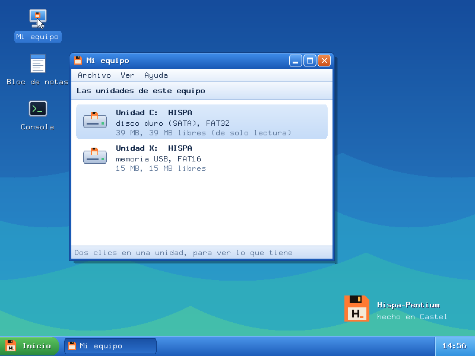

**La unidad del sistema** es de la que se cargan los programas cuando no se dice
otra (el intérprete, el Bloc de notas...): la que diga el cargador
(**`unidad=X`**) si está y lleva el sistema (`ORDENES.BIN` en su raíz, o en
`\HISPA` si es un sistema instalado en el disco: sección 12); si no,
la primera que lo lleve (`C:`, `D:`... y luego `X:`...); si no, `M:`. (Así, el
disco de dentro de un PC, que puede tener una partición FAT con otras cosas
—la de arranque EFI, por ejemplo—, no pasa por unidad del sistema.) Cada tarea tiene **su unidad y su carpeta de trabajo** (las hereda de quien
la lanza); una ruta puede llevar la letra delante (`X:\CARTAS\UNA.TXT`), y sin
ella es de la unidad de trabajo. (Al cambiar de unidad se va a su raíz: no se
guarda una carpeta de trabajo por unidad, como hace el DOS.)

**La FAT** (`fat.cas`). Leer:

- **FAT12, FAT16 y FAT32**, según el número de clusters (como manda la norma).
  Un volumen es un **disco entero** o **una partición** (los reparte
  `unidades.cas`, arriba), y puede haber **varios montados a la vez**: lo de
  cada uno (dónde empieza, su clase, sus FAT, sus clusters libres...) está en
  su ficha, y las funciones trabajan con uno, «el que está en uso»; al pasar
  de uno a otro, lo que quedara por escribir del primero va a su disco. Un
  cerrojo para todos: las tareas entran en la FAT de una en una.
- **Rutas** con `\` o `/`, con carpetas (`TEXTOS\PIRATA.TXT`), sin distinguir
  mayúsculas (la letra de la unidad la quita antes `usuario.cas`, que es quien
  sabe de unidades). Nombres de 8+3, y los largos (abajo).
- Un archivo o una carpeta abiertos son un **manejador**; de un archivo se leen
  octetos (siguiendo su cadena de clusters por la FAT; en FAT12, con las entradas
  de 12 bits a caballo entre dos sectores); de una carpeta, sus entradas una a una
  (nombre, atributos, tamaño, fecha y hora). La raíz de FAT12/16, que no va por
  clusters, se lee igual.
- En la memoria hay **un sector de datos y uno de la FAT**; cada lectura va al
  disco sector a sector. Es sencillo y lento: para cargar programas de unos K,
  sobra.
- Los **clusters libres**: en FAT12/16 se cuentan en la FAT; en FAT32, lo que diga
  su sector de información.

Al arrancar, el núcleo busca los discos (los de dentro y las memorias USB), monta
los volúmenes FAT que tengan y dice lo que hay, una línea por disco y otra con
las unidades:

```
usb: controladora EHCI 8086:24CD, 6 puertos
usb: aparato 0, 0627:0001, velocidad alta, en el puerto 1 (EHCI); teclado
usb: aparato 1, 0627:0001, velocidad alta, en el puerto 2 (EHCI); ratón
usb: aparato 2, 46F4:0001, velocidad alta, en el puerto 3 (EHCI); almacenamiento
usb: 1 teclados, 1 ratones, 1 memorias.
disco 0: QEMU HARDDISK, 40 MB, FAT32 (SATA).
disco 1: QEMU    QEMU HARDDISK, 16 MB, FAT16 (USB).
los discos de dentro son de solo lectura (para escribir en ellos: «escritura» en la línea del cargador).
unidades: C: (disco 0, SATA, FAT32) X: (disco 1, USB, FAT16); la del sistema, X:
```

(Eso es QEMU con un disco SATA, un EHCI con teclado, ratón y memoria, y
`escritura=usb unidad=X` en la línea del núcleo. Un disco sin ninguna partición
FAT sale como «sin FAT». Con **`registro`** en la línea del cargador, esas
líneas quedan además en **`ARRANQUE.TXT`**, en la unidad del sistema, si es la
memoria de arranque y se puede escribir en ella: en un PC de verdad con el
escritorio en marcha la pantalla de texto no se ve. Al medio minuto se le añade
una línea con cómo van el teclado y el ratón USB: cuántos informes han llegado,
cuántos fallos han dado sus tuberías y el último informe de un ratón, octeto a
octeto. Lo mismo dice la orden `usb` de la consola del núcleo.)

**La unidad en memoria (M:).** Si el cargador ha traído archivos como **módulos
de multiboot** (un PC arrancado de una memoria USB con GRUB: sección 11), esos
módulos hacen de **unidad M:, en memoria y de solo lectura**: `DIR` los enseña,
`TYPE` los lee, los programas se lanzan por su nombre y un programa los abre y
los lee como archivos. No tiene carpetas, y no se puede crear ni borrar nada en
ella (`usuario.cas`). Es la **unidad del sistema** cuando no hay otra: un PC sin
disco FAT cuyo USB no se deja (o arrancado con `sinusb sindisco`), que así tiene
al menos el intérprete, el Bloc de notas y la Consola.

**Escribir** (desde el 19/11):

- **El controlador** (`escribir_sectores`): en el IDE, la orden de escribir
  (hasta 255 sectores de una vez), cada sector de palabra en palabra al puerto
  de datos, esperando a que el disco lo pida y, al final, a que lo haya tomado;
  en el SATA, WRITE DMA EXT; en una memoria USB, WRITE(10). `asentar` manda
  FLUSH CACHE (que el disco pase a la superficie lo que tenga guardado).
- **Los archivos**: un archivo se abre para leer, para leer y escribir, para
  crearlo (si ya estaba, queda vacío) o para añadir al final. Al escribir más allá
  de su final **crece**: se le dan clusters libres (se buscan en la FAT desde donde
  se dio el último) y se enlazan a su cadena. La posición se puede **mover** a
  cualquier sitio, también más allá del final: al escribir ahí, lo de en medio
  queda **a cero**. **Cortar** deja el archivo con el tamaño de su posición y
  suelta los clusters que sobran. **Borrar** suelta toda su cadena y tacha su
  entrada (y los trozos de su nombre largo).
- **Las carpetas**: una entrada nueva va al primer hueco de su carpeta (una
  tachada, o el final); si no queda sitio, la carpeta **crece** un cluster (a cero).
  La raíz de FAT12/16, que es fija, no crece: se llena. Una **carpeta nueva** lleva
  su cluster a cero con sus entradas `.` y `..`. Solo se borra una carpeta
  **vacía**, que no esté abierta ni sea la de trabajo de nadie. **Cambiar el
  nombre** es cambiarlo en su entrada; un archivo, además, puede pasar a otra
  carpeta (una carpeta no: habría que cambiar su `..`).
- **Las dos copias de la FAT** se escriben siempre (todas las que diga el
  volumen; una FAT32 que solo lleva una al día, esa). En **FAT32**, el **sector de
  información** lleva la cuenta de clusters libres y por dónde buscar el
  siguiente: se pone al día al cerrar un archivo, al borrar y al tocar carpetas.
  (En FAT12, las entradas de 12 bits a caballo entre dos sectores se escriben
  igual que se leen.)
- **La fecha y la hora** de lo que se crea o se escribe son las del reloj del PC
  (`fecha.cas`); al escribir se marca además el atributo «por archivar».
- **Nombres**: al crear, **8+3** (en mayúsculas, sin las letras que la FAT no
  admite; la ñ y la ç valen; `CON`, `PRN`, `AUX`, `NUL`, `COM1`... no, que son
  de los dispositivos del DOS). No se crean nombres largos.
- **Cuándo llega al disco**: los datos, en el momento (cada sector se escribe
  según se llena; no hay nada esperando en la memoria más que el sector de la FAT
  que se está tocando, que se escribe al acabar cada llamada). La **entrada del
  archivo** (su tamaño y su primer cluster) se pone al día **al cerrarlo** (o al
  cortarlo), como en el DOS: si se apaga con un archivo a medio escribir, quedan
  clusters sueltos que `fsck` recoge, pero nada cruzado.

**Los nombres largos (VFAT)**, al leer: los trozos de nombre largo que van delante
de una entrada se juntan (comprobando su número y la suma del nombre corto) y se
pasan de Unicode a la página 437 (lo que no está en ella sale como `_`). `DIR` los
enseña a la derecha, y un archivo o una carpeta se puede **abrir por su nombre
largo** (sin distinguir mayúsculas) igual que por el corto. Al borrar o cambiar de
nombre, los trozos se tachan con la entrada (que no queden sueltos).

### Los CD y los DVD, y las imágenes de disco (21/11)

Carlos, con la 0.8.1 en VirtualBox: «Hispa-Pentium no reconoce los DVD». Hasta
aquí el CD de instalación lo cargaba GRUB entero en la memoria (la unidad M:) y
el núcleo no sabía leer un lector. Ahora lee **CD y DVD de datos**, por las tres
vías, y **monta imágenes de disco** como si fueran un CD más.

**Los lectores** (todos hablan las órdenes SCSI de los lectores, MMC, que arma
`cdrom.cas`):

- **IDE** (`atapi.cas`): los **dos canales** (el primario, `0x1F0`/`0x3F6`, y el
  secundario, `0x170`/`0x376`), maestro y esclavo: donde no hay un disco duro se
  pregunta con **IDENTIFY PACKET DEVICE** (A1h), y si es ATAPI de la clase 5
  (CD/DVD), se apunta con su modelo. Cada orden es **PACKET** (A0h) y, detrás,
  el paquete de 12 octetos por el puerto de datos; los datos vienen por **PIO**
  en tandas (el lector dice en LBA_MEDIO/ALTO cuántos octetos trae cada vez; lo
  que no se quiere se tira). En el canal primario se usa el cerrojo de
  `ata.cas` (`toma_canal`/`suelta_canal`). Es donde pone **VirtualBox** su lector
  (el secundario maestro), y muchos PC de los 2000.
- **SATA** (`ahcicd.cas`): los puertos con la firma **EB140101**. `ahci.cas` solo
  los apunta (y los para, que no usen las tablas de los discos: una línea en
  `mira_puerto` y tres funciones al final, para que la fusión con la rama del
  SATA sea fácil); `ahcicd.cas` les da sus tablas y ocho páginas para los datos
  (16 sectores de 2048 por orden, un PRD por página) y manda **PACKET con el bit
  «A»** en la cabecera de la orden y el paquete en **ACMD** (0x40 de la tabla),
  con los datos por **DMA**. Si falla, el registro de error (en TFD) dice la
  clave, y el puerto se para y se vuelve a arrancar.
- **USB** (`usbalm.cas`): un aparato de almacenamiento cuyo INQUIRY dice
  **clase 5** es un lector (sin disco puede no estar listo ni decir cuánto mide:
  no se le pregunta al enchufarlo); se aceptan también las subclases 02 (ATAPI)
  y 05 (SFF-8070i) de los lectores USB de antes. Las órdenes van en el mismo
  envoltorio (CBW) que las de las memorias, con su largo de verdad (6, 10 o 12),
  dos sectores por orden. Enchufar y desenchufar en marcha va por
  `usbcal.cas`, como las memorias («Lector de CD conectado: F:»).

**Las órdenes** (`cdrom.cas`): TEST UNIT READY (¿hay disco y está listo?),
REQUEST SENSE (por qué no: 02/3A «no hay disco», 02/04 «se está poniendo a
girar», **06/28 «se ha cambiado el disco»**), READ CAPACITY, **READ TOC** (si la
primera pista es de sonido, es un **CD de música**: se dice, y no se cuelga
nada; escucharlo, otro día), READ(10) (de 16 en 16 sectores por IDE y SATA, de
2 en 2 por USB; con tres intentos, salvo si el disco ya no está) y, para
**expulsar**, PREVENT ALLOW MEDIUM REMOVAL y START STOP UNIT (LoEj).

**La capa de discos**: un lector es un disco más, de la clase **DE_CD**, con
sectores de **2048** (el campo nuevo `bloque` de cada disco) y tantos como el
disco que tenga (0 sin disco). No se escribe en él nunca (ni con «escritura»),
INSTALAR no lo ve (la llamada 63 lo salta) y la 64 no lee de él.

**ISO 9660** (`iso.cas`), de solo lectura, como un volumen más de `fat.cas`
(que sigue llevando todos los archivos abiertos: un volumen ISO lleva «iso» en
su ficha y, para él, `fat.cas` pide a `iso.cas` lo suyo; los cambios en
`fat.cas` van marcados con «(CD)»). Se miran los descriptores desde el sector
16: el primario (su nombre, lo que mide, la raíz) y, si lo hay, el
suplementario de **Joliet** (escapes `%/@`, `%/C`, `%/E`): con él, los nombres
largos (UCS-2, a la página 437) y el nombre del volumen. Sin Joliet, **Rock
Ridge** si lo hay (el «SP» del «.» de la raíz; los nombres de las entradas
**NM**, de UTF-8 a la 437); si no, los nombres de siempre (sin el `;1` ni el
punto del final). Cada entrada lleva además un **nombre corto** hecho del largo
como Windows (`documento-de-prueba-largo.txt` es `DOCUME~1.TXT`), y se abre por
los dos. Las fechas pasan a las de la FAT; todo sale con el atributo de solo
lectura. Se lee de sector en sector (con uno guardado) y, los sectores enteros,
derechos a donde se piden, de 32 en 32.

**Las letras** (`unidades.cas`): cada lector tiene **la primera letra libre tras
los discos de dentro** (D: si hay un disco duro, aunque no tenga FAT; la C: si
no hay ninguno), como en Hispa-DOS, y **se le queda aunque no tenga disco**. Un
CD nunca es la unidad del sistema (el CD de instalar sigue siendo M:, en la
memoria; su lector, además, es D:).

**Meter y sacar el disco** (`cdcal.cas`): una tarea del núcleo, `cd-cambios`, le
pregunta a cada lector **cada dos segundos** qué tiene. Si llega un disco de
datos, se monta con la letra del lector; si se va, o se cambia por otro (el
«06/28»), su unidad deja de estar (los archivos abiertos en ella dan error y los
programas que trabajaban en ella pasan a la unidad del sistema) y, si es otro,
se monta el nuevo. Se avisa en la **bandeja** («CD insertado: D:», «DVD
insertado: D:», «CD retirado: D:», «CD de música en D:», «El disco de D: no se
puede leer»): los avisos llegan con los del USB (los saca `usbcal.cas`), con un
disco dibujado y «CD y DVD» de título; y a las ventanas les llega EV_UNIDADES.
**Expulsar** (la llamada 132, la orden `EXPULSAR D:` o el menú de la unidad en
Mi equipo): la unidad deja de estar y se abre la bandeja.

**Las imágenes de disco**: `MONTAR X:\DISCOS\ALGO.ISO` (o dos clics en el
archivo en Mi equipo, o «Montar» en su menú) la monta como una unidad más, con
la **primera letra libre**, y Mi equipo entra en ella. Valen las **.ISO**
(sectores de 2048), las **.BIN en crudo** (de 2352: MODE1, los datos desde el
16, o MODE2, desde el 24) y su hoja **.CUE** (se lee el `FILE "..." BINARY`), y
las **.IMG** (.IMA, .VFD) de disquete o de disco duro, con FAT. Cómo: se apunta
dónde está el archivo **en su disco** (`fat.cas`, `trozos_archivo`: la cadena de
clusters, hecha trozos seguidos; en un CD, un trozo) y la imagen es un disco
más, de la clase **DE_IMAGEN** (`discos.cas`), que lee de esos sectores por
debajo de la FAT (sin abrir el archivo: la FAT no se llama a sí misma). Vale con
la imagen en cualquier unidad (C:, una memoria USB, un CD, otra imagen); un
archivo en más de 96 trozos no se monta (se dice). **Si se va el disco donde
está el archivo** (se desenchufa la memoria, se saca el CD, se quita con
seguridad), la imagen **se desmonta sola** («Imagen desmontada: F: (su disco se
ha ido)»). `DESMONTAR F:` (o «Expulsar») la quita; `MONTAR` sin nada dice los
lectores (con lo que tienen) y las imágenes montadas.

**Mi equipo**: los lectores salen con su letra aunque no tengan disco (detrás de
las unidades), con un **disco dibujado**: «Unidad D:  PRUEBA_CD», «lector de CD o
DVD: QEMU DVD-ROM», «670 K, ISO 9660 (de solo lectura)», o «sin disco», «un CD
de música», «el disco no se puede leer». Una imagen sale como **«CD virtual: la
imagen C:\DISCOS\PRUEBA.ISO»** (o «disco virtual», una .IMG), con el disco
dentro de un **marco de puntos** (se distingue por la forma y por el texto, no
solo por el color). El menú de una unidad de CD o de una imagen: «Abrir|Expulsar».

Las llamadas nuevas: **132** (expulsar la unidad de la letra EBX: el lector abre
la bandeja; la imagen se desmonta) y **133** (montar la imagen del archivo EBX:
da su letra, o 1 no está, 2 no es una imagen que se pueda leer, 3 demasiados
trozos, 4 no caben más, 5 está en M:). En `Info_unidad` (la 43): `medio` 4 es un
lector de CD (MEDIO_CD) y 5 una imagen (MEDIO_IMAGEN); `clase` 9 es ISO 9660;
`quitable` 2, que se puede expulsar; y `relleno[0]`, lo que tiene el lector (0
nada, 1 datos, 2 música, 3 no se lee).

**Lo que falta**: escuchar los CD de música (READ CD y el sonido); UDF (los
DVD que solo lo llevan; los de vídeo y casi todos los de datos llevan también
ISO 9660); los archivos de varios trozos (de más de 4 GB) de ISO 9660 y las
entradas CE de Rock Ridge; GET EVENT STATUS NOTIFICATION (hoy, TEST UNIT READY
cada dos segundos, que vale en todos); grabar. Y probarlo en VirtualBox y en un
PC de verdad con un lector IDE y uno SATA.

## 8. El intérprete de órdenes

`uordenes.cas` (`ORDENES.BIN` en el disco): **un programa del anillo 3**, escrito
en Castel con `modelo usuario`, que no toca nada del núcleo: todo lo hace por las
llamadas al sistema. Lee una línea del teclado y hace lo que dice; las órdenes
valen en mayúsculas o en minúsculas. La petición de órdenes enseña la unidad y la
carpeta de trabajo (`C:\TEXTOS>`, o `X:\>` arrancando de la memoria USB). **`X:`**
(una letra y dos puntos) cambia de unidad; las rutas pueden llevar la letra
delante (`COPY C:\LEEME.TXT X:\`, `DIR D:\TEXTOS`), y `CD X:\CARTAS` cambia a la
vez de unidad y de carpeta.

| Orden | Qué hace |
|---|---|
| `AYUDA` (o `?`) | las órdenes |
| `VER` | la versión del sistema |
| `CLS` | borra la pantalla |
| `MEM` | la memoria que hay, la libre, lo que ocupa el intérprete y las tareas |
| `FECHA` | la fecha y la hora del reloj del PC |
| `TECLADO [ES\|US]` | el teclado: el español o el de EE. UU. (sin nada, dice cuál hay) |
| `DIR [carpeta]` | los archivos de una carpeta (la de trabajo si no se dice): nombre, tamaño, fecha, hora y, si lo tiene, su nombre largo; cuántos son, lo que ocupan y lo que queda libre. Con comodines, los que casen: `DIR *.TXT`, `DIR TEXTOS\P*` |
| `TYPE archivo` | enseña un archivo de texto |
| `COPY origen destino` | copia un archivo en otro, o a una carpeta; con comodines, varios a una carpeta (`COPY \TEXTOS\*.TXT .`). Sin destino, a la carpeta de trabajo |
| `DEL archivo` | borra un archivo, o los que casen (`DEL *.BAK`) |
| `REN viejo nuevo` | cambia el nombre de un archivo o de una carpeta; si el nuevo lleva carpeta (`REN A.TXT OTRA\A.TXT`), el archivo se mueve a ella |
| `MD carpeta`, `RD carpeta` | hace una carpeta; borra una carpeta vacía |
| `CD [carpeta]` | cambia de carpeta de trabajo (`CD ..` sube una, `CD \` va a la raíz; también `CD..` y `CD\`); sin nada, dice cuál es |
| `PATH [carpetas]` | las carpetas donde se buscan los programas, separadas con `;` (de fábrica, `C:\`); `PATH ;` lo deja vacío; sin nada, lo enseña |
| `ECHO texto` | escribe el texto (`ECHO.`, una línea en blanco; `ECHO OFF` y `ECHO ON`, en los archivos de órdenes) |
| `REM ...` | un comentario |
| `PAUSE` | «Pulse una tecla para seguir . . .» y la espera |
| `ESCRITORIO` | pone en marcha el escritorio (sección 10); este intérprete, el de la pantalla de texto, acaba |
| `SALIR` | acaba el intérprete (se vuelve a la consola del núcleo; en una ventana de la Consola, la cierra) |
| cualquier otro nombre | **un programa** (`HOLA` o `HOLA.BIN`) o **un archivo de órdenes** (`LOTE` o `LOTE.BAT`): se busca en la carpeta de trabajo y luego en las del PATH (con una carpeta delante, `TEXTOS\ECO2`, solo ahí); lo que siga son sus argumentos. Un programa se lanza y se le espera; si acaba con un código distinto de 0, se dice. Si no existe: «Orden o nombre de programa desconocido». |

(`DEL`, `REN`, `MD`, `RD`, `CD`, `COPY`, `PAUSE` y `SALIR` también valen como
`ERASE`/`BORRAR`, `RENAME`, `MKDIR`, `RMDIR`, `CHDIR`, `COPIAR`, `PAUSA` y `EXIT`.)

- **La redirección**: detrás de cualquier orden, `> archivo` manda al archivo lo
  que escriba (creándolo, o vaciándolo si estaba), y `>> archivo` lo añade al
  final: `DIR > LISTA.TXT`, `ECHO otra línea >> NOTAS.TXT`, `HOLA > SALIDA.TXT`
  (también lo que escribe un programa, y los que este lance). El archivo queda
  con los finales de línea del DOS. No hay `<` ni tuberías.
- **Los archivos de órdenes (.BAT)**: una orden por línea, las mismas que se
  teclean. Cada línea se enseña antes de hacerla, salvo con `ECHO OFF` o si
  empieza por `@`. `%1` a `%9` son los argumentos (`%0`, el nombre; `%%`, un `%`).
  Un archivo de órdenes que llama a otro pasa a él (no vuelve). No hay `IF`,
  `GOTO`, `FOR` ni variables.
- **La línea se corrige** con Retroceso y Supr, moviéndose con las flechas, Inicio
  y Fin; Esc la borra. **La historia**: las flechas de arriba y abajo traen las
  ocho últimas líneas. (Está en `leer_línea`, de `llamadas.cas`: la tiene cualquier
  programa que lea líneas.)
- **Ctrl+C** acaba el programa que corre (sale `^C` y vuelve la petición de
  órdenes) y, si lo había lanzado un archivo de órdenes, también el archivo. Sin
  programa en marcha, deja la línea que se estaba escribiendo. En `PAUSE`, acaba
  el archivo de órdenes.

Si el programa lanzado hace lo que no debe, el núcleo lo acaba, lo dice, y el
intérprete sigue con su petición de órdenes.

## 9. La consola del núcleo

Es la tarea 1, del anillo 0: lo que queda de la semilla, para mirar el núcleo por
dentro. (El intérprete de órdenes de verdad es el de la sección 8.)

| Orden | Qué hace |
|---|---|
| `ayuda` | las órdenes |
| `hora` | los segundos y centésimas desde que arrancó |
| `memoria` | los marcos libres y el montón (bloques, octetos, huecos, páginas; reservas, liberaciones y fallos vistos) |
| `mapa` | el mapa de memoria de multiboot |
| `paginas` | la paginación: CR0, el directorio, la identidad (páginas y tablas), el montón y la zona a la demanda |
| `monton` | prueba el montón: 3000 vueltas de reservar y liberar al azar (con lo de dentro comprobado), y mira que todo vuelve a estar como antes: «montón sin fugas» |
| `estropear` | estropea el montón a propósito (escribe de más, suelta dos veces, suelta lo que no es suyo) y enseña que se ve |
| `toca` | escribe en la zona a la demanda: el fallo de página se atiende y la escritura llega |
| `turnos` | dos tareas que cuentan sin ceder durante un segundo: cuántas veces se han alternado |
| `dormir` | tres tareas que duermen 20, 40 y 60 tics (hechas en otro orden) |
| `tareas` | las tareas, con su estado, su anillo, sus turnos y sus tics |
| `programas` | los módulos que ha traído el cargador |
| `ejecutar N` | ejecuta el módulo N en el anillo 3 y espera a que acabe; dice su código y los marcos libres antes y después |
| `disco` | los discos (modelo, sectores, y si es IDE, SATA o USB), el sistema de archivos de la unidad del sistema (qué FAT, dónde empieza, clusters, los libres; sectores leídos y escritos, y archivos abiertos) y las unidades con su letra |
| `usb` | las controladoras USB y los aparatos enumerados, y cómo van el teclado y el ratón (informes que han llegado, fallos de sus tuberías) |
| `dir [CARPETA]` | las entradas de una carpeta de la unidad del sistema |
| `lanzar PROGRAMA.BIN [ARGUMENTOS]` | carga el programa del disco, lo ejecuta en el anillo 3 con sus argumentos y espera a que acabe |
| `ordenes` | lanza el intérprete de órdenes (`ORDENES.BIN`) |
| `teclas` | las teclas pulsadas |
| `teclado es`, `teclado us` | el teclado: el español (el de fábrica) o el de EE. UU. |
| `escritorio` | pone en marcha el escritorio (sección 10) |
| `fallo` | lee donde no hay nada: el fallo de página del núcleo, que lo para (código 14) |
| `cero` | divide por cero (código 9) |
| `apagar` | acaba (código 5) |

(Las órdenes de esta consola se escriben sin acentos, como cuando el teclado era
el de EE. UU.)

### El teclado

Es **el español** (`consola.cas`), con las letras de la **página 437**, la del PC
y la que usa Hispa-DOS (y Castel para sus textos):

- `ñ Ñ ç Ç ¿ ¡ º ª ·` y los signos donde están en un teclado español (`-` y `_`
  junto a Mayús, `'` y `?` junto al 0, `<` y `>` junto a la Z...).
- **Los acentos, con tecla muerta**: `´` y luego la vocal da `á é í ó ú`; igual
  `` ` `` (`à è ì ò ù`), `^` (`â ê î ô û`) y `¨` (`ä ë ï ö ü`). El acento y un
  espacio dan el acento solo; con otra letra, el acento y la letra. La 437 no
  tiene `Á Í Ó Ú` (sí `É`, `Ü`, `Ä`, `Ö`): salen sin acento, como en Hispa-DOS.
- **Alt Gr**: `\ | @ # ~ ¬ [ ] { }`. **Bloq Mayús**, para las letras (también ñ y ç).
- Las flechas, Inicio, Fin, Supr, RePág, AvPág, Insert y F1 a F10 llegan a los
  programas como `0x100` más su código (`TECLA_ARRIBA`...).
- **Ctrl** con una letra da su número de control; **Ctrl+C** acaba los programas
  en marcha (sección 5).
- El de EE. UU. sigue estando: `teclado us` en esta consola, `TECLADO US` en el
  intérprete, o `teclado=us` en lo que se le dice al núcleo al arrancar.
- **Un teclado USB es el mismo teclado** (desde la 0.6): `usbhid.cas` traduce lo
  que dice el teclado USB a los códigos que daría uno PS/2 y se los da a
  `consola.cas`, que no distingue. Puede haber los dos a la vez (el de un
  portátil y uno enchufado).

---

## 10. El entorno gráfico: el escritorio

El entorno gráfico de Hispa-Pentium (desde la 0.4; con menús, iconos y
portapapeles desde la 0.5): un escritorio con la comodidad de los de principios
de los 2000, **de diseño propio**. No lleva nada de nadie: ni logotipos, ni
fondos, ni iconos, ni los colores de otro sistema. La paleta es la de la casa para
esta gama (**azules y verdes**, con las esquinas redondas), el logo es el
**disquete de Hispa-DOS** y la letra es la de 8x16 de Hispa Ventanas (diseño
propio, con sus tildes y su eñe).

| | |
|---|---|
|  |  |
|  |  |
|  | 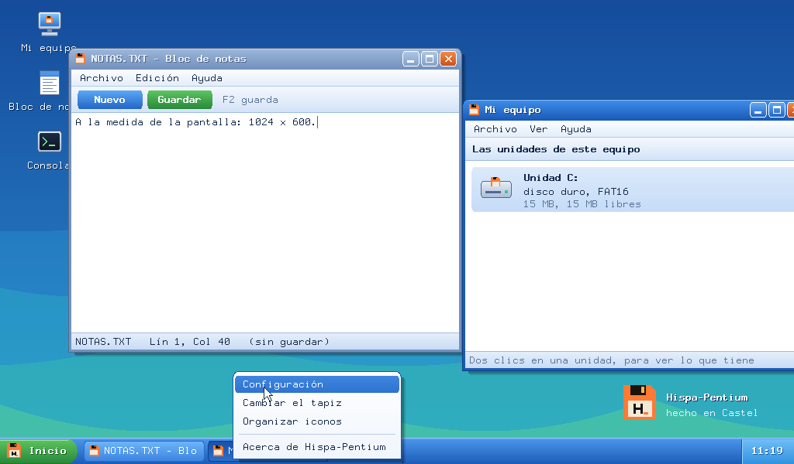 |
|  |  |

### Lo que se ve

- **El tapiz**: tres a elegir («Olas», «Azul» y «Verde»), con el disquete y el
  nombre abajo a la derecha.
- **Los iconos del tapiz**: «Mi equipo», «Bloc de notas» y «Consola», con su
  rótulo en letra normal. Un clic lo elige (el rótulo queda sobre azul); **dos
  clics lo abren**; se llevan a otro sitio **arrastrándolos**.
- **La barra de tareas**, abajo: el botón **«Inicio»** (verde, redondeado), un
  **botón por cada ventana abierta** (pulsarlo la trae delante; si ya lo estaba, la
  minimiza; si estaba minimizada, la recupera) y, a la derecha, la **bandeja con el
  reloj** (el de la CMOS; se pone al día cada minuto).
- **El menú Inicio**, de dos columnas: a la izquierda, en blanco, los **Programas**
  (Bloc de notas, Consola, Mi equipo); a la derecha, en azul muy claro, los
  **Documentos** (los `.TXT` de la raíz del disco: se abren con el Bloc de notas) y
  **Configuración**; y abajo, **«Apagar el equipo»**. Se abre con el botón o con la
  **tecla del logo**; la opción bajo el ratón se resalta; con las flechas, Intro y
  Esc también se anda por él; un clic fuera lo cierra.
- **Las ventanas**: la barra de título azul con degradado y las esquinas de arriba
  redondeadas, el disquete, el nombre y **tres botones** (minimizar, maximizar o
  volver al tamaño de antes, y cerrar, este en el naranja del disquete), un borde y
  una sombra suave. Se **mueven** arrastrando el título, pasan **delante** al
  pulsarlas, y **dos clics en el título** las maximizan. **Cambian de tamaño
  arrastrando el borde o una esquina**: encima de ellos la flecha cambia de forma
  (de lado a lado, de arriba abajo o en diagonal), y se agarran también un poco
  por fuera. La ventana activa lleva el título de azul vivo; las demás, de azul
  gris.
- **El botón secundario del ratón** saca un menú, según dónde:
  - en el **tapiz**: Configuración, Cambiar el tapiz (pasa al siguiente),
    Organizar iconos (cada uno a su sitio) y Acerca de Hispa-Pentium;
  - en el **título de una ventana**, o en **su botón de la barra de tareas**:
    Restaurar, Mover, Minimizar, Maximizar y Cerrar (en gris, lo que en ese
    momento no toca). «Mover» lleva la flecha al título y la ventana la sigue
    hasta el clic siguiente (o Intro, o Esc);
  - en un **icono** del tapiz o en un programa o documento del **menú Inicio**:
    Abrir;
  - en el **Bloc de notas**: Cortar, Copiar, Pegar y Seleccionar todo; en la
    **Consola**: Copiar y Pegar; en **Mi equipo**: Abrir.

  En los menús, la opción bajo el ratón se resalta; un clic la elige; las flechas,
  Intro y Esc valen; un clic fuera lo cierra.
- **La barra de menús de las ventanas** (Archivo, Edición, Ayuda...), en el Bloc
  de notas, la Consola y Mi equipo: pulsar un rótulo abre su menú; pulsarlo otra
  vez lo cierra.
- **Seleccionar texto** (en el Bloc de notas y en la Consola): **arrastrando** el
  ratón; con **dos clics**, la palabra; con **tres**, la línea; con **Mayús y un
  clic**, hasta ahí; y, en el Bloc, con **Mayús y las flechas** (o Inicio, Fin,
  Re Pág, Av Pág). Lo seleccionado se ve en blanco sobre azul.
- **El portapapeles del sistema**: lo que se corta o se copia en un programa se
  pega en cualquier otro (del Bloc a la Consola, y al revés). Es un texto.
- **«Apagar el equipo»**: Apagar, Reiniciar o Cancelar. Apagar deja la pantalla de
  «Ya puede apagar el equipo» (en QEMU, además, lo apaga).
- **Configuración**: lo que hay (la pantalla, la memoria, las tareas), el teclado
  (español o de EE. UU.), el tapiz y el dock (visible u oculto); y, junto a la pantalla, **«Cambiar...»**: la
  medida de la pantalla, en el momento donde la tarjeta lo deja y, si no, al
  arrancar (más abajo, «La medida de la pantalla»). **Acerca de Hispa-Pentium**: la versión y la
  licencia.
- **El Bloc de notas** (`BLOC.BIN`, `ubloc.cas`): escribir un texto con el teclado
  español y **guardarlo en el disco** («Guardar», F2 o Ctrl+S; en la página 437 y
  con los finales de línea del DOS). Las flechas, Inicio, Fin, Re Pág, Av Pág,
  Supr, Retroceso; un clic pone el cursor; las líneas largas siguen debajo.
  **Cortar, Copiar, Pegar y Seleccionar todo** (Ctrl+X, Ctrl+C, Ctrl+V, Ctrl+A, el
  menú Edición o el del botón secundario); lo que se teclea sustituye a lo
  seleccionado. Menús: Archivo (Nuevo, Guardar, Salir), Edición y Ayuda. Abre
  `NOTAS.TXT`, o el archivo que se le diga (los documentos del menú). Si se cierra
  con cambios sin guardar, avisa.
- **La Consola** (`CONSOLA.BIN`, `uconsola.cas`): una ventana de 80 x 25 letras con
  el **intérprete de órdenes dentro** (el mismo `ORDENES.BIN`, sin tocarle una
  línea), y lo que este lance. Ctrl+C acaba el programa que corra; `SALIR` cierra
  la ventana. Lo que hay en la pantalla **se selecciona con el ratón y se copia**
  (el menú Edición, el del botón secundario, o Ctrl+C si hay algo seleccionado);
  **Pegar** teclea lo del portapapeles. Lo seleccionado se suelta en cuanto se
  escribe algo en la pantalla. Menús: Archivo (Cerrar), Edición (Copiar, Pegar,
  Seleccionar todo) y Ayuda (las órdenes: teclea `AYUDA`).
- **Mi equipo** (`EQUIPO.BIN`, `uequipo.cas`), desde el 21/11/2026 **el
  explorador de archivos**: el árbol de las unidades y las carpetas, cuatro
  vistas, copiar, cortar y pegar, la Papelera, buscar, Propiedades, Abrir
  con... y las miniaturas (más abajo, «El explorador de archivos»).
- **El dock**: los programas fijados y los abiertos, centrado encima de la
  barra de tareas (más abajo, «El dock»).

### Cómo está hecho

**El modo gráfico** (`video.cas`). Un modo con la memoria de la pantalla seguida
(«framebuffer lineal»). Sale de uno de dos sitios:

1. **del cargador**, si ya lo ha dejado puesto y lo dice en la información de
   multiboot (GRUB, cuando el núcleo se lo pide en su cabecera: sección 11);
2. de la **VBE de Bochs** (la VGA de QEMU, Bochs y VirtualBox): QEMU con `-kernel`
   no da nunca un modo gráfico, así que el núcleo lo pide él por los dos puertos de
   esa tarjeta (`0x1CE`, el índice; `0x1CF`, el dato), y busca la memoria de la
   pantalla en la primera zona de su dispositivo PCI (`1234:1111`).

800 x 600 si no se dice otra cosa (`modo=1024x600` en la línea del cargador: el
que sea, de 640 x 480 a 1600 x 1200). El escritorio se acomoda a la medida que
haya: la del cargador manda. La memoria de la pantalla se pone en la zona de los
gráficos del núcleo (sección 3). **Todo se dibuja con 32 bits por punto**; si el
modo que hay es de 24 o de 16 (hay tarjetas que no dan otro), se dibuja en un
lienzo de 32 bits aparte y `volcar()` pasa a la pantalla de verdad lo que se ha
tocado. (`bits=24` o `bits=16` en la línea del cargador lo fuerzan con la VBE de
Bochs, para probarlo.) Con la VBE de Bochs, aunque el modo lo haya puesto el
cargador, **se cambia en marcha** (`cambia_modo()`: más abajo, «La medida de la
pantalla»).

**Dibujar** (`grafico.cas`), en Castel. Un **lienzo** es un rectángulo de puntos
(`0x00RRGGBB`) en la memoria, con su ancho, su alto y los puntos que hay de una
fila a la siguiente (así, un trozo de un lienzo es otro lienzo). Rectángulos,
degradados (de arriba abajo y de lado a lado), **esquinas redondas**, bordes,
líneas, círculos, oscurecer (las sombras), el disquete (hecho con rectángulos, a
cualquier tamaño), **texto** con la letra de 8x16 (`letra.cas`: 256 letras de la
página 437, con las de más de Ventanas) y **copiar** de un lienzo a otro. Todo se
recorta a los bordes del lienzo. Las filas se llenan y se copian con `rep stosd` y
`rep movsd` (unas líneas de ensamblador); lo demás es Castel.

**El ratón** (`raton.cas`): el PS/2, por la segunda boca del 8042 y la IRQ 12. La
interrupción lleva la cuenta de dónde está la flecha y apunta cada cambio de botón
en una cola, con el sitio donde fue (un clic no se pierde aunque se tarde en
atenderlo). Desde la 0.6, **un ratón USB** (o un panel táctil que se presente como
ratón) hace lo mismo: `usbhid.cas` le da a `raton.cas` cada movimiento y cada
cambio de botón (sección 11). Si no hay 8042 (un Mac, un PC «sin legado»: su
puerto lee `0xFF`), el PS/2 ni se intenta.

**El gestor de ventanas** (`ventanas.cas`), en el núcleo. Cada ventana tiene **su
propio lienzo**, con el marco pintado y lo de dentro, donde dibuja su dueño: así,
componer la pantalla es solo copiar, y nadie tiene que volver a pintar cuando otra
ventana le pasa por encima. Se compone en un **doble búfer** (el tapiz y, encima,
las ventanas de atrás adelante, con su sombra y sus esquinas) y de ahí a la
pantalla; y **solo lo que ha cambiado**: una lista corta de rectángulos «sucios»
(los que se tocan se juntan). La flecha se pinta al final, en la pantalla. La barra
de tareas, el menú y los cuadros son ventanas como las demás (la barra y el menú,
sin marco y siempre delante).

Una tarea del núcleo, **`escritorio`**, da el **pulso** cien veces por segundo:
recoge los clics y lo que se ha movido el ratón, y las teclas, y los reparte.
Mover, cambiar de tamaño, traer delante, minimizar, maximizar y cerrar lo hace el
gestor; lo demás va a la **cola de sucesos** de la ventana que toca (una tecla a
la activa; un clic, donde cae), y su dueño los recoge. Con cada clic van **los
botones** pulsados, las **teclas de cambio** (Mayús, Control) y **las veces
seguidas** que se ha pulsado ahí (1; 2, el doble clic; 3, el triple: mismo sitio y
menos de medio segundo); con cada flecha del teclado, si venía con Mayús. Al
cambiar el tamaño (o al maximizar), la ventana cambia de lienzo: se le copia lo
que tenía, para que no parpadee, y su dueño recibe «tamaño» para volver a pintar
(si llegan varios seguidos, vale con el último). Con el escritorio en marcha **las
teclas son suyas**: quien lea de la consola de texto se queda esperando, y Ctrl+C
es una tecla más (cada Consola tiene el suyo). Todo lo de las ventanas va con un
cerrojo: los programas dibujan a la vez que el escritorio compone.

**Cambiar el tamaño.** El borde mide 4 puntos; para acertarle con un panel táctil
se agarra también desde 3 puntos por fuera, y las esquinas miden 14 a lo largo.
Mientras se arrastra, la ventana se rehace a cada paso (no hay un «marco de
goma»): 200 x 140 lo menos, la pantalla lo más. Los cuadros (Apagar,
Configuración) no cambian de tamaño.

**El fondo.** Lo que cae fuera de todas las ventanas (el tapiz), y el botón
secundario en un título, van a una ventana que no se ve, la **«del fondo»**, que
es del escritorio: ahí atiende los iconos y pone sus menús. **Los iconos** se
pintan en el propio tapiz; de cada uno se guarda lo que tapa, para quitarlo de ahí
al moverlo o al elegirlo.

**Los menús emergentes** (`emergente.cas`). Solo hay uno abierto a la vez: una
ventana del núcleo, sin marco y por delante de todo. Las opciones se dan en un
texto, separadas por «|» («-» es una raya), con un bit por cada una que sale en
gris. Lo abre el escritorio para los suyos, o un programa por la llamada 39 para
una ventana suya: al cerrarse, a esa ventana le llega el suceso **«menú»** con la
opción elegida (o «ninguna») y la etiqueta que dio. La **barra de menús** de una
ventana la pinta el propio programa (`barramenu.cas`), y cada rótulo abre debajo
un menú de estos.

**El portapapeles** está en el núcleo (`usuario.cas`, la llamada 40): un texto de
hasta 64 K, en la página 437 y con sus líneas acabadas en `\n`; el último que se
ha copiado en cualquier programa.

**Los programas** abren su ventana y dibujan por las **llamadas al sistema** 32 a
41 (sección 6): `ventana`, `rectángulo`, `degradado`, `texto`, `mapa`, `suceso`,
`menú`, `al_portapapeles`... de `llamadas.cas`. Al acabar un programa (o si el
núcleo lo acaba), sus ventanas se cierran solas.

```
importar Llamadas
...
v := ventana("Hola", 300, 120)
degradado(v, 0, 0, 300, 120, 0xEAF3FE, 0xC4DCF8)
texto_negrita(v, 20, 20, "¡Hola, escritorio!", 0x14294A)
mientras suceso(v, s, cierto) y s.clase <> EV_CERRAR hacer
    ; el botón secundario: un menú; lo elegido llega luego (EV_MENÚ: s.a, la opción)
    si s.clase = EV_RATÓN_BAJA y s.c yb BOTÓN_DERECHO <> 0 entonces
        menú(v, ent32(s.a), ent32(s.b), "Saludar|-|Salir", 0, 1)
    fin
fin
```

**Los programas de los paquetes en el menú y en el tapiz** (`accesos.cas`,
desde el 20/11/2026, rama `clicgest-pentium`). Un paquete que trae un programa
con ventana deja, además, un archivo de texto `NOMBRE.MNU` en `\HISPA\MENU`
(o en `\MENU`, en un sistema sin instalar), en la página 437 y con CR LF:

```
nombre=Agenda
programa=\HISPA\AGENDA.BIN
argumentos=
icono=\HISPA\MENU\AGENDA.ICP
escritorio=si
```

El escritorio lo pone en el menú Inicio, debajo de «Mi equipo» (el menú crece
lo que haga falta) y, con `escritorio=si`, como icono del tapiz. Se vuelven a
leer cada vez que se abre el menú: lo que se instala con el escritorio en
marcha sale la vez siguiente (y si han cambiado, los iconos del tapiz se
ordenan otra vez). Hasta seis. El icono es un **`.ICP`**: la magia `HPIC`, el
ancho y el alto (32 y 32, dos palabras de 32 bits) y 32 x 32 puntos
`0xAARRGGBB` (de A = 0x80 para arriba se pinta; lo demás es transparente); lo
hace **`tools/hpicono.py ENTRADA.png SALIDA.ICP`** de un PNG de 32 x 32. En el
menú se pinta a la mitad (16 x 16). Sin icono, una ventanita.

**Mayús+Tab** (desde la misma fecha): con el escritorio en marcha, el teclado
la da como la tecla `TECLA_MAYÚS_TAB` (`0x10F`, en `Llamadas`), para que los
programas vuelvan al control de antes; Tab sigue siendo el 9.

**Ctrl+Tab, Ctrl+Mayús+Tab y Alt+letra** (desde la 0.8.2, rama
`controles-erp`, 21/11/2026): con el escritorio en marcha llegan como
`TECLA_CTRL_TAB` (`0x110`), `TECLA_CTRL_MAYÚS_TAB` (`0x111`) y `TECLA_ALT` +
la letra (`0x180` para la a ... `0x199` para la z; el Alt de la izquierda; el
Alt Gr sigue siendo el de las letras de más), para cambiar de pestaña y abrir
los menús de una ventana. Y la **llamada 81** (`maximizar(v)` en
`Llamadas`): la ventana se maximiza (como con dos clics en su título) y le
llega `EV_TAMAÑO` con lo que mide.

### Los controles de las ventanas: `controles.cas`


*Desde la 0.8.2 (21/11/2026).* Un módulo para los programas del anillo 3 que
quieren una ventana de aplicación de las de siempre (un programa de gestión,
un ERP de escritorio): `importar Controles`. El programa pinta en un **lienzo
propio** del tamaño de la ventana (con `Grafico`, el de dibujar del
escritorio) y `volcar()` lo manda entero a la ventana (la llamada 34,
`mapa`). Así puede escribir con la letra del sistema **a vez y media (12x24)
o al doble (16x32)** además de a su tamaño (8x16): `preparar(nombre,
T_NORMAL|T_GRANDE|T_MUY_GRANDE, maximizada)`; `LA` y `LT` son lo que mide
una letra, `E` los márgenes. Con la escala impar, cada punto de la letra es
uno o dos, alternando (nítida, sin difuminar).

| Control | Funciones | Teclas |
|---|---|---|
| botón | `botón`, `botón_ancho` (principal: verde; apagado: gris) | Intro, Espacio |
| campo | `campo`, `campo_de` (el rótulo encima; oculto; solo para ver), `campo_izq` (el rótulo a la izquierda) y `campo_tecla` (con su cursor: flechas, Inicio, Fin, Retroceso, Supr) | |
| números | `número_tecla`: solo cifras y, con decimales, una coma (el punto, también el del teclado numérico, vale como coma) | |
| fecha | `fecha_tecla` (dd/mm/aaaa, las barras las pone él), `fecha_vale`, `fecha_a_iso`, `fecha_de_iso` | |
| casilla | `casilla` (con una X dentro) | Espacio |
| lista desplegable | `desplegable` (lo elegido y la flecha), `abrir_desplegable` (las opciones, en un menú del escritorio: llega `EV_MENÚ` con la etiqueta del control), `desplegable_tecla` | Intro, Espacio; arriba y abajo, sin abrirla |
| recuadro con título | `recuadro(x, y, ancho, alto, «Datos generales»)`: da dónde empieza lo de dentro | |
| pestañas | `pestañas(id, x, y, ancho, «Inicio\|Socios\|...», activa, apagadas)`, `pestaña_en`, `otra_pestaña` | Ctrl+Tab, Ctrl+Mayús+Tab |
| rejilla | una variable `Rejilla` por tabla (`rejilla_nueva(g, máximo)`: los renglones, en memoria pedida con `más_memoria`), `rejilla_columna` (rótulo, ancho en letras —0: lo que quede—, a la derecha), `renglón_nuevo`, `celda`, `rejilla_lista`, `rejilla_filtrar` (sin mirar mayúsculas ni tildes), `rejilla_ordenar` (números, fechas dd/mm/aaaa o textos; otra vez, al revés), `rejilla_elegido`, `rejilla_id`, `rejilla_ir` (primero, anterior, siguiente, último), `rejilla_clic` (en un rótulo, ordena) | flechas, Re Pág, Av Pág, Inicio, Fin |
| barra de menús | `barra_menús(x, y, ancho, «&Archivo\|&Ver\|A&yuda», abierto)` (la letra tras «&», subrayada), `menú_de_alt`, `menú_en_barra`, `abrir_menú_barra` | Alt+letra |
| barra de herramientas | `barra_herramientas`, `herramienta(id, x, y, icono, texto, apagado)` con los iconos dibujados (`I_NUEVO`, `I_GUARDAR`, `I_DESHACER`, `I_BUSCAR`, `I_IMPRIMIR`, `I_REFRESCAR`, `I_PRIMERO`, `I_ANTERIOR`, `I_SIGUIENTE`, `I_ÚLTIMO`, `I_EDITAR`, `I_BORRAR`), `separador` | (no las recorre el tabulador: son atajos) |
| barra de estado | `barra_estado(y, «usuario\|asociación\|...\|12:00»)`: el último trozo, a la derecha | |

**El foco**: los controles se apuntan al pintarlos (`empezar_controles()` al
empezar cada vez), en el orden en que los recorre el tabulador
(`pasar_foco`); `control_en(x, y)` dice cuál hay en un punto y
`asegurar_foco()` lo pone en el primero si el que tenía ya no está. El que
tiene el teclado lleva **un borde azul grueso**; lo elegido de una rejilla,
**letra blanca sobre azul y una flecha**; lo que hay que mirar
(`R_AVISO`), fondo naranja claro **y una franja** a la izquierda (y su
palabra en una celda): nada depende solo del color.

**`MUESTRA.BIN`** (`umuestra.cas`) lleva todos (`MUESTRA normal`, con la
letra normal; `MUESTRA doble`, al doble): es el ejemplo para empezar un
programa de ventana, y lo que prueba `castel/pruebas.sh`. El primer
programa hecho con ellos es ClicGest 0.2 (un programa de ClicGest, aparte).

**Los terminales** (`terminal.cas`). Para que la Consola tenga dentro al intérprete
de órdenes sin tocarlo: un terminal son **dos tubos**. El programa que lo hace (la
Consola) lee por uno lo que escriben los de dentro y lo pinta, letra a letra, como
una pantalla de texto; y mete por el otro las teclas que llegan a su ventana (lo
que se pega también entra por ahí, poco a poco: en el tubo caben 256 teclas). Los
programas que lanza **heredan el terminal**: su `escribir` va al tubo en vez de a
la pantalla y su `tecla` sale de él, y no se enteran. Ctrl+C en un terminal acaba
los programas de dentro (menos los que lo atienden ellos); al cerrar la ventana, se
acaban todos.

**Lo que dice el núcleo** con el escritorio en marcha (lo que lanza, los avisos, una
excepción) sale por el **puerto serie**, como siempre.

### El Administrador de dispositivos (21/11, la 0.8.3)

Lo pidió Carlos el 21/11: qué hay en cada equipo, qué controlador de
Hispa-Pentium lo lleva y qué falta, y **un informe para mandarlo** desde
cada portátil del taller. Se abre desde **Inicio › Configuración ›
«Dispositivos...»** y desde **el botón secundario en «Mi
equipo» › Propiedades** (`DISPOSIT.BIN`, `udisposi.cas`, hecho con los
controles de `controles.cas`).


- **El árbol, por categorías**: Pantalla, Discos, Controladoras de disco, USB,
  Red, Sonido, Teclado y ratón, Sistema y ACPI, Batería, Procesador y Otros
  dispositivos (una rejilla con «[-]»/«[+]»: un clic ahí, Intro, dos clics o
  las flechas izquierda y derecha la abren y la cierran). Cada dispositivo con
  su **nombre**, su **estado en palabra** («funciona», «SIN CONTROLADOR», «CON
  ERROR», «desactivado», «no le hace falta»), el **controlador** y el
  **identificador** (`8086:100E`, `PNP0303`). Lo que no tiene controlador o
  tiene un error va con un **«!»** (o una «X») delante, **fondo naranja y una
  franja** a la izquierda, y su palabra: **nada depende solo del color**
  (Carlos es daltónico). Lo que funciona lleva un «+» (la letra del sistema no
  tiene «√»).
- **Las propiedades** (Intro o dos clics): otra ventana (el mismo programa, con
  `/P BUS DIRECCIÓN`), con las pestañas **General** (tipo, fabricante, dónde
  está, el estado en una frase y el detalle: la MAC y el enlace de la tarjeta
  de red, la carga, la salud y los ciclos de la batería), **Controlador** (quién
  lo lleva —en el núcleo o un servicio del anillo 3—, el identificador, el
  subsistema, la revisión, la clase, lo que dice de sí un aparato USB, la ruta
  en ACPI, de qué cuelga) y **Recursos** (la IRQ, los puertos y la memoria, con
  lo que miden). «Copiar estos datos» y «Cerrar» (o Esc; Ctrl+Tab cambia de pestaña).
- **«Copiar informe»** (al portapapeles: se pega en el Bloc de notas) y
  **«Guardar informe»**: a `X:\DISPOSIT.TXT` (la memoria USB), o a la primera
  memoria USB o el primer disco en los que se pueda escribir. El informe
  empieza por el equipo, la fecha, la memoria, la pantalla, un resumen y **lo
  que falta** (sin controlador o con error), y luego cada categoría con cada
  dispositivo y todos sus datos (`[OK]`, `[!]`, `[X]`, `[--]` delante, para
  buscarlo a ojo). Sin escritorio, `DISPOSIT` lo escribe en la pantalla;
  `DISPOSIT /INFORME > A.TXT` y `DISPOSIT /GUARDAR [RUTA]`, desde las órdenes.

| | |
|---|---|
| 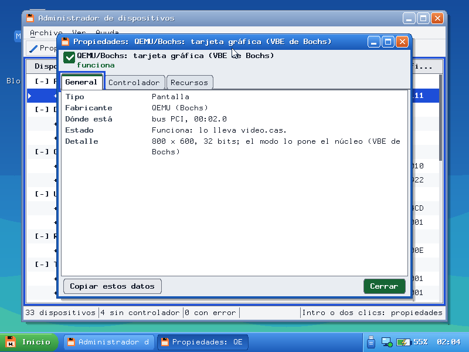 |  |

**La llamada 155** (`dispositivos.cas`, de solo lectura) hace la lista cada vez
que se pide, en fichas `Dispositivo` de 320 octetos (la misma en
`llamadas.cas` y en `acpi/pentium/pentium.h`): el bus (`BUS_PCI`, `BUS_USB`,
`BUS_ACPI`, `BUS_PLACA`, `BUS_DISCO`, `BUS_CPU`), la dirección, de quién cuelga
(su número en la lista), el fabricante y el modelo, la clase al estilo del PCI,
el subsistema, la revisión, el estado (`EST_...`), la IRQ, hasta seis
recursos (clase, base y largo), el nombre PnP, el controlador, el nombre (el
modelo del disco, lo que dice el aparato USB, la ruta ACPI), la marca y un
detalle. Mira:

- **el bus PCI entero** (también detrás de los puentes), cada función con sus
  zonas: **medidas una vez** (se escriben unos en el BAR con el aparato sin
  atender en la memoria ni en los puertos y las interrupciones cerradas, y se
  pone como estaba: lo de todos los sistemas), su IRQ y lo que dicen de él los
  controladores: `ahci.cas` (su controladora), `ata.cas` (el canal primario),
  `xhci/ehci/uhci.cas` (las que han tomado; las que no se han dejado, «con
  error»; con `sinusb`, desactivadas), `video.cas` (la tarjeta que tiene la
  memoria de la pantalla; sin modo gráfico, la pantalla de texto),
  `RED.BIN` (la tarjeta que lleva el servicio de red), `pci.cas` (los puentes);
- **los aparatos USB** de `usb.cas`, con **su nombre y su marca de verdad**
  (sus descriptores de cadena, preguntados una vez a cada uno) y qué módulo los
  atiende (`usbhid.cas`, `usbalm.cas`, `usb.cas` los concentradores), colgados
  de su controladora o de su concentrador; y lo que no se ha dejado enumerar;
- **los discos** de `discos.cas`, colgados de su controladora, con su tamaño,
  sus unidades y si se puede escribir en ellos;
- **lo de siempre**: el teclado y el ratón PS/2 (si contestan), el reloj de la
  CMOS, el 8253, los 8259 y los puertos serie que dice la BIOS (COM1 es el
  registro del núcleo); y **el procesador** (CPUID: su nombre, su familia y lo
  que tiene);
- **ACPI**: el sistema (`ACPI.BIN`) y **lo que apunta el servicio con la 156**:
  después de la primera lectura de la batería, con la tarea quieta, `ACPI.BIN`
  recorre el espacio de nombres (los dispositivos con `_HID` y `_STA` presente,
  sin los enlaces de interrupción `PNP0C0F`), con su ruta y lo que dice su
  `_CRS`, y dice quién lo lleva (la batería, el adaptador y el controlador
  embebido, él; los buses PCI, `pci.cas`; los recursos de la placa y los
  contenedores, nadie: no les hace falta). Con `acpisindisp` en la línea del
  cargador no lo hace. Lo de ACPI que ya sale como «lo de siempre» (el teclado,
  el ratón, el reloj, COM1) va con ello (su ruta, en sus propiedades), no aparte.
- **Para un controlador nuevo** (los lectores de CD de `pentium-cd`, una
  tarjeta): `Dispositivos.apuntar(ficha, 1)` desde el núcleo; si es un aparato
  PCI (bus `BUS_PCI` y su dirección), su estado, su controlador y sus textos se
  juntan con la ficha del PCI. Lo que apunta un servicio que se acaba ya no sale.

Los nombres (los fabricantes y los modelos del PCI y del USB, las clases y los
nombres PnP) van en unas tablas de texto de `udisposi.cas`: lo que se conoce
(QEMU, VirtualBox, VMware, Intel PIIX/ICH7/ICH9/NM10/Bay Trail, las Wi-Fi de
Intel, Broadcom y Atheros, Realtek, Marvell, VIA, SiS...) y, si no está, el
fabricante y la clase («Realtek: Tarjeta de red (Ethernet)»).

### El explorador de archivos: `EQUIPO.BIN` (21/11)

| | |
|---|---|
|  | 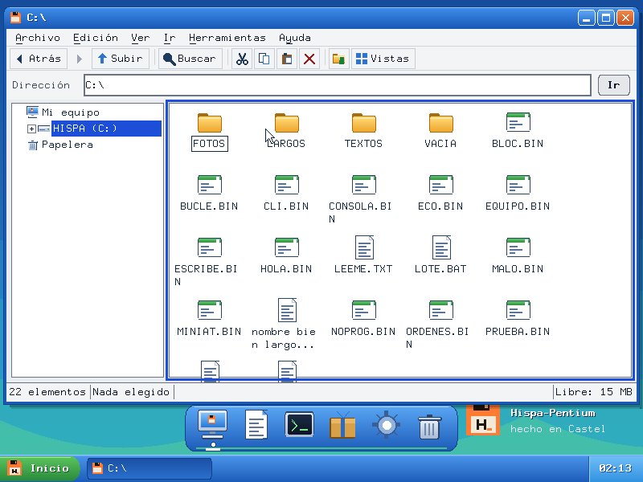 |
|  | 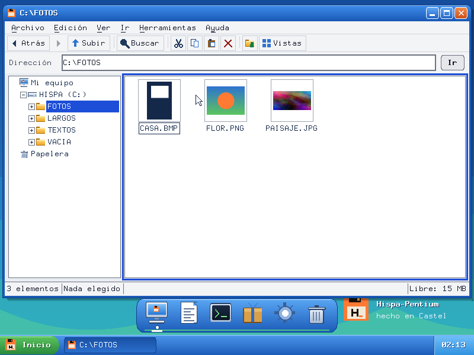 |
|  | 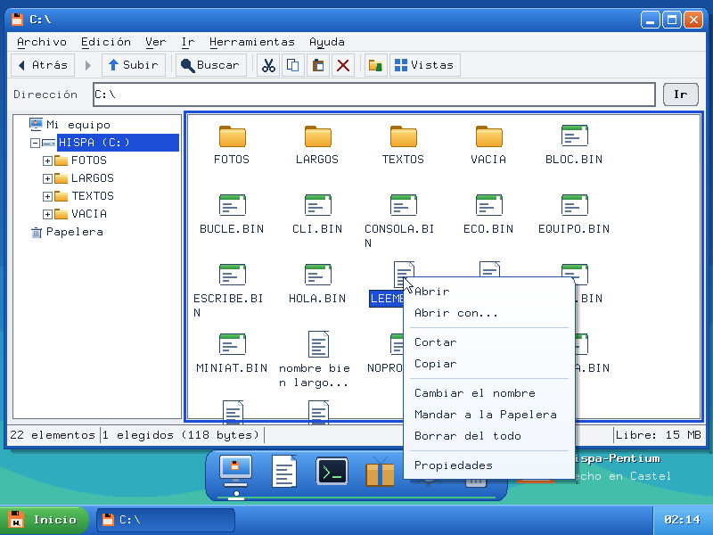 |
|  |  |

Lo pidió Carlos el 21/11 («actualizar el explorador de archivos, dock… lo
que necesitemos para estar a la altura de un sistema operativo»). «Mi
equipo» (`EQUIPO.BIN`) pasa a ser un **explorador** de los de verdad: un
programa del anillo 3 hecho con los controles de las ventanas
(`controles.cas`: la barra de menús, la de herramientas, la dirección, la
rejilla de los detalles, los botones y las casillas de los cuadros), con lo
que hace con los archivos aparte (`exoper.cas`, sin pintar nada) y los
iconos dibujados (`iconos.cas`, que comparte con el dock).

**Lo que se ve.** Arriba, la **barra de menús** (Archivo, Edición, Ver, Ir,
Herramientas, Ayuda: Alt y su letra la abren; con las flechas a los lados,
al menú de al lado), la de **herramientas** (Atrás, Adelante, Subir, Buscar,
Cortar, Copiar, Pegar, Borrar, Carpeta nueva y Vistas; en gris lo que no
toca) y la **dirección** (`C:\TEXTOS`, `Mi equipo`, `Papelera`), que se
puede escribir (Intro va; vale sin la letra). A la izquierda, el **árbol**:
Mi equipo con sus unidades (cada una con su icono: disco duro, memoria USB,
CD, en memoria) y sus carpetas (por orden; el `[+]` y el `[-]` son un
cuadrito con su signo, no un color), y la Papelera. A la derecha, lo que hay
donde se está; abajo, la **barra de estado** (cuántos hay, cuántos elegidos
y lo que miden, lo libre de la unidad o «De solo lectura»).

**Las vistas** (Ver, Vistas o F8): **miniaturas** (las imágenes en pequeño;
lo demás, su icono grande), **iconos**, **lista** (en columnas) y
**detalles** (la rejilla de `controles.cas`: nombre, tamaño, tipo y fecha de
modificación; un clic en el rótulo ordena, otra vez al revés, con su
triángulo). Las carpetas van siempre delante; el tamaño y la fecha se
ordenan por su número. En Mi equipo, cada unidad en un mosaico con lo libre,
de cuánto, y una barra; en la Papelera, de dónde era y cuándo se borró; al
buscar, en qué carpeta está.

**Elegir.** Un clic elige uno; **Control y un clic** añade o quita;
**Mayús y un clic**, desde el anterior hasta ahí; **un recuadro con el
ratón** desde un sitio sin nada, los que toca (con Control, se suman). Con
el teclado: las flechas (en iconos, también arriba y abajo por filas),
Inicio, Fin, Re Pág, Av Pág; **con Mayús, eligiendo**; **Espacio** elige o
suelta el del cursor; Ctrl+A, todos. Lo elegido, **letra blanca sobre
azul**; el cursor, **un borde** alrededor (no solo el color).

**Abrir.** Dos clics o Intro: una carpeta, se entra; un archivo, **con lo
suyo**: las **asociaciones** de `ASOCIA.TXT` (`\HISPA\ASOCIA.TXT` en un
sistema instalado; si no, `\ASOCIA.TXT`): un texto en la página 437, una
línea por extensión, `EXT=programa|argumentos`, donde `%1` es el archivo
(`TXT=\BLOC.BIN|%1`, `PLU=\HVPRUN.BIN|\OFICINA\PLUMA.HVP %1`, `BIN=%1|`).
Sin él, las de siempre (el Bloc, HVPRUN con la oficina, Mirador para las
imágenes). **Abrir con...** saca la lista de los programas (los de siempre
y los de los paquetes, sus `.MNU`), o se escribe otro; con «Abrir siempre
los .EXT con este», lo guarda en `ASOCIA.TXT`. Herramientas > Las
asociaciones lo abre en el Bloc de notas.

**Copiar, cortar y pegar** (Ctrl+C, Ctrl+X, Ctrl+V, Edición, las
herramientas o el menú del botón secundario): va por **el portapapeles del
sistema** (un texto que empieza por `\x01ARCHIVOS COPIAR` o `CORTAR` y una
ruta por renglón), así que de una ventana del explorador a otra también.
**Arrastrar** lo elegido a una carpeta (de lo de dentro o del árbol) lo
**lleva** allí (en otra unidad, o con Control, lo **copia**); mientras se
arrastra, un rótulo con lo que va junto a la flecha y un borde verde en la
carpeta donde caería. **Fuera de la ventana**: en el **tapiz**, un acceso
(un icono con la flechita, que lo abre con lo suyo; se lleva a otro sitio
arrastrándolo y el botón secundario lo quita: `ATAJOS.INI`); en el
**dock**, un programa (`.BIN`) se fija, y en su Papelera, se tira. (Va lo
primero de lo elegido: la llamada 171.)

**El trabajo** (`exoper.cas`): copiar, mover, mandar a la Papelera, borrar
del todo, restaurar y vaciar. Primero se apunta todo lo que hay que hacer
(las carpetas, enteras, de una en una: así solo hay un archivo abierto a la
vez y se sabe cuánto es) y luego se hace **a pasos cortos** (un trozo de 16
K, una carpeta, un nombre), con **un cuadro con la barra de progreso** (lo
que va, cuál de cuántos y el tanto por ciento, en número además de la
barra) y **Cancelar** (o Esc: lo que iba por la mitad se quita). Si el
destino ya existe: **«¿Se reemplaza?»**: Reemplazar, Saltar, A todos,
Saltar todos o Cancelar. Mover en la misma unidad solo cambia el sitio (la
llamada 22, también con carpetas); a otra, copia y borra. Copiar en la misma
carpeta hace `NOMBRE~1.EXT`. Una carpeta no se lleva dentro de sí misma.
Lo que no ha ido bien sale en la barra de estado.

**Cambiar el nombre** (F2) y **Carpeta nueva** (F7, Ctrl+N): un cuadro con
el nombre (lo primero que se escribe sustituye al que había). De momento,
**8 letras, un punto y 3 más** (la FAT de Hispa-Pentium aún no escribe
nombres largos; los lee y los enseña). **Propiedades**: el nombre (y el
corto), el tipo, dónde está, el tamaño (de una carpeta, todo lo de dentro:
cuántos archivos y carpetas), cuándo se hizo, cuándo se cambió y el último
acceso, y **los atributos** (solo lectura, oculto, archivo: casillas que se
pueden cambiar; «es del sistema», si lo es); de una unidad, su tipo, su FAT,
la capacidad, lo libre y lo ocupado, el disco y si se puede escribir.

**La Papelera.** Supr manda lo elegido a `\PAPELERA` de su unidad (una
carpeta oculta y de sistema que se hace la primera vez), con un nombre
propio (`D1234567.EXT`) y una línea en `\PAPELERA\INDICE.TXT` (el nombre de
dentro, de dónde era, su nombre y cuándo se borró). La Papelera del árbol
junta las de todas las unidades: **Restaurar** lo devuelve a donde estaba
(haciendo su carpeta si ya no está), **Borrar del todo** y **Vaciar la
Papelera** preguntan antes. **Mayús+Supr** borra del todo sin pasar por
ella (preguntando). En las unidades de solo lectura (el permiso de
escritura de cada disco: «escritura», «escritura=usb»; los CD; la unidad en
memoria) no se borra, ni se pega, ni se cambia nada: sale en gris y lo dice.

**Buscar** (F3, Ctrl+F, la herramienta): el panel de la izquierda pasa a
ser el de buscar: el nombre o un trozo (sin mirar mayúsculas ni tildes; con
`*` y `?`, como en el DOS), «También dentro» (las subcarpetas), y Buscar.
Busca en la carpeta en que se está (en Mi equipo, en todas las unidades);
Esc para. Lo encontrado sale en detalles, con su carpeta; se abre, se
copia o se borra como lo demás. «Carpetas» vuelve al árbol.

**Las miniaturas**: **`MINIAT.BIN`** (`nucleo32/miniat/`: `miniat.c` con
**stb_image**, de `terceros/stb`, en C, como TLS.BIN), un programa aparte
que lee la imagen (BMP, PNG, JPG, GIF, TGA, PSD, PNM), la deja en 64 x 64
como mucho (con su forma; lo transparente, sobre blanco) y la escribe en un
archivo (`HPMI`, el ancho, el alto y los puntos), en la primera unidad en
la que se pueda escribir (`X:\MINIAT.TMP`, que el explorador no enseña y
borra). El explorador lo lanza para cada imagen que se ve, de una en una y
sin esperar (sigue respondiendo mientras), y guarda hasta 120 en su
memoria. Sin `MINIAT.BIN`, o sin sitio, el icono de imagen.

**Las unidades que van y vienen**: con `EV_UNIDADES` (una memoria USB que
se enchufa o se quita, un CD que se mete o se saca, una imagen que se
monta o se desmonta: `MEDIO_CD`, el 4, y `MEDIO_IMAGEN`, el 5, con el icono
del CD) se vuelven a leer el árbol y Mi equipo; si se estaba en una que ya
no está, a Mi equipo, diciéndolo. El botón secundario en una memoria USB:
«Quitar con seguridad»; en un CD o una imagen montada, «Expulsar» (la
llamada 132). Un lector sin disco dice «sin disco» (o «un CD de música», o
que no se lee) en su tipo y al abrirlo. **Una imagen de disco** (`.ISO`,
`.CUE`, `.IMG`, `.IMA`) se **monta** al abrirla (dos clics, Intro, o
«Montar» en su menú: la llamada 133) y se entra en ella: sale en Mi equipo
como «CD virtual (E:)».

**El teclado entero**: Tab y Mayús+Tab (la dirección, Ir, el árbol, lo de
dentro), las flechas, Intro (abrir), Retroceso (subir), Supr y Mayús+Supr,
F1 (las teclas), F2, F3, F4 o Ctrl+L (la dirección: lo que se escribe la
sustituye), F5 (actualizar), F6 (el árbol o lo de dentro), F7, F8 (otra
vista), F9 (el menú de lo elegido), F10 (el menú Archivo), Alt y la letra
de cada menú, Ctrl+A, Ctrl+C, Ctrl+X, Ctrl+V. En el árbol: arriba y abajo
(va a la carpeta), la derecha abre (y baja), la izquierda cierra (o sube).
En los cuadros: Tab, Intro, Espacio y Esc.

```
EQUIPO                 Mi equipo
EQUIPO C:\CARPETA      abre ahí (también sin la letra)
EQUIPO /PAPELERA       la Papelera
EQUIPO /ABRIR RUTA     abre ese archivo con lo suyo (una carpeta: ahí); sin ventana (los accesos del tapiz)
EQUIPO /BORRAR RUTA    lo manda a la Papelera, sin ventana (la Papelera del dock)
```

**Lo de `controles.cas` que ha hecho falta** (sin duplicar: lo genérico va
en el sistema): la rejilla con **icono** delante del nombre
(`Renglón.icono`, `letra`), **varios elegidos** (`g.varios`,
`Renglón.marcado`; `sel` es el cursor), un **grupo** que va siempre delante
(las carpetas), las columnas que **se ordenan por un número**
(`g.col_clave`, `col_clave2`: `Renglón.clave`, `id2`), `rejilla_en` (el
renglón en un punto, sin elegirlo), `rejilla_caben`, `rejilla_de_vista`; los
iconos de herramienta `I_SUBIR`, `I_CORTAR`, `I_COPIAR`, `I_PEGAR`,
`I_CARPETA` y `I_VISTAS`; y `alto_pedido`/`ancho_pedido` para la medida de
la ventana. En el emergente, **CON_FLECHAS** en la etiqueta de un menú:
las flechas a los lados lo cierran con `A_LA_IZQUIERDA` o `A_LA_DERECHA`.

### El dock (21/11)

| | |
|---|---|
|  | 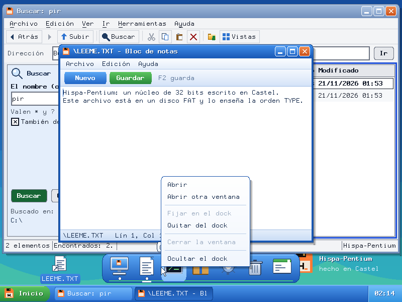 |

Una barra de lanzamiento con **iconos grandes** (40 puntos), centrada abajo,
encima de la barra de tareas: un panel azul con los bordes redondos y la
raya verde de la casa (lo que aprobó Carlos: «bordes redondeados, azules,
verdes»). Lleva los **programas fijados** (Mi equipo, el Bloc de notas, la
Consola, Programas y actualizaciones, Configuración y la Papelera, si no se
dice otra cosa) y, detrás de una raya, **los abiertos que no lo están**
(con el nombre de su ventana). Debajo de cada programa abierto, **un
punto**; bajo el de la ventana de delante, además, **una raya** (formas, no
colores). Con la flecha encima, el icono se resalta y su **nombre** sale en
una etiqueta. **Un clic** lo abre o trae su ventana (si ya era la de
delante, la recoge, como su botón de la barra de tareas). **El botón
secundario**: Abrir, Abrir otra ventana, Fijar en el dock, Quitar del dock,
Cerrar la ventana y Ocultar el dock (en gris lo que no toca). Un icono
fijado **se arrastra** a lo largo del dock para cambiarlo de sitio. Lo que
se suelta desde el explorador: un programa se fija; en la Papelera (que
cambia de icono cuando tiene algo), se tira.

Se guarda en **`DOCK.INI`** (`\HISPA\DOCK.INI`, o `\DOCK.INI` en un sistema
sin instalar; si no se puede escribir, solo dura hasta apagar):

```
visible=si
fijado=\EQUIPO.BIN||Mi equipo|12
fijado=\EQUIPO.BIN|/PAPELERA|Papelera|13
```

(el programa, sus argumentos, su nombre y la clase de su icono; con 0, el de
su paquete —su `.ICP`— o una ventanita). En **Configuración**, «Dock:
Visible / Oculto» (en la 0.8.4, en su fila, y debajo «Dispositivos...»,
«Red y Tailscale...» y «Cerrar»). Cómo está hecho (`dock.cas`, en el núcleo, con
`iconos.cas`): una ventana sin marco, siempre delante y **TRASLÚCIDA**
(una bandera nueva del gestor: sus puntos con el octeto de arriba puesto no
se ven ni se pulsan, y dejan ver y pulsar lo de debajo: así el panel es
redondo y la etiqueta no tapa nada). **No tapa nada de nadie**: cuando una
ventana ocupa el sitio de su panel (una maximizada, un cuadro grande de
un programa), el dock **se aparta**; vuelve cuando el sitio queda libre, o
al llevar la flecha a la raya de justo encima de la barra de tareas (y se
queda mientras la flecha esté encima). Un programa que quiera caber encima
del dock lo sabe con `DATO_ALTO_LIBRE` (`Ventanas.alto_dock`): así se
pone el explorador. Sabe qué está abierto mirando las
ventanas y el nombre (y los argumentos) de la tarea de cada una; lo que se
pulsa se lo pide al escritorio (`Dock.pide`: lanzar o Configuración).

### La medida de la pantalla, desde Configuración (20/11)

Lo que faltaba (lo dijo Carlos con el CD 0.8 en VirtualBox: «en Configuración se
ve la resolución pero no se puede cambiar»). Ahora, en Configuración, junto a
«Pantalla: 800 x 600, 32 bits por punto», el botón **«Cambiar...»** abre el
cuadro **«Pantalla»**: la medida de ahora, la **lista de modos** (en verde el
elegido; en azul el de ahora) y, debajo, lo último que ha pasado. Como en
Hispa-486, de dos maneras según la tarjeta:

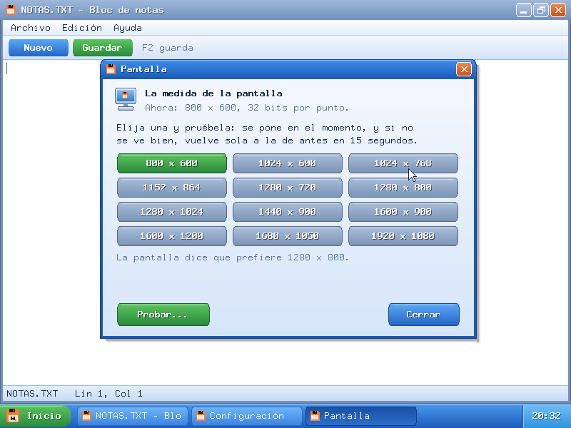

**1. Con la VBE de Bochs: en el momento.** Es la tarjeta de QEMU y Bochs
(`1234:1111`) y la de **VirtualBox**, tanto la **VBoxVGA** (`80EE:BEEF`) como
la **VMSVGA** (`15AD:0405`, que lleva la misma VBE debajo mientras no se use
como SVGA) y la VBoxSVGA: se sabe que está porque su puerto `0x1CE`/`0x1CF`
contesta `B0C0`-`B0CF`. Aunque el modo lo haya puesto GRUB (el CD, el disco
instalado), la VBE de la BIOS de esas máquinas es esa misma tarjeta, así que el
núcleo puede cambiarlo él:

- **«Probar...»** pone la elegida **ya**, y sale **«¿Se ve bien la pantalla?»**
  con la cuenta atrás: **«Mantener»** (o Intro) la deja; **«Volver»** (o Esc, o
  cerrar el cuadro) vuelve a la de antes; y si en **15 s** no se dice nada,
  **vuelve sola** (por si la pantalla se ha quedado a oscuras o fuera de rango).
  En un sistema instalado, «Mantener» la guarda también para los próximos
  arranques (`\HISPA\PANTALLA.ENV`, abajo).
- **Cómo se cambia** (`video.cas`, `cambia_modo()`): se apaga la tarjeta, se le
  dan el ancho, el alto y 32 bits por punto, se enciende con la memoria seguida, y
  el ancho virtual y los desplazamientos a la medida (así la fila mide lo que el
  ancho, venga de donde venga el modo de antes); luego **se lee lo puesto**,
  también el bit de encendido (VirtualBox, si el modo no le cabe en su memoria,
  no lo enciende y no dice nada más). La memoria de la pantalla es la misma (la
  tarjeta no la mueve): se pone a la vista lo que mida ahora. Si algo falla, se
  vuelve al modo de antes, tal cual. Si el modo de antes era de 24 o 16 bits (con
  el lienzo de 32 aparte), ese lienzo se suelta: el nuevo siempre es de 32.
- **Las ventanas** (`ventanas.cas`, `cambia_pantalla()`): un doble búfer y un
  tapiz nuevos (se piden antes de tocar nada: si no hay memoria, no se cambia),
  y las ventanas dentro: **las maximizadas, a la medida nueva** (su programa
  recibe `EV_TAMAÑO` y se vuelve a pintar, como al maximizar); las demás, donde
  estaban si caben y si no, más arriba o más a la izquierda. El ratón llega hasta
  el borde nuevo (`pon_medida_ratón()`).
- **El escritorio** (`escritorio.cas`, `cambia_medida()`): cierra el menú Inicio,
  los emergentes y el globo; la barra de tareas, de lado a lado y abajo; el menú
  Inicio, encima; el tapiz, pintado otra vez a la medida; los iconos que se
  salgan, dentro; los cuadros abiertos, centrados.

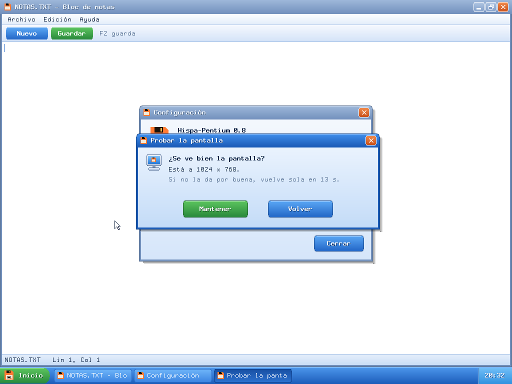

**La lista** (`prepara_modos()`): de 800 x 600 a 1920 x 1080 (800 x 600, 1024 x
600, 1024 x 768, 1152 x 864, 1280 x 720, 1280 x 800, 1280 x 1024, 1366 x 768,
1440 x 900, 1600 x 900, 1600 x 1200, 1680 x 1050 y 1920 x 1080), y de ellos solo
los que caben:

- en **la tarjeta**: lo más que da (la VBE de Bochs lo dice con `GETCAPS`), el
  ancho en múltiplos de 8 en la de QEMU y Bochs (redondea: 1366 se queda en
  1360; la de VirtualBox no), y **su
  memoria**: la de QEMU y Bochs, su registro `0xA` (en trozos de 64 K); la de la
  VBoxVGA, el mismo registro leído de 32 bits (en octetos: lo que usan los
  controladores de VirtualBox); la de la VMSVGA no se sabe desde ahí, y entonces
  manda lo que se lee al ponerlo (si no cabe, no se enciende: se dice y se vuelve);
- en **la pantalla**: lo que ella dice de sí misma (su **EDID**). En QEMU, la
  tarjeta lo deja en su tercera zona PCI: la medida que prefiere (se dice debajo:
  «La pantalla dice que prefiere 1280 x 800») y, de sus medidas de siempre, la
  más grande; no se ofrece nada más grande. En VirtualBox no hay EDID (su
  «pantalla» es la ventana, que muestra lo que sea), ni se puede pedir a la BIOS
  sin volver al modo real (más abajo);
- en el **núcleo**: los 16 MB de su ventana para la memoria de la pantalla
  (`GRÁFICOS_TABLAS`) y la memoria libre para el doble búfer y el tapiz nuevos.

El de ahora sale siempre, aunque no sea de la lista.

**2. Sin la VBE de Bochs (un PC de verdad): al arrancar.** El modo lo pone GRUB
con la VBE de la BIOS, que desde el modo protegido no se puede llamar. El cuadro
lo dice («Esta tarjeta no deja cambiarla en marcha: se guarda y se pone al
arrancar otra vez»), la lista lleva también **«A la medida»** (lo que el monitor
prefiera, `auto`: su EDID, que GRUB sí le pregunta a la BIOS), y el botón es
**«Guardar y reiniciar...»**: se apunta para el próximo arranque y sale «Al
arrancar otra vez, a 1024 x 768», con **«Reiniciar ahora»** y «Más tarde».

- **`\HISPA\PANTALLA.ENV`**: un bloque de variables de GRUB (1024 octetos, como
  `GRUBENV`, para que GRUB pueda escribir en él con `save_env`): `pantalla=`
  (`1024x768` o `auto`), `antes=` (la de antes, para volver) y `prueba=`. Va
  aparte de `GRUBENV` porque PAQUETES y ACTUALIZ escriben aquel entero (su
  `nuevo=`) y se lo llevarían por delante.
- **`GRUB.CFG` lo lee**: la primera vez que se guarda una medida, si `GRUB.CFG`
  no lo hace aún (los instalados con la 0.8), el escritorio le añade al final
  (GRUB lee el archivo entero antes de enseñar el menú, y la entrada usa
  `$modo` al arrancar):

  ```
  if [ -f /HISPA/PANTALLA.ENV ]; then
    load_env -f /HISPA/PANTALLA.ENV pantalla antes prueba
    if [ "$prueba" = 2 ]; then
      set pantalla="$antes"
      set antes=
      set prueba=0
      save_env -f /HISPA/PANTALLA.ENV pantalla antes prueba
    elif [ "$prueba" = 1 ]; then
      set prueba=2
      save_env -f /HISPA/PANTALLA.ENV prueba
    fi
    if [ "$pantalla" = auto ]; then
      set modo=auto
    elif [ -n "$pantalla" ]; then
      set modo="${pantalla}x32,${pantalla},${modo}"
    fi
  fi
  ```

  La **reserva de siempre** sigue detrás: si la BIOS no tiene esa medida (ni con
  32 bits ni con otros), GRUB pasa a la de `set modo=` (`800x600x32,800x600,auto`)
  y, al final, a `auto`: siempre arranca con algo que se ve.
- **A prueba, al arrancar**: «Guardar» deja `prueba=1`; GRUB, al arrancar con
  ella, la pone a `2`. El escritorio, al ver `1` o `2`, pregunta **«¿Se ve bien
  la pantalla?»** con los mismos 15 s: «Mantener» deja `prueba=0`; «Volver» o los
  15 s apuntan la de antes (`pantalla=antes`) y ofrecen reiniciar. Y si la
  pantalla se ha quedado a oscuras y se **reinicia a lo bruto**, GRUB ve
  `prueba=2` (nadie la ha dado por buena) y **vuelve solo a la de antes**.
- En un sistema instalado **con** la VBE de Bochs (VirtualBox), la medida
  guardada la pone GRUB al arrancar (con la tarjeta de QEMU y Bochs la pone su
  controlador `video_bochs`, cualquiera; con las de VirtualBox, por la VBE de la
  BIOS); y si la BIOS no la tiene (la VMSVGA de QEMU no da, por ejemplo, 1200 x
  800), GRUB pone otra y **el núcleo la cambia en marcha** al arrancar el
  escritorio.
- **Desde el CD o la memoria USB, sin instalar**, no hay dónde guardarla: la
  lista sale en gris, y para arrancar a la medida está la entrada **«a la medida
  de la pantalla»** del menú del CD.

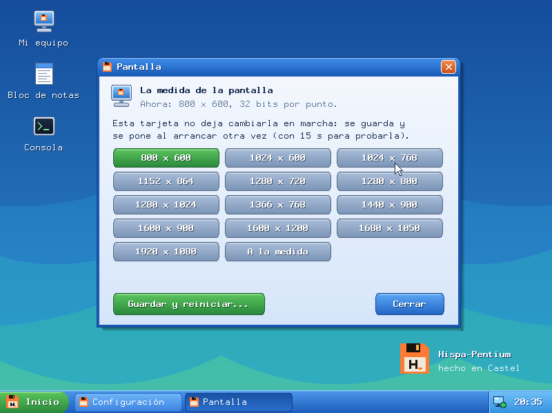

**¿Y la lista de modos de la BIOS?** GRUB deja en la información de multiboot
la de su VBE (`vbe_control_info`), pero solo trae **números** de modo (y un
puntero de modo real que puede apuntar a la memoria de trabajo de GRUB, ya
pisada): la medida de cada uno hay que pedírsela a la BIOS (`4F01h`), y eso no
se puede desde el modo protegido. Por eso, sin la VBE de Bochs, se ofrece la
lista de siempre y manda la reserva de GRUB.

**¿Cambiarla en marcha llamando a la VBE de la BIOS?** Evaluado, y **no se ha
hecho**. Hay dos maneras:

1. **Una tarea V86** (el modo virtual 8086 del procesador, lo que usaban X.org y
   los controladores VESA de los 90): hace falta el primer mega a la vista **del
   anillo 3** en ese espacio (la tabla de interrupciones de la página 0, la zona
   de datos de la BIOS, su EBDA y sus ROM de `C0000h` a `FFFFFh`: hoy están en la
   identidad del núcleo, sin el permiso del anillo 3), un **monitor** que atienda la
   protección general de `INT`, `PUSHF`, `POPF`, `CLI`, `STI` e `IRET` (con
   IOPL < 3) y el mapa de puertos del TSS (hoy no hay); y, sobre todo, una
   **entrada de interrupción propia** en ensamblador: al pasar de V86 al anillo 0
   el procesador deja `DS`, `ES`, `FS` y `GS` a 0, y las `interrupción función` de
   Castel cuentan con `DS` plano (no lo vuelven a cargar), así que la protección
   general, el fallo de página y las demás excepciones necesitarían su propia
   puerta para cuando vienen de V86.
2. **Un emulador de modo real** pequeño (como x86emu, el de X.org y `v86d` de
   Linux): sin trucos del procesador, pero son miles de líneas para emular todo
   lo de 16 bits (y de 32, que las VBIOS usan) y los puertos.

Las dos se pueden hacer, pero **lo que no se puede aquí es dejarlo robusto**: la
única VBIOS que se puede probar (la de QEMU, SeaVGABIOS) ya habla con la VBE de
Bochs, que se cambia sin BIOS; las de los PC de verdad (la Intel GMA del Toshiba
y del HP Mini, la de los Mac) hacen cada una lo suyo (llamadas a la BIOS del
sistema, al PCI BIOS, esperas con el reloj, instrucciones de 32 bits), y un fallo
ahí deja el equipo **colgado con la pantalla a oscuras**. Con GRUB, en cambio, el
peor caso es un reinicio y la vuelta sola a la de antes. Queda para más adelante,
como servicio aparte (al estilo de `ACPI.BIN`), cuando haya en qué probarlo; para
las Intel GMA, el arreglo de la sección 11 (decirle a la tubería la medida nueva
sin la BIOS) es lo que más rinde.

**Probado** (parte 17 de las pruebas, `SOLO=pantalla`): con QEMU `-kernel`
(-vga std: el modo lo pone el núcleo) la lista, «Probar...», «Mantener», el Bloc
de notas maximizado que se pone a la medida nueva y la vuelta sola a los 15 s;
el CD en un «pc» como VirtualBox con el modo de GRUB, con `-vga std` (como la
VBoxVGA) y con `-vga vmware` (la VMSVGA, `15AD:0405`), cambiado en marcha; e
instalado desde el CD con `-vga cirrus` (sin la VBE de Bochs, como un PC de
verdad): guardar, reiniciar, la prueba al arrancar con «Mantener», y otra que
no se da por buena y que GRUB deshace sola al reiniciar a lo bruto. Y,
instalado con `-vga std`, «Mantener» que se guarda; y con `-vga vmware`, 1200 x
800 (que su BIOS no da) puesta por el núcleo al arrancar.

### Lo que falta

Escribir **nombres largos** (el explorador ya hace carpetas, cambia
nombres y deja accesos de documentos en el tapiz, pero en 8+3); arrastrar
de una ventana del explorador a otra y desde otros programas; ocultar el
dock solo (que salga al acercarse); «Nueva carpeta» en el tapiz; la barra de
desplazamiento en los programas de Castel (la **rueda del ratón** ya llega,
desde la 0.8.3: `EV_RUEDA`, sección 14 ter; la usa el Navegador);
que la Consola cambie sus filas y columnas con la ventana, y guarde lo que ha
pasado hacia arriba; menús que se abren con Alt y submenús; letras de otros
tamaños y de ancho variable; el ajuste del doble clic; y que el tapiz pueda ser
una imagen del disco.

### La oficina de Hispa-386, dentro: HVPRUN

| | |
|---|---|
|  |  |
|  |  |
|  |  |

Los programas de la **oficina de Hispa-386** (Facturas, Pluma, Cuentas y
Mirador: módulos `.HVP` de Hispa Ventanas) corren en el escritorio de
Hispa-Pentium **sin tocarles una línea**: son los mismos archivos que en
Hispa-386, hechos con `tools/mkhvp.py` de `programas/*.asm`. Los abre
**`HVPRUN.BIN`** (`castel/nucleo32/hvprun/`), un programa del anillo 3 (cabecera
`HPU3`) escrito en NASM:

```
HVPRUN \OFICINA\FACTURAS.HVP [ARCHIVO]
```

- **Lo de arriba es Hispa Ventanas**: el gestor de ventanas, los mensajes y las
  tareas cooperativas, los controles (botones, cuadros de texto, listas, barras
  de desplazamiento), los menús, los menús contextuales, los cuadros de diálogo
  (también el de elegir archivo) y el dibujo (`ventanas/gestor.inc`,
  `nucleo.inc`, `controles.inc`, `menus.inc`, `contexto.inc`, `dialogos.inc`,
  `tamano.inc`, `dc.inc`, `gdi.inc`...) **se reensamblan tal cual**: son de 32
  bits plano y no tocan el hardware. `ventanas/` no se ha tocado.
- **Lo de debajo es de Hispa-Pentium** (`pent.inc`, `ppantalla.inc`,
  `pdos.inc`, `pfaltan.inc`): la «pantalla» de Ventanas es una superficie de 8
  bits del tamaño de lo de dentro de **una ventana de Hispa-Pentium**; lo que
  cambia se pasa a 32 bits con la paleta de Ventanas y se le da al núcleo como
  un mapa de puntos (llamada 34). El ratón (con el doble clic que cuenta el
  núcleo) y las teclas llegan como sucesos (35); los archivos `dos_*`, por las
  llamadas 7-9 y 18-26; buscar archivos (`INT 21h`, 4Eh y 4Fh) abre la carpeta
  y la lee entrada a entrada (12); la fecha y la hora, de la llamada 15; la
  memoria (`mem_bloque` y el montón de Ventanas), de la 17; el reloj de la BIOS
  (18,2 tics por segundo), de los tics del núcleo.
- **La ventana principal** del programa ocupa esa ventana entera: su marco y su
  título de Ventanas quedan fuera (el título lo pone Hispa-Pentium, y cambia
  cuando el programa lo cambia: «Pluma - carta.PLU»); su barra de menús sí se
  ve. Al estirar o maximizar la ventana de Hispa-Pentium, el programa recibe
  `WM_SIZE` y se recoloca. Los **cuadros de diálogo y los menús** salen dentro de
  la ventana, con el aire de Hispa Ventanas. La ventana nace **en el centro**
  (la llamada 80, nueva) y del tamaño que el programa pide según la pantalla.
- **El portapapeles** de Ventanas se pone al día con el del sistema (llamada
  40) al entrar en la ventana, al salir de ella y al acabar: lo copiado en
  Pluma se pega en el Bloc de notas, y al revés.
- El **botón de cerrar** es un `WM_CLOSE` para el programa (Pluma pregunta si
  hay cambios sin guardar); con un cuadro abierto encima, lo cierra a él.
- Lo que el programa pide de modo real (`rm_interrup`): de `INT 21h`, 0Eh,
  19h, 1Ah, 2Ah, 2Ch, 36h, 39h-3Bh, 3Ch-42h, 4408h, 47h, 4Eh, 4Fh y 56h. La
  **impresora** aún no: `INT 11h` dice que no hay puerto paralelo, y Facturas y
  Pluma lo avisan. Lo demás contesta «función no válida» y lo dice por el
  puerto serie (o el terminal), para saber qué falta.

En el **menú Inicio**, el grupo **«Oficina»** (debajo de los programas) los
abre; **Mi equipo** abre con HVPRUN los `.HVP`, los documentos de Pluma
(`.PLU`), las hojas de Cuentas (`.HOJ`) y las imágenes (`.BMP`, `.PCX`, `.GIF`,
`.PNG`, `.JPG`, `.TGA`, `.ICO`, `.PPM`, con Mirador). En el disco van
`\HVPRUN.BIN` y la carpeta `\OFICINA` (los cuatro `.HVP`, `TIPOS.DAT` y
`DICCIO.DAT`): los pone `nucleo32/hvprun/hacer.sh`, y de ahí `usb.sh` (la
memoria USB) y `disco.sh IMAGEN 16 oficina`. Facturas guarda sus datos al lado
de su módulo (`\OFICINA\FACTURAS.DAT`).

Lo que falta: imprimir; el sonido; las teclas con Alt (el núcleo aún no las
da: los menús se abren con F10 o con el ratón) y F11-F12; la forma del cursor
que pide el programa (la flecha es siempre la del sistema); que cada cuadro de
diálogo sea una ventana de Hispa-Pentium aparte; abrir otros programas desde
uno de Ventanas (`prog_abrir`); y probar los otros de la oficina (Datos, el
Lector, Publicaciones y Presentaciones), que deberían ir igual.

## 11. En un PC de verdad: GRUB, la memoria USB y el USB

`nucleo32/usb.sh IMAGEN` hace la imagen de una **memoria USB** (64 MB, FAT16,
arranque BIOS con GRUB) para probar Hispa-Pentium en un PC: se graba tal cual en la
memoria y se arranca de ella. (Necesita ser root, `parted`, `dosfstools` y
`grub-pc-bin`.) El menú de GRUB (la 0.7):

| Entrada | Qué arranca | El modo |
|---|---|---|
| el escritorio (800 x 600) | `ESCRIT8.BIN escritorio escritura=usb unidad=X registro` | el de su cabecera |
| el escritorio **a la medida de la pantalla** | lo mismo | `set gfxpayload=auto`: el que el panel dice que prefiere |
| el escritorio (1024 x 600) | `ESCRIT6.BIN` con lo mismo | el de su cabecera |
| el escritorio (1366 x 768) | `ESCRIT13.BIN` con lo mismo | el de su cabecera |
| el escritorio (1024 x 768) | `ESCRIT10.BIN` con lo mismo | el de su cabecera |
| el escritorio **sin tocar el USB ni los discos** (como la 0.5) | `ESCRIT8.BIN escritorio sindisco sinusb` | el de su cabecera |
| ver los modos de vídeo que da la BIOS | la orden `videoinfo` de GRUB | — |
| el intérprete de órdenes (modo texto) | `SEMILLA.BIN ordenes escritura=usb unidad=X registro` | texto |
| la consola del núcleo (modo texto) | `SEMILLA.BIN escritura=usb unidad=X registro` | texto |
| **Instalar Hispa-Pentium en el disco duro** (desde la 0.7) | `SEMILLA.BIN instalar unidad=M`, con todo lo que se instala como módulos (sección 12) | texto |

- **La memoria de arranque es la unidad X:**, la del sistema (`unidad=X`): desde
  la 0.6 el núcleo la lee él, con su USB (más abajo). De ella se cargan el
  intérprete, el Bloc de notas, la Consola y Mi equipo, y **en ella se puede
  guardar** (`escritura=usb`): el Bloc de notas deja ahí sus textos.
- **Los discos de dentro del PC se ven, pero no se tocan**: el núcleo busca los
  IDE y los SATA y monta sus volúmenes FAT como `C:`, `D:`... de **solo
  lectura** (`escritura=usb` da permiso solo a las memorias USB: sección 7). Mi
  equipo los enseña; un disco sin FAT (NTFS, ext4...) sale como disco que no se
  puede leer.
- **Los programas vienen también como módulos**, por si el USB de un equipo no
  se deja: GRUB carga con el núcleo `ORDENES.BIN`, `BLOC.BIN`, `CONSOLA.BIN`,
  `EQUIPO.BIN`, `HOLA.BIN`, `ECO.BIN`, `PRUEBA.BIN`, `BUCLE.BIN` y `LEEME.TXT`, que
  hacen de **unidad M: en memoria** (sección 7). Si no hay X:, la del sistema es
  ella, y entonces no se puede guardar nada (el Bloc de notas lo dice).
- **`registro`**: lo que el núcleo encuentra al arrancar (los discos, las
  controladoras USB y cada aparato, las unidades) queda en **`X:\ARRANQUE.TXT`**
  y, al medio minuto, cómo van el teclado y el ratón USB (sección 7).
  Es para poder verlo luego desde otro equipo: con el escritorio en marcha no se
  ve la pantalla de texto del núcleo. (La última entrada, la consola del núcleo
  en modo texto, lo enseña en la pantalla.)
- **Si con lo nuevo un equipo no arranca** (se queda parado al tomar el USB, o
  al mirar los discos), la entrada «sin tocar el USB ni los discos» arranca como
  la 0.5: `sinusb` y `sindisco`, con los programas de la unidad M:.
- **El modo gráfico, de GRUB.** En un PC de verdad no está la tarjeta de QEMU: el
  modo lo tiene que poner el cargador antes de entrar en el núcleo (con la VBE de
  la BIOS, que desde el modo protegido ya no se puede llamar). Multiboot lo prevé:
  el núcleo lo pide en su **cabecera** (la bandera de vídeo y el ancho, el alto y
  los bits que prefiere). El compilador de Castel deja en la cabecera el sitio
  para ello, a cero (CASTEL32.md §8), y **`nucleo32/modo_grafico.py NUCLEO.BIN
  SALIDA.BIN [ANCHO ALTO [BITS]]`** hace una copia del núcleo que lo pide: los
  `ESCRIT*.BIN` son eso. GRUB pone el modo y le dice al núcleo dónde está la
  memoria de la pantalla; el escritorio arranca en él, **con la medida que le
  den**. El núcleo sin tocar (`SEMILLA.BIN`) pide lo de siempre, modo texto: con él
  van QEMU con `-kernel` y las dos entradas de texto.
- **La medida de la pantalla.** Al cargar el núcleo, GRUB apunta lo que pide su
  cabecera en su variable `gfxpayload`, así: `ANCHOxALTOxBITS,ANCHOxALTO,auto`. Si
  la BIOS no tiene ese modo, prueba el mismo con otros bits y, si tampoco,
  **`auto`**: el que la pantalla dice que prefiere (GRUB se lo pregunta al panel:
  su EDID), y si no lo sabe, el que le parece (800 x 600, en lo probado). La
  entrada «a la medida de la pantalla» pone `gfxpayload=auto` después de cargar
  el núcleo: lo que diga el panel. En las dos, GRUB solo puede poner **modos que
  la BIOS dé por VBE**.
- **Si la BIOS no da el modo del panel.** Pasa: hay BIOS de portátil (las de los
  Intel de los netbooks, sobre todo) que por VBE solo dan los modos «de siempre»
  (640 x 480, 800 x 600, 1024 x 768) y no el de su propio panel (1024 x 600,
  1366 x 768). La entrada **«Ver los modos de vídeo que da la BIOS»** lo dice:
  enseña la lista (página a página: una tecla para seguir) y, al final, el que
  prefiere el panel. Entonces:
  1. si el modo del panel **está en la lista**, van las entradas «a la medida» y
     la de su tamaño;
  2. si **no está**, GRUB pone otro y el escritorio sale en él: a 800 x 600 se ve
     bien (el panel lo estira, o lo deja con bandas a los lados); a 1024 x 768 en
     un panel de 600 de alto, aplastado;
  3. el arreglo de verdad, **para más adelante**: que el núcleo ponga él la
     medida del panel hablando con la tarjeta, sin la BIOS. En las Intel (GMA)
     no hace falta un controlador entero: la BIOS ya ha dejado el panel encendido
     con sus tiempos, y basta con apagar el «ajuste al panel», decirle al plano y
     a la tubería la medida nueva (los registros `PIPESRC`, `DSPSIZE`,
     `DSPSTRIDE` y `PFIT_CONTROL`) y leer la medida del panel de sus tiempos. Es
     lo que hacían en su día los parches de «resolución» para estas tarjetas.
- **Probado en QEMU** arrancando la imagen como una memoria USB (`-device qemu-xhci
  -device usb-storage`): GRUB, el modo puesto por él (800 x 600 y 1024 x 600; el
  de 1366 x 768 no lo tiene la BIOS de QEMU, y sale el que GRUB elige: así se
  prueba también ese camino) y el escritorio con sus programas.
- **Probado en un PC de verdad** (19/11/2026): un **Toshiba NB250** (Atom N455,
  pantalla de 1024 x 600, panel táctil Synaptics PS/2), con la 0.4 a 800 x 600:
  arranca deprisa, el escritorio sale bien, y el ratón (botón principal y
  movimiento) y el teclado van. Y un **MacBook Air de 2012** (sin 8042: el
  teclado y el panel son USB), con la 0.5: el escritorio se ve, pero ni el
  teclado ni el panel responden; para él (y para todos los PC sin teclado ni
  ratón PS/2) es el USB de la 0.6, que **en un PC de verdad está por probar**.
  Hace falta, además, una VBE con modos de 32, 24 o 16 bits.
- **Sin GRUB**, otro camino para más adelante: un cargador propio de 16 bits que
  pida el modo a la VBE (`int 10h`, `4F02h`) antes de pasar a modo protegido y
  deje al núcleo la misma información.

### El USB

Desde la 0.6 el núcleo tiene su USB, escrito en Castel (con lo aprendido en
HSPUSB, el USB de Hispa-DOS, que está en ensamblador de 16 bits: `drivers/hspusb.asm`
y `docs/USB.md`). Lo enchufado se enumera **al arrancar** y **sin interrupciones** (las
controladoras se miran); lo que se enchufa y se desenchufa después, desde la
0.8, lo atiende `usbcal.cas` (más abajo, «El USB en caliente»):

1. **Las controladoras** (`usb.cas`): se buscan en el bus PCI (clase 0x0C,
   subclase 0x03) las **xHCI** (interfaz 0x30), las **EHCI** (0x20) y las
   **UHCI** (0x00), por ese orden, se le
   **quitan a la BIOS** (el «traspaso»: «es del sistema», esperar a que la suelte
   y apagar sus SMI; en el EHCI se hace siempre, que hay BIOS —la de los Mac— que
   lo usan sin decir que es suyo), se reinician y se ponen en marcha. Hasta
   entonces la BIOS imitaba con ellas un teclado PS/2; desde entonces, el teclado
   y el ratón USB los lleva el núcleo.
2. **xHCI** (`xhci.cas`), el de los PC de 2012 en adelante: la tabla de contextos
   (con las páginas «de borrador» que pida la controladora), el anillo de órdenes
   y el de sucesos; por cada aparato, su ranura, su contexto y un anillo de
   transferencias por extremo. La controladora da ella las direcciones y lleva
   las transacciones partidas; el núcleo le dice de cada aparato su velocidad, su
   **cadena de ruta** (por qué puerto de cada concentrador se llega a él) y, si
   es de USB 1.x detrás de un concentrador de alta velocidad, su traductor.
   Contextos de 32 o de 64 octetos, puertos de USB 2 y de USB 3.
3. **EHCI** (`ehci.cas`), el de los equipos de 2002 a 2012: la lista asíncrona
   (una cola de trabajo para control y «a granel», que se rellena en cada
   transferencia) y la **lista periódica** con las tuberías de interrupción. Los
   aparatos de USB 1.x **detrás de un concentrador de alta velocidad** (el
   teclado y el panel de un MacBook cuelgan así de su EHCI) van con
   **transacciones partidas**: la cola lleva la dirección y el puerto del
   concentrador y, en las tuberías, se pregunta en la microtrama 0 y se recoge
   en las 2, 3 y 4. Lo que hay en un puerto de la controladora y no es de alta
   velocidad se cede a la controladora compañera (UHCI), como manda la norma.
   **UHCI** (`uhci.cas`), las compañeras de un EHCI (a ellas van a parar los
   teclados y ratones enchufados a un PC de 2002 a 2010: el Toshiba NB250 y el
   HP Mini tienen cuatro) y las únicas de los PC de antes: sus registros son
   puertos de E/S; la lista de 1024 tramas apunta toda a la cadena de las
   tuberías de interrupción y, detrás, a la cola de trabajo. Cada paquete es
   un descriptor (TD), y la alternancia la lleva el núcleo; si los datos llegan
   cortos, se salta al estado a mano. A la BIOS se le quita apagando su
   imitación de teclado (el registro `LEGSUP`).
4. **Enumerar** (`usb.cas`): a cada aparato se le reinicia el puerto, se le da
   dirección, se leen sus descriptores (quién es, sus interfaces y sus extremos)
   y se le pone su configuración. Un **concentrador** se enciende puerto a puerto
   y se sigue por lo que cuelgue de él (hasta cinco en fila). Lo que no se deja
   se apunta (en qué paso se quedó) y se dice.
5. **Teclado** (`usbhid.cas`): el protocolo de arranque (ocho octetos: los
   modificadores y hasta seis teclas). Comparando cada informe con el anterior
   se sabe qué se ha pulsado y qué se ha soltado, y eso se le da a `consola.cas`
   **con los mismos códigos que da un teclado PS/2**: el teclado español, los
   acentos con tecla muerta, Alt Gr, Ctrl+C y las flechas son los mismos. La
   repetición de la tecla que se deja pulsada se hace aquí (medio segundo, y
   luego 25 por segundo). En los teclados de Apple con distribución europea se
   deshace el cambio de dos teclas (la de la izquierda del 1 y la de al lado de
   Mayús), como hacen los demás sistemas.
6. **Ratón y panel táctil**: el protocolo de arranque si la interfaz lo tiene
   (botones, X e Y en los tres primeros octetos); si no, se lee su **descriptor
   de informe** y se busca en él dónde van los botones y los ejes X e Y
   relativos, con su identificador de informe (y, al arrancar, se dicen los
   octetos de ese descriptor, para tenerlos). El panel de un MacBook, recién
   encendido, es un ratón de estos (movimiento y el clic físico; tocar para
   pulsar y los gestos son de su modo multitáctil, que no se usa). Una tarea del
   núcleo mira las tuberías cada centésima de segundo.
7. **Memorias** (`usbalm.cas`): la clase «almacenamiento» con el transporte
   «solo a granel» y órdenes SCSI. Cada orden es un envoltorio de 31 octetos
   (CBW), los datos y un estado de 13 (CSW): `INQUIRY`, `TEST UNIT READY`,
   `READ CAPACITY (10)`, `READ (10)`, `WRITE (10)` y `SYNCHRONIZE CACHE`;
   `REQUEST SENSE` cuando una falla, quitar la parada del extremo y el reinicio
   de la clase si se atasca. Ocho sectores por orden. La memoria es un disco
   más de `discos.cas`, y su FAT, la unidad `X:`.

### El USB en caliente (desde la 0.8)

Lo que se enchufa y se desenchufa con el equipo en marcha lo atiende
`usbcal.cas`: una tarea del núcleo, **`usb-caliente`**, mira **cada medio
segundo** los puertos de las controladoras (sus registros: el aviso de «ha
cambiado lo enchufado», que se borra al mirarlo) y **cada segundo** los de los
concentradores (la petición de su estado). Sin interrupciones, como lo demás.

- **Se enchufa algo**: se esperan 100 ms a que se asiente, se reinicia el
  puerto y se enumera como al arrancar (un EHCI cede a su compañera lo que no
  es de alta velocidad, y es ella la que lo ve). Un **teclado** o un **ratón**
  funcionan al momento (la tarea que los atiende se pone en marcha con el
  primero); un **concentrador**, con todo lo que lleve colgado; una
  **memoria** es un disco más y cada volumen FAT suyo, una unidad con **la
  primera letra libre desde la W: hacia abajo**. Las direcciones USB, las
  fichas de los aparatos, las tuberías y los sitios en las tablas de discos y
  unidades se reutilizan.
- **Se desenchufa algo**: el aparato (y lo que cuelgue de él) queda **marcado
  como ido** y lo que se le esté pidiendo falla en el acto, sin esperar a que
  se pase el tiempo. Un teclado **suelta las teclas** que tenía pulsadas (y
  deja de repetir) y un ratón, sus botones: nada se queda apretado. Las
  unidades de una memoria dejan de estar; **los archivos abiertos en ellas dan
  error** («el disco falla») hasta que el programa los cierre, y el programa
  sigue; quien trabajaba en esa unidad pasa a la del sistema. Luego se quita:
  sus tuberías salen de la lista periódica (EHCI, UHCI), en el xHCI se
  deshabilita su ranura y se sueltan las páginas de su contexto y sus anillos,
  y su dirección queda libre. Si se va **la memoria del sistema**, la unidad
  del sistema pasa a ser M: (los programas que trajo GRUB); si vuelve, vuelve
  a ser X:.
- **Quitar con seguridad** (la llamada 130): **en Mi equipo** (botón
  secundario sobre la unidad: «Abrir | Quitar con seguridad»), **en la bandeja
  del escritorio** (el icono de la memoria, que sale con una enchufada: un clic,
  y «Quitar con seguridad W:» por cada una) y con la orden **`quitar W`** de la
  consola del núcleo. Lo pendiente va a la memoria (las entradas de los
  archivos abiertos para escribir, la FAT y, en FAT32, la cuenta de libres), se
  le dice que lo asiente (SYNCHRONIZE CACHE) y que se pare (START STOP UNIT), y
  sus unidades dejan de estar: «**Ya puede quitar la memoria W:**». **La memoria
  de la que corre el sistema no se deja quitar**: «X: es la memoria del sistema:
  no se puede quitar» (en Mi equipo, la opción sale en gris).
- **Los avisos**: cada cosa se dice por el puerto serie (`usb: se enchufa el
  aparato 2, ...`, `usb: aviso: Memoria USB conectada: W:`) y, con el
  escritorio, en un **globo** encima de la bandeja que se va solo a los seis
  segundos (o con un clic). **Mi equipo se pone al día solo**: a las ventanas de
  los programas les llega `EV_UNIDADES` cuando aparece o desaparece una unidad.


**Probado en QEMU** con el monitor (`device_add usb-storage`, `usb-kbd`,
`usb-mouse`, `usb-hub` y `device_del`), en xHCI y EHCI y con un teclado de USB
1.1 que pasa a la UHCI compañera (`pruebas.sh`, parte 11: `SOLO=caliente`): la
memoria enchufada se lee; escrita y quitada con seguridad, `fsck.fat` la da por
sana; quitada a lo bruto con un archivo abierto (`PRUEBA abierto W:\HOLA.TXT`),
el programa ve los errores y sigue; un concentrador con un teclado y un ratón
detrás, enchufado y quitado entero; y en el escritorio, un ratón que llega
abre Mi equipo. **En un PC de verdad, por probar** (el HP Mini y el Toshiba).

**Lo que no hace** (todavía): las controladoras **OHCI** (las de USB 1.1 que no
son de Intel ni de VIA: las compañeras de los EHCI de NVIDIA, SiS y de algunos
AMD); pasar al xHCI los puertos que los Intel de las series 7 a 9 dejan en
el EHCI (no hace falta: van por el EHCI con su concentrador); las tabletas (ejes
absolutos); las luces del teclado; los discos USB con sectores que no sean de 512.

**Probado en QEMU**, que tiene las tres controladoras (`-device qemu-xhci`,
`-device usb-ehci`, `-device piix3-usb-uhci`, y un EHCI con sus UHCI compañeras:
`ich9-usb-ehci1` e `ich9-usb-uhci1`), teclado, ratón, concentrador (de USB 1.1) y memoria
(`usb-kbd`, `usb-mouse`, `usb-hub`, `usb-storage`), y con `-machine pc,i8042=off`
quita el teclado y el ratón PS/2, como en un Mac: sección 14. **Lo que QEMU no
puede probar**: las transacciones partidas del EHCI (no tiene concentrador de
alta velocidad), que son justo el camino del teclado y el panel del MacBook;
están hechas según la norma y como las hace HSPUSB, pero hasta que no se prueben
en el equipo no se sabe.

### Apagar de verdad y la batería (ACPI)

*20/11/2026.* Hasta aquí, «Apagar el equipo» solo decía «Ya puede apagar el
equipo» (en QEMU, su puerto de pruebas). Ahora **apaga de verdad** (ACPI, el
estado S5), **reinicia** por el camino que diga el equipo y, en los portátiles,
la **bandeja enseña la batería**. Todo eso sale del mismo trabajo que ya había
para Hispa-DOS ([ACPI.md](ACPI.md)): el núcleo de C de `HSPACPI` con
**ACPICA** dentro, sin tocar una línea de lo que lee la batería.

**Un servicio aparte, en el anillo 3.** ACPI no cabe en un núcleo en Castel (y
no hace falta): las tablas del equipo son un programa en AML que hay que
ejecutar, con su intérprete (ACPICA, 150 K de C). Lo lleva **`ACPI.BIN`**, un
programa del anillo 3 como los demás (cabecera `HPU3`, enlazado para
`0x40000000`), hecho con **los mismos objetos** de `build/acpi/` que
`HSPACPI.BIN` (`acpi/pentium/hacer.sh`; el Makefile los compila): cambian solo
la entrada (`acpi/pentium/entrada.asm`), la «máquina» (`maquina.c`: puertos,
memoria, PCI y reloj) y el bucle (`servicio.c`). Si el AML de un equipo hace
algo raro, lo que cae es ese programa, no el núcleo. El núcleo lo lanza al
arrancar (`semilla.cas`, `arranca_acpi`) si está en la unidad del sistema
(`\ACPI.BIN`; en un sistema instalado, `\HISPA\ACPI.BIN`), con la línea del
cargador como argumentos; `sinacpi` en ella no lo lanza, y con `instalar`
tampoco. Si no está, todo es como antes.

**Lo que puede y los demás no** (`energia.cas`, llamadas 150 a 154). Un
programa del anillo 3 no puede tocar puertos ni memoria física; el servicio
se lo pide al núcleo, y **solo él**: el núcleo apunta su tarea al lanzarlo, y a
cualquier otra le contesta «no vale» (el mismo `ACPI.BIN` lanzado a mano desde
el intérprete lo dice y acaba).

| EAX | Qué | Devuelve |
|---|---|---|
| 150 | un **puerto**: EBX el puerto, ECX el valor, EDX los octetos (1, 2, 4) y 0x100 para escribir | lo leído |
| 151 | **la memoria física** desde EBX, ECX octetos, a la vista del servicio: en su zona de `0xB0000000`, sin caché. Esas páginas llevan la marca **`AJENO`** (`paginas.cas`): al acabar el programa sus marcos **no** vuelven a los libres (son del equipo: las tablas ACPI, registros) | dónde |
| 152 | la **configuración PCI**: EBX la dirección (como en CF8h; los bits 0-1, el octeto), ECX, EDX como en la 150; dirección y dato de una vez, con las interrupciones tapadas: el núcleo también usa CF8h/CFCh (lo que ACPICA escribe en CF8h se guarda en `maquina.c` y va con el acceso a CFCh) | lo leído |
| 153 | el servicio da lo último leído (EBX: una `Energía`, la `struct pe_energia` de `acpi/pentium/pentium.h`) y espera como mucho ECX tics a que el núcleo le mande algo (la orden se mira cada décima de segundo) | la orden: 0, 1 apagar, 2 reiniciar |
| 154 | (cualquier programa) **la batería**: la `Energía` a EBX | 1, o 0 si no hay servicio |

La memoria física que pide se apunta en `maquina.c` y se vuelve a usar (el
núcleo no la quita hasta que el programa acaba); en QEMU son 152 K. El reloj
sale del contador del procesador (RDTSC se puede leer en el anillo 3), medido
al empezar contra los tics del núcleo; una espera de más de 20 ms duerme. El
núcleo de C sigue con su «tarea» (`nucleo.c`, con su pila): el bucle de
`servicio.c` la deja correr y duerme entre paso y paso, y solo entre lecturas
(`tarea_quieta()`) usa ACPICA desde fuera (para apagar). Lee **igual que
HSPACPI en el modo mínimo** (docs/ACPI.md, «Los dos modos»): no se pasa el
equipo a modo ACPI ni se usa la SCI mientras está encendido, `_REG` del
controlador embebido, `PWUP` antes de cada lectura en el HP Mini y **sin
`_PSR`** (apagaría su tarjeta de red), el ritmo y las dos baterías del ThinkPad
A275, la salud (`_BIF`/`_BIX`). Una lectura cada 10 s (`acpicada=N` en la
línea del cargador). Lo que apunta (lo que en Hispa-DOS es `BATERIA.LOG`) sale
por el **puerto serie** y, con `registro` en la línea del cargador (las
entradas de la memoria USB lo llevan), también a **`\ACPI.TXT`** de la unidad
del sistema (con la memoria USB, `X:\ACPI.TXT`).

**Apagar, en orden** (`escritorio.cas`, `apaga`; `energia.cas`):

1. **Avisar a los programas**: a cada ventana de un programa, «cerrar» (como el
   botón de la ventana), y hasta 2 s para que se cierren, sin dejar de mover
   el escritorio. Si alguno no se cierra (el Bloc de notas con cambios sin
   guardar avisa y se queda), **no se apaga**: un aviso lo dice («Hay un
   programa sin cerrar: ¿algo sin guardar?»); al pedirlo **otra vez**, se le
   cierra (como el Bloc al cerrar otra vez).
2. La pantalla del final («Apagando el equipo...»), y los programas que
   queden (sin ventana) se acaban: sus archivos se cierran y lo escrito queda.
3. **Vaciar los discos** (`asentar` de cada uno).
4. **ACPI**: se le manda «apagar» al servicio, que, con su tarea quieta, hace
   lo de ACPICA: `AcpiEnterSleepStatePrep(5)` (`\_S5`, `_PTS(5)`, `_SST`),
   el **modo ACPI** si el equipo no está en él (`SMI_CMD` ← `ACPI_ENABLE`,
   como `APAGAR` de Hispa-DOS: hay BIOS que si no, no apagan) y
   `AcpiEnterSleepState(5)`: `SLP_TYP` y luego `SLP_EN` en `PM1a_CNT` (y
   `PM1b_CNT`). Si el equipo sigue encendido, lo dice; a los 15 s (o si el
   servicio no está), **el núcleo lo intenta él** con lo que el servicio le
   dio al arrancar (`PM1a_CNT`, `\_S5`, `SMI_CMD`; si ACPICA no ha podido con
   `\_S5`, el servicio lo busca a mano en la DSDT, como `APAGAR`).
5. Si nada de eso apaga: en QEMU, su puerto de pruebas (el código 5); en un PC
   de verdad, el aviso de siempre, «Ya puede apagar el equipo». **APM no**: es
   de modo real o de un modo protegido de 16 bits de la BIOS, y los equipos
   que lo tienen (antes de 2008) casi siempre tienen también ACPI.

**Reiniciar**: lo mismo hasta vaciar los discos; se avisa al servicio (le dice
al controlador embebido que lo deja, `_REG (3, 0)`, y ya no toca ACPI) y luego,
como `REINICIAR` de Hispa-DOS, lo que funcione primero: el **registro de
reinicio de la FADT** (en E/S, en memoria o en la configuración PCI, si la FADT
lo trae), el **controlador del teclado** (FEh al 64h), el puerto **CF9h** (02h
y 06h) y un **triple fallo**. La llamada 66 (la que usan INSTALAR y el
asistente) va por aquí también.

**La batería en la bandeja** (`energia.cas`, `pinta_pila` y `ayuda_pila`).
Si el equipo declara batería (en un sobremesa no hay pila, ni sin ACPI), la
bandeja crece y, a la izquierda del reloj, sale **la pila** con lo que queda
(verde; ámbar por debajo del 25 %, rojo del 10 %), un **rayo** si está
enchufado, un aspa si no hay batería puesta, y el **porcentaje**. Con el
puntero **quieto medio segundo** encima sale, encima de la barra y centrado en
el puntero, el **recuadro de ayuda**, crema, como en Hispa-486
([VENTANAS.md](VENTANAS.md), «[AYUDA]»):

- sin cable: «Batería: 73 % · quedan 2 h 10 min» (los minutos, si el equipo
  los da); con cable: «Enchufado · cargando: 73 %» o «Enchufado · cargada
  (100 %)»; sin batería puesta, «Sin batería puesta · enchufado»;
- la **salud**: «Salud: 68 % (guarda 5.000 de 7.350 mAh de cuando era nueva)»
  (con dos baterías, «entre las 2 guardan ... de cuando eran nuevas»);
- los **ciclos de carga**, si el equipo los da (`_BIX`): «312 ciclos de carga»
  («312 y 45» con dos);
- por debajo del 50 % de salud, en terracota: «La batería está gastada: dura
  menos de la mitad que nueva».

Se va al sacar el puntero de la pila o al pulsar un botón (y no vuelve hasta
salir y entrar); mientras se ve, se pone al día solo (al enchufar, cambia sin
mover el puntero). Es una ventana sin marco «encima», del núcleo, que no toma
el foco.

**Lo que no se puede probar en QEMU**: el controlador embebido de verdad (el
del HP Mini y el del Toshiba, con sus tiempos), las llamadas a la BIOS (SMI)
de sus métodos y que la BIOS de cada uno apague con `SLP_EN`. Las pruebas
(sección 15, la parte 14 de `pruebas.sh`) usan la batería de mentira de las de Hispa-DOS
(`tests/acpi/bateria-qemu.aml`, con `-acpitable`), y apagan y reinician QEMU
con PIIX4 (`pc`) y con ICH9 (`q35`). Para el equipo: la imagen
`hispa-pentium-usb-0.8-hp-mini.zip` (o `-toshiba`, la misma), con todo lo de la 0.8 y su LEEME.

## 12. Instalarlo en el disco duro

Desde la **0.7**, Hispa-Pentium se instala en el disco duro del PC y arranca de
él, sin la memoria USB. Son tres piezas: el programa **INSTALAR** (en pantalla
azul, en modo texto), el **arranque del disco** (GRUB, en el MBR) y el
**asistente del primer arranque** (una ventana del escritorio).

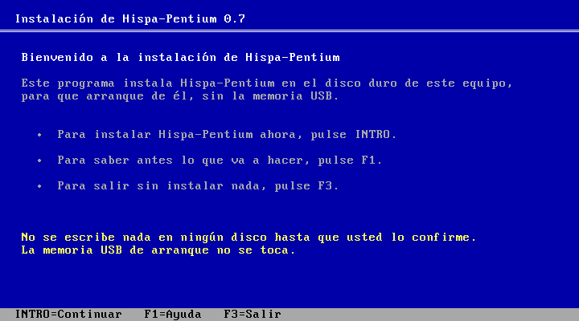

### El programa INSTALAR

`uinstala.cas` (`INSTALAR.BIN`): **un programa del anillo 3**, en Castel, como el
intérprete de órdenes. Se arranca con la última entrada del menú de la memoria
USB, **«Instalar Hispa-Pentium 0.7 en el disco duro»**: el núcleo en modo texto
con `instalar unidad=M` en su línea, que lo lanza él. La pantalla es la de las
instalaciones de siempre: fondo azul, el título arriba y, abajo, las teclas
(**INTRO** sigue, **F1** ayuda, **F3** sale). Los pasos:

1. **La bienvenida.** No se escribe nada en ningún disco hasta la última
   confirmación: con F3 se sale (lo pregunta) y el equipo se reinicia.
2. **Elegir el disco.** La lista de los **discos de dentro** del PC (IDE y
   SATA), cada uno con su tamaño, sus particiones (su clase —NTFS, FAT32,
   Linux, extendida, EFI...— y su tamaño; las de una tabla GPT también) y su
   **espacio sin usar**. Las **memorias USB** salen debajo, con un «no se toca»:
   **no se ofrecen nunca** (y el núcleo, además, no deja: más abajo).

   
3. **Dónde.** Según lo que tenga el disco:
   - **en blanco** (su primer sector, a cero): se usa entero, sin más preguntas
     que la confirmación del final;
   - con particiones y **espacio sin usar** (64 MB o más, sin partición, y un
     sitio libre en la tabla): se ofrece **instalar ahí**, en una partición
     nueva, **sin tocar lo que hay**;
   - siempre, **borrar el disco entero**: pide **dos confirmaciones**, en dos
     pantallas con el recuadro en rojo y el disco dicho por su nombre: una
     **S** y, después, **escribir la palabra BORRAR**. Con cualquier otra cosa
     se vuelve atrás sin haber tocado nada.

   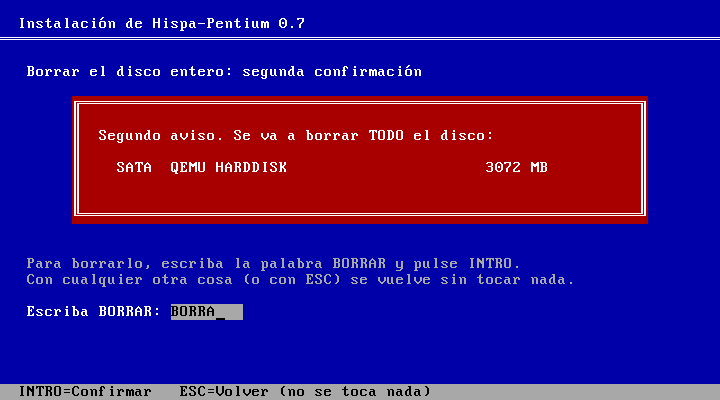
4. **«Todo listo para instalar»**: el disco, la partición que se va a hacer, lo
   que se copia y cómo queda el arranque. Al pulsar INTRO se empieza a escribir.
5. **Instalar**, con su barra:
   - **la partición**, en la tabla del **MBR** (de la clase 0C, FAT32, a megas
     enteros, la activa; hasta **32 GB**: una FAT32 mayor tarda mucho en
     repasarse con este núcleo, y lo que sobra queda sin usar);
   - **el formato FAT32, escrito desde cero**: el sector de arranque (con su
     copia), el sector de información, las dos FAT y la raíz; clusters de 512
     octetos hasta 260 MB, de 4 K hasta 8 GB, de 8 K hasta 16 y de 16 K de ahí
     arriba;
   - **el sistema, a `C:\HISPA`**: el núcleo (`NUCLEO.BIN`), los programas, el
     asistente, los textos (`LEEME.TXT`, también en la raíz, y `MANUAL.TXT`),
     el menú de arranque (`GRUB.CFG`) y `MBR.ANT`, el primer sector que tenía
     el disco, por si acaso. Los archivos van seguidos, uno detrás de otro;
   - **el arranque**: lo último, para que si algo falla antes el disco siga
     arrancando como arrancaba.

   
6. **El final**: quitar la memoria USB e INTRO para reiniciar.

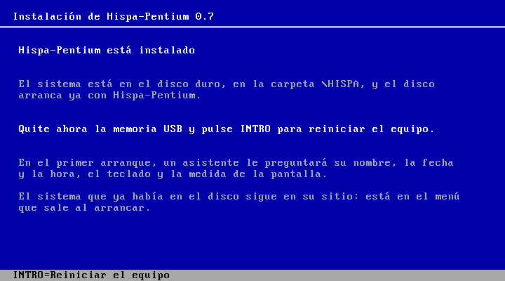

**De dónde sale lo que se instala.** De la raíz de la unidad del sistema, que
con esa entrada es **M:**: GRUB trae como módulos todo lo que hay que instalar
(`NUCLEO.BIN` —la copia del núcleo que pide 800 x 600—, los programas,
`ASISTE.BIN`, los textos, `BOOT.IMG` y `CORE.IMG`). Así se puede instalar
aunque el USB de ese equipo no se deje leer por el núcleo, y **la memoria USB no
hace falta ni leerla**. (En la memoria, lo que solo vale para instalar —los textos
del sistema instalado, `BOOT.IMG`, `CORE.IMG` y `CARPETAS.TXT`— está en su
carpeta `\INSTALA`.)

**Lo que no va a `\HISPA`.** Todo va a `C:\HISPA`, menos lo que diga
**`CARPETAS.TXT`**, si viene entre los módulos: cada línea suya,
`ARCHIVO.EXT=CARPETA`, manda ese archivo a esa carpeta de la raíz del disco
(hasta cuatro carpetas; él no se instala). Es para **la oficina** (sección 10):
`usb.sh` añade a la entrada de instalar `HVPRUN.BIN` (que va con los programas,
a `\HISPA`: el núcleo lo encuentra ahí) y los programas y los datos de
`\OFICINA`, con su `CARPETAS.TXT`, y quedan en **`C:\OFICINA`**, como en la
memoria USB: en el sistema instalado, el grupo «Oficina» del menú Inicio y Mi
equipo los abren igual.

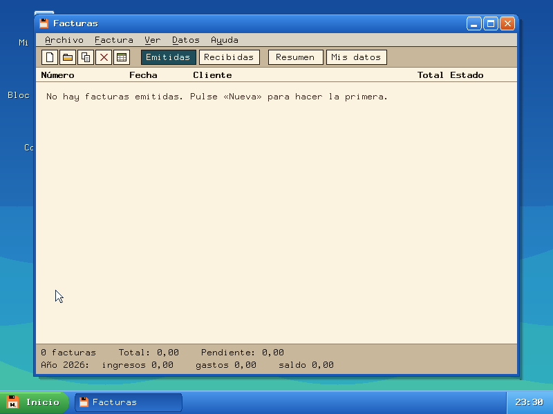

**Cómo escribe.** INSTALAR no usa los archivos del núcleo para el disco nuevo
(el núcleo monta los volúmenes al arrancar, y ese todavía no existe): escribe
**sector a sector** (las llamadas 64 y 65) su propia FAT32, que es sencilla
porque el volumen nace vacío: cada archivo ocupa clusters seguidos.

**Lo que no hace todavía.** En un disco con tabla **GPT** solo instala
borrándolo entero (lee sus particiones y las enseña, pero no añade una: el disco
queda con tabla MBR). Añadirla no bastaría: los sistemas que viven en un disco
GPT arrancan por UEFI, y Hispa-Pentium arranca por la BIOS; para convivir con
ellos hace falta antes el arranque por UEFI. No mira dentro de una partición **extendida** (la cuenta
entera como ocupada); no deja elegir el **tamaño** de la partición ni usar una
que ya exista; y en un disco **de los de antes**, cuya primera partición
empieza en el sector 63, no hay sitio delante para el arranque: lo dice, y solo
ofrece borrarlo.

### El arranque del disco

**GRUB 2**, el mismo cargador de la memoria USB, por dos razones: es lo que ya
arranca este núcleo en los PC de verdad (multiboot, con el modo gráfico puesto
por él: sección 11), y deja en el menú una entrada para **el sistema que ya
hubiera** en el disco. El núcleo no puede «hacer» un GRUB, así que viene hecho
con el sistema (`usb.sh`):

- **`BOOT.IMG`**: el primer sector de GRUB. Sus 440 octetos de código van al
  **MBR** (la tabla de particiones no se toca); lleva dicho que el resto está
  desde el sector 1.
- **`CORE.IMG`** (unos 160 K): el resto de GRUB, **con todos sus módulos
  dentro** (los discos por la BIOS, las tablas MBR y GPT, la FAT, multiboot, el
  vídeo por VBE, `chainloader`...), porque en el disco instalado no hay carpeta
  de módulos. Va al **hueco** de delante de la primera partición (del sector 1
  en adelante; las particiones empiezan en el 2048). Lleva dentro dos órdenes:
  buscar en los discos el archivo `/HISPA/GRUB.CFG` y seguir lo que diga. No
  lleva escrito en qué disco ni en qué partición está: vale para cualquiera.

**`C:\HISPA\GRUB.CFG`**, el menú, lo escribe INSTALAR:

| Entrada | Qué arranca |
|---|---|
| Hispa-Pentium | `NUCLEO.BIN escritorio escritura`, con la medida de pantalla de la línea `set modo=` |
| el intérprete de órdenes (modo texto) | `NUCLEO.BIN ordenes escritura`, en modo texto |
| de emergencia | `NUCLEO.BIN escritorio sindisco sinusb`, con los programas como módulos (la unidad M:) |
| el sistema que ya estaba en el disco | (si se instaló junto a otro) `chainloader +1` de su partición |

La primera línea que cuenta, **`set modo=800x600x32,800x600,auto`**, es la medida
de la pantalla: la cambia el asistente (o se cambia a mano). Desde el 20/11, lo
que se elige en Configuración (`\HISPA\PANTALLA.ENV`) va por delante: la
primera vez que se guarda una medida, el escritorio le añade a `GRUB.CFG` lo que
la lee (sección 10, «La medida de la pantalla»).

**Sin GRUB**, otro camino para más adelante: un cargador propio (MBR y sector de
arranque de la partición) que lea el núcleo de la FAT32 y pida el modo a la VBE.

### El núcleo, instalado

- **La carpeta del sistema.** Un sistema instalado lleva sus programas en
  **`\HISPA`** y no en la raíz, como la memoria de arranque. La unidad del
  sistema se reconoce por `ORDENES.BIN` en la raíz **o en `\HISPA`**; y un
  programa que no está donde se pide **se busca en `\HISPA`** de la unidad del
  sistema (así el escritorio, la Consola y el intérprete lanzan lo de siempre
  sin saber dónde está, y `BLOC` vale desde cualquier carpeta).
- **`C:\HISPA\HISPA.INI`** (`ajustes.cas`): `usuario=`, `equipo=`, `teclado=`
  (`es` o `us`) y `modo=`. El núcleo lo lee al arrancar: pone el teclado y
  guarda el nombre, con el que **saluda el menú Inicio** («Hola, Carlos»).
- **Con `instalar` en la línea del cargador**, el permiso de escritura es al
  revés que con `escritura=usb`: **solo en los discos de dentro**; en las
  memorias USB no se escribe ni un sector (los dos cerrojos de la sección 7).
  Y solo entonces vale la llamada 65 (escribir sectores), en un disco de dentro
  que no lleve la unidad del sistema ni sea él mismo un medio de arranque (con
  el sistema en su raíz: la imagen de la memoria USB grabada en un disco de
  dentro): **nunca en una memoria USB**. Sin `instalar`, INSTALAR no encuentra
  ningún disco donde escribir.
- **Las llamadas nuevas** (60 a 68, sección 6): texto con color en la pantalla
  de texto y su cursor, un texto solo al puerto serie, lo que se sabe de un
  disco, leer y escribir sectores, reiniciar, poner en hora el reloj del PC y
  los ajustes.

### El asistente del primer arranque

`uasiste.cas` (`ASISTE.BIN`), una ventana del escritorio. El escritorio lo lanza
si el sistema está instalado y **no hay `HISPA.INI`**: la primera vez (o si se
cierra sin aceptar, o si se borra el archivo). Pregunta el **nombre** del
usuario y el del **equipo**, la **fecha y la hora** (las pone en el reloj del
PC, el de la CMOS), el **teclado** (español o de EE. UU.: cambia en el momento)
y la **medida de la pantalla** (800 x 600, 1024 x 600, 1024 x 768, 1280 x 800,
1366 x 768 o «la que prefiera el monitor»). Con el ratón o con el teclado: Tab
pasa de casilla en casilla, el espacio o las flechas cambian el teclado y la
pantalla, Intro acepta. Al aceptar guarda `HISPA.INI`, cambia la línea `set
modo=` de `GRUB.CFG` (la medida la pone GRUB **al arrancar**: se ve la próxima
vez) y le dice al núcleo que lea los ajustes.


### Probarlo en QEMU

```
cd castel
nucleo32/usb.sh /dev/shm/usb.img                  # la memoria USB (como root)
truncate -s 2G /dev/shm/disco.img                 # un disco SATA en blanco
qemu-system-i386 -m 64 -rtc base=localtime -device qemu-xhci,id=u \
  -drive file=/dev/shm/usb.img,format=raw,if=none,id=m -device usb-storage,bus=u.0,drive=m,bootindex=1 \
  -device ahci,id=sata -drive id=d,file=/dev/shm/disco.img,format=raw,if=none -device ide-hd,drive=d,bus=sata.0,bootindex=2
# (la última entrada del menú, INTRO tres veces, y al final INTRO para reiniciar)
qemu-system-i386 -m 64 -rtc base=localtime \
  -device ahci,id=sata -drive id=d,file=/dev/shm/disco.img,format=raw,if=none -device ide-hd,drive=d,bus=sata.0
```

### El CD (o DVD) de instalación, y VirtualBox (20/11)

**`nucleo32/cd.sh IMAGEN.ISO [CLAVE_PRIVADA]`** hace el **CD de Hispa-Pentium**:
una ISO 9660 (unos 8 MB) que arranca **por la BIOS con El Torito «sin
emulación»** (`grub-mkrescue` con solo `i386-pc`, y `xorriso`; no hace falta
ser root). La misma imagen vale **grabada en un CD o en un DVD**, en un PC de
verdad, y en **VirtualBox** o QEMU como unidad óptica; y, como es híbrida,
grabada tal cual en una memoria USB también arranca.

**Por qué no hace falta ATAPI ni ISO 9660 en el núcleo.** GRUB lee el CD por
la BIOS y **carga en la memoria** todo lo que hace falta, como módulos: el
núcleo lo ve como la **unidad M:** (en memoria, de solo lectura), la misma de
la memoria USB cuando su USB no se deja (sección 7). Así vale cualquier unidad
de CD (IDE, SATA, USB) sin un controlador más, y el núcleo no crece; y el
programa INSTALAR copia de M: al disco como siempre. (Un controlador ATAPI y
la ISO 9660 solo servirían para leer el CD *después* de arrancar: para
instalar, no hacen falta.) Lo común con la memoria USB (compilar todo, el
núcleo y sus copias que piden el modo, los programas, ACPI, la oficina, los
textos, `BOOT.IMG`/`CORE.IMG`, los paquetes del sistema y las listas de
módulos) está en **`nucleo32/sistema.sh`**, que leen `usb.sh`, `cd.sh` y
`actualiza.sh`.

El menú de GRUB del CD (10 s):

| Entrada | Qué arranca |
|---|---|
| **Arrancar Hispa-Pentium 0.8 sin instalar** (la de por omisión) | `ESCRIT8.BIN escritorio unidad=M`, con los programas como módulos: el escritorio a 800 x 600; los discos se ven pero no se tocan |
| **Instalar Hispa-Pentium 0.8 en el disco duro** | `SEMILLA.BIN instalar unidad=M` con todo lo que se instala y **`MEDIO.TXT`** («CD»), que le dice a INSTALAR que es el CD: «sin el CD», «Saque ahora el CD (o el DVD)» (no lo instala) |
| sin instalar, a la medida de la pantalla | `gfxpayload=auto` |
| sin instalar, sin USB, discos, red ni ACPI | por si un equipo no arranca |
| el intérprete de órdenes (modo texto) | `SEMILLA.BIN ordenes unidad=M` |
| los modos de vídeo de la BIOS | `videoinfo` |
| arrancar del disco duro | `chainloader +1` del primer disco (si se ha dejado el CD puesto) |

En el CD van también, en `\PAQUETES`, los paquetes del sistema con su catálogo
(con `CLAVE_PRIVADA`, firmado).

**Sin UEFI**: el núcleo usa la pantalla de texto (INSTALAR) y el modo que pone
GRUB por la VBE, que con UEFI no están, y el disco instalado arranca por la
BIOS. En VirtualBox, «Habilitar EFI» tiene que estar quitado (lo está, para
«Other»).

**VirtualBox**, lo que trae de serie y cómo va:

| Pieza | En VirtualBox | Hispa-Pentium |
|---|---|---|
| el disco | SATA AHCI (ICH9) o IDE (PIIX3/PIIX4) | los dos (`ahci.cas`, `ata.cas`); el CD en AHCI (ATAPI) se ve y no se toca |
| el CD/DVD | en el mismo SATA o en el IDE secundario | GRUB lo carga para arrancar (M:); desde el 21/11 el núcleo lo lee también: es D: (`atapi.cas`, `ahcicd.cas`, sección 7) |
| la red | Intel PRO/1000 MT Desktop (82540EM, `8086:100E`) | la e1000 de `RED.BIN` (ya estaba en la lista) |
| el USB | OHCI (USB 1.1), con la tableta USB si se elige | OHCI no lo lleva: se deja quieto; teclado y ratón, por PS/2 (el ratón «PS/2» de VirtualBox) |
| la gráfica | VMSVGA o VBoxVGA, con VBE | el modo lo pone GRUB por la VBE; desde Configuración se cambia **en marcha** (las dos llevan la VBE de Bochs: sección 10) |
| ACPI | sí | `ACPI.BIN`: apagar de verdad |

**Probado en QEMU imitando a VirtualBox** (parte 15 de las pruebas): `-machine
pc` con el disco IDE, `-device pci-ohci` con una `usb-tablet` y la e1000
(`-nic user,model=e1000`): arranca sin instalar, con la red; instala en el disco
IDE y el disco arranca solo. `-machine q35` (ICH9: el disco y el CD en AHCI):
instala en el disco SATA y arranca. El LEEME de la carpeta del CD cuenta paso a
paso cómo hacer la máquina en VirtualBox.

```
castel/nucleo32/cd.sh /tmp/cd.iso
truncate -s 2G /tmp/d.img
qemu-system-i386 -machine q35 -m 256 -nic user,model=e1000 -cdrom /tmp/cd.iso \
  -drive file=/tmp/d.img,format=raw,if=none,id=d -device ide-hd,drive=d,bus=ide.0 -boot d
```

## 13. Los paquetes y las actualizaciones

Desde la **0.8** (20/11/2026), lo instalado en el disco se puede **poner al día,
añadir y quitar** sin volver a instalar el sistema: por **paquetes** (archivos
`.HPQ`), que maneja el programa **PAQUETES** (`upaquete.cas`, `PAQUETES.BIN`,
del anillo 3, en Castel) y que se hacen en el VPS con **`tools/hpq.py`**. Los
paquetes se traen de una carpeta (la de la memoria USB, la de otro disco...) o,
desde la tarde del 20/11, **de Internet**, con el catálogo **firmado**
(Ed25519): más abajo, «Por Internet», «La firma» y «El núcleo nuevo».

### La 0.8.1: la primera actualización de verdad

*20/11/2026, por la noche.* Lo que cambia desde el CD 0.8 llega por el
actualizador como **0.8.1**: solo suben los paquetes cuyo contenido ha cambiado
(comparados archivo a archivo con los del CD): **`base`** (el núcleo con la
llamada 99 del servicio TLS, cambiar la resolución desde Configuración, los
accesos de los paquetes en el menú Inicio y Mayús+Tab; y su MANUAL.TXT),
**`red`** (IPCONFIG, PING y DESCARGAR, que ya sabe `https://`) y el nuevo
**`tls`** (`TLS.BIN` y `HTTPS.BIN`, sección 14). Los demás siguen en la 0.8
(`VERSION_08` en `tools/hpq.py`). `tls` y `red` necesitan `base >= 0.8.1`; el
programa **ClicGest** (paquete `clicgest`, de su propio repositorio) necesita
`base`, `red` y `tls` 0.8.1. El núcleo sigue diciendo «versión 0.8» (los textos
de VER y del menú Inicio no cambian: lo que se instala lo dicen los paquetes).

Probado a mano en QEMU (un «q35» como el VirtualBox de Carlos): el sistema
instalado del CD 0.8 (el mismo `.iso`), con el catálogo firmado de verdad en un
servidor de aquí, avisa «Hay 2 actualizaciones», las pone, reinicia con el
núcleo nuevo («El núcleo nuevo ha arrancado bien»; el de antes, en
`NUCLEO.ANT`), instala `clicgest` (y con él `tls`) desde «Programas y
actualizaciones», ClicGest sale en el menú Inicio y, al entrar con una cuenta
que no existe, habla TLS 1.2 con clicgest.es (la cadena comprobada) y dice «El
correo o la contraseña no son correctos» (el 401 de su API).

### El paquete (.HPQ)

Un archivo con dos partes: **una cabecera de texto** (página 437, líneas con CR
LF) y, detrás, **los archivos tal cual**, uno detrás de otro, en el orden de la
cabecera:

```
HPQ 1
nombre=oficina
version=1.0
descripcion=La oficina de Hispa-386: Facturas, Pluma, Cuentas y Mirador
necesita=hvprun >= 0.7
choca=
archivo=\OFICINA\FACTURAS.HVP 172610 4c1d...e9 (su SHA-256, en 64 cifras)
archivo=\OFICINA\PLUMA.HVP 128402 90ab...17
...
fin
```

- **`nombre`**: hasta 8 letras (`a-z`, cifras, `-`, `_`): es también el nombre de
  su registro (`OFICINA.PQI`). **`version`**: números con puntos, que se comparan
  número a número (la 0.10 es más nueva que la 0.9).
- **`necesita`** (las **dependencias**) y **`choca`** (los **conflictos**): una
  lista separada por comas, cada uno con su versión si hace falta: `base >= 0.7,
  nucleo >= 0.8, hvprun` (con `>=`, `<=`, `=`, `>` y `<`; sin nada, cualquier
  versión). **`nucleo`** es el núcleo **que está en marcha** (su versión la da la
  llamada 15): un programa que use llamadas nuevas lo pide así.
- **`archivo`**: adónde va (una ruta entera de la unidad del sistema, en 8+3:
  `\HISPA\BLOC.BIN`, `\OFICINA\PLUMA.HVP`; no en `\HISPA\PAQUETES`, que es la base
  de lo instalado), lo que mide y su **SHA-256**.
- Lo que PAQUETES no conoce lo deja pasar: así caben cosas nuevas sin cambiar de
  formato. Lo que se firma es el **catálogo**, que lleva el SHA-256 de cada
  paquete entero (más abajo, «La firma»): el paquete no lleva firma propia.

El **SHA-256** está escrito en Castel (`nucleo32/sha256.cas`, el módulo `Sha256`:
`empezar`, `añadir` y `acabar`, de FIPS 180-4), para los programas del anillo 3.

### El catálogo (CATALOGO.TXT)

Al lado de los paquetes, uno por línea (puede haber varias versiones del mismo):

```
HPQ-CATALOGO 1
paquete=oficina 1.0 OFICINA.HPQ 798859 0d4f...a2 La oficina de Hispa-386: ...
```

El nombre, la versión, el archivo, **lo que mide y el SHA-256 del paquete
entero** (cabecera incluida) y la descripción. Un paquete que se trae por el
catálogo tiene que medir eso y dar esa suma, además de las de sus archivos.

### Lo instalado: C:\HISPA\PAQUETES

Un **registro por paquete**, `NOMBRE.PQI`: **la cabecera de su paquete, tal
cual** (qué es, qué versión, qué necesita, qué archivos dejó y sus sumas). Con eso
se actualiza (lo que la versión nueva ya no trae se quita), se quita limpiamente
y se comprueba. Además, si hacen falta: `DIARIO.TXT` y `HECHO.TXT` (una
instalación a medias, abajo), `ORIGEN.TXT` (de dónde traer los paquetes, si no se
quiere que lo busque) y `BAJADAS` (lo traído de Internet).

**INSTALAR deja apuntado lo que instala**: `usb.sh` hace con `hpq.py` los
paquetes del sistema y sus registros, que van con lo que se instala (en la
memoria, en `\INSTALA\PAQUETES`), y `CARPETAS.TXT` los manda a
`HISPA\PAQUETES` (desde la 0.8, `CARPETAS.TXT` admite también una carpeta
**dentro de `\HISPA`**: `ARCHIVO.EXT=HISPA\CARPETA`). Así, en un sistema recién
instalado, `PAQUETES LISTA` ya dice los ocho paquetes del sistema y `PAQUETES
COMPRUEBA` los encuentra iguales.

### El programa PAQUETES

En el intérprete de órdenes (o en la Consola del escritorio):

| Orden | Qué hace |
|---|---|
| `PAQUETES LISTA` | lo instalado: nombre, versión y descripción |
| `PAQUETES CATALOGO` | lo que hay para instalar (la versión más nueva de cada uno), y si está instalado o hay una más nueva |
| `PAQUETES INSTALA nombre...` | lo instala del catálogo (la versión más nueva), **con lo que necesite, antes y en orden** |
| `PAQUETES INSTALA X:\PAQUETES\A.HPQ` | instala ese archivo (lo que necesite, del catálogo de su carpeta, si lo tiene, o del de siempre) |
| `PAQUETES ACTUALIZA [nombre...]` | pone al día todo lo instalado (o eso): lo que tenga una versión más nueva en el catálogo |
| `PAQUETES QUITA nombre...` | lo quita: sus archivos, su registro y las carpetas que se queden vacías; no, si otro lo necesita |
| `PAQUETES MIRA A.HPQ` | lo que lleva un paquete, y si está sano |
| `PAQUETES COMPRUEBA` | si los archivos instalados siguen como se instalaron (su SHA-256) |
| `PAQUETES ESTADO` | lo instalado y lo del catálogo, una línea por paquete, para otro programa (la ventana) |
| `/DESDE=carpeta` o `/DESDE=http://...` | de dónde traer los paquetes |
| `/FORZAR` | quitar aunque otro lo necesite; poner una versión igual o más vieja que la instalada |

**De dónde.** Lo que diga `/DESDE=`; si no, la primera línea de
`C:\HISPA\PAQUETES\ORIGEN.TXT`; si no, la carpeta **`\PAQUETES`** de la primera
unidad que tenga un `CATALOGO.TXT` (primero las memorias USB: la de arranque de
la 0.8 lleva todos los paquetes del sistema); y si no, Internet:
`http://actualiza.hispados.es/pentium/`.

**Antes de tocar nada**, PAQUETES hace el plan entero: lo que se pide y lo que
necesita (la versión más nueva del catálogo que cumpla, si lo instalado no
cumple; las dependencias se siguen hasta 16 niveles, y una en círculo no se
repite), y mira que **nada choque** (con lo instalado o entre sí, en los dos
sentidos) y que **ningún archivo sea de otro paquete**. Luego **comprueba las
sumas** de todos los paquetes del plan (el paquete entero contra el catálogo, y
cada archivo contra su cabecera): con una sola mala, no se instala nada y el
disco queda igual. Y también **mira que quepa**.

**O todo o nada** (cada paquete): lo que se va a hacer se apunta antes en
**`DIARIO.TXT`** (las carpetas que hay que hacer, los archivos que se ponen
—diciendo si ya estaban— y los que se quitan); los archivos nuevos se escriben
**aparte**, en la carpeta de su destino (`HPQnnnnn.NUE`), volviendo a comprobar
su suma; y solo entonces se cambian: lo de antes se **aparta** (`HPQnnnnn.VIE`) y
lo nuevo se pone en su sitio, cambiando nombres. El registro (`NOMBRE.PQI`) es el
último. Con todo cambiado, el diario pasa a **`HECHO.TXT`**: desde ahí ya no se
deshace; se borra lo apartado, las carpetas vacías, y el diario. Si algo falla a
mitad (el disco lleno, un archivo que no se deja), se deshace en el momento. Y
si **se va la luz** a mitad, la próxima vez que se use PAQUETES (cualquier orden)
ve el diario y **lo deshace**: lo apartado vuelve a su sitio, lo nuevo se borra,
y lo dice. (Si se va mientras se escribe un `.NUE`, quedan clusters sueltos que
`fsck` recoge, como con cualquier archivo a medio escribir: lo instalado sigue
entero.) Cuando hay que instalar varios paquetes, cada uno es su propio todo o
nada, en orden: si falla el tercero, los dos primeros (lo que necesitaba) quedan
instalados, y se dice.

**El gancho de la red** (cómo era; hoy lo hace `DESCARGA.BIN`, el de verdad:
«Por Internet», abajo). PAQUETES no sabe de TCP/IP: para traer de Internet el
catálogo y cada paquete, a `C:\HISPA\PAQUETES\BAJADAS`, lanza el programa
**`DESCARGA.BIN`** (la orden de descargar de la red: su nombre tiene que caber en
8+3) con dos argumentos, **`URL DESTINO`**, lo espera, y vale si acaba con el
código 0 y el archivo está. Si no está, lo dice («hace falta la red»). Si la red
diera la descarga como **llamada al sistema** en vez de como programa, basta con
poner su número en `LLAMADA_DESCARGAR` (`upaquete.cas`): se llama con EBX = la
URL y ECX = el archivo de destino, y un error es lo de siempre. Lo traído se
comprueba igual (el SHA-256 del catálogo y los de los archivos). Las pruebas lo
ejercitan con un `DESCARGA` de mentira que copia de la memoria USB.

### La ventana: «Programas y actualizaciones»

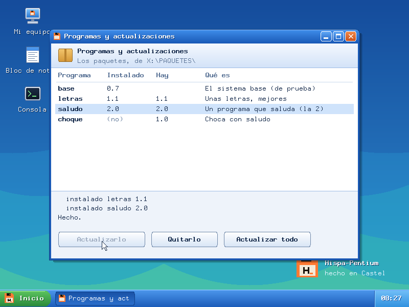

En el menú Inicio, **«Actualizar»** (encima de Configuración) abre
`ACTUALIZ.BIN` (`uactual.cas`): la lista de lo instalado y de lo que hay en el
catálogo, con la versión instalada, la que hay (en verde si es más nueva) y lo
que es; y tres botones: **Instalarlo** (o **Actualizarlo**, si ya está y hay una
más nueva), **Quitarlo** y **Actualizar todo**. Con el teclado: las flechas
eligen, Intro instala, Supr quita, F5 vuelve a mirar. La ventana no sabe de
paquetes: lanza PAQUETES (`PAQUETES ESTADO`, una línea por paquete fácil de
leer: `p|nombre|instalada|la del catálogo|descripción`; `PAQUETES INSTALA
nombre`...) con lo que escribe mandado a un archivo (`VENTANA.TXT`, en la base,
que luego borra), y enseña abajo las últimas líneas de lo que ha dicho: las
dependencias, las sumas y el todo o nada son los de PAQUETES.

**El intérprete encuentra lo instalado**: en un sistema instalado, el `PATH` de
fábrica de ORDENES lleva además `C:\HISPA` (`C:\;C:\HISPA`), así que un programa
que trae un paquete se lanza por su nombre desde cualquier carpeta.

### tools/hpq.py

```
python3 tools/hpq.py crea SALIDA.HPQ --nombre bloc --version 0.8 --descripcion "El Bloc de notas" \
        --necesita "base >= 0.7" BLOC.BIN='\HISPA\BLOC.BIN'
python3 tools/hpq.py catalogo CARPETA        # CATALOGO.TXT con los .HPQ de la carpeta
python3 tools/hpq.py mira A.HPQ              # lo que lleva, y sus sumas
python3 tools/hpq.py registro A.HPQ A.PQI    # su registro (la cabecera)
python3 tools/hpq.py sistema SALIDA CARPETA...   # los paquetes del sistema (lo usa usb.sh)
```

**Los paquetes del sistema** (`hpq.py sistema`, de lo mismo que se instala):

| Paquete | Versión | Lleva | Necesita |
|---|---|---|---|
| `base` | 0.8.3 | `NUCLEO.BIN`, `ORDENES.BIN`, `ASISTE.BIN`, `INSTALAR.BIN`, `LEEME.TXT` (en `\HISPA` y en la raíz), `MANUAL.TXT`, `BOOT.IMG`, `CORE.IMG` | — |
| `bloc` | 0.7 | `BLOC.BIN` | base >= 0.7 |
| `consola` | 0.7 | `CONSOLA.BIN` | base >= 0.7 |
| `equipo` | 0.8.3 | `EQUIPO.BIN` (Mi equipo) y `DISPOSIT.BIN` (el Administrador de dispositivos) | base >= 0.8.3 |
| `ejemplos` | 0.8.2 | `HOLA.BIN`, `ECO.BIN`, `PRUEBA.BIN`, `BUCLE.BIN`, `MUESTRA.BIN` (los controles de las ventanas) | base >= 0.8.2 |
| `paquetes` | 1.0 | `PAQUETES.BIN`, `ACTUALIZ.BIN` (su ventana) | base >= 0.7, nucleo >= 0.7 |
| `hvprun` | 0.7 | `HVPRUN.BIN` | base >= 0.7 |
| `oficina` | 1.0 | `\OFICINA\`: `FACTURAS.HVP`, `PLUMA.HVP`, `CUENTAS.HVP`, `MIRADOR.HVP`, `TIPOS.DAT`, `DICCIO.DAT` | hvprun >= 0.7 |

Y uno que no va con el sistema (`hpq.py opcionales`, la lista `OPCIONALES`: se
instala desde «Programas y actualizaciones»): `navega` 0.1, **el Navegador**
(`\HISPA\NAVEGA\...` y su acceso en `\HISPA\MENU`; necesita base >= 0.8.3,
red y tls: sección 14 ter).

(`GRUB.CFG`, `HISPA.INI` y `MBR.ANT` no son de ningún paquete: son de este equipo.)
Para publicar una actualización: hacer el paquete con su versión nueva, ponerlo
con los demás, `hpq.py catalogo` y subir la carpeta (a la memoria USB o, cuando
haya red, a `actualiza.hispados.es/pentium/`).

### Por Internet (la tarde del 20/11)

**El servidor.** `http://actualiza.hispados.es/pentium/` (el VPS sirve
`/www/hispados` con ese nombre; la carpeta `pentium` va al lado de los `.paq` de
Hispa-DOS): los `.HPQ`, su `CATALOGO.TXT` y la firma, `CATALOGO.FIR`. Lo hace
**`nucleo32/actualiza.sh CARPETA CLAVE_PRIVADA`** (los mismos paquetes que van
en la memoria USB y en el CD, hechos de lo que se instala, y el catálogo
firmado; al acabar comprueba la firma con la clave pública del sistema). Para
publicar una versión nueva: subir su número en `tools/hpq.py` (`SISTEMA`), hacer
`actualiza.sh` otra vez y copiar **la carpeta entera** (los paquetes y el
catálogo van juntos: si no, las sumas no cuadran y no se instala).

**De dónde.** Igual que antes (`/DESDE=`, `ORIGEN.TXT`, la carpeta `\PAQUETES` de
una unidad con catálogo, primero las memorias USB) y, si no, Internet. Lo trae
**`DESCARGA.BIN`** (la orden DESCARGAR de la sección 14) a
`C:\HISPA\PAQUETES\BAJADAS`: el catálogo, su firma y cada paquete, cada vez
(«Buscar novedades» es eso: traer el catálogo otra vez).

### La firma

Todo va por **HTTP sin cifrar**, así que cualquiera en el camino podría
cambiar lo que llega. Por eso el catálogo va **firmado con Ed25519** (RFC 8032):
el catálogo lleva el tamaño y el SHA-256 de cada paquete, y cada paquete los de
sus archivos, así que con firmar el catálogo queda atado todo.

- **`CATALOGO.FIR`**, al lado del catálogo: una línea, `ed25519 ` y las 128
  cifras hexadecimales de la firma de `CATALOGO.TXT` tal cual (octeto a octeto).
- **La clave pública va dentro del sistema**: `nucleo32/clave.cas` (el módulo
  `Clave`: sus 32 octetos y su huella, las 16 primeras cifras, que PAQUETES
  dice al comprobar). **La privada no está en el repositorio**: en el VPS, en
  `/root/.claude/Secretos/hispa-pentium-firma.key` (permisos 600). Sin ella no
  se puede publicar nada que un Hispa-Pentium acepte de Internet.
- **Comprobarla**: `nucleo32/firma.cas` (el módulo `Firma`, en Castel: unas 600
  líneas, de dominio público el camino —el de TweetNaCl— y GPL lo escrito). Lleva
  su **SHA-512** (los números de 64 bits hechos de dos de 32) y las cuentas de la
  curva con los números módulo 2^255 − 19 en **32 trozos de 8 bits**, cada uno en
  un `ent32`: así ninguna cuenta pasa de 32 bits (Castel no tiene números de 64)
  y no hace falta ensamblador. Comprueba que S < 2^253 y que la clave es un punto
  de la curva. Tarda unos **0,25 s** en QEMU (24-30 tics).
- **Cuándo**: lo traído **de Internet** tiene que llevar firma, y buena: si no
  la trae («el catálogo de Internet no trae su firma») o no es buena («la firma
  del catálogo NO es buena: no se usa nada de él»), no se usa **nada** del
  catálogo. De **una carpeta**, si trae `CATALOGO.FIR` se comprueba igual (y con
  una mala, nada); sin ella se usa, como antes (la ha puesto ahí quien maneja el
  equipo). `PAQUETES ESTADO` dice `origen|...|firmado` y la ventana pone
  «(firma buena)» al lado del origen.
- **`PAQUETES FIRMA ARCHIVO`**: si `ARCHIVO.FIR` (el mismo nombre, con `.FIR`)
  es su firma buena, con la clave del sistema.
- **`tools/hpq.py`**: `clave PRIVADA` (una nueva: la privada al archivo, 600, y
  dice la pública), `publica PRIVADA [clave.cas]` (y el módulo de Castel),
  `firma CARPETA PRIVADA`, `catalogo CARPETA --clave PRIVADA` (hace el catálogo y
  lo firma) y `comprueba CARPETA PUBLICA`. Usa el módulo `cryptography` de Python.
- **Cambiar de clave** (si la privada se perdiera o se supiera): una nueva con
  `hpq.py clave`, `hpq.py publica ... clave.cas`, y sacar un `paquetes` nuevo
  firmado aún con la vieja (que lleva ya la clave nueva); luego, todo con la
  nueva.

### El núcleo nuevo, y volver al de antes

Cuando un paquete cambia **`\HISPA\NUCLEO.BIN`** (el `base`):

1. El de antes **no se borra**: queda en **`\HISPA\NUCLEO.ANT`** (el de justo
   antes de la última actualización).
2. PAQUETES escribe **`\HISPA\GRUBENV`** (el «bloque de entorno» de GRUB: 1.024
   octetos, texto y `#` hasta el final) con **`nuevo=1`**, y, si `GRUB.CFG` aún
   no la tiene, le añade al final la entrada **«Hispa-Pentium con el núcleo de
   antes»** (`--id anterior`, `NUCLEO.ANT`) y unas líneas que leen y escriben
   `GRUBENV` (`load_env`, `save_env`: el `CORE.IMG` de la 0.8 lleva `loadenv`):

   | `nuevo=` | Qué hace GRUB al arrancar |
   |---|---|
   | 1 | lo pasa a **2** y arranca el núcleo nuevo, como siempre |
   | 2 | (el nuevo no llegó a decir que arrancó) lo pasa a **3** y arranca **el de antes** |
   | 3 o 4 | sigue arrancando el de antes |
   | 0 | lo de siempre |

3. PAQUETES dice `reiniciar|...` y la ventana ofrece **«Reiniciar ahora»** o
   **«Más tarde»** (la llamada 66, que vacía los discos antes).
4. Al arrancar el escritorio de un sistema instalado, **`ACTUALIZ /BANDEJA`**
   mira `GRUBENV`: con `nuevo=2`, el núcleo nuevo ha arrancado: lo pone a **0** y
   lo dice («El núcleo nuevo ha arrancado bien»); con `nuevo=3`, GRUB ha vuelto
   al de antes: lo pone a **4** (para decirlo una sola vez) y lo dice («El nuevo
   no llegó a arrancar: se usa el de antes»).

Así, un núcleo nuevo que se cuelga, o que reinicia, o que no llega al
escritorio: **al reiniciar (aunque sea a mano), GRUB arranca solo el de antes**.
Probado en QEMU con un núcleo que se queda en `hlt` (parte 15 de las pruebas).
Se sigue con el de antes hasta que se instale otro núcleo (`PAQUETES INSTALA
... /FORZAR`, o uno más nuevo). En un disco instalado con la 0.7 (su `CORE.IMG`
sin `loadenv`), GRUB dice que no conoce `load_env` y sigue: la entrada del de
antes está igual en el menú, pero hay que elegirla a mano.

### El aviso de la bandeja

Al arrancar el escritorio de un sistema instalado (con `HISPA.INI`: no en el
primer arranque, que es el del asistente), el núcleo lanza, si está,
**`\HISPA\ACTUALIZ.BIN /BANDEJA`** (lo único nuevo en el núcleo: tres líneas
en `escritorio.cas`). Sin molestar: lo de `GRUBENV` (arriba); luego espera a
la red (hasta 90 s; sin red, se acaba sin decir nada), hace `PAQUETES ESTADO`
a su archivo (`BANDEJA.TXT`) y, **solo si hay algo más nuevo** que lo
instalado (o algo que contar del núcleo), saca una **ventanita abajo a la
derecha, encima de la bandeja**: «Hay N actualizaciones», con **«Verlas»** (abre
la ventana) y **«Ahora no»**; se va sola a los 45 s. (Un icono propio en la
bandeja, como el de la red, pediría más núcleo: la ventanita es un programa
del anillo 3.)

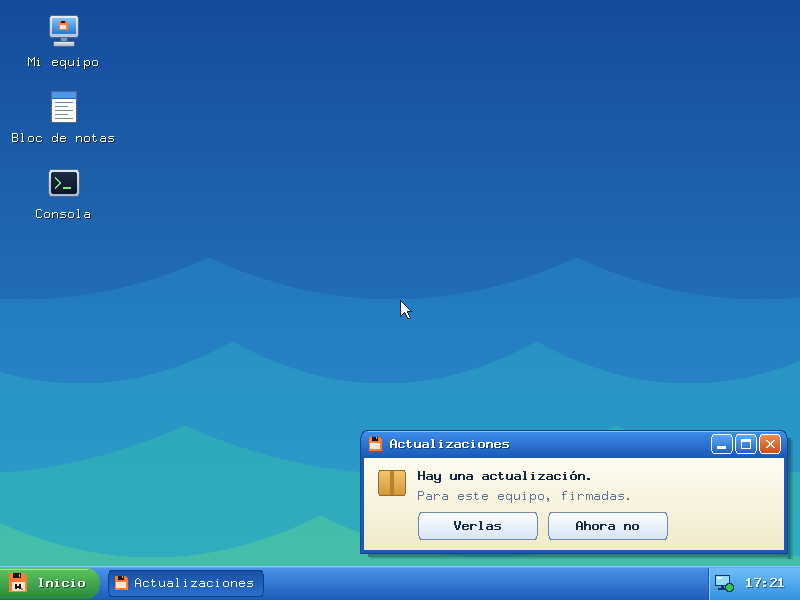

### La ventana, con su barra

«Programas y actualizaciones» lanza PAQUETES **sin quedarse parada**
(`acabada`, cada 15 tics) y con **`/AVANCE`**: PAQUETES escribe en
`C:\HISPA\PAQUETES\AVANCE.TXT` una línea `hecho total texto` («Comprobando
la firma del catálogo», «Bajando BASE.HPQ», «Comprobando base», «Instalando
base»), y `DESCARGA /AVANCE=archivo` la pone al día cada 16 K mientras baja un
paquete (con lo que dice `Content-Length`): la ventana la lee y pinta la
**barra** (sin total, una franja que corre). Botones: **Instalarlo**
(o Actualizarlo), **Quitarlo**, **Actualizar todo** y **Buscar novedades**
(F5). Abajo, lo que dice PAQUETES (sin lo que dice DESCARGA de cada archivo).
**A la medida de la ventana**: al cambiarla de tamaño o maximizarla, la lista,
los mensajes, la barra y los botones se recolocan a su ancho y su alto (la
lista enseña más renglones), y lo que no cabe se corta con «...» (antes, con
la ventana maximizada, las descripciones y los mensajes se salían de su
recuadro: lo vio Carlos con la red de verdad, 20/11). Si el servidor aún no
tiene nada publicado (el catálogo da 404: `DESCARGA` acaba entonces con el
código 4), PAQUETES lo dice en llano: «Todavía no hay actualizaciones
publicadas en el servidor.»


**Lo que falta**: HTTPS (sección 14); buscar novedades cada cierto tiempo (hoy,
al arrancar y al pulsar); que la ventana deje elegir el origen; las
diferencias (hoy se baja el paquete entero); y una firma por paquete, para
los que se instalan sueltos de una carpeta.

## 14. La red por cable (la 0.8)

*20/11/2026.* La base para que un Hispa-Pentium instalado (el HP Mini 5103 de
Carlos, el primero) sea un equipo útil: **la red por cable**. Con el cable
enchufado, el sistema pide la IP solo (DHCP), el icono de la bandeja se pone
verde y, en la Consola, `IPCONFIG`, `PING` y `DESCARGAR http://...`.

### Cómo está repartida: un servicio del anillo 3

La red de verdad **no está en el núcleo**: es un programa del anillo 3, el
**servicio de red** (`RED.BIN`, `ured.cas`), con los controladores de las
tarjetas y la pila TCP/IP enteros, escritos en Castel. Así el núcleo apenas
crece (un módulo de 500 líneas, `red.cas`, y nueve llamadas; CASTEL, el
compilador escrito en Castel, está cerca de los límites de sus tablas con el
núcleo) y un fallo de la red acaba con el servicio, no con el sistema.

```
  PING, IPCONFIG, DESCARGAR...  (redes.cas)
        │  llamada 90: un pedido (cabecera de 8 palabras + hasta 8 K)
        ▼
  el núcleo (red.cas): cartero; espera la respuesta
        │  llamadas 92 (el pedido siguiente) y 93 (contestar)
        ▼
  RED.BIN, el servicio de red (anillo 3, con IOPL 3)
     ured.cas    el bucle: la tarjeta, el tiempo, los pedidos
     rtcp.cas    TCP
     rpila.cas   Ethernet, ARP, IPv4, ICMP, UDP, DHCP, DNS
     rtarjeta.cas  las tarjetas (e1000, RTL8139) y lo común
     ryukon.cas  la Marvell Yukon 88E8059 (HP Mini 5103)
     rbase.cas   puertos, PCI, el registro, orden de red, sumas
        │  puertos de E/S (IOPL 3), registros (llamada 95), DMA (94), IRQ (98)
        ▼
  la tarjeta de red
```

**Lo que pone el núcleo** (`red.cas`, módulo `Red`; las llamadas, de la 90 a la
98: otra sesión usa de la 110 en adelante):

| EAX | Quién | Qué | Devuelve |
|---|---|---|---|
| 90 | un programa | **pedir a la red**: EBX, la cabecera (ocho palabras: la orden, sus datos y, en la octava, cuántos octetos van; la respuesta se escribe encima); ECX, los octetos (los que van y donde se dejan los que vuelven); EDX, cuántos caben. El programa espera (bloqueado) hasta que el servicio conteste. Si no hay servicio, el núcleo lo pone en marcha (una vez) y vuelve a pedir | la primera palabra de la respuesta (`SIN_RED` si no hay servicio) |
| 91 | el servicio | **apuntarse como servicio de red** (solo uno, y solo un programa que se llame `RED.BIN`): el núcleo le pone **IOPL 3** en las banderas que repondrá `iretd` (los puertos de E/S, y `cli`/`sti` para el bus PCI) | 0, o `EN_USO` |
| 92 | el servicio | **el pedido siguiente**, a EBX (`Pedido_red`: el hueco, su número de serie, la tarea, cuánto cabe en la respuesta, cuántos octetos trae, la cabecera; detrás, los octetos: caben 64 + 8.192); con ECX tics de espera si no hay ninguno (dormido; un pedido nuevo o la interrupción de la tarjeta lo despiertan antes). También los **avisos**: una tarea que había usado la red ha acabado (la orden `0xFFFF`) | 1, o 0 si no hay |
| 93 | el servicio | **contestar** al hueco EBX con la `Respuesta_red` de ECX (la serie, dónde están los octetos y la cabecera). Si el programa ya no espera (Ctrl+C), la serie no cuadra y se tira | 0 |
| 94 | el servicio | **EBX páginas seguidas de memoria física** (hasta 16, a cero, desde los 16 MB: `reservar_seguidos` de `marcos.cas`) a su vista, en `0xA0000000` y siguientes; su dirección física, a ECX | dónde se ven |
| 95 | el servicio | **los registros de un aparato** (de la dirección física EBX, ECX octetos; solo por encima de la memoria de verdad) a su vista, sin caché | dónde se ven |
| 96 | el servicio | **cómo está la red** (EBX: `RED_SIN_TARJETA`, `RED_SIN_CABLE`, `RED_BUSCANDO`, `RED_CONECTADA`), su IP (ECX) y el aparato PCI que hace DMA (EDX) | 0 |
| 97 | cualquiera | cómo está la red (lo que dijo el servicio con la 96) y, a EBX, la IP | `RED_...` (`RED_NADA`: no hay servicio) |
| 98 | el servicio | **la interrupción de su tarjeta** (EBX: 3, 5, 7, 9, 10 u 11; 0: ninguna): cuando llega, el núcleo **tapa esa línea** en el 8259, despierta al servicio y la destapa en su siguiente llamada 92 (el servicio ya ha visto la causa en la tarjeta) | 0 |
| 99 | un programa | **pedir al servicio TLS** (`TLS.BIN`): como la 90, pero el pedido va al servicio de las conexiones cifradas (más abajo, «HTTPS: el servicio TLS»). Si no está en marcha, el núcleo lo pone (una vez) | la primera palabra de la respuesta (`SIN_TLS`, `0xFFFFFFE3`, si no hay servicio) |

Si el servicio se acaba (o lo acaban), el núcleo **apaga el DMA de su tarjeta**
(el bit 2 de la orden PCI) antes de que su memoria vuelva a los marcos libres,
quita los registros de su vista, tapa su interrupción y contesta `SIN_RED` a
los que esperaban.

**Cuándo se pone en marcha el servicio**: al arrancar el escritorio, si hay una
tarjeta de red PCI (clase 02h: por el icono de la bandeja); con `conred` en la
línea del cargador, siempre; y, si no, la primera vez que un programa pide algo
a la red. Con **`sinred`** no se pone nunca (el arranque de emergencia de la
memoria USB y del disco instalado lo lleva). El núcleo lo carga de la unidad
del sistema (`\RED.BIN`, o `\HISPA\RED.BIN` en un sistema instalado), sin
terminal ni archivo de salida: no escribe en la pantalla; lo que pasa lo
**apunta** (6.000 octetos en su memoria, que `IPCONFIG /TODO` enseña) y lo
manda por el puerto serie (`red: ...`, lo que leen las pruebas). Si dice que
no hay tarjeta, sigue en marcha para contestarlo (y no se relanza).

### Las tarjetas

| Tarjeta | PCI | Cómo |
|---|---|---|
| Intel PRO/1000 (la familia 8254x, «e1000»: la 82540EM de QEMU y VirtualBox; y la 82574L) | `8086:100E` y otras 30 | registros en memoria (BAR0, 128 K); 32 descriptores de recepción con búferes de 2 K y 8 de envío; la MAC de `RAL`/`RAH` (o de la EEPROM). **Probada en QEMU.** |
| Realtek RTL8139 (y la D-Link DFE-538TX) | `10EC:8139`, `1186:1300` | por los puertos; anillo de recepción de 8 K (con WRAP) y cuatro búferes de envío. **Probada en QEMU.** |
| Marvell Yukon 2 «Optima» 88E8059 (la del HP Mini 5103; y la 88E8079) | `11AB:4381`, `11AB:4382` | pasada de la de Hispa-DOS (`drivers/hspred.asm`, docs/RED.md «Marvell Yukon 88E8059»): el mismo orden de registros y los mismos valores, por memoria; tres anillos (estado, recepción, envío) en páginas propias. **Sin probar en el equipo**: QEMU no la emula (y la de Hispa-DOS tampoco se ha probado aún allí). Cada paso de su puesta en marcha se apunta. |

Antes de nada, la tarjeta pasa a **D0** (el estado de energía de trabajar) por
su capacidad PCI de gestión de energía, por si otro sistema la dejó dormida
al reiniciar. El enlace se mira cada cuarto de segundo: al llegar, se pide la
IP; al irse, lo pendiente acaba con `SIN_CABLE`. La Yukon no espera a la
autonegociación al arrancar (tarda de 2 a 4 s): lo hace su `yk_atender`.

La pila es común: **Ethernet**; **ARP** (16 vecinos; lo que espera a que
conteste uno, en una cola de 4 tramas; se contesta a quien pregunta por
nuestra IP); **IPv4** (sin trocear: lo partido se tira; la suma de la cabecera
se comprueba); **ICMP** (se contesta a los ping; y los hace, con el tiempo en
microsegundos: los tics y lo que lleva contado el 8253); **UDP** (8 puertos
para los programas, con su cola de 8 K); **DHCP** (DISCOVER, OFFER, REQUEST,
ACK, con el nombre `hispa-pentium`; se renueva a la mitad de la concesión; si
dicen que no, otra vez); **DNS** (la pregunta A, con reintentos, siguiendo los
CNAME de la respuesta; 8 nombres sabidos durante 5 minutos); y **TCP**
(`rtcp.cas`): 8 conexiones salientes, con 16 K de lo que se envía y 32 K de lo
que llega; el MSS (1.460) en el SYN; la ventana que se anuncia es lo libre de
lo recibido y se avisa cuando se abre; lo enviado se guarda hasta que llega su
ACK y, si no llega a tiempo, se manda otra vez desde ahí, cada vez esperando el
doble (de 1 a 32 s; a los 8 intentos, cortada); con la ventana de la otra punta
cerrada, un octeto de vez en cuando para preguntar; lo desordenado se tira (se
repite el ACK); FIN en los dos sentidos, RST a lo que no es de ninguna
conexión. Sin escuchar en un puerto (de momento solo se conecta), sin
reensamblar desordenado ni retransmisión rápida.

### Los programas

Un programa usa la red con el módulo **`Redes`** (`redes.cas`): `estado_red`
(un `Info_red`: la tarjeta, la MAC, el enlace, la IP, la máscara, la puerta, el
DNS, el servidor y la concesión, las tramas), `resolver` (un nombre, o
«10.0.2.2» tal cual), `ping`, `conectar`, `enviar` (todo, aunque haya que
esperar), `recibir` (con su espera; 0 cuando la otra punta cierra),
`cerrar_conexión`, `udp_abrir`, `udp_enviar`, `udp_recibir`, `renovar`,
`registro_red`, y `ip_a_texto`/`texto_a_ip`. Si la red aún se está poniendo en
marcha (el enlace, la IP), espera hasta 10 s antes de dar el error. Los errores
(`SIN_TARJETA`, `SIN_CABLE`, `SIN_IP`, `TIEMPO`, `RECHAZADA`, `NO_RESUELVE`,
`CORTADA_RED`...) van de `0xFFFFFFE0` a `0xFFFFFFEF`, por debajo de los del
núcleo: `es_error_red` mira los dos, y `texto_error_red` los dice.

| Orden | En el disco | Qué |
|---|---|---|
| `IPCONFIG [/RENOVAR] [/TODO]` | `IPCONFIG.BIN` (`uipconf.cas`) | cómo está la red (si aún se pide la IP, espera); `/RENOVAR`, otra vez DHCP; `/TODO`, además lo apuntado por el servicio (para mandarlo si algo no va: `IPCONFIG /TODO > RED.TXT`) |
| `PING nombre [-n veces] [-l octetos] [-t]` | `PING.BIN` (`uping.cas`) | como el de siempre, con su resumen; Ctrl+C para (`-t`) y dice el resumen |
| `DESCARGAR http[s]://servidor[:puerto]/camino [archivo]` | `DESCARGA.BIN` (`udescarg.cas`) | HTTP/1.1, sin cifrar o (desde el 20/11, con `https://`) cifrado con el servicio TLS: `Content-Length`, en trozos (`chunked`) o hasta que se cierre; hasta 5 redirecciones; el archivo, con el nombre de lo último del camino en 8+3 (o el que se diga; `-`: a la pantalla); un punto cada 32 K y, al final, cuánto y en cuánto tiempo. Si el certificado no vale, no baja nada y dice por qué |
| `HTTPS [-X MÉTODO] [-d DATOS] [-H Cabecera:valor] [-i] [-o ARCHIVO] dirección...` | `HTTPS.BIN` (`uhttps.cas`) | un curl pequeño con la biblioteca `Https`: varias direcciones seguidas, por la misma conexión y con las galletas; `HTTPS /ESTADO` (la fecha que usa el servicio TLS, las autoridades) y `HTTPS /TODO` (lo que ha apuntado) |

El intérprete de órdenes, con un nombre de más de ocho letras que no
encuentra, prueba con las ocho primeras (como el DOS): `DESCARGAR` es
`DESCARGA.BIN`.

**El icono de la red** está en la bandeja, a la izquierda del reloj, mientras
haya servicio: una pantallita con una luz verde (conectada), ámbar (pidiendo
la IP), roja (sin cable) o gris (sin tarjeta). Con un clic, un aviso dice
cómo está y la IP. Se repinta cuando el servicio dice que algo ha cambiado (la
llamada 96 sube `cambios_red`).

### Probarlo

En QEMU, con `-netdev user` (QEMU hace de router: DHCP, la puerta `10.0.2.2`,
que es la máquina donde corre QEMU, y el DNS `10.0.2.3`, que pregunta al de
ella):

```
castel/nucleo32/disco.sh /tmp/d.img 16 red
QEMU_MAS="-nic user,model=e1000" ESCRIBE=1 DISCO=/tmp/d.img ARRANQUE=ordenes \
  castel/nucleo32/probar.sh "" ipconfig ":pausa 3" "ping 10.0.2.2" ":pausa 5"
```

(con `-netdev user,id=n0 -device rtl8139,netdev=n0`, la RTL8139). `probar.sh`
pone `-nic none` si no se le da una tarjeta: si no, QEMU pone una e1000 y el
escritorio pondría en marcha el servicio. Para descargar, un servidor HTTP en
esta máquina se ve en `10.0.2.2` (`nucleo32/servidor_prueba.py`, el de las
pruebas). En el VPS sale a internet: `ping actualiza.hispados.es` y
`descargar http://actualiza.hispados.es/ultima.txt -` también van.

### El Wi-Fi, más adelante

El Wi-Fi de Hispa-486 (`wifi/`: la gestión 802.11 y WPA2 propias, en C, y el
controlador `brcmsmac` de Linux para la Broadcom BCM43224 del HP Mini, con su
microcódigo; docs/WIFI.md) es C y son decenas de miles de líneas: no se va a
pasar a Castel. Cómo encajaría: **un segundo servicio, `WIFI.BIN`**, compilado
de esos mismos fuentes con `gcc -m32 -ffreestanding` como binario plano con la
cabecera `HPU3` (lo que hace `HVPRUN` en NASM: CASTEL32.md §8), con un `compat/`
nuevo que en vez de las llamadas del residente de Hispa-486 use las del servicio
(91 con su propio nombre, 94 para el DMA, 95 para los registros, 98 para la
interrupción). La radio da tramas 802.3 (el `nucleo/` ya traduce de 802.11),
así que la pila de `RED.BIN` no cambia: le basta **una tarjeta más**,
`T_WIFI`, cuyas `enviar_trama`/`recibir_trama` pasan las tramas entre los dos
servicios por un tubo del núcleo (dos llamadas nuevas, a partir de la 99), y
`hay_enlace` es «asociada y con la clave puesta». La red elegida y su clave,
en `\HISPA\RED.INI` (como `RED.INI` de Hispa-486); un programa `WIFI` para
buscar redes y conectarse, y el icono diría la intensidad.

### HTTPS: el servicio TLS (`TLS.BIN`)

*20/11/2026.* Para que los programas de Castel (el primero, ClicGest, que solo
va por HTTPS) hablen con un servidor de hoy: **TLS 1.2 de cliente**, con el
certificado del servidor comprobado hasta una autoridad raíz de confianza, SNI
y la fecha buena. Es lo de **HSPTLS** de Hispa-486 (`w32/tls/hsptls.c`,
docs/RED.md «HSPTLS.DLL»), pasado a este sistema: **BearSSL 0.6** (Thomas
Pornin, licencia MIT, `terceros/bearssl`: los mismos fuentes, sin cambiar
nada) compilado en C para el anillo 3, como `ACPI.BIN` con ACPICA.

**Un servicio aparte, no dentro de `RED.BIN`.** `RED.BIN` es Castel (lo compila
CASTEL32) y BearSSL es C: no se pueden enlazar juntos sin un enlazador que el
sistema no tiene. Y así un fallo del cifrado acaba con `TLS.BIN`, no con la
red, y lo que no usa HTTPS no paga sus 140 K. El precio es un salto más (el
programa → `TLS.BIN` → `RED.BIN`): nada al lado del apretón de manos.

```
  DESCARGAR, HTTPS, ClicGest...  (redes.cas: conectar_seguro, enviar, recibir...;
        │                         biblioteca32/https.cas: Https)
        │  llamada 99: un pedido, como la 90
        ▼
  el núcleo (red.cas): cartero de los dos servicios (cada hueco sabe a cuál va)
        │  llamadas 92 y 93
        ▼
  TLS.BIN, el servicio TLS (anillo 3; nucleo32/tls/: tls.c, libc.c, entrada.asm)
     BearSSL 0.6: TLS 1.2, X.509, ECDHE, ECDSA, RSA, ChaCha20-Poly1305, AES-GCM
        │  llamada 90: las conexiones TCP, como cualquier programa
        ▼
  RED.BIN, el servicio de red
```

Lo cambiado en el núcleo es poco y va marcado con «(TLS)»: en `red.cas`, cada
hueco lleva su destino (el de red o el TLS), un segundo servicio (`TLS.BIN` se
apunta con la 91, sin puertos ni DMA; coge sus pedidos con la 92 y contesta con
la 93) y los avisos de las tareas que acaban, para los dos; en `usuario.cas`, la
99 y `lanza_tls` (como `lanza_red`).

**Para los programas** (`redes.cas`), una conexión cifrada es como una TCP:

```
s := conectar_seguro("clicgest.es", 443, ESPERA_NORMAL)   ; resuelve, conecta, apretón de manos
si es_error_red(s) entonces escribir(texto_error_red(s)) ... fin
enviar(s, pedido, n)                 ; como siempre: enviar, enviar_texto, recibir, cerrar_conexión
n := recibir(s, búfer, 8192, 1000)   ; 0: el servidor ha cerrado
cerrar_conexión(s)
```

El número de una conexión cifrada va de `0x1000` en adelante (`es_segura(s)`):
`enviar`, `recibir` y `cerrar_conexión` lo ven y van a la 99 en vez de a la 90.
Además: `info_segura(s, texto, cabe, ms, marcas)` («TLS 1.2, ECDHE-ECDSA,
ChaCha20-Poly1305», lo que tardó el apretón y si se reanudó o la cadena ya
estaba comprobada), `estado_tls(texto, cabe)` y `registro_tls`. Los errores
nuevos: `TLS_CERTIFICADO` (`0xFFFFFFE5`: el certificado no vale), `TLS_FALLO`
(`E4`: la conexión segura no se ha podido hacer), `SIN_TLS` (`E3`: falta
`TLS.BIN`) y `TLS_SIN_HORA` (`E2`); para los tres de TLS, `texto_error_red` da
**el texto de `TLS.BIN`, en español y con el detalle**: «el certificado es de
otro sitio, no de 10.0.2.2», «el certificado de X no lo firma ninguna autoridad
conocida», «el certificado de X ha caducado o aún no vale (con la fecha
01/06/2050, del reloj del PC); compruebe la fecha del equipo», «el reloj del
equipo no está en hora y no se ha podido preguntar la hora a
actualiza.hispados.es: sin la fecha no se pueden comprobar los certificados»...

**La biblioteca `Https`** (`castel/biblioteca32/https.cas`; importa `Redes`, así
que un programa de fuera de `nucleo32/` se compila con `-I castel/nucleo32`):

| Función | Qué |
|---|---|
| `https_get(url, destino, cabe, r)` | GET: el cuerpo, a `destino` (acaba en 0 si cabe); da el código (200...) o un error |
| `https_post(url, clase, cuerpo, n, destino, cabe, r)` | POST con `Content-Type: clase` |
| `https_pedir(método, url, cabeceras, cuerpo, n, destino, cabe, r)` | cualquier método, con cabeceras propias (`"X-Uno: 1\r\nX-Dos: 2\r\n"`) |
| `https_abrir(...)` y `https_leer(trozo, cabe)` | lo mismo, pero el cuerpo a trozos (para lo grande); `https_cerrar()` si no se lee entero |
| `https_cabecera(nombre, destino, cabe)` | una cabecera de la última respuesta |
| `https_galleta(nombre, destino, cabe)`, `https_borrar_galletas()` | las galletas guardadas |
| `https_texto_error(e)` | el error, en español |

`r` es un `Respuesta_https`: `código`, `error`, `largo` (lo dejado en
`destino`), `total` (lo que traía), `redirigida`, `url` (la final) y
`contenido` (el `Content-Type`). Sigue hasta 5 redirecciones (con 303, y 301/302
tras un POST, pasa a GET; `sin_redirecciones := cierto` para no seguirlas);
entiende `Content-Length`, los trozos (`chunked`) y «hasta que se cierre»;
guarda las galletas (`Set-Cookie`: 16, con `Domain`, `Path`, `Secure` y
`Max-Age=0`; `Expires` no se mira: son de sesión; `sin_galletas := cierto`) y
las devuelve a ese servidor; y **deja la conexión abierta** (keep-alive) para
el pedido siguiente al mismo servidor, que así no repite el apretón de manos (si
el servidor la ha cerrado entretanto, lo intenta otra vez con una nueva). **Sin
gzip**: no se manda `Accept-Encoding` y los servidores mandan el cuerpo tal
cual (descomprimir costaría un inflado en Castel; no es barato).

**Dentro de `TLS.BIN`** (`nucleo32/tls/tls.c`):

- *El perfil* (el de HSPTLS): solo **TLS 1.2** —BearSSL 0.6 no tiene TLS 1.3, y
  clicgest.es e hispados.es (nginx) aceptan 1.2—; intercambio ECDHE (Curve25519,
  P-256, P-384), certificado del servidor ECDSA o RSA, y ChaCha20-Poly1305 o
  AES-GCM. Con **SNI**. Reanuda sesiones (4 servidores): la segunda conexión a
  clicgest.es no hace ni el intercambio de claves.
- *Las autoridades raíz*: las 20 de HSPTLS (`w32/tls/anclas.h`, hecho de
  `w32/tls/raices/*.pem` con `tools/mkanclas.sh`: ISRG Root X1, X2, **YE** y
  **YR** —la cadena de clicgest.es y de hispados.es acaba en ISRG Root YE—,
  DigiCert, GlobalSign, Sectigo, Amazon, Google...) y los `*.CER` (X.509 en DER,
  de autoridad) que haya en `\HISPA\RAICES` y en `\RAICES` de la unidad del
  sistema: así se añade una (las pruebas ponen ahí la suya).
- *La memoria de certificados* (la de HSPTLS): una cadena ya comprobada para un
  servidor (su resumen SHA-256 con el nombre) vale una semana sin volver a
  comprobar sus firmas; en la memoria del servicio y en `TLS.CCH`.
- *El azar*: no hay generador del sistema; se junta el contador de ciclos (TSC)
  cada vez que llega algo de la red, los tics y la fecha, y una semilla que se
  guarda de una vez para otra (`TLS.SEM`).
- *Sin hilos*: un bucle que atiende los pedidos y, de cada conexión, mueve los
  registros entre BearSSL y `RED.BIN`; lo que espera un programa (el apretón,
  lo que tiene que llegar) se contesta cuando está, y mientras tanto se atiende
  a los demás (8 conexiones a la vez; la memoria de cada una se pide al
  núcleo, llamada 17, la primera vez que hace falta).
- Lo que pasa lo **apunta** (`tls: ...` por el puerto serie; `HTTPS /TODO`).

`TLS.CCH`, `TLS.SEM` y `TLS.INI` van en `\HISPA` de la unidad del sistema (o en
su raíz si no hay `\HISPA`).

**La hora.** Para mirar las fechas de un certificado hace falta saber qué día
es. `TLS.BIN` usa **el reloj del PC** (la CMOS, por la llamada 15) si es
creíble: no antes del día en que se hizo ese `TLS.BIN` (lo pone `hacer.sh`:
el del último cambio de `tls.c`) ni 30 años después. Si no lo es (la pila del
reloj gastada: el HP Mini o el Toshiba arrancan en el 2000 o el 2009), pide la
hora por **HTTP sin cifrar** a `actualiza.hispados.es` (o al servidor que diga
una línea `hora=servidor[:puerto]` de `TLS.INI`) y toma la de su cabecera
`Date`. **Es un riesgo, y se apunta**: quien pueda cambiar esa respuesta (en la
red de en medio) puede hacer pasar por bueno un certificado caducado o aún no
válido —no uno falso: la firma y el nombre se siguen comprobando—. Lo mejor es
poner el reloj en hora (el asistente del primer arranque, llamada 67). Si
tampoco hay respuesta, no hay conexión: `TLS_SIN_HORA`.

**Lo que cuesta.** Medido en QEMU con `-icount shift=0` (el contador de ciclos
cuenta entonces instrucciones: es lo que `TLS.BIN` apunta como «M ciclos» de
BearSSL), con `-O2 -march=i586`:

| | Instrucciones (BearSSL) | Pentium a 133 MHz (estimado) |
|---|---|---|
| **Apretón de manos con clicgest.es, la primera vez** (la cadena: dos firmas ECDSA P-384; más P-256 y X25519) | **201 M** | **unos 3 s** (de 2,3 a 3,8) |
| El mismo con hispados.es | 211 M | unos 3 s |
| **Con la cadena ya comprobada** (`TLS.CCH`) | **25 M** | **unos 0,35 s** |
| **Sesión reanudada** (la segunda conexión al mismo servidor) | **menos de 1 M** | **menos de 10 ms** (más la ida y vuelta por la red) |
| Con el certificado de prueba (P-256) / RSA 2048 | 42 M / 30 M | 0,5 s / 0,35 s |
| Descifrar los datos: ChaCha20-Poly1305 (clicgest.es) | 94 por octeto | unos 0,9 MB/s |
| Descifrar los datos: AES-256-GCM (el servidor de prueba) | 239 por octeto | unos 0,3 MB/s |

La estimación, como la de HSPTLS para el 486 (docs/RED.md): unos 1,5 ciclos
por instrucción corriente en un Pentium (P5, con las dos tuberías a medias) y 10
por multiplicación de 32×32 bits (`MUL`), que son el 5 % de las instrucciones
de un apretón (las cuentas de HSPTLS); el margen, de 1,2 a 2 ciclos por
instrucción. Con keep-alive y la reanudación, lo normal de un programa como
ClicGest es pagar el apretón entero una vez por arranque (y ni eso con
`TLS.CCH`): luego, cada pedido, lo que tarde el servidor.

**La memoria.** `TLS.BIN` mide 102 K en el disco (BearSSL entero, las
autoridades y el servicio) y 37 K de variables; **cada conexión cifrada, 37 K**
más (los búferes de TLS: 16 K de lo que llega, 4 K de lo que sale, la cadena y
el estado de BearSSL), además de los 48 K de la conexión TCP de `RED.BIN`.

**Probarlo** (`castel/pruebas.sh`, parte 13 bis: `SOLO=tls`):

```
castel/nucleo32/disco.sh /tmp/d.img 16 red tls       # con TLS.BIN y HTTPS.BIN (hacer.sh: gcc -m32)
QEMU_MAS="-nic user,model=e1000" ESCRIBE=1 DISCO=/tmp/d.img ARRANQUE=ordenes \
  castel/nucleo32/probar.sh "" ":pausa 2" "descargar https://clicgest.es/ clic.htm" ":pausa 10" "https /estado"
```

Sin internet, `nucleo32/tls/servidor_https.py` hace una raíz de prueba
(`RAIZ.CER`, que se copia a `\RAICES\PRUEBA.CER` del disco) y cuatro servidores
HTTPS para «10.0.2.2» (ECDSA, RSA, uno de otro nombre y uno de una raíz que no
conoce nadie) y uno HTTP para la cabecera `Date`; `RELOJ=2001-01-01` en
`probar.sh` pone el reloj del PC donde se quiera. Lo descargado de
https://clicgest.es/ y https://hispados.es/ en QEMU es igual octeto a octeto que
lo que baja `curl`.

**En el sistema**: `TLS.BIN` y `HTTPS.BIN` van en la memoria USB y en el CD
(`nucleo32/sistema.sh`: en la raíz, como módulos, y a `\HISPA` al instalar) y
son el paquete **`tls`** de `tools/hpq.py` (necesita `base` y `red`), con los
demás del sistema en el catálogo firmado de `actualiza.sh`.

### Lo que falta

Reensamblar lo que llega desordenado y la retransmisión rápida (escuchar en un
puerto ya va: sección 14 ter); IPv6; una IP puesta a mano (`RED.INI`); varias tarjetas a
la vez; el Wi-Fi (arriba); TLS 1.3 (BearSSL no lo tiene), gzip en `Https` y la
hora por NTP; más tarjetas (la RTL8168 del Toshiba NB250,
la PCnet, NE2000: Hispa-DOS ya las lleva). (El navegador, encima de esto, ya
está: sección 14 ter.)
(Las **actualizaciones** por la red ya van: sección 13.)

## 14 ter. SSH, WireGuard y Tailscale (rama pentium-tailscale)

*21/11/2026.* Lo que pidió Carlos: entrar en la terminal de Hispa-Pentium
desde cualquier otro equipo, y desde él en los demás, como hace ya con sus
MacBook: **SSH** (cliente y servidor) y **Tailscale** (cada equipo con su
nombre y su IP 100.x, esté donde esté), con **WireGuard** debajo, que también
vale suelto (un túnel como el de wg-quick).

```
  SSH.BIN, SSHD.BIN, WG.BIN, TAILSCAL.BIN   (C del anillo 3: nucleo32/hispac/hacer.sh)
     hispac/   hispa.c (llamadas, red, archivos, azar, ventanas, página 437), cripto.c
     ssh/      ssh.c (el transporte), sshc.c (SSH), sshd.c (SSHD)
     wg/       wg.c (el protocolo de WireGuard), wgmain.c (WG)
     tailscale/ ts.c (TAILSCALE), control.c (ts2021: Noise y HTTP/2), derp.c, json.c
     terceros/monocypher (X25519, Ed25519, ChaCha20, Poly1305)
        │ llamada 90 (TCP, UDP, la interfaz del túnel)     │ llamada 99 (TLS: DERP y el control por https)
        ▼                                                  ▼
  RED.BIN: TCP en escucha (SSH) y la interfaz del túnel ── TLS.BIN
```

**Por qué no Dropbear.** Se miró portarlo (MIT), pero Dropbear vive de POSIX:
`fork`, `select`, los pseudoterminales, `getpwnam`, los archivos de `/etc`;
hacerle una capa de todo eso era más código (y más fallos) que el propio SSH.
El SSH de Hispa-Pentium está **escrito aquí**, a partir de las RFC 4251 a 4254,
8709 y 8731 y de `PROTOCOL.chacha20poly1305` de OpenSSH (la descripción), con
la criptografía de **Monocypher 4.0.2** (BSD-2 o CC0, `terceros/monocypher`,
con su LEEME y su licencia). Lo mismo WireGuard (del documento de WireGuard y de
wireguard.com/protocol: sin código del núcleo Linux ni de wireguard-go) y
Tailscale (de su documentación y de su código, BSD-3, como referencia, sin
copiarlo; Headscale, BSD-3, solo para las pruebas).

### Lo que cambia en RED.BIN (marcado «(SSH)», «(TÚNEL)» y «(TAILSCALE)»)

- **TCP en escucha** (`rtcp.cas`): `O_ESCUCHAR` (20: un puerto; da el número
  de la escucha, de `0x40` en adelante) y `O_ACEPTAR` (21: espera a que llegue
  una conexión; da su número y, en `cab[1]` y `cab[2]`, la IP y el puerto de la
  otra punta). Un SYN a un puerto en escucha hace una conexión en
  `SYN_RECIBIDO`, que contesta SYN+ACK (otra vez si se pierde) y pasa a
  establecida con el ACK. Dos como mucho esperando a que se acepten, por
  puerto; la que no se acepta en 30 s, fuera. Al acabar el programa, sus
  escuchas se cierran (`tcp_acabó`).
- **La interfaz del túnel** (`rpila.cas`), para WireGuard y Tailscale:
  `O_TUNEL` (22: la IP propia del túnel y sus redes, pares red-máscara, hasta 8),
  `O_TUNEL_LEER` (23: el paquete IP siguiente que sale por él, con espera),
  `O_TUNEL_ENTRA` (24: uno que ha llegado, ya descifrado), `O_TUNEL_QUITAR` (25),
  `O_TUNEL_DNS` (26: los nombres de los equipos, «nombre ip» por línea) y
  `O_TUNEL_ESTADO` (27). Lo que va a una de sus redes no sale por la tarjeta:
  se pone en una cola de 16 para el servicio del túnel; la IP de origen (y la de
  las sumas de TCP y UDP) es la del túnel (`ip_propia`); el MSS por el túnel,
  1.240 (MTU de 1.280, la de Tailscale). Lo que entra por él solo vale si va a
  la IP del túnel y viene de una de sus redes. `resolver` mira antes los
  nombres del túnel (el corto, «mac3», o el entero, «mac3.red.ts.net»): es el
  MagicDNS de Tailscale. La interfaz es de quien la puso: si acaba, se quita.
- **La bandeja** (`red.cas`, `escritorio.cas`): RED.BIN dice con el bit 8 de la
  llamada 96 si hay túnel (`túnel_red`); el icono de la red lleva entonces cuatro
  puntos en la pantallita, y un clic abre la ventana de Tailscale. En
  **Configuración**, el botón «Red y Tailscale...» la abre también.
- **ORDENES /C orden** hace esa orden y acaba: lo que usa `ssh equipo orden`.

### SSH: el cliente (`SSH.BIN`)

```
SSH [-p puerto] usuario@equipo [orden]
SSH /LLAVE        hace la llave propia (ssh-ed25519) y enseña la pública
```

- Intercambio **curve25519-sha256**, llave del servidor **ssh-ed25519**, cifrado
  **chacha20-poly1305@openssh.com**, con **kex-strict** (la defensa contra
  Terrapin, CVE-2023-48795) y claves nuevas si la otra punta las pide. Es lo
  que hablan OpenSSH 6.5 y siguientes (Linux, macOS, Windows 10).
- **Los equipos conocidos**, en `\HISPA\SSH\CONOCIDO.TXT` (como known_hosts): la
  primera vez se enseña la huella («SHA256:...») y se pregunta; si luego
  cambia, no se entra y se dice por qué.
- **Entrar**: con la llave propia (`\HISPA\SSH\ID_ED.SSH`, la semilla secreta;
  `ID_ED.PUB`, la línea para el `~/.ssh/authorized_keys` del otro equipo) si la
  hay, y si no, con la contraseña (sin eco; se borra de la memoria al mandarla).
- **El terminal**: una ventana suya de 80 x 25 (sin escritorio, la pantalla de
  texto) que entiende lo de un **xterm**: los 16 colores, los 256 y los de 24
  bits (al más cercano), negrita, inverso, subrayado, mover el cursor, borrar,
  insertar y quitar líneas y letras, la zona de desplazamiento, la pantalla
  alternativa (nano, top, mc, less), las líneas del DEC y el UTF-8 (a la página
  437). Las teclas salen como las de un xterm (flechas, Inicio, Fin, RePág,
  AvPág, Supr, F1 a F12, Ctrl+letra). **«~.»** al principio de una línea corta.
- Con una **orden** detrás, la hace allí y enseña lo que salga en la Consola.

### SSH: el servidor (`SSHD.BIN`)

```
SSHD               cómo está (y la huella de la llave del equipo)
SSHD /ENCENDER     lo enciende (y queda encendido en los arranques)
SSHD /APAGAR       lo apaga
SSHD /CLAVE        pone la contraseña para entrar
SSHD /PUERTO=n     otro puerto (22 si no se dice)
```

**Apagado de fábrica**: no escucha hasta que el usuario lo enciende (aquí, o
con el botón de la ventana «Red y Tailscale»); encendido, en un sistema
instalado vuelve solo en los arranques siguientes (el escritorio lanza
`SSHD /ARRANQUE`, que mira `SSHD.INI`). La contraseña se guarda
**resumida** (`\HISPA\SSH\CLAVE.TXT`: PBKDF2-HMAC-SHA-256, 10.000 vueltas, sal de
16 octetos; nunca en claro) y las llaves que pueden entrar sin ella, en
`\HISPA\SSH\AUTORIZA.TXT` (o `authorized_keys`), como las de OpenSSH
(ssh-ed25519). La llave del equipo (`LLAVE.SSH`, secreta) se hace la primera
vez. El usuario tiene que ser el de `HISPA.INI` (si lo hay); tres contraseñas
malas y se corta (con espera entre una y otra).

Dentro, **la Consola de Hispa-Pentium**: SSHD hace un terminal del núcleo
(`terminal.cas`, llamada 37: lo que ya usa la Consola del escritorio; no ha
hecho falta nada nuevo en el núcleo) y lanza dentro ORDENES.BIN; lo que este
escribe sale por el canal en UTF-8 (con `\r\n`; el salto de página, «borrar la
pantalla»), y lo que se teclea al otro lado (UTF-8 y las secuencias de un
xterm) entra como las teclas de Hispa-Pentium. Ctrl+C acaba lo que corre
dentro. Una sesión a la vez (un terminal por programa). Lo que pasa se apunta
por el puerto serie (`sshd: ...`).

### WireGuard (`WG.BIN`)

```
WG                     cómo está (como «wg show»)
WG /ENCENDER [archivo] lo pone en marcha (\HISPA\WG\WG0.CNF si no se dice)
WG /APAGAR             lo quita
WG /LLAVE              una clave privada nueva y su pública
WG /PUBLICA clave      la pública de una privada
```

El archivo es el de wg-quick (`[Interface]` PrivateKey, Address, ListenPort;
`[Peer]` PublicKey, PresharedKey, Endpoint, AllowedIPs, PersistentKeepalive),
solo IPv4 y sin la ruta por defecto (0.0.0.0/0: todavía no; las demás redes
sí). El protocolo (`wg/wg.c`): el apretón **Noise_IKpsk2_25519_ChaChaPoly_BLAKE2s**
(como iniciador y como respondedor, con su marca de tiempo TAI64N que siempre
sube), mac1 y mac2 con las galletas (XChaCha20-Poly1305), los mensajes de datos
con su ventana contra repeticiones, las claves nuevas cada 2 minutos (las
viejas no valen a los 3), «sigo aquí» a los 10 s y el PersistentKeepalive. Los
paquetes van por UDP (un puerto de RED.BIN) y por la interfaz del túnel.

### Tailscale (`TAILSCAL.BIN`, la orden `TAILSCALE`)

```
TAILSCALE                  cómo está: el nombre, la IP 100.x y los equipos de la red
TAILSCALE /CONECTAR [url]  se conecta (con una url, a ese servidor: Headscale)
TAILSCALE /DESCONECTAR     se desconecta (y queda así en los arranques)
TAILSCALE /OLVIDAR         olvida las claves (la próxima vez, un equipo nuevo)
TAILSCALE /IP              la IP 100.x de este equipo
```

1. **Las claves**: la de la máquina, la del nodo (que es la de WireGuard) y la
   de «disco», en `\HISPA\TS\CLAVES.TS` (secretas; se hacen la primera vez).
2. **El servidor de control** (`control.c`): `GET /key` da su clave; luego
   **ts2021**: `POST /ts2021` con `Upgrade: tailscale-control-protocol` y el
   primer mensaje de **Noise_IK_25519_ChaChaPoly_BLAKE2s** en la cabecera
   `X-Tailscale-Handshake` (prólogo «Tailscale Control Protocol v113»); el
   servidor contesta 101 y su mensaje de Noise; desde ahí, registros cifrados
   (tipo 4, de hasta 4.096 octetos, nonce de mayor a menor). Dentro va **HTTP/2**
   con lo justo: el prefacio, los ajustes (sin «push», ventana de 4 MB), un
   pedido cada vez con las cabeceras en HPACK literal, PING y SETTINGS
   contestados, y de las cabeceras de la respuesta solo el «:status 200»
   (0x88). Lo «temprano» que manda el servidor antes de HTTP/2 se salta.
3. **El alta**: `POST /machine/register` con la clave del nodo y el Hostinfo
   (el nombre del equipo, de `HISPA.INI`, en minúsculas). Si el servidor da una
   **dirección de alta** (`AuthURL`), sale en la orden, en la ventana y en el
   registro: el usuario la abre en otro equipo con su cuenta y lo aprueba;
   mientras, el registro se repite con `Followup` (el servidor espera a que se
   apruebe). **El alta en la red de verdad de Carlos la hace él**: la dirección
   sale en pantalla.
4. **El mapa de la red**: `POST /machine/map` con `Stream: true`: mensajes de 4
   octetos de largo (de menor a mayor) y su JSON (`json.c`: un lector sin
   memoria, por trozos del texto): el nodo propio (su nombre y su IP 100.x), los
   relevos DERP (`DERPMap`), los equipos (`Peers`, `PeersChanged`,
   `PeersRemoved`, `PeersChangedPatch`, `OnlineChange`) y las reglas
   (`PacketFilter`). Con eso se pone la interfaz del túnel (100.64.0.0/10 y las
   subredes que anuncien), los nombres (MagicDNS) y un par de WireGuard por
   equipo.
5. **DERP** (`derp.c`): por HTTPS (TLS.BIN), `GET /derp` con `Upgrade: DERP`;
   el servidor se presenta (FrameServerKey: «DERP🔑» y su clave), uno dice quién
   es con una caja de NaCl (FrameClientInfo: X25519 + XSalsa20-Poly1305,
   `cripto.c`), y luego FrameSendPacket y FrameRecvPacket con la clave del
   otro; los Ping se contestan. El relevo de casa es el que antes conecta (o el
   de `derp=` en TS.INI), se le dice al servidor (`PreferredDERP`) y se guarda;
   lo de cada equipo va por el relevo de casa de él (hasta 4 a la vez).
6. **Las reglas**: lo que entra por el túnel solo pasa si lo dejan las reglas
   de la red (las ACL de Tailscale: origen, destino, puertos y protocolo) o si
   contesta a algo que salió de aquí; hasta que llegan las reglas, nada nuevo
   entra.

**Lo directo por UDP** (la perforación de NAT con los mensajes «disco») queda
para más adelante: todo va por DERP, que es más lento (unos 20 a 80 ms más por
ida y vuelta, según el relevo) pero llega siempre. Los mensajes disco que
llegan se ignoran; los demás equipos, al no recibir respuesta, siguen por DERP.

**La ventana** (`TAILSCALE /VENTANA`: Configuración > «Red y Tailscale...», o
el icono de la red con el túnel puesto): conectado o no, el nombre y la IP de
este equipo, la dirección de alta si falta, el botón Conectar/Desconectar, la
lista de equipos con su IP y su estado (en línea o no), y el servidor SSH con
su botón Encender/Apagar. Se repinta cada 2 s.

Lo suyo va en `\HISPA\TS`: TS.INI (`encendido=`, `servidor=`, `nombre=`,
`derp=`), CLAVES.TS y ESTADO.TXT (cómo está: lo leen la orden y la ventana).

### Probarlo

`castel/pruebas.sh`, parte 18 (`SOLO=ssh`, `SOLO=wg`, `SOLO=tailscale`):

- **SSHD contra el cliente OpenSSH** de esta máquina (QEMU con
  `hostfwd=tcp::P-:22`): una orden (`ssh -p P prueba@127.0.0.1 "echo ..."`) y
  una sesión con terminal; con llave.
- **SSH contra un sshd de OpenSSH** propio de la prueba (en un puerto alto, con
  su llave del equipo, su `authorized_keys` y un `ForceCommand` que pinta con
  colores y lee una línea: no da una shell): la huella, la llave propia, el
  terminal (en la pantalla de texto) y una orden.
- **WireGuard contra el del núcleo Linux**, en un espacio de nombres de red
  (`ip netns`, con QEMU dentro: no toca la red de la máquina): el apretón, ping
  en los dos sentidos y SSH por el túnel.
- **Tailscale contra Headscale 0.29** (un servidor de control libre, BSD) con su
  DERP dentro, en otro espacio de nombres, con un `tailscaled` de verdad como
  otro equipo (en modo de usuario, con su estado y su socket aparte: la
  Tailscale de la máquina no se toca): el alta con la dirección (la aprueba la
  prueba con `headscale auth register`), el mapa, DERP, ping y SSH en los dos
  sentidos por la red de Tailscale, por el nombre.

### Los paquetes

`ssh` (SSH.BIN y SSHD.BIN) y `tailscal` (TAILSCAL.BIN y WG.BIN: los nombres de
los paquetes son de 8 letras, por su registro `<NOMBRE>.PQI`), los dos de la
0.8.3 y con `base >= 0.8.3` y `red >= 0.8.3` (`tailscal`, además, `tls`); suben
`base` (ORDENES /C, la bandeja, Configuración) y `red` (la escucha y el túnel).

### Lo que falta

Lo directo por UDP de Tailscale (disco, STUN, perforar el NAT); IPv6 por el
túnel; la ruta por defecto por WireGuard; varias sesiones de SSHD a la vez;
reenviar puertos y `scp`/`sftp`; llaves RSA y ECDSA (solo ssh-ed25519); la
«tailnet lock»; y ponerlos en marcha al arrancar sin escritorio (con él, en un
sistema instalado, el escritorio lanza `SSHD /ARRANQUE` y `TAILSCALE /ARRANQUE`,
que solo se quedan si se dejaron encendidos).

## 14 bis. Hispa-Pentium se compila a sí mismo (CASTEL32)

*20/11/2026.* El núcleo y sus programas se pueden compilar **dentro de
Hispa-Pentium**: el compilador de Castel escrito en Castel, compilado para 32 bits,
es un programa del anillo 3 más (**CASTEL32.BIN**, con su ensamblador
**ENSAMB32.BIN**; [CASTEL32.md](../castel/docs/CASTEL32.md) §11). Con los fuentes
en el disco:

```
C:\NUC>\CASTEL32 SEMILLA.CAS -o \S\SEMILLA.ASM -I \BIB32 --gasto
C:\>ENSAMB32 S\SEMILLA.ASM S\NUCLEO.BIN
```

sale el mismo NUCLEO.BIN, octeto a octeto, que con ccastel.py y NASM (en QEMU, unos
8 s compilar y 3 ensamblar; el núcleo con sus 19 programas, 21 y 7). Y CASTEL32 se
compila a sí mismo dentro, hasta el punto fijo. Lo comprueba `castel/pruebas.sh`
en su parte 15 (`SOLO=castel32`).

## 14 ter. El Navegador (NAVEGA.BIN, la 0.8.3)

*21/11/2026.* Lo que faltaba (Carlos: «todavía le falta el explorador web»):
**un navegador de verdad**, que abre la web de hoy —ClicGest, hispados.es,
Google, Wikipedia— con sus hojas de estilo, sus imágenes, sus letras y su
JavaScript, en una ventana del escritorio, con pestañas, la rueda del ratón,
el portapapeles del sistema y descargas.

| | |
|---|---|
| 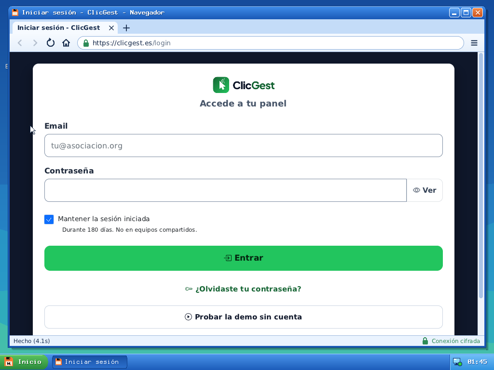 | 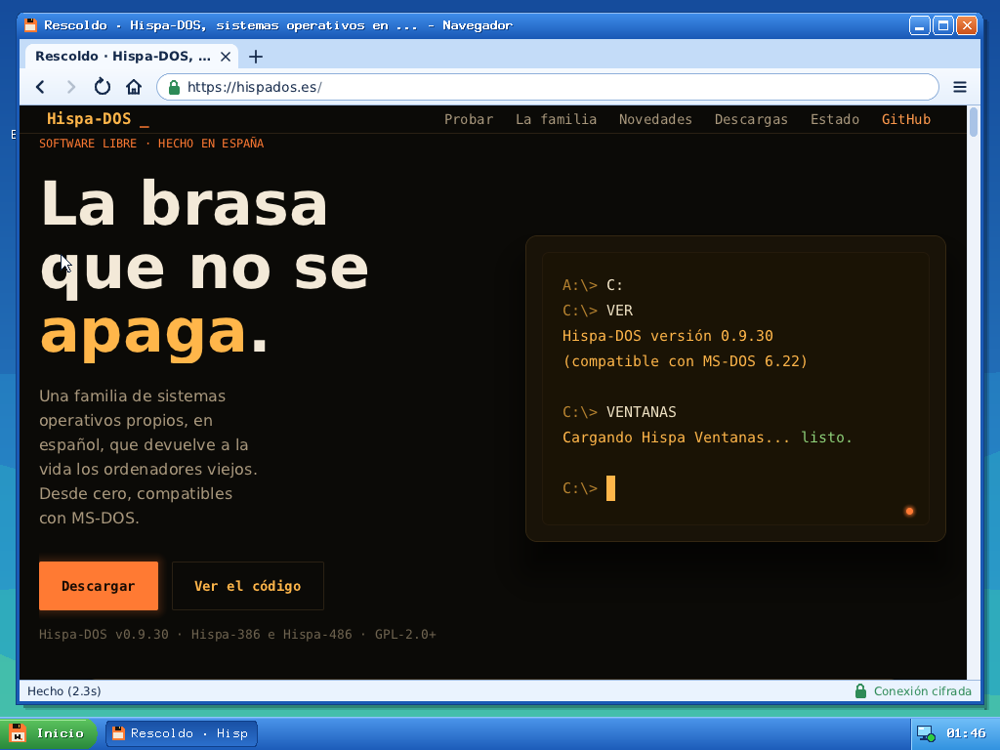 |
| 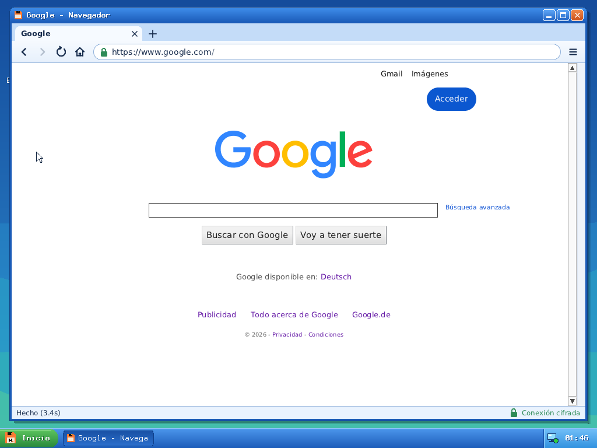 | 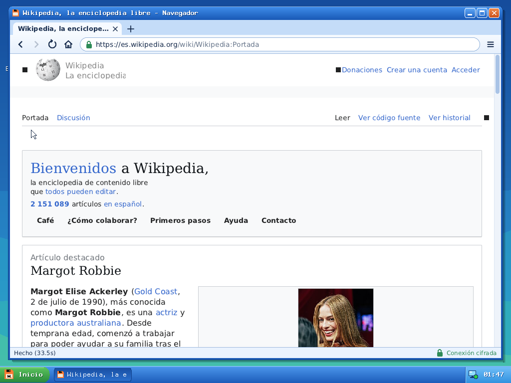 |
| 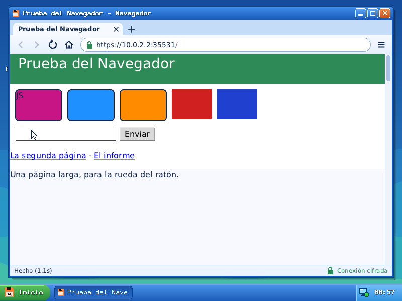 | 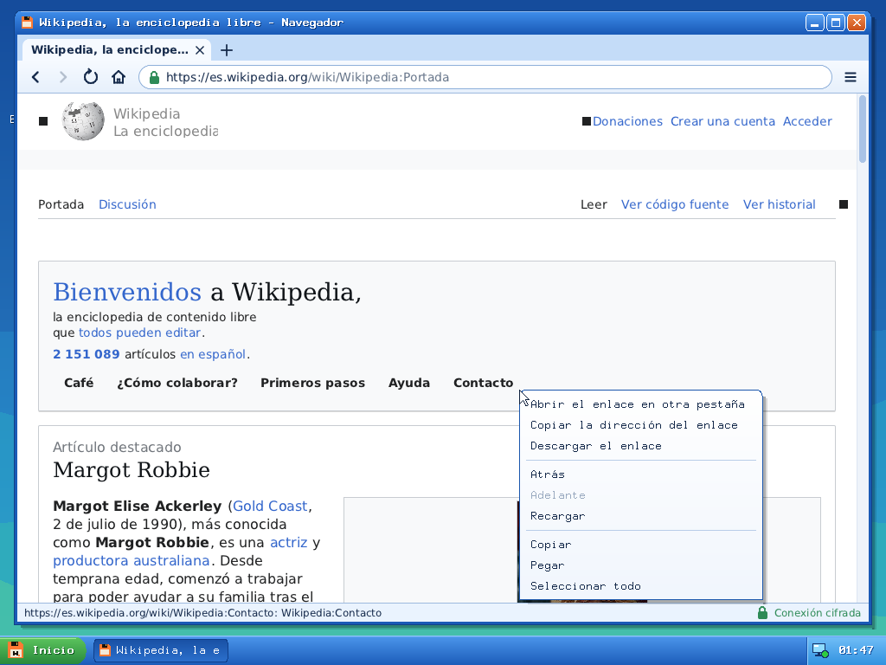 |

**Es el Navegador completo de Hispa-486** ([NAVEGADOR2.md](486/NAVEGADOR2.md):
NetSurf 3.11 con lo nuestro —las variables de CSS, `@font-face` con WOFF y
WOFF2, grid, `gap`, esquinas redondas, sombras, 96 ppp y JavaScript con
QuickJS—), con un **frontal nuevo** sobre las llamadas de Hispa-Pentium. Los
fuentes de `w32/surf` (la red, las letras, las imágenes, el CSS, el
JavaScript) van **tal cual**; lo único que no sirve es su ventana de Hispa
Ventanas (`surf.c`). Así, lo que se arregle en uno vale para los dos.

### Cómo se maneja

Arriba, **las pestañas** (cada una con su «×»; la **+** abre otra con la
página de inicio) y **la barra**: Atrás, Adelante, Recargar (mientras carga,
Parar), Inicio, **la dirección** (con el candado verde en las cifradas: el
servidor en negro y lo demás en gris) y **el menú** (≡: Nueva pestaña, Cerrar
la pestaña, Copiar la dirección, Ver las descargas, Página de inicio, Acerca
del Navegador, Salir). Abajo, la línea de estado («Cargando…» en ocre,
«Conexión cifrada» en verde, el enlace de debajo del ratón, lo que lleva una
descarga). A la derecha, la barra de desplazamiento (el pulgar se arrastra).

| | |
|---|---|
| La rueda del ratón | mueve la página (o la caja con desplazamiento que hay debajo); con Mayús, a los lados |
| El botón derecho | en un enlace: Abrir el enlace en otra pestaña, Copiar la dirección del enlace, Descargar el enlace; siempre: Atrás, Adelante, Recargar, Copiar, Pegar, Seleccionar todo |
| F6 o Ctrl+L | a la dirección (elegida entera). Lo que no parece una dirección (con espacios, sin punto) se busca en Google; `C:\CARPETA\PAGINA.HTM` abre la del disco |
| F5 o Ctrl+R | recargar; Esc, parar |
| Ctrl+T, Ctrl+W | pestaña nueva, cerrar la de ahora (con el núcleo de la rama `controles-erp`, Ctrl+Tab y Ctrl+Mayús+Tab cambian de pestaña) |
| Ctrl+C, Ctrl+V, Ctrl+X, Ctrl+A | con **el portapapeles del sistema** (lo copiado en el Navegador se pega en el Bloc de notas, y al revés) |
| Flechas, Re Pág, Av Pág, Inicio, Fin, Espacio | mueven la página (en un campo, el cursor) |
| Retroceso | fuera de un campo: atrás |
| Tab, Mayús+Tab | en los formularios, al campo siguiente o al anterior |

`alert()` y `confirm()` de las páginas salen en un cuadro propio (otra
ventana, en el centro). **Las descargas** (lo que el servidor manda como
`attachment`, lo que no se puede enseñar, o «Descargar el enlace») van a
**`C:\DESCARGA`** con un nombre de 8+3 sacado del suyo («Informe anual
2026.zip» queda `INFORMEA.ZIP`; si ya hay uno, `INFORM~1.ZIP`), y la línea
de estado dice lo que lleva y, al acabar, dónde está.

**`NAVEGA.INI`** (junto al programa; todas las líneas son opcionales):
`Inicio=` (la página de arranque y del botón Inicio: `https://www.google.es/`
si no se dice; `resource:welcome.html` es la que va con el Navegador, sin
red), `Idioma=` (`es`: lo que se pide a las páginas) y `Descargas=`
(`C:\DESCARGA`). Las galletas que dicen hasta cuándo valen se guardan al
cerrar en `SURFGAL.TXT`, y lo de `localStorage` en `NAVEGA2.ALM`. Con un
`SURF.LOG` (aunque esté vacío) en la carpeta, apunta lo que hace (NetSurf en
`NS.LOG`, el JavaScript en `SURFJS.LOG`) y **F1** deja en `CAJAS.TXT` el árbol
de cajas y el de libdom de la página (así se encontró lo de Wikipedia).

### Dónde está: el paquete «navega»

Es un **paquete aparte** (no va con el sistema: el CD y la memoria USB no
crecen 2,4 MB), **`navega`** («navegador» no cabe: los nombres de paquete son
de 8 letras, como su registro `.PQI`), versión 0.1, que se instala desde
**«Programas y actualizaciones»** o con `PAQUETES INSTALA navega`. Necesita
`base >= 0.8.3` (el núcleo de abajo), `red` y `tls`. Lleva:

| | |
|---|---|
| `\HISPA\NAVEGA\NAVEGA.BIN` | el programa (2,0 MB) |
| `\HISPA\NAVEGA\NAVEGA.INI`, `LEEME.TXT` | las opciones; las licencias |
| `\HISPA\NAVEGA\RECURSOS\` | las hojas de estilo de NetSurf, sus textos en español, la página de inicio sin red y el diccionario de Brotli (para las letras WOFF2) |
| `\HISPA\NAVEGA\FUENTES\` | las letras DejaVu (Sans, Serif y Mono, normal y negrita), recortadas a las de Europa occidental (208 KB) |
| `\HISPA\MENU\NAVEGA.MNU`, `NAVEGA.ICP` | el acceso **«Navegador»** del menú Inicio y del tapiz (un globo con la flecha, de diseño propio: `navega/navega32.png`) |

Lo hace **`castel/nucleo32/navega/paquete.sh SALIDA`** (`NAVEGA.HPQ` y su
línea del catálogo, `CATALOGO.LIN`), con `tools/hpq.py opcionales` (la lista
`OPCIONALES`, para los paquetes que no van con el sistema) y `hpq.py linea`;
y `nucleo32/actualiza.sh` lo mete en el catálogo de Internet con los demás.
Sin instalar (las pruebas), en `\NAVEGA` y su acceso en `\MENU`
(`disco.sh ... navegador`).

Probado con PAQUETES (en QEMU: un sistema con base 0.8.2, red y tls, y una
memoria USB con el catálogo): `PAQUETES INSTALA navega` dice «Se va a
instalar: base 0.8.3 (en lugar de la 0.8.2), navega 0.1», comprueba las sumas,
los pone (con las carpetas de `\HISPA\NAVEGA`) y `PAQUETES COMPRUEBA` los da
por buenos; con el núcleo nuevo hay que reiniciar (sección 13).

**La 0.8.3 entera, por Internet** (21/11): el catálogo firmado con base y
equipo 0.8.3 (el núcleo del Navegador y el Administrador de dispositivos),
navega 0.1, clicgest 0.2.1 y los demás como estaban (iguales octeto a octeto a
los publicados). Probado en QEMU desde un sistema con lo publicado de la 0.8.2
(base 0.8.2, equipo 0.8, clicgest 0.2.1...), sirviendo el catálogo por HTTP
(`PAQUETES ... /DESDE=http://10.0.2.2:...`): la firma, buena; `PAQUETES
ACTUALIZA` pone base y equipo 0.8.3 («Reinicie para usar el núcleo nuevo»),
`PAQUETES INSTALA navega` lo baja (2,4 MB) y lo pone; los 49 archivos de
`\HISPA` cuadran con sus registros; y con el núcleo nuevo, el menú Inicio
trae ClicGest y el Navegador, el Navegador abre Google y DISPOSIT, el
Administrador de dispositivos:

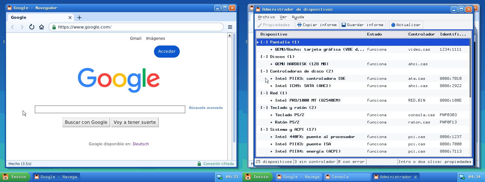

### Cómo está hecho

```
castel/nucleo32/navega/
  frontal.c     la ventana (llamadas 32-36, 39, 40 y 80): pestañas (una ventana
                de NetSurf cada una), barra, dirección, desplazamiento, estado,
                ratón y rueda, teclado (de la página 437 a Unicode), portapapeles,
                menús emergentes, los cuadros de alert/confirm; y el bucle de los
                sucesos con el planificador de NetSurf
  descarga.c    las descargas (gui_download_table), con su nombre 8+3
  sistema.c     lo de Windows que piden los fuentes de Hispa-486, con las
                llamadas de Hispa-Pentium (abajo)
  entrada.asm   la cabecera HPU3 y la entrada (fninit); pentium.ld: 0x40000000
  navega.mk     cómo se compila (make -f, sin -j); hacer.sh: la carpeta entera
  paquete.sh    el paquete; servidor_pruebas.py: el sitio de las pruebas
  prueba_x87.c  X87.BIN (abajo)
w32/surf/       el Navegador completo de Hispa-486, sin su surf.c
w32/navega/http.c, w32/msvcrt.c, w32/js/ (QuickJS), terceros/netsurf, stb, brotli, dejavu
```

**Un programa del anillo 3 en C, como `TLS.BIN`**, pero de 2 MB: NetSurf
(-Os), QuickJS (-O2) y la biblioteca de C, con `gcc -m32 -march=i586
-ffreestanding` y enlazado con `ld --gc-sections` para `0x40000000`.

**Los fuentes de Hispa-486, sin tocar: `sistema.c`.** NAVEGA2.EXE era un
programa Win32 para HW32 y llamaba a KERNEL32, WSOCK32, HSPTLS y USER32. En
vez de reescribir su red, sus archivos y su memoria, `sistema.c` da **esas
mismas funciones** (con su nombre y su `stdcall`) hechas con las llamadas de
Hispa-Pentium, y todo lo demás compila igual:

| Lo de Windows | Con qué se hace aquí |
|---|---|
| `CreateFileA`, `ReadFile`, `WriteFile`, `SetFilePointer`, `FindFirstFileA`... | los archivos del núcleo (llamadas 7-9, 12, 13, 18-26, 28); 16 abiertos a la vez en todo el sistema |
| `VirtualAlloc`, `VirtualFree` | la llamada 17 (el final del programa); las zonas sueltas se apuntan y se vuelven a dar, la de arriba se devuelve |
| `HeapAlloc` (el `malloc` de MSVCRT) | el `malloc` de `w32/surf/memoria.c`: uno solo para todo el programa |
| `GetSystemTimeAsFileTime`, `GetTickCount`, `Sleep` | el reloj del PC (dato 10) y los tics (como HW32: sin huso) |
| `socket`, `connect`, `send`, `recv`, `select`, `gethostbyname` | las conexiones TCP de `RED.BIN` (llamada 90) |
| `TlsAbrir`, `TlsConectar`, `TlsLeer`... (HSPTLS) | las cifradas de `TLS.BIN` (llamada 99), que resuelve, conecta y hace el apretón de manos él: `http.c` dice antes si la que viene es https (un gancho `[PENTIUM]`) |
| `MessageBoxA` | el cuadro de `frontal.c` |

**La biblioteca de C** es `w32/msvcrt.c` (la MSVCRT.DLL de Hispa-486) con
su `malloc` con otro nombre (el de todos es el de `memoria.c`); **QuickJS**
(`w32/js`, la HSPJS.DLL) va dentro como iba en la DLL: se enlaza aparte y solo
se ve desde fuera lo que exportaba (`objcopy --keep-global-symbols`), así su
`malloc`, su `fprintf` y sus divisiones de 64 bits no chocan con los demás.

**El dibujo.** NetSurf pinta la página en un búfer de 32 bits (libnsfb) y lo
de la ventana (las pestañas, la barra, la dirección, el estado) se pinta en
otros tres, con **las mismas letras DejaVu** de la página (`letra.c`, de
cualquier tamaño, suavizadas) y rayas suavizadas para los iconos; todo se da
al núcleo con `OP_MAPA` (llamada 34), **solo lo que ha cambiado**. La rueda y
las flechas **mueven lo ya pintado** en el búfer y se pinta solo la franja que
entra.

**La red.** Las conexiones TCP las hace `RED.BIN` y las cifradas `TLS.BIN`
(con la cadena comprobada, la sesión reanudada y `TLS.CCH`: sección 14). Una
petición cada vez, por la conexión que se guarda abierta (la de NAVEGA2). El
apretón de manos se hace de una vez (unos 3 s la primera vez en un Pentium
133; luego, la sesión reanudada, nada): mientras, la ventana espera. El
User-Agent es **`HispaSurf/0.2 (NetSurf 3.11; Hispa-Pentium)`**: sin
«HispaNavegador», «(Hispa-486» ni «Hispa32», así ClicGest da su web normal
(no la ligera).

### El núcleo 0.8.3 (lo que necesita el Navegador)

Tres cambios, marcados «(NAVEGADOR)»:

- **La rueda del ratón** (`raton.cas`, `usbhid.cas`, `ventanas.cas`): el
  ratón PS/2 se pone en **IntelliMouse** (las frecuencias 200, 100 y 80; si
  luego dice que es el 3, manda cuatro octetos: el cuarto, la rueda) y el
  USB con protocolo de arranque da la suya en el cuarto octeto. El escritorio
  manda a la ventana que hay debajo de la flecha el suceso nuevo
  **`EV_RUEDA` (13)**: `a`, `b`, dónde; `c`, los pasos con signo en el octeto
  bajo (arriba, positivos) y `CON_MAYÚS`/`CON_CONTROL`. Al arrancar dice
  «escritorio: el ratón PS/2 tiene rueda». (En `llamadas.cas`, `EV_RUEDA`,
  para los programas de Castel.) Ojo en las pruebas: con cuatro octetos por
  paquete, en la cola PS/2 de QEMU (16 octetos) caben 4 paquetes por suceso
  (508 puntos, antes 635); lo que sobra de un `mouse_move` más grande llega
  con el suceso siguiente (el clic). `probar.sh` ya mueve de 50 en 50; los
  saltos a mano de `pruebas.sh`, en dos.
- **El x87 de cada programa** (`tareas.cas`): hasta ahora el núcleo no
  guardaba la coma flotante al cambiar de tarea, y dos programas que la
  usaran a la vez (el Navegador, QuickJS, lo de HVPRUN) se la pisaban. Ahora
  cada ficha lleva su x87 (108 octetos, `fnsave`/`frstor`) y se reparte **al
  usarlo**: al cambiar de tarea se enciende `CR0.TS` y, si la nueva usa coma
  flotante, la excepción 7 (`sin_x87`) guarda la de la otra y pone la suya (o
  una a estrenar). Lo que no la usa (casi todo, y el núcleo) no paga nada.
  Las instrucciones van como `db` (`clts`, `fninit`, `fnsave`, `frstor`), para
  que el núcleo se siga compilando igual con CASTEL32 y ENSAMB32 (sección 14
  bis). **`X87.BIN`** (`navega/prueba_x87.c`) lo prueba: se lanza a sí mismo
  dos veces y los tres dejan números distintos en la pila del x87 mientras
  duermen; con el núcleo de antes dice «MAL», con este «bien».
- **Programas de hasta 8 MB** (`MAX_PROGRAMA`, `usuario.cas`; antes 2 MB:
  NAVEGA.BIN mide 2.095.604 octetos).

`tools/hpq.py`: `base` y `equipo` (con el Administrador de dispositivos) pasan a la **0.8.3** (sobre la 0.8.2 de los controles; los demás siguen como estaban).

### Lo que se arregló por el camino (vale también para Hispa-486)

- **`vh` y `vw` estaban cambiados en libcss 0.9.2** (`100vh` daba el ancho de
  la ventana): la tarjeta de entrar de ClicGest (centrada en un `body` de
  `min-height: 100vh`) salía muy abajo, también en Hispa-486; ahora sale como
  en Chrome.
- **`opacity: 0`** no se pinta (ni lo de dentro): los botones de Google con su
  capa encima, lo que se enseña poco a poco (las `.reveal` de clicgest.es, que
  su JavaScript enseña). Lo de en medio (0,5) se sigue pintando entero.
- **`document.implementation.createHTMLDocument()`** (`w32/navega/dom.js`)
  daba el documento de la página: jQuery, al arrancar, prueba
  `body.innerHTML = "<form></form><form></form>"` en él y **se llevaba el
  cuerpo entero de la página** (Wikipedia salía en blanco con JavaScript).
  Ahora da uno aparte.
- Un campo que el JavaScript hace de texto (su `type`) después de hacer su
  caja tiene su textarea al maquetar (Wikipedia: un fallo de página).

### Comparado con Chrome

A 1024 x 768 (la página, 970 x 588; Chrome a esa medida, `google-chrome
--headless`), en `pentium/navegador/`:

| Página | El Navegador | Chrome |
|---|---|---|
| https://clicgest.es/login | `01_clicgest_login.png` | `01_clicgest_login_chrome.png` |
| https://hispados.es/ | `02_hispados.png` | `02_hispados_chrome.png` |
| https://www.google.es/ | `03_google.png` | `03_google_chrome.png` |
| https://es.wikipedia.org/ | `04_wikipedia.png` | `04_wikipedia_chrome.png` |

ClicGest y hispados.es salen casi iguales (las letras de la web, las
esquinas, las sombras, los colores de las variables). Google da a quien no
conoce su página sencilla de siempre (a Chrome, que sale de un servidor en
Alemania, el aviso de las galletas): sin el icono de las aplicaciones (SVG).
Wikipedia, entera, con su JavaScript (el buscador y los menús de arriba, en
SVG, no salen). Lo que queda distinto es lo de NAVEGADOR2.md («Lo que queda
distinto»): sin SVG, sin `position: fixed` de verdad, sin `transform` ni
animaciones; aquí, en cambio, los colores son los de verdad (32 bits, no la
paleta de 256 de Hispa Ventanas).

### Medidas

En QEMU sin KVM (en el VPS va, para este código, como un Pentium de 200-300
MHz: NAVEGADOR2.md, «Medidas»), 128 MB, 1024 x 768, por la red de QEMU a
Internet; la memoria, la de `memoria.c` (en uso / lo más) y lo pedido al
sistema (`VirtualAlloc`), que dice la línea `navega: hecho ...` del puerto
serie:

| Página (por orden, en la misma pestaña) | Tiempo («Hecho») | En uso (KB) | Lo más (KB) | Del sistema (KB) |
|---|---|---|---|---|
| (al abrirlo: `about:blank`) | — | 3.196 | 3.253 | 3.264 |
| https://clicgest.es/login (la primera conexión cifrada: la cadena se comprueba; Bootstrap, sus dos letras de la web) | 4,1 s | 7.452 | 10.677 | 9.664 |
| https://hispados.es/ | 2,3 s | 8.877 | 12.092 | 11.200 |
| https://www.google.es/ (lleva a google.com) | 3,4 s | 7.066 | 12.105 | 16.340 |
| https://es.wikipedia.org/ (con 1,4 MB de JavaScript) | 33,5 s | 34.423 | 40.003 | 50.836 |

(Con la pestaña de Wikipedia abierta, una nueva con ClicGest: 3,5 s.) Lo que
cuesta el cifrado lo apunta `TLS.BIN`: el apretón de manos con la cadena ya
comprobada, 25 M instrucciones; con la sesión reanudada, menos de 1 M; los 1,4
MB del JavaScript de Wikipedia, 235 M (ChaCha20-Poly1305).

Con el programa (2,1 MB), su pila y los búferes de la ventana (a 1024 x 768,
unos 3,5 MB), el Navegador **arranca en unos 7 MB**. ClicGest, hispados.es y
Google caben de sobra en **64 MB** (probado: tras las tres, 7.827 marcos
libres, 31 MB); Wikipedia (1,4 MB de JavaScript) pide unos 50 MB al sistema:
con 64 MB sale entera, pero justísima (quedan 43 marcos libres: 172 KB); con
128 MB, holgada.
Un Pentium de verdad a 133 MHz es unas dos veces más lento que este QEMU:
ClicGest, unos 8 s la primera vez (la cadena de certificados se comprueba una
vez: luego, `TLS.CCH`); Wikipedia, más de un minuto.

### Probarlo

`castel/pruebas.sh`, **parte 18** (`SOLO=navegador`, unos 3 minutos; sin
Internet): `navega/servidor_pruebas.py` sirve el mismo sitio por HTTP y por
HTTPS (con su raíz de prueba en `\RAICES`) y apunta lo que le piden. Se
comprueba: el acceso del menú y su icono en el tapiz; la página por HTTPS, con
**la hoja de fuera con variables de CSS, un PNG, un JPEG, JavaScript (el DOM,
`setTimeout`, `localStorage`), `fetch` con las dos galletas** (la del servidor
y la de `document.cookie`) y su cabecera; el User-Agent; **la rueda**, Fin,
un **formulario POST con eñe** y su respuesta, **Atrás**, **el menú del botón
derecho** (abrir el enlace en otra pestaña), **F6** con una dirección sin
`http://` (por HTTP), **el portapapeles** (Ctrl+L, Ctrl+C y Ctrl+V en un campo
de otra pestaña), **una descarga** a `C:\DESCARGA\INFORMEA.ZIP` igual octeto a
octeto, cerrar la ventana, **las galletas guardadas** (`SURFGAL.TXT`: las que
duran, no las de sesión) y `localStorage`; y **X87.BIN** (el x87 de cada
programa). Para mirarlo a mano:

```
castel/nucleo32/disco.sh /tmp/d.img 32 red tls navegador
DISCO=/tmp/d.img ARRANQUE=escritorio MODULOS= MEMORIA=128 QEMU_MAS="-nic user,model=e1000" \
  castel/nucleo32/probar.sh "" ":pausa 3" ":doble 62 260" ":pausa 20" ":captura nav"
```

### Lo que falta

- **Que la ventana no espere** al apretón de manos de TLS (hoy se queda quieta
  ese momento: unos 3 s la primera vez en un Pentium 133); pedir varias cosas
  a la vez (hoy, una petición cada vez, como en Hispa-486).
- Lo de NetSurf que queda (NAVEGADOR2.md, «Lo que falta»): **SVG** (los iconos
  de Google, de Wikipedia, de Bootstrap), `position: fixed`, `transform`,
  `<details>`, la cursiva de verdad, los pesos de las letras variables, rehacer
  solo la parte de las cajas que cambia (en las páginas grandes, cada clic que
  cambia el árbol tarda).
- Letras de más escrituras (las DejaVu van recortadas a las de Europa
  occidental), imprimir, la forma de la flecha (el núcleo no deja cambiarla),
  arrastrar y soltar, el historial y los marcadores guardados, y preguntar
  dónde guardar una descarga.
- Nombres largos al descargar (el núcleo aún crea solo 8+3).

## 15. Las pruebas

`castel/pruebas.sh` (las partes 8 a 14; `SOLO=32 ./pruebas.sh` hace solo esas y la
de los errores; `SOLO=06`, solo la 9, lo de la 0.6; `SOLO=07`, solo la 10, instalar en el disco;
`SOLO=08`, las de la 0.8, de la 11 a la 14; y `SOLO=caliente`, `SOLO=paquetes`, `SOLO=red`,
`SOLO=tls` o `SOLO=acpi`, solo una de ellas) arranca el núcleo en QEMU varias veces y comprueba: que arranca, lee el
teclado, el reloj corre y la división por cero llega a su excepción; que el mapa de
memoria da los marcos; que la **paginación está activa** con la identidad; que un
**fallo de página se atiende** en la zona a la demanda; que el **montón no pierde**
ni bloques ni marcos tras 3000 vueltas y que **ve lo que lo estropea**; que **dos
tareas se alternan** con el reloj; que las dormilonas despiertan en orden; que un
**programa del anillo 3** escribe por la `int 0x80`, duerme y acaba con su código, y
que su espacio de direcciones vuelve entero; que la llamada al sistema no enseña la
memoria del núcleo; que un programa que lee la memoria del núcleo o hace `cli` se
acaba y el núcleo sigue; y que un fallo de página del núcleo se dice con su
dirección.

**Con disco** (imágenes hechas con `nucleo32/disco.sh`, dadas a QEMU como disco
IDE): que IDENTIFY dice el disco que hay; que la **FAT16 se monta**, se lee su raíz
y una carpeta (saltando los nombres largos); que un **programa se carga del disco**,
corre, recibe sus argumentos, acaba con su código y devuelve toda su memoria; que
lo que no es un programa o no está no se lanza. Que el **intérprete de órdenes**
(del anillo 3, cargado del disco) hace **AYUDA, VER, MEM, DIR, TYPE y CLS** (la
pantalla se mira), **lanza programas por su nombre** con sus argumentos (también de
una carpeta) y los espera, dice lo que no conoce, y sigue cuando un programa se
acaba a la fuerza. Desde dentro de un programa (`PRUEBA.BIN`): la **memoria que
crece** y se devuelve; **leer un archivo de varios clusters** a trozos de 777
octetos (la suma de sus octetos es la del archivo de verdad); la **pila que crece
sola** (200 llamadas anidadas con 4000 octetos cada una, y leer del disco a un
arreglo local sin estrenar) y la que se desboca, que acaba con el programa; el tope de archivos
abiertos; que las **direcciones que no son del programa no se tocan**; **lanzar dos
programas a la vez y esperarlos**; que **dos programas que escriben a la vez no se
mezclan** (240 líneas enteras: el cerrojo de la consola); que tocar memoria
devuelta acaba con el programa; y que, al salir, **el núcleo ha recogido** el
archivo que quedó abierto y el programa que nadie esperó (los mismos marcos libres,
ningún archivo abierto, solo las dos tareas del núcleo). Y lo mismo, en corto, con
**FAT12, FAT32 y un disco con tabla de particiones**; el arranque directo al
intérprete (`-append ordenes`); y el núcleo sin disco.

**Escribiendo en el disco** (cada prueba, en una copia de la imagen, con
`ESCRIBE=1`; luego la miran desde fuera `fsck.fat` y `mtools`), con **FAT16, FAT12,
FAT32 y la FAT16 de una partición**: desde dentro de un programa (`ESCRIBE.BIN`),
crear un archivo y escribirlo a trozos de 777 octetos, leerlo de vuelta igual,
escribir en medio, **cortarlo** (los clusters que sobran quedan libres),
**alargarlo dejando un hueco** (que se lee a cero), **añadir al final**, crear
encima y borrar; lo que no se puede (abrir dos veces para escribir, borrar o
renombrar lo abierto, nombres que no valen, carpetas que no están); **carpetas**:
hacerlas, entrar, meter 70 archivos (la carpeta crece), mover un archivo a otra,
cambiar nombres, vaciarlas y borrarlas, y que al final quedan **los mismos
clusters libres**. Con las órdenes: `ECHO ... >` y `>>`, `COPY` (uno, y varios con
comodines), `MD`, `CD`, `REN`, `DEL`, `RD`, un programa y `DIR` redirigidos a un
archivo, y lo que tienen que decir cuando no puede ser. En FAT12, además, **llenar
el disco** hasta el último cluster y vaciarlo. Después, que **`fsck.fat` da el
disco por sano** (las dos FAT iguales, el sector de información de FAT32 con su
cuenta, ningún cluster suelto), que **`mtools` ve lo mismo** (lo creado con sus
finales de línea, lo copiado igual que el original octeto a octeto, lo renombrado
y lo borrado), y que **al volver a arrancar** el núcleo lee lo que escribió.

**El intérprete**: `CD` y la carpeta de trabajo (en la petición, en las rutas, en
lo que se crea, heredada por los programas), carpetas dentro de carpetas, `PATH`
(con él, sin él y con varias carpetas), un **archivo .BAT** (sus líneas, `ECHO`,
`REM`, `PAUSE`, `%1`, programas y redirección dentro; `ECHO OFF` y `@`), la
**historia** y la corrección de la línea (lo que queda en la pantalla, deshaciendo
los retrocesos: `nucleo32/pantalla.py`), `FECHA` (la del reloj del PC). **Ctrl+C**
con un programa que da vueltas sin llamar al sistema, uno que duerme, uno que
espera teclas, uno lanzado desde un .BAT (que también se acaba), uno que escribía
en un archivo (queda cerrado, con su tamaño, y el disco sano), en `PAUSE`, sin
programa en marcha, y desde la consola del núcleo; y que después no quedan
archivos abiertos, ni tareas, ni memoria sin devolver.

**El teclado español**: una línea con todas sus letras y signos (`ñ ç ¿ ¡ º ª`,
los cuatro acentos con su tecla muerta, Alt Gr, Bloq Mayús) tecleada tecla a
tecla y mandada a un archivo, que se compara **octeto a octeto** con lo que tiene
que ser en la página 437; el cambio al de EE. UU. y vuelta. **Los nombres
largos**: `DIR` los enseña (también con eñe), se abre por ellos, y al renombrar o
borrar no quedan trozos sueltos (lo mira `fsck.fat`).

Además, como con todo lo de Castel: **CASTEL** (el compilador escrito en Castel,
dentro de Hispa-8086) saca el **mismo ensamblador** que `ccastel.py` para el núcleo
(con sus módulos nuevos), el intérprete de órdenes y los demás programas de
usuario, y **ENSAMBLA** da el **mismo binario que NASM**. (El lenguaje no se ha
tocado; de los compiladores, solo el arranque de `modelo usuario`, en los dos: ya
no pone la pila, que es del núcleo. En la tanda del 19/11 de madrugada, ni eso. En
la de la 0.4, cuatro palabras a cero en la cabecera multiboot de `modelo núcleo`,
en los dos: el sitio para pedir el modo gráfico, sección 11. En la de la 0.5, más
sitio para los textos en CASTEL: más abajo.)

**Sin disco, y sin permiso** (la tanda de la 0.4): con los programas como módulos
de multiboot y sin disco (la unidad en memoria, que desde la 0.6 es `M:`), `ordenes`
lanza el intérprete que venga, `DIR` enseña los módulos, `TYPE` los lee, los programas se lanzan por su nombre, y crear, borrar o
hacer carpetas se niega («es de solo lectura»); con un disco y sin `escritura`,
todo lo que escribe se niega y **la imagen queda idéntica octeto a octeto**; con
`sindisco`, los discos ni se miran.

**El escritorio**, con capturas de la pantalla (el `screendump` del monitor de
QEMU) que mira **`nucleo32/mira_captura.py`**: el tamaño, el color de puntos
sueltos y **textos** buscados con la propia letra del sistema, en cualquier color
(como las pruebas de Hispa Ventanas). Una sesión entera, con el ratón y el teclado
movidos por el monitor de QEMU: el escritorio recién arrancado (el tapiz, «Inicio»,
el reloj con la hora del PC, la flecha); el **menú Inicio** con sus dos columnas;
lanzar el **Bloc de notas**, teclear un texto con eñe, acentos y «¿?», **guardarlo
con F2** y que el archivo esté luego en la imagen del disco **octeto a octeto** (y
`fsck.fat` la dé por sana); **arrastrar** la ventana, **maximizarla** con dos
clics (y que el programa vuelva a pintar lo suyo), devolverla a su tamaño,
**minimizarla** y recuperarla con su botón de la barra; la **Consola** con el
intérprete dentro (una orden, un programa que da vueltas y Ctrl+C, `VER`) y que
`SALIR` la cierra; **Configuración** y el cambio de tapiz; **cerrar** el Bloc de
notas con su botón; y **«Apagar el equipo»**, que apaga. Además: la orden
`ESCRITORIO` del intérprete; abrir un documento del menú; 1024 x 768 con 24 bits
por punto; que sin tarjeta gráfica que valga se dice y la consola sigue; que
`modo_grafico.py` deja bien la cabecera; y la **memoria USB con GRUB** arrancada en
QEMU como tal (el modo, puesto por GRUB; los programas, de los módulos). Las
capturas se quedan en una carpeta con `CAPTURAS_A=carpeta ./pruebas.sh`.

**La 0.5**, en tres sesiones más (el botón secundario, `mouse_button 2`; el triple
clic; Mayús con un clic, con la tecla sujeta desde el monitor): los **iconos** del
tapiz y su menú, con «Cambiar el tapiz»; abrir el Bloc de notas con dos clics en
su icono; en él, **seleccionar** una palabra con dos clics (se mira el azul de lo
seleccionado punto a punto), el menú del botón secundario, **Cortar**, **Ctrl+V**,
Mayús con las flechas, **Ctrl+C**, la línea entera con tres clics, teclear encima
de lo seleccionado, Mayús con un clic, arrastrar, y el menú **Edición** de la
barra; **cambiar el tamaño** de la ventana por su esquina (y que el programa
repinta); «Abrir» con el botón secundario en el menú Inicio; y que lo copiado en
el Bloc **se pega en la Consola** (el portapapeles es del sistema). En la Consola:
seleccionar con dos clics y copiar con Ctrl+C, y pegarlo en el Bloc; el **menú de
la ventana** en su título (Maximizar, Cerrar) y en su botón de la barra de tareas
(Restaurar); estirarla. **Mi equipo**: las unidades, entrar en C:, y abrir un
texto con el Bloc de notas. «Acerca de Hispa-Pentium». Y a **1024 x 600**: el
escritorio a esa medida, llevar un icono a otro sitio y «Organizar iconos»,
Configuración diciendo la medida, y **«Mover»** desde el menú de una ventana.
**El explorador de archivos y el dock** (21/11): el dock con su borde; Mi
equipo con el árbol, el mosaico de C: (lo libre) y la Papelera; las vistas
de iconos y de detalles (la rejilla); las **miniaturas** de un BMP, un PNG y
un JPG (`MINIAT.BIN`, si hay gcc con `-m32`: el color de la miniatura);
copiar y pegar con Ctrl+C y Ctrl+V; F2 y F7 (los cuadros); Supr a la
Papelera, la Papelera del árbol y Restaurar; el menú del botón secundario;
Control y un clic, y el recuadro del ratón (los elegidos, en la barra de
estado); soltar un archivo en el tapiz (un acceso, que con dos clics lo abre
en el Bloc) y un programa en el dock (fijado); buscar con F3; el menú del
dock y «Ocultar el dock». Luego, en el disco (mtools): la copia con su
nombre nuevo igual al original, la carpeta restaurada, `\PAPELERA` oculta
con su índice vacío, `ATAJOS.INI` y `DOCK.INI`, y fsck.fat. De
la memoria USB, además: la entrada de **1024 x 600** arrancada en QEMU (el modo lo
pone GRUB por la cabecera de esa copia del núcleo) y que el menú trae las
entradas nuevas («a la medida de la pantalla», con `gfxpayload=auto`; los modos
de vídeo de la BIOS).

**La 0.6** (la parte 9 de `pruebas.sh`), todo en QEMU:

- **AHCI** (`-device ahci` con un disco `ide-hd`): la controladora se encuentra,
  IDENTIFY dice el disco y la FAT se monta encima; se leen una carpeta, un
  archivo de varios clusters (su suma, la de verdad) y programas; **escribiendo**
  (FAT32 y la FAT16 de una partición): el programa `ESCRIBE.BIN` entero (crear,
  escribir a trozos, cortar, alargar, 70 archivos en una carpeta, borrarlo todo:
  quedan los mismos clusters libres) y órdenes del intérprete, y después
  **`fsck.fat` da el disco por sano** y `mtools` ve lo escrito; **sin permiso**,
  la imagen queda idéntica octeto a octeto; y un disco con tabla **GPT** (hecha
  con `parted`), cuya partición se encuentra y se monta.
- **Dos discos a la vez** (el IDE, `C:`, y el SATA, `D:`): las rutas con letra
  (`DIR D:\TEXTOS`, `COPY C:\... D:\...`, lanzar un programa de la otra unidad),
  `D:` para cambiar de unidad (con su carpeta de trabajo y su petición), la
  unidad que no hay, y que de una a otra no se cambia de nombre; los dos discos
  quedan sanos y lo copiado es igual octeto a octeto.
- **El USB sin teclado ni ratón PS/2** (`-machine pc,i8042=off`: lo que se teclea
  por el monitor de QEMU llega por el teclado USB), con el **xHCI** y con el
  **EHCI**: las líneas de la enumeración (teclado, ratón, memoria); el **teclado
  español** entero por USB (eñe, acentos y diéresis con tecla muerta, `¿?`),
  **Ctrl+C** con un programa que da vueltas y las **flechas** (la historia); la
  **memoria USB como unidad X:**: leerla (el archivo de varios clusters, los
  programas) y **escribirla** (`ESCRIBE.BIN` entero y `COPY`), con `fsck.fat` y
  `mtools` después.
- **Un concentrador** (el de QEMU es de USB 1.1) en el xHCI, con el teclado, el
  ratón y la memoria detrás; **un EHCI con dos UHCI compañeras**, con el teclado
  y el ratón de USB 1.1 (se ceden a ellas y se enumeran allí) y la memoria en el
  EHCI; y **una UHCI sola** con la memoria en ella (leer y escribir a velocidad
  plena).
- **`escritura=usb unidad=X`** con un disco IDE y una memoria USB: en la memoria
  se escribe y se copia; en el disco de dentro, no («es de solo lectura»), y su
  imagen queda **idéntica octeto a octeto**. Y **`sinusb`**: ni una línea de USB.
- **El escritorio sin teclado ni ratón PS/2**: el **ratón USB** abre el menú
  Inicio y lanza el Bloc de notas; el **teclado USB** escribe en él; F2 guarda, y
  lo guardado está luego **en la imagen de la memoria USB**; **Mi equipo** enseña
  `C:` (el SATA de dentro, de solo lectura) y `X:` (la memoria USB), y se entra
  en `X:`.
- **La memoria USB con GRUB** (`usb.sh`), arrancada como tal de un xHCI y de un
  EHCI, sin 8042: GRUB carga el núcleo con la BIOS llevando el USB, el núcleo se
  lo quita, lee él la memoria (`X:`, la del sistema, con `M:` al lado), se lanza
  el Bloc de notas con el ratón USB, se teclea, se guarda, y en la imagen quedan
  `NOTAS.TXT` y **`ARRANQUE.TXT`** (el registro del arranque), con la FAT sana.

**La 0.7** (la parte 10 de `pruebas.sh`: instalar en el disco), todo en QEMU. Con
el núcleo arrancado con `-kernel`, `instalar unidad=M` y lo que se instala como
módulos (lo mismo que hace la entrada de la memoria USB), tecleando por el
monitor y mirando la **pantalla de texto** (`:texto` en `probar.sh`) y lo que
INSTALAR apunta por el puerto serie:

- **Un disco SATA en blanco**: la bienvenida (el título y el pie con sus
  teclas), la ayuda (F1), la lista de discos, «todo listo» y el final; después,
  desde fuera: la tabla (`parted`: una partición FAT32, la activa), **`fsck.fat`
  da el volumen por sano**, los archivos de `\HISPA` son **iguales octeto a
  octeto** que los originales (`mtools`), el MBR lleva `BOOT.IMG` y `CORE.IMG`
  está desde el sector 1; `GRUB.CFG` es el que tiene que ser; y lo que dice
  `CARPETAS.TXT` (dos archivos de prueba) está en su carpeta, `C:\COSAS`, y no
  en `\HISPA`. Y **otra vez encima** del disco recién instalado (que el núcleo
  ya monta como C:).
- **Un disco con la partición de otro sistema** (100 MB de datos al azar, de
  la clase de NTFS) **y espacio sin usar**: se enseña lo que tiene; **borrar pide
  sus dos confirmaciones**, y con la palabra mal escrita, con N o saliendo con
  F3 **el disco queda idéntico octeto a octeto**; instalando en lo libre, **la
  partición de antes queda idéntica**, la nueva es la segunda y la activa, el
  menú de arranque lleva la entrada del otro sistema y `MBR.ANT` es el primer
  sector de antes.
- **Un disco lleno**: solo se ofrece borrarlo; confirmado (S y BORRAR), queda
  instalado (199 MB: la FAT32 de clusters de 512 octetos). **Uno de los de
  antes** (la partición en el sector 63): se dice que no hay sitio para el
  arranque, y no se toca. **Uno con tabla GPT**: se leen sus particiones y solo
  se instala borrándolo (queda con tabla MBR). **Un disco IDE** de 2 GB
  (clusters de 4 K).
- **Sin `instalar`** en la línea del cargador (aunque haya `escritura`),
  INSTALAR no encuentra ningún disco donde escribir, y la imagen queda idéntica.

Y de verdad, **con la memoria USB arrancada como tal** (GRUB, de un **xHCI** y de
un **EHCI**) y un disco SATA en blanco de 2 GB: el menú trae la entrada
«Instalar...»; se instala; **la memoria USB no se ofrece como disco y queda
idéntica octeto a octeto**; el disco, sano y con el sistema. Después, **SOLO con
el disco**: la BIOS arranca **GRUB desde su MBR** y sale el menú de
`\HISPA\GRUB.CFG`; el núcleo lee el disco (C:, FAT32), arranca el escritorio y
lanza **el asistente**: con el teclado (el nombre, el equipo, la hora, la
pantalla a 1024 x 600) y, en la otra pasada, con el ratón (el teclado de
EE. UU., que cambia en el momento); `HISPA.INI` y la línea `set modo=` de
`GRUB.CFG` quedan como se ha dicho, el reloj de la barra marca la hora puesta,
**el menú Inicio saluda con el nombre**; en el **segundo arranque** ya no sale
el asistente y el escritorio está a **1024 x 600**; la entrada de modo texto
del disco arranca el intérprete, con el teclado guardado; y **la oficina, en el
disco instalado**: el menú Inicio abre Facturas (con `C:\HISPA\HVPRUN.BIN`) y
Mi equipo entra en `C:\OFICINA` y abre Cuentas.

Y en la instalación de verdad, desde la 0.8: **INSTALAR deja los registros** de
los ocho paquetes del sistema en `C:\HISPA\PAQUETES` (iguales a los de la
memoria), y en el sistema instalado `PAQUETES LISTA` los dice y `PAQUETES
COMPRUEBA` encuentra todos sus archivos como se instalaron (su SHA-256). En la
instalación con el núcleo de `-kernel`, un registro de prueba va a
`\HISPA\PAQUETES` por `CARPETAS.TXT` («HISPA\PAQUETES»).

**La 0.8: los paquetes** (la parte 12 de `pruebas.sh`, `SOLO=paquetes`), en QEMU, con
un disco SATA «instalado» (FAT32, con `C:\HISPA` y lo instalado: `base`) y una
memoria USB con paquetes de prueba hechos con `tools/hpq.py` (letras 1.0 y 1.1,
saludo 1.0 y 2.0 —que necesitan letras, base y el núcleo—, choque —que choca
con saludo— y malo —con un octeto cambiado—): `hpq.py` hace los paquetes, el
catálogo y los registros, y ve la suma mala; `PAQUETES LISTA` y `CATALOGO` (la
memoria USB, encontrada sola); **instalar un archivo de la memoria con lo que
necesita** (letras antes, la versión más nueva del catálogo) y lanzar el
programa nuevo por su nombre; **instalar por el nombre** (la versión más nueva);
**actualizar** (la 1.0 a la 2.0: un archivo cambia, otro llega y el que ya no va
se quita) y que después todo está al día; **una suma mala**, **un conflicto**,
**quitar lo que otro necesita** y lo que no hay: se dice y **el disco queda
idéntico octeto a octeto**; `COMPRUEBA` ve un archivo cambiado a mano;
**quitar** (con las carpetas que quedan vacías): el disco vuelve a tener los
mismos archivos y los mismos clusters que al principio; **un corte a mitad**
(`/CORTE=4`: tras el cuarto cambio de nombre se queda quieto y QEMU se apaga):
quedan el diario y lo apartado, y **al volver PAQUETES lo deshace** y el disco
está como antes del corte; **el gancho de la red** con un `DESCARGA` de mentira
(`/DESDE=http://...`: el catálogo y el paquete se traen a `BAJADAS` y se
instalan) y sin él («hace falta la red»); y **la ventana** desde el menú Inicio
(«Actualizar»): la lista, Instalarlo (con lo que necesita) y Quitarlo, con
capturas. Después de cada paso, `fsck.fat` da el disco por sano, `mtools`
compara lo instalado octeto a octeto y no quedan restos (`HPQ*.NUE`, `.VIE`,
el diario).

**La 0.8: la red** (la parte 13 de `pruebas.sh`; `SOLO=red ./pruebas.sh`,
la primera y la decimotercera, unos cinco minutos), con un servidor HTTP de esta
máquina (`nucleo32/servidor_prueba.py`, que QEMU deja ver en `10.0.2.2`) y un
disco hecho con `disco.sh ... red`:

- **La e1000**: el servicio se pone en marcha solo (la primera vez que se pide
  algo), encuentra la tarjeta y pide la IP por **DHCP**; **IPCONFIG** dice la
  tarjeta, la MAC, el enlace, la IP, la máscara, la puerta, el DNS y el
  servidor; **PING** a la puerta, tres respuestas; **DESCARGAR** con
  `Content-Length` (400 K), en trozos (`chunked`, con trozos de todos los
  tamaños), hasta que se cierra (HTTP/1.0), una redirección 302, un 404, a otra
  carpeta, `https://` sin `TLS.BIN` en el disco (se dice que falta) y sin nada; **Ctrl+C** en medio de
  una descarga que no llega (el programa acaba y la red sigue: `IPCONFIG
  /TODO` y `MEM`); y, desde fuera, que **lo descargado es igual octeto a
  octeto** que lo del servidor (los cuatro archivos) y el disco queda sano.
- **La RTL8139**: IPCONFIG y DESCARGAR, igual octeto a octeto. El **DNS** (el
  de QEMU, que pregunta al de esta máquina): un nombre que no existe se dice y
  uno de verdad (`actualiza.hispados.es`) se resuelve (si esta máquina no sale
  a la red, no se prueba).
- **Sin tarjeta** (el servicio lo dice, y PING también) y con **`sinred`** (ni se
  pone en marcha).
- **El escritorio** pone en marcha el servicio (hay tarjeta), el **icono**
  está en la bandeja con la luz verde, y un clic en él da el aviso con la IP.

Además, a mano, la memoria USB de `usb.sh` arrancada en QEMU con una e1000:
GRUB, el escritorio, el servicio en marcha y el icono en verde; y, en el VPS,
`ping actualiza.hispados.es` y `descargar http://actualiza.hispados.es/ultima.txt -`.
Lo que **no se prueba**: la Yukon (QEMU no la tiene), y TCP con pérdidas (la
red de QEMU no pierde nada: las retransmisiones solo se han visto en papel).

Lo que **no se puede probar en QEMU**: las transacciones partidas del EHCI (el
teclado y el panel de un MacBook: sección 11), el traspaso de verdad desde la
BIOS de cada equipo, y los discos SATA de verdad.

Los disquetes de las pruebas de los dos compiladores y los dos ensambladores van
ahora en **tres tandas** (la semilla de Hispa-Pentium en una y sus programas en
otra): el ensamblador de la semilla pasa de 600 K y ya no cabía con lo demás. Y a
CASTEL, el compilador escrito en Castel, se le ha subido **el sitio para los
textos** de un programa de 40 a 64 K (`compilador/base.cas`): el núcleo, con el
escritorio de la 0.5, ya no le cabía («demasiados textos»). Es el único cambio en
los compiladores de esta tanda; lo que sacan no cambia.

Con la 0.6 el núcleo ha crecido otra vez (el ensamblador de la semilla pasa de
900 K), y a CASTEL se le han subido tres tablas más: **48 módulos** por programa
(eran 24), **48 K para los nombres** (eran 40) y **160 K para el árbol** (eran
128). Sus tandas de Hispa-Pentium llevan ahora en B: un disquete de **2,88 MB**,
donde CASTEL deja su archivo temporal y la salida (en A:, los fuentes: solo los
módulos del núcleo en la segunda tanda, y los programas con los dos módulos que
usan en la tercera). Lo que sacan los dos compiladores sigue siendo lo mismo.

Con la 0.7 no ha hecho falta tocar los compiladores: lo de instalar son dos
programas del anillo 3 aparte (INSTALAR y el asistente), y el núcleo solo ha
crecido en un módulo corto (`ajustes.cas`) y nueve llamadas. CASTEL compila el
núcleo con sitio: de sus tablas usa 2.644 párrafos de 3.072 para los nombres,
2.809 de 4.096 para los textos y 8.718 de 10.240, lo más, para el árbol.

Con la 0.8 (todo junto) tampoco: el núcleo gana `usbcal.cas`, `red.cas` y
`energia.cas` (CASTEL los sigue compilando igual que `ccastel.py`, en la segunda
tanda), pero sus tablas, sí: el núcleo entero ya no le cabía («demasiados
nombres»: 3.075 párrafos de 3.072). Más memoria no le queda en Hispa-8086,
así que se ha repartido la misma: **52 K para los nombres** (eran 48) y **60 K
para los textos** (eran 64). Con la semilla usa 3.075 de 3.328 párrafos de
nombres, 3.171 de 3.840 de textos, 10.153 de 10.240, lo más, de árbol y 3.400
de 3.584 de lo declarado: casi sin margen (castel/docs/CASTEL32.md). PAQUETES, su ventana y
`sha256.cas` van con los demás programas, en la tercera; y la red son programas
del anillo 3 aparte, que van en una **cuarta tanda** (en A:, `RED.BIN` con sus
seis módulos e IPCONFIG, PING y DESCARGAR; en B:, lo que sale), lo mismo para
ENSAMBLA.

**La 0.8: HTTPS** (sección 14, «HTTPS: el servicio TLS»; la parte 13 bis de
`pruebas.sh`: **14 comprobaciones**, `SOLO=tls ./pruebas.sh`, unos tres
minutos y medio), con los servidores de `nucleo32/tls/servidor_https.py` y un
disco hecho con `disco.sh ... red tls`, con la raíz de prueba en `\RAICES`:
`TLS.BIN` se hace (`hacer.sh`) y se pone en marcha solo; **DESCARGAR
https://** con un certificado ECDSA y con uno RSA, con largo y en trozos, igual
octeto a octeto; la orden **HTTPS** (la biblioteca `Https`): las galletas
vuelven en el pedido siguiente por la misma conexión (un solo apretón de
manos), un POST con su cuerpo y una cabecera propia, una redirección en el
mismo servidor y otra a otro; los certificados que **no valen** (otro nombre,
una raíz desconocida y, con el reloj en el 2050, caducado), cada uno con su
texto; `HTTPS /ESTADO`; `TLS.CCH` guardado y usado al arrancar otra vez; **la
hora** con el reloj del PC en el 2001 (de la cabecera `Date`, avisado como
riesgo) y sin servidor de la hora (no hay conexión, y se dice). Si esta máquina
sale a internet, también **https://clicgest.es/ y https://hispados.es/**,
iguales octeto a octeto que con `curl`, con la hora de actualiza.hispados.es.

**La 0.8: apagar de verdad y la batería** (sección 11; la parte 14 de
`pruebas.sh`: **20 comprobaciones**, `SOLO=acpi ./pruebas.sh`, los errores y
esa parte: unos tres minutos). Con la batería de
mentira de las pruebas de Hispa-DOS (`tests/acpi/bateria-qemu.aml`, cargada
con `-acpitable`; la CMOS que lee se cambia por el monitor de QEMU con la
máquina parada un momento, orden `:monitor` de `probar.sh`): que el núcleo
lanza el servicio y este lee las tablas y la batería; la pila en la bandeja,
su recuadro (sin cable, con los minutos, la salud y los ciclos), que se pone
al día al enchufar, que un clic lo quita, la batería gastada; «Apagar» con el
Bloc de notas sin guardar (no se apaga y se dice) y otra vez (se apaga por
ACPI: QEMU termina); reiniciar con PIIX4 (por el teclado) y con ICH9 (`q35`:
apagar y reiniciar por el registro de la FADT); sin ACPI (`-no-acpi`: lo de
antes); un sobremesa (sin pila, y apaga por ACPI); y que un programa
cualquiera no puede usar las llamadas del servicio.

**La 0.8: la firma, el núcleo nuevo y el CD** (la tarde del 20/11). En la
parte 12 (`SOLO=paquetes`), PAQUETES se compila con una **clave de prueba**
(`hpq.py clave`, en la carpeta de la prueba; su `clave.cas` al lado de una
copia de `upaquete.cas`, que el compilador encuentra antes que el de
`nucleo32`) y el catálogo de prueba va firmado: `hpq.py` firma y comprueba;
`PAQUETES FIRMA` dice buena y mala; de Internet, firmado, se usa; cambiado
una letra, o sin `CATALOGO.FIR`, no se usa nada (tampoco de la carpeta que
trae la firma mala); un `base` que cambia `NUCLEO.BIN` deja `NUCLEO.ANT`,
`GRUBENV` (1.024 octetos, `nuevo=1`) y la entrada del de antes en `GRUB.CFG`
una sola vez, y pide reiniciar; y la ventana, con «Buscar novedades» y «(firma
buena)». La **parte 16** (`SOLO=cd`, unos ocho minutos) hace el CD con
`cd.sh` (El Torito sin emulación, menos de 650 MB) y, en QEMU como VirtualBox:
arranca sin instalar en un `pc` con IDE, OHCI con su tableta y la e1000 (con
la red); instala en el disco IDE y en el SATA de un `q35` (con el CD en AHCI)
y los dos discos arrancan (el asistente); y en el del `q35`, con un servidor
HTTP de aquí (`servidor_prueba.py` con RAIZ) y un catálogo firmado: el aviso
de la bandeja al arrancar, «Verlas», «Actualizar todo» con un núcleo nuevo,
«Reiniciar ahora», «El núcleo nuevo ha arrancado bien» (`nuevo=0`); y con un
núcleo que se queda en `hlt`, reiniciar a mano: GRUB elige solo el de antes,
el sistema lo dice y `GRUBENV` queda en `nuevo=4`.
La **parte 19** (`SOLO=dispositivos`, unos dos minutos) prueba el
**Administrador de dispositivos**: en un «pc» con la e1000, EHCI con teclado,
ratón, tableta (sin controlador) y una memoria, un disco SATA y la batería de
mentira, desde Mi equipo › Propiedades y desde Configuración; guardar el
informe en la memoria (y lo que dice: el PCI con sus zonas medidas, la red con
su MAC, el USB con sus nombres de verdad, los discos, lo de siempre con lo de
ACPI, la batería, lo que falta); las tres pestañas de las propiedades;
copiarlo. Y en un «q35» (ICH9, la RTL8139, xHCI con un concentrador), el
informe en texto; y con `sinusb` y `sinacpi`, lo desactivado.

La **parte 17** (`SOLO=pantalla`, unos seis minutos) prueba la medida de la
pantalla desde Configuración (sección 10): con `-kernel` (-vga std), la lista
(con lo que dice el EDID de QEMU), «Probar...», «Mantener», el Bloc de notas
maximizado a la medida nueva y la vuelta sola a los 15 s; el CD con el modo de
GRUB en un `pc` como VirtualBox, con `-vga std` y `-vga vmware` (la VMSVGA),
cambiado en marcha; instalado desde el CD con `-vga cirrus` (sin la VBE de
Bochs): `PANTALLA.ENV` y `GRUB.CFG`, «Reiniciar ahora», la prueba al arrancar y
«Mantener», y otra medida que no se da por buena y que GRUB deshace al
reiniciar a lo bruto; e instalado con `-vga std`: «Mantener» guardada; y con `-vga
vmware`, 1200 x 800 (que su BIOS no da) puesta por el núcleo al arrancar.
La **parte 21** (`SOLO=lectores`, unos cuatro minutos; 21/11) prueba los CD
y DVD y las imágenes de disco (sección 7) con una ISO de prueba hecha allí
mismo (genisoimage o xorriso, con Joliet y Rock Ridge: una carpeta con nombre
largo, otra dentro y un archivo de 300 K): como **VirtualBox** (`pc`, el disco
en SATA y el lector en el IDE secundario maestro), por **AHCI** (el `q35`, el
lector en un puerto SATA) y por **USB** (`usb-storage` con la ISO, al arrancar
y enchufado en marcha con `device_add`): DIR y TYPE con los nombres largos, y
lo copiado al disco, **comparado octeto a octeto** con lo de la ISO; sacar,
cambiar y volver a meter el disco con el monitor de QEMU (`eject`, `change`),
con sus avisos, y `EXPULSAR`; `MONTAR` la misma ISO, un disquete `.IMG` y una
`.CUE` con su `.BIN` en crudo (comparados también con lo de la ISO), una
imagen dentro del CD y otra en una memoria USB que se desenchufa (se desmontan
solas al irse su disco); y Mi equipo: el CD con su disco dibujado, una `.ISO`
montada con dos clics, el CD virtual en su marco de puntos y «Expulsar».
Desde esta rama, el lector de CD vacío que QEMU pone de serie (IDE secundario
maestro) sale en todas las pruebas: es un disco más (detrás de los discos y
las memorias del arranque: una memoria enchufada en marcha pasa a ser el disco
2), y la tarea `cd-cambios`, una tarea más del núcleo (las cuentas de tareas y
del montón de las partes 8 y 13 suben en una). Con ella, `SOLO=32` (rama
`pentium-cd`, 21/11) dio **517 bien, 1 mal**: el que falla es una línea del
servicio de red pegada a la petición del intérprete (`> red: DHCP...`) en la
parte 16, con la máquina cargada (tres suites a la vez); suelta (`SOLO=cd`), 72 bien, 0 mal.
Con ella, `SOLO=32` (rama `pentium-pantalla`, 20/11 por la noche) dio **479 bien,
0 mal**.
La **parte 18** (`SOLO=navegador`, unos tres minutos; rama `pentium-navegador`,
21/11) prueba **el Navegador** (sección 14 ter) contra el sitio de prueba de
`navega/servidor_pruebas.py` (HTTP y HTTPS) y el x87 de cada programa
(`X87.BIN`): **22 comprobaciones, 22 bien**.

Con la firma, el núcleo nuevo y el CD, la pasada entera del 20/11 por la tarde (rama
`pentium-dvd`, con CASTEL32 ya dentro) dio **541 bien, 0 mal**; tras los
arreglos de la ventana y el paso a `actualiza.hispados.es`, `SOLO=08` (de la 11
a la 14 y la 16) dio **156 bien, 0 mal**.

Antes, `pruebas.sh` tenía **508 comprobaciones** (423 hasta la 0.7;
de la 0.8, los paquetes, el USB en caliente, la red, apagar de verdad y la
batería, y las del AHCI del ICH7). La memoria USB trae ahora **20 programas** (18 hasta la 0.8.1; la 0.8.2 añade MUESTRA.BIN y la 0.8.3, DISPOSIT.BIN)
como módulos (eran 9: PAQUETES y ACTUALIZ, RED, IPCONFIG, PING y DESCARGA,
ACPI.BIN y, desde el 20/11, TLS.BIN y HTTPS), y 10 paquetes del sistema (con
«red» y «tls»). Algo más de una hora
en el VPS. La última pasada entera (20/11/2026, con las cinco ramas juntas,
el arreglo del AHCI del ICH7 y las tablas de CASTEL repartidas) dio **508
bien, 0 mal**, y los dos compiladores sacan lo mismo en los 52 programas y
dicen igual los 54 errores. `SOLO=08` (las cuatro partes de la 0.8)
son unos doce minutos; `SOLO=caliente`, `SOLO=paquetes`, `SOLO=red` y
`SOLO=acpi`, cada una sola, de tres a cinco.

Hasta la 0.7, `pruebas.sh` tenía **423 comprobaciones** (369 con la 0.6, 13 de
la oficina de Hispa-386 dentro y 41 de instalar en el disco, dos de ellas de la
oficina en el disco instalado; unos cuarenta y cinco minutos en el VPS). La
última pasada entera (19-20/11/2026, con la 0.7 y la oficina juntas) dio **423
bien, 0 mal**; `SOLO=07 ./pruebas.sh` (los errores y la parte 10, instalar en el
disco) son unos cinco minutos; `SOLO=06` (la parte 9, lo de la 0.6 y la
oficina), unos diez, y `SOLO=16`, lo que no arranca el núcleo (de la parte 1 a
la 7, con los dos compiladores y los dos ensambladores), otros siete.

## 16. Por dónde seguir

Hecho el 21/11 (la 0.8.3, rama `pentium-navegador`): **el Navegador** (sección
14 ter), con la rueda del ratón, el x87 de cada programa y programas de hasta 8
MB en el núcleo. Lo siguiente, allí: que la ventana no espere al apretón de
manos, SVG y probarlo en el HP Mini y en el Toshiba.

**Metas** (21/11): ~~**CD y DVD**~~ (hecho el 21/11: IDE, SATA y USB, ISO 9660
con Joliet, meter y sacar en marcha, «Expulsar»; sección 7) · **montar
imágenes** de disco (.ISO, .CUE/.BIN, .IMG): hecho el 21/11 · escuchar los CD
de música · UDF.

Hecho en la del 20/11 (la 0.8, cinco ramas juntas en `pentium-08`): el AHCI
del ICH7 (sección 7), el USB en caliente y apagar de verdad con la batería
(sección 11), los paquetes (sección 13) y **la red por cable** (sección 14).
Lo primero, **probarlo todo junto en el HP Mini y en el Toshiba** (la imagen
`hispa-pentium-usb-0.8-*.zip` de `Pruebas/Pendientes/<equipo>/Pentium-0.8-todo`,
con su LEEME): el disco SATA del NB250 con el arreglo del FIS, la Yukon del
HP Mini y que ACPI apague de verdad en los dos. Luego, lo de la red, allí mismo
(«Lo que falta», el Wi-Fi y HTTPS); y, encima de ella: **las actualizaciones** por
la red (el gancho de PAQUETES ya está: falta la firma del catálogo),
**los controladores** que faltan y el **Explorador**.

Hecho en la tanda del 18-19/11/2026: el disco (ATA) y la FAT, cargar programas del
disco, las llamadas al sistema nuevas, la consola con cerrojo, el intérprete de
órdenes del anillo 3, la memoria del usuario que crece (`más_memoria`) y la pila
que crece sola. Y en la del 19/11 de madrugada: **escribir en el disco** (ATA y
FAT12/16/32, con `COPY`, `DEL`, `REN`, `MD`, `RD` y la redirección), el
intérprete con **`CD`, `PATH`, archivos `.BAT`, historia y Ctrl+C**, el **teclado
español** y los **nombres largos** al leer. Y en la del 19/11 por la mañana (la
0.4): **el escritorio** (sección 10), la unidad en memoria, el permiso de escritura
y la memoria USB con GRUB (sección 11). Y en la del 19/11 a mediodía (la 0.5,
después de la primera prueba en un PC de verdad): los **menús del botón
secundario**, **seleccionar, cortar, copiar y pegar** con el portapapeles del
sistema, los **iconos del tapiz**, **Mi equipo**, las ventanas que **cambian de
tamaño**, la **barra de menús** y el escritorio **a la medida de la pantalla**. Y
en la del 19/11 por la tarde (la 0.6): los **discos SATA (AHCI)**, la **capa de
discos** con su permiso de escritura, la **FAT con varios volúmenes**, las
**unidades con letra** y el **USB** (xHCI, EHCI y UHCI; teclado, ratón,
concentradores y memorias). Y en la del 19/11 por la noche: **la oficina de
Hispa-386 dentro** (HVPRUN, sección 10) y, con la 0.7, **instalarlo en el disco
duro** (sección 12): INSTALAR, el arranque del disco y el asistente del primer
arranque. Lo siguiente:

0. **La instalación, más**: probarla **en un PC de verdad** (en un disco que no
   importe); añadir una partición a un disco con tabla **GPT** (con su partición
   de arranque de BIOS) en vez de borrarlo; elegir el **tamaño** de la partición
   y usar una que ya exista; las particiones **lógicas**; una orden para
   **reparar el arranque** (volver a poner `BOOT.IMG` y `CORE.IMG`, que ya están
   en `\HISPA`); `FORMAT` y hacer particiones desde el intérprete; un **cargador
   propio** en vez de GRUB; y el arranque por **UEFI**. En el escritorio: que
   Configuración deje cambiar lo del asistente, y usuarios con su carpeta.
   Y **los PC de verdad**: probar la 0.6 en el Mac de 2012 (el teclado y el panel
   por el EHCI con transacciones partidas), en el Toshiba y en el HP Mini; la
   **medida del panel** cuando la BIOS no la da por VBE (sección 11; la medida
   ya se elige desde Configuración, sección 10, pero en un PC de verdad solo
   entre las que da la BIOS, y al arrancar; el cambio en marcha por la BIOS, con
   V86 o un emulador, está evaluado allí y queda para cuando se pueda probar); **enchufar
   y desenchufar** el USB en marcha; las controladoras OHCI; **LBA de 48 bits**
   en el IDE (discos de más de 128 GB en modo IDE) y el canal IDE secundario;
   apagar de verdad (ACPI: hecho el 20/11, sección 11; falta probarlo en el HP
   Mini, el Toshiba y el ThinkPad A275). Y **el escritorio, más** (lo que falta, al final de
   la sección 10).

1. **El intérprete, más**: `IF`, `GOTO`, `FOR`, `CALL` y variables en los `.BAT`;
   la redirección de la entrada (`<`) y las tuberías (`|`); `COPY CON`, `MOVE`,
   `XCOPY`, `ATTRIB`; comillas para los nombres con espacios; `NUL`, `CON` y
   `PRN` como nombres de dispositivo.
2. **La FAT, más**: **crear nombres largos** (hoy se leen y se abre por ellos,
   pero lo nuevo es de 8+3); mover carpetas de una carpeta a otra; los atributos
   (`ATTRIB`); la marca de «volumen sin cerrar bien» y revisar el disco al
   arrancar; formatear.
3. **Páginas compartidas o copiadas al escribir**, cuando haya procesos que se
   dupliquen; y cargar los programas a la demanda (hoy se leen enteros).
4. **El disco, mejor**: una caché de sectores de verdad (hoy, uno de datos y uno de
   FAT: escribir un archivo grande va sector a sector, y con una memoria USB cada
   sector son tres transferencias), leer y escribir varios sectores de una vez, y
   la interrupción del disco (y las del USB) en vez de mirar el estado.
5. **El teclado, más**: las luces (Bloq Mayús, Bloq Num), el teclado numérico con
   Bloq Num, la repetición a medida, y otras distribuciones cargadas de un archivo.
   Una consola con otra página de códigos (la 850, para `Á Í Ó Ú`) pide cambiar
   también la letra de la pantalla.
6. **Prioridades y un planificador mejor**, semáforos y colas de mensajes entre
   tareas (los cerrojos ya están). Programas en segundo plano de verdad (hoy
   Ctrl+C acaba todos los que no lo atienden).
7. **El lenguaje**: llamar a funciones por su dirección, sumar a un arreglo como a
   un puntero y funciones de interrupción públicas (CASTEL32.md §10), que hoy se
   rodean a mano.
8. **Más tarde**: el cargador de PE (los programas Win32 de Hispa-486, HW32) sobre
   este núcleo, que es la base de la gama XP.
