# Hispa-Pentium — el núcleo de la gama XP, escrito en Castel

*18/11/2026; puesto al día el 20/11/2026 (la 0.8, todo junto: el disco SATA del ICH7, el USB en caliente, los paquetes, la red y apagar de verdad con la batería) y el 21/11/2026 (la 0.8.2: los controles de las ventanas; la 0.8.3: **el Navegador**, la web de hoy con NetSurf y JavaScript, con la rueda del ratón y el x87 de cada programa en el núcleo: sección 14 ter; y **Escudo, el antivirus y el cortafuegos**, con las firmas de ClamAV: sección 14 septies; y **el Wi-Fi**, `WIFI.BIN`, el núcleo Wi-Fi de Hispa-486 en el anillo 3: sección 14 octies). Hispa-Pentium es el miembro de la

*18/11/2026; puesto al día el 20/11/2026 (la 0.8: la red). Hispa-Pentium es el miembro de la
familia Hispa-DOS para los PC de 2000 en adelante (la gama de Windows XP, [ROADMAP](ROADMAP.md)): un **núcleo propio
de 32 bits, sin DOS por debajo**, con memoria virtual, escrito en
[Castel](../castel/README.md). Esta nota cuenta lo que hay hecho: la semilla de la
Fase 5 de Castel (IDT, reloj, teclado, excepciones) ha crecido hasta tener memoria
con paginación, tareas con el reloj repartiendo el procesador y programas en el
anillo 3; y, desde la noche del 18 al 19/11, **disco duro (ATA) y sistema de
archivos (FAT12/16/32)**, programas que **se cargan del disco**, más llamadas al
sistema (teclado, archivos, lanzar y esperar programas, memoria que crece) y un
**intérprete de órdenes en el anillo 3** (DIR, TYPE, VER, CLS, MEM, AYUDA y lanzar
programas por su nombre). En la tanda del 19/11 de madrugada: **se escribe en el
disco** (crear, escribir, alargar, cortar y borrar archivos; carpetas; COPY, DEL,
REN, MD, RD y la redirección `>` y `>>`), el intérprete tiene **carpeta de trabajo
(CD), PATH, archivos .BAT, historia de la línea y Ctrl+C**, el **teclado es el
español** (acentos con tecla muerta, ñ, ç, ¿ ¡) y se leen los **nombres largos**
(VFAT). Y en la del 19/11 por la mañana (la **0.4**): el primer **entorno gráfico**,
un **escritorio** con el aire de los de principios de los 2000 y diseño propio
(modo gráfico de 32 bits, ratón, ventanas con su barra de título redondeada, barra
de tareas con el botón «Inicio», menú Inicio de dos columnas, reloj, un Bloc de
notas y una Consola con el intérprete de órdenes dentro: sección 10); y lo que
hace falta para probarlo en **PC de verdad** (sección 11): una memoria USB con
GRUB, los programas del cargador como **unidad en memoria** cuando no hay disco, y
**no escribir en el disco del PC** si no se pide. Y en la del 19/11 a mediodía (la
**0.5**, después de la primera prueba en un PC de verdad, un Toshiba NB250): el
**botón secundario** del ratón con sus menús, **seleccionar, cortar, copiar y
pegar** con un portapapeles del sistema, **iconos en el tapiz**, «Mi equipo»,
ventanas que **cambian de tamaño** por el borde, **barra de menús** en las ventanas
y el escritorio **a la medida de la pantalla** (1024 x 600 y los demás). Y en la
del 19/11 por la tarde (la **0.6**, el primer paso para poder **instalarlo en el
disco duro**: que el núcleo vea los discos y el USB de los PC de verdad): los
**discos SATA (AHCI)**, una **capa de discos** con el permiso de escritura disco a
disco, la **FAT con varios volúmenes a la vez**, las **unidades con letra** (C: el
disco de dentro, X: la memoria USB de arranque, M: lo que trae el cargador) y el
**USB** (xHCI, EHCI y UHCI): **teclado, ratón y panel táctil**, **concentradores**
y **memorias** (secciones 7 y 11). Y en la del 19/11 por la noche (la **0.7**):
**instalarlo en el disco duro** (sección 12): el programa **INSTALAR**, en
pantalla azul (elegir el disco, hacer la partición, darle formato FAT32, copiar
el sistema a `C:\HISPA`), el **arranque desde el disco** (GRUB en el MBR) y el
**asistente del primer arranque** (el nombre, la fecha y la hora, el teclado, la
pantalla: `HISPA.INI`). Y en la del 20/11 (la **0.8**, cinco ramas juntas en una): el **disco SATA**
más robusto en las Intel ICH7 (el Toshiba NB250: sección 7); el **USB en
caliente** (memorias, teclados, ratones y concentradores que se enchufan y se
quitan en marcha, con «quitar con seguridad»: sección 11); **los paquetes y las
actualizaciones** (sección 13): paquetes `.HPQ` con sus dependencias y sus
sumas SHA-256, hechos con `tools/hpq.py`; el programa **PAQUETES**, que instala
(con lo que haga falta, en orden), actualiza y quita, o todo o nada (y deshace
lo que deje a medias un corte de luz), y su ventana **«Programas y
actualizaciones»**; INSTALAR deja apuntado lo que instala; **la red por cable** (sección 14): un
**servicio de red** en el anillo 3 (`RED.BIN`) con las tarjetas Intel PRO/1000,
Realtek RTL8139 y Marvell Yukon 88E8059 (la del HP Mini) y una pila TCP/IP
propia (ARP, IPv4, ICMP, UDP, TCP, DHCP y DNS), los programas **IPCONFIG**,
**PING** y **DESCARGAR** (HTTP) y el icono de la red en la bandeja; y **apagar
de verdad** (ACPI, S5), reiniciar por la FADT y la **batería en la bandeja**
con su recuadro de ayuda, con el núcleo ACPI de Hispa-DOS (ACPICA) como
servicio del anillo 3, `ACPI.BIN` (sección 11). En la bandeja caben a la vez,
de izquierda a derecha, la memoria USB, la red, la pila y el reloj. Todo está
en `castel/nucleo32/` (y el servicio de ACPI, en `acpi/pentium/`). Y la tarde del 20/11: las **actualizaciones por Internet** (`actualiza.hispados.es/pentium/`), con el catálogo **firmado** (Ed25519, en Castel), la ventana con su barra, el aviso al arrancar y el **núcleo nuevo con vuelta sola al de antes** si no arranca (sección 13); y el **CD (o DVD) de instalación**, que vale para VirtualBox (sección 12). Y el 21/11: **los CD y los DVD** (ATAPI por IDE y por AHCI, y los lectores USB; ISO 9660 con Joliet y Rock Ridge, meter y sacar el disco en marcha, «Expulsar») y **las imágenes de disco** (.ISO, .CUE/.BIN, .IMG) montadas como una unidad más (sección 7, «Los CD y los DVD»).*

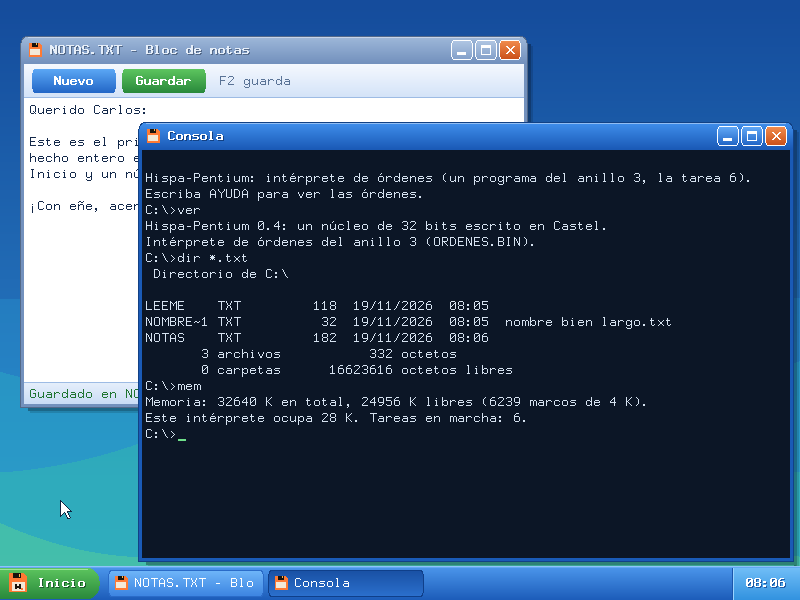

Copyright (C) 2026 Carlos Sanz y contribuidores. GPL-2.0 o posterior.

---

## 1. Cómo se arranca

**El escritorio** (sección 10), en QEMU, con su ventana (en un PC con escritorio;
o por VNC con `-display vnc=:1`):

```
cd castel
nucleo32/disco.sh /dev/shm/pentium.img
./compilar.sh nucleo32/semilla.cas /dev/shm/SEMILLA.BIN
qemu-system-i386 -kernel /dev/shm/SEMILLA.BIN -append "escritorio escritura" -m 32 -rtc base=localtime \
  -drive file=/dev/shm/pentium.img,format=raw,if=ide,index=0
```

(`escritorio` arranca el entorno gráfico; `escritura` deja escribir en el disco,
que si no es de solo lectura: sección 7. Con `modo=1024x768`, ese tamaño; con
`tapiz=1` o `tapiz=2`, otro fondo. Desde el intérprete de órdenes, la orden
`ESCRITORIO`; desde la consola del núcleo, `escritorio`.)

**La consola de texto**, con un disco:

```
cd castel
nucleo32/disco.sh /dev/shm/pentium.img            # un disco FAT16 con el intérprete y los programas
DISCO=/dev/shm/pentium.img ARRANQUE=ordenes MODULOS= nucleo32/probar.sh "" dir "type leeme.txt" "eco hola y adios" malo mem salir apagar
ESCRIBE=1 DISCO=/dev/shm/pentium.img ARRANQUE=ordenes MODULOS= nucleo32/probar.sh "" "md cartas" "echo hola > cartas\\una.txt" "dir cartas" salir apagar
fsck.fat -n /dev/shm/pentium.img                  # el disco, visto desde fuera: sano
```

`nucleo32/disco.sh IMAGEN [12|16|32|mbr]` hace la imagen de un disco duro con
`mkfs.fat` y `mtools`: FAT16 (16 MB) si no se dice otra cosa, FAT12 (4 MB), FAT32
(40 MB) o un disco con tabla de particiones y la FAT16 en la primera. Dentro van
`ORDENES.BIN` (el intérprete de órdenes), `HOLA.BIN`, `ECO.BIN`, `MALO.BIN`,
`CLI.BIN`, `PRUEBA.BIN`, `ESCRIBE.BIN`, `BUCLE.BIN`, tres archivos de órdenes
(`LOTE.BAT`, `SINFIN.BAT`, `VISTO.BAT`), `LEEME.TXT` y las carpetas `TEXTOS` y
`LARGOS` (esta, con nombres largos).

`nucleo32/probar.sh` compila el núcleo (`semilla.cas` con sus módulos), arranca
QEMU con `-kernel SEMILLA.BIN`, con la imagen de `DISCO=` como disco IDE (y con
`escritura` en la línea del núcleo, salvo con `SOLO_LECTURA=1`) y le
teclea las órdenes por el monitor de QEMU (como un teclado de verdad: el español,
tecla a tecla, con sus acentos; `:tecla ctrl-c` o `:tecla up ret` pulsan esas
teclas tal cual; y, para el escritorio, `:clic X Y`, `:doble X Y`, `:arrastra X1 Y1
X2 Y2`, `:raton X Y`, `:escribe texto`, `:pausa S` y `:captura NOMBRE`, que deja
la pantalla en `$CAPTURAS/NOMBRE.ppm`; y `:monitor ORDEN`, que le da esa orden al
monitor de QEMU: `device_add` y `device_del`, para enchufar y quitar aparatos USB
en marcha, sección 11). **Lo que se escribe en el disco no llega a la imagen** (se queda
en una copia de QEMU) **salvo con `ESCRIBE=1`**. Lo que se escribe sale por la pantalla y por el puerto serie, y el
script lo enseña con el código con que acaba el núcleo. Con `ARRANQUE=ordenes`
(lo que QEMU pasa con `-append`), el núcleo lanza el intérprete de órdenes nada
más arrancar; sin eso, se queda en su consola (la del núcleo, sección 9), y el
intérprete se lanza con la orden `ordenes`. Sin `DISCO=` el núcleo arranca igual,
con los programas de siempre como módulos de multiboot (`-initrd`; `MODULOS=`
para que no lleve ninguno).

**Para verlo y teclear uno mismo** (en un terminal de texto; se sale con Esc y
luego 2, `quit`; o tecleando `salir` y `apagar`):

```
cd castel
nucleo32/disco.sh /dev/shm/pentium.img
./compilar.sh nucleo32/semilla.cas /dev/shm/SEMILLA.BIN
qemu-system-i386 -kernel /dev/shm/SEMILLA.BIN -append "ordenes escritura" -m 32 -display curses -rtc base=localtime \
  -drive file=/dev/shm/pentium.img,format=raw,if=ide,index=0 -device isa-debug-exit,iobase=0xf4,iosize=0x04
```

(Así, con `escritura`, **sí se escribe en la imagen**: lo que se cree o se borre queda en
`/dev/shm/pentium.img`, y se puede mirar luego con `mdir -i /dev/shm/pentium.img ::`
o comprobar con `fsck.fat -n`. El teclado es el español. **Ojo con `-display
curses`**: ahí QEMU no recibe teclas, sino las letras que le manda el terminal, y
las convierte en teclas de un teclado de EE. UU.: hay que arrancar con
`-append "ordenes escritura teclado=us"` (probado: van todas las letras y signos del ASCII,
con su `\` y su `>`; no la eñe ni los acentos). Con `-k es` QEMU las convierte al
teclado español y la eñe sale, pero no sabe dar las de Alt Gr ni las vocales con
acento. Para ver el teclado español entero, la ventana de QEMU en un PC con
escritorio (sin `-display curses`) o un PC de verdad: ahí cada tecla llega como
es.) Sin QEMU: `SEMILLA.BIN` lo arranca cualquier cargador multiboot
(GRUB: `multiboot /SEMILLA.BIN ordenes`), y el disco es el primero del canal IDE
primario.

```
Hispa-Pentium (semilla), un núcleo de 32 bits escrito en Castel
memoria: 32 MB, 7862 marcos libres; paginación activa; 0 programas de usuario.
disco 0: QEMU HARDDISK, 16 MB, FAT16.
lanzo ORDENES.BIN del disco (la tarea 3, en el anillo 3)

Hispa-Pentium: intérprete de órdenes (un programa del anillo 3, la tarea 3).
Escriba AYUDA para ver las órdenes.
C:\>md cartas
C:\>cd cartas
C:\CARTAS>echo Querida señora: ¿qué tal está? > maría.txt
C:\CARTAS>type \leeme.txt >> maría.txt
C:\CARTAS>copy maría.txt copia.txt
        1 archivo(s) copiado(s).
C:\CARTAS>ren copia.txt otra.txt
C:\CARTAS>dir
 Directorio de C:\CARTAS

.             <DIR>       19/11/2026  03:23
..            <DIR>       19/11/2026  03:23
MARIA    TXT         150  19/11/2026  03:23
OTRA     TXT         150  19/11/2026  03:23
       2 archivos           300 octetos
       2 carpetas      16631808 octetos libres
C:\CARTAS>del otra.txt
C:\CARTAS>cd ..
C:\>lote uno dos
lote: empiezo con uno y dos (y el 100%)
desde el lote
(ECO.BIN ha acabado con el código 3)
lote: una línea
lote: y otra

Pulse una tecla para seguir . . . 
lote: fin
C:\>bucle
bucle: doy vueltas sin fin (Ctrl+C para acabar)
^C
C:\>salir
Hasta luego.
ORDENES.BIN ha acabado con el código 0; marcos libres: 7862 antes y 7862 después
```

(Lo de arriba sale de `ESCRIBE=1 DISCO=/dev/shm/pentium.img ARRANQUE=ordenes MODULOS=
nucleo32/probar.sh "" "md cartas" "cd cartas" "echo Querida señora: ¿qué tal está? >
maría.txt" ... "lote uno dos" ":tecla spc" bucle :espera ":tecla ctrl-c" salir
apagar`; después, `fsck.fat -n /dev/shm/pentium.img` da el disco por sano y `mdir -i
/dev/shm/pentium.img ::CARTAS` enseña `MARIA.TXT`.)

---

## 2. Las piezas

El núcleo son unas 15.000 líneas de Castel en treinta y tres módulos (más la
biblioteca de 32 bits, `castel/biblioteca32/`: Textos32, Mem32 y Formato,
CASTEL32.md §7). Sale un binario de unos 141 K (un tercio, el entorno gráfico; una
cuarta parte, los discos y el USB).

| Módulo | Qué hace |
|---|---|
| `cpu.cas` (Cpu) | La **GDT** nueva: código y datos del anillo 0 (0x08, 0x10), del anillo 3 (0x1B, 0x23) y el **TSS** (0x28, cargado con `ltr`). La **IDT** (`pon_puerta`, con puertas del anillo 0 o llamables desde el 3), los dos **8259** (IRQ en 0x20-0x2F) y el **reloj 8253** a 100 Hz. Lo que solo se dice en ensamblador: CR0, CR2, CR3, `cli`/`sti` (`sin_interrupciones` y `reponer`), `hlt`. |
| `multiboot.cas` (Multiboot) | Lo que cuenta el cargador: la memoria alta, el **mapa de memoria** región a región, los **módulos** que ha cargado y lo que se le ha dicho al núcleo al arrancarlo (`-append`). |
| `marcos.cas` (Marcos) | El **gestor de marcos físicos**: un mapa de bits, un bit por marco de 4 K (hasta 1 GB). Al empezar suelta lo que el mapa dice libre y tapa el primer mega, el propio núcleo, la información del cargador, sus textos (lo que se le dice al núcleo y los nombres de los módulos: QEMU los deja justo detrás del núcleo) y sus módulos. `reservar_marco` (lo da a cero) y `soltar_marco` (no cuenta dos veces). |
| `paginas.cas` (Paginas) | La **paginación**: directorio y tablas de páginas, `mapear`, `desmapear`, `traducir`; el directorio del núcleo (la identidad) y uno por programa (`nuevo_espacio`, `soltar_espacio`); la **zona a la demanda**; y `usuario_puede`, para que la llamada al sistema no toque lo que no es del programa. |
| `monton.cas` (Monton) | El **montón del núcleo**: `reservar` y `liberar`, con cabecera, pie, relleno y comprobación (sección 4). |
| `tareas.cas` (Tareas) | Las **tareas**: fichas, colas, el **reloj que cambia de tarea**, `ceder`, `dormir`, `bloquear`/`despertar_tarea`, `terminar` y `esperar`; los **cerrojos** (`tomar`, `soltar`) y las tareas huérfanas (sección 5). |
| `consola.cas` (Consola) | El **teclado** (el PS/2, por la IRQ 1, o uno USB: el español, con teclas muertas, Alt Gr y Bloq Mayús; su cola de letras, `leer_tecla`; Ctrl+C) y la **pantalla**, cada uno con su cerrojo: `escribir_trozo` (una ristra entera sin que se cuele otra tarea), `borrar_pantalla` (secciones 5 y 9). |
| `pci.cas` (Pci) | El **bus PCI**: leer y escribir la configuración de cada aparato (puertos `0xCF8` y `0xCFC`) y buscar los de una clase (la controladora SATA, las de USB), también detrás de los puentes. |
| `ata.cas` (Ata) | Los **discos duros ATA** del canal IDE primario, en PIO y con LBA de 28 bits: `identificar` (IDENTIFY: modelo y sectores), `leer_sectores`, `escribir_sectores` y `asentar` (sección 7). |
| `ahci.cas` (Ahci) | Los **discos SATA** de una controladora **AHCI**: los puertos, IDENTIFY, leer y escribir por **DMA** con **LBA de 48 bits** (sección 7). |
| `discos.cas` (Discos) | **Los discos, sean de la clase que sean** (IDE, SATA, USB): una tabla, y leer, escribir y asentar sin saber qué hay debajo. Lleva el **permiso de escritura** de cada disco. |
| `fat.cas` (Fat) | El **sistema de archivos FAT12/16/32**, para leer y escribir, con **varios volúmenes montados a la vez**: abrir por la ruta, leer, escribir, cortar, borrar, cambiar de nombre, hacer y borrar carpetas, los nombres largos, los clusters libres (sección 7). |
| `unidades.cas` (Unidades) | **Las unidades y sus letras**: mira las particiones de cada disco (tabla del **MBR** y **GPT**), monta cada volumen FAT y le da su letra (C:, D:... los de dentro; X:, W:, V:... las memorias USB; M: la unidad en memoria); y cuál es la **unidad del sistema**. |
| `usbbase.cas`, `xhci.cas`, `ehci.cas`, `uhci.cas`, `usb.cas` | **El USB** (sección 11): las controladoras **xHCI** (USB 3), **EHCI** (USB 2.0) y **UHCI** (USB 1.1), quitárselas a la BIOS, y **enumerar** lo que hay enchufado, también detrás de **concentradores**. |
| `usbhid.cas` (Usbhid) | Los **teclados y ratones USB** (y los paneles táctiles que se presentan como ratón): le dan a `consola.cas` y a `raton.cas` lo mismo que los PS/2. |
| `usbalm.cas` (Usbalm) | Las **memorias USB** (almacenamiento «solo a granel», órdenes SCSI): un disco más para `discos.cas`. |
| `usbcal.cas` (Usbcal) | **El USB en caliente** (desde la 0.8, sección 11): la tarea que mira los puertos y atiende lo que se enchufa y se desenchufa en marcha, y «quitar con seguridad». |
| `registro.cas` (Registro) | El **registro del arranque**: lo que el núcleo dice de los discos y del USB, apuntado para guardarlo en `ARRANQUE.TXT`. |
| `fecha.cas` (Fecha) | La **fecha y la hora** del reloj de pila del PC (la CMOS), como las guarda la FAT; y **ponerlo en hora**. |
| `ajustes.cas` (Ajustes) | Los **ajustes de un sistema instalado** (`\HISPA\HISPA.INI`): el nombre del usuario y del equipo y el teclado (sección 12). |
| `usuario.cas` (Usuario) | Los **programas del anillo 3**: los carga **del disco** (o de los módulos de multiboot) en su espacio de direcciones y atiende la **llamada al sistema** (`int 0x80`, sección 6). |
| `permisos.cas` (Permisos) | (PROTEGE, 0.8.4) **La zona protegida**: quién puede escribir qué en `\HISPA` (la tabla), los secretos que solo lee su dueño, el **sello** que el núcleo pone a los programas del sistema por la ruta de la que los carga y la marca de **servicio** (sección 14 sexies). |
| `video.cas` (Video) | El **modo gráfico**: el que haya dejado el cargador (multiboot) o el de la **VBE de Bochs/QEMU**; la memoria de la pantalla, a la vista del núcleo; y, si el modo no es de 32 bits, el volcado a 24 o a 16 (sección 10). |
| `edid.cas` (Edid) | Lo que dice la **pantalla** de sí misma (su EDID): en QEMU, de su tarjeta; en las Intel, por el DDC con el GMBUS; la nativa, lo más grande y su nombre (sección 10). |
| `grafico.cas` (Grafico), `letra.cas` (Letra) | **Dibujar**: los lienzos; rectángulos, degradados, esquinas redondas, líneas, círculos, el disquete de la casa, texto con la **letra de 8x16** (la de Hispa Ventanas, hecha por `hazletra.py`) y copiar de un lienzo a otro. |
| `raton.cas` (Raton) | El **ratón** (el PS/2, por la IRQ 12, o uno USB): dónde está la flecha y la cola de clics. |
| `touchpad.cas` (Touchpad) | (TOUCHPAD) **El touchpad Synaptics en modo absoluto**: de sus paquetes, el ratón (mover, tocar para hacer clic, el borde derecho como rueda, dos dedos, la palma); sin tocar el equipo (sección 14 sexvicies). |
| `ventanas.cas` (Ventanas) | El **gestor de ventanas**: un lienzo por ventana, el marco, el orden, componer solo lo que cambia con doble búfer, la flecha (y sus formas), mover y **cambiar de tamaño**, y repartir el ratón y las teclas. |
| `emergente.cas` (Emergente) | Los **menús emergentes**: el del botón secundario y el que cuelga de una barra de menús. |
| `terminal.cas` (Terminal) | Los **terminales**: dos tubos para que una ventana tenga dentro al intérprete de órdenes y a sus programas. |
| `escritorio.cas` (Escritorio) | El **escritorio**: el tapiz y sus **iconos**, la barra de tareas, el menú Inicio, el reloj, los cuadros (apagar, configuración, «Acerca de»), los menús del botón secundario, y la tarea que lo mueve todo. |
| `organiza.cas` (Organiza) | (ICONOS) **Dónde van los iconos del tapiz**: la zona de trabajo (sin la barra ni el dock), la rejilla, organizarlos (por nombre, tipo, tamaño o fecha), la organización automática, la cuadrícula, las páginas si no caben, `ICONOS.INI` y los archivos de la carpeta ESCRITOR (sección 10, «Los iconos del tapiz»). |
| `red.cas` (Red) | **La red**, lo que pone el núcleo (sección 14): el cartero entre los programas y el servicio de red (`RED.BIN`) —y el servicio TLS (`TLS.BIN`), con la llamada 99—, y lo que solo el servicio de red puede pedir: los puertos, memoria física seguida para el DMA, los registros de la tarjeta y su interrupción. |

| `energia.cas` (Energia) | **Apagar de verdad, reiniciar y la batería**: las llamadas del servicio de ACPI (`ACPI.BIN`, un programa del anillo 3 con ACPICA) y la 154; apagar por ACPI (S5) y reiniciar (FADT, 8042, CF9h); la pila de la bandeja y su recuadro de ayuda (sección 11). |
| `dispositivos.cas` (Dispositivos) | **Lo que hay en el equipo y qué lo lleva** (desde la 0.8.3): las llamadas 155 (la lista, de solo lectura) y 156 (lo que apuntan los servicios del anillo 3), para el Administrador de dispositivos (sección 10). |
| `sonido.cas` (Sonido) | (SONIDO) **El sonido**, lo que pone el núcleo (sección 14 decies): los canales de los programas (sus colas), el volumen general, el silencio, los sonidos del sistema y las órdenes para el servicio de sonido (`SONIDO.BIN`); las llamadas 190 a 199. |
| `preferencias.cas` (Preferencias) | (PANEL) **Los ajustes del Panel de control** (sección 14 quattuordecies): la llamada 174, aplicarlos (el ratón, el teclado, el tema, el tapiz...) y `PANEL.INI`, que escribe solo el núcleo. |
| `iconpanel.cas` (Iconpanel) | (PANEL) **Los iconos del Panel de control** (Configuración y PANEL.BIN), dibujados, cada uno con su forma. |
| `win32.cas` (Win32) | [WIN32] **Lo de los programas de Windows** (sección 14 quater): las llamadas 180 a 182 (páginas en cualquier sitio de la zona del programa, el mapa de las teclas, las ventanas sin marco o a pantalla completa). |
| `semilla.cas` (Semilla) | El programa: arranca todo lo anterior; las **excepciones** (con el fallo de página, que se atiende) y la **consola del núcleo** con sus órdenes (sección 9). |

Y, para el anillo 3 (`modelo usuario`, CASTEL32.md §1), también en Castel:

| Archivo | En el disco | Qué es |
|---|---|---|
| `llamadas.cas` (Llamadas) | — | El **módulo de las llamadas al sistema** para los programas: `tecla`, `leer_línea` (con su historia), `abrir`, `crear`, `leer`, `escribir_archivo`, `mover`, `cortar`, `cerrar`, `borrar`, `renombrar`, `crear_carpeta`, `cambiar_carpeta`, `redirigir`, `entrada`, `lanzar`, `esperar`, `argumentos`, `dato`, `más_memoria`...; y las **ventanas** (`ventana`, `suceso`, `rectángulo`, `degradado`, `texto`, `mapa`...), los **menús** (`menú`), el **portapapeles** (`al_portapapeles`, `del_portapapeles`) y los terminales. Un programa lo importa y no escribe ni una `int 0x80`. |
| `barramenu.cas` (Barramenu) | — | La **barra de menús** de una ventana (Archivo, Edición, Ayuda): pintarla, saber qué rótulo se ha pulsado y abrir su menú. |
| `sha256.cas` (Sha256) | — | El resumen **SHA-256** (FIPS 180-4): `empezar`, `añadir`, `acabar` (sección 13). |
| `uinstala.cas` | `INSTALAR.BIN` | **INSTALAR**: instala el sistema en el disco duro, en pantalla azul (sección 12). |
| `upaquete.cas` | `PAQUETES.BIN` | **PAQUETES**: instala, actualiza y quita paquetes `.HPQ`, con sus dependencias, sus sumas y deshaciendo lo que quede a medias (sección 13). |
| `uactual.cas` | `ACTUALIZ.BIN` | La ventana **«Programas y actualizaciones»** del escritorio: la de PAQUETES (sección 13). |
| `uasiste.cas` | `ASISTE.BIN` | El **asistente del primer arranque** de un sistema instalado (sección 12). |
| `ubloc.cas` | `BLOC.BIN` | El **Bloc de notas** 1.0 del escritorio (sección 14 quindecies), con sus módulos: `bloctxt.cas` (el texto: búfer con hueco y la historia), `blocvis.cas` (lo que se ve), `blocarc.cas` (leer y guardar), `blocbus.cas` (buscar), `blocexp.cas` (expresiones regulares), `blocpag.cas` (las páginas), `blocdif.cas` (comparar), `bloclen.cas` con `bloc/lenguajes/*.LEN` y `blocdef.cas` (los lenguajes), `letramono.cas` (la letra de ancho fijo) y `blocmem.cas` (la memoria). |
| `uequipo.cas` | `EQUIPO.BIN` | **Mi equipo**: las unidades (con su letra, de qué son y lo que cabe en ellas) y lo que hay dentro (sección 10). |
| `udisposi.cas` | `DISPOSIT.BIN` | El **Administrador de dispositivos**: el PCI, el USB, ACPI, los discos, lo de siempre y el procesador, con el controlador de cada cosa, sus recursos y un informe (sección 10). |
| `uconsola.cas` | `CONSOLA.BIN` | La **Consola** del escritorio: el intérprete de órdenes dentro de una ventana (sección 10). |
| `uordenes.cas` | `ORDENES.BIN` | El **intérprete de órdenes** (sección 8). |
| `uhola.cas` | `HOLA.BIN` | Escribe, suma, duerme, pide su número de tarea y prueba que la llamada al sistema no le deja enseñar la memoria del núcleo. |
| `ueco.cas` | `ECO.BIN` | Enseña sus argumentos (y acaba con cuántas palabras eran). |
| `umalo.cas`, `ucli.cas` | `MALO.BIN`, `CLI.BIN` | Los que hacen lo que no deben: leer la memoria del núcleo y hacer `cli`. |
| `uprueba.cas` | `PRUEBA.BIN` | Prueba las llamadas al sistema desde dentro: la memoria que crece, leer un archivo a trozos, abrir de más, punteros que no son suyos, lanzar y esperar, escribir dos a la vez. |
| `uescribe.cas` | `ESCRIBE.BIN` | Prueba **escribir en el disco** desde dentro: crear, escribir a trozos, leer de vuelta, escribir en medio, cortar, alargar con hueco, añadir; lo que no se puede; las carpetas; con `lleno`, llena el disco y lo vacía. |
| `redes.cas` (Redes) | — | La **red para los programas** (sección 14): `estado_red`, `resolver`, `ping`, `conectar`, `enviar`, `recibir`, los puertos UDP... |
| `ured.cas` con `rbase.cas`, `rtarjeta.cas`, `ryukon.cas`, `rpila.cas` y `rtcp.cas` | `RED.BIN` | El **servicio de red**: las tarjetas y la pila TCP/IP (sección 14). |
| `tls/tls.c` con BearSSL (en C: `tls/hacer.sh`) | `TLS.BIN` | El **servicio TLS**: las conexiones cifradas, HTTPS (sección 14). |
| `sonido/*.c` (en C: `sonido/hacer.sh`) | `SONIDO.BIN` | (SONIDO) El **servicio de sonido** (HD Audio, AC'97 y Sound Blaster 16; la mezcla; los sonidos del sistema) y la orden **SONIDO** (sección 14 decies). |
| `uhttps.cas` (con `biblioteca32/https.cas`) | `HTTPS.BIN` | La orden **HTTPS**: pedir direcciones con la biblioteca `Https` (sección 14). |
| `uipconf.cas`, `uping.cas`, `udescarg.cas` | `IPCONFIG.BIN`, `PING.BIN`, `DESCARGA.BIN` | **IPCONFIG**, **PING** y **DESCARGAR** (sección 14). |
| `upanel.cas` | `PANEL.BIN` | (PANEL) **El Panel de control**: Fecha y hora, Ratón, Teclado, Red y Wi-Fi, Energía y Personalización (sección 14 quattuordecies). |
| `uraton.cas` | `RATON.BIN` | (TOUCHPAD) **El touchpad**: qué hay, `RATON /TOUCHPAD` (graba lo que manda en TOUCHPAD.TXT), `/ANALIZA` y `/INYECTA` (las pruebas) (sección 14 sexvicies). |
| `uhorared.cas` con `ntp.cas` y `zonas.cas` | `HORARED.BIN` | (NTP) **La hora por Internet** (SNTP) y el horario de verano; la orden HORARED (sección 14 quattuordecies). |
| `panelaj.cas` (Panelaj) | — | (PANEL) Las llamadas 174 (los ajustes) y 175 (la hora exacta) para los programas. |
| `ubucle.cas` | `BUCLE.BIN` | El que no acaba nunca (da vueltas, duerme, espera teclas o escribe sin parar): para probar **Ctrl+C**. |

---

## 3. La memoria

Las direcciones (lo mismo en todos los espacios, menos la parte del usuario):

| Desde | Hasta | Qué |
|---|---|---|
| `0x00000000` | la memoria que haya (hasta 1 GB) | **la identidad**: la memoria de verdad, tal cual. El núcleo, sus variables, la pantalla y los marcos (un marco se toca por su dirección física). Solo el anillo 0. |
| `0x40000000` | `0xBFFFFFFF` | **el programa de usuario** (anillo 3): cada uno, en su directorio. Su código y sus datos; detrás, lo que pida de más (`más_memoria`, sección 6); y arriba del todo (desde `0xBFC00000`), **su pila**, que crece hacia abajo. |
| `0xC0000000` | `0xC3FFFFFF` | **el montón del núcleo** (hasta 64 MB: de él salen los lienzos de las ventanas, el doble búfer y el tapiz). |
| `0xD0000000` | `0xD03FFFFF` | **la zona a la demanda** (4 MB): vacía; el fallo de página pone un marco donde se toque. |
| `0xE0000000` | `0xE0FFFFFF` | **la pantalla gráfica** (16 MB): la memoria de la tarjeta, que está muy por encima de la RAM, puesta aquí cuando se entra en un modo gráfico. Sus tablas están hechas desde el arranque: la ven todos los espacios de direcciones. |
| `0xE8000000` | `0xE83FFFFF` | **los registros de los aparatos** (4 MB): los de la controladora AHCI y los de las de USB, que también están por encima de la RAM (`mapear_aparato`, sin caché). Su tabla, hecha desde el arranque. |

- Los marcos salen del **mapa de memoria de multiboot**; sin él, de la memoria
  alta que diga el cargador. Con QEMU y 32 MB: 8160 marcos, unos 7835 libres al
  arrancar.
- El directorio del núcleo lleva la identidad con páginas de 4 K (sin páginas
  grandes: vale para el 386) y, hechas desde el principio, las tablas del montón y
  de la zona a la demanda. Así, lo que se ponga ahí después lo ven todos los
  espacios de direcciones, que **copian las entradas del núcleo** al hacerse.
- La paginación se enciende con `CR0.PG` sobre ese directorio. Cambiar de espacio
  es cambiar CR3 (lo hace el cambio de tarea si la siguiente tiene otro). Quitar
  una página del directorio en uso vuelve a cargar CR3 (la TLB se vacía); no se
  usa `invlpg`, que es del 486. **También se vacía al quitar una página del
  núcleo** (del montón o de la zona a la demanda) aunque el directorio puesto sea
  el de un programa: el núcleo trabaja ahora dentro de las llamadas al sistema,
  con el directorio del programa, y esas páginas están en todos. (Sin eso, el
  montón que bajaba y volvía a subir escribía en el marco viejo: salió al lanzar
  dos programas a la vez desde el anillo 3.)
- **El fallo de página** (excepción 14) mira CR2 y el código de error. Si es del
  núcleo, en la zona a la demanda y la página no estaba, le pone un marco a cero y
  vuelve: la instrucción se repite y ahora llega. Si no, dice dónde ha sido y por
  qué (`lectura`/`escritura`, `núcleo`/`anillo 3`, `no presente`/`protección`) y en
  qué instrucción; si era del anillo 3, se acaba esa tarea y el núcleo sigue; si era
  del núcleo, se para (código 14).

## 4. El montón

Bloques seguidos, cada uno con una **cabecera** (magia, tamaño, estado, lo pedido),
lo pedido, un **relleno** de `0xCD` (4 octetos por lo menos) y un **pie** (tamaño y
otra magia). Se toma el primer hueco que valga (partiéndolo si sobra); si no hay,
el montón crece poniendo marcos debajo, de página en página. Al soltar se juntan
los huecos vecinos (nunca hay dos seguidos) y, si lo suelto es lo de arriba del
todo, el montón baja y **devuelve los marcos**.

Al soltar se comprueba todo: que el puntero sea de un bloque, las dos magias, el
tamaño, el estado y que el relleno siga intacto. Un bloque que **se suelta dos
veces**, un puntero que **no es de un bloque** o lo **escrito más allá de lo
pedido** se dicen, y el montón no se toca. `revisar()` recorre el montón entero con
las mismas comprobaciones y cuenta lo que hay.

## 5. Las tareas

Cada tarea tiene su ficha (estado, nombre, su pila del núcleo de 8 K, del montón,
su directorio, cuándo despierta, quién la espera, con qué ha acabado, sus turnos y
sus tics) y la pila guarda lo demás: **lo que hay en la pila de una tarea parada es
lo que dejó la interrupción que la paró** (lo que apila el procesador y lo que
guarda `pushad`). La ficha guarda dónde empieza eso, su «marco».

**Cambiar de tarea es cambiar de marco**: las dos funciones de interrupción que
cambian (el reloj, IRQ 0, y la 0x30, la de `ceder()`) guardan su EBP (que, nada más
entrar, apunta a lo de `pushad`) en la ficha de la que corre, eligen la siguiente y
ponen en EBP el de ella; su salida normal (`mov esp, ebp`, `popad`, `iretd`) la
reanuda. Una tarea nueva lleva su marco hecho a mano, como si la hubieran parado
justo al empezar (y, encima, adónde vuelve su función al acabar). Para el anillo 3,
el marco lleva además la pila y el selector de usuario, y el TSS da al procesador
la pila del núcleo de la tarea que corre.

- **Apropiativa**: a cada tic (100 por segundo), si hay otra tarea lista, le toca a
  ella (por turno, de una cola). Dos tareas que cuentan sin parar y no ceden nunca
  se alternan cien veces por segundo (la orden `turnos`).
- Si no hay nadie listo, corre la **ociosa**: un `hlt` detrás de otro.
- **`dormir(n)`**: la tarea pasa a la lista de las dormidas hasta el tic que toca
  (el reloj las despierta).
- **`bloquear()` y `despertar_tarea(t)`**: esperar a algo. La consola espera así a
  las teclas: el teclado la despierta.
- **`terminar(c)`** y **`esperar(t)`**: una tarea acaba con su código (también la
  que vuelve de su función, con 0); quien la espera la recoge: su pila vuelve al
  montón y, si es del anillo 3, su espacio de direcciones entero vuelve a los
  marcos libres.
- **Padres y huérfanas**: cada tarea sabe quién la hizo. Si un programa acaba sin
  esperar a los que lanzó, se quedan huérfanos y **los recoge el núcleo** cuando
  acaban (`recoger_huérfanas`, al hacer una tarea nueva y en la consola).
- **Los cerrojos** (`tomar(c)` y `soltar(c)`): lo que es de todos y tarda (la
  pantalla, el teclado, el canal del disco, la FAT) lo usa una tarea cada vez. La
  que encuentra el cerrojo tomado **espera en su cola, sin tapar las
  interrupciones**: el reloj sigue repartiendo el procesador entre las demás. Quien
  lo suelta se lo da a la primera de la cola. La misma tarea lo puede tomar varias
  veces.
- **La consola con su cerrojo** (`consola.cas`): la llamada al sistema `escribir`
  saca su ristra entera con el cerrojo de la pantalla tomado, así que dos
  programas que escriben a la vez no se mezclan las letras (las pruebas lanzan dos
  que escriben 120 líneas cada uno sin parar: salen las 240 enteras). La tecla de
  retroceso mueve el cursor un sitio atrás (también en la pantalla). Lo que
  escribe el núcleo con `escribir()` va directo, sin cerrojo (una excepción
  siempre puede decir lo suyo); una tarea del núcleo que quiere una línea entera la
  envuelve en `tomar_consola()` y `soltar_consola()` (antes tapaba las
  interrupciones). Leer el teclado también va con cerrojo: si varias tareas leen,
  esperan en fila.
- **Ctrl+C acaba los programas en marcha.** Cuando el teclado lo ve, marca los
  programas del anillo 3 (menos los que han dicho que lo atienden ellos: un
  intérprete de órdenes) para acabar, y despierta a los que dormían o esperaban
  una tecla o a otro programa. **Una tarea solo se acaba cuando no está a medias
  de nada del núcleo**: al entrar o al salir de una llamada al sistema, o cuando
  el reloj la pilla corriendo en el anillo 3 (así se para también un programa que
  da vueltas sin llamar nunca al sistema). Se le cierran sus archivos (lo escrito
  queda en el disco), sale `^C` y acaba con el código 254; quien la esperaba
  sigue. A los que lo atienden ellos les llega como una tecla (el 3) si no había
  nadie a quien acabar, y se les apunta para que puedan preguntarlo (`hubo_corte`).
- **La carpeta de trabajo** es de cada tarea (un texto en su ficha: «» la raíz, o
  `\UNA\OTRA`); la hereda de quien la lanza, igual que **adónde va lo que
  escribe** (a la pantalla, o a un archivo: la redirección).

## 6. El anillo 3

Un programa de usuario es un binario plano de Castel con `modelo usuario`, con una
cabecera (`HPU3`, dónde va, dónde acaba lo del archivo, dónde lo que empieza a
cero, por dónde se empieza). El núcleo lo carga **de un archivo del disco** (lo lee
entero a su montón) o de un módulo de multiboot: le hace un **directorio de páginas
nuevo**, le pone marcos desde `0x40000000` hasta el final de sus variables (páginas
del usuario), copia lo del archivo y hace su tarea, que empieza en el anillo 3, con
sus argumentos guardados aparte (un texto).

La **llamada al sistema** es la `int 0x80` (una puerta que se puede llamar desde el
anillo 3). Lo que se pide va en EAX y sus datos en EBX, ECX y EDX; lo que se
devuelve, en EAX. Un programa en Castel no la escribe: `escribir` y `salir` son del
lenguaje, y lo demás lo da el módulo **Llamadas** (`llamadas.cas`).

| EAX | Qué | En `Llamadas` | Devuelve |
|---|---|---|---|
| 1 | escribir ECX octetos desde EBX | `escribir()`, `escribir_trozo` | los escritos |
| 2 | acabar con el código de EBX | `salir()`, volver de `principal` | (no vuelve) |
| 3 | dormir EBX tics | `dormir` | 0 |
| 4 | los tics desde que arrancó | `tics` | |
| 5 | el número de la tarea | `mi_tarea` | |
| 6 | **leer una tecla** (EBX = 0: la espera; 1: solo si la hay) | `tecla`, `tecla_si_hay`, `leer_línea` | la letra (página 437); 0x100 + su código si no es letra (las flechas...); o 0 |
| 7 | **abrir** el archivo o la carpeta de nombre EBX, del modo ECX (0 leer; 1 leer y escribir; 2 crearlo o dejarlo vacío; 3 escribir al final, creándolo si no está) | `abrir`, `abrir_para`, `crear` | su manejador |
| 8 | **leer** del archivo EBX, a ECX, hasta EDX octetos | `leer` | los leídos (0: el final) |
| 9 | **cerrar** el archivo EBX | `cerrar` | |
| 10 | **lanzar** el programa de nombre EBX con los argumentos ECX | `lanzar` | el número de su tarea |
| 11 | **esperar** a que acabe la tarea EBX (una lanzada por uno mismo); con ECX = 1, sin esperar (`acabada`: `SIGUE` si no ha acabado); (CORTES) con ECX = 2, **acabarla** a ella y a las que haya lanzado, esté esperando a lo que esté (la red, el disco): «Cancelar» y lo que no responde | `esperar`, `acabada`, `acabar_hija` | su código de salida |
| 12 | la entrada siguiente de la carpeta EBX, a ECX (32 octetos) | `entrada` | 1, o 0 si no hay más |
| 13 | lo que mide el archivo EBX | `largo_de` | |
| 14 | los argumentos del programa, a EBX (caben ECX) | `argumentos` | su largo |
| 15 | un dato del sistema (marcos libres y totales, páginas del programa, versión, tareas, la FAT, los clusters libres...) | `dato` | |
| 16 | borrar la pantalla | `borrar_pantalla` | |
| 17 | **mover el final de la memoria** del programa EBX octetos (con signo) | `más_memoria`, `menos_memoria` | el final de antes |
| 18 | **escribir** en el archivo EBX, desde ECX, EDX octetos | `escribir_archivo` | los escritos (menos si se llena el disco) |
| 19 | **mover la posición** del archivo EBX a ECX octetos (con signo) del principio (EDX = 0), de donde está (1) o del final (2) | `mover` | la posición nueva |
| 20 | **cortar** el archivo EBX en su posición (o alargarlo con ceros hasta ella) | `cortar` | 0 |
| 21 | **borrar** el archivo de nombre EBX | `borrar` | 0 |
| 22 | **cambiar el nombre** EBX por el nombre ECX (un archivo, también a otra carpeta) | `renombrar` | 0 |
| 23 | **hacer la carpeta** de nombre EBX | `crear_carpeta` | 0 |
| 24 | **borrar la carpeta** de nombre EBX (vacía) | `borrar_carpeta` | 0 |
| 25 | la **carpeta de trabajo** pasa a ser la de nombre EBX | `cambiar_carpeta` | 0 |
| 26 | la carpeta de trabajo, a EBX (caben ECX) | `carpeta_actual` | su largo |
| 27 | **redirigir**: lo que escriba el programa (y los que lance) va al archivo EBX, abierto para escribir (0xFFFFFFFF: otra vez a la pantalla) | `redirigir` | 0 |
| 28 | la entrada siguiente de la carpeta EBX, a ECX, y su **nombre largo**, a EDX (256 octetos) | `entrada_larga` | 1, o 0 si no hay más |
| 29 | **Ctrl+C**: lo atiende el programa (EBX = 1) o lo acaba (0) | `atender_corte` | 0 |
| 30 | ¿se ha pulsado Ctrl+C desde la última vez que se preguntó? | `hubo_corte` | 1 o 0 |
| 31 | el teclado: el español (EBX = 1) o el de EE. UU. (0); con otra cosa, solo dice cuál hay | `poner_teclado`, `teclado_español` | 1 o 0 |
| 32 | **una ventana nueva**: su nombre en EBX, y el ancho (ECX) y el alto (EDX) de lo de dentro | `ventana` | su número |
| 33 | cerrar la ventana EBX | `cerrar_ventana` | 0 |
| 34 | **dibujar** en la ventana EBX lo que dice la orden de ECX (qué, dónde, lo que mide, dos colores, unos datos y un número): un rectángulo, un degradado, uno redondeado, un borde, una línea, texto (fino, en negrita o sobre fondo), un mapa de puntos de 32 bits, desplazar un trozo, el disquete | `rectángulo`, `degradado`, `redondeado`, `marco`, `línea`, `texto`, `texto_negrita`, `texto_fondo`, `mapa`, `desplazar`, `disquete` | 0 |
| 35 | **el suceso siguiente** de la ventana EBX, a ECX (16 octetos); con EDX = 1, lo espera | `suceso` | 1, o 0 si no hay |
| 36 | cambiar el nombre (EBX: la ventana; ECX: el nombre) | `título` | 0 |
| 37 | **los terminales** (sección 10): EBX = 0, hacer uno; 1, leer lo que han escrito los de dentro (a ECX, hasta EDX octetos); 2, una tecla para ellos (ECX); 3, Ctrl+C | `hacer_terminal`, `leer_terminal`, `teclear`, `cortar_terminal` | |
| 38 | **poner en marcha el escritorio** | `escritorio` | 1 o 0 |
| 39 | **un menú emergente** para la ventana EBX, como dice lo de ECX (dónde, las opciones separadas por «\|», las que salen en gris y una etiqueta): lo elegido llega luego como el suceso «menú» | `menú` | 0 |
| 40 | **el portapapeles**: EBX = 0, guardar los EDX octetos de ECX; 1, copiar lo que hay a ECX (hasta EDX); 2, cuánto hay | `al_portapapeles`, `del_portapapeles`, `en_portapapeles` | los octetos |
| 41 | **lanzar un programa y soltarlo** (EBX: el nombre; ECX: sus argumentos): no hay que esperarlo | `lanzar_suelto` | su tarea |
| 42 | **la unidad de trabajo**: cambiarla (EBX: su letra; 0: solo preguntar) | `unidad` | la letra de la que queda |
| 43 | lo que se sabe de **la unidad** número EBX (o del disco sin unidad), a ECX | `info_unidad` | 1, o 0 si no hay tantas |
| 60 | **texto en la pantalla de texto**: EDX letras de ECX en la columna (bits 0-7 de EBX) y la fila (8-15), con el color de los bits 16-23; con el bit 31, EDX veces la letra ECX. No con el escritorio en marcha ni en un terminal | `texto_en`, `letras_en` | las escritas |
| 61 | ECX octetos de EBX, **solo al puerto serie** | `al_serie` | |
| 62 | **el cursor** de la pantalla de texto, a la columna y la fila de EBX (una fila de 25 para arriba: no se ve) | `cursor_en` | 0 |
| 63 | lo que se sabe del **disco** número EBX (su clase, sus sectores, su modelo, si se puede instalar en él), a ECX | `info_disco` | 1, o 0 si no hay tal disco |
| 64 | **leer sectores** del disco EBX, como dice ECX (el primero, cuántos —hasta 128— y adónde) | `leer_disco` | 0 |
| 65 | **escribirlos**. Solo con `instalar` en la línea del cargador, en un disco de dentro que no lleve la unidad del sistema (nunca en una memoria USB); las unidades de ese disco dejan de estar montadas | `escribir_disco` | 0 |
| 66 | **reiniciar** el equipo | `reiniciar` | (no vuelve) |
| 67 | **poner en hora el reloj del PC**: la fecha (EBX) y la hora (ECX), como las guarda la FAT | `poner_reloj` | 0 |
| 68 | **los ajustes** (`HISPA.INI`): EBX = 0, leerlos otra vez; 1, el nombre del usuario, a ECX; 2, ¿está el sistema instalado en el disco?; 3, el nombre del equipo | `releer_ajustes`, `nombre_usuario`, `sistema_instalado`, `nombre_equipo` | |
| 130 | **quitar con seguridad** la memoria USB de la unidad de letra EBX (desde la 0.8): lo pendiente se escribe, la memoria se para y sus unidades dejan de estar | `quitar_memoria` | 0 (`QUITADA`), ya se puede quitar; 1, no hay tal unidad; 2, no es una memoria USB; 3 (`ES_DEL_SISTEMA`), el sistema corre desde ella |
| 131 | las veces que han **aparecido o desaparecido unidades** (además, a las ventanas de los programas les llega `EV_UNIDADES`) | `cambios_unidades` | ese número |
| 134 | (REPRODUCTOR) **el CD de música** del lector de la letra EBX: ECX = 0, la tabla de las pistas (una `Toc_cd`) a EDX; 1, leer sectores de sonido (una `Pide_sonido` en EDX: el lba, cuántos —hasta 64—, adónde; 2.352 octetos cada uno); 2, en crudo (sección 14 sexdecies) | `cd_pistas`, `cd_sonido` | 0, `NO_HAY` o `MAL` |
| 135 | (REPRODUCTOR) **el icono de la ventana** EBX (suya) **en la bandeja**: ECX, 16 x 16 puntos, la ayuda y las opciones de su menú; 0, quitarlo. Los clics le llegan como `EV_BANDEJA` | — | 0 |
| 170 | (explorador, 21/11) **los atributos** del archivo o la carpeta de nombre EBX: con ECX = 0xFFFFFFFF, solo leerlos; si no, poner los de solo lectura, oculto, de sistema y archivo (`0x27`: los de carpeta y volumen no se tocan) | `atributos_de`, `poner_atributos` | los que quedan, o un error |
| 171 | (explorador) **lo soltado fuera de la ventana**: EBX, la ventana (suya); ECX, una `Suelta` (el punto, dentro de la ventana, y una ruta entera con su letra). Lo recoge el escritorio: en el dock, se fija (o va a la Papelera); en el tapiz, un acceso nuevo | `soltar_fuera` | 0 (`EN_USO` si aún no ha recogido el de antes) |
| 172 | (MIRADOR) **una imagen como tapiz**: EBX = 1, la de ECX (una `Imagen_tapiz`: el ancho, el alto y sus puntos 0x00RRGGBB, ya a la medida de la pantalla), que el núcleo guarda en `FONDO.HPM` (al lado de `DOCK.INI`: `\HISPA` instalado, la raíz si no) y pinta el escritorio; EBX = 0, quitarla (vuelve el de siempre) | — | 0, o el error |
| 80 | **colocar la ventana** EBX (suya) con su esquina en (ECX, EDX) de la pantalla; con ECX = 0xFFFFFFFF, en el centro (encima de la barra de tareas). La usa HVPRUN (sección 10, «La oficina de Hispa-386») | — | 0 |
| 90-98 | **la red**: pedir al servicio de red (90) y lo del propio servicio (91 a 96, 98); cómo está (97). Las cuenta la sección 14 | `redes.cas` | |

| 190-199 | (SONIDO) **el sonido**: abrir un canal (190), darle muestras (191), el canal (192), el volumen y lo de todos (193), tocar un .WAV (194); y lo del servicio de sonido (195 a 199). Las cuenta la sección 14 decies | `abrir_canal`, `dar_muestras`, `orden_canal`, `tocar_wav`, `volumen_general`, `sonar` | |
| 180-182 | [WIN32] **los programas de Windows** (`WIN32.BIN`, sección 14 ter): poner y quitar páginas en cualquier sitio de la zona del programa (180), las teclas pulsadas ahora y desde la última vez (181: EBX el búfer, ECX lo que cabe —desde la 0.8.7—: 32 octetos, solo las pulsadas ahora; 64 o más, también las de desde la última vez; 0, los 64 de antes —WIN32 1.1, juegos 1.0 y Pluma 2.0 lo dan así, con un búfer de 64—; menos de 32, `NO_VALE`. Antes escribía siempre 64: un búfer de 32 en la pila se pisaba), y las ventanas: hacerlas sin marco o a pantalla completa, colocarlas, traerlas delante, dónde están, el ratón; (JUEGOS) llevar la flecha, lo movido de verdad y esconderla (182) | — | |
| 183-185 | (JUEGOS) **lo que pide un juego** (sección 14 quater ter): los hilos de un proceso de Windows, su TEB, el despachador de SEH, ceder y quitar las primeras 64 K (183); esperar mientras en una dirección haya un valor (184) y despertar a los que esperan (185). (El CD de sonido de los juegos es la 134, la del Reproductor, con la letra 0: el primer lector; la 186 queda libre) | `crear_hilo`, `acaba_hilos`, `a_su_despachador` | |

| 150-153 | **solo el servicio de ACPI** (`ACPI.BIN`): puertos, memoria física, configuración PCI, y dar la batería y esperar órdenes (sección 11, «Apagar de verdad y la batería») | — | |
| 154 | **la batería**: lo último que ha leído el servicio de ACPI (una `Energía`, `energia.cas`) a EBX | — | 1, o 0 si no hay servicio |
| 155 | (dispositivos) **la lista de los dispositivos** y qué los lleva: hasta ECX fichas `Dispositivo` (320 octetos, `dispositivos.cas`) a EBX. Solo lee | `lista_dispositivos` | cuántos hay (aunque no quepan) |
| 156 | (dispositivos; **solo los servicios**: `ACPI.BIN`, `RED.BIN`) apuntar la ficha de EBX (ECX = 0) u olvidar las suyas (ECX = 1) | — | 0 |
| 157 | (PROTEGE) **el modo administrador**: EBX = 0, pedirlo (lo pregunta el núcleo en la pantalla: sección 14 sexies); 1, dejarlo; 2, ¿se tiene? | `pedir_admin`, `dejar_admin`, `es_admin` | 1 o 0 (`DENEGADO` si no hay a quién preguntar) |
| 173 | (BLOC, REPRODUCTOR; la 0.8.7) **lo soltado desde Mi equipo** en una ventana suya (tras `EV_SOLTADO` = 14, que lleva el punto, visto desde dentro): la ruta, a EBX (caben ECX, con su 0). Una sola para todos: el Bloc de notas la abre en una pestaña, el Reproductor la pone en la lista. Se da una vez | `lo_soltado` | su largo; `NO_HAY` (nada para ella) o `NO_VALE` |
| 174 | (PANEL) **un ajuste del Panel de control**: EBX la clave, ECX el valor nuevo (0xFFFFFFFF: leerlo). Cambiarlo, el Panel de control o el modo administrador (sección 14 quattuordecies) | `ajuste`, `poner_ajuste` (`panelaj.cas`) | el que queda, o `DENEGADO` |
| 175 | (PANEL, NTP) **la hora exacta**: EBX = 0, el reloj del PC en segundos desde el 1/1/2000; EBX = 1, ponerlo a ECX (como la 67, y HORARED.BIN sin atrasarlo más de 2 horas) | `hora_exacta`, `poner_hora_exacta` | el reloj, o 0 / `DENEGADO` |
| 158 | (PROTEGE; **solo los servicios**) el sello de la tarea EBX (los de `permisos.cas`; con el bit 31, es un servicio) | `sello_de_tarea` | el sello, o `NO_VALE` |
| 100 | (WIFI) **pedir al servicio Wi-Fi** (`WIFI.BIN`), como la 90 (sección 14 octies) | — | la primera palabra de la respuesta (`SIN_WIFI` si no hay servicio) |

Desde la 0.8.4 (PROTEGE), **lo que toca archivos del sistema pasa por
`permisos.cas`**: la 7 (abrir para escribir; y, para leer, los secretos), la
21 a la 24, la 133 y la 170 (poner atributos) dan `DENEGADO` (0xFFFFFFF0,
«acceso denegado») donde el programa no tiene permiso; la 64 y la 65 (los
sectores en crudo) son solo de INSTALAR o del modo administrador; la 150 a la
152 y la 156, solo de las tareas que el núcleo ha marcado como servicio
(sección 14 sexies).

(La 15 con `DATO_TERMINAL`, el 15, (REPRODUCTOR) dice si el programa va en un
terminal (la Consola, SSH); con `DATO_MIS_TICS`, el 16, los tics en que el
reloj lo ha pillado corriendo. Con `DATO_ALTO_LIBRE`, el 14, da lo alto de la pantalla sin la barra
de tareas ni el dock: así una ventana grande puede quedar encima del dock. La
12 y la 28 dan además, en lo que antes iba a cero, la fecha del último
acceso (`reservado`) y la fecha y la hora en que se hizo el archivo (`libre`:
abajo la fecha, arriba la hora). La 22 lleva también **carpetas** a otra
carpeta de la misma unidad: se pone bien su «..»; no dentro de sí misma.)

(La 11, con ECX = 1, no se queda esperando: da `SIGUE` si la tarea no ha acabado
—`acabada`—. La 15 da además el ancho y el alto de la pantalla gráfica y si el
escritorio está en marcha. Con un terminal, la 1, la 6 y la 16 van a él.)

- **Los errores** son números de `0xFFFFFFF0` para arriba (`es_error(r)`): no
  existe (`NO_HAY`), no hay disco, demasiados archivos abiertos, el manejador no
  vale o el disco falla, no es un programa, no hay memoria, no vale lo pedido; y
  los de escribir: no queda sitio (`DISCO_LLENO`), ya existe, está en uso, es de
  solo lectura, la carpeta no está vacía, el nombre no vale, es una carpeta, no
  es una carpeta. `texto_error(e)` lo dice en español.
- **Los nombres de archivo** que no empiezan por una barra se entienden **desde la
  carpeta de trabajo** de la tarea; `.` y `..` valen en cualquier sitio de la ruta
  (los resuelve el núcleo antes de ir al disco). `C:` delante se admite.
- **Un archivo abierto para escribir es de uno solo**: mientras tanto no se puede
  abrir otra vez (ni para leer), ni borrar, ni cambiar de nombre («está en uso»).
  Varios pueden leer el mismo a la vez. Si la tarea acaba (o la acaban) sin
  cerrarlo, el núcleo lo cierra por ella y lo escrito queda.
- **La redirección** (27) es del núcleo: lo que la tarea escribe con `escribir` va
  al archivo en vez de a la pantalla, con los **finales de línea del DOS** (un
  avance de línea suelto sale como retorno de carro y avance). La heredan los
  programas que lance; lo que dice el núcleo de ellos (una excepción, `^C`) sigue
  saliendo por la pantalla.
- **Lo que el programa da como dirección se comprueba** antes de tocarlo, página a
  página: tiene que ser suyo (y, para leer del disco en él, escribible). Un nombre
  de archivo se copia al núcleo mirando cada página por la que pasa. La memoria del
  núcleo, o lo que no tiene, ni se enseña ni se pisa.
- **Con las interrupciones abiertas**: mientras el núcleo atiende una llamada, el
  reloj sigue cambiando de tarea (leer del disco tarda). Lo de todos va con su
  cerrojo o tapándolas un momento (sección 5).
- **Los archivos abiertos son de la tarea que los abrió** (16 a la vez en todo el
  sistema): otra tarea no puede usar su manejador, y al acabar la tarea (o si el
  núcleo la acaba) se le cierran solos.
- **Lanzar y esperar**: `lanzar` da el número de la tarea nueva; `esperar` solo
  vale para las que ha lanzado uno mismo, y da su código de salida (255 si el
  núcleo tuvo que acabarla). Lo que no se espera lo recoge el núcleo.
- **La pila crece sola**: la pila del programa no va dentro de sus variables: el
  núcleo se la pone arriba del todo de su zona (acaba en `0xC0000000`), con una
  sola página; cuando la pila baja a una página que no tiene, el **fallo de página
  le pone una nueva** y el programa sigue sin enterarse (hasta 4 MB). Solo se
  atiende lo que cae de por donde va la pila (ESP) para arriba, o justo debajo
  (lo que una instrucción apila): una dirección cualquiera de esa zona sigue
  siendo un fallo. Si el programa le da al núcleo un arreglo local que aún no ha
  tocado (para leer del disco en él), el núcleo le pone esas páginas antes. Una
  pila que se desboca llega a su tope (la última página no se pone nunca) y el
  programa se acaba, no el núcleo.
- **La memoria que crece** (el `sbrk` de siempre): `más_memoria(n)` pone páginas
  nuevas, a cero, detrás de lo que tiene el programa, y `menos_memoria(n)` las
  devuelve (tocar luego ahí es un fallo de página, y se acaba el programa). Al
  acabar, todo vuelve a los marcos libres.

Lo que un programa no puede hacer (leer la memoria del núcleo: fallo de página de
protección; `cli` o tocar un puerto: protección general) acaba con él (código 255)
y el núcleo sigue.

Los registros de datos (DS, ES...) llevan siempre el selector de datos del usuario,
plano: el anillo 0 lo puede usar, y así pasar a una tarea del anillo 3 no obliga a
tocarlos. Solo la pila del núcleo usa el del anillo 0.

## 7. Los discos, las unidades y los archivos

**Los discos**, de tres clases, cada una con su controlador:

- **IDE** (`ata.cas`): el canal IDE primario (puertos `0x1F0`-`0x1F7` y `0x3F6`),
  sus dos discos, en **PIO** y con **LBA de 28 bits** (hasta 128 GB).
  `identificar()` manda IDENTIFY a cada uno: si contesta, guarda su modelo y
  cuántos sectores tiene (un lector de CD, ATAPI, se reconoce por su firma y se
  deja). `leer_sectores(disco, lba, n, destino)` manda la orden de leer (hasta 255
  sectores de una vez) y trae cada sector de palabra en palabra por el puerto de
  datos. No usa la interrupción del disco (se le dice que no la dé): mira el
  estado hasta que el dato está, con un tope de vueltas por si el disco no
  contesta. Es lo que llevan los PC de antes y los de después puestos en modo
  «IDE» (el HP Mini 5103).
- **SATA** (`ahci.cas`, desde la 0.6): una controladora **AHCI** (PCI clase 01,
  subclase 06, interfaz 01: la busca `pci.cas`). Sus registros están en la
  memoria (el registro base número 5), muy por encima de la RAM: se ponen a la
  vista del núcleo en la zona de los aparatos (sección 3). Se le pide a la BIOS
  que la suelte (si la norma lo prevé en esa controladora), se la pone en modo
  AHCI y **no se reinicia** (los discos ya giran: los arrancó la BIOS). A cada
  puerto con un disco (enlace hecho y firma de disco: un lector de CD se deja)
  se le da una página con su **lista de órdenes** (32 cabeceras; se usa una), el
  sitio de los **FIS** que contesta el disco y la **tabla de la orden** (el FIS
  de la orden y la lista de trozos de memoria, PRD); se para el puerto, se le
  dan sus tablas y se vuelve a poner en marcha. Órdenes: IDENTIFY, **READ DMA
  EXT** y **WRITE DMA EXT** (LBA de 48 bits; las de 28 si el disco es de los de
  antes) y FLUSH CACHE. Los datos van por **DMA**: el disco los deja (o los
  toma) él solo en una página del núcleo, ocho sectores por orden, y de ahí se
  copian adonde se piden. Sin interrupciones: se mira el puerto hasta que la
  orden sale de la lista (o el disco da un error: entonces se para y se
  arranca el puerto, para que valga la siguiente). Los sectores se cuentan en
  32 bits: hasta 2 TB. Es lo que llevan el Toshiba NB250 (8086:27C1) y casi
  todos los PC de 2008 en adelante.
  **Desde la 0.8**, el arranque de los puertos es como el de Linux y el de
  la norma (AHCI 1.3, 10.1.2), porque la 0.7 no veía el disco del Toshiba
  NB250 (ICH7-M, 8086:27C1). El modo AHCI (GHC.AE) lo primero; CAP2 y BOHC
  solo con AHCI 1.2 o más (el ICH7 es 1.1); si PI viene a 0, los puertos que
  dice CAP.NP; en el ICH6 y el ICH7, los puertos se encienden también en el
  registro PCS del PCI (0x92); cada puerto con corriente (POD), girando
  (SUD), con el enlace despierto y **sin el ahorro de energía del enlace**
  (ALPE y ASP a 0). Luego, por cada puerto con enlace: **parar** ST y FRE (y
  esperar CR y FR a 0), darle sus tablas (CLB, FB), **FRE = 1**, limpiar SERR
  e IS y **solo entonces mirar TFD**: TFD sale del FIS que manda el disco, y
  con FRE = 0 ese FIS se pierde. Si el disco sigue **ocupado** (BSY o DRQ) al
  medio segundo, un **COMRESET del puerto con FRE = 1** (SCTL.DET = 1, 20 ms,
  DET = 0, el enlace otra vez y hasta 3 s a que TFD quede sin BSY y llegue
  la firma), SERR limpio, **ST = 1** e IDENTIFY. Es lo que le pasaba al
  NB250 (el registro de Carlos del 20/11: enlace hecho, SSTS 123, firma de
  disco 101h, pero TFD en 80h para siempre e IDENTIFY sin acabar): el FIS del
  COMRESET de la BIOS se había perdido. Si así no sale ningún disco, la
  **segunda vuelta**: COMRESET de cada puerto y hasta 10 s a que el disco
  gire; antes, en las demás controladoras, se reinicia la controladora
  entera (GHC.HR), pero **en el ICH6 y el ICH7 no**: en el NB250 deja todos
  los puertos sin enlace. Un puerto en el que no se ve nada enchufado
  (SSTS.DET = 0) durante 0,15 s seguidos está vacío y no se le espera más
  (`espera_enlace`): sin eso, una controladora con puertos vacíos y sin
  discos (la ICH9 de QEMU `q35`) retrasaba el arranque casi 6 s. Lo que ve
  (la controladora, CAP, GHC, PI, VS y, por puerto, SSTS, CMD, TFD y la
  firma, y **SSTS, TFD, SERR, CMD y SIG tras FRE=1, tras el COMRESET y tras
  ST=1**) queda en `ARRANQUE.TXT` y lo enseña la orden `disco` de la consola
  del núcleo. En QEMU (que manda el FIS al poner FRE) esos caminos se prueban
  con `ahci=ocupado` (el disco, como si siguiera ocupado tras FRE = 1),
  `ahci=ich7` (la segunda vuelta sin GHC.HR), `ahci=reinicio`, `ahci=pi0` y
  `ahci=desalineada`; lo del NB250 de verdad, solo en el NB250.
- **USB** (`usbalm.cas`, desde la 0.6): las memorias USB (sección 11).

**Una sola tabla de discos** (`discos.cas`): quien lee o escribe sectores (la FAT,
las particiones) lo hace por `leer_sectores(d, lba, n, destino)`,
`escribir_sectores` y `asentar`, con el número del disco en esa tabla, y no sabe
si debajo hay un IDE, un SATA o una memoria USB. Cada controlador tiene su
cerrojo: las tareas usan cada uno de uno en uno.

**En los discos no se escribe si no se pide.** En un PC de verdad, el disco de
dentro es el del dueño, con sus cosas. Así que, de fábrica, **todos los discos
son de solo lectura**: los controladores no mandan ni una orden de escribir, y
crear, escribir, borrar, cambiar de nombre o hacer carpetas da «es de solo
lectura». El permiso se lleva **disco a disco** (`discos.cas`), y lo da el
cargador en la línea del núcleo:

| En la línea del cargador | Dónde se puede escribir |
|---|---|
| (nada) | en ningún disco |
| **`escritura=usb`** | solo en las **memorias USB** (los discos de dentro se ven, pero no se tocan): lo que lleva la memoria USB de prueba (sección 11) |
| **`escritura`** | en todos (`-append "ordenes escritura"`; `probar.sh` lo dice él solo cuando se le da una imagen de disco; con `SOLO_LECTURA=1`, no) |
| **`instalar`** | solo en los **discos de dentro** (en las memorias USB, ni un sector): para instalar el sistema (sección 12) |

Hay dos cerrojos, uno detrás de otro: `discos.cas` no pasa una escritura a un
disco sin permiso, y cada controlador se niega por su cuenta si no se le ha dicho
que puede. Con **`sindisco`** el núcleo ni mira los discos de dentro (ni IDE ni
SATA); con **`sinusb`**, ni toca el USB.

**Las unidades y sus letras** (`unidades.cas`), como en Hispa-DOS:

| Letra | Qué es |
|---|---|
| `C:`, `D:`... | los volúmenes FAT de los **discos de dentro** (IDE y SATA), por orden |
| `X:`, `W:`, `V:`... | los de las **memorias USB**, de la X: hacia abajo, como en Hispa-DOS: `X:` es la memoria de arranque (si hay varias, la que lleva `ORDENES.BIN`); las que se enchufan en marcha, la primera libre desde la `W:` (sección 11) |
| `M:` | la **unidad en memoria**: los archivos que ha traído el cargador (abajo) |

De cada disco se miran sus **particiones**: si el disco entero es un volumen FAT
(sin tabla), vale; si no, la tabla del **MBR** (las cuatro primarias, de las
clases 01, 04, 06, 0B, 0C, 0E y EF) o, si es un disco de los de ahora, la **GPT**
(su cabecera, en el sector 1, y sus entradas: se prueba cada partición, que la
FAT se reconoce por su primer sector). Cada volumen FAT que aparece **se monta**
(hasta 7 a la vez) y recibe su letra. Un disco sin ninguno se dice («sin FAT») y
Mi equipo lo enseña como disco que no se puede leer. No se miran todavía las
particiones lógicas (las de dentro de una extendida).


**La unidad del sistema** es de la que se cargan los programas cuando no se dice
otra (el intérprete, el Bloc de notas...): la que diga el cargador
(**`unidad=X`**) si está y lleva el sistema (`ORDENES.BIN` en su raíz, o en
`\HISPA` si es un sistema instalado en el disco: sección 12); si no,
la primera que lo lleve (`C:`, `D:`... y luego `X:`...); si no, `M:`. (Así, el
disco de dentro de un PC, que puede tener una partición FAT con otras cosas
—la de arranque EFI, por ejemplo—, no pasa por unidad del sistema.) Cada tarea tiene **su unidad y su carpeta de trabajo** (las hereda de quien
la lanza); una ruta puede llevar la letra delante (`X:\CARTAS\UNA.TXT`), y sin
ella es de la unidad de trabajo. (Al cambiar de unidad se va a su raíz: no se
guarda una carpeta de trabajo por unidad, como hace el DOS.)

**La FAT** (`fat.cas`). Leer:

- **FAT12, FAT16 y FAT32**, según el número de clusters (como manda la norma).
  Un volumen es un **disco entero** o **una partición** (los reparte
  `unidades.cas`, arriba), y puede haber **varios montados a la vez**: lo de
  cada uno (dónde empieza, su clase, sus FAT, sus clusters libres...) está en
  su ficha, y las funciones trabajan con uno, «el que está en uso»; al pasar
  de uno a otro, lo que quedara por escribir del primero va a su disco. Un
  cerrojo para todos: las tareas entran en la FAT de una en una.
- **Rutas** con `\` o `/`, con carpetas (`TEXTOS\PIRATA.TXT`), sin distinguir
  mayúsculas (la letra de la unidad la quita antes `usuario.cas`, que es quien
  sabe de unidades). Nombres de 8+3, y los largos (abajo).
- Un archivo o una carpeta abiertos son un **manejador**; de un archivo se leen
  octetos (siguiendo su cadena de clusters por la FAT; en FAT12, con las entradas
  de 12 bits a caballo entre dos sectores); de una carpeta, sus entradas una a una
  (nombre, atributos, tamaño, fecha y hora). La raíz de FAT12/16, que no va por
  clusters, se lee igual.
- En la memoria hay **un sector de datos y uno de la FAT**; cada lectura va al
  disco sector a sector. Es sencillo y lento: para cargar programas de unos K,
  sobra.
- Los **clusters libres**: en FAT12/16 se cuentan en la FAT; en FAT32, lo que diga
  su sector de información.

Al arrancar, el núcleo busca los discos (los de dentro y las memorias USB), monta
los volúmenes FAT que tengan y dice lo que hay, una línea por disco y otra con
las unidades:

```
usb: controladora EHCI 8086:24CD, 6 puertos
usb: aparato 0, 0627:0001, velocidad alta, en el puerto 1 (EHCI); teclado
usb: aparato 1, 0627:0001, velocidad alta, en el puerto 2 (EHCI); ratón
usb: aparato 2, 46F4:0001, velocidad alta, en el puerto 3 (EHCI); almacenamiento
usb: 1 teclados, 1 ratones, 1 memorias.
disco 0: QEMU HARDDISK, 40 MB, FAT32 (SATA).
disco 1: QEMU    QEMU HARDDISK, 16 MB, FAT16 (USB).
los discos de dentro son de solo lectura (para escribir en ellos: «escritura» en la línea del cargador).
unidades: C: (disco 0, SATA, FAT32) X: (disco 1, USB, FAT16); la del sistema, X:
```

(Eso es QEMU con un disco SATA, un EHCI con teclado, ratón y memoria, y
`escritura=usb unidad=X` en la línea del núcleo. Un disco sin ninguna partición
FAT sale como «sin FAT». Con **`registro`** en la línea del cargador, esas
líneas quedan además en **`ARRANQUE.TXT`**, en la unidad del sistema, si es la
memoria de arranque y se puede escribir en ella: en un PC de verdad con el
escritorio en marcha la pantalla de texto no se ve. Al medio minuto se le añade
una línea con cómo van el teclado y el ratón USB: cuántos informes han llegado,
cuántos fallos han dado sus tuberías y el último informe de un ratón, octeto a
octeto. Lo mismo dice la orden `usb` de la consola del núcleo.)

**La unidad en memoria (M:).** Si el cargador ha traído archivos como **módulos
de multiboot** (un PC arrancado de una memoria USB con GRUB: sección 11), esos
módulos hacen de **unidad M:, en memoria y de solo lectura**: `DIR` los enseña,
`TYPE` los lee, los programas se lanzan por su nombre y un programa los abre y
los lee como archivos. No tiene carpetas, y no se puede crear ni borrar nada en
ella (`usuario.cas`). Es la **unidad del sistema** cuando no hay otra: un PC sin
disco FAT cuyo USB no se deja (o arrancado con `sinusb sindisco`), que así tiene
al menos el intérprete, el Bloc de notas y la Consola.

**Escribir** (desde el 19/11):

- **El controlador** (`escribir_sectores`): en el IDE, la orden de escribir
  (hasta 255 sectores de una vez), cada sector de palabra en palabra al puerto
  de datos, esperando a que el disco lo pida y, al final, a que lo haya tomado;
  en el SATA, WRITE DMA EXT; en una memoria USB, WRITE(10). `asentar` manda
  FLUSH CACHE (que el disco pase a la superficie lo que tenga guardado).
- **Los archivos**: un archivo se abre para leer, para leer y escribir, para
  crearlo (si ya estaba, queda vacío) o para añadir al final. Al escribir más allá
  de su final **crece**: se le dan clusters libres (se buscan en la FAT desde donde
  se dio el último) y se enlazan a su cadena. La posición se puede **mover** a
  cualquier sitio, también más allá del final: al escribir ahí, lo de en medio
  queda **a cero**. **Cortar** deja el archivo con el tamaño de su posición y
  suelta los clusters que sobran. **Borrar** suelta toda su cadena y tacha su
  entrada (y los trozos de su nombre largo).
- **Las carpetas**: una entrada nueva va al primer hueco de su carpeta (una
  tachada, o el final); si no queda sitio, la carpeta **crece** un cluster (a cero).
  La raíz de FAT12/16, que es fija, no crece: se llena. Una **carpeta nueva** lleva
  su cluster a cero con sus entradas `.` y `..`. Solo se borra una carpeta
  **vacía**, que no esté abierta ni sea la de trabajo de nadie. **Cambiar el
  nombre** es cambiarlo en su entrada; un archivo, además, puede pasar a otra
  carpeta (una carpeta no: habría que cambiar su `..`).
- **Las dos copias de la FAT** se escriben siempre (todas las que diga el
  volumen; una FAT32 que solo lleva una al día, esa). En **FAT32**, el **sector de
  información** lleva la cuenta de clusters libres y por dónde buscar el
  siguiente: se pone al día al cerrar un archivo, al borrar y al tocar carpetas.
  (En FAT12, las entradas de 12 bits a caballo entre dos sectores se escriben
  igual que se leen.)
- **La fecha y la hora** de lo que se crea o se escribe son las del reloj del PC
  (`fecha.cas`); al escribir se marca además el atributo «por archivar».
- **Nombres**: al crear, **8+3** (en mayúsculas, sin las letras que la FAT no
  admite; la ñ y la ç valen; `CON`, `PRN`, `AUX`, `NUL`, `COM1`... no, que son
  de los dispositivos del DOS). No se crean nombres largos.
- **Cuándo llega al disco**: los datos, en el momento (cada sector se escribe
  según se llena; no hay nada esperando en la memoria más que el sector de la FAT
  que se está tocando, que se escribe al acabar cada llamada). La **entrada del
  archivo** (su tamaño y su primer cluster) se pone al día **al cerrarlo** (o al
  cortarlo), como en el DOS: si se apaga con un archivo a medio escribir, quedan
  clusters sueltos que `fsck` recoge, pero nada cruzado.

**Los nombres largos (VFAT)**, al leer: los trozos de nombre largo que van delante
de una entrada se juntan (comprobando su número y la suma del nombre corto) y se
pasan de Unicode a la página 437 (lo que no está en ella sale como `_`). `DIR` los
enseña a la derecha, y un archivo o una carpeta se puede **abrir por su nombre
largo** (sin distinguir mayúsculas) igual que por el corto. Al borrar o cambiar de
nombre, los trozos se tachan con la entrada (que no queden sueltos).

### Los CD y los DVD, y las imágenes de disco (21/11)

Carlos, con la 0.8.1 en VirtualBox: «Hispa-Pentium no reconoce los DVD». Hasta
aquí el CD de instalación lo cargaba GRUB entero en la memoria (la unidad M:) y
el núcleo no sabía leer un lector. Ahora lee **CD y DVD de datos**, por las tres
vías, y **monta imágenes de disco** como si fueran un CD más.

**Los lectores** (todos hablan las órdenes SCSI de los lectores, MMC, que arma
`cdrom.cas`):

- **IDE** (`atapi.cas`): los **dos canales** (el primario, `0x1F0`/`0x3F6`, y el
  secundario, `0x170`/`0x376`), maestro y esclavo: donde no hay un disco duro se
  pregunta con **IDENTIFY PACKET DEVICE** (A1h), y si es ATAPI de la clase 5
  (CD/DVD), se apunta con su modelo. Cada orden es **PACKET** (A0h) y, detrás,
  el paquete de 12 octetos por el puerto de datos; los datos vienen por **PIO**
  en tandas (el lector dice en LBA_MEDIO/ALTO cuántos octetos trae cada vez; lo
  que no se quiere se tira). En el canal primario se usa el cerrojo de
  `ata.cas` (`toma_canal`/`suelta_canal`). Es donde pone **VirtualBox** su lector
  (el secundario maestro), y muchos PC de los 2000.
- **SATA** (`ahcicd.cas`): los puertos con la firma **EB140101**. `ahci.cas` solo
  los apunta (y los para, que no usen las tablas de los discos: una línea en
  `mira_puerto` y tres funciones al final, para que la fusión con la rama del
  SATA sea fácil); `ahcicd.cas` les da sus tablas y ocho páginas para los datos
  (16 sectores de 2048 por orden, un PRD por página) y manda **PACKET con el bit
  «A»** en la cabecera de la orden y el paquete en **ACMD** (0x40 de la tabla),
  con los datos por **DMA**. Si falla, el registro de error (en TFD) dice la
  clave, y el puerto se para y se vuelve a arrancar.
- **USB** (`usbalm.cas`): un aparato de almacenamiento cuyo INQUIRY dice
  **clase 5** es un lector (sin disco puede no estar listo ni decir cuánto mide:
  no se le pregunta al enchufarlo); se aceptan también las subclases 02 (ATAPI)
  y 05 (SFF-8070i) de los lectores USB de antes. Las órdenes van en el mismo
  envoltorio (CBW) que las de las memorias, con su largo de verdad (6, 10 o 12),
  dos sectores por orden. Enchufar y desenchufar en marcha va por
  `usbcal.cas`, como las memorias («Lector de CD conectado: F:»).

**Las órdenes** (`cdrom.cas`): TEST UNIT READY (¿hay disco y está listo?),
REQUEST SENSE (por qué no: 02/3A «no hay disco», 02/04 «se está poniendo a
girar», **06/28 «se ha cambiado el disco»**), READ CAPACITY, **READ TOC** (si la
primera pista es de sonido, es un **CD de música**: se dice, y no se cuelga
nada; escucharlo, otro día), READ(10) (de 16 en 16 sectores por IDE y SATA, de
2 en 2 por USB; con tres intentos, salvo si el disco ya no está) y, para
**expulsar**, PREVENT ALLOW MEDIUM REMOVAL y START STOP UNIT (LoEj).

**La capa de discos**: un lector es un disco más, de la clase **DE_CD**, con
sectores de **2048** (el campo nuevo `bloque` de cada disco) y tantos como el
disco que tenga (0 sin disco). No se escribe en él nunca (ni con «escritura»),
INSTALAR no lo ve (la llamada 63 lo salta) y la 64 no lee de él.

**ISO 9660** (`iso.cas`), de solo lectura, como un volumen más de `fat.cas`
(que sigue llevando todos los archivos abiertos: un volumen ISO lleva «iso» en
su ficha y, para él, `fat.cas` pide a `iso.cas` lo suyo; los cambios en
`fat.cas` van marcados con «(CD)»). Se miran los descriptores desde el sector
16: el primario (su nombre, lo que mide, la raíz) y, si lo hay, el
suplementario de **Joliet** (escapes `%/@`, `%/C`, `%/E`): con él, los nombres
largos (UCS-2, a la página 437) y el nombre del volumen. Sin Joliet, **Rock
Ridge** si lo hay (el «SP» del «.» de la raíz; los nombres de las entradas
**NM**, de UTF-8 a la 437); si no, los nombres de siempre (sin el `;1` ni el
punto del final). Cada entrada lleva además un **nombre corto** hecho del largo
como Windows (`documento-de-prueba-largo.txt` es `DOCUME~1.TXT`), y se abre por
los dos. Las fechas pasan a las de la FAT; todo sale con el atributo de solo
lectura. Se lee de sector en sector (con uno guardado) y, los sectores enteros,
derechos a donde se piden, de 32 en 32.

**Las letras** (`unidades.cas`): cada lector tiene **la primera letra libre tras
los discos de dentro** (D: si hay un disco duro, aunque no tenga FAT; la C: si
no hay ninguno), como en Hispa-DOS, y **se le queda aunque no tenga disco**. Un
CD nunca es la unidad del sistema (el CD de instalar sigue siendo M:, en la
memoria; su lector, además, es D:).

**Meter y sacar el disco** (`cdcal.cas`): una tarea del núcleo, `cd-cambios`, le
pregunta a cada lector **cada dos segundos** qué tiene. Si llega un disco de
datos, se monta con la letra del lector; si se va, o se cambia por otro (el
«06/28»), su unidad deja de estar (los archivos abiertos en ella dan error y los
programas que trabajaban en ella pasan a la unidad del sistema) y, si es otro,
se monta el nuevo. Se avisa en la **bandeja** («CD insertado: D:», «DVD
insertado: D:», «CD retirado: D:», «CD de música en D:», «El disco de D: no se
puede leer»): los avisos llegan con los del USB (los saca `usbcal.cas`), con un
disco dibujado y «CD y DVD» de título; y a las ventanas les llega EV_UNIDADES.
**Expulsar** (la llamada 132, la orden `EXPULSAR D:` o el menú de la unidad en
Mi equipo): la unidad deja de estar y se abre la bandeja.

**Las imágenes de disco**: `MONTAR X:\DISCOS\ALGO.ISO` (o dos clics en el
archivo en Mi equipo, o «Montar» en su menú) la monta como una unidad más, con
la **primera letra libre**, y Mi equipo entra en ella. Valen las **.ISO**
(sectores de 2048), las **.BIN en crudo** (de 2352: MODE1, los datos desde el
16, o MODE2, desde el 24) y su hoja **.CUE** (se lee el `FILE "..." BINARY`), y
las **.IMG** (.IMA, .VFD) de disquete o de disco duro, con FAT. Cómo: se apunta
dónde está el archivo **en su disco** (`fat.cas`, `trozos_archivo`: la cadena de
clusters, hecha trozos seguidos; en un CD, un trozo) y la imagen es un disco
más, de la clase **DE_IMAGEN** (`discos.cas`), que lee de esos sectores por
debajo de la FAT (sin abrir el archivo: la FAT no se llama a sí misma). Vale con
la imagen en cualquier unidad (C:, una memoria USB, un CD, otra imagen); un
archivo en más de 96 trozos no se monta (se dice). **Si se va el disco donde
está el archivo** (se desenchufa la memoria, se saca el CD, se quita con
seguridad), la imagen **se desmonta sola** («Imagen desmontada: F: (su disco se
ha ido)»). `DESMONTAR F:` (o «Expulsar») la quita; `MONTAR` sin nada dice los
lectores (con lo que tienen) y las imágenes montadas.

**Mi equipo**: los lectores salen con su letra aunque no tengan disco (detrás de
las unidades), con un **disco dibujado**: «Unidad D:  PRUEBA_CD», «lector de CD o
DVD: QEMU DVD-ROM», «670 K, ISO 9660 (de solo lectura)», o «sin disco», «un CD
de música», «el disco no se puede leer». Una imagen sale como **«CD virtual: la
imagen C:\DISCOS\PRUEBA.ISO»** (o «disco virtual», una .IMG), con el disco
dentro de un **marco de puntos** (se distingue por la forma y por el texto, no
solo por el color). El menú de una unidad de CD o de una imagen: «Abrir|Expulsar».

Las llamadas nuevas: **132** (expulsar la unidad de la letra EBX: el lector abre
la bandeja; la imagen se desmonta) y **133** (montar la imagen del archivo EBX:
da su letra, o 1 no está, 2 no es una imagen que se pueda leer, 3 demasiados
trozos, 4 no caben más, 5 está en M:). En `Info_unidad` (la 43): `medio` 4 es un
lector de CD (MEDIO_CD) y 5 una imagen (MEDIO_IMAGEN); `clase` 9 es ISO 9660;
`quitable` 2, que se puede expulsar; y `relleno[0]`, lo que tiene el lector (0
nada, 1 datos, 2 música, 3 no se lee).

**Lo que falta**: (escuchar los CD de música: hecho, READ CD y la llamada 134,
§14 sexdecies) UDF (los
DVD que solo lo llevan; los de vídeo y casi todos los de datos llevan también
ISO 9660); los archivos de varios trozos (de más de 4 GB) de ISO 9660 y las
entradas CE de Rock Ridge; GET EVENT STATUS NOTIFICATION (hoy, TEST UNIT READY
cada dos segundos, que vale en todos); grabar. Y probarlo en VirtualBox y en un
PC de verdad con un lector IDE y uno SATA.

## 8. El intérprete de órdenes

`uordenes.cas` (`ORDENES.BIN` en el disco): **un programa del anillo 3**, escrito
en Castel con `modelo usuario`, que no toca nada del núcleo: todo lo hace por las
llamadas al sistema. Lee una línea del teclado y hace lo que dice; las órdenes
valen en mayúsculas o en minúsculas. La petición de órdenes enseña la unidad y la
carpeta de trabajo (`C:\TEXTOS>`, o `X:\>` arrancando de la memoria USB). **`X:`**
(una letra y dos puntos) cambia de unidad; las rutas pueden llevar la letra
delante (`COPY C:\LEEME.TXT X:\`, `DIR D:\TEXTOS`), y `CD X:\CARTAS` cambia a la
vez de unidad y de carpeta.

| Orden | Qué hace |
|---|---|
| `AYUDA` (o `?`) | las órdenes |
| `VER` | la versión del sistema |
| `CLS` | borra la pantalla |
| `MEM` | la memoria que hay, la libre, lo que ocupa el intérprete y las tareas |
| `FECHA` | la fecha y la hora del reloj del PC |
| `TECLADO [ES\|US]` | el teclado: el español o el de EE. UU. (sin nada, dice cuál hay) |
| `DIR [carpeta]` | los archivos de una carpeta (la de trabajo si no se dice): nombre, tamaño, fecha, hora y, si lo tiene, su nombre largo; cuántos son, lo que ocupan y lo que queda libre. Con comodines, los que casen: `DIR *.TXT`, `DIR TEXTOS\P*` |
| `TYPE archivo` | enseña un archivo de texto |
| `COPY origen destino` | copia un archivo en otro, o a una carpeta; con comodines, varios a una carpeta (`COPY \TEXTOS\*.TXT .`). Sin destino, a la carpeta de trabajo |
| `DEL archivo` | borra un archivo, o los que casen (`DEL *.BAK`) |
| `REN viejo nuevo` | cambia el nombre de un archivo o de una carpeta; si el nuevo lleva carpeta (`REN A.TXT OTRA\A.TXT`), el archivo se mueve a ella |
| `MD carpeta`, `RD carpeta` | hace una carpeta; borra una carpeta vacía |
| `CD [carpeta]` | cambia de carpeta de trabajo (`CD ..` sube una, `CD \` va a la raíz; también `CD..` y `CD\`); sin nada, dice cuál es |
| `PATH [carpetas]` | las carpetas donde se buscan los programas, separadas con `;` (de fábrica, `C:\`); `PATH ;` lo deja vacío; sin nada, lo enseña |
| `ECHO texto` | escribe el texto (`ECHO.`, una línea en blanco; `ECHO OFF` y `ECHO ON`, en los archivos de órdenes) |
| `REM ...` | un comentario |
| `PAUSE` | «Pulse una tecla para seguir . . .» y la espera |
| `ESCRITORIO` | pone en marcha el escritorio (sección 10); este intérprete, el de la pantalla de texto, acaba |
| `SALIR` | acaba el intérprete (se vuelve a la consola del núcleo; en una ventana de la Consola, la cierra) |
| cualquier otro nombre | **un programa** (`HOLA` o `HOLA.BIN`) o **un archivo de órdenes** (`LOTE` o `LOTE.BAT`): se busca en la carpeta de trabajo y luego en las del PATH (con una carpeta delante, `TEXTOS\ECO2`, solo ahí); lo que siga son sus argumentos. Un programa se lanza y se le espera; si acaba con un código distinto de 0, se dice. Si no existe: «Orden o nombre de programa desconocido». |

(`DEL`, `REN`, `MD`, `RD`, `CD`, `COPY`, `PAUSE` y `SALIR` también valen como
`ERASE`/`BORRAR`, `RENAME`, `MKDIR`, `RMDIR`, `CHDIR`, `COPIAR`, `PAUSA` y `EXIT`.)

- **La redirección**: detrás de cualquier orden, `> archivo` manda al archivo lo
  que escriba (creándolo, o vaciándolo si estaba), y `>> archivo` lo añade al
  final: `DIR > LISTA.TXT`, `ECHO otra línea >> NOTAS.TXT`, `HOLA > SALIDA.TXT`
  (también lo que escribe un programa, y los que este lance). El archivo queda
  con los finales de línea del DOS. No hay `<` ni tuberías.
- **Los archivos de órdenes (.BAT)**: una orden por línea, las mismas que se
  teclean. Cada línea se enseña antes de hacerla, salvo con `ECHO OFF` o si
  empieza por `@`. `%1` a `%9` son los argumentos (`%0`, el nombre; `%%`, un `%`).
  Un archivo de órdenes que llama a otro pasa a él (no vuelve). No hay `IF`,
  `GOTO`, `FOR` ni variables.
- **La línea se corrige** con Retroceso y Supr, moviéndose con las flechas, Inicio
  y Fin; Esc la borra. **La historia**: las flechas de arriba y abajo traen las
  ocho últimas líneas. (Está en `leer_línea`, de `llamadas.cas`: la tiene cualquier
  programa que lea líneas.)
- **Ctrl+C** acaba el programa que corre (sale `^C` y vuelve la petición de
  órdenes) y, si lo había lanzado un archivo de órdenes, también el archivo. Sin
  programa en marcha, deja la línea que se estaba escribiendo. En `PAUSE`, acaba
  el archivo de órdenes.

Si el programa lanzado hace lo que no debe, el núcleo lo acaba, lo dice, y el
intérprete sigue con su petición de órdenes.

## 9. La consola del núcleo

Es la tarea 1, del anillo 0: lo que queda de la semilla, para mirar el núcleo por
dentro. (El intérprete de órdenes de verdad es el de la sección 8.)

| Orden | Qué hace |
|---|---|
| `ayuda` | las órdenes |
| `hora` | los segundos y centésimas desde que arrancó |
| `memoria` | los marcos libres y el montón (bloques, octetos, huecos, páginas; reservas, liberaciones y fallos vistos) |
| `mapa` | el mapa de memoria de multiboot |
| `paginas` | la paginación: CR0, el directorio, la identidad (páginas y tablas), el montón y la zona a la demanda |
| `monton` | prueba el montón: 3000 vueltas de reservar y liberar al azar (con lo de dentro comprobado), y mira que todo vuelve a estar como antes: «montón sin fugas» |
| `estropear` | estropea el montón a propósito (escribe de más, suelta dos veces, suelta lo que no es suyo) y enseña que se ve |
| `toca` | escribe en la zona a la demanda: el fallo de página se atiende y la escritura llega |
| `turnos` | dos tareas que cuentan sin ceder durante un segundo: cuántas veces se han alternado |
| `dormir` | tres tareas que duermen 20, 40 y 60 tics (hechas en otro orden) |
| `tareas` | las tareas, con su estado, su anillo, sus turnos y sus tics |
| `programas` | los módulos que ha traído el cargador |
| `ejecutar N` | ejecuta el módulo N en el anillo 3 y espera a que acabe; dice su código y los marcos libres antes y después |
| `disco` | los discos (modelo, sectores, y si es IDE, SATA o USB), el sistema de archivos de la unidad del sistema (qué FAT, dónde empieza, clusters, los libres; sectores leídos y escritos, y archivos abiertos) y las unidades con su letra |
| `usb` | las controladoras USB y los aparatos enumerados, y cómo van el teclado y el ratón (informes que han llegado, fallos de sus tuberías) |
| `dir [CARPETA]` | las entradas de una carpeta de la unidad del sistema |
| `lanzar PROGRAMA.BIN [ARGUMENTOS]` | carga el programa del disco, lo ejecuta en el anillo 3 con sus argumentos y espera a que acabe |
| `ordenes` | lanza el intérprete de órdenes (`ORDENES.BIN`) |
| `teclas` | las teclas pulsadas |
| `teclado es`, `teclado us` | el teclado: el español (el de fábrica) o el de EE. UU. |
| `escritorio` | pone en marcha el escritorio (sección 10) |
| `fallo` | lee donde no hay nada: el fallo de página del núcleo, que lo para (código 14) |
| `cero` | divide por cero (código 9) |
| `apagar` | acaba (código 5) |

(Las órdenes de esta consola se escriben sin acentos, como cuando el teclado era
el de EE. UU.)

### El teclado

Es **el español** (`consola.cas`), con las letras de la **página 437**, la del PC
y la que usa Hispa-DOS (y Castel para sus textos):

- `ñ Ñ ç Ç ¿ ¡ º ª ·` y los signos donde están en un teclado español (`-` y `_`
  junto a Mayús, `'` y `?` junto al 0, `<` y `>` junto a la Z...).
- **Los acentos, con tecla muerta**: `´` y luego la vocal da `á é í ó ú`; igual
  `` ` `` (`à è ì ò ù`), `^` (`â ê î ô û`) y `¨` (`ä ë ï ö ü`). El acento y un
  espacio dan el acento solo; con otra letra, el acento y la letra. La 437 no
  tiene `Á Í Ó Ú` (sí `É`, `Ü`, `Ä`, `Ö`): salen sin acento, como en Hispa-DOS.
- **Alt Gr**: `\ | @ # ~ ¬ [ ] { }`. **Bloq Mayús**, para las letras (también ñ y ç).
- Las flechas, Inicio, Fin, Supr, RePág, AvPág, Insert y F1 a F10 llegan a los
  programas como `0x100` más su código (`TECLA_ARRIBA`...).
- **Ctrl** con una letra da su número de control; **Ctrl+C** acaba los programas
  en marcha (sección 5).
- El de EE. UU. sigue estando: `teclado us` en esta consola, `TECLADO US` en el
  intérprete, o `teclado=us` en lo que se le dice al núcleo al arrancar.
- **Un teclado USB es el mismo teclado** (desde la 0.6): `usbhid.cas` traduce lo
  que dice el teclado USB a los códigos que daría uno PS/2 y se los da a
  `consola.cas`, que no distingue. Puede haber los dos a la vez (el de un
  portátil y uno enchufado).

---

## 10. El entorno gráfico: el escritorio

El entorno gráfico de Hispa-Pentium (desde la 0.4; con menús, iconos y
portapapeles desde la 0.5): un escritorio con la comodidad de los de principios
de los 2000, **de diseño propio**. No lleva nada de nadie: ni logotipos, ni
fondos, ni iconos, ni los colores de otro sistema. La paleta es la de la casa para
esta gama (**azules y verdes**, con las esquinas redondas), el logo es el
**disquete de Hispa-DOS** y la letra es la de 8x16 de Hispa Ventanas (diseño
propio, con sus tildes y su eñe).

| | |
|---|---|
| 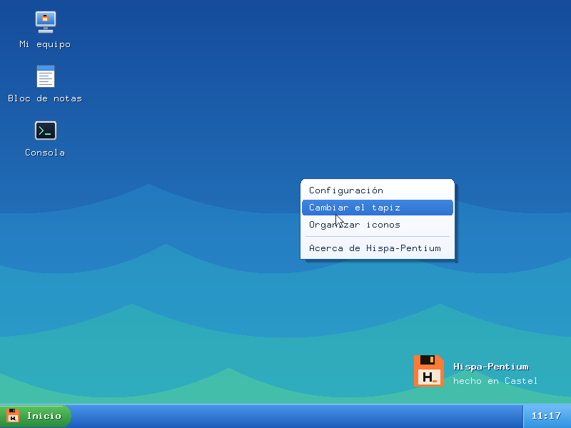 |  |
|  |  |
| 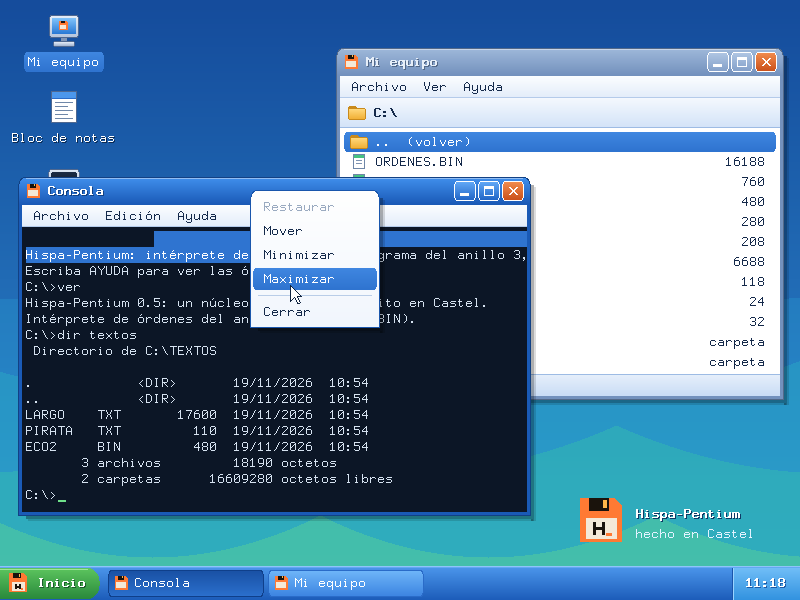 |  |
|  |  |

### Lo que se ve

- **El tapiz**: tres a elegir («Olas», «Azul» y «Verde»), con el disquete y el
  nombre abajo a la derecha.
- **Los iconos del tapiz**: «Mi equipo», «Bloc de notas» y «Consola», con su
  rótulo en letra normal (y los de los paquetes, los accesos soltados y los
  archivos del escritorio). Un clic lo elige (un recuadro alrededor del
  dibujo y el rótulo sobre azul con su borde blanco); **dos clics lo abren**;
  se llevan a otro sitio **arrastrándolos**, siempre dentro de la zona de
  los iconos (más abajo, «Los iconos del tapiz»).
- **La barra de tareas**, abajo: el botón **«Inicio»** (verde, redondeado), un
  **botón por cada ventana abierta** (pulsarlo la trae delante; si ya lo estaba, la
  minimiza; si estaba minimizada, la recupera) y, a la derecha, la **bandeja con el
  reloj** (el de la CMOS; se pone al día cada minuto).
- **El menú Inicio** (desde la 0.8.4 es otro: más abajo, «El menú Inicio y los atajos de teclado»). El de antes, de dos columnas: a la izquierda, en blanco, los **Programas**
  (Bloc de notas, Consola, Mi equipo); a la derecha, en azul muy claro, los
  **Documentos** (los `.TXT` de la raíz del disco: se abren con el Bloc de notas) y
  **Configuración**; y abajo, **«Apagar el equipo»**. Se abre con el botón o con la
  **tecla del logo**; la opción bajo el ratón se resalta; con las flechas, Intro y
  Esc también se anda por él; un clic fuera lo cierra.
- **Las ventanas**: la barra de título azul con degradado y las esquinas de arriba
  redondeadas, el disquete, el nombre y **tres botones** (minimizar, maximizar o
  volver al tamaño de antes, y cerrar, este en el naranja del disquete), un borde y
  una sombra suave. Se **mueven** arrastrando el título, pasan **delante** al
  pulsarlas, y **dos clics en el título** las maximizan. **Cambian de tamaño
  arrastrando el borde o una esquina**: encima de ellos la flecha cambia de forma
  (de lado a lado, de arriba abajo o en diagonal), y se agarran también un poco
  por fuera. La ventana activa lleva el título de azul vivo; las demás, de azul
  gris.
- **El botón secundario del ratón** saca un menú, según dónde:
  - en el **tapiz**: Configuración, Cambiar el tapiz (pasa al siguiente),
    Organizar iconos... (su submenú: por nombre, por tipo, por tamaño, por
    fecha, como al principio y sus casillas; más abajo, «Los iconos del
    tapiz») y Acerca de Hispa-Pentium;
  - en el **título de una ventana**, o en **su botón de la barra de tareas**:
    Restaurar, Mover, Minimizar, Maximizar y Cerrar (en gris, lo que en ese
    momento no toca). «Mover» lleva la flecha al título y la ventana la sigue
    hasta el clic siguiente (o Intro, o Esc);
  - en un **icono** del tapiz o en un programa o documento del **menú Inicio**:
    Abrir;
  - en el **Bloc de notas**: Cortar, Copiar, Pegar y Seleccionar todo; en la
    **Consola**: Copiar y Pegar; en **Mi equipo**: Abrir.

  En los menús, la opción bajo el ratón se resalta; un clic la elige; las flechas,
  Intro y Esc valen; un clic fuera lo cierra.
- **La barra de menús de las ventanas** (Archivo, Edición, Ayuda...), en el Bloc
  de notas, la Consola y Mi equipo: pulsar un rótulo abre su menú; pulsarlo otra
  vez lo cierra.
- **Seleccionar texto** (en el Bloc de notas y en la Consola): **arrastrando** el
  ratón; con **dos clics**, la palabra; con **tres**, la línea; con **Mayús y un
  clic**, hasta ahí; y, en el Bloc, con **Mayús y las flechas** (o Inicio, Fin,
  Re Pág, Av Pág). Lo seleccionado se ve en blanco sobre azul.
- **El portapapeles del sistema**: lo que se corta o se copia en un programa se
  pega en cualquier otro (del Bloc a la Consola, y al revés). Es un texto.
- **«Apagar el equipo»**: Apagar, Reiniciar o Cancelar. Apagar deja la pantalla de
  «Ya puede apagar el equipo» (en QEMU, además, lo apaga).
- **Configuración**: (PANEL, la 0.8.7) **el Panel de control**: lo que hay
  (la pantalla, la memoria, las tareas) y un icono por sección (Fecha y hora,
  Pantalla, Sonido, Ratón, Teclado, Red y Wi-Fi, Energía, Programas,
  Personalización, Dispositivos y Acerca de: sección 14 quattuordecies). El de
  **Pantalla** es la medida de la pantalla, en el momento donde la tarjeta lo
  deja y, si no, al arrancar (más abajo, «La medida de la pantalla»). **Acerca de Hispa-Pentium**: la versión y la
  licencia.
- **El Bloc de notas** (`BLOC.BIN`, `ubloc.cas`; desde el 22/11/2026, la **1.0**:
  pestañas, buscar y reemplazar con expresiones, colores según el lenguaje,
  UTF-8, comparar... en la sección 14 quindecies): escribir un texto con el teclado
  español y **guardarlo en el disco** («Guardar», F2 o Ctrl+S; en la página 437 y
  con los finales de línea del DOS). Las flechas, Inicio, Fin, Re Pág, Av Pág,
  Supr, Retroceso; un clic pone el cursor; las líneas largas siguen debajo.
  **Cortar, Copiar, Pegar y Seleccionar todo** (Ctrl+X, Ctrl+C, Ctrl+V, Ctrl+A, el
  menú Edición o el del botón secundario); lo que se teclea sustituye a lo
  seleccionado. Menús: Archivo (Nuevo, Guardar, Salir), Edición y Ayuda. Abre
  `NOTAS.TXT`, o el archivo que se le diga (los documentos del menú). Si se cierra
  con cambios sin guardar, avisa.
- **La Consola** (`CONSOLA.BIN`, `uconsola.cas`): una ventana de 80 x 25 letras con
  el **intérprete de órdenes dentro** (el mismo `ORDENES.BIN`, sin tocarle una
  línea), y lo que este lance. Ctrl+C acaba el programa que corra; `SALIR` cierra
  la ventana. Lo que hay en la pantalla **se selecciona con el ratón y se copia**
  (el menú Edición, el del botón secundario, o Ctrl+C si hay algo seleccionado);
  **Pegar** teclea lo del portapapeles. Lo seleccionado se suelta en cuanto se
  escribe algo en la pantalla. Menús: Archivo (Cerrar), Edición (Copiar, Pegar,
  Seleccionar todo) y Ayuda (las órdenes: teclea `AYUDA`).
- **Mi equipo** (`EQUIPO.BIN`, `uequipo.cas`), desde el 21/11/2026 **el
  explorador de archivos**: el árbol de las unidades y las carpetas, cuatro
  vistas, copiar, cortar y pegar, la Papelera, buscar, Propiedades, Abrir
  con... y las miniaturas (más abajo, «El explorador de archivos»).
- **El dock**: los programas fijados y los abiertos, centrado encima de la
  barra de tareas (más abajo, «El dock»).

### Cómo está hecho

**El modo gráfico** (`video.cas`). Un modo con la memoria de la pantalla seguida
(«framebuffer lineal»). Sale de uno de dos sitios:

1. **del cargador**, si ya lo ha dejado puesto y lo dice en la información de
   multiboot (GRUB, cuando el núcleo se lo pide en su cabecera: sección 11);
2. de la **VBE de Bochs** (la VGA de QEMU, Bochs y VirtualBox): QEMU con `-kernel`
   no da nunca un modo gráfico, así que el núcleo lo pide él por los dos puertos de
   esa tarjeta (`0x1CE`, el índice; `0x1CF`, el dato), y busca la memoria de la
   pantalla en la primera zona de su dispositivo PCI (`1234:1111`).

800 x 600 si no se dice otra cosa (`modo=1024x600` en la línea del cargador: el
que sea, de 640 x 480 a 1600 x 1200). El escritorio se acomoda a la medida que
haya: la del cargador manda. La memoria de la pantalla se pone en la zona de los
gráficos del núcleo (sección 3). **Todo se dibuja con 32 bits por punto**; si el
modo que hay es de 24 o de 16 (hay tarjetas que no dan otro), se dibuja en un
lienzo de 32 bits aparte y `volcar()` pasa a la pantalla de verdad lo que se ha
tocado. (`bits=24` o `bits=16` en la línea del cargador lo fuerzan con la VBE de
Bochs, para probarlo.) Con la VBE de Bochs, aunque el modo lo haya puesto el
cargador, **se cambia en marcha** (`cambia_modo()`: más abajo, «La medida de la
pantalla»).

**Dibujar** (`grafico.cas`), en Castel. Un **lienzo** es un rectángulo de puntos
(`0x00RRGGBB`) en la memoria, con su ancho, su alto y los puntos que hay de una
fila a la siguiente (así, un trozo de un lienzo es otro lienzo). Rectángulos,
degradados (de arriba abajo y de lado a lado), **esquinas redondas**, bordes,
líneas, círculos, oscurecer (las sombras), el disquete (hecho con rectángulos, a
cualquier tamaño), **texto** con la letra de 8x16 (`letra.cas`: 256 letras de la
página 437, con las de más de Ventanas) y **copiar** de un lienzo a otro. Todo se
recorta a los bordes del lienzo. Las filas se llenan y se copian con `rep stosd` y
`rep movsd` (unas líneas de ensamblador); lo demás es Castel.

**El ratón** (`raton.cas`): el PS/2, por la segunda boca del 8042 y la IRQ 12. La
interrupción lleva la cuenta de dónde está la flecha y apunta cada cambio de botón
en una cola, con el sitio donde fue (un clic no se pierde aunque se tarde en
atenderlo). Desde la 0.6, **un ratón USB** (o un panel táctil que se presente como
ratón) hace lo mismo: `usbhid.cas` le da a `raton.cas` cada movimiento y cada
cambio de botón (sección 11). Si no hay 8042 (un Mac, un PC «sin legado»: su
puerto lee `0xFF`), el PS/2 ni se intenta.

**El gestor de ventanas** (`ventanas.cas`), en el núcleo. Cada ventana tiene **su
propio lienzo**, con el marco pintado y lo de dentro, donde dibuja su dueño: así,
componer la pantalla es solo copiar, y nadie tiene que volver a pintar cuando otra
ventana le pasa por encima. Se compone en un **doble búfer** (el tapiz y, encima,
las ventanas de atrás adelante, con su sombra y sus esquinas) y de ahí a la
pantalla; y **solo lo que ha cambiado**: una lista corta de rectángulos «sucios»
(los que se tocan se juntan). La flecha se pinta al final, en la pantalla. La barra
de tareas, el menú y los cuadros son ventanas como las demás (la barra y el menú,
sin marco y siempre delante).

Una tarea del núcleo, **`escritorio`**, da el **pulso** cien veces por segundo:
recoge los clics y lo que se ha movido el ratón, y las teclas, y los reparte.
Mover, cambiar de tamaño, traer delante, minimizar, maximizar y cerrar lo hace el
gestor; lo demás va a la **cola de sucesos** de la ventana que toca (una tecla a
la activa; un clic, donde cae), y su dueño los recoge. Con cada clic van **los
botones** pulsados, las **teclas de cambio** (Mayús, Control) y **las veces
seguidas** que se ha pulsado ahí (1; 2, el doble clic; 3, el triple: mismo sitio y
menos de medio segundo); con cada flecha del teclado, si venía con Mayús. Al
cambiar el tamaño (o al maximizar), la ventana cambia de lienzo: se le copia lo
que tenía, para que no parpadee, y su dueño recibe «tamaño» para volver a pintar
(si llegan varios seguidos, vale con el último). Con el escritorio en marcha **las
teclas son suyas**: quien lea de la consola de texto se queda esperando, y Ctrl+C
es una tecla más (cada Consola tiene el suyo). Todo lo de las ventanas va con un
cerrojo: los programas dibujan a la vez que el escritorio compone.

**Cambiar el tamaño.** El borde mide 4 puntos; para acertarle con un panel táctil
se agarra también desde 3 puntos por fuera, y las esquinas miden 14 a lo largo.
Mientras se arrastra, la ventana se rehace a cada paso (no hay un «marco de
goma»): 200 x 140 lo menos, la pantalla lo más. Los cuadros (Apagar,
Configuración) no cambian de tamaño.

**El fondo.** Lo que cae fuera de todas las ventanas (el tapiz), y el botón
secundario en un título, van a una ventana que no se ve, la **«del fondo»**, que
es del escritorio: ahí atiende los iconos y pone sus menús. **Los iconos** se
pintan en el propio tapiz; de cada uno se guarda lo que tapa, para quitarlo de ahí
al moverlo o al elegirlo.

**Los menús emergentes** (`emergente.cas`). Solo hay uno abierto a la vez: una
ventana del núcleo, sin marco y por delante de todo. Las opciones se dan en un
texto, separadas por «|» («-» es una raya), con un bit por cada una que sale en
gris. Lo abre el escritorio para los suyos, o un programa por la llamada 39 para
una ventana suya: al cerrarse, a esa ventana le llega el suceso **«menú»** con la
opción elegida (o «ninguna») y la etiqueta que dio. La **barra de menús** de una
ventana la pinta el propio programa (`barramenu.cas`), y cada rótulo abre debajo
un menú de estos.

**El portapapeles** está en el núcleo (`usuario.cas`, la llamada 40): un texto de
hasta 64 K, en la página 437 y con sus líneas acabadas en `\n`; el último que se
ha copiado en cualquier programa.

**Los programas** abren su ventana y dibujan por las **llamadas al sistema** 32 a
41 (sección 6): `ventana`, `rectángulo`, `degradado`, `texto`, `mapa`, `suceso`,
`menú`, `al_portapapeles`... de `llamadas.cas`. Al acabar un programa (o si el
núcleo lo acaba), sus ventanas se cierran solas.

```
importar Llamadas
...
v := ventana("Hola", 300, 120)
degradado(v, 0, 0, 300, 120, 0xEAF3FE, 0xC4DCF8)
texto_negrita(v, 20, 20, "¡Hola, escritorio!", 0x14294A)
mientras suceso(v, s, cierto) y s.clase <> EV_CERRAR hacer
    ; el botón secundario: un menú; lo elegido llega luego (EV_MENÚ: s.a, la opción)
    si s.clase = EV_RATÓN_BAJA y s.c yb BOTÓN_DERECHO <> 0 entonces
        menú(v, ent32(s.a), ent32(s.b), "Saludar|-|Salir", 0, 1)
    fin
fin
```

**Los programas de los paquetes en el menú y en el tapiz** (`accesos.cas`,
desde el 20/11/2026, rama `clicgest-pentium`). Un paquete que trae un programa
con ventana deja, además, un archivo de texto `NOMBRE.MNU` en `\HISPA\MENU`
(o en `\MENU`, en un sistema sin instalar), en la página 437 y con CR LF:

```
nombre=Agenda
programa=\HISPA\AGENDA.BIN
argumentos=
icono=\HISPA\MENU\AGENDA.ICP
escritorio=si
```

El escritorio lo pone en el menú Inicio, debajo de «Mi equipo» (el menú crece
lo que haga falta) y, con `escritorio=si`, como icono del tapiz. Se vuelven a
leer cada vez que se abre el menú: lo que se instala con el escritorio en
marcha sale la vez siguiente (y si han cambiado, los iconos del tapiz se
ordenan otra vez). Hasta seis. El icono es un **`.ICP`**: la magia `HPIC`, el
ancho y el alto (32 y 32, dos palabras de 32 bits) y 32 x 32 puntos
`0xAARRGGBB` (de A = 0x80 para arriba se pinta; lo demás es transparente); lo
hace **`tools/hpicono.py ENTRADA.png SALIDA.ICP`** de un PNG de 32 x 32. En el
menú se pinta a la mitad (16 x 16). Sin icono, una ventanita.

**Mayús+Tab** (desde la misma fecha): con el escritorio en marcha, el teclado
la da como la tecla `TECLA_MAYÚS_TAB` (`0x10F`, en `Llamadas`), para que los
programas vuelvan al control de antes; Tab sigue siendo el 9.

**Ctrl+Tab, Ctrl+Mayús+Tab y Alt+letra** (desde la 0.8.2, rama
`controles-erp`, 21/11/2026): con el escritorio en marcha llegan como
`TECLA_CTRL_TAB` (`0x110`), `TECLA_CTRL_MAYÚS_TAB` (`0x111`) y `TECLA_ALT` +
la letra (`0x180` para la a ... `0x199` para la z; el Alt de la izquierda; el
Alt Gr sigue siendo el de las letras de más), para cambiar de pestaña y abrir
los menús de una ventana. Y la **llamada 81** (`maximizar(v)` en
`Llamadas`): la ventana se maximiza (como con dos clics en su título) y le
llega `EV_TAMAÑO` con lo que mide.

### Los controles de las ventanas: `controles.cas`

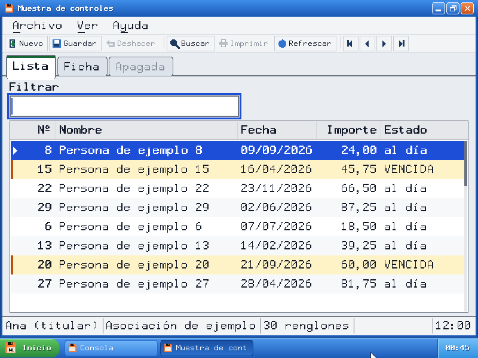

*Desde la 0.8.2 (21/11/2026).* Un módulo para los programas del anillo 3 que
quieren una ventana de aplicación de las de siempre (un programa de gestión,
un ERP de escritorio): `importar Controles`. El programa pinta en un **lienzo
propio** del tamaño de la ventana (con `Grafico`, el de dibujar del
escritorio) y `volcar()` lo manda entero a la ventana (la llamada 34,
`mapa`). Así puede escribir con la letra del sistema a su tamaño (8x16) o
con la **letra grande** (el renglón de 24 o de 32 puntos): `preparar(nombre,
T_NORMAL|T_GRANDE|T_MUY_GRANDE, maximizada)`; `LT` es el alto del renglón,
`LA` la medida para colocar las cosas (la de una letra media: 8, 12 o 16) y
`E` los márgenes.

**La letra grande, suavizada** (desde la rama `pentium-letras`, 21/11/2026):
antes era la de 8x16 escalada (a vez y media, cada punto uno o dos: trazos
desiguales y escalones); ahora es **DejaVu Sans** (y **DejaVu Sans Bold** en
negrita), **proporcional**, rasterizada para cada tamaño (letra de 18 puntos
en el renglón de 24, de 24 en el de 32) con el «hinting» de la letra, **16
tonos por punto** que se mezclan con lo que hay debajo, y su **kerning**. No
se escala ni se rasteriza en marcha: `letrasuave.cas` (unos 100 KB, hecho
por `hazletrasuave.py` con FreeType, en tiempo de compilación; no se edita)
trae cada letra lista, y pintarla es mezclar (la fila, en ensamblador). Para
medir: `ancho_texto`, `ancho_negrita`, `ancho_ne(t, n, m, negrita)` y
`caben_ne` (cuántas letras caben en tantos puntos); `texto_corto` recorta con
«…», `párrafo` parte las líneas por lo que mide cada letra, y el cursor de
los campos va donde acaba la letra de verdad. La letra normal (8x16) sigue
siendo la del sistema. `mira_captura.py` busca la letra grande con la letra
ya rasterizada (`texto15`/`negrita15`, renglón de 24; `texto2`/`negrita2`,
de 32).

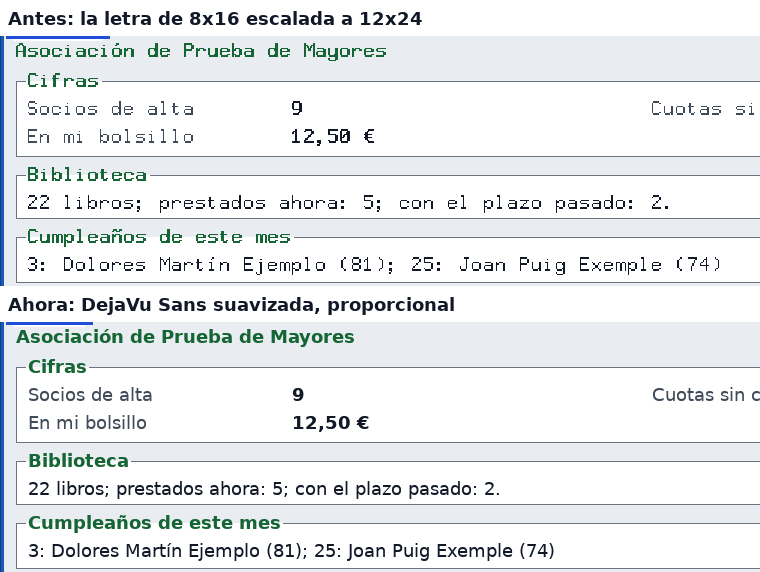

| Control | Funciones | Teclas |
|---|---|---|
| botón | `botón`, `botón_ancho` (principal: verde; apagado: gris) | Intro, Espacio |
| campo | `campo`, `campo_de` (el rótulo encima; oculto; solo para ver), `campo_izq` (el rótulo a la izquierda) y `campo_tecla` (con su cursor: flechas, Inicio, Fin, Retroceso, Supr) | |
| números | `número_tecla`: solo cifras y, con decimales, una coma (el punto, también el del teclado numérico, vale como coma) | |
| fecha | `fecha_tecla` (dd/mm/aaaa, las barras las pone él), `fecha_vale`, `fecha_a_iso`, `fecha_de_iso` | |
| casilla | `casilla` (con una X dentro) | Espacio |
| lista desplegable | `desplegable` (lo elegido y la flecha), `abrir_desplegable` (las opciones, en un menú del escritorio: llega `EV_MENÚ` con la etiqueta del control), `desplegable_tecla` | Intro, Espacio; arriba y abajo, sin abrirla |
| recuadro con título | `recuadro(x, y, ancho, alto, «Datos generales»)`: da dónde empieza lo de dentro | |
| pestañas | `pestañas(id, x, y, ancho, «Inicio\|Socios\|...», activa, apagadas)`, `pestaña_en`, `otra_pestaña` | Ctrl+Tab, Ctrl+Mayús+Tab |
| rejilla | una variable `Rejilla` por tabla (`rejilla_nueva(g, máximo)`: los renglones, en memoria pedida con `más_memoria`), `rejilla_columna` (rótulo, ancho típico en letras medias —lo más que mide; 0: la del texto largo, que se lleva lo que sobra—, a la derecha), **anchos que se cambian arrastrando el borde de un rótulo** (`rejilla_clic_veces`, `rejilla_arrastra`, `rejilla_suelta`; dos clics en el borde: lo más largo que se ve) y que se recuerdan con `anchos_archivo(ruta)`, `renglón_nuevo`, `celda`, `rejilla_lista`, `rejilla_filtrar` (sin mirar mayúsculas ni tildes), `rejilla_ordenar` (números, fechas dd/mm/aaaa o textos; otra vez, al revés), `rejilla_elegido`, `rejilla_id`, `rejilla_ir` (primero, anterior, siguiente, último), `rejilla_clic` (en un rótulo, ordena) | flechas, Re Pág, Av Pág, Inicio, Fin |
| barra de menús | `barra_menús(x, y, ancho, «&Archivo\|&Ver\|A&yuda», abierto)` (la letra tras «&», subrayada), `menú_de_alt`, `menú_en_barra`, `abrir_menú_barra` | Alt+letra |
| barra de herramientas | `barra_herramientas`, `herramienta(id, x, y, icono, texto, apagado)` con los iconos dibujados (`I_NUEVO`, `I_GUARDAR`, `I_DESHACER`, `I_BUSCAR`, `I_IMPRIMIR`, `I_REFRESCAR`, `I_PRIMERO`, `I_ANTERIOR`, `I_SIGUIENTE`, `I_ÚLTIMO`, `I_EDITAR`, `I_BORRAR`), `separador` | (no las recorre el tabulador: son atajos) |
| barra de estado | `barra_estado(y, «usuario\|asociación\|...\|12:00»)`: el último trozo, a la derecha | |

**El foco**: los controles se apuntan al pintarlos (`empezar_controles()` al
empezar cada vez), en el orden en que los recorre el tabulador
(`pasar_foco`); `control_en(x, y)` dice cuál hay en un punto y
`asegurar_foco()` lo pone en el primero si el que tenía ya no está. El que
tiene el teclado lleva **un borde azul grueso**; lo elegido de una rejilla,
**letra blanca sobre azul y una flecha**; lo que hay que mirar
(`R_AVISO`), fondo naranja claro **y una franja** a la izquierda (y su
palabra en una celda): nada depende solo del color.

**Los anchos de las columnas de la rejilla** (rama `pentium-letras`,
21/11/2026). Cada columna de ancho dado mide lo que su contenido más largo
(medido con la letra de verdad, en negrita, que es como va lo elegido), sin
pasar de lo que dijo el programa (lo típico: un nombre y dos apellidos, unas
30 letras; una fecha, 10) ni bajar de su rótulo; la del texto largo (ancho
0: un título, un concepto) se lleva lo que sobra. Si no cabe todo, primero
se estrecha el texto largo (hasta un sexto de la rejilla) y luego las más
anchas a la vez, hasta que quepa: las fechas, los números y los importes se
quedan enteros mientras se pueda. Quien la usa puede **arrastrar el borde
de un rótulo** (el borde va con el ratón: si el texto largo está a la
derecha, cambia la columna de la izquierda y lo demás se corre; si está a
la izquierda, una columna gana lo que pierde la otra) y **dos clics en el
borde** dejan la columna en lo que mide lo más largo que se ve. Con
`anchos_archivo(ruta)` los anchos elegidos se recuerdan (por rejilla, por
sus rótulos; en dieciseisavos de letra, así valen para cualquier tamaño)
en un archivo de texto. El programa pasa los sucesos del ratón:
`rejilla_clic_veces(g, x, y, veces(s.c))` al pulsar, `rejilla_arrastra(x)`
con `EV_RATÓN_MUEVE` y `rejilla_suelta()` con `EV_RATÓN_SUBE`
(`rejilla_clic` sigue valiendo: es con una vez). Una celda lleva hasta 63
letras (antes, 47).

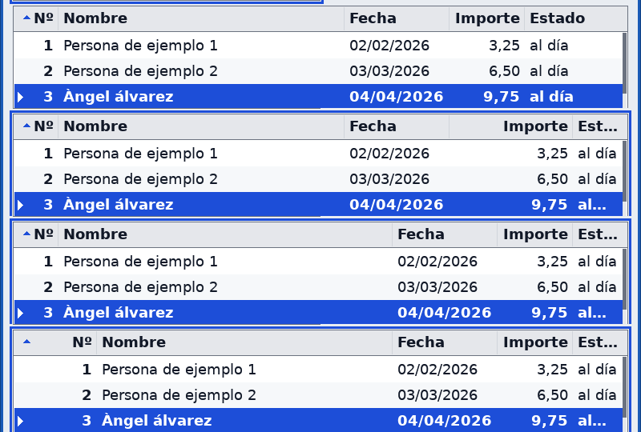

**`MUESTRA.BIN`** (`umuestra.cas`) lleva todos (`MUESTRA normal`, con la
letra normal; `MUESTRA doble`, al doble): es el ejemplo para empezar un
programa de ventana, y lo que prueba `castel/pruebas.sh`. El primer
programa hecho con ellos es ClicGest 0.2 (un programa de ClicGest, aparte).

**Los terminales** (`terminal.cas`). Para que la Consola tenga dentro al intérprete
de órdenes sin tocarlo: un terminal son **dos tubos**. El programa que lo hace (la
Consola) lee por uno lo que escriben los de dentro y lo pinta, letra a letra, como
una pantalla de texto; y mete por el otro las teclas que llegan a su ventana (lo
que se pega también entra por ahí, poco a poco: en el tubo caben 256 teclas). Los
programas que lanza **heredan el terminal**: su `escribir` va al tubo en vez de a
la pantalla y su `tecla` sale de él, y no se enteran. Ctrl+C en un terminal acaba
los programas de dentro (menos los que lo atienden ellos); al cerrar la ventana, se
acaban todos.

**Lo que dice el núcleo** con el escritorio en marcha (lo que lanza, los avisos, una
excepción) sale por el **puerto serie**, como siempre.

### El Administrador de dispositivos (21/11, la 0.8.3)

Lo pidió Carlos el 21/11: qué hay en cada equipo, qué controlador de
Hispa-Pentium lo lleva y qué falta, y **un informe para mandarlo** desde
cada portátil del taller. Se abre desde **Inicio › Configuración ›
«Dispositivos...»** y desde **el botón secundario en «Mi
equipo» › Propiedades** (`DISPOSIT.BIN`, `udisposi.cas`, hecho con los
controles de `controles.cas`).

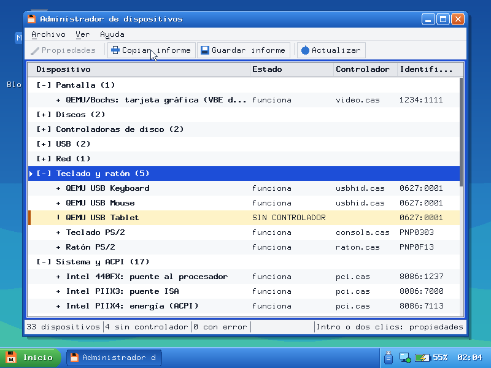

- **El árbol, por categorías**: Pantalla, Discos, Controladoras de disco, USB,
  Red, Sonido, Teclado y ratón, Sistema y ACPI, Batería, Procesador y Otros
  dispositivos (una rejilla con «[-]»/«[+]»: un clic ahí, Intro, dos clics o
  las flechas izquierda y derecha la abren y la cierran). Cada dispositivo con
  su **nombre**, su **estado en palabra** («funciona», «SIN CONTROLADOR», «CON
  ERROR», «desactivado», «no le hace falta»), el **controlador** y el
  **identificador** (`8086:100E`, `PNP0303`). Lo que no tiene controlador o
  tiene un error va con un **«!»** (o una «X») delante, **fondo naranja y una
  franja** a la izquierda, y su palabra: **nada depende solo del color**
  (Carlos es daltónico). Lo que funciona lleva un «+» (la letra del sistema no
  tiene «√»).
- **Las propiedades** (Intro o dos clics): otra ventana (el mismo programa, con
  `/P BUS DIRECCIÓN`), con las pestañas **General** (tipo, fabricante, dónde
  está, el estado en una frase y el detalle: la MAC y el enlace de la tarjeta
  de red, la carga, la salud y los ciclos de la batería), **Controlador** (quién
  lo lleva —en el núcleo o un servicio del anillo 3—, el identificador, el
  subsistema, la revisión, la clase, lo que dice de sí un aparato USB, la ruta
  en ACPI, de qué cuelga) y **Recursos** (la IRQ, los puertos y la memoria, con
  lo que miden). «Copiar estos datos» y «Cerrar» (o Esc; Ctrl+Tab cambia de pestaña).
- **«Copiar informe»** (al portapapeles: se pega en el Bloc de notas) y
  **«Guardar informe»**: a `X:\DISPOSIT.TXT` (la memoria USB), o a la primera
  memoria USB o el primer disco en los que se pueda escribir. El informe
  empieza por el equipo, la fecha, la memoria, la pantalla, un resumen y **lo
  que falta** (sin controlador o con error), y luego cada categoría con cada
  dispositivo y todos sus datos (`[OK]`, `[!]`, `[X]`, `[--]` delante, para
  buscarlo a ojo). Sin escritorio, `DISPOSIT` lo escribe en la pantalla;
  `DISPOSIT /INFORME > A.TXT` y `DISPOSIT /GUARDAR [RUTA]`, desde las órdenes.

| | |
|---|---|
|  | 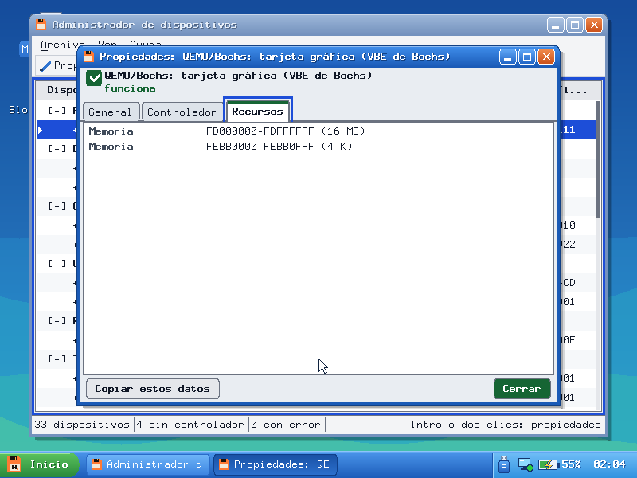 |

**La llamada 155** (`dispositivos.cas`, de solo lectura) hace la lista cada vez
que se pide, en fichas `Dispositivo` de 320 octetos (la misma en
`llamadas.cas` y en `acpi/pentium/pentium.h`): el bus (`BUS_PCI`, `BUS_USB`,
`BUS_ACPI`, `BUS_PLACA`, `BUS_DISCO`, `BUS_CPU`), la dirección, de quién cuelga
(su número en la lista), el fabricante y el modelo, la clase al estilo del PCI,
el subsistema, la revisión, el estado (`EST_...`), la IRQ, hasta seis
recursos (clase, base y largo), el nombre PnP, el controlador, el nombre (el
modelo del disco, lo que dice el aparato USB, la ruta ACPI), la marca y un
detalle. Mira:

- **el bus PCI entero** (también detrás de los puentes), cada función con sus
  zonas: **medidas una vez** (se escriben unos en el BAR con el aparato sin
  atender en la memoria ni en los puertos y las interrupciones cerradas, y se
  pone como estaba: lo de todos los sistemas), su IRQ y lo que dicen de él los
  controladores: `ahci.cas` (su controladora), `ata.cas` (el canal primario),
  `xhci/ehci/uhci.cas` (las que han tomado; las que no se han dejado, «con
  error»; con `sinusb`, desactivadas), `video.cas` (la tarjeta que tiene la
  memoria de la pantalla; sin modo gráfico, la pantalla de texto),
  `RED.BIN` (la tarjeta que lleva el servicio de red), `pci.cas` (los puentes);
- **los aparatos USB** de `usb.cas`, con **su nombre y su marca de verdad**
  (sus descriptores de cadena, preguntados una vez a cada uno) y qué módulo los
  atiende (`usbhid.cas`, `usbalm.cas`, `usb.cas` los concentradores), colgados
  de su controladora o de su concentrador; y lo que no se ha dejado enumerar;
- **los discos** de `discos.cas`, colgados de su controladora, con su tamaño,
  sus unidades y si se puede escribir en ellos;
- **lo de siempre**: el teclado y el ratón PS/2 (si contestan), el reloj de la
  CMOS, el 8253, los 8259 y los puertos serie que dice la BIOS (COM1 es el
  registro del núcleo); y **el procesador** (CPUID: su nombre, su familia y lo
  que tiene);
- **ACPI**: el sistema (`ACPI.BIN`) y **lo que apunta el servicio con la 156**:
  después de la primera lectura de la batería, con la tarea quieta, `ACPI.BIN`
  recorre el espacio de nombres (los dispositivos con `_HID` y `_STA` presente,
  sin los enlaces de interrupción `PNP0C0F`), con su ruta y lo que dice su
  `_CRS`, y dice quién lo lleva (la batería, el adaptador y el controlador
  embebido, él; los buses PCI, `pci.cas`; los recursos de la placa y los
  contenedores, nadie: no les hace falta). Con `acpisindisp` en la línea del
  cargador no lo hace. Lo de ACPI que ya sale como «lo de siempre» (el teclado,
  el ratón, el reloj, COM1) va con ello (su ruta, en sus propiedades), no aparte.
- **Para un controlador nuevo** (los lectores de CD de `pentium-cd`, una
  tarjeta): `Dispositivos.apuntar(ficha, 1)` desde el núcleo; si es un aparato
  PCI (bus `BUS_PCI` y su dirección), su estado, su controlador y sus textos se
  juntan con la ficha del PCI. Lo que apunta un servicio que se acaba ya no sale.

Los nombres (los fabricantes y los modelos del PCI y del USB, las clases y los
nombres PnP) van en unas tablas de texto de `udisposi.cas`: lo que se conoce
(QEMU, VirtualBox, VMware, Intel PIIX/ICH7/ICH9/NM10/Bay Trail, las Wi-Fi de
Intel, Broadcom y Atheros, Realtek, Marvell, VIA, SiS...) y, si no está, el
fabricante y la clase («Realtek: Tarjeta de red (Ethernet)»).

### El explorador de archivos: `EQUIPO.BIN` (21/11)

| | |
|---|---|
| 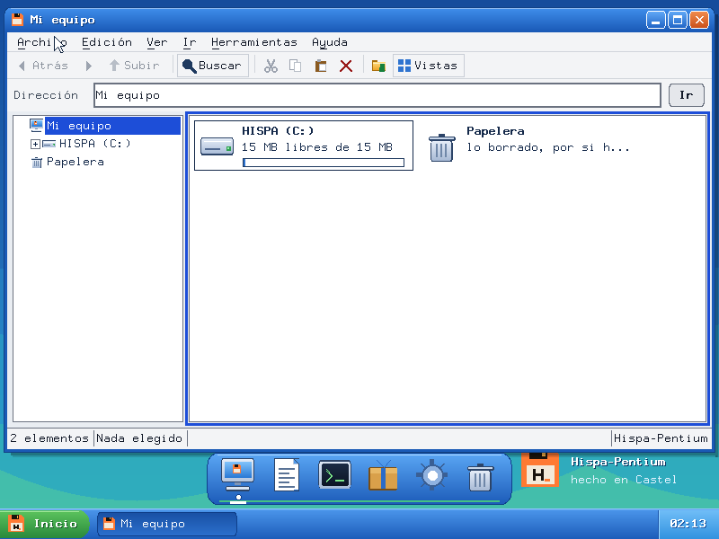 |  |
| 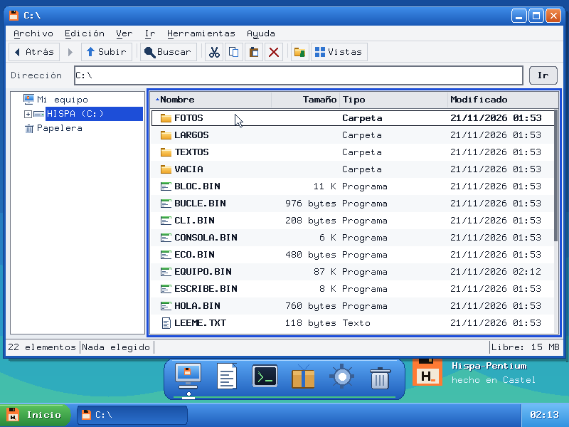 |  |
| 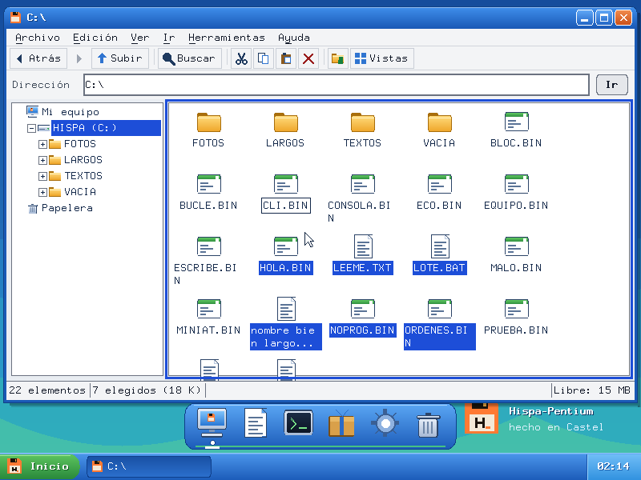 |  |
| 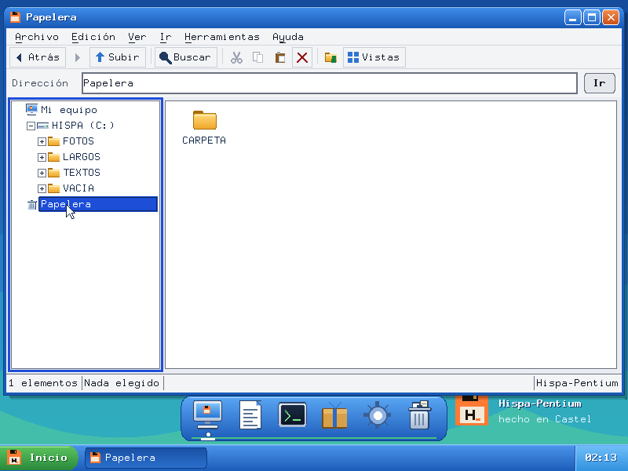 | 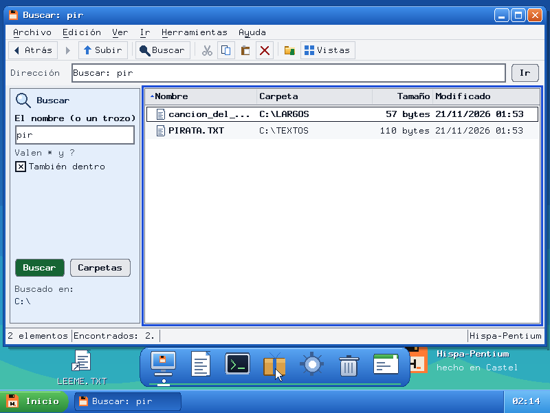 |

Lo pidió Carlos el 21/11 («actualizar el explorador de archivos, dock… lo
que necesitemos para estar a la altura de un sistema operativo»). «Mi
equipo» (`EQUIPO.BIN`) pasa a ser un **explorador** de los de verdad: un
programa del anillo 3 hecho con los controles de las ventanas
(`controles.cas`: la barra de menús, la de herramientas, la dirección, la
rejilla de los detalles, los botones y las casillas de los cuadros), con lo
que hace con los archivos aparte (`exoper.cas`, sin pintar nada) y los
iconos dibujados (`iconos.cas`, que comparte con el dock).

**Lo que se ve.** Arriba, la **barra de menús** (Archivo, Edición, Ver, Ir,
Herramientas, Ayuda: Alt y su letra la abren; con las flechas a los lados,
al menú de al lado), la de **herramientas** (Atrás, Adelante, Subir, Buscar,
Cortar, Copiar, Pegar, Borrar, Carpeta nueva y Vistas; en gris lo que no
toca) y la **dirección** (`C:\TEXTOS`, `Mi equipo`, `Papelera`), que se
puede escribir (Intro va; vale sin la letra). A la izquierda, el **árbol**:
Mi equipo con sus unidades (cada una con su icono: disco duro, memoria USB,
CD, en memoria) y sus carpetas (por orden; el `[+]` y el `[-]` son un
cuadrito con su signo, no un color), y la Papelera. A la derecha, lo que hay
donde se está; abajo, la **barra de estado** (cuántos hay, cuántos elegidos
y lo que miden, lo libre de la unidad o «De solo lectura»).

**Las vistas** (Ver, Vistas o F8): **miniaturas** (las imágenes en pequeño;
lo demás, su icono grande), **iconos**, **lista** (en columnas) y
**detalles** (la rejilla de `controles.cas`: nombre, tamaño, tipo y fecha de
modificación; un clic en el rótulo ordena, otra vez al revés, con su
triángulo). Las carpetas van siempre delante; el tamaño y la fecha se
ordenan por su número. En Mi equipo, cada unidad en un mosaico con lo libre,
de cuánto, y una barra; en la Papelera, de dónde era y cuándo se borró; al
buscar, en qué carpeta está.

**Elegir.** Un clic elige uno; **Control y un clic** añade o quita;
**Mayús y un clic**, desde el anterior hasta ahí; **un recuadro con el
ratón** desde un sitio sin nada, los que toca (con Control, se suman). Con
el teclado: las flechas (en iconos, también arriba y abajo por filas),
Inicio, Fin, Re Pág, Av Pág; **con Mayús, eligiendo**; **Espacio** elige o
suelta el del cursor; Ctrl+A, todos. Lo elegido, **letra blanca sobre
azul**; el cursor, **un borde** alrededor (no solo el color).

**Abrir.** Dos clics o Intro: una carpeta, se entra; un archivo, **con lo
suyo**: las **asociaciones** de `ASOCIA.TXT` (`\HISPA\ASOCIA.TXT` en un
sistema instalado; si no, `\ASOCIA.TXT`): un texto en la página 437, una
línea por extensión, `EXT=programa|argumentos`, donde `%1` es el archivo
(`TXT=\BLOC.BIN|%1`, `PLU=\HVPRUN.BIN|\OFICINA\PLUMA.HVP %1`, `BIN=%1|`).
Sin él, las de siempre (el Bloc, HVPRUN con la oficina, Mirador para las
imágenes). **Abrir con...** saca la lista de los programas (los de siempre
y los de los paquetes, sus `.MNU`), o se escribe otro; con «Abrir siempre
los .EXT con este», lo guarda en `ASOCIA.TXT`. Herramientas > Las
asociaciones lo abre en el Bloc de notas.

**Copiar, cortar y pegar** (Ctrl+C, Ctrl+X, Ctrl+V, Edición, las
herramientas o el menú del botón secundario): va por **el portapapeles del
sistema** (un texto que empieza por `\x01ARCHIVOS COPIAR` o `CORTAR` y una
ruta por renglón), así que de una ventana del explorador a otra también.
**Arrastrar** lo elegido a una carpeta (de lo de dentro o del árbol) lo
**lleva** allí (en otra unidad, o con Control, lo **copia**); mientras se
arrastra, un rótulo con lo que va junto a la flecha y un borde verde en la
carpeta donde caería. **Fuera de la ventana**: en el **tapiz**, un acceso
(un icono con la flechita, que lo abre con lo suyo; se lleva a otro sitio
arrastrándolo y el botón secundario lo quita: `ATAJOS.INI`); en el
**dock**, un programa (`.BIN`) se fija, y en su Papelera, se tira. (Va lo
primero de lo elegido: la llamada 171.)

**El trabajo** (`exoper.cas`): copiar, mover, mandar a la Papelera, borrar
del todo, restaurar y vaciar. Primero se apunta todo lo que hay que hacer
(las carpetas, enteras, de una en una: así solo hay un archivo abierto a la
vez y se sabe cuánto es) y luego se hace **a pasos cortos** (un trozo de 16
K, una carpeta, un nombre), con **un cuadro con la barra de progreso** (lo
que va, cuál de cuántos y el tanto por ciento, en número además de la
barra) y **Cancelar** (o Esc: lo que iba por la mitad se quita). Si el
destino ya existe: **«¿Se reemplaza?»**: Reemplazar, Saltar, A todos,
Saltar todos o Cancelar. Mover en la misma unidad solo cambia el sitio (la
llamada 22, también con carpetas); a otra, copia y borra. Copiar en la misma
carpeta hace `NOMBRE~1.EXT`. Una carpeta no se lleva dentro de sí misma.
Lo que no ha ido bien sale en la barra de estado.

**Cambiar el nombre** (F2) y **Carpeta nueva** (F7, Ctrl+N): un cuadro con
el nombre (lo primero que se escribe sustituye al que había). De momento,
**8 letras, un punto y 3 más** (la FAT de Hispa-Pentium aún no escribe
nombres largos; los lee y los enseña). **Propiedades**: el nombre (y el
corto), el tipo, dónde está, el tamaño (de una carpeta, todo lo de dentro:
cuántos archivos y carpetas), cuándo se hizo, cuándo se cambió y el último
acceso, y **los atributos** (solo lectura, oculto, archivo: casillas que se
pueden cambiar; «es del sistema», si lo es); de una unidad, su tipo, su FAT,
la capacidad, lo libre y lo ocupado, el disco y si se puede escribir.

**La Papelera.** Supr manda lo elegido a `\PAPELERA` de su unidad (una
carpeta oculta y de sistema que se hace la primera vez), con un nombre
propio (`D1234567.EXT`) y una línea en `\PAPELERA\INDICE.TXT` (el nombre de
dentro, de dónde era, su nombre y cuándo se borró). La Papelera del árbol
junta las de todas las unidades: **Restaurar** lo devuelve a donde estaba
(haciendo su carpeta si ya no está), **Borrar del todo** y **Vaciar la
Papelera** preguntan antes. **Mayús+Supr** borra del todo sin pasar por
ella (preguntando). En las unidades de solo lectura (el permiso de
escritura de cada disco: «escritura», «escritura=usb»; los CD; la unidad en
memoria) no se borra, ni se pega, ni se cambia nada: sale en gris y lo dice.

**Buscar** (F3, Ctrl+F, la herramienta): el panel de la izquierda pasa a
ser el de buscar: el nombre o un trozo (sin mirar mayúsculas ni tildes; con
`*` y `?`, como en el DOS), «También dentro» (las subcarpetas), y Buscar.
Busca en la carpeta en que se está (en Mi equipo, en todas las unidades);
Esc para. Lo encontrado sale en detalles, con su carpeta; se abre, se
copia o se borra como lo demás. «Carpetas» vuelve al árbol.

**Las miniaturas**: **`MINIAT.BIN`** (`nucleo32/miniat/`: `miniat.c` con
**stb_image**, de `terceros/stb`, en C, como TLS.BIN), un programa aparte
que lee la imagen (BMP, PNG, JPG, GIF, TGA, PSD, PNM), la deja en 64 x 64
como mucho (con su forma; lo transparente, sobre blanco) y la escribe en un
archivo (`HPMI`, el ancho, el alto y los puntos), en la primera unidad en
la que se pueda escribir (`X:\MINIAT.TMP`, que el explorador no enseña y
borra). El explorador lo lanza para cada imagen que se ve, de una en una y
sin esperar (sigue respondiendo mientras), y guarda hasta 120 en su
memoria. Sin `MINIAT.BIN`, o sin sitio, el icono de imagen.

**Las unidades que van y vienen**: con `EV_UNIDADES` (una memoria USB que
se enchufa o se quita, un CD que se mete o se saca, una imagen que se
monta o se desmonta: `MEDIO_CD`, el 4, y `MEDIO_IMAGEN`, el 5, con el icono
del CD) se vuelven a leer el árbol y Mi equipo; si se estaba en una que ya
no está, a Mi equipo, diciéndolo. El botón secundario en una memoria USB:
«Quitar con seguridad»; en un CD o una imagen montada, «Expulsar» (la
llamada 132). Un lector sin disco dice «sin disco» (o «un CD de música», o
que no se lee) en su tipo y al abrirlo. **Una imagen de disco** (`.ISO`,
`.CUE`, `.IMG`, `.IMA`) se **monta** al abrirla (dos clics, Intro, o
«Montar» en su menú: la llamada 133) y se entra en ella: sale en Mi equipo
con su nombre y «CD virtual: 670 K, ISO 9660» (si no tiene nombre, «CD virtual (E:)»).

**El teclado entero**: Tab y Mayús+Tab (la dirección, Ir, el árbol, lo de
dentro), las flechas, Intro (abrir), Retroceso (subir), Supr y Mayús+Supr,
F1 (las teclas), F2, F3, F4 o Ctrl+L (la dirección: lo que se escribe la
sustituye), F5 (actualizar), F6 (el árbol o lo de dentro), F7, F8 (otra
vista), F9 (el menú de lo elegido), F10 (el menú Archivo), Alt y la letra
de cada menú, Ctrl+A, Ctrl+C, Ctrl+X, Ctrl+V. En el árbol: arriba y abajo
(va a la carpeta), la derecha abre (y baja), la izquierda cierra (o sube).
En los cuadros: Tab, Intro, Espacio y Esc.

```
EQUIPO                 Mi equipo
EQUIPO C:\CARPETA      abre ahí (también sin la letra)
EQUIPO /PAPELERA       la Papelera
EQUIPO /ABRIR RUTA     abre ese archivo con lo suyo (una carpeta: ahí); sin ventana (los accesos del tapiz)
EQUIPO /BORRAR RUTA    lo manda a la Papelera, sin ventana (la Papelera del dock)
```

**Lo de `controles.cas` que ha hecho falta** (sin duplicar: lo genérico va
en el sistema): la rejilla con **icono** delante del nombre
(`Renglón.icono`, `letra`), **varios elegidos** (`g.varios`,
`Renglón.marcado`; `sel` es el cursor), un **grupo** que va siempre delante
(las carpetas), las columnas que **se ordenan por un número**
(`g.col_clave`, `col_clave2`: `Renglón.clave`, `id2`), `rejilla_en` (el
renglón en un punto, sin elegirlo), `rejilla_caben`, `rejilla_de_vista`; los
iconos de herramienta `I_SUBIR`, `I_CORTAR`, `I_COPIAR`, `I_PEGAR`,
`I_CARPETA` y `I_VISTAS`; y `alto_pedido`/`ancho_pedido` para la medida de
la ventana. En el emergente, **CON_FLECHAS** en la etiqueta de un menú:
las flechas a los lados lo cierran con `A_LA_IZQUIERDA` o `A_LA_DERECHA`.

### El dock (21/11)

| | |
|---|---|
| 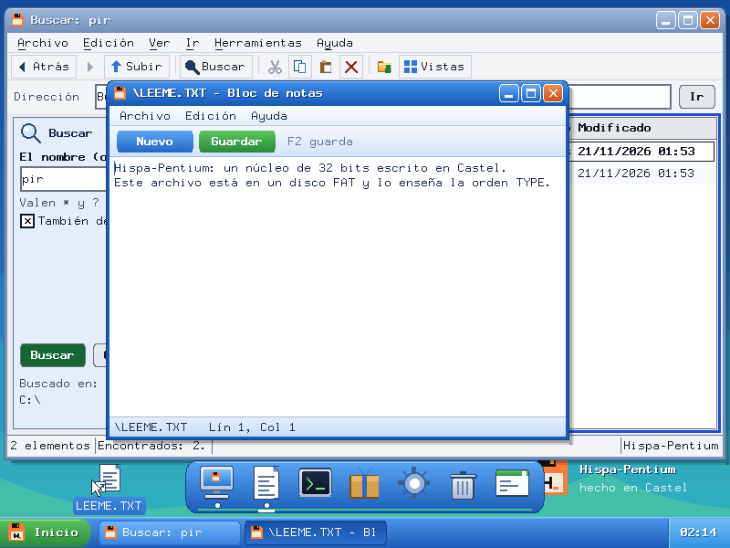 |  |

Una barra de lanzamiento con **iconos grandes** (40 puntos), centrada abajo,
encima de la barra de tareas: un panel azul con los bordes redondos y la
raya verde de la casa (lo que aprobó Carlos: «bordes redondeados, azules,
verdes»). Lleva los **programas fijados** (Mi equipo, el Bloc de notas, la
Consola, Programas y actualizaciones, Configuración y la Papelera, si no se
dice otra cosa) y, detrás de una raya, **los abiertos que no lo están**
(con el nombre de su ventana). Debajo de cada programa abierto, **un
punto**; bajo el de la ventana de delante, además, **una raya** (formas, no
colores). Con la flecha encima, el icono se resalta y su **nombre** sale en
una etiqueta. **Un clic** lo abre o trae su ventana (si ya era la de
delante, la recoge, como su botón de la barra de tareas). **El botón
secundario**: Abrir, Abrir otra ventana, Fijar en el dock, Quitar del dock,
Cerrar la ventana y Ocultar el dock (en gris lo que no toca). Un icono
fijado **se arrastra** a lo largo del dock para cambiarlo de sitio. Lo que
se suelta desde el explorador: un programa se fija; en la Papelera (que
cambia de icono cuando tiene algo), se tira.

Se guarda en **`DOCK.INI`** (`\HISPA\DOCK.INI`, o `\DOCK.INI` en un sistema
sin instalar; si no se puede escribir, solo dura hasta apagar):

```
visible=si
fijado=\EQUIPO.BIN||Mi equipo|12
fijado=\EQUIPO.BIN|/PAPELERA|Papelera|13
```

(el programa, sus argumentos, su nombre y la clase de su icono; con 0, el de
su paquete —su `.ICP`— o una ventanita). En **Configuración**, «Dock:
Visible / Oculto» (en la 0.8.4, en su fila, y debajo «Dispositivos...»,
«Red y Tailscale...» y «Cerrar»). Cómo está hecho (`dock.cas`, en el núcleo, con
`iconos.cas`): una ventana sin marco, siempre delante y **TRASLÚCIDA**
(una bandera nueva del gestor: sus puntos con el octeto de arriba puesto no
se ven ni se pulsan, y dejan ver y pulsar lo de debajo: así el panel es
redondo y la etiqueta no tapa nada). **No tapa nada de nadie**: cuando una
ventana ocupa el sitio de su panel (una maximizada, un cuadro grande de
un programa), el dock **se aparta**; vuelve cuando el sitio queda libre, o
al llevar la flecha a la raya de justo encima de la barra de tareas (y se
queda mientras la flecha esté encima). Un programa que quiera caber encima
del dock lo sabe con `DATO_ALTO_LIBRE` (`Ventanas.alto_dock`): así se
pone el explorador. Sabe qué está abierto mirando las
ventanas y el nombre (y los argumentos) de la tarea de cada una; lo que se
pulsa se lo pide al escritorio (`Dock.pide`: lanzar o Configuración).

### Los iconos del tapiz: la zona, la rejilla y «Organizar iconos» (22/11; marcado «(ICONOS)»)

| | |
|---|---|
| 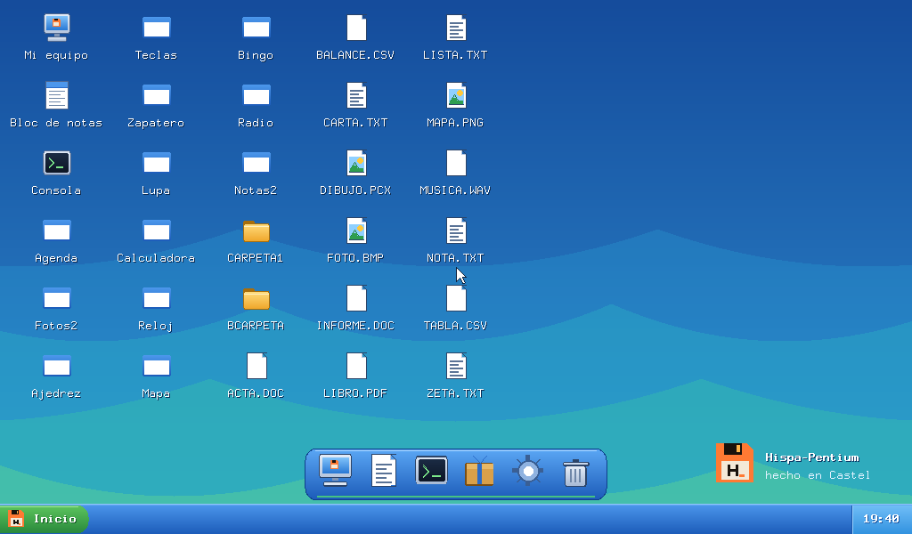 | 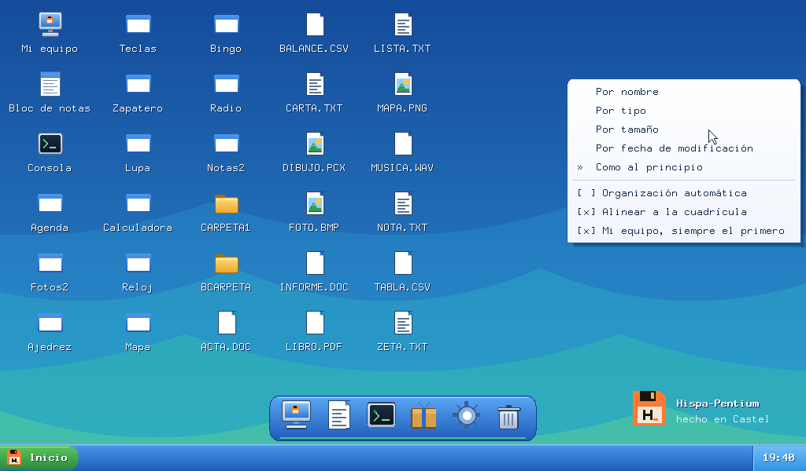 |
| 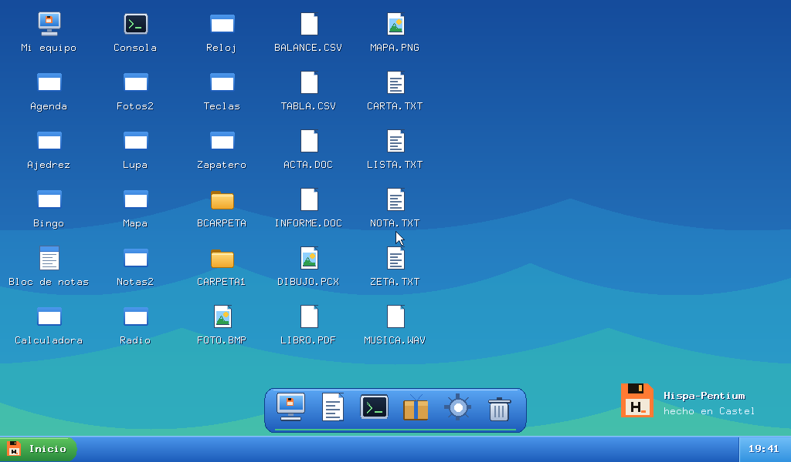 | 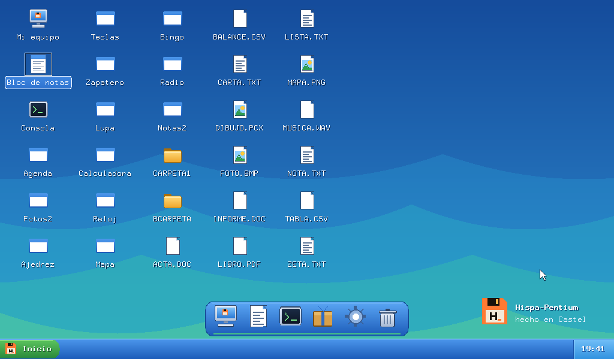 |
| 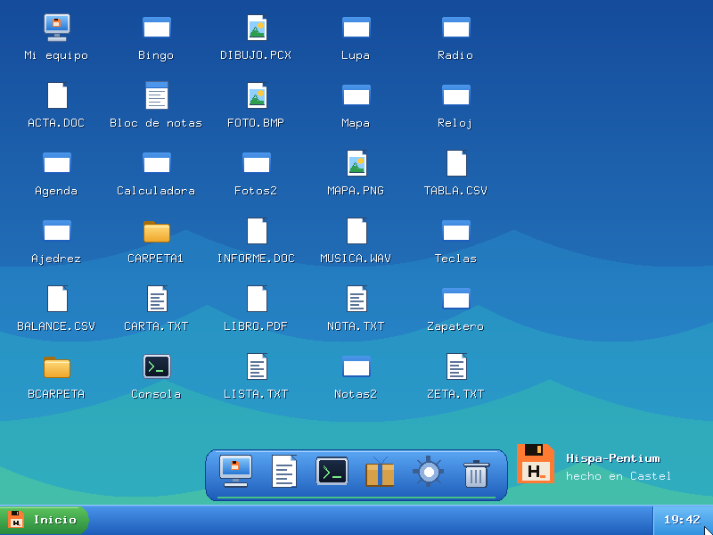 | 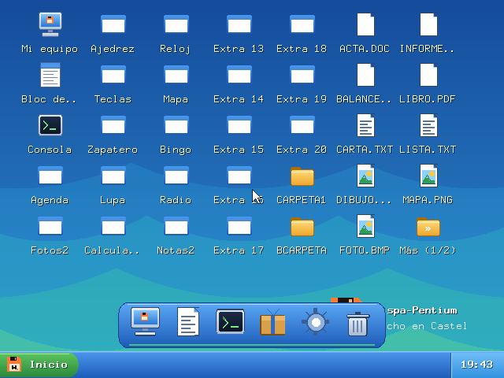 |
| 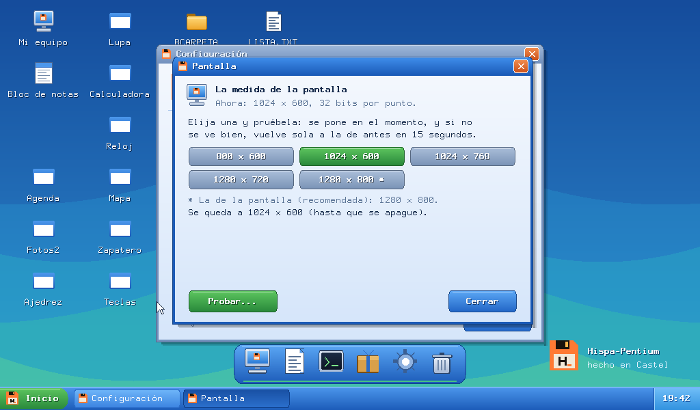 | |

Lo pidió Carlos el 22/11: «Organizar iconos tiene que tener un mínimo en
pantalla destinado para la organización de los iconos, imposibilitando que se
escondan debajo del menú de Inicio. Igualmente también estaría genial que se
pudieran organizar por nombre, tipo, etc.» Antes, «Organizar iconos» los ponía
en una sola columna sin mirar la pantalla: con muchos, los de abajo se
quedaban debajo de la barra de tareas (con «Inicio») o del dock.

**La zona de trabajo** (`organiza.cas`): la pantalla menos la barra de
tareas (34 puntos), menos el dock si se ve (62), menos un margen (8 a los
lados y abajo, 12 arriba). **Ningún icono sale de ella**: ni al arrancar, ni
al organizarlos, ni al arrastrar uno (mientras se lleva, no baja de la zona;
soltado encima de la barra, vuelve a ella), ni al llegar iconos nuevos (un
paquete instalado, un acceso soltado desde el explorador, un archivo nuevo en
ESCRITOR), ni al cambiar la medida de la pantalla (de 1280 x 720 a 1024 x 600 o
a 800 x 600, en marcha), ni al ver u ocultar el dock, ni al entrar otro
usuario. (El menú Inicio, cuando se abre, tapa lo que tenga debajo como
cualquier ventana; lo que no puede pasar es que un icono se quede **siempre**
escondido debajo de la barra, del botón «Inicio» o del dock.)

**La rejilla**: celdas de 112 x 76 puntos, de arriba abajo y, cuando no caben
en una columna, en la siguiente. Si no caben en la pantalla, las celdas se
estrechan (hasta 80 x 64; los rótulos largos, con «..»); y si aun así no
caben, **páginas**: la última celda de cada una es «Más (1/2)», con una
flecha, que pasa a la siguiente (un clic, o Av Pág y Re Pág con el teclado).
Nunca se esconde ninguno. Dos iconos no quedan **nunca** uno encima de otro:
el que se suelta encima de otro va a la celda libre más cercana.

**«Organizar iconos...»** (el menú del botón secundario en el tapiz) es un
submenú:

| Opción | Lo que hace |
|---|---|
| Por nombre | En orden alfabético (sin mirar mayúsculas ni tildes; la eñe, detrás de la ene) |
| Por tipo | Los programas, las carpetas, los documentos (por su extensión: BMP, CSV, DOC...) y los accesos; dentro de cada uno, por nombre |
| Por tamaño | De menos a más (el del archivo; de un programa, su `.BIN`; las carpetas, 0) |
| Por fecha de modificación | Lo más nuevo, primero |
| Como al principio | Como salen: los de siempre, los de los paquetes, los accesos y los archivos (como antes de esto) |
| [x] Organización automática | Con ella, se ordenan solos (en el orden elegido) cada vez que se añade o se quita alguno, y lo que se arrastra vuelve a su sitio en el orden |
| [x] Alinear a la cuadrícula | Con ella (lo normal), lo que se suelta va a la celda más cercana; sin ella, se queda donde se suelta, dentro de la zona y sin tapar a otro |
| [x] Mi equipo, siempre el primero | Mi equipo, arriba a la izquierda, sea cual sea el orden |

El orden elegido lleva delante «»», y las casillas, «[x]» o «[ ]»: la forma,
no solo el color.

**Con el teclado** (con el tapiz pulsado, o sin ventanas): las flechas van al
icono de al lado (la primera, al primero), una letra al siguiente que empieza
por ella, Intro lo abre, Esc no deja ninguno elegido, Av Pág y Re Pág cambian
de página. Para eso el gestor de ventanas (`ventanas.cas`) le da las teclas a
la ventana del fondo cuando lo último que se ha pulsado es el tapiz.

**Lo que se guarda**, por usuario: `ICONOS.INI`, en sus ajustes
(`\USUARIOS\CARLOS\AJUSTES\ICONOS.INI`); sin usuarios, `\HISPA\ICONOS.INI`
(o `\ICONOS.INI` sin instalar). Solo lo escribe el núcleo (`permisos.cas`).
Se lee al arrancar y al entrar cada usuario:

```
orden=tipo
automatica=no
cuadricula=si
primero=si
sitio=s:Mi equipo|8|12
sitio=f:CARTA.TXT|456|88
```

(«sitio»: dónde dejó cada uno, por su clase —«s» los de siempre, «p» los de
los paquetes, «a» los accesos, «f» los archivos— y su nombre.)

**Los archivos del escritorio**: los de la carpeta ESCRITOR del que ha
entrado (`\USUARIOS\CARLOS\ESCRITOR`, la que hace `cuentas.cas`); sin
usuarios, los de `\ESCRITOR` en la unidad del sistema, si está. Hasta 24
(los ocultos y los del sistema, no). Cada uno, con el icono de su clase
(como en el explorador); dos clics lo abren con lo suyo (`EQUIPO /ABRIR`). El
escritorio mira la carpeta cada dos segundos: lo que se copia o se borra
ahí sale o se va solo.

**Por el puerto serie**, cada vez que los coloca: `escritorio: iconos
(motivo): N en la zona X0,Y0-X1,Y1, celdas de A x B, C x F, P página(s),
orden O: Mi equipo@8,12/1; ...`; con eso comprueba
`castel/nucleo32/mira_iconos.py` que ninguno se sale ni se tapa.

**Probarlo**: `SOLO=iconos castel/pruebas.sh` (la parte 47,
`pruebas_iconos.sh`): 30 iconos (12 accesos de paquetes y 15 archivos y
carpetas en `\ESCRITOR`) a 1024 x 600 y a 800 x 600, cada orden, arrastrar uno
a la barra, la cuadrícula, la automática, el teclado, `ICONOS.INI` y el
arranque siguiente; cambiar la medida en marcha (de 1280 x 720 a 800 x 600 y
a 1024 x 600); 47 a 640 x 480 (dos páginas); y sin el dock.

### El menú Inicio y los atajos de teclado (21/11, la 0.8.4; marcado «(MENÚ)»)

| | |
|---|---|
| 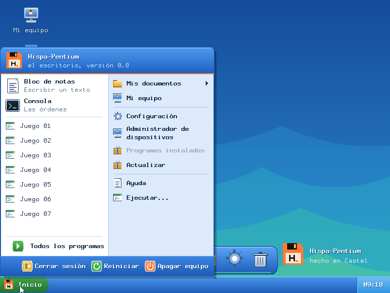 | 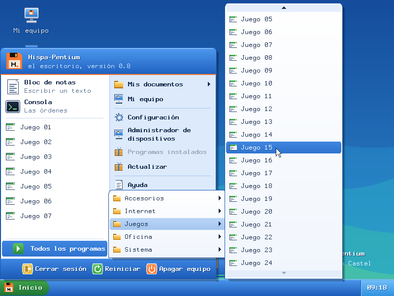 |
| 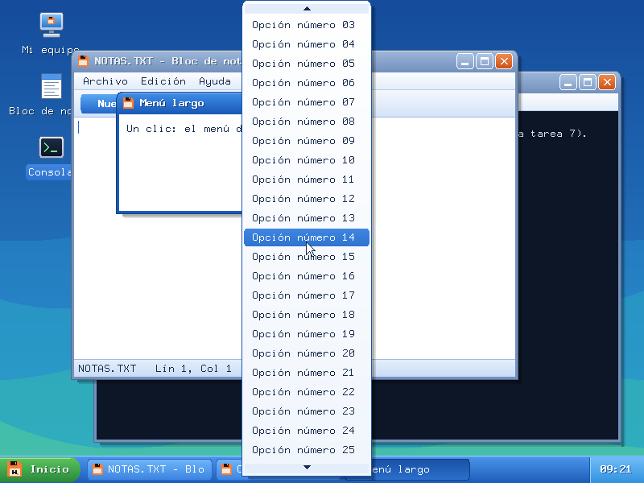 | 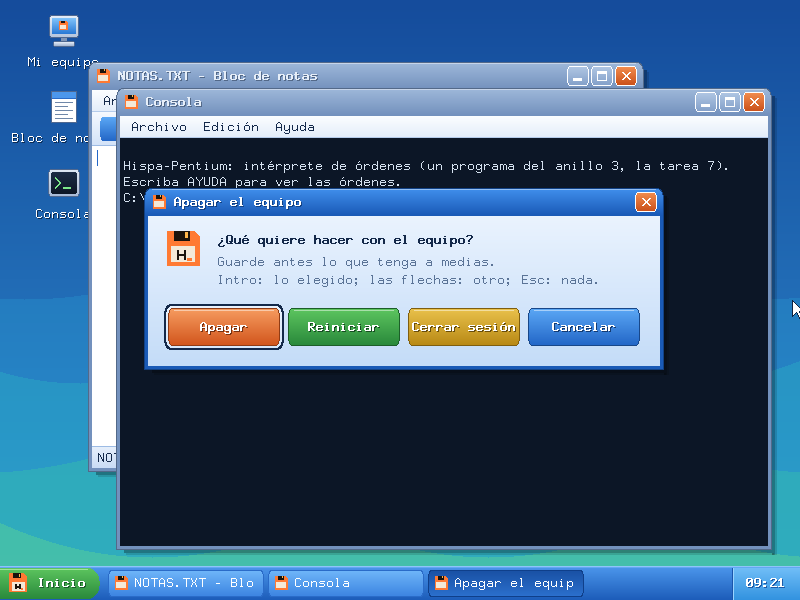 |

Lo pidió Carlos el 21/11: «actualizar el menú de inicio con todos los
programas, y que *Apagar equipo* no se esconda por tener muchos programas».
Antes el menú crecía con cada acceso de un paquete (hasta 6) y, con muchos,
el pie se iba de la pantalla. Ahora (`inicio.cas`, un módulo nuevo del
núcleo) es de los de principios de los 2000, con diseño propio:

- **Arriba**, el saludo («Hola, Carlos») con el disquete.
- **A la izquierda**, en blanco: los **fijados** (en negrita, con su
  explicación debajo: el Bloc de notas y la Consola, si no se dice otra
  cosa) y los **más usados** (los que más se han abierto desde el menú;
  mientras no hay cuentas, los de los paquetes y la oficina). Caben los que
  caben: nunca empujan nada. Abajo del todo, **«Todos los programas»** (la
  flecha verde).
- **«Todos los programas»** abre un submenú con sus **carpetas** (las que
  tienen algo, en este orden): Accesorios, Desarrollo, Internet, Juegos,
  Multimedia, Oficina, Programas de terceros, Programas de Windows,
  Seguridad, Sistema y Otros; y cada carpeta, otro submenú con lo que lleva,
  por orden alfabético: lo de serie (el Bloc, la Consola, Mi equipo; la
  oficina; los programas de Windows de ejemplo y MUESTRA, si están;
  Configuración, el Administrador de dispositivos, Programas y
  actualizaciones, Programas instalados y Red y Tailscale) y **lo de los
  paquetes** (`\HISPA\MENU\*.MNU`: hasta 32).
- La carpeta de un acceso sale de su **`tipo=`** (los de la tabla de §13:
  Sistema, Oficina, Internet y red, Juegos y emuladores, Multimedia,
  Seguridad, Programas de Windows, Herramientas —a Accesorios—, Desarrollo,
  Programas de terceros): el del `.MNU` si lo lleva; si no, el de la
  cabecera del paquete que lo trae (su registro, `\HISPA\PAQUETES\*.PQI`,
  donde está la línea `archivo=\HISPA\MENU\X.MNU`); y si tampoco, por el
  programa (NAVEGA, WIFI, SSH → Internet; CLICGEST → Oficina; ESCUDO →
  Seguridad; un `.EXE` → Programas de Windows) o **Otros**.
- **A la derecha**, en azul muy claro (en negrita, y en dos renglones lo que
  no cabe): **Mis documentos** (un submenú con los `.TXT` de la raíz, hasta
  24; sin ninguno, abre Mi equipo), **Mi equipo**, **Configuración**, el
  **Administrador de dispositivos**, **Programas instalados** (la ventana
  para desinstalar de la rama pentium-programas, `\INSTALAD.BIN`: mientras
  no esté, en gris), **Actualizar** (Programas y actualizaciones), **Ayuda**
  (`MANUAL.TXT` en el Bloc de notas) y **Ejecutar...**.
- **El pie**, siempre a la vista: **Cerrar sesión**, **Reiniciar** y
  **Apagar equipo** (cada uno con su icono: una puerta amarilla, una
  flecha en círculo verde y el botón de encender naranja).

El menú **mide siempre lo mismo**: 440 x 470 puntos, o lo que quepa encima
de la barra de tareas (a 640 x 480, 442 de alto); a 800 x 600 y a
1024 x 600, igual. **Los submenús no crecen más que la pantalla**: si no
caben, se ve lo que cabe entre dos franjas con flechas (▲ ▼, en gris si ya
no se puede ir más allá) y se desplazan con **un clic en la franja**, con
**la flecha quieta encima** (solo), con **la rueda** y con el teclado.

**Con el ratón**: la flecha encima de «Todos los programas» (o de «Mis
documentos», o de una carpeta) abre su submenú; si se va de ahí, el
submenú se cierra un tercio de segundo después, salvo que la flecha llegue
a él (así se puede ir **en diagonal** sin que se cierre). Un clic abre el
programa. **El botón secundario** en un programa: **Abrir** y **Anclar al
menú Inicio** (o **Quitar del menú Inicio**, si ya está fijado).

**Con el teclado**: el logo (o **Ctrl+Esc**) lo abre; **↑ ↓** de una
opción a otra; **→ ←** de una columna a otra, y a los submenús y de vuelta;
**Intro** (o el espacio) abre; **Esc** cierra el submenú de más adentro (y
luego el menú); **Inicio, Fin, Re Pág, Av Pág** en los submenús; y **la
letra inicial** (sin mirar tildes ni mayúsculas) lleva a la opción
siguiente que empieza por ella.

**Lo fijado y las cuentas** se guardan, en un sistema instalado, en
`C:\HISPA\INICIO.INI` (página 437, CR LF; sin instalar —la memoria USB, un
disco de pruebas— solo mientras está en marcha):

    ; el menú Inicio de Hispa-Pentium: lo fijado y las veces que se ha abierto cada programa
    fijo=Bloc de notas
    fijo=Consola
    uso=3|Navegador

**Cómo está hecho**: `inicio.cas` hace la lista de lo que hay cada vez que se
abre (con los accesos de `accesos.cas`, que ahora lleva también el `tipo`) y
pinta el menú y sus dos submenús, cada uno en su ventana del núcleo (sin
marco, por delante). Lo que se elige no lo hace él: lo deja en `pedido` (la
acción de `escritorio.cas`, o un programa con sus argumentos) y lo hace
`haz()` del escritorio. Un clic en un submenú le llega al menú como «fuera»
(`EV_FUERA`): se mira con `ventana_en_punto` si cae en uno de los suyos. El
gestor de ventanas pasa de 20 a 24 (14 guardadas para el núcleo: los
programas siguen teniendo 10).

**Los menús emergentes largos** (`emergente.cas`): hasta 32 opciones (eran
12) y 1024 letras (la llamada 39, 768). Si no caben a lo alto, como los
submenús: lo que cabe, con sus franjas de flechas, la rueda, el teclado
(Re Pág, Av Pág, Inicio, Fin) y **la letra inicial**. `ularga.cas`
(`LARGA.BIN`) es el programa de las pruebas: un menú de 30 opciones.

#### Los atajos de teclado de todo el sistema

Los atiende el escritorio (le llegan a la barra de tareas, como el logo), por
delante de los programas, sin quitarles los suyos (Ctrl+Tab de las pestañas,
Alt+letra de los menús de `controles.cas`, F2 de ClicGest... siguen igual).
El teclado (`consola.cas`) da unas teclas nuevas con el escritorio en marcha:
`TECLA_ALT_F4` (0x112), `TECLA_ALT_TAB`, `TECLA_ALT_MAYÚS_TAB`,
`TECLA_ALT_SUELTA` (Alt suelto tras un Alt+Tab), `TECLA_ALT_ESPACIO`,
`TECLA_TAREAS`, `TECLA_IMPR`, `TECLA_ALT_IMPR` (hasta 0x119) y
`TECLA_LOGO_LETRA` + letra (0x1A0...). El logo ya no abre el menú al
pulsarlo, sino **al soltarlo** si no se ha pulsado otra tecla con él (como
en los sistemas de hoy; también en un teclado USB, que manda el logo como
E0 5B / E0 DB).

| Atajo | Lo que hace |
|---|---|
| Logo, o Ctrl+Esc | abre y cierra el menú Inicio |
| Logo+E | Mi equipo (el explorador) |
| Logo+D | enseña el escritorio: minimiza todas las ventanas; otra vez, las devuelve |
| Logo+R | **Ejecutar...**: un cuadro con un campo; Intro abre lo escrito (un programa —sin extensión, `.BIN`—, una carpeta —en Mi equipo— o un `.TXT`/`.INI`/`.BAT` —en el Bloc—, con sus argumentos detrás) |
| Logo+L | cierra la sesión, si hay usuario (con nombre en HISPA.INI); si no, nada |
| Alt+Tab, Alt+Mayús+Tab | a la ventana siguiente (o a la de antes); mientras se tiene Alt, una **franja** en medio con sus iconos y el nombre de la elegida; al soltar Alt, se queda esa (y si estaba recogida, sale). Esc, sin cambiar |
| Alt+F4 | cierra la ventana activa, como su botón ✕ (el programa puede preguntar si guarda); **en el tapiz** (si lo último pulsado es el tapiz, o no hay ventanas): el cuadro **Apagar el equipo** |
| Alt+Espacio | el menú de la ventana activa: Restaurar, Mover, **Tamaño**, Minimizar, Maximizar y Cerrar; **Mover** y **Tamaño** también **con las flechas** (16 puntos cada vez; Intro o Esc acaban) |
| Ctrl+Alt+Supr, o Ctrl+Mayús+Esc | el **Administrador de tareas**: los programas con ventana (su título, su tarea, si está recogido); **Cambiar a** (Intro), **Terminar** (Supr: acaba la tarea, sin guardar), Cerrar (Esc). No había ninguno en Pentium |
| Impr Pant | una **captura** de la pantalla, en `\CAPTURAS\CAPTnnnn.BMP` (24 bits; el portapapeles es de texto), y un globo que lo dice |
| Alt+Impr Pant | lo mismo, de la ventana activa |
| F1 | en el tapiz: la **Ayuda** (`MANUAL.TXT`); en un programa, la suya, si la tiene (le llega F1 como siempre) |

**El cuadro «Apagar el equipo»** (el del pie del menú y el de Alt+F4) lleva
ahora **Apagar** (elegido: un borde oscuro alrededor, no solo un color),
**Reiniciar**, **Cerrar sesión** y **Cancelar**: las flechas (o Tab) cambian
lo elegido, **Intro** lo hace, **Esc** cancela.

**Cerrar sesión** cierra los programas (como al apagar: el que tiene algo sin
guardar lo pregunta, y entonces no sigue) y deja un cuadro «Hasta pronto,
Carlos» con **Entrar**. Aún no hay contraseñas (está en METAS: «Usuarios con
contraseña»); cuando las haya, ese cuadro será el de entrar.

**«Reiniciar»** del pie del menú reinicia sin más preguntas (como el del
cuadro: antes cierra los programas, y el que tenga algo sin guardar lo dice).

Las pruebas: `SOLO=menu ./pruebas.sh` (la parte 23: 86 bien, 0 mal). Con el menú nuevo se pusieron al día las de antes que lo usan (las coordenadas del menú, del menú de la ventana con «Tamaño» y del cuadro de apagar). `SOLO=32` entera (21/11, con cinco pasadas de otras ramas a la vez en la misma máquina): 694 bien y 4 mal, ninguna del menú: dos del EHCI de la parte 9 (la memoria no llega a tiempo con la máquina tan cargada; en la pasada anterior, bien), el túnel de WireGuard desde Linux (falla igual en las otras ramas) y la línea del asistente que llega detrás del «> » de la consola (la prueba ya lo admite).

### La medida de la pantalla, desde Configuración (20/11)

Lo que faltaba (lo dijo Carlos con el CD 0.8 en VirtualBox: «en Configuración se
ve la resolución pero no se puede cambiar»). Ahora, en Configuración, junto a
«Pantalla: 800 x 600, 32 bits por punto», el botón **«Cambiar...»** abre el
cuadro **«Pantalla»**: la medida de ahora, la **lista de modos** (en verde el
elegido; en azul el de ahora) y, debajo, lo último que ha pasado. Como en
Hispa-486, de dos maneras según la tarjeta:


**1. Con la VBE de Bochs: en el momento.** Es la tarjeta de QEMU y Bochs
(`1234:1111`) y la de **VirtualBox**, tanto la **VBoxVGA** (`80EE:BEEF`) como
la **VMSVGA** (`15AD:0405`, que lleva la misma VBE debajo mientras no se use
como SVGA) y la VBoxSVGA: se sabe que está porque su puerto `0x1CE`/`0x1CF`
contesta `B0C0`-`B0CF`. Aunque el modo lo haya puesto GRUB (el CD, el disco
instalado), la VBE de la BIOS de esas máquinas es esa misma tarjeta, así que el
núcleo puede cambiarlo él:

- **«Probar...»** pone la elegida **ya**, y sale **«¿Se ve bien la pantalla?»**
  con la cuenta atrás: **«Mantener»** (o Intro) la deja; **«Volver»** (o Esc, o
  cerrar el cuadro) vuelve a la de antes; y si en **15 s** no se dice nada,
  **vuelve sola** (por si la pantalla se ha quedado a oscuras o fuera de rango).
  En un sistema instalado, «Mantener» la guarda también para los próximos
  arranques (`\HISPA\PANTALLA.ENV`, abajo).
- **Cómo se cambia** (`video.cas`, `cambia_modo()`): se apaga la tarjeta, se le
  dan el ancho, el alto y 32 bits por punto, se enciende con la memoria seguida, y
  el ancho virtual y los desplazamientos a la medida (así la fila mide lo que el
  ancho, venga de donde venga el modo de antes); luego **se lee lo puesto**,
  también el bit de encendido (VirtualBox, si el modo no le cabe en su memoria,
  no lo enciende y no dice nada más). La memoria de la pantalla es la misma (la
  tarjeta no la mueve): se pone a la vista lo que mida ahora. Si algo falla, se
  vuelve al modo de antes, tal cual. Si el modo de antes era de 24 o 16 bits (con
  el lienzo de 32 aparte), ese lienzo se suelta: el nuevo siempre es de 32.
- **Las ventanas** (`ventanas.cas`, `cambia_pantalla()`): un doble búfer y un
  tapiz nuevos (se piden antes de tocar nada: si no hay memoria, no se cambia),
  y las ventanas dentro: **las maximizadas, a la medida nueva** (su programa
  recibe `EV_TAMAÑO` y se vuelve a pintar, como al maximizar); las demás, donde
  estaban si caben y si no, más arriba o más a la izquierda. El ratón llega hasta
  el borde nuevo (`pon_medida_ratón()`).
- **El escritorio** (`escritorio.cas`, `cambia_medida()`): cierra el menú Inicio,
  los emergentes y el globo; la barra de tareas, de lado a lado y abajo; el menú
  Inicio, encima; el tapiz, pintado otra vez a la medida; los iconos que se
  salgan, dentro; los cuadros abiertos, centrados.


**La lista** (`prepara_modos()`): de 800 x 600 a 1920 x 1080 (800 x 600, 1024 x
600, 1024 x 768, 1152 x 864, 1280 x 720, 1280 x 800, 1280 x 1024, 1366 x 768,
1440 x 900, 1600 x 900, 1600 x 1200, 1680 x 1050 y 1920 x 1080), y de ellos solo
los que caben:

- en **la tarjeta**: lo más que da (la VBE de Bochs lo dice con `GETCAPS`), el
  ancho en múltiplos de 8 en la de QEMU y Bochs (redondea: 1366 se queda en
  1360; la de VirtualBox no), y **su
  memoria**: la de QEMU y Bochs, su registro `0xA` (en trozos de 64 K); la de la
  VBoxVGA, el mismo registro leído de 32 bits (en octetos: lo que usan los
  controladores de VirtualBox); la de la VMSVGA no se sabe desde ahí, y entonces
  manda lo que se lee al ponerlo (si no cabe, no se enciende: se dice y se vuelve);
- en **la pantalla**: lo que ella dice de sí misma (su **EDID**). En QEMU, la
  tarjeta lo deja en su tercera zona PCI: la medida que prefiere (se dice debajo:
  «La pantalla dice que prefiere 1280 x 800») y, de sus medidas de siempre, la
  más grande; no se ofrece nada más grande. En VirtualBox no hay EDID (su
  «pantalla» es la ventana, que muestra lo que sea), ni se puede pedir a la BIOS
  sin volver al modo real (más abajo);
- en el **núcleo**: los 16 MB de su ventana para la memoria de la pantalla
  (`GRÁFICOS_TABLAS`) y la memoria libre para el doble búfer y el tapiz nuevos.

El de ahora sale siempre, aunque no sea de la lista.

**2. Sin la VBE de Bochs (un PC de verdad): al arrancar.** El modo lo pone GRUB
con la VBE de la BIOS, que desde el modo protegido no se puede llamar. El cuadro
lo dice («Esta tarjeta no deja cambiarla en marcha: se guarda y se pone al
arrancar otra vez»), la lista lleva también **«A la medida»** (lo que el monitor
prefiera, `auto`: su EDID, que GRUB sí le pregunta a la BIOS), y el botón es
**«Guardar y reiniciar...»**: se apunta para el próximo arranque y sale «Al
arrancar otra vez, a 1024 x 768», con **«Reiniciar ahora»** y «Más tarde».

- **`\HISPA\PANTALLA.ENV`**: un bloque de variables de GRUB (1024 octetos, como
  `GRUBENV`, para que GRUB pueda escribir en él con `save_env`): `pantalla=`
  (`1024x768` o `auto`), `antes=` (la de antes, para volver) y `prueba=`. Va
  aparte de `GRUBENV` porque PAQUETES y ACTUALIZ escriben aquel entero (su
  `nuevo=`) y se lo llevarían por delante.
- **`GRUB.CFG` lo lee**: la primera vez que se guarda una medida, si `GRUB.CFG`
  no lo hace aún (los instalados con la 0.8), el escritorio le añade al final
  (GRUB lee el archivo entero antes de enseñar el menú, y la entrada usa
  `$modo` al arrancar):

  ```
  if [ -f /HISPA/PANTALLA.ENV ]; then
    load_env -f /HISPA/PANTALLA.ENV pantalla antes prueba
    if [ "$prueba" = 2 ]; then
      set pantalla="$antes"
      set antes=
      set prueba=0
      save_env -f /HISPA/PANTALLA.ENV pantalla antes prueba
    elif [ "$prueba" = 1 ]; then
      set prueba=2
      save_env -f /HISPA/PANTALLA.ENV prueba
    fi
    if [ "$pantalla" = auto ]; then
      set modo=auto
    elif [ -n "$pantalla" ]; then
      set modo="${pantalla}x32,${pantalla},${modo}"
    fi
  fi
  ```

  La **reserva de siempre** sigue detrás: si la BIOS no tiene esa medida (ni con
  32 bits ni con otros), GRUB pasa a la de `set modo=` (`800x600x32,800x600,auto`)
  y, al final, a `auto`: siempre arranca con algo que se ve.
- **A prueba, al arrancar**: «Guardar» deja `prueba=1`; GRUB, al arrancar con
  ella, la pone a `2`. El escritorio, al ver `1` o `2`, pregunta **«¿Se ve bien
  la pantalla?»** con los mismos 15 s: «Mantener» deja `prueba=0`; «Volver» o los
  15 s apuntan la de antes (`pantalla=antes`) y ofrecen reiniciar. Y si la
  pantalla se ha quedado a oscuras y se **reinicia a lo bruto**, GRUB ve
  `prueba=2` (nadie la ha dado por buena) y **vuelve solo a la de antes**.
- En un sistema instalado **con** la VBE de Bochs (VirtualBox), la medida
  guardada la pone GRUB al arrancar (con la tarjeta de QEMU y Bochs la pone su
  controlador `video_bochs`, cualquiera; con las de VirtualBox, por la VBE de la
  BIOS); y si la BIOS no la tiene (la VMSVGA de QEMU no da, por ejemplo, 1200 x
  800), GRUB pone otra y **el núcleo la cambia en marcha** al arrancar el
  escritorio.
- **Desde el CD o la memoria USB, sin instalar**, no hay dónde guardarla: la
  lista sale en gris, y para arrancar a la medida está la entrada **«a la medida
  de la pantalla»** del menú del CD.


**¿Y la lista de modos de la BIOS?** GRUB deja en la información de multiboot
la de su VBE (`vbe_control_info`), pero solo trae **números** de modo (y un
puntero de modo real que puede apuntar a la memoria de trabajo de GRUB, ya
pisada): la medida de cada uno hay que pedírsela a la BIOS (`4F01h`), y eso no
se puede desde el modo protegido. Por eso, sin la VBE de Bochs, se ofrece la
lista de siempre y manda la reserva de GRUB.

**¿Cambiarla en marcha llamando a la VBE de la BIOS?** Evaluado, y **no se ha
hecho**. Hay dos maneras:

1. **Una tarea V86** (el modo virtual 8086 del procesador, lo que usaban X.org y
   los controladores VESA de los 90): hace falta el primer mega a la vista **del
   anillo 3** en ese espacio (la tabla de interrupciones de la página 0, la zona
   de datos de la BIOS, su EBDA y sus ROM de `C0000h` a `FFFFFh`: hoy están en la
   identidad del núcleo, sin el permiso del anillo 3), un **monitor** que atienda la
   protección general de `INT`, `PUSHF`, `POPF`, `CLI`, `STI` e `IRET` (con
   IOPL < 3) y el mapa de puertos del TSS (hoy no hay); y, sobre todo, una
   **entrada de interrupción propia** en ensamblador: al pasar de V86 al anillo 0
   el procesador deja `DS`, `ES`, `FS` y `GS` a 0, y las `interrupción función` de
   Castel cuentan con `DS` plano (no lo vuelven a cargar), así que la protección
   general, el fallo de página y las demás excepciones necesitarían su propia
   puerta para cuando vienen de V86.
2. **Un emulador de modo real** pequeño (como x86emu, el de X.org y `v86d` de
   Linux): sin trucos del procesador, pero son miles de líneas para emular todo
   lo de 16 bits (y de 32, que las VBIOS usan) y los puertos.

Las dos se pueden hacer, pero **lo que no se puede aquí es dejarlo robusto**: la
única VBIOS que se puede probar (la de QEMU, SeaVGABIOS) ya habla con la VBE de
Bochs, que se cambia sin BIOS; las de los PC de verdad (la Intel GMA del Toshiba
y del HP Mini, la de los Mac) hacen cada una lo suyo (llamadas a la BIOS del
sistema, al PCI BIOS, esperas con el reloj, instrucciones de 32 bits), y un fallo
ahí deja el equipo **colgado con la pantalla a oscuras**. Con GRUB, en cambio, el
peor caso es un reinicio y la vuelta sola a la de antes. Queda para más adelante,
como servicio aparte (al estilo de `ACPI.BIN`), cuando haya en qué probarlo; para
las Intel GMA, el arreglo de la sección 11 (decirle a la tubería la medida nueva
sin la BIOS) es lo que más rinde.

**Probado** (parte 17 de las pruebas, `SOLO=pantalla`): con QEMU `-kernel`
(-vga std: el modo lo pone el núcleo) la lista, «Probar...», «Mantener», el Bloc
de notas maximizado que se pone a la medida nueva y la vuelta sola a los 15 s;
el CD en un «pc» como VirtualBox con el modo de GRUB, con `-vga std` (como la
VBoxVGA) y con `-vga vmware` (la VMSVGA, `15AD:0405`), cambiado en marcha; e
instalado desde el CD con `-vga cirrus` (sin la VBE de Bochs, como un PC de
verdad): guardar, reiniciar, la prueba al arrancar con «Mantener», y otra que
no se da por buena y que GRUB deshace sola al reiniciar a lo bruto. Y,
instalado con `-vga std`, «Mantener» que se guarda; y con `-vga vmware`, 1200 x
800 (que su BIOS no da) puesta por el núcleo al arrancar.

### La pantalla, por su EDID; y la memoria USB (21/11)

Lo que dijo Carlos con el **HP Mini 5103** de verdad (GMA 3150, panel de
1024 x 600): Configuración ofrecía **1920 de ancho**, y «ponga lo que ponga, se
queda en 1024 x 600». Lo primero, porque sin la VBE de Bochs no se miraba lo
que puede la pantalla; lo segundo, porque arrancaba **de la memoria USB**, y
desde ella la lista no hacía nada (sin decir por qué).

**Lo que dice la pantalla** (`edid.cas`, nuevo): su **EDID**, una vez, al poner
el escritorio:

1. en QEMU, de su tarjeta (la tercera zona PCI de `1234:1111`);
2. en las **Intel** (GMA 950/945, **GMA 3150** de los Atom N450/N455/N550, GMA
   X3100/4500 y HD Graphics), por el **DDC** de la pantalla (I2C, dirección 50h)
   con el **GMBUS** de la tarjeta (sus registros GMBUS0 a GMBUS3, como los
   cuenta la documentación pública de Intel, «IHD-OS»): primero las patillas
   del panel (LVDS, los portátiles) y luego las del VGA. En `5100h` de su zona
   de registros hasta las GMA 4500; en `C5100h` desde las HD Graphics. Se lee
   con un ciclo «con índice» desde el octeto 0, de cuatro en cuatro, con un
   tope de espera en cada paso, y se comprueba la cabecera y la suma. Los paneles
   **eDP** (Bay Trail, como el Acer One 10, y muchos de Haswell en adelante) no
   lo dan por ahí sino por el canal AUX de DisplayPort: no se mira. **Sin
   probar aún en un Intel de verdad** (QEMU no tiene esa tarjeta): lo dirá el
   registro del arranque del HP Mini.

De él: la **nativa** (su primera medida detallada), el **nombre** del monitor
(su descriptor `FCh`) y lo más grande que sabe mostrar (en un panel o un monitor
digital, la nativa; en uno analógico, lo más grande de sus medidas).

**La lista** (`prepara_modos()`), con eso:

- **con EDID**: nada mayor que lo que puede la pantalla, y la nativa marcada
  como **recomendada** («1024 x 600 *» y, debajo, «La de la pantalla
  (recomendada): 1024 x 600.»), aunque no esté en la lista de siempre;
- **sin EDID, pero sabiendo la nativa**: si se ha arrancado **«a la medida de la
  pantalla»** (la entrada del menú, que ahora le dice al núcleo `amedida`, o
  `PANTALLA.ENV` con `auto`), la que puso GRUB es la de la pantalla (la eligió
  él por su EDID, que GRUB sí le pide a la BIOS). Se apunta en `PANTALLA.ENV`
  (`nativa=`) para los arranques siguientes;
- **sin saber nada, en un PC de verdad**: nada mayor que la de ahora («No se
  sabe su medida: nada mayor que la de ahora»), y «A la medida» para que la
  elija GRUB;
- en una **máquina virtual** sin EDID (VirtualBox), sin tope: su pantalla es
  una ventana, y «Probar...» vuelve sola a los 15 s;
- nunca se elige de por sí nada mayor: la elegida al abrir es la de ahora.

**La memoria USB** (`usb.sh`): su menú lee `\PANTALLA.ENV` (en su raíz) igual
que el del disco instalado, y lo usa la **primera entrada** (dice antes de
arrancar a qué medida va); «Guardar y reiniciar...» lo escribe ahí (se arranca
con `escritura=usb`). Las memorias hechas antes del 21/11 no lo traen: el
cuadro lo dice. Y cuando no se puede guardar, al pulsar una medida se dice
**por qué** (el CD es de solo lectura; sin permiso de escritura; una memoria de
antes; sin instalar).

**Si la BIOS no da la pedida**, GRUB pone otra de la reserva sin decir nada; el
núcleo, al arrancar, compara: «**Este equipo no permite 1600 x 900: se queda en
800 x 600.**», en un aviso, y `PANTALLA.ENV` pasa a la que hay (si estaba a
prueba, a la de antes). Con la VBE de Bochs, la pone él.

**El registro del arranque**: todo lo de la pantalla (con qué medida ha
arrancado, el EDID o que no lo hay, lo que pide `PANTALLA.ENV`, lo que se elige,
la prueba y si no se permite) va a `ARRANQUE.TXT` de la unidad del sistema: en
la memoria USB (con `registro`, como siempre) y en el disco instalado
(`C:\ARRANQUE.TXT`).

**El Administrador de dispositivos** enseña, en Pantalla, colgado de la
tarjeta, el **monitor** con su nombre y para qué medida está hecho («Monitor:
QEMU Monitor», «hecho para 1024 x 600 (EDID: la tarjeta de QEMU)»): lo que ya
se leyó al arrancar (la llamada 155, de solo lectura, como siempre).

**Lo que no se ha hecho**: el `_DDC` de ACPI (el EDID que algunas BIOS dan por
ACPI, sobre todo de paneles eDP): pide que `ACPI.BIN` evalúe un método más y lo
pase al núcleo por una llamada de servicio; queda para la próxima si el GMBUS no
basta en algún equipo.

**Probado** (parte 17, `SOLO=pantalla`): QEMU con `-device VGA,xres=1024,yres=600`
(la lista: 800 x 600 y 1024 x 600 recomendada; el monitor en el Administrador
de dispositivos), con `xres=1366,yres=768` y con `edid=off`; la memoria USB con
`-vga cirrus` (sin VBE de Bochs ni EDID, como el HP Mini): «A la medida»
guardada en `X:\PANTALLA.ENV`, la prueba al arrancar, y 1600 x 900 (que cirrus
no da) dicho en un aviso y en `X:\ARRANQUE.TXT`; y el disco instalado con
cirrus, con la nativa apuntada.

### Lo que falta

Escribir **nombres largos** (el explorador ya hace carpetas, cambia
nombres y deja accesos de documentos en el tapiz, pero en 8+3); arrastrar
de una ventana del explorador a otra y desde otros programas; ocultar el
dock solo (que salga al acercarse); «Nueva carpeta» en el tapiz; la barra de
desplazamiento en los programas de Castel (la **rueda del ratón** ya llega,
desde la 0.8.3: `EV_RUEDA`, sección 14 ter; la usa el Navegador);
que la Consola cambie sus filas y columnas con la ventana, y guarde lo que ha
pasado hacia arriba; menús que se abren con Alt y submenús; letras de otros
tamaños y de ancho variable; el ajuste del doble clic; y que el tapiz pueda ser
una imagen del disco.

### La oficina de Hispa-386, dentro: HVPRUN

| | |
|---|---|
| 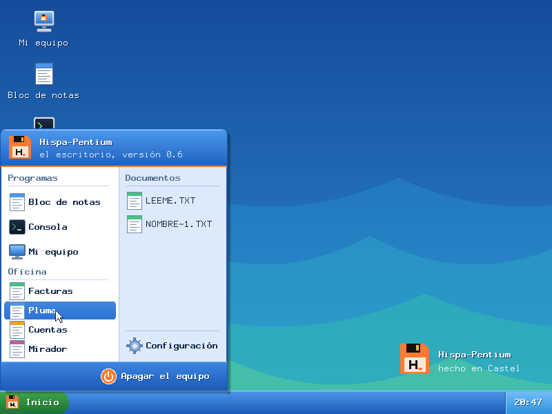 |  |
|  | 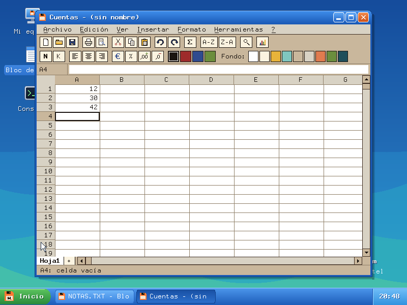 |
|  | 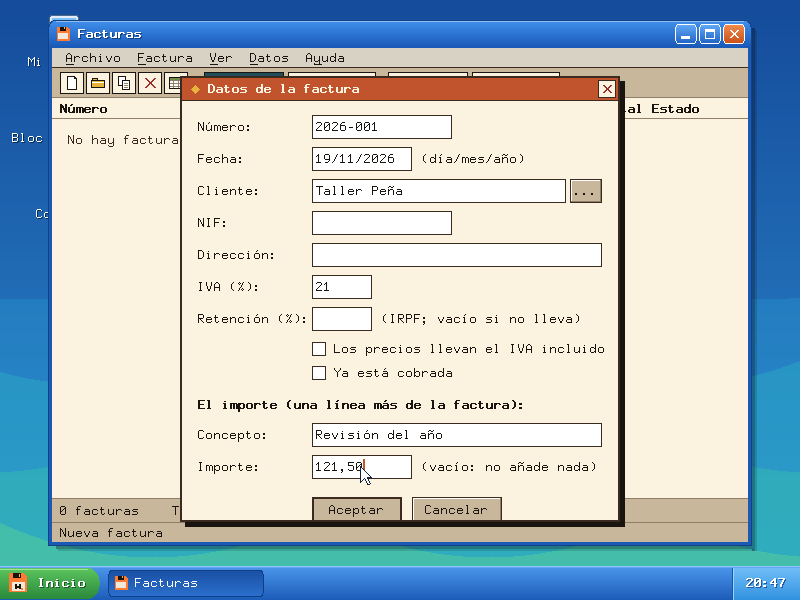 |

Los programas de la **oficina de Hispa-386** (Facturas, Pluma, Cuentas y
Mirador: módulos `.HVP` de Hispa Ventanas) corren en el escritorio de
Hispa-Pentium **sin tocarles una línea**: son los mismos archivos que en
Hispa-386, hechos con `tools/mkhvp.py` de `programas/*.asm`. Los abre
**`HVPRUN.BIN`** (`castel/nucleo32/hvprun/`), un programa del anillo 3 (cabecera
`HPU3`) escrito en NASM:

```
HVPRUN \OFICINA\FACTURAS.HVP [ARCHIVO]
```

- **Lo de arriba es Hispa Ventanas**: el gestor de ventanas, los mensajes y las
  tareas cooperativas, los controles (botones, cuadros de texto, listas, barras
  de desplazamiento), los menús, los menús contextuales, los cuadros de diálogo
  (también el de elegir archivo) y el dibujo (`ventanas/gestor.inc`,
  `nucleo.inc`, `controles.inc`, `menus.inc`, `contexto.inc`, `dialogos.inc`,
  `tamano.inc`, `dc.inc`, `gdi.inc`...) **se reensamblan tal cual**: son de 32
  bits plano y no tocan el hardware. `ventanas/` no se ha tocado.
- **Lo de debajo es de Hispa-Pentium** (`pent.inc`, `ppantalla.inc`,
  `pdos.inc`, `pfaltan.inc`): la «pantalla» de Ventanas es una superficie de 8
  bits del tamaño de lo de dentro de **una ventana de Hispa-Pentium**; lo que
  cambia se pasa a 32 bits con la paleta de Ventanas y se le da al núcleo como
  un mapa de puntos (llamada 34). El ratón (con el doble clic que cuenta el
  núcleo) y las teclas llegan como sucesos (35); los archivos `dos_*`, por las
  llamadas 7-9 y 18-26; buscar archivos (`INT 21h`, 4Eh y 4Fh) abre la carpeta
  y la lee entrada a entrada (12); la fecha y la hora, de la llamada 15; la
  memoria (`mem_bloque` y el montón de Ventanas), de la 17; el reloj de la BIOS
  (18,2 tics por segundo), de los tics del núcleo.
- **La ventana principal** del programa ocupa esa ventana entera: su marco y su
  título de Ventanas quedan fuera (el título lo pone Hispa-Pentium, y cambia
  cuando el programa lo cambia: «Pluma - carta.PLU»); su barra de menús sí se
  ve. Al estirar o maximizar la ventana de Hispa-Pentium, el programa recibe
  `WM_SIZE` y se recoloca. Los **cuadros de diálogo y los menús** salen dentro de
  la ventana, con el aire de Hispa Ventanas. La ventana nace **en el centro**
  (la llamada 80, nueva) y del tamaño que el programa pide según la pantalla.
- **El portapapeles** de Ventanas se pone al día con el del sistema (llamada
  40) al entrar en la ventana, al salir de ella y al acabar: lo copiado en
  Pluma se pega en el Bloc de notas, y al revés.
- El **botón de cerrar** es un `WM_CLOSE` para el programa (Pluma pregunta si
  hay cambios sin guardar); con un cuadro abierto encima, lo cierra a él.
- Lo que el programa pide de modo real (`rm_interrup`): de `INT 21h`, 0Eh,
  19h, 1Ah, 2Ah, 2Ch, 36h, 39h-3Bh, 3Ch-42h, 4408h, 47h, 4Eh, 4Fh y 56h. La
  **impresora** aún no: `INT 11h` dice que no hay puerto paralelo, y Facturas y
  Pluma lo avisan. Lo demás contesta «función no válida» y lo dice por el
  puerto serie (o el terminal), para saber qué falta.

En el **menú Inicio**, el grupo **«Oficina»** (debajo de los programas) los
abre; **Mi equipo** abre con HVPRUN los `.HVP`, los documentos de Pluma
(`.PLU`), las hojas de Cuentas (`.HOJ`) y las imágenes (`.BMP`, `.PCX`, `.GIF`,
`.PNG`, `.JPG`, `.TGA`, `.ICO`, `.PPM`, con Mirador). En el disco van
`\HVPRUN.BIN` y la carpeta `\OFICINA` (los `.HVP`, `TIPOS.DAT`, sus otros
tamaños y `DICCIO.DAT`): los pone `nucleo32/hvprun/hacer.sh`, y de ahí `usb.sh` (la
memoria USB) y `disco.sh IMAGEN 16 oficina`. Facturas guarda sus datos al lado
de su módulo (`\OFICINA\FACTURAS.DAT`), y Datos su base de siempre
(`\OFICINA\DATOS.BDD`). Desde la oficina 1.1 van también Datos, el Lector,
Publicaciones, Presentaciones y Pintura: el apartado siguiente.

Los **emuladores** que corren con HVPRUN (Hispa-Snes e Hispa-Drive) están en
`\JUEGOS` de la memoria USB y se abren desde Mi equipo: notan que están en
HVPRUN porque `aj_leer AJ_TXT_VERSION` da 0 y entonces usan el reloj fino
(`aj_leer 20`) y no tocan puertos (docs/HISPADRIVE.md).

Lo que falta: imprimir; la forma del cursor que pide el programa (la flecha
es siempre la del sistema); que cada cuadro de diálogo sea una ventana de
Hispa-Pentium aparte; y abrir otros programas desde uno de Ventanas
(`prog_abrir`). (El sonido llegó con hvprun 0.9; Alt+letra, la rueda y los
otros cuatro de la oficina, con la 0.10: abajo.)

### La oficina 1.1 entera (rama pentium-oficina, «(OFICINA2)»)

| | |
|---|---|
| 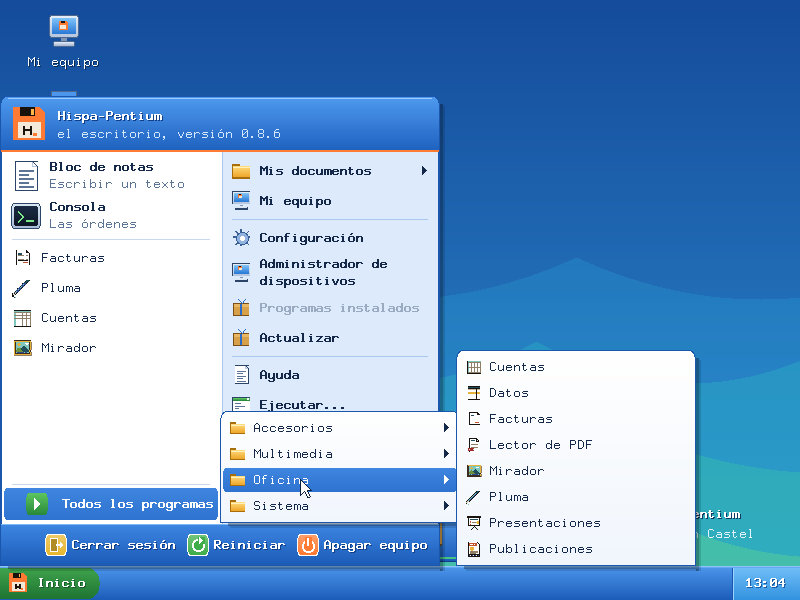 | 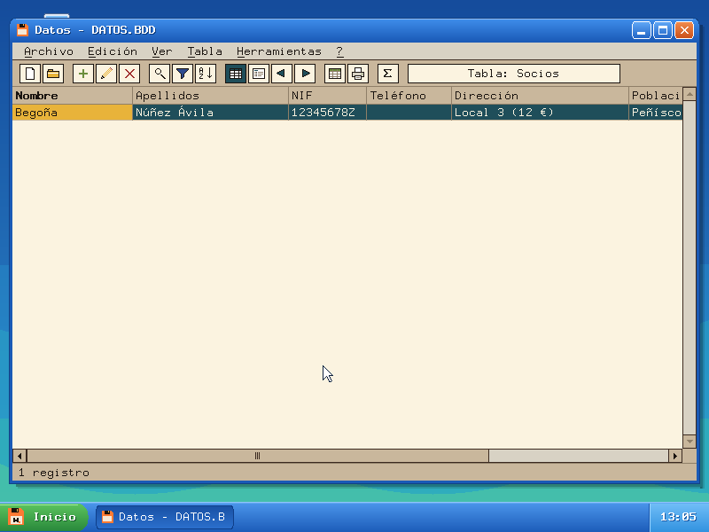 |
| 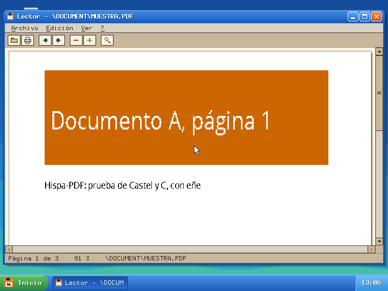 | 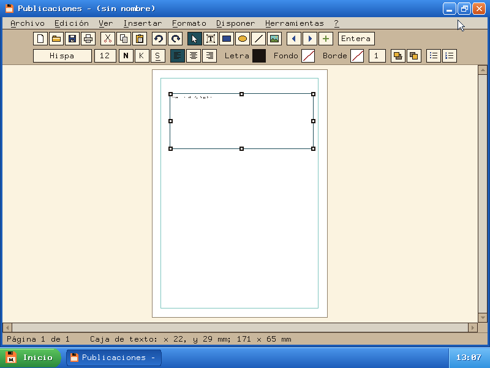 |
| 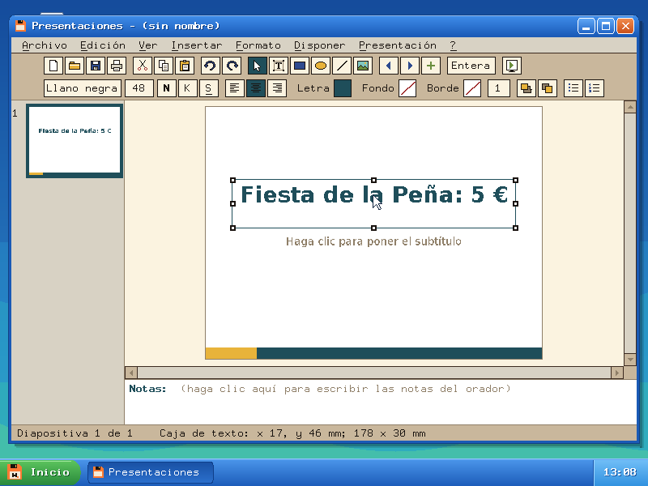 | 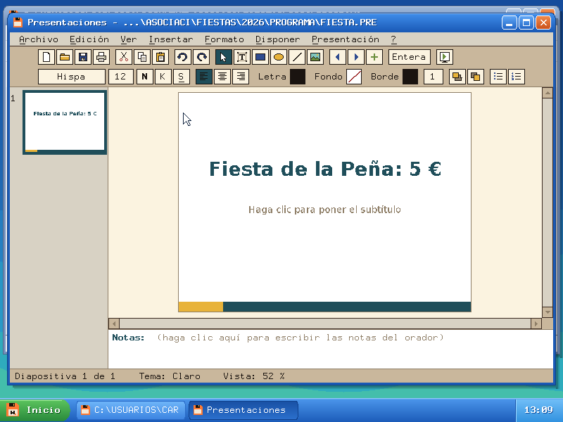 |
| 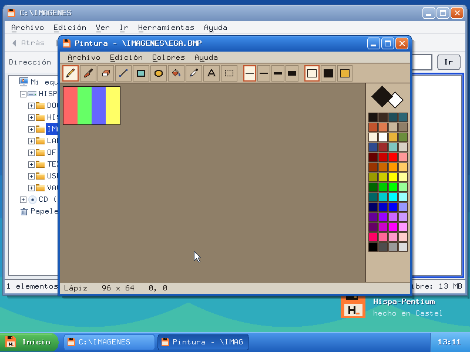 | 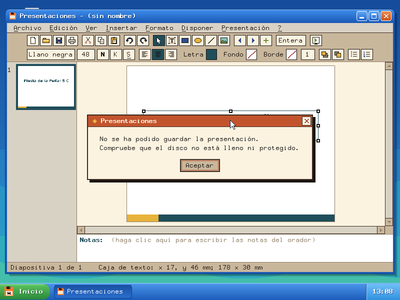 |

Los cuatro que faltaban de la oficina de Hispa-386 y Pintura corren ya en
HVPRUN, comprobados uno por uno en QEMU (abrir, escribir, guardar, cerrar y
volver a abrir; la parte 40 de las pruebas):

- **Datos** (`DATOS.HVP`, tipo Access): bases `.BDD` con sus tablas, la
  rejilla y la ficha. Su base de siempre, `DATOS.BDD`, va al lado del programa
  (`\OFICINA`, fuera de la zona protegida).
- **El Lector** (`LECTOR.HVP`): los PDF, con la rueda, Av Pág, buscar, copiar
  el texto de la página y «Guardar el texto de la página» (`.TXT`).
- **Publicaciones** (`PUBLICA.HVP`, tipo Publisher, `.PUB`) y
  **Presentaciones** (`PRESENTA.HVP`, tipo PowerPoint, `.PRE`), con los
  tipos de letra de la oficina en todos sus tamaños: el paquete `oficina` no
  llevaba `TIPOS12.DAT`, `TIPOS24.DAT` ni `TIPOS32.DAT`, y lo de 9, 18, 24, 36 y
  48 puntos salía con la letra «Hispa» a escala; ahora van (unos 500 K más).
- **Pintura** (`PINTURA.HVP`, el paquete aparte `pintura`, tipo Multimedia,
  como el Mirador: es de imágenes, y así se puede quitar sin quitar la
  oficina; se instala de serie, como en Hispa-386 y en Windows). Guarda en BMP;
  **ahora lee también PCX** (un plano de 8 bits con la paleta del final o
  grises, color verdadero en tres planos, blanco y negro, y 16 colores en
  planos o en un plano de 2 o 4 bits; con RLE o sin comprimir), para
  «Editar» los PCX: lo abierto se guarda al lado como `.BMP` (el PCX no se
  pisa). En Hispa-386 sigue igual (su prueba, `tests/run_pintura_tests.sh`).

**El menú Inicio** (`inicio.cas`, «(OFICINA2)»): en Todos los programas >
Oficina, Datos, Lector de PDF, Publicaciones y Presentaciones (y Pintura en
Multimedia) **si está su `.HVP`** (una oficina 1.0 no los enseña), fuera de
los más usados de salida (salen cuando se usan; los cuatro de siempre no
cambian de sitio). **Cada uno con su icono, el de su `.HVP`** (32 x 32 a 4
bits, desde el octeto 64, con los 16 colores de Hispa Ventanas; se lee una vez;
si no se puede, la hoja con su letra). **Con el Mirador de Pentium**
(el paquete `mirador`: un acceso a `MIRADOR.BIN`), **el Mirador de la oficina
no sale** (ni en el menú ni en «Abrir con...»): no dos Miradores; el `.HVP`
sigue en el paquete para los sistemas sin el de Pentium.

**Mi equipo** (`exoper.cas` y `uequipo.cas`, «(OFICINA2)»): `.BDD` con Datos,
`.PUB` con Publicaciones, `.PRE` con Presentaciones y **`.PDF` con Hispa-PDF si
está instalado** (`\HISPA\HISPAPDF.BIN`) **y, si no, con el Lector**. Un
`ASOCIA.TXT` de antes (sin esas clases) usa las de siempre para lo que no
dice; y si el `.HVP` de una clase no está (una oficina de antes), es como si no
hubiera nada («Abrir con...»). En el menú del botón secundario de un `.BMP` o
un `.PCX`, **«Editar con Pintura»** (si está; «Abrir» sigue siendo el Mirador,
el nativo si está). En «Abrir con...», los de la oficina 1.1 que estén.

**HVPRUN 0.10** (`nucleo32/hvprun/poficina.inc`, y dos líneas en
`ppantalla.inc` y `hvprun.asm`), lo que les faltaba:

- **La rueda del ratón**: el suceso 13 de Hispa-Pentium no lo atendía; ahora
  llega a Ventanas (`ges_rueda`, `WM_MOUSEWHEEL` a la ventana de debajo).
- **Alt+letra** abre el menú que la tiene marcada: Hispa-Pentium da
  `TECLA_ALT` + la letra (0x180...) y HVPRUN lo pasaba como un código que
  Ventanas no conocía; ahora llega como en DOS (AL = 0, AH = el código de la
  tecla).
- **Los títulos largos**: el núcleo no acepta uno de 64 letras o más
  (`MAX_TÍTULO`): con un documento de una ruta larga el título no cambiaba y,
  si el primero ya era largo, **la ventana ni se hacía**. Ahora se acorta:
  «Presentaciones - ...\ASOCIACI\FIESTAS\2026\PROGRAMA\FIESTA.PRE» (el nombre
  del programa, «...» y el final de la ruta, desde una «\»).
- **El programa, en la unidad del sistema**: Mi equipo abre un documento de
  otra unidad (una memoria USB, `D:\CARTA.PLU`) con la unidad de trabajo en
  la suya, y `\OFICINA\PLUMA.HVP` se buscaba en `D:`. Si no está donde se dice
  (y se ha dado sin letra), se busca en la del sistema.
- **Dónde se trabaja** (lo que enseñan Abrir y Guardar como, y donde va lo
  que se guarda sin ruta): con un documento, su carpeta; sin él, **los
  documentos del usuario**: con usuarios (la llamada 200 de la rama
  `usuarios`: la ficha que es la suya), `\USUARIOS\<SU CARPETA>\DOCUMENT`; sin
  ellos, `\DOCUMENT` si está; si no, la de siempre (la raíz). Nunca `\HISPA`:
  ahí el núcleo no deja escribir a ningún programa de la oficina («acceso
  denegado», y el programa lo dice: «No se ha podido guardar...»).

**En los programas** («(OFICINA2)», sin cambiar nada en Hispa-386 más que
esto): tras un «Guardar como» que no se puede (en `\HISPA`, o un disco
lleno), Pluma, Cuentas, Publicaciones, Presentaciones y Pintura se quedaban
con ese nombre, y Ctrl+G volvía a fallar sin preguntar; ahora vuelven al
nombre de antes y Guardar pregunta otra vez dónde (`programas/pluma.asm`,
`cuentas/archivo.inc`, `comun/lamina_ed.inc`, `pintura.asm`). Sus pruebas de
Hispa-386 siguen pasando (`tests/run_pintura_tests.sh`, `run_pluma_tests.sh`,
`run_cuentas_tests.sh`, `run_publica_tests.sh`, `run_presenta_tests.sh`).

Comprobado también: el teclado español (tildes, ñ y el euro con Alt Gr+E),
el portapapeles con el Bloc de notas (Ctrl+C en Datos o en el Lector, Ctrl+V
en el Bloc), maximizar (Publicaciones se recoloca), y una ruta de 57 letras
(`C:\USUARIOS\CARLOSSA\DOCUMENT\ASOCIACI\FIESTAS\2026\PROGRAMA`): abrir de
ahí, guardar y «Guardar como» a esa misma carpeta.

**Los paquetes**: `oficina` 1.1 (los ocho `.HVP` con `TIPOS12/24/32.DAT`;
necesita hvprun >= 0.10), `pintura` 1.0 (`\OFICINA\PINTURA.HVP`, del sistema,
tipo multimedia) y `hvprun` 0.10. El menú y las clases nuevas son del núcleo
(`inicio.cas`) y de Mi equipo (`exoper.cas`, `uequipo.cas`): llegan con la
base y el paquete `equipo` que salgan con esta rama; sin ellos, los programas
nuevos se abren igual desde Mi equipo (dos clics en su `.HVP`).

**Probarlo**: `SOLO=oficina ./pruebas.sh` (la parte 40, `castel/pruebas_oficina.sh`;
con `OFICINA_CAPTURAS=carpeta`, deja sus capturas en PNG). Las muestras se
hacen ahí: `nucleo32/hvprun/muestras/haz_imagenes.py` (BMP y tres PCX) y
`nucleo32/pdf/pruebas/haz_pdf.py` (el PDF).

## 11. En un PC de verdad: GRUB, la memoria USB y el USB

`nucleo32/usb.sh IMAGEN` hace la imagen de una **memoria USB** (64 MB, FAT16,
arranque BIOS con GRUB) para probar Hispa-Pentium en un PC: se graba tal cual en la
memoria y se arranca de ella. (Necesita ser root, `parted`, `dosfstools` y
`grub-pc-bin`.) El menú de GRUB (la 0.7):

| Entrada | Qué arranca | El modo |
|---|---|---|
| el escritorio (800 x 600) | `ESCRIT8.BIN escritorio escritura=usb unidad=X registro` | el de su cabecera |
| el escritorio **a la medida de la pantalla** | lo mismo | `set gfxpayload=auto`: el que el panel dice que prefiere |
| el escritorio (1024 x 600) | `ESCRIT6.BIN` con lo mismo | el de su cabecera |
| el escritorio (1366 x 768) | `ESCRIT13.BIN` con lo mismo | el de su cabecera |
| el escritorio (1024 x 768) | `ESCRIT10.BIN` con lo mismo | el de su cabecera |
| el escritorio **sin tocar el USB ni los discos** (como la 0.5) | `ESCRIT8.BIN escritorio sindisco sinusb` | el de su cabecera |
| ver los modos de vídeo que da la BIOS | la orden `videoinfo` de GRUB | — |
| el intérprete de órdenes (modo texto) | `SEMILLA.BIN ordenes escritura=usb unidad=X registro` | texto |
| la consola del núcleo (modo texto) | `SEMILLA.BIN escritura=usb unidad=X registro` | texto |
| **Instalar Hispa-Pentium en el disco duro** (desde la 0.7) | `SEMILLA.BIN instalar unidad=M`, con todo lo que se instala como módulos (sección 12) | texto |

- **La memoria de arranque es la unidad X:**, la del sistema (`unidad=X`): desde
  la 0.6 el núcleo la lee él, con su USB (más abajo). De ella se cargan el
  intérprete, el Bloc de notas, la Consola y Mi equipo, y **en ella se puede
  guardar** (`escritura=usb`): el Bloc de notas deja ahí sus textos.
- **Los discos de dentro del PC se ven, pero no se tocan**: el núcleo busca los
  IDE y los SATA y monta sus volúmenes FAT como `C:`, `D:`... de **solo
  lectura** (`escritura=usb` da permiso solo a las memorias USB: sección 7). Mi
  equipo los enseña; un disco sin FAT (NTFS, ext4...) sale como disco que no se
  puede leer.
- **Los programas vienen también como módulos**, por si el USB de un equipo no
  se deja: GRUB carga con el núcleo `ORDENES.BIN`, `BLOC.BIN`, `CONSOLA.BIN`,
  `EQUIPO.BIN`, `HOLA.BIN`, `ECO.BIN`, `PRUEBA.BIN`, `BUCLE.BIN` y `LEEME.TXT`, que
  hacen de **unidad M: en memoria** (sección 7). Si no hay X:, la del sistema es
  ella, y entonces no se puede guardar nada (el Bloc de notas lo dice).
- **`registro`**: lo que el núcleo encuentra al arrancar (los discos, las
  controladoras USB y cada aparato, las unidades) queda en **`X:\ARRANQUE.TXT`**
  y, al medio minuto, cómo van el teclado y el ratón USB (sección 7).
  Es para poder verlo luego desde otro equipo: con el escritorio en marcha no se
  ve la pantalla de texto del núcleo. (La última entrada, la consola del núcleo
  en modo texto, lo enseña en la pantalla.)
- **Si con lo nuevo un equipo no arranca** (se queda parado al tomar el USB, o
  al mirar los discos), la entrada «sin tocar el USB ni los discos» arranca como
  la 0.5: `sinusb` y `sindisco`, con los programas de la unidad M:.
- **El modo gráfico, de GRUB.** En un PC de verdad no está la tarjeta de QEMU: el
  modo lo tiene que poner el cargador antes de entrar en el núcleo (con la VBE de
  la BIOS, que desde el modo protegido ya no se puede llamar). Multiboot lo prevé:
  el núcleo lo pide en su **cabecera** (la bandera de vídeo y el ancho, el alto y
  los bits que prefiere). El compilador de Castel deja en la cabecera el sitio
  para ello, a cero (CASTEL32.md §8), y **`nucleo32/modo_grafico.py NUCLEO.BIN
  SALIDA.BIN [ANCHO ALTO [BITS]]`** hace una copia del núcleo que lo pide: los
  `ESCRIT*.BIN` son eso. GRUB pone el modo y le dice al núcleo dónde está la
  memoria de la pantalla; el escritorio arranca en él, **con la medida que le
  den**. El núcleo sin tocar (`SEMILLA.BIN`) pide lo de siempre, modo texto: con él
  van QEMU con `-kernel` y las dos entradas de texto.
- **La medida de la pantalla.** Al cargar el núcleo, GRUB apunta lo que pide su
  cabecera en su variable `gfxpayload`, así: `ANCHOxALTOxBITS,ANCHOxALTO,auto`. Si
  la BIOS no tiene ese modo, prueba el mismo con otros bits y, si tampoco,
  **`auto`**: el que la pantalla dice que prefiere (GRUB se lo pregunta al panel:
  su EDID), y si no lo sabe, el que le parece (800 x 600, en lo probado). La
  entrada «a la medida de la pantalla» pone `gfxpayload=auto` después de cargar
  el núcleo: lo que diga el panel. En las dos, GRUB solo puede poner **modos que
  la BIOS dé por VBE**.
- **Si la BIOS no da el modo del panel.** Pasa: hay BIOS de portátil (las de los
  Intel de los netbooks, sobre todo) que por VBE solo dan los modos «de siempre»
  (640 x 480, 800 x 600, 1024 x 768) y no el de su propio panel (1024 x 600,
  1366 x 768). La entrada **«Ver los modos de vídeo que da la BIOS»** lo dice:
  enseña la lista (página a página: una tecla para seguir) y, al final, el que
  prefiere el panel. Entonces:
  1. si el modo del panel **está en la lista**, van las entradas «a la medida» y
     la de su tamaño;
  2. si **no está**, GRUB pone otro y el escritorio sale en él: a 800 x 600 se ve
     bien (el panel lo estira, o lo deja con bandas a los lados); a 1024 x 768 en
     un panel de 600 de alto, aplastado;
  3. el arreglo de verdad, **para más adelante**: que el núcleo ponga él la
     medida del panel hablando con la tarjeta, sin la BIOS. En las Intel (GMA)
     no hace falta un controlador entero: la BIOS ya ha dejado el panel encendido
     con sus tiempos, y basta con apagar el «ajuste al panel», decirle al plano y
     a la tubería la medida nueva (los registros `PIPESRC`, `DSPSIZE`,
     `DSPSTRIDE` y `PFIT_CONTROL`) y leer la medida del panel de sus tiempos. Es
     lo que hacían en su día los parches de «resolución» para estas tarjetas.
- **Probado en QEMU** arrancando la imagen como una memoria USB (`-device qemu-xhci
  -device usb-storage`): GRUB, el modo puesto por él (800 x 600 y 1024 x 600; el
  de 1366 x 768 no lo tiene la BIOS de QEMU, y sale el que GRUB elige: así se
  prueba también ese camino) y el escritorio con sus programas.
- **Probado en un PC de verdad** (19/11/2026): un **Toshiba NB250** (Atom N455,
  pantalla de 1024 x 600, panel táctil Synaptics PS/2), con la 0.4 a 800 x 600:
  arranca deprisa, el escritorio sale bien, y el ratón (botón principal y
  movimiento) y el teclado van. Y un **MacBook Air de 2012** (sin 8042: el
  teclado y el panel son USB), con la 0.5: el escritorio se ve, pero ni el
  teclado ni el panel responden; para él (y para todos los PC sin teclado ni
  ratón PS/2) es el USB de la 0.6, que **en un PC de verdad está por probar**.
  Hace falta, además, una VBE con modos de 32, 24 o 16 bits.
- **Sin GRUB**, otro camino para más adelante: un cargador propio de 16 bits que
  pida el modo a la VBE (`int 10h`, `4F02h`) antes de pasar a modo protegido y
  deje al núcleo la misma información.

### El USB

Desde la 0.6 el núcleo tiene su USB, escrito en Castel (con lo aprendido en
HSPUSB, el USB de Hispa-DOS, que está en ensamblador de 16 bits: `drivers/hspusb.asm`
y `docs/USB.md`). Lo enchufado se enumera **al arrancar** y **sin interrupciones** (las
controladoras se miran); lo que se enchufa y se desenchufa después, desde la
0.8, lo atiende `usbcal.cas` (más abajo, «El USB en caliente»):

1. **Las controladoras** (`usb.cas`): se buscan en el bus PCI (clase 0x0C,
   subclase 0x03) las **xHCI** (interfaz 0x30), las **EHCI** (0x20) y las
   **UHCI** (0x00), por ese orden, se le
   **quitan a la BIOS** (el «traspaso»: «es del sistema», esperar a que la suelte
   y apagar sus SMI; en el EHCI se hace siempre, que hay BIOS —la de los Mac— que
   lo usan sin decir que es suyo), se reinician y se ponen en marcha. Hasta
   entonces la BIOS imitaba con ellas un teclado PS/2; desde entonces, el teclado
   y el ratón USB los lleva el núcleo.
2. **xHCI** (`xhci.cas`), el de los PC de 2012 en adelante: la tabla de contextos
   (con las páginas «de borrador» que pida la controladora), el anillo de órdenes
   y el de sucesos; por cada aparato, su ranura, su contexto y un anillo de
   transferencias por extremo. La controladora da ella las direcciones y lleva
   las transacciones partidas; el núcleo le dice de cada aparato su velocidad, su
   **cadena de ruta** (por qué puerto de cada concentrador se llega a él) y, si
   es de USB 1.x detrás de un concentrador de alta velocidad, su traductor.
   Contextos de 32 o de 64 octetos, puertos de USB 2 y de USB 3.
3. **EHCI** (`ehci.cas`), el de los equipos de 2002 a 2012: la lista asíncrona
   (una cola de trabajo para control y «a granel», que se rellena en cada
   transferencia) y la **lista periódica** con las tuberías de interrupción. Los
   aparatos de USB 1.x **detrás de un concentrador de alta velocidad** (el
   teclado y el panel de un MacBook cuelgan así de su EHCI) van con
   **transacciones partidas**: la cola lleva la dirección y el puerto del
   concentrador y, en las tuberías, se pregunta en la microtrama 0 y se recoge
   en las 2, 3 y 4. Lo que hay en un puerto de la controladora y no es de alta
   velocidad se cede a la controladora compañera (UHCI), como manda la norma.
   **UHCI** (`uhci.cas`), las compañeras de un EHCI (a ellas van a parar los
   teclados y ratones enchufados a un PC de 2002 a 2010: el Toshiba NB250 y el
   HP Mini tienen cuatro) y las únicas de los PC de antes: sus registros son
   puertos de E/S; la lista de 1024 tramas apunta toda a la cadena de las
   tuberías de interrupción y, detrás, a la cola de trabajo. Cada paquete es
   un descriptor (TD), y la alternancia la lleva el núcleo; si los datos llegan
   cortos, se salta al estado a mano. A la BIOS se le quita apagando su
   imitación de teclado (el registro `LEGSUP`).
4. **Enumerar** (`usb.cas`): a cada aparato se le reinicia el puerto, se le da
   dirección, se leen sus descriptores (quién es, sus interfaces y sus extremos)
   y se le pone su configuración. Un **concentrador** se enciende puerto a puerto
   y se sigue por lo que cuelgue de él (hasta cinco en fila). Lo que no se deja
   se apunta (en qué paso se quedó) y se dice.
5. **Teclado** (`usbhid.cas`): el protocolo de arranque (ocho octetos: los
   modificadores y hasta seis teclas). Comparando cada informe con el anterior
   se sabe qué se ha pulsado y qué se ha soltado, y eso se le da a `consola.cas`
   **con los mismos códigos que da un teclado PS/2**: el teclado español, los
   acentos con tecla muerta, Alt Gr, Ctrl+C y las flechas son los mismos. La
   repetición de la tecla que se deja pulsada se hace aquí (medio segundo, y
   luego 25 por segundo). En los teclados de Apple con distribución europea se
   deshace el cambio de dos teclas (la de la izquierda del 1 y la de al lado de
   Mayús), como hacen los demás sistemas.
6. **Ratón y panel táctil**: el protocolo de arranque si la interfaz lo tiene
   (botones, X e Y en los tres primeros octetos); si no, se lee su **descriptor
   de informe** y se busca en él dónde van los botones y los ejes X e Y
   relativos, con su identificador de informe (y, al arrancar, se dicen los
   octetos de ese descriptor, para tenerlos). El panel de un MacBook, recién
   encendido, es un ratón de estos (movimiento y el clic físico; tocar para
   pulsar y los gestos son de su modo multitáctil, que no se usa). Una tarea del
   núcleo mira las tuberías cada centésima de segundo.
7. **Memorias** (`usbalm.cas`): la clase «almacenamiento» con el transporte
   «solo a granel» y órdenes SCSI. Cada orden es un envoltorio de 31 octetos
   (CBW), los datos y un estado de 13 (CSW): `INQUIRY`, `TEST UNIT READY`,
   `READ CAPACITY (10)`, `READ (10)`, `WRITE (10)` y `SYNCHRONIZE CACHE`;
   `REQUEST SENSE` cuando una falla, quitar la parada del extremo y el reinicio
   de la clase si se atasca. Ocho sectores por orden. La memoria es un disco
   más de `discos.cas`, y su FAT, la unidad `X:`.

### El USB en caliente (desde la 0.8)

Lo que se enchufa y se desenchufa con el equipo en marcha lo atiende
`usbcal.cas`: una tarea del núcleo, **`usb-caliente`**, mira **cada medio
segundo** los puertos de las controladoras (sus registros: el aviso de «ha
cambiado lo enchufado», que se borra al mirarlo) y **cada segundo** los de los
concentradores (la petición de su estado). Sin interrupciones, como lo demás.

- **Se enchufa algo**: se esperan 100 ms a que se asiente, se reinicia el
  puerto y se enumera como al arrancar (un EHCI cede a su compañera lo que no
  es de alta velocidad, y es ella la que lo ve). Un **teclado** o un **ratón**
  funcionan al momento (la tarea que los atiende se pone en marcha con el
  primero); un **concentrador**, con todo lo que lleve colgado; una
  **memoria** es un disco más y cada volumen FAT suyo, una unidad con **la
  primera letra libre desde la W: hacia abajo**. Las direcciones USB, las
  fichas de los aparatos, las tuberías y los sitios en las tablas de discos y
  unidades se reutilizan.
- **Se desenchufa algo**: el aparato (y lo que cuelgue de él) queda **marcado
  como ido** y lo que se le esté pidiendo falla en el acto, sin esperar a que
  se pase el tiempo. Un teclado **suelta las teclas** que tenía pulsadas (y
  deja de repetir) y un ratón, sus botones: nada se queda apretado. Las
  unidades de una memoria dejan de estar; **los archivos abiertos en ellas dan
  error** («el disco falla») hasta que el programa los cierre, y el programa
  sigue; quien trabajaba en esa unidad pasa a la del sistema. Luego se quita:
  sus tuberías salen de la lista periódica (EHCI, UHCI), en el xHCI se
  deshabilita su ranura y se sueltan las páginas de su contexto y sus anillos,
  y su dirección queda libre. Si se va **la memoria del sistema**, la unidad
  del sistema pasa a ser M: (los programas que trajo GRUB); si vuelve, vuelve
  a ser X:.
- **Quitar con seguridad** (la llamada 130): **en Mi equipo** (botón
  secundario sobre la unidad: «Abrir | Quitar con seguridad»), **en la bandeja
  del escritorio** (el icono de la memoria, que sale con una enchufada: un clic,
  y «Quitar con seguridad W:» por cada una) y con la orden **`quitar W`** de la
  consola del núcleo. Lo pendiente va a la memoria (las entradas de los
  archivos abiertos para escribir, la FAT y, en FAT32, la cuenta de libres), se
  le dice que lo asiente (SYNCHRONIZE CACHE) y que se pare (START STOP UNIT), y
  sus unidades dejan de estar: «**Ya puede quitar la memoria W:**». **La memoria
  de la que corre el sistema no se deja quitar**: «X: es la memoria del sistema:
  no se puede quitar» (en Mi equipo, la opción sale en gris).
- **Los avisos**: cada cosa se dice por el puerto serie (`usb: se enchufa el
  aparato 2, ...`, `usb: aviso: Memoria USB conectada: W:`) y, con el
  escritorio, en un **globo** encima de la bandeja que se va solo a los seis
  segundos (o con un clic). **Mi equipo se pone al día solo**: a las ventanas de
  los programas les llega `EV_UNIDADES` cuando aparece o desaparece una unidad.

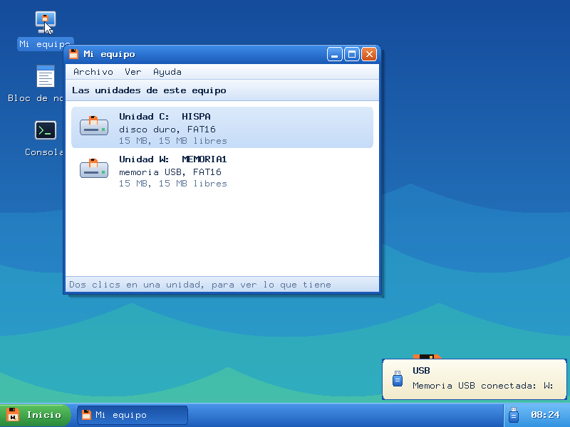

**Probado en QEMU** con el monitor (`device_add usb-storage`, `usb-kbd`,
`usb-mouse`, `usb-hub` y `device_del`), en xHCI y EHCI y con un teclado de USB
1.1 que pasa a la UHCI compañera (`pruebas.sh`, parte 11: `SOLO=caliente`): la
memoria enchufada se lee; escrita y quitada con seguridad, `fsck.fat` la da por
sana; quitada a lo bruto con un archivo abierto (`PRUEBA abierto W:\HOLA.TXT`),
el programa ve los errores y sigue; un concentrador con un teclado y un ratón
detrás, enchufado y quitado entero; y en el escritorio, un ratón que llega
abre Mi equipo. **En un PC de verdad, por probar** (el HP Mini y el Toshiba).

**Lo que no hace** (todavía): las controladoras **OHCI** (las de USB 1.1 que no
son de Intel ni de VIA: las compañeras de los EHCI de NVIDIA, SiS y de algunos
AMD); pasar al xHCI los puertos que los Intel de las series 7 a 9 dejan en
el EHCI (no hace falta: van por el EHCI con su concentrador); las tabletas (ejes
absolutos); las luces del teclado; los discos USB con sectores que no sean de 512.

**Probado en QEMU**, que tiene las tres controladoras (`-device qemu-xhci`,
`-device usb-ehci`, `-device piix3-usb-uhci`, y un EHCI con sus UHCI compañeras:
`ich9-usb-ehci1` e `ich9-usb-uhci1`), teclado, ratón, concentrador (de USB 1.1) y memoria
(`usb-kbd`, `usb-mouse`, `usb-hub`, `usb-storage`), y con `-machine pc,i8042=off`
quita el teclado y el ratón PS/2, como en un Mac: sección 14. **Lo que QEMU no
puede probar**: las transacciones partidas del EHCI (no tiene concentrador de
alta velocidad), que son justo el camino del teclado y el panel del MacBook;
están hechas según la norma y como las hace HSPUSB, pero hasta que no se prueben
en el equipo no se sabe.

### Apagar de verdad y la batería (ACPI)

*20/11/2026.* Hasta aquí, «Apagar el equipo» solo decía «Ya puede apagar el
equipo» (en QEMU, su puerto de pruebas). Ahora **apaga de verdad** (ACPI, el
estado S5), **reinicia** por el camino que diga el equipo y, en los portátiles,
la **bandeja enseña la batería**. Todo eso sale del mismo trabajo que ya había
para Hispa-DOS ([ACPI.md](ACPI.md)): el núcleo de C de `HSPACPI` con
**ACPICA** dentro, sin tocar una línea de lo que lee la batería.

**Un servicio aparte, en el anillo 3.** ACPI no cabe en un núcleo en Castel (y
no hace falta): las tablas del equipo son un programa en AML que hay que
ejecutar, con su intérprete (ACPICA, 150 K de C). Lo lleva **`ACPI.BIN`**, un
programa del anillo 3 como los demás (cabecera `HPU3`, enlazado para
`0x40000000`), hecho con **los mismos objetos** de `build/acpi/` que
`HSPACPI.BIN` (`acpi/pentium/hacer.sh`; el Makefile los compila): cambian solo
la entrada (`acpi/pentium/entrada.asm`), la «máquina» (`maquina.c`: puertos,
memoria, PCI y reloj) y el bucle (`servicio.c`). Si el AML de un equipo hace
algo raro, lo que cae es ese programa, no el núcleo. El núcleo lo lanza al
arrancar (`semilla.cas`, `arranca_acpi`) si está en la unidad del sistema
(`\ACPI.BIN`; en un sistema instalado, `\HISPA\ACPI.BIN`), con la línea del
cargador como argumentos; `sinacpi` en ella no lo lanza, y con `instalar`
tampoco. Si no está, todo es como antes.

**Lo que puede y los demás no** (`energia.cas`, llamadas 150 a 154). Un
programa del anillo 3 no puede tocar puertos ni memoria física; el servicio
se lo pide al núcleo, y **solo él**: el núcleo apunta su tarea al lanzarlo, y a
cualquier otra le contesta «no vale» (el mismo `ACPI.BIN` lanzado a mano desde
el intérprete lo dice y acaba).

| EAX | Qué | Devuelve |
|---|---|---|
| 150 | un **puerto**: EBX el puerto, ECX el valor, EDX los octetos (1, 2, 4) y 0x100 para escribir | lo leído |
| 151 | **la memoria física** desde EBX, ECX octetos, a la vista del servicio: en su zona de `0xB0000000`, sin caché. Esas páginas llevan la marca **`AJENO`** (`paginas.cas`): al acabar el programa sus marcos **no** vuelven a los libres (son del equipo: las tablas ACPI, registros) | dónde |
| 152 | la **configuración PCI**: EBX la dirección (como en CF8h; los bits 0-1, el octeto), ECX, EDX como en la 150; dirección y dato de una vez, con las interrupciones tapadas: el núcleo también usa CF8h/CFCh (lo que ACPICA escribe en CF8h se guarda en `maquina.c` y va con el acceso a CFCh) | lo leído |
| 153 | el servicio da lo último leído (EBX: una `Energía`, la `struct pe_energia` de `acpi/pentium/pentium.h`) y espera como mucho ECX tics a que el núcleo le mande algo (la orden se mira cada décima de segundo) | la orden: 0, 1 apagar, 2 reiniciar |
| 154 | (cualquier programa) **la batería**: la `Energía` a EBX | 1, o 0 si no hay servicio |

La memoria física que pide se apunta en `maquina.c` y se vuelve a usar (el
núcleo no la quita hasta que el programa acaba); en QEMU son 152 K. El reloj
sale del contador del procesador (RDTSC se puede leer en el anillo 3), medido
al empezar contra los tics del núcleo; una espera de más de 20 ms duerme. El
núcleo de C sigue con su «tarea» (`nucleo.c`, con su pila): el bucle de
`servicio.c` la deja correr y duerme entre paso y paso, y solo entre lecturas
(`tarea_quieta()`) usa ACPICA desde fuera (para apagar). Lee **igual que
HSPACPI en el modo mínimo** (docs/ACPI.md, «Los dos modos»): no se pasa el
equipo a modo ACPI ni se usa la SCI mientras está encendido, `_REG` del
controlador embebido, `PWUP` antes de cada lectura en el HP Mini y **sin
`_PSR`** (apagaría su tarjeta de red), el ritmo y las dos baterías del ThinkPad
A275, la salud (`_BIF`/`_BIX`). Una lectura cada 10 s (`acpicada=N` en la
línea del cargador). Lo que apunta (lo que en Hispa-DOS es `BATERIA.LOG`) sale
por el **puerto serie** y, con `registro` en la línea del cargador (las
entradas de la memoria USB lo llevan), también a **`\ACPI.TXT`** de la unidad
del sistema (con la memoria USB, `X:\ACPI.TXT`).

**Apagar, en orden** (`escritorio.cas`, `apaga`; `energia.cas`):

1. **Avisar a los programas**: a cada ventana de un programa, «cerrar» (como el
   botón de la ventana), y hasta 3 s para que se cierren, sin dejar de mover
   el escritorio. (CORTES) Si alguno no se cierra (el Bloc de notas con
   cambios sin guardar pregunta; uno colgado ni lo lee), el cuadro **«Estos
   programas no se han cerrado»**, con cada uno («no responde» o «espera una
   respuesta»), **«Forzar el cierre»** y **«Cancelar»**; sin elegir nada, a
   los 15 s se fuerza (a los 60 si alguno pregunta algo): sección 14 tervicies.
   (Antes: «Hay un programa sin cerrar: ¿algo sin guardar?» y no se apagaba
   hasta pedirlo otra vez.)
2. La pantalla del final («Apagando el equipo...»), y los programas que
   queden (sin ventana) se acaban: sus archivos se cierran y lo escrito queda.
3. **Vaciar los discos** (`asentar` de cada uno).
4. **ACPI**: se le manda «apagar» al servicio, que, con su tarea quieta, hace
   lo de ACPICA: `AcpiEnterSleepStatePrep(5)` (`\_S5`, `_PTS(5)`, `_SST`),
   el **modo ACPI** si el equipo no está en él (`SMI_CMD` ← `ACPI_ENABLE`,
   como `APAGAR` de Hispa-DOS: hay BIOS que si no, no apagan) y
   `AcpiEnterSleepState(5)`: `SLP_TYP` y luego `SLP_EN` en `PM1a_CNT` (y
   `PM1b_CNT`). Si el equipo sigue encendido, lo dice; a los 15 s (o si el
   servicio no está), **el núcleo lo intenta él** con lo que el servicio le
   dio al arrancar (`PM1a_CNT`, `\_S5`, `SMI_CMD`; si ACPICA no ha podido con
   `\_S5`, el servicio lo busca a mano en la DSDT, como `APAGAR`).
5. Si nada de eso apaga: en QEMU, su puerto de pruebas (el código 5); en un PC
   de verdad, el aviso de siempre, «Ya puede apagar el equipo». **APM no**: es
   de modo real o de un modo protegido de 16 bits de la BIOS, y los equipos
   que lo tienen (antes de 2008) casi siempre tienen también ACPI.

**Reiniciar**: lo mismo hasta vaciar los discos; se avisa al servicio (le dice
al controlador embebido que lo deja, `_REG (3, 0)`, y ya no toca ACPI) y luego,
como `REINICIAR` de Hispa-DOS, lo que funcione primero: el **registro de
reinicio de la FADT** (en E/S, en memoria o en la configuración PCI, si la FADT
lo trae), el **controlador del teclado** (FEh al 64h), el puerto **CF9h** (02h
y 06h) y un **triple fallo**. La llamada 66 (la que usan INSTALAR y el
asistente) va por aquí también.

**La batería en la bandeja** (`energia.cas`, `pinta_pila` y `ayuda_pila`).
Si el equipo declara batería (en un sobremesa no hay pila, ni sin ACPI), la
bandeja crece y, a la izquierda del reloj, sale **la pila** con lo que queda
(verde; ámbar por debajo del 25 %, rojo del 10 %), un **rayo** si está
enchufado, un aspa si no hay batería puesta, y el **porcentaje**. Con el
puntero **quieto medio segundo** encima sale, encima de la barra y centrado en
el puntero, el **recuadro de ayuda**, crema, como en Hispa-486
([VENTANAS.md](VENTANAS.md), «[AYUDA]»):

- sin cable: «Batería: 73 % · quedan 2 h 10 min» (los minutos, si el equipo
  los da); con cable: «Enchufado · cargando: 73 %» o «Enchufado · cargada
  (100 %)»; sin batería puesta, «Sin batería puesta · enchufado»;
- la **salud**: «Salud: 68 % (guarda 5.000 de 7.350 mAh de cuando era nueva)»
  (con dos baterías, «entre las 2 guardan ... de cuando eran nuevas»);
- los **ciclos de carga**, si el equipo los da (`_BIX`): «312 ciclos de carga»
  («312 y 45» con dos);
- por debajo del 50 % de salud, en terracota: «La batería está gastada: dura
  menos de la mitad que nueva».

Se va al sacar el puntero de la pila o al pulsar un botón (y no vuelve hasta
salir y entrar); mientras se ve, se pone al día solo (al enchufar, cambia sin
mover el puntero). Es una ventana sin marco «encima», del núcleo, que no toma
el foco.

**Lo que no se puede probar en QEMU**: el controlador embebido de verdad (el
del HP Mini y el del Toshiba, con sus tiempos), las llamadas a la BIOS (SMI)
de sus métodos y que la BIOS de cada uno apague con `SLP_EN`. Las pruebas
(sección 15, la parte 14 de `pruebas.sh`) usan la batería de mentira de las de Hispa-DOS
(`tests/acpi/bateria-qemu.aml`, con `-acpitable`), y apagan y reinician QEMU
con PIIX4 (`pc`) y con ICH9 (`q35`). Para el equipo: la imagen
`hispa-pentium-usb-0.8-hp-mini.zip` (o `-toshiba`, la misma), con todo lo de la 0.8 y su LEEME.

### Arrancar por UEFI (22/11, rama pentium-uefi; marcado «(UEFI)»)

Hasta aquí la memoria USB, el CD e INSTALAR arrancaban **solo por la BIOS**
(o el «Legacy»/«CSM» de un equipo UEFI), con GRUB y multiboot. Ahora la
memoria USB y el CD arrancan **también por UEFI**: de 64 bits (`BOOTX64.EFI`) y,
si en el equipo que hace la imagen está su GRUB, de 32 bits (`BOOTIA32.EFI`: los
Atom Bay Trail como el **Acer One 10** o el Medion, que tienen UEFI de 32 bits
con un procesador de 64). Lo elige el equipo; la memoria es la misma.

**La imagen** (`nucleo32/usb.sh`, `nucleo32/cd.sh` y lo común en
`nucleo32/uefi.sh`):

- **La memoria USB**: la tabla sigue siendo la del **MBR**, con una sola
  partición FAT16 (la de siempre, con el GRUB de la BIOS en el MBR y su hueco).
  En ella van **`\EFI\BOOT\BOOTX64.EFI`** (y `BOOTIA32.EFI`): un GRUB EFI hecho
  con `grub-mkimage`, con todo lo que usa el menú dentro (no hace falta la
  carpeta de módulos de EFI) y `-p /boot/grub` sin disco: busca su `grub.cfg` en
  la misma partición de la que lo cargó el firmware. Es lo de Rufus «MBR para
  BIOS o UEFI»: los firmwares buscan `\EFI\BOOT\` en cualquier partición FAT de
  una memoria USB (no hace falta que sea de clase `EFh`), y así el núcleo sigue
  viendo una sola unidad X: y la BIOS de los equipos viejos no ve nada nuevo.
  No hay ESP aparte ni GPT.
- **El CD**: `grub-mkrescue` sin `-d` hace las dos: el El Torito de la BIOS y
  otro de **UEFI** (`/efi.img`, una FAT con el GRUB EFI), y la tabla para
  grabarlo en una memoria con `dd`. La parte 16 sigue viendo su El Torito 1 de
  la BIOS igual.
- **El menú** es el mismo `grub.cfg` para las dos: con `$grub_platform` = `efi`
  salen las entradas de UEFI (`multiboot2` y `module2`; los mismos módulos,
  `a_module2`), y si no, las de siempre (`multiboot`), sin tocar. Por UEFI se
  cargan solo `efi_gop` y `efi_uga` (con `all_video`, en QEMU, GRUB usaría la
  VBE de Bochs por su cuenta). Hay además «Volver a la configuración del
  firmware» (`fwsetup`).
- **Sin GRUB EFI** en el equipo que hace la imagen (los paquetes
  `grub-efi-amd64-bin` y `grub-efi-ia32-bin`), o con `SIN_UEFI=1`, la imagen sale
  **como antes**, solo BIOS: el PC de Albinyana no los tiene, y sus pruebas siguen
  igual.
- **`LEEME-UEFI.TXT`** en la raíz (`nucleo32/uefi/LEEME-UEFI.TXT`): que hay que
  **apagar el Secure Boot** (no está firmado: sin shim), cómo se suele hacer (la
  tecla de la configuración, la pestaña Security/Boot, la contraseña de
  supervisor que piden los Acer para dejarlo cambiar, «Other OS»), que se puede
  **volver a encender** después, las teclas del menú de arranque y lo que cambia.

**El núcleo, por multiboot2.** Castel pone ahora en el núcleo **dos cabeceras**
(`ccastel.py` y `compilador/apoyo.cas`, `ARRANQUE_NUCLEO`, iguales): la de
multiboot de siempre (con el sitio del modo gráfico de `modo_grafico.py`, que
sigue en el mismo sitio) y detrás, alineada a 8, la de **multiboot2** (88
octetos, la suma ya hecha): las mismas direcciones (etiqueta 2), la misma
entrada (3) y la pantalla (5, optativa, sin medida: la que diga `gfxpayload`).
La entrada guarda la magia y la información igual; `multiboot.cas` da lo mismo
con una que con otra (`mb2()`):

| Lo que da | multiboot | multiboot2 (UEFI) |
|---|---|---|
| la línea | campo 4 | etiqueta 1 |
| los módulos | la lista del campo 3 | las etiquetas 3 (apuntadas la primera vez, hasta 2048) |
| el mapa de memoria | campo 6 | etiqueta 6 (cada entrada se ve como una `Región` contada 4 octetos antes: base, largo y clase caen igual) |
| la pantalla | campos 88-110 (la VBE) | etiqueta 8 (la del **GOP**) |
| la RSDP de ACPI | (no la da: ACPI.BIN la busca en la EBDA y en E0000h-FFFFFh) | etiqueta 15 (ACPI 2) o 14: `rsdp()` |
| ¿UEFI? | no | etiquetas 11/12 (la tabla del sistema de EFI): `arrancado_por_uefi()` |

`marcos.cas` no da como libre **toda** la información de multiboot2
(`largo_info()`: ahí van los nombres de los módulos, la línea y la copia de la
RSDP). GRUB sale de los servicios de arranque del firmware antes de entrar.

**Lo que usaba la BIOS, sin ella:**

- **La pantalla**: la deja el firmware (GOP) o GRUB se la pide antes de arrancar
  (`gfxpayload=auto`: la que dice la pantalla por su EDID o, si no, la que había;
  las entradas de 1024 x 600, 1366 x 768 y 1024 x 768, `ANCHOxALTOx32,…,auto`; la
  medida guardada en `PANTALLA.ENV`, igual que por la BIOS). No `keep`: con la
  consola de texto de EFI, GRUB no tiene modo que guardar y no da pantalla. **El
  cambio en marcha no se hace** (`se_cambia_en_marcha()` y `cambia_modo()` dicen
  que no con UEFI, aunque en QEMU esté la VBE de Bochs: así QEMU se porta como un
  PC de verdad); Configuración › Pantalla lo dice («Arrancado por UEFI: no se
  cambia en marcha, la pone el firmware al arrancar. Se guarda para el próximo
  arranque.») y va por «Guardar y reiniciar...». Si el GOP es **RGB** (el rojo
  abajo; casi todos son BGR), se dibuja en un lienzo aparte y `volcar()` le da la
  vuelta a cada punto (`pantalla_al_revés()`, `fila_al_revés`). El EDID por el
  GMBUS de Intel sigue valiendo.
- **El modo texto** no existe: **`textouefi.cas`** pasa la página de `0xB8000` a
  un marco de RAM (todo lo de texto —la consola del núcleo, el intérprete del
  arranque, INSTALAR, la llamada 60— sigue escribiendo ahí, como siempre) y una
  tarea del núcleo, `texto-uefi`, la **pinta en la pantalla del firmware** cada 4
  tics: 80 x 25 letras de 8 x 16 de la página 437 entera (`letra437.cas`, la de la
  HispaBIOS: `hazletra437.py`), los 16 colores de la VGA y el cursor, al doble o
  al triple si la pantalla da para ello, en el centro. Solo lo que cambia. Con el
  escritorio en marcha se calla. Lo que el núcleo dice antes de la paginación
  solo sale por el puerto serie.
- **ACPI**: el núcleo le pasa a `ACPI.BIN` la RSDP de GRUB detrás de la línea
  (`rsdp=XXXXXXXX`, la dirección física de la copia, dentro de la información
  de multiboot2); `maquina.c` la usa en vez de buscarla (`mq_pon_rsdp`).
- **Los puertos serie** del Administrador de dispositivos: sin la zona de datos
  de la BIOS (400h es memoria cualquiera), se miran por su registro de prueba.
- **int 13h, A20, la VBE**: el núcleo no los usa (GRUB hace lo suyo).
- **El 8259, el 8254 y la CMOS** siguen en casi todos los equipos UEFI aunque el
  CSM esté apagado (el bloque «legacy» del PCH). **Ojo**: en los Intel de 2015 en
  adelante (Skylake, el Monovate de Tiger Lake) el firmware puede **parar el
  reloj del 8254** para ahorrar (`8254CGE` del ITSS: lo que la HispaBIOS ya
  trata, `pit_avanza`); el núcleo, sin su tic, se quedaría parado. Haría falta
  el HPET o el reloj del APIC. Los Bay Trail lo tienen andando.
- **El teclado**: en muchos portátiles y 2 en 1 modernos el de dentro no es
  PS/2: por USB va (el teclado del Acer One 10 se engancha por USB); por
  **I2C-HID** (algunas tabletas), no. El LEEME dice que se enchufe uno USB.
- **Las zonas PCI por encima de 4 GB**: OVMF (y los PC con «Above 4G
  decoding») ponen las zonas de memoria de 64 bits de algunos aparatos (el xHCI
  de QEMU) por encima de los 4 GB, y el núcleo, de 32 bits, no las usa
  (`pci_memoria` da 0): sin USB. En las pruebas, OVMF va sin su ventana de 64
  bits (`-fw_cfg name=opt/ovmf/X-PciMmio64Mb,string=0`), como casi todos los
  portátiles; moverlas debajo (con la ventana del puente que dice ACPI) queda
  para más adelante.

**Lo de los primeros equipos de verdad (22/11 por la noche).**

- **ASUS ROG GL553V** (Kaby Lake, xHCI 8086:A12F): por UEFI al escritorio a
  1920 x 1080, pero el teclado de dentro (USB, de velocidad plena) y un ratón USB
  de velocidad plena no se dejaban enumerar (pasos 2 y 5). La causa encontrada
  en `xhci.cas`: tras un error que no fuera STALL (error de la transacción,
  «babble») el xHCI deja el extremo **parado** («Halted») y el núcleo mandaba
  «Stop Endpoint», que en un extremo parado no vale: los tres reintentos fallaban
  todos. Ahora se repone siempre (Reset Endpoint y el anillo, adelante). Y
  además, como Linux y Windows: 10 ms tras la dirección (con el EHCI ya se
  esperaban), los de velocidad plena empiezan con un paquete de 64 en el
  extremo 0 (luego, Evaluate Context con el suyo), y si un aparato no se deja,
  otro reinicio del puerto y otra vez. El registro dice ahora, en cada fallo,
  el **código del xHCI** (4: error de la transacción, 6: STALL, 3: babble,
  «se pasó el tiempo»...), lo que dio la petición y los 8 primeros octetos
  leídos, y si al reintentarlo fue bien.
- **El SMBIOS por UEFI** no está en F0000h: el núcleo lo busca en la tabla de
  configuración de la tabla del sistema de EFI (etiquetas 11/12 de multiboot2;
  los GUID de SMBIOS 3 y 2; GRUB 2.12 no da la etiqueta 13) y se lo pasa a
  `ACPI.BIN` (`smbios=`); `mq_smbios()` da su punto de entrada (el dado, o el de
  F0000h-FFFFFh con la BIOS). El registro de ACPI.BIN: «ACPI: SMBIOS en ...h».
- **ThinkPad A275** (el touchpad/TrackPoint PS/2 dejó de ir): el arranque del
  ratón PS/2 (`raton.cas`) tira antes lo que haya en el 8042 (un octeto que
  quedara se tomaba por la respuesta), y si el ratón no contesta a F6 se
  reinicia (FF, espera su AA) y se prueba otra vez. Y el registro lleva la línea
  **«ps2: controlador 8042 sí/no; prueba de la boca 1 (teclado) .., de la 2
  (ratón) ..; el ratón contesta .., id ..»**, por la BIOS y por UEFI.
- **La primera línea del registro** (ARRANQUE.TXT): «arranque: por UEFI (64
  bits, GOP 1366 x 768)» o «por la BIOS/CSM (VBE 800 x 600)» (o «modo texto»), y
  la línea del cargador (que dice la entrada del menú elegida). También en
  Acerca de («Arrancado por UEFI...»).

- **La pantalla negra de los PC de ahora** (ThinkPad E14 con i7-1355U,
  Raptor Lake; otro con i3-1115G4, Tiger Lake): GRUB sí, el núcleo nada. Las
  dos causas que se han arreglado (en QEMU no se pueden dar las dos de verdad):
  1. **El GOP por encima de los 4 GB** (0x4000000000...): `pantalla_del_cargador`
     la rechazaba, y sin pantalla ni la consola de texto se pintaba. Ahora
     (`Video.prepara_pantalla_alta`, desde `textouefi.cas`) las cuatro entradas
     del directorio de la zona de los gráficos pasan a ser **páginas de 4 MB con
     PSE-36** (los bits 32-39 de la dirección en los 13-20 de la entrada; CR4.PSE),
     sin PAE; `Video.vista()` da el desplazamiento dentro de la página de 4 MB.
     Probado con la RAM de por encima de 4 GB (`pruebapse36` en la línea, QEMU
     `-m 5G`: lo escrito llega a 0x100001234).
  2. **Sin 8254** (el firmware lo para con el CSM apagado): al encender las
     interrupciones, `relojhpet.cas` mira si llegan los tics; si no, el **HPET**
     (tabla «HPET» de ACPI) en modo de sustitución (su temporizador 0 por la
     IRQ 0, 100 por segundo); y si no hay HPET, el **temporizador del APIC
     local** (xAPIC o x2APIC), medido contra el reloj de ACPI (PM timer de la
     FADT), con el vector de la IRQ 0 y su «fin de interrupción» en el reloj
     de `tareas.cas` (`eoi_apic`). Probado en QEMU con `pit=off` y con
     `pit=off,hpet=off`.
  Y para saber dónde se queda: la consola de texto se pinta ya en cada paso
  del arranque (`pinta_ahora()`, también sin tic), y el menú de UEFI tiene
  **«Diagnóstico (UEFI)»**: `videoinfo`, `cpuid -l`, `lsacpi` (¿hay HPET?),
  `lsefisystab`, `lspci` y `lsmmap`, con paginador, para hacer fotos.
- **ia32**: con `grub-efi-ia32-bin` ya en el VPS, `usb.sh` y `cd.sh` ponen
  `BOOTIA32.EFI` solos y la parte 48 arranca la memoria con el OVMF de 32 bits.

**Lo que no se ha hecho:**

- **El disco instalado arranca solo por la BIOS.** INSTALAR se puede lanzar
  arrancado por UEFI (su pantalla azul se pinta en la del firmware), pero lo
  que pone en el disco es el GRUB de la BIOS (MBR + hueco); la entrada del menú
  lo avisa antes. Para UEFI haría falta una partición EFI (o `\EFI\BOOT` en la
  FAT32), el GRUB EFI que busque `\HISPA\GRUB.CFG` y un `GRUB.CFG` con las dos
  maneras, y tocar lo que lo cambia (el asistente, PAQUETES, ACTUALIZ).
- No firmado (sin shim): hay que apagar el Secure Boot.

**Probado** (parte 48, `SOLO=uefi`, `pruebas_uefi.sh`, 77 bien): con OVMF de 64 bits
(q35): la memoria con `BOOTX64.EFI` y su menú, el escritorio a la medida del GOP
(1280 x 800, la del EDID de QEMU), ACPI.BIN con la RSDP de GRUB y la batería de
la SSDT de prueba, el disco SATA (AHCI) y la memoria por el xHCI como X:, la
consola del núcleo pintada en la pantalla del firmware (con las letras al
doble) y su texto en el marco que dice; `PANTALLA.ENV` a 800 x 600 pedida al GOP
y Configuración › Pantalla diciendo que no se cambia en marcha; la misma memoria por SeaBIOS (multiboot
de siempre, 800 x 600, nada de UEFI); y el CD por UEFI al escritorio. El de 32
bits, si están OVMF32 y GRUB ia32. Y siguen pasando, con las imágenes híbridas
(VPS), las partes cd, pantalla, 06 y 07; y en el PC de Albinyana (sin GRUB EFI:
imágenes solo BIOS) castel32, 06, 07, cd, caliente, paquetes, acpi y pantalla.

## 12. Instalarlo en el disco duro

Desde la **0.7**, Hispa-Pentium se instala en el disco duro del PC y arranca de
él, sin la memoria USB. Son tres piezas: el programa **INSTALAR** (en pantalla
azul, en modo texto), el **arranque del disco** (GRUB, en el MBR) y el
**asistente del primer arranque** (una ventana del escritorio).


### El programa INSTALAR

`uinstala.cas` (`INSTALAR.BIN`): **un programa del anillo 3**, en Castel, como el
intérprete de órdenes. Se arranca con la última entrada del menú de la memoria
USB, **«Instalar Hispa-Pentium 0.7 en el disco duro»**: el núcleo en modo texto
con `instalar unidad=M` en su línea, que lo lanza él. La pantalla es la de las
instalaciones de siempre: fondo azul, el título arriba y, abajo, las teclas
(**INTRO** sigue, **F1** ayuda, **F3** sale). Los pasos:

1. **La bienvenida.** No se escribe nada en ningún disco hasta la última
   confirmación: con F3 se sale (lo pregunta) y el equipo se reinicia.
2. **Elegir el disco.** La lista de los **discos de dentro** del PC (IDE y
   SATA), cada uno con su tamaño, sus particiones (su clase —NTFS, FAT32,
   Linux, extendida, EFI...— y su tamaño; las de una tabla GPT también) y su
   **espacio sin usar**. Las **memorias USB** salen debajo, con un «no se toca»:
   **no se ofrecen nunca** (y el núcleo, además, no deja: más abajo).

   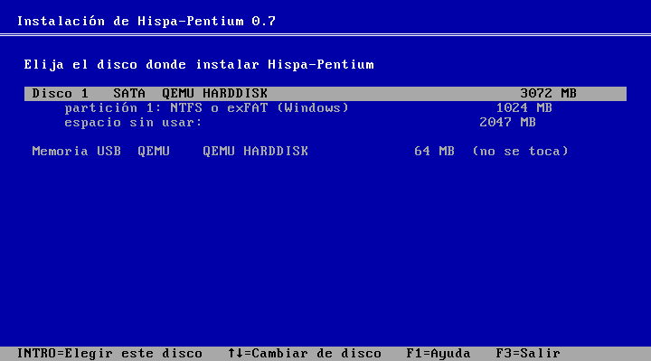
3. **Dónde.** Según lo que tenga el disco:
   - **en blanco** (su primer sector, a cero): se usa entero, sin más preguntas
     que la confirmación del final;
   - con particiones y **espacio sin usar** (64 MB o más, sin partición, y un
     sitio libre en la tabla): se ofrece **instalar ahí**, en una partición
     nueva, **sin tocar lo que hay**;
   - siempre, **borrar el disco entero**: pide **dos confirmaciones**, en dos
     pantallas con el recuadro en rojo y el disco dicho por su nombre: una
     **S** y, después, **escribir la palabra BORRAR**. Con cualquier otra cosa
     se vuelve atrás sin haber tocado nada.

   
4. **«Todo listo para instalar»**: el disco, la partición que se va a hacer, lo
   que se copia y cómo queda el arranque. Al pulsar INTRO se empieza a escribir.
5. **Instalar**, con su barra:
   - **la partición**, en la tabla del **MBR** (de la clase 0C, FAT32, a megas
     enteros, la activa; hasta **32 GB**: una FAT32 mayor tarda mucho en
     repasarse con este núcleo, y lo que sobra queda sin usar);
   - **el formato FAT32, escrito desde cero**: el sector de arranque (con su
     copia), el sector de información, las dos FAT y la raíz; clusters de 512
     octetos hasta 260 MB, de 4 K hasta 8 GB, de 8 K hasta 16 y de 16 K de ahí
     arriba;
   - **el sistema, a `C:\HISPA`**: el núcleo (`NUCLEO.BIN`), los programas, el
     asistente, los textos (`LEEME.TXT`, también en la raíz, y `MANUAL.TXT`),
     el menú de arranque (`GRUB.CFG`) y `MBR.ANT`, el primer sector que tenía
     el disco, por si acaso. Los archivos van seguidos, uno detrás de otro;
   - **el arranque**: lo último, para que si algo falla antes el disco siga
     arrancando como arrancaba.

   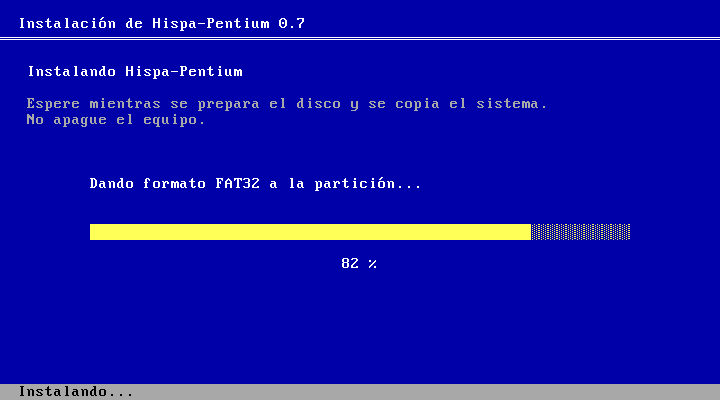
6. **El final**: quitar la memoria USB e INTRO para reiniciar.


**De dónde sale lo que se instala.** De la raíz de la unidad del sistema, que
con esa entrada es **M:**: GRUB trae como módulos todo lo que hay que instalar
(`NUCLEO.BIN` —la copia del núcleo que pide 800 x 600—, los programas,
`ASISTE.BIN`, los textos, `BOOT.IMG` y `CORE.IMG`). Así se puede instalar
aunque el USB de ese equipo no se deje leer por el núcleo, y **la memoria USB no
hace falta ni leerla**. (En la memoria, lo que solo vale para instalar —los textos
del sistema instalado, `BOOT.IMG`, `CORE.IMG` y `CARPETAS.TXT`— está en su
carpeta `\INSTALA`.)

**Lo que no va a `\HISPA`.** Todo va a `C:\HISPA`, menos lo que diga
**`CARPETAS.TXT`**, si viene entre los módulos: cada línea suya,
`ARCHIVO.EXT=CARPETA`, manda ese archivo a esa carpeta de la raíz del disco
(hasta cuatro carpetas; él no se instala). Es para **la oficina** (sección 10):
`usb.sh` añade a la entrada de instalar `HVPRUN.BIN` (que va con los programas,
a `\HISPA`: el núcleo lo encuentra ahí) y los programas y los datos de
`\OFICINA`, con su `CARPETAS.TXT`, y quedan en **`C:\OFICINA`**, como en la
memoria USB: en el sistema instalado, el grupo «Oficina» del menú Inicio y Mi
equipo los abren igual.


**Cómo escribe.** INSTALAR no usa los archivos del núcleo para el disco nuevo
(el núcleo monta los volúmenes al arrancar, y ese todavía no existe): escribe
**sector a sector** (las llamadas 64 y 65) su propia FAT32, que es sencilla
porque el volumen nace vacío: cada archivo ocupa clusters seguidos.

**Lo que no hace todavía.** En un disco con tabla **GPT** solo instala
borrándolo entero (lee sus particiones y las enseña, pero no añade una: el disco
queda con tabla MBR). Añadirla no bastaría: los sistemas que viven en un disco
GPT arrancan por UEFI, y Hispa-Pentium arranca por la BIOS; para convivir con
ellos hace falta antes el arranque por UEFI. No mira dentro de una partición **extendida** (la cuenta
entera como ocupada); no deja elegir el **tamaño** de la partición ni usar una
que ya exista; y en un disco **de los de antes**, cuya primera partición
empieza en el sector 63, no hay sitio delante para el arranque: lo dice, y solo
ofrece borrarlo.

### El arranque del disco

**GRUB 2**, el mismo cargador de la memoria USB, por dos razones: es lo que ya
arranca este núcleo en los PC de verdad (multiboot, con el modo gráfico puesto
por él: sección 11), y deja en el menú una entrada para **el sistema que ya
hubiera** en el disco. El núcleo no puede «hacer» un GRUB, así que viene hecho
con el sistema (`usb.sh`):

- **`BOOT.IMG`**: el primer sector de GRUB. Sus 440 octetos de código van al
  **MBR** (la tabla de particiones no se toca); lleva dicho que el resto está
  desde el sector 1.
- **`CORE.IMG`** (unos 160 K): el resto de GRUB, **con todos sus módulos
  dentro** (los discos por la BIOS, las tablas MBR y GPT, la FAT, multiboot, el
  vídeo por VBE, `chainloader`...), porque en el disco instalado no hay carpeta
  de módulos. Va al **hueco** de delante de la primera partición (del sector 1
  en adelante; las particiones empiezan en el 2048). Lleva dentro dos órdenes:
  buscar en los discos el archivo `/HISPA/GRUB.CFG` y seguir lo que diga. No
  lleva escrito en qué disco ni en qué partición está: vale para cualquiera.

**`C:\HISPA\GRUB.CFG`**, el menú, lo escribe INSTALAR:

| Entrada | Qué arranca |
|---|---|
| Hispa-Pentium | `NUCLEO.BIN escritorio escritura`, con la medida de pantalla de la línea `set modo=` |
| el intérprete de órdenes (modo texto) | `NUCLEO.BIN ordenes escritura`, en modo texto |
| de emergencia | `NUCLEO.BIN escritorio sindisco sinusb`, con los programas como módulos (la unidad M:) |
| el sistema que ya estaba en el disco | (si se instaló junto a otro) `chainloader +1` de su partición |

La primera línea que cuenta, **`set modo=800x600x32,800x600,auto`**, es la medida
de la pantalla: la cambia el asistente (o se cambia a mano). Desde el 20/11, lo
que se elige en Configuración (`\HISPA\PANTALLA.ENV`) va por delante: la
primera vez que se guarda una medida, el escritorio le añade a `GRUB.CFG` lo que
la lee (sección 10, «La medida de la pantalla»).

**Sin GRUB**, otro camino para más adelante: un cargador propio (MBR y sector de
arranque de la partición) que lea el núcleo de la FAT32 y pida el modo a la VBE.

### El núcleo, instalado

- **La carpeta del sistema.** Un sistema instalado lleva sus programas en
  **`\HISPA`** y no en la raíz, como la memoria de arranque. La unidad del
  sistema se reconoce por `ORDENES.BIN` en la raíz **o en `\HISPA`**; y un
  programa que no está donde se pide **se busca en `\HISPA`** de la unidad del
  sistema (así el escritorio, la Consola y el intérprete lanzan lo de siempre
  sin saber dónde está, y `BLOC` vale desde cualquier carpeta).
- **`C:\HISPA\HISPA.INI`** (`ajustes.cas`): `usuario=`, `equipo=`, `teclado=`
  (`es` o `us`) y `modo=`. El núcleo lo lee al arrancar: pone el teclado y
  guarda el nombre, con el que **saluda el menú Inicio** («Hola, Carlos»).
- **Con `instalar` en la línea del cargador**, el permiso de escritura es al
  revés que con `escritura=usb`: **solo en los discos de dentro**; en las
  memorias USB no se escribe ni un sector (los dos cerrojos de la sección 7).
  Y solo entonces vale la llamada 65 (escribir sectores), en un disco de dentro
  que no lleve la unidad del sistema ni sea él mismo un medio de arranque (con
  el sistema en su raíz: la imagen de la memoria USB grabada en un disco de
  dentro): **nunca en una memoria USB**. Sin `instalar`, INSTALAR no encuentra
  ningún disco donde escribir.
- **Las llamadas nuevas** (60 a 68, sección 6): texto con color en la pantalla
  de texto y su cursor, un texto solo al puerto serie, lo que se sabe de un
  disco, leer y escribir sectores, reiniciar, poner en hora el reloj del PC y
  los ajustes.

### El asistente del primer arranque

`uasiste.cas` (`ASISTE.BIN`), una ventana del escritorio. El escritorio lo lanza
si el sistema está instalado y **no hay `HISPA.INI`**: la primera vez (o si se
cierra sin aceptar, o si se borra el archivo). Pregunta el **nombre** del
usuario y el del **equipo**, la **fecha y la hora** (las pone en el reloj del
PC, el de la CMOS), el **teclado** (español o de EE. UU.: cambia en el momento)
y la **medida de la pantalla** (800 x 600, 1024 x 600, 1024 x 768, 1280 x 800,
1366 x 768 o «la que prefiera el monitor»). Con el ratón o con el teclado: Tab
pasa de casilla en casilla, el espacio o las flechas cambian el teclado y la
pantalla, Intro acepta. Al aceptar guarda `HISPA.INI`, cambia la línea `set
modo=` de `GRUB.CFG` (la medida la pone GRUB **al arrancar**: se ve la próxima
vez) y le dice al núcleo que lea los ajustes.

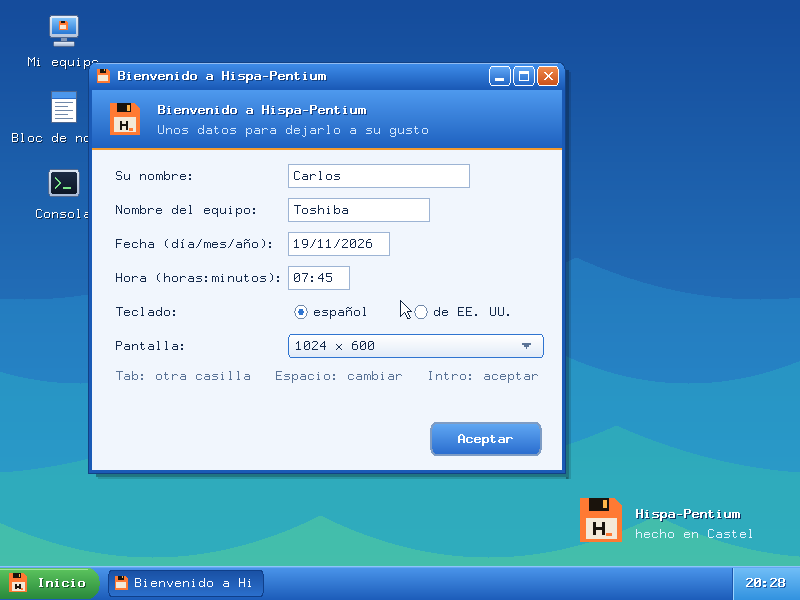

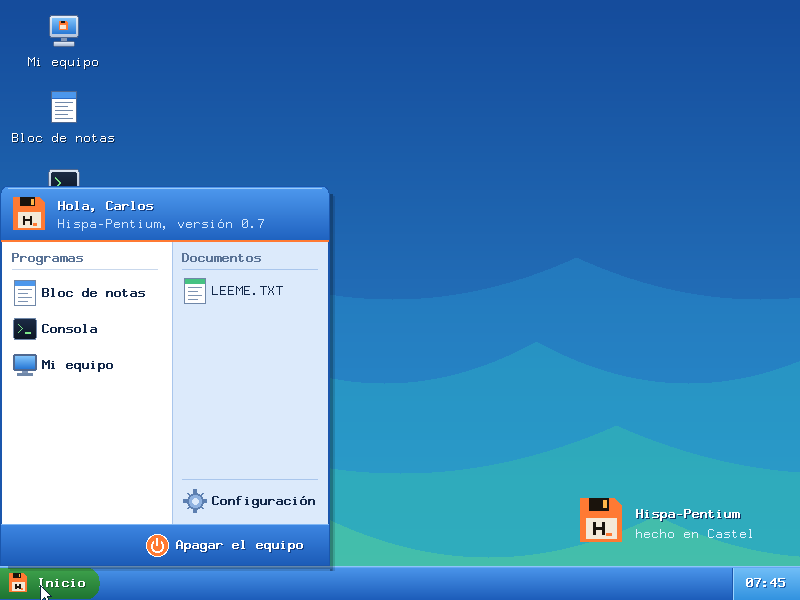

### Probarlo en QEMU

```
cd castel
nucleo32/usb.sh /dev/shm/usb.img                  # la memoria USB (como root)
truncate -s 2G /dev/shm/disco.img                 # un disco SATA en blanco
qemu-system-i386 -m 64 -rtc base=localtime -device qemu-xhci,id=u \
  -drive file=/dev/shm/usb.img,format=raw,if=none,id=m -device usb-storage,bus=u.0,drive=m,bootindex=1 \
  -device ahci,id=sata -drive id=d,file=/dev/shm/disco.img,format=raw,if=none -device ide-hd,drive=d,bus=sata.0,bootindex=2
# (la última entrada del menú, INTRO tres veces, y al final INTRO para reiniciar)
qemu-system-i386 -m 64 -rtc base=localtime \
  -device ahci,id=sata -drive id=d,file=/dev/shm/disco.img,format=raw,if=none -device ide-hd,drive=d,bus=sata.0
```

### El CD (o DVD) de instalación, y VirtualBox (20/11)

**`nucleo32/cd.sh IMAGEN.ISO [CLAVE_PRIVADA]`** hace el **CD de Hispa-Pentium**:
una ISO 9660 (unos 8 MB) que arranca **por la BIOS con El Torito «sin
emulación»** (`grub-mkrescue` con solo `i386-pc`, y `xorriso`; no hace falta
ser root). La misma imagen vale **grabada en un CD o en un DVD**, en un PC de
verdad, y en **VirtualBox** o QEMU como unidad óptica; y, como es híbrida,
grabada tal cual en una memoria USB también arranca.

**Por qué no hace falta ATAPI ni ISO 9660 en el núcleo.** GRUB lee el CD por
la BIOS y **carga en la memoria** todo lo que hace falta, como módulos: el
núcleo lo ve como la **unidad M:** (en memoria, de solo lectura), la misma de
la memoria USB cuando su USB no se deja (sección 7). Así vale cualquier unidad
de CD (IDE, SATA, USB) sin un controlador más, y el núcleo no crece; y el
programa INSTALAR copia de M: al disco como siempre. (Un controlador ATAPI y
la ISO 9660 solo servirían para leer el CD *después* de arrancar: para
instalar, no hacen falta.) Lo común con la memoria USB (compilar todo, el
núcleo y sus copias que piden el modo, los programas, ACPI, la oficina, los
textos, `BOOT.IMG`/`CORE.IMG`, los paquetes del sistema y las listas de
módulos) está en **`nucleo32/sistema.sh`**, que leen `usb.sh`, `cd.sh` y
`actualiza.sh`.

El menú de GRUB del CD (10 s):

| Entrada | Qué arranca |
|---|---|
| **Arrancar Hispa-Pentium 0.8 sin instalar** (la de por omisión) | `ESCRIT8.BIN escritorio unidad=M`, con los programas como módulos: el escritorio a 800 x 600; los discos se ven pero no se tocan |
| **Instalar Hispa-Pentium 0.8 en el disco duro** | `SEMILLA.BIN instalar unidad=M` con todo lo que se instala y **`MEDIO.TXT`** («CD»), que le dice a INSTALAR que es el CD: «sin el CD», «Saque ahora el CD (o el DVD)» (no lo instala) |
| sin instalar, a la medida de la pantalla | `gfxpayload=auto` |
| sin instalar, sin USB, discos, red ni ACPI | por si un equipo no arranca |
| el intérprete de órdenes (modo texto) | `SEMILLA.BIN ordenes unidad=M` |
| los modos de vídeo de la BIOS | `videoinfo` |
| arrancar del disco duro | `chainloader +1` del primer disco (si se ha dejado el CD puesto) |

En el CD van también, en `\PAQUETES`, los paquetes del sistema con su catálogo
(con `CLAVE_PRIVADA`, firmado).

**(UEFI)** Desde la rama pentium-uefi el CD arranca también por UEFI (sección
11, «Arrancar por UEFI»); el disco instalado, de momento, solo por la BIOS. En
VirtualBox, con «Habilitar EFI» quitado (lo está, para «Other») va por la BIOS,
como siempre.

**VirtualBox**, lo que trae de serie y cómo va:

| Pieza | En VirtualBox | Hispa-Pentium |
|---|---|---|
| el disco | SATA AHCI (ICH9) o IDE (PIIX3/PIIX4) | los dos (`ahci.cas`, `ata.cas`); el CD en AHCI (ATAPI) se ve y no se toca |
| el CD/DVD | en el mismo SATA o en el IDE secundario | GRUB lo carga para arrancar (M:); desde el 21/11 el núcleo lo lee también: es D: (`atapi.cas`, `ahcicd.cas`, sección 7) |
| la red | Intel PRO/1000 MT Desktop (82540EM, `8086:100E`) | la e1000 de `RED.BIN` (ya estaba en la lista) |
| el USB | OHCI (USB 1.1), con la tableta USB si se elige | OHCI no lo lleva: se deja quieto; teclado y ratón, por PS/2 (el ratón «PS/2» de VirtualBox) |
| la gráfica | VMSVGA o VBoxVGA, con VBE | el modo lo pone GRUB por la VBE; desde Configuración se cambia **en marcha** (las dos llevan la VBE de Bochs: sección 10) |
| ACPI | sí | `ACPI.BIN`: apagar de verdad |

**Probado en QEMU imitando a VirtualBox** (parte 15 de las pruebas): `-machine
pc` con el disco IDE, `-device pci-ohci` con una `usb-tablet` y la e1000
(`-nic user,model=e1000`): arranca sin instalar, con la red; instala en el disco
IDE y el disco arranca solo. `-machine q35` (ICH9: el disco y el CD en AHCI):
instala en el disco SATA y arranca. El LEEME de la carpeta del CD cuenta paso a
paso cómo hacer la máquina en VirtualBox.

```
castel/nucleo32/cd.sh /tmp/cd.iso
truncate -s 2G /tmp/d.img
qemu-system-i386 -machine q35 -m 256 -nic user,model=e1000 -cdrom /tmp/cd.iso \
  -drive file=/tmp/d.img,format=raw,if=none,id=d -device ide-hd,drive=d,bus=ide.0 -boot d
```

## 13. Los paquetes y las actualizaciones

Desde la **0.8** (20/11/2026), lo instalado en el disco se puede **poner al día,
añadir y quitar** sin volver a instalar el sistema: por **paquetes** (archivos
`.HPQ`), que maneja el programa **PAQUETES** (`upaquete.cas`, `PAQUETES.BIN`,
del anillo 3, en Castel) y que se hacen en el VPS con **`tools/hpq.py`**. Los
paquetes se traen de una carpeta (la de la memoria USB, la de otro disco...) o,
desde la tarde del 20/11, **de Internet**, con el catálogo **firmado**
(Ed25519): más abajo, «Por Internet», «La firma» y «El núcleo nuevo».

### La 0.8.1: la primera actualización de verdad

*20/11/2026, por la noche.* Lo que cambia desde el CD 0.8 llega por el
actualizador como **0.8.1**: solo suben los paquetes cuyo contenido ha cambiado
(comparados archivo a archivo con los del CD): **`base`** (el núcleo con la
llamada 99 del servicio TLS, cambiar la resolución desde Configuración, los
accesos de los paquetes en el menú Inicio y Mayús+Tab; y su MANUAL.TXT),
**`red`** (IPCONFIG, PING y DESCARGAR, que ya sabe `https://`) y el nuevo
**`tls`** (`TLS.BIN` y `HTTPS.BIN`, sección 14). Los demás siguen en la 0.8
(`VERSION_08` en `tools/hpq.py`). `tls` y `red` necesitan `base >= 0.8.1`; el
programa **ClicGest** (paquete `clicgest`, de su propio repositorio) necesita
`base`, `red` y `tls` 0.8.1. El núcleo sigue diciendo «versión 0.8» (los textos
de VER y del menú Inicio no cambian: lo que se instala lo dicen los paquetes).

Probado a mano en QEMU (un «q35» como el VirtualBox de Carlos): el sistema
instalado del CD 0.8 (el mismo `.iso`), con el catálogo firmado de verdad en un
servidor de aquí, avisa «Hay 2 actualizaciones», las pone, reinicia con el
núcleo nuevo («El núcleo nuevo ha arrancado bien»; el de antes, en
`NUCLEO.ANT`), instala `clicgest` (y con él `tls`) desde «Programas y
actualizaciones», ClicGest sale en el menú Inicio y, al entrar con una cuenta
que no existe, habla TLS 1.2 con clicgest.es (la cadena comprobada) y dice «El
correo o la contraseña no son correctos» (el 401 de su API).

### El paquete (.HPQ)

Un archivo con dos partes: **una cabecera de texto** (página 437, líneas con CR
LF) y, detrás, **los archivos tal cual**, uno detrás de otro, en el orden de la
cabecera:

```
HPQ 1
nombre=oficina
version=1.0
descripcion=La oficina de Hispa-386: Facturas, Pluma, Cuentas y Mirador
necesita=hvprun >= 0.7
choca=
archivo=\OFICINA\FACTURAS.HVP 172610 4c1d...e9 (su SHA-256, en 64 cifras)
archivo=\OFICINA\PLUMA.HVP 128402 90ab...17
...
fin
```

- **`nombre`**: hasta 8 letras (`a-z`, cifras, `-`, `_`): es también el nombre de
  su registro (`OFICINA.PQI`). **`version`**: números con puntos, que se comparan
  número a número (la 0.10 es más nueva que la 0.9).
- **`necesita`** (las **dependencias**) y **`choca`** (los **conflictos**): una
  lista separada por comas, cada uno con su versión si hace falta: `base >= 0.7,
  nucleo >= 0.8, hvprun` (con `>=`, `<=`, `=`, `>` y `<`; sin nada, cualquier
  versión). **`nucleo`** es el núcleo **que está en marcha** (su versión la da la
  llamada 15): un programa que use llamadas nuevas lo pide así.
- **`archivo`**: adónde va (una ruta entera de la unidad del sistema, en 8+3:
  `\HISPA\BLOC.BIN`, `\OFICINA\PLUMA.HVP`; no en `\HISPA\PAQUETES`, que es la base
  de lo instalado), lo que mide y su **SHA-256**.
- Lo que PAQUETES no conoce lo deja pasar: así caben cosas nuevas sin cambiar de
  formato. Lo que se firma es el **catálogo**, que lleva el SHA-256 de cada
  paquete entero (más abajo, «La firma»): el paquete no lleva firma propia.

El **SHA-256** está escrito en Castel (`nucleo32/sha256.cas`, el módulo `Sha256`:
`empezar`, `añadir` y `acabar`, de FIPS 180-4), para los programas del anillo 3.

### El catálogo (CATALOGO.TXT)

Al lado de los paquetes, uno por línea (puede haber varias versiones del mismo):

```
HPQ-CATALOGO 1
paquete=oficina 1.0 OFICINA.HPQ 798859 0d4f...a2 La oficina de Hispa-386: ...
```

El nombre, la versión, el archivo, **lo que mide y el SHA-256 del paquete
entero** (cabecera incluida) y la descripción. Un paquete que se trae por el
catálogo tiene que medir eso y dar esa suma, además de las de sus archivos.

**Los paquetes del sistema** (0.8.6): detrás, una línea `sistema=nombre` por
cada paquete que va con el sistema (los de `SISTEMA` de `tools/hpq.py` y
`escudo`: `DEL_SISTEMA`; no los opcionales, como navega, pdf, comprim,
mirador o clicgest, ni las firmas de Escudo, que trae Escudo). `PAQUETES
ACTUALIZA` (sin nombres: «Actualizar todo») **instala también los del sistema
que no estén** («Nuevo del sistema: accesori»): así un equipo que viene de una
versión de antes recibe los que salieron después (accesori, sonido y wifi en
la 0.8.5; escudo). Lo que se quita a propósito (`PAQUETES QUITA`) queda en
`C:\HISPA\PAQUETES\QUITADOS.TXT` y ACTUALIZA no lo vuelve a poner; `PAQUETES
INSTALA` lo borra de ahí. `PAQUETES ESTADO` los marca (`p|nombre||versión|...|tipo|nuevo`)
y la bandeja los cuenta entre las actualizaciones; en «Programas y
actualizaciones» salen en **Pendientes** con «(nuevo)» en la columna de lo
instalado. Un PAQUETES de antes no mira esas líneas: un equipo con la 1.2 se
pone al día en dos veces (la primera trae PAQUETES 1.3; tras reiniciar, la
bandeja avisa de los nuevos del sistema y «Actualizar todo» los pone).

**La serie** (22/11/2026, rama `usuarios`, por la revisión de seguridad: M3).
La segunda línea del catálogo firmado es `serie=N`: la pone `hpq.py firma` (y
`catalogo --clave`), dentro de lo firmado, y la sube cada vez (la de antes más
uno y, como poco, los segundos desde 1970: sube aunque `catalogo` haya rehecho
el archivo; `--serie N` para las pruebas). PAQUETES 1.4 apunta la más alta que
ha visto en `C:\HISPA\PAQUETES\SERIE.TXT` y **no usa un catálogo de Internet
con la serie más baja** (o sin serie, si ya ha visto una): «el catálogo de
Internet es más viejo (serie 50) que el último que se ha usado (serie 100): no
se usa». Así nadie le puede servir otra vez un catálogo viejo, firmado de
verdad, con versiones que tenían fallos ya arreglados. Uno de una carpeta del
equipo (el CD, una memoria USB) más viejo se usa, con un aviso (lo ha puesto ahí
quien está delante). Un PAQUETES de antes no mira esa línea.

### Lo instalado: C:\HISPA\PAQUETES

Un **registro por paquete**, `NOMBRE.PQI`: **la cabecera de su paquete, tal
cual** (qué es, qué versión, qué necesita, qué archivos dejó y sus sumas). Con eso
se actualiza (lo que la versión nueva ya no trae se quita), se quita limpiamente
y se comprueba. Además, si hacen falta: `DIARIO.TXT` y `HECHO.TXT` (una
instalación a medias, abajo), `ORIGEN.TXT` (de dónde traer los paquetes, si no se
quiere que lo busque) y `BAJADAS` (lo traído de Internet).

**INSTALAR deja apuntado lo que instala**: `usb.sh` hace con `hpq.py` los
paquetes del sistema y sus registros, que van con lo que se instala (en la
memoria, en `\INSTALA\PAQUETES`), y `CARPETAS.TXT` los manda a
`HISPA\PAQUETES` (desde la 0.8, `CARPETAS.TXT` admite también una carpeta
**dentro de `\HISPA`**: `ARCHIVO.EXT=HISPA\CARPETA`). Así, en un sistema recién
instalado, `PAQUETES LISTA` ya dice los ocho paquetes del sistema y `PAQUETES
COMPRUEBA` los encuentra iguales.

### El programa PAQUETES

En el intérprete de órdenes (o en la Consola del escritorio):

| Orden | Qué hace |
|---|---|
| `PAQUETES LISTA` | lo instalado: nombre, versión y descripción |
| `PAQUETES CATALOGO` | lo que hay para instalar (la versión más nueva de cada uno), y si está instalado o hay una más nueva |
| `PAQUETES INSTALA nombre...` | lo instala del catálogo (la versión más nueva), **con lo que necesite, antes y en orden** |
| `PAQUETES INSTALA X:\PAQUETES\A.HPQ` | instala ese archivo (lo que necesite, del catálogo de su carpeta, si lo tiene, o del de siempre) |
| `PAQUETES ACTUALIZA [nombre...]` | pone al día todo lo instalado (o eso): lo que tenga una versión más nueva en el catálogo |
| `PAQUETES QUITA nombre...` | lo quita: sus archivos, su registro y las carpetas que se queden vacías; no, si otro lo necesita |
| `PAQUETES MIRA A.HPQ` | lo que lleva un paquete, y si está sano |
| `PAQUETES COMPRUEBA` | si los archivos instalados siguen como se instalaron (su SHA-256) |
| `PAQUETES ESTADO` | lo instalado y lo del catálogo, una línea por paquete, para otro programa (la ventana); desde la 1.1, con su tipo al final |
| `PAQUETES LISTA /TIPO` | (PROGRAMAS) lo instalado, por tipos (Sistema, Oficina, Internet y red...), y al final los programas sueltos |
| `PAQUETES REPARA [nombre...]` | (PROGRAMAS) comprueba las sumas de lo instalado (todo, o eso) y vuelve a poner **solo lo dañado** (lo cambiado y lo que falta), del paquete de la misma versión |
| `PAQUETES ARCHIVOS nombre` | (PROGRAMAS) sus archivos: lo que mide cada uno y si está `bien`, `CAMBIADO` o `FALTA` |
| `PAQUETES SUELTOS` | (PROGRAMAS) los programas que no son de ningún paquete (`.EXE`, `.BIN`, `.HVP` en la raíz, `\HISPA`, `\HISPA32` y `\PROGRAMS`, con sus subcarpetas) |
| `PAQUETES FICHAS [/CATALOGO]` | (PROGRAMAS) todo lo de lo instalado y lo suelto (y, con /CATALOGO, lo del catálogo), una línea cada uno, para la ventana |
| `PAQUETES QUITA nombre /DEPENDIENTES` | (PROGRAMAS) lo quita, y antes lo que lo necesite (y lo que necesite a eso), cada uno su todo o nada |
| `/DESDE=carpeta` o `/DESDE=http://...` | de dónde traer los paquetes |
| `/FORZAR` | quitar aunque otro lo necesite; poner una versión igual o más vieja que la instalada |

**De dónde.** Lo que diga `/DESDE=`; si no, la primera línea de
`C:\HISPA\PAQUETES\ORIGEN.TXT`; si no, la carpeta **`\PAQUETES`** de la primera
unidad que tenga un `CATALOGO.TXT` (primero las memorias USB: la de arranque de
la 0.8 lleva todos los paquetes del sistema); y si no, Internet:
`http://actualiza.hispados.es/pentium/`.

**Antes de tocar nada**, PAQUETES hace el plan entero: lo que se pide y lo que
necesita (la versión más nueva del catálogo que cumpla, si lo instalado no
cumple; las dependencias se siguen hasta 16 niveles, y una en círculo no se
repite), y mira que **nada choque** (con lo instalado o entre sí, en los dos
sentidos) y que **ningún archivo sea de otro paquete**. Luego **comprueba las
sumas** de todos los paquetes del plan (el paquete entero contra el catálogo, y
cada archivo contra su cabecera): con una sola mala, no se instala nada y el
disco queda igual. Y también **mira que quepa**.

**O todo o nada** (cada paquete): lo que se va a hacer se apunta antes en
**`DIARIO.TXT`** (las carpetas que hay que hacer, los archivos que se ponen
—diciendo si ya estaban— y los que se quitan); los archivos nuevos se escriben
**aparte**, en la carpeta de su destino (`HPQnnnnn.NUE`), volviendo a comprobar
su suma; y solo entonces se cambian: lo de antes se **aparta** (`HPQnnnnn.VIE`) y
lo nuevo se pone en su sitio, cambiando nombres. El registro (`NOMBRE.PQI`) es el
último. Con todo cambiado, el diario pasa a **`HECHO.TXT`**: desde ahí ya no se
deshace; se borra lo apartado, las carpetas vacías, y el diario. Si algo falla a
mitad (el disco lleno, un archivo que no se deja), se deshace en el momento. Y
si **se va la luz** a mitad, la próxima vez que se use PAQUETES (cualquier orden)
ve el diario y **lo deshace**: lo apartado vuelve a su sitio, lo nuevo se borra,
y lo dice. (Si se va mientras se escribe un `.NUE`, quedan clusters sueltos que
`fsck` recoge, como con cualquier archivo a medio escribir: lo instalado sigue
entero.) Cuando hay que instalar varios paquetes, cada uno es su propio todo o
nada, en orden: si falla el tercero, los dos primeros (lo que necesitaba) quedan
instalados, y se dice.

**El gancho de la red** (cómo era; hoy lo hace `DESCARGA.BIN`, el de verdad:
«Por Internet», abajo). PAQUETES no sabe de TCP/IP: para traer de Internet el
catálogo y cada paquete, a `C:\HISPA\PAQUETES\BAJADAS`, lanza el programa
**`DESCARGA.BIN`** (la orden de descargar de la red: su nombre tiene que caber en
8+3) con dos argumentos, **`URL DESTINO`**, lo espera, y vale si acaba con el
código 0 y el archivo está. Si no está, lo dice («hace falta la red»). Si la red
diera la descarga como **llamada al sistema** en vez de como programa, basta con
poner su número en `LLAMADA_DESCARGAR` (`upaquete.cas`): se llama con EBX = la
URL y ECX = el archivo de destino, y un error es lo de siempre. Lo traído se
comprueba igual (el SHA-256 del catálogo y los de los archivos). Las pruebas lo
ejercitan con un `DESCARGA` de mentira que copia de la memoria USB.

### El tipo de cada paquete (PROGRAMAS, 21/11/2026)

Cada paquete dice **de qué tipo es**: con eso, «Programas instalados» los
agrupa y el menú Inicio («Todos los programas», rama pentium-menu) hace sus
carpetas. Es un campo más de la cabecera del `.HPQ` (y, por tanto, del
registro `.PQI`):

```
HPQ 1
nombre=navega
version=0.2
descripcion=El Navegador: la web de hoy (NetSurf con JavaScript)...
tipo=internet
necesita=base >= 0.8.3, red >= 0.8.1, tls >= 0.8.1
...
```

y, en el catálogo, **una línea aparte por paquete**, detrás de las de
`paquete=` (un PAQUETES de antes no la mira, y la línea de cada paquete sigue
como era):

```
HPQ-CATALOGO 1
paquete=navega 0.2 NAVEGA.HPQ 9123456 3f0a... El Navegador: ...
paquete=clicgest 0.2.3 CLICGEST.HPQ 412345 9b1c... ClicGest: ...
tipo=clicgest terceros
tipo=navega internet
```

**Los tipos** (el código es lo que se escribe; en este orden salen):

| Código (`tipo=`) | Nombre (carpeta del menú, apartado de la ventana) | Paquetes |
|---|---|---|
| `sistema` | Sistema | base, paquetes, equipo, hvprun |
| `oficina` | Oficina | bloc, oficina, pdf |
| `internet` | Internet y red | red, tls, navega, ssh, tailscal, wifi |
| `juegos` | Juegos y emuladores | (los emuladores, cuando lleguen) |
| `multimedia` | Multimedia | sonido, mirador, pintura |
| `seguridad` | Seguridad | escudo |
| `windows` | Programas de Windows | win32 |
| `herramientas` | Herramientas | consola, accesori, comprim |
| `desarrollo` | Desarrollo | ejemplos |
| `terceros` | Programas de terceros | clicgest |
| `otros` | Otros | (el que no dice nada ni se sabe) |

Y aparte, solo en la ventana (no es un tipo de paquete): **«Programas de
terceros (sin paquete)»**, los programas copiados a mano.

- **Compatible hacia atrás.** Vale el código o el nombre (`tipo=Internet y
  red`), sin mirar mayúsculas. Si la cabecera no lo trae (los paquetes de antes
  de la 0.8.4, los de otros repositorios), vale el del catálogo y, al
  instalarlo, **PAQUETES lo apunta en su registro** (`tipo=...` antes del
  `fin` del `.PQI`); si tampoco, **se deduce del nombre** (la tabla de arriba:
  `TIPO_POR_NOMBRE` en `tools/hpq.py` y en `upaquete.cas`); y si no, `otros`.
  Así, en un sistema instalado antes, todo sale en su sitio sin reinstalar.
- **Para el menú Inicio** (pentium-menu): la carpeta de un programa es el
  `tipo=` del registro `.PQI` del paquete que deja su `.MNU` (o, si no lo
  dice, la tabla por nombre; si no, «Otros»). Un `.MNU` puede llevar su propio
  `tipo=` (el mismo código), que manda (accesos.cas e inicio.cas de
  pentium-menu, ya fusionada aquí, lo hacen así).
- **El tipo puede ir solo en el catálogo**: `hpq.py catalogo` pone la línea
  `tipo=` de cada paquete (de su cabecera o de la tabla), así que un paquete
  que no cambia (ClicGest 0.2.3) no hay que rehacerlo ni subirle la versión.
- `hpq.py crea ... --tipo internet` lo pone en la cabecera; `hpq.py tipos`
  dice la tabla; `hpq.py mira` dice el tipo; `hpq.py linea` da las dos líneas
  (la del paquete y la de su tipo). Los paquetes del sistema y los opcionales
  lo llevan todos (del nombre, con la tabla).
- **Imprescindibles**: `base`, `red` y `paquetes` no se quitan nunca (ni con
  `/FORZAR`): PAQUETES lo dice y por qué. Un paquete de otro puede pedirlo con
  `imprescindible=si` en su cabecera.

### La ventana: «Programas y actualizaciones» con pestañas (PROGRAMA.BIN)

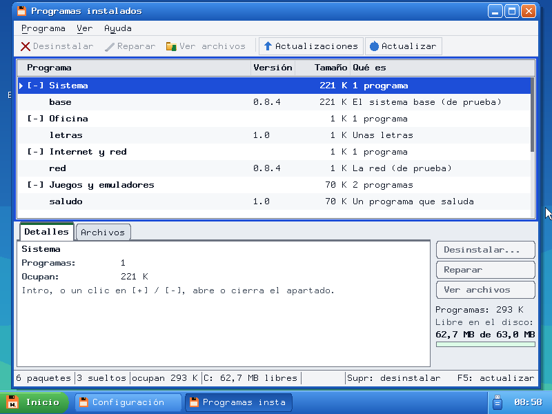
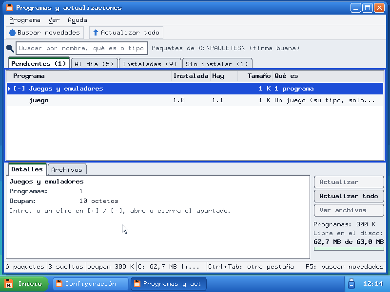
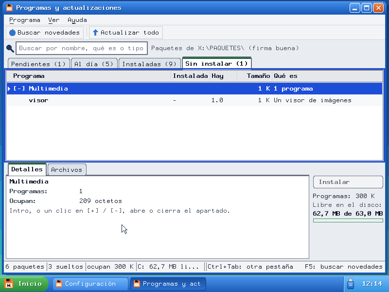
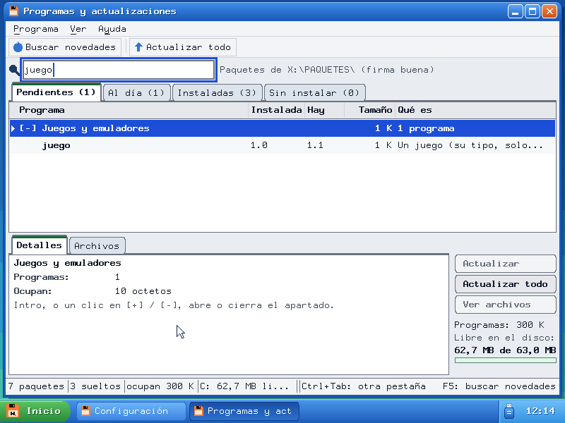
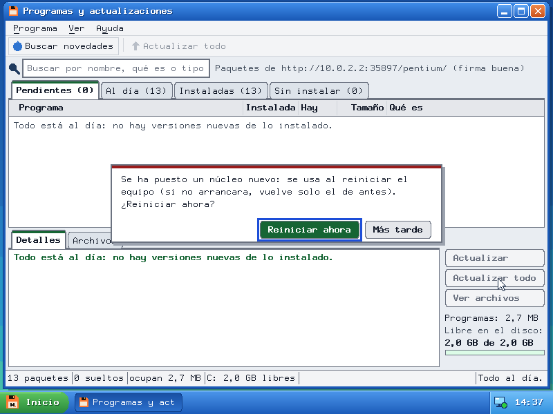
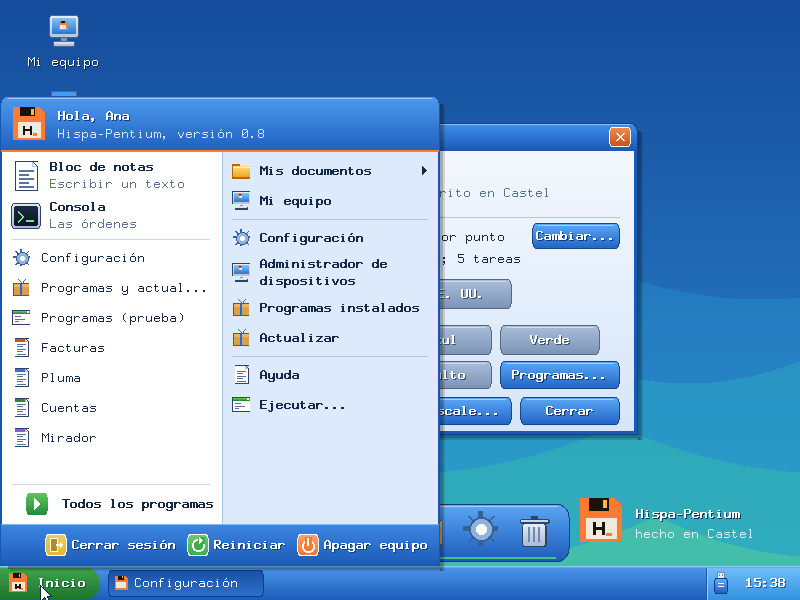

**Una sola ventana** para todo lo de los programas (petición de Carlos del
21/11: lo instalado por tipos para desinstalarlo, y las actualizaciones
organizadas): `PROGRAMA.BIN` (`uprogram.cas`, con los controles del sistema:
pestañas y rejilla; del paquete `paquetes` 1.2). Cuatro pestañas, cada una
con **cuántos tiene** («Pendientes (3)»):

| Pestaña | Qué tiene | Botones |
|---|---|---|
| **Pendientes** (la de por omisión) | lo instalado con una versión más nueva en el catálogo (columnas «Instalada» y «Hay»); sin nada, «Todo está al día» | **Actualizar** (el elegido), **Actualizar todo**, Ver archivos |
| **Al día** | lo instalado que ya está en su última versión | Desinstalar..., Reparar, Ver archivos |
| **Instaladas** | todo lo instalado y, al final, los programas sueltos | Desinstalar... (o Borrar...), Reparar, Ver archivos |
| **Sin instalar** | lo del catálogo que no está instalado (los opcionales: navega, clicgest, ssh, tailscal, win32...) | **Instalar** |

En todas, **un árbol por tipos** (cada tipo con cuántos tiene y lo que
ocupan; `[+]`/`[-]` lo abre y lo cierra). Arriba, **la búsqueda** (con su
lupa), común a las cuatro: filtra al escribir por nombre, qué es o tipo, sin
mirar tildes ni mayúsculas (`contiene` de controles.cas), y las cuentas de
las pestañas son las de lo que se encuentra; Esc la borra. A su derecha, de
dónde son los paquetes (y «firma buena»).

**Se abre** en la pestaña que toca: `PROGRAMA [/PENDIENTES | /ALDIA |
/INSTALADAS | /SININSTALAR]` (o `ACTUALIZ` con lo mismo). En el menú Inicio
nuevo (inicio.cas), «Actualizar» (columna derecha, y «Programas y
actualizaciones» en Todos los programas › Sistema), el dock y el aviso de la
bandeja («Verlas») lanzan `ACTUALIZ.BIN`, que abre esta ventana en
**Pendientes** (la ventana vieja de `uactual.cas` queda solo si
`PROGRAMA.BIN` no está; `ACTUALIZ /BANDEJA` sigue igual); «Programas
instalados» (columna derecha y Sistema: `ruta_instalados()` =
`\PROGRAMA.BIN /INSTALADAS`) y **Configuración › «Programas...»** la abren
en **Instaladas**.

Abajo, en «Detalles», el elegido: su paquete, su tipo, su versión (y la
nueva, si la hay), **lo que ocupa en el disco** (y cuántos archivos), **cuándo
se instaló** (la fecha de su registro), **lo que necesita** y **lo que lo
necesita**; de uno sin instalar, lo que se trae. A la derecha, sus botones y
**lo que ocupan todos los programas y lo libre en el disco** (con su barra).
Instalar y actualizar van con la barra de PAQUETES (bajando, comprobando,
instalando) y, si cambia el núcleo, ofrecen reiniciar.

- **Desinstalar...** pide confirmarlo. Si otros lo necesitan, lo dice y
  ofrece quitarlos también («Hay programas que necesitan letras: saludo,
  extra... ¿Quitarlos también?» › «Quitar los 3»: `PAQUETES QUITA letras
  /DEPENDIENTES`). Lo imprescindible (base, red, paquetes, y lo que lo
  necesite) no se puede quitar, y se explica. Mientras se quita, **una barra**
  con lo hecho (archivo a archivo: `AVANCE.TXT`); si se corta, el diario de
  PAQUETES lo deshace la próxima vez.
- **Reparar**: `PAQUETES REPARA nombre` (comprueba las sumas y vuelve a poner
  lo dañado).
- **Ver archivos**: la pestaña «Archivos», con cada uno y su estado
  (`PAQUETES ARCHIVOS`): lo cambiado o lo que falta, en naranja y con su
  palabra.
- **Los programas sueltos** (los `.EXE` de Windows, los `.BIN` y `.HVP`
  copiados a mano en la raíz, `\HISPA`, `\HISPA32` y `\PROGRAMS`, con sus
  subcarpetas, que no son de ningún paquete) salen en «Programas de terceros
  (sin paquete)», con **Borrar...**: a la Papelera del explorador
  (`EQUIPO /BORRAR`); sin Mi equipo instalado, se borra del todo (y se avisa
  antes).

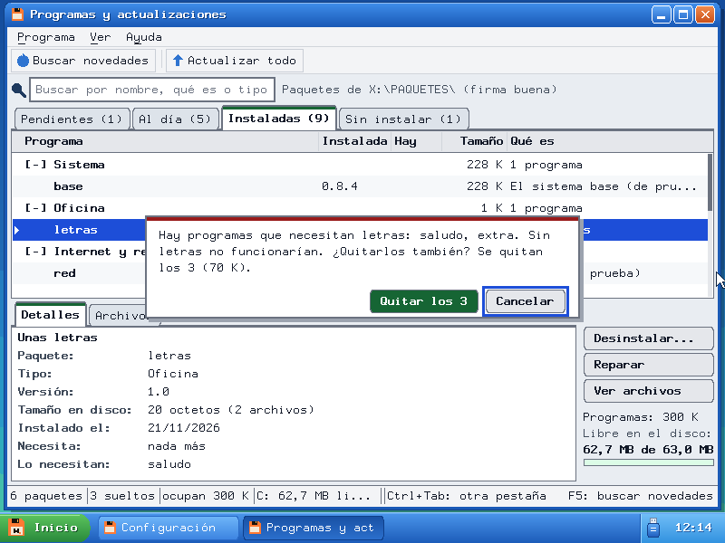
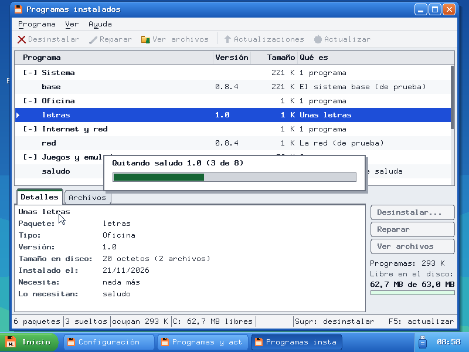
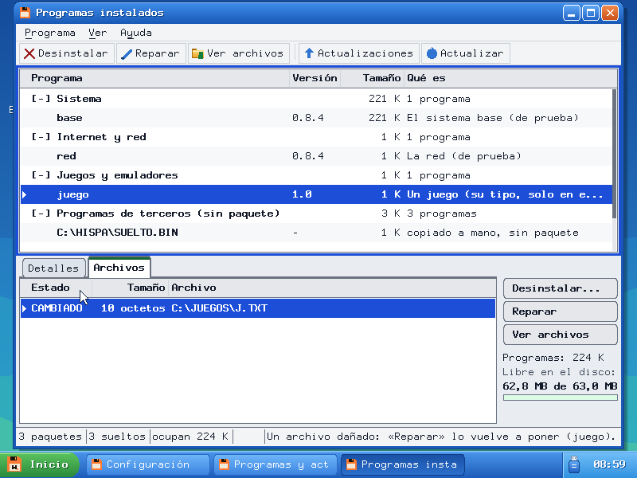


Probado en QEMU (`castel/pruebas.sh`, parte 24, `SOLO=programas`: 19
comprobaciones de la Consola y del disco desde fuera y 18 capturas de la
ventana y del menú Inicio: Instaladas desde Configuración, Pendientes desde «Actualizar»,
Sin instalar e Instalar, la búsqueda, Actualizar, desinstalar con lo que lo
necesita y su barra, los archivos, reparar y borrar un suelto).

Con el teclado: las flechas andan por el árbol (izquierda y derecha cierran y
abren un tipo), Ctrl+Tab cambia de pestaña, escribir busca (Ctrl+F o F3: la
búsqueda; Esc la borra), Supr desinstala o borra, Intro abre un tipo, enseña
los archivos o instala, F5 busca novedades, Alt+P/V/Y los menús;
el botón derecho, el menú del programa. Como la de las actualizaciones, no sabe
de paquetes: lanza `PAQUETES FICHAS /CATALOGO` (una línea por paquete:
`f|nombre|versión|tipo|octetos|archivos|fecha|imprescindible (por qué)|necesita|lo necesitan|descripción`;
una por suelto, `s|ruta|octetos|fecha`; `u|letra|total K|libre K`; y, con
`/CATALOGO`, `o|de dónde|firmado` y la más nueva de cada uno del catálogo,
`c|nombre|versión|tipo|octetos|descripción`) con su
salida a `C:\HISPA\PAQUETES\PROGRAMA.TXT`. `PROGRAMA /LENTO` (para las
pruebas) hace que PAQUETES vaya despacio al quitar, para ver la barra.

### La ventana de antes: ACTUALIZ.BIN

*(PROGRAMAS, 21/11: desde la 1.2 de `paquetes`, `ACTUALIZ.BIN` abre la ventana
unificada de arriba, `PROGRAMA.BIN`, en «Pendientes»; lo que sigue es la
ventana de antes, que queda solo si `PROGRAMA.BIN` no está, y `ACTUALIZ
/BANDEJA`, que no cambia.)*


En el menú Inicio, **«Actualizar»** (encima de Configuración) abre
`ACTUALIZ.BIN` (`uactual.cas`): la lista de lo instalado y de lo que hay en el
catálogo, con la versión instalada, la que hay (en verde si es más nueva) y lo
que es; y tres botones: **Instalarlo** (o **Actualizarlo**, si ya está y hay una
más nueva), **Quitarlo** y **Actualizar todo**. Con el teclado: las flechas
eligen, Intro instala, Supr quita, F5 vuelve a mirar. La ventana no sabe de
paquetes: lanza PAQUETES (`PAQUETES ESTADO`, una línea por paquete fácil de
leer: `p|nombre|instalada|la del catálogo|descripción`; `PAQUETES INSTALA
nombre`...) con lo que escribe mandado a un archivo (`VENTANA.TXT`, en la base,
que luego borra), y enseña abajo las últimas líneas de lo que ha dicho: las
dependencias, las sumas y el todo o nada son los de PAQUETES.

**El intérprete encuentra lo instalado**: en un sistema instalado, el `PATH` de
fábrica de ORDENES lleva además `C:\HISPA` (`C:\;C:\HISPA`), así que un programa
que trae un paquete se lanza por su nombre desde cualquier carpeta.

### tools/hpq.py

```
python3 tools/hpq.py crea SALIDA.HPQ --nombre bloc --version 0.8 --descripcion "El Bloc de notas" \
        --necesita "base >= 0.7" BLOC.BIN='\HISPA\BLOC.BIN'
python3 tools/hpq.py catalogo CARPETA        # CATALOGO.TXT con los .HPQ de la carpeta
python3 tools/hpq.py mira A.HPQ              # lo que lleva, y sus sumas
python3 tools/hpq.py registro A.HPQ A.PQI    # su registro (la cabecera)
python3 tools/hpq.py sistema SALIDA CARPETA...   # los paquetes del sistema (lo usa usb.sh)
```

**Los paquetes del sistema** (`hpq.py sistema`, de lo mismo que se instala):

| Paquete | Versión | Lleva | Necesita |
|---|---|---|---|
| `base` | 0.8.3 | `NUCLEO.BIN`, `ORDENES.BIN`, `ASISTE.BIN`, `INSTALAR.BIN`, `LEEME.TXT` (en `\HISPA` y en la raíz), `MANUAL.TXT`, `BOOT.IMG`, `CORE.IMG` | — |
| `bloc` | 1.0 (BLOC: el Bloc de notas 1.0, sección 14 quindecies) | `BLOC.BIN` | base >= 0.7 |
| `consola` | 0.7 | `CONSOLA.BIN` | base >= 0.7 |
| `equipo` | 0.8.3 | `EQUIPO.BIN` (Mi equipo) y `DISPOSIT.BIN` (el Administrador de dispositivos) | base >= 0.8.3 |
| `ejemplos` | 0.8.2 | `HOLA.BIN`, `ECO.BIN`, `PRUEBA.BIN`, `BUCLE.BIN`, `MUESTRA.BIN` (los controles de las ventanas) | base >= 0.8.2 |
| `paquetes` | 1.2 | `PAQUETES.BIN`, `ACTUALIZ.BIN` (su ventana), `PROGRAMA.BIN` (la ventana con pestañas) | base >= 0.8.2, nucleo >= 0.7 |
| `hvprun` | 0.10 | `HVPRUN.BIN` | base >= 0.7 |
| `oficina` | 1.1 | `\OFICINA\`: `FACTURAS.HVP`, `PLUMA.HVP`, `CUENTAS.HVP`, `MIRADOR.HVP`, `DATOS.HVP`, `LECTOR.HVP`, `PUBLICA.HVP`, `PRESENTA.HVP`, `TIPOS.DAT`, `TIPOS12.DAT`, `TIPOS24.DAT`, `TIPOS32.DAT`, `DICCIO.DAT` | hvprun >= 0.10 |
| `pintura` | 1.0 | `\OFICINA\PINTURA.HVP` | hvprun >= 0.10 |

Y uno que no va con el sistema (`hpq.py opcionales`, la lista `OPCIONALES`: se
instala desde «Programas y actualizaciones»): `navega` 0.1, **el Navegador**
(`\HISPA\NAVEGA\...` y su acceso en `\HISPA\MENU`; necesita base >= 0.8.3,
red y tls: sección 14 ter).

(`GRUB.CFG`, `HISPA.INI` y `MBR.ANT` no son de ningún paquete: son de este equipo.)
Para publicar una actualización: hacer el paquete con su versión nueva, ponerlo
con los demás, `hpq.py catalogo` y subir la carpeta (a la memoria USB o, cuando
haya red, a `actualiza.hispados.es/pentium/`).

### Por Internet (la tarde del 20/11)

**El servidor.** `http://actualiza.hispados.es/pentium/` (el VPS sirve
`/www/hispados` con ese nombre; la carpeta `pentium` va al lado de los `.paq` de
Hispa-DOS): los `.HPQ`, su `CATALOGO.TXT` y la firma, `CATALOGO.FIR`. Lo hace
**`nucleo32/actualiza.sh CARPETA CLAVE_PRIVADA`** (los mismos paquetes que van
en la memoria USB y en el CD, hechos de lo que se instala, y el catálogo
firmado; al acabar comprueba la firma con la clave pública del sistema). Para
publicar una versión nueva: subir su número en `tools/hpq.py` (`SISTEMA`), hacer
`actualiza.sh` otra vez y copiar **la carpeta entera** (los paquetes y el
catálogo van juntos: si no, las sumas no cuadran y no se instala).

**De dónde.** Igual que antes (`/DESDE=`, `ORIGEN.TXT`, la carpeta `\PAQUETES` de
una unidad con catálogo, primero las memorias USB) y, si no, Internet. Lo trae
**`DESCARGA.BIN`** (la orden DESCARGAR de la sección 14) a
`C:\HISPA\PAQUETES\BAJADAS`: el catálogo, su firma y cada paquete, cada vez
(«Buscar novedades» es eso: traer el catálogo otra vez).

### La firma

Todo va por **HTTP sin cifrar**, así que cualquiera en el camino podría
cambiar lo que llega. Por eso el catálogo va **firmado con Ed25519** (RFC 8032):
el catálogo lleva el tamaño y el SHA-256 de cada paquete, y cada paquete los de
sus archivos, así que con firmar el catálogo queda atado todo.

- **`CATALOGO.FIR`**, al lado del catálogo: una línea, `ed25519 ` y las 128
  cifras hexadecimales de la firma de `CATALOGO.TXT` tal cual (octeto a octeto).
- **La clave pública va dentro del sistema**: `nucleo32/clave.cas` (el módulo
  `Clave`: sus 32 octetos y su huella, las 16 primeras cifras, que PAQUETES
  dice al comprobar). **La privada no está en el repositorio**: en el VPS, en
  `/root/.claude/Secretos/hispa-pentium-firma.key` (permisos 600). Sin ella no
  se puede publicar nada que un Hispa-Pentium acepte de Internet.
- **Comprobarla**: `nucleo32/firma.cas` (el módulo `Firma`, en Castel: unas 600
  líneas, de dominio público el camino —el de TweetNaCl— y GPL lo escrito). Lleva
  su **SHA-512** (los números de 64 bits hechos de dos de 32) y las cuentas de la
  curva con los números módulo 2^255 − 19 en **32 trozos de 8 bits**, cada uno en
  un `ent32`: así ninguna cuenta pasa de 32 bits (Castel no tiene números de 64)
  y no hace falta ensamblador. Comprueba que S < L (el orden del grupo, como pide la RFC 8032: desde el
  21/11, la revisión de seguridad; antes solo S < 2^253, y la misma firma con
  S + L también pasaba) y que la clave es un punto
  de la curva. Tarda unos **0,25 s** en QEMU (24-30 tics).
- **Cuándo**: lo traído **de Internet** tiene que llevar firma, y buena: si no
  la trae («el catálogo de Internet no trae su firma») o no es buena («la firma
  del catálogo NO es buena: no se usa nada de él»), no se usa **nada** del
  catálogo. De **una carpeta**, si trae `CATALOGO.FIR` se comprueba igual (y con
  una mala, nada); sin ella se usa, como antes (la ha puesto ahí quien maneja el
  equipo). `PAQUETES ESTADO` dice `origen|...|firmado` y la ventana pone
  «(firma buena)» al lado del origen.
- **`PAQUETES FIRMA ARCHIVO`**: si `ARCHIVO.FIR` (el mismo nombre, con `.FIR`)
  es su firma buena, con la clave del sistema.
- **`tools/hpq.py`**: `clave PRIVADA` (una nueva: la privada al archivo, 600, y
  dice la pública), `publica PRIVADA [clave.cas]` (y el módulo de Castel),
  `firma CARPETA PRIVADA [--serie N]` (antes pone la serie: arriba),
  `catalogo CARPETA --clave PRIVADA` (hace el catálogo y lo firma) y
  `comprueba CARPETA PUBLICA`. Usa el módulo `cryptography` de Python.
- **Cambiar de clave** (si la privada se perdiera o se supiera): una nueva con
  `hpq.py clave`, `hpq.py publica ... clave.cas`, y sacar un `paquetes` nuevo
  firmado aún con la vieja (que lleva ya la clave nueva); luego, todo con la
  nueva.

### El núcleo nuevo, y volver al de antes

Cuando un paquete cambia **`\HISPA\NUCLEO.BIN`** (el `base`):

1. El de antes **no se borra**: queda en **`\HISPA\NUCLEO.ANT`** (el de justo
   antes de la última actualización).
2. PAQUETES escribe **`\HISPA\GRUBENV`** (el «bloque de entorno» de GRUB: 1.024
   octetos, texto y `#` hasta el final) con **`nuevo=1`**, y, si `GRUB.CFG` aún
   no la tiene, le añade al final la entrada **«Hispa-Pentium con el núcleo de
   antes»** (`--id anterior`, `NUCLEO.ANT`) y unas líneas que leen y escriben
   `GRUBENV` (`load_env`, `save_env`: el `CORE.IMG` de la 0.8 lleva `loadenv`):

   | `nuevo=` | Qué hace GRUB al arrancar |
   |---|---|
   | 1 | lo pasa a **2** y arranca el núcleo nuevo, como siempre |
   | 2 | (el nuevo no llegó a decir que arrancó) lo pasa a **3** y arranca **el de antes** |
   | 3 o 4 | sigue arrancando el de antes |
   | 0 | lo de siempre |

3. PAQUETES dice `reiniciar|...` y la ventana ofrece **«Reiniciar ahora»** o
   **«Más tarde»** (la llamada 66, que vacía los discos antes).
4. Al arrancar el escritorio de un sistema instalado, **`ACTUALIZ /BANDEJA`**
   mira `GRUBENV`: con `nuevo=2`, el núcleo nuevo ha arrancado: lo pone a **0** y
   lo dice («El núcleo nuevo ha arrancado bien»); con `nuevo=3`, GRUB ha vuelto
   al de antes: lo pone a **4** (para decirlo una sola vez) y lo dice («El nuevo
   no llegó a arrancar: se usa el de antes»).

Así, un núcleo nuevo que se cuelga, o que reinicia, o que no llega al
escritorio: **al reiniciar (aunque sea a mano), GRUB arranca solo el de antes**.
Probado en QEMU con un núcleo que se queda en `hlt` (parte 15 de las pruebas).
Se sigue con el de antes hasta que se instale otro núcleo (`PAQUETES INSTALA
... /FORZAR`, o uno más nuevo). En un disco instalado con la 0.7 (su `CORE.IMG`
sin `loadenv`), GRUB dice que no conoce `load_env` y sigue: la entrada del de
antes está igual en el menú, pero hay que elegirla a mano.

### El aviso de la bandeja

Al arrancar el escritorio de un sistema instalado (con `HISPA.INI`: no en el
primer arranque, que es el del asistente), el núcleo lanza, si está,
**`\HISPA\ACTUALIZ.BIN /BANDEJA`** (lo único nuevo en el núcleo: tres líneas
en `escritorio.cas`). Sin molestar: lo de `GRUBENV` (arriba); luego espera a
la red (hasta 90 s; sin red, se acaba sin decir nada), hace `PAQUETES ESTADO`
a su archivo (`BANDEJA.TXT`) y, **solo si hay algo más nuevo** que lo
instalado (o algo que contar del núcleo), saca una **ventanita abajo a la
derecha, encima de la bandeja**: «Hay N actualizaciones», con **«Verlas»** (abre
la ventana) y **«Ahora no»**; se va sola a los 45 s. (Un icono propio en la
bandeja, como el de la red, pediría más núcleo: la ventanita es un programa
del anillo 3.)


### La ventana, con su barra

«Programas y actualizaciones» lanza PAQUETES **sin quedarse parada**
(`acabada`, cada 15 tics) y con **`/AVANCE`**: PAQUETES escribe en
`C:\HISPA\PAQUETES\AVANCE.TXT` una línea `hecho total texto` («Comprobando
la firma del catálogo», «Bajando BASE.HPQ», «Comprobando base», «Instalando
base»), y `DESCARGA /AVANCE=archivo` la pone al día cada 16 K mientras baja un
paquete (con lo que dice `Content-Length`): la ventana la lee y pinta la
**barra** (sin total, una franja que corre). Botones: **Instalarlo**
(o Actualizarlo), **Quitarlo**, **Actualizar todo** y **Buscar novedades**
(F5). Abajo, lo que dice PAQUETES (sin lo que dice DESCARGA de cada archivo).
**A la medida de la ventana**: al cambiarla de tamaño o maximizarla, la lista,
los mensajes, la barra y los botones se recolocan a su ancho y su alto (la
lista enseña más renglones), y lo que no cabe se corta con «...» (antes, con
la ventana maximizada, las descripciones y los mensajes se salían de su
recuadro: lo vio Carlos con la red de verdad, 20/11). Si el servidor aún no
tiene nada publicado (el catálogo da 404: `DESCARGA` acaba entonces con el
código 4), PAQUETES lo dice en llano: «Todavía no hay actualizaciones
publicadas en el servidor.»


**Lo que falta**: HTTPS (sección 14); buscar novedades cada cierto tiempo (hoy,
al arrancar y al pulsar); que la ventana deje elegir el origen; las
diferencias (hoy se baja el paquete entero); y una firma por paquete, para
los que se instalan sueltos de una carpeta.

## 14. La red por cable (la 0.8)

*20/11/2026.* La base para que un Hispa-Pentium instalado (el HP Mini 5103 de
Carlos, el primero) sea un equipo útil: **la red por cable**. Con el cable
enchufado, el sistema pide la IP solo (DHCP), el icono de la bandeja se pone
verde y, en la Consola, `IPCONFIG`, `PING` y `DESCARGAR http://...`.

### Cómo está repartida: un servicio del anillo 3

La red de verdad **no está en el núcleo**: es un programa del anillo 3, el
**servicio de red** (`RED.BIN`, `ured.cas`), con los controladores de las
tarjetas y la pila TCP/IP enteros, escritos en Castel. Así el núcleo apenas
crece (un módulo de 500 líneas, `red.cas`, y nueve llamadas; CASTEL, el
compilador escrito en Castel, está cerca de los límites de sus tablas con el
núcleo) y un fallo de la red acaba con el servicio, no con el sistema.

```
  PING, IPCONFIG, DESCARGAR...  (redes.cas)
        │  llamada 90: un pedido (cabecera de 8 palabras + hasta 8 K)
        ▼
  el núcleo (red.cas): cartero; espera la respuesta
        │  llamadas 92 (el pedido siguiente) y 93 (contestar)
        ▼
  RED.BIN, el servicio de red (anillo 3, con IOPL 3)
     ured.cas    el bucle: la tarjeta, el tiempo, los pedidos
     rtcp.cas    TCP
     rpila.cas   Ethernet, ARP, IPv4, ICMP, UDP, DHCP, DNS
     rtarjeta.cas  las tarjetas (e1000, RTL8139) y lo común
     ryukon.cas  la Marvell Yukon 88E8059 (HP Mini 5103)
     rbase.cas   puertos, PCI, el registro, orden de red, sumas
        │  puertos de E/S (IOPL 3), registros (llamada 95), DMA (94), IRQ (98)
        ▼
  la tarjeta de red
```

**Lo que pone el núcleo** (`red.cas`, módulo `Red`; las llamadas, de la 90 a la
98: otra sesión usa de la 110 en adelante):

| EAX | Quién | Qué | Devuelve |
|---|---|---|---|
| 90 | un programa | **pedir a la red**: EBX, la cabecera (ocho palabras: la orden, sus datos y, en la octava, cuántos octetos van; la respuesta se escribe encima); ECX, los octetos (los que van y donde se dejan los que vuelven); EDX, cuántos caben. El programa espera (bloqueado) hasta que el servicio conteste. Si no hay servicio, el núcleo lo pone en marcha (una vez) y vuelve a pedir | la primera palabra de la respuesta (`SIN_RED` si no hay servicio) |
| 91 | el servicio | **apuntarse como servicio de red** (solo uno, y solo un programa que se llame `RED.BIN`): el núcleo le pone **IOPL 3** en las banderas que repondrá `iretd` (los puertos de E/S, y `cli`/`sti` para el bus PCI) | 0, o `EN_USO` |
| 92 | el servicio | **el pedido siguiente**, a EBX (`Pedido_red`: el hueco, su número de serie, la tarea, cuánto cabe en la respuesta, cuántos octetos trae, la cabecera; detrás, los octetos: caben 64 + 8.192); con ECX tics de espera si no hay ninguno (dormido; un pedido nuevo o la interrupción de la tarjeta lo despiertan antes). También los **avisos**: una tarea que había usado la red ha acabado (la orden `0xFFFF`) | 1, o 0 si no hay |
| 93 | el servicio | **contestar** al hueco EBX con la `Respuesta_red` de ECX (la serie, dónde están los octetos y la cabecera). Si el programa ya no espera (Ctrl+C), la serie no cuadra y se tira | 0 |
| 94 | el servicio | **EBX páginas seguidas de memoria física** (hasta 16, a cero, desde los 16 MB: `reservar_seguidos` de `marcos.cas`) a su vista, en `0xA0000000` y siguientes; su dirección física, a ECX | dónde se ven |
| 95 | el servicio | **los registros de un aparato** (de la dirección física EBX, ECX octetos; solo por encima de la memoria de verdad) a su vista, sin caché | dónde se ven |
| 96 | el servicio | **cómo está la red** (EBX: `RED_SIN_TARJETA`, `RED_SIN_CABLE`, `RED_BUSCANDO`, `RED_CONECTADA`), su IP (ECX) y el aparato PCI que hace DMA (EDX) | 0 |
| 97 | cualquiera | cómo está la red (lo que dijo el servicio con la 96) y, a EBX, la IP | `RED_...` (`RED_NADA`: no hay servicio) |
| 98 | el servicio | **la interrupción de su tarjeta** (EBX: 3, 5, 7, 9, 10 u 11; 0: ninguna): cuando llega, el núcleo **tapa esa línea** en el 8259, despierta al servicio y la destapa en su siguiente llamada 92 (el servicio ya ha visto la causa en la tarjeta) | 0 |
| 99 | un programa | **pedir al servicio TLS** (`TLS.BIN`): como la 90, pero el pedido va al servicio de las conexiones cifradas (más abajo, «HTTPS: el servicio TLS»). Si no está en marcha, el núcleo lo pone (una vez) | la primera palabra de la respuesta (`SIN_TLS`, `0xFFFFFFE3`, si no hay servicio) |

Si el servicio se acaba (o lo acaban), el núcleo **apaga el DMA de su tarjeta**
(el bit 2 de la orden PCI) antes de que su memoria vuelva a los marcos libres,
quita los registros de su vista, tapa su interrupción y contesta `SIN_RED` a
los que esperaban.

**Cuándo se pone en marcha el servicio**: al arrancar el escritorio, si hay una
tarjeta de red PCI (clase 02h: por el icono de la bandeja); con `conred` en la
línea del cargador, siempre; y, si no, la primera vez que un programa pide algo
a la red. Con **`sinred`** no se pone nunca (el arranque de emergencia de la
memoria USB y del disco instalado lo lleva). El núcleo lo carga de la unidad
del sistema (`\RED.BIN`, o `\HISPA\RED.BIN` en un sistema instalado), sin
terminal ni archivo de salida: no escribe en la pantalla; lo que pasa lo
**apunta** (6.000 octetos en su memoria, que `IPCONFIG /TODO` enseña) y lo
manda por el puerto serie (`red: ...`, lo que leen las pruebas). Si dice que
no hay tarjeta, sigue en marcha para contestarlo (y no se relanza).

### Las tarjetas

| Tarjeta | PCI | Cómo |
|---|---|---|
| Intel PRO/1000 (la familia 8254x, «e1000»: la 82540EM de QEMU y VirtualBox; y la 82574L) | `8086:100E` y otras 30 | registros en memoria (BAR0, 128 K); 32 descriptores de recepción con búferes de 2 K y 8 de envío; la MAC de `RAL`/`RAH` (o de la EEPROM). **Probada en QEMU.** |
| Realtek RTL8139 (y la D-Link DFE-538TX) | `10EC:8139`, `1186:1300` | por los puertos; anillo de recepción de 8 K (con WRAP) y cuatro búferes de envío. **Probada en QEMU.** |
| Marvell Yukon 2 «Optima» 88E8059 (la del HP Mini 5103; y la 88E8079) | `11AB:4381`, `11AB:4382` | pasada de la de Hispa-DOS (`drivers/hspred.asm`, docs/RED.md «Marvell Yukon 88E8059»): el mismo orden de registros y los mismos valores, por memoria; tres anillos (estado, recepción, envío) en páginas propias. **Sin probar en el equipo**: QEMU no la emula (y la de Hispa-DOS tampoco se ha probado aún allí). Cada paso de su puesta en marcha se apunta. |

Antes de nada, la tarjeta pasa a **D0** (el estado de energía de trabajar) por
su capacidad PCI de gestión de energía, por si otro sistema la dejó dormida
al reiniciar. El enlace se mira cada cuarto de segundo: al llegar, se pide la
IP; al irse, lo pendiente acaba con `SIN_CABLE`. La Yukon no espera a la
autonegociación al arrancar (tarda de 2 a 4 s): lo hace su `yk_atender`.

La pila es común: **Ethernet**; **ARP** (16 vecinos; lo que espera a que
conteste uno, en una cola de 4 tramas; se contesta a quien pregunta por
nuestra IP); **IPv4** (sin trocear: lo partido se tira; la suma de la cabecera
se comprueba); **ICMP** (se contesta a los ping; y los hace, con el tiempo en
microsegundos: los tics y lo que lleva contado el 8253); **UDP** (8 puertos
para los programas, con su cola de 8 K); **DHCP** (DISCOVER, OFFER, REQUEST,
ACK, con el nombre `hispa-pentium`; se renueva a la mitad de la concesión; si
dicen que no, otra vez); **DNS** (la pregunta A, con reintentos, siguiendo los
CNAME de la respuesta; 8 nombres sabidos durante 5 minutos); y **TCP**
(`rtcp.cas`): 8 conexiones salientes, con 16 K de lo que se envía y 32 K de lo
que llega; el MSS (1.460) en el SYN; la ventana que se anuncia es lo libre de
lo recibido y se avisa cuando se abre; lo enviado se guarda hasta que llega su
ACK y, si no llega a tiempo, se manda otra vez desde ahí, cada vez esperando el
doble (de 1 a 16 s; al séptimo sin respuesta, unos 63 s, cortada: sección 14
vicies); con la ventana de la otra punta
cerrada, un octeto de vez en cuando para preguntar; lo desordenado se tira (se
repite el ACK); FIN en los dos sentidos, RST a lo que no es de ninguna
conexión. Sin escuchar en un puerto (de momento solo se conecta), sin
reensamblar desordenado ni retransmisión rápida.

### Los programas

Un programa usa la red con el módulo **`Redes`** (`redes.cas`): `estado_red`
(un `Info_red`: la tarjeta, la MAC, el enlace, la IP, la máscara, la puerta, el
DNS, el servidor y la concesión, las tramas), `resolver` (un nombre, o
«10.0.2.2» tal cual), `ping`, `conectar`, `enviar` (todo, aunque haya que
esperar), `recibir` (con su espera; 0 cuando la otra punta cierra),
`cerrar_conexión`, `udp_abrir`, `udp_enviar`, `udp_recibir`, `renovar`,
`registro_red`, y `ip_a_texto`/`texto_a_ip`. Si la red aún se está poniendo en
marcha (el enlace, la IP), espera hasta 10 s antes de dar el error. Los errores
(`SIN_TARJETA`, `SIN_CABLE`, `SIN_IP`, `TIEMPO`, `RECHAZADA`, `NO_RESUELVE`,
`CORTADA_RED`...) van de `0xFFFFFFE0` a `0xFFFFFFEF`, por debajo de los del
núcleo: `es_error_red` mira los dos, y `texto_error_red` los dice.

| Orden | En el disco | Qué |
|---|---|---|
| `IPCONFIG [/RENOVAR] [/TODO]` | `IPCONFIG.BIN` (`uipconf.cas`) | cómo está la red (si aún se pide la IP, espera); `/RENOVAR`, otra vez DHCP; `/TODO`, además lo apuntado por el servicio (para mandarlo si algo no va: `IPCONFIG /TODO > RED.TXT`) |
| `PING nombre [-n veces] [-l octetos] [-t]` | `PING.BIN` (`uping.cas`) | como el de siempre, con su resumen; Ctrl+C para (`-t`) y dice el resumen |
| `DESCARGAR http[s]://servidor[:puerto]/camino [archivo]` | `DESCARGA.BIN` (`udescarg.cas`) | HTTP/1.1, sin cifrar o (desde el 20/11, con `https://`) cifrado con el servicio TLS: `Content-Length`, en trozos (`chunked`) o hasta que se cierre; hasta 5 redirecciones; el archivo, con el nombre de lo último del camino en 8+3 (o el que se diga; `-`: a la pantalla); un punto cada 32 K y, al final, cuánto y en cuánto tiempo. Si el certificado no vale, no baja nada y dice por qué |
| `HTTPS [-X MÉTODO] [-d DATOS] [-H Cabecera:valor] [-i] [-o ARCHIVO] dirección...` | `HTTPS.BIN` (`uhttps.cas`) | un curl pequeño con la biblioteca `Https`: varias direcciones seguidas, por la misma conexión y con las galletas; `HTTPS /ESTADO` (la fecha que usa el servicio TLS, las autoridades) y `HTTPS /TODO` (lo que ha apuntado) |

El intérprete de órdenes, con un nombre de más de ocho letras que no
encuentra, prueba con las ocho primeras (como el DOS): `DESCARGAR` es
`DESCARGA.BIN`.

**El icono de la red** está en la bandeja, a la izquierda del reloj, mientras
haya servicio: una pantallita con una luz verde (conectada), ámbar (pidiendo
la IP), roja (sin cable) o gris (sin tarjeta). Con un clic, un aviso dice
cómo está y la IP. Se repinta cuando el servicio dice que algo ha cambiado (la
llamada 96 sube `cambios_red`).

### Probarlo

En QEMU, con `-netdev user` (QEMU hace de router: DHCP, la puerta `10.0.2.2`,
que es la máquina donde corre QEMU, y el DNS `10.0.2.3`, que pregunta al de
ella):

```
castel/nucleo32/disco.sh /tmp/d.img 16 red
QEMU_MAS="-nic user,model=e1000" ESCRIBE=1 DISCO=/tmp/d.img ARRANQUE=ordenes \
  castel/nucleo32/probar.sh "" ipconfig ":pausa 3" "ping 10.0.2.2" ":pausa 5"
```

(con `-netdev user,id=n0 -device rtl8139,netdev=n0`, la RTL8139). `probar.sh`
pone `-nic none` si no se le da una tarjeta: si no, QEMU pone una e1000 y el
escritorio pondría en marcha el servicio. Para descargar, un servidor HTTP en
esta máquina se ve en `10.0.2.2` (`nucleo32/servidor_prueba.py`, el de las
pruebas). En el VPS sale a internet: `ping actualiza.hispados.es` y
`descargar http://actualiza.hispados.es/ultima.txt -` también van.

### El Wi-Fi

Hecho el 21/11 (sección 14 octies): un segundo servicio, `WIFI.BIN`, con el
núcleo Wi-Fi de Hispa-486, que para `RED.BIN` es **una tarjeta más**.

### HTTPS: el servicio TLS (`TLS.BIN`)

*20/11/2026.* Para que los programas de Castel (el primero, ClicGest, que solo
va por HTTPS) hablen con un servidor de hoy: **TLS 1.2 de cliente**, con el
certificado del servidor comprobado hasta una autoridad raíz de confianza, SNI
y la fecha buena. Es lo de **HSPTLS** de Hispa-486 (`w32/tls/hsptls.c`,
docs/RED.md «HSPTLS.DLL»), pasado a este sistema: **BearSSL 0.6** (Thomas
Pornin, licencia MIT, `terceros/bearssl`: los mismos fuentes, sin cambiar
nada) compilado en C para el anillo 3, como `ACPI.BIN` con ACPICA.

**Un servicio aparte, no dentro de `RED.BIN`.** `RED.BIN` es Castel (lo compila
CASTEL32) y BearSSL es C: no se pueden enlazar juntos sin un enlazador que el
sistema no tiene. Y así un fallo del cifrado acaba con `TLS.BIN`, no con la
red, y lo que no usa HTTPS no paga sus 140 K. El precio es un salto más (el
programa → `TLS.BIN` → `RED.BIN`): nada al lado del apretón de manos.

```
  DESCARGAR, HTTPS, ClicGest...  (redes.cas: conectar_seguro, enviar, recibir...;
        │                         biblioteca32/https.cas: Https)
        │  llamada 99: un pedido, como la 90
        ▼
  el núcleo (red.cas): cartero de los dos servicios (cada hueco sabe a cuál va)
        │  llamadas 92 y 93
        ▼
  TLS.BIN, el servicio TLS (anillo 3; nucleo32/tls/: tls.c, libc.c, entrada.asm)
     BearSSL 0.6: TLS 1.2, X.509, ECDHE, ECDSA, RSA, ChaCha20-Poly1305, AES-GCM
        │  llamada 90: las conexiones TCP, como cualquier programa
        ▼
  RED.BIN, el servicio de red
```

Lo cambiado en el núcleo es poco y va marcado con «(TLS)»: en `red.cas`, cada
hueco lleva su destino (el de red o el TLS), un segundo servicio (`TLS.BIN` se
apunta con la 91, sin puertos ni DMA; coge sus pedidos con la 92 y contesta con
la 93) y los avisos de las tareas que acaban, para los dos; en `usuario.cas`, la
99 y `lanza_tls` (como `lanza_red`).

**Para los programas** (`redes.cas`), una conexión cifrada es como una TCP:

```
s := conectar_seguro("clicgest.es", 443, ESPERA_NORMAL)   ; resuelve, conecta, apretón de manos
si es_error_red(s) entonces escribir(texto_error_red(s)) ... fin
enviar(s, pedido, n)                 ; como siempre: enviar, enviar_texto, recibir, cerrar_conexión
n := recibir(s, búfer, 8192, 1000)   ; 0: el servidor ha cerrado
cerrar_conexión(s)
```

El número de una conexión cifrada va de `0x1000` en adelante (`es_segura(s)`):
`enviar`, `recibir` y `cerrar_conexión` lo ven y van a la 99 en vez de a la 90.
Además: `info_segura(s, texto, cabe, ms, marcas)` («TLS 1.2, ECDHE-ECDSA,
ChaCha20-Poly1305», lo que tardó el apretón y si se reanudó o la cadena ya
estaba comprobada), `estado_tls(texto, cabe)` y `registro_tls`. Los errores
nuevos: `TLS_CERTIFICADO` (`0xFFFFFFE5`: el certificado no vale), `TLS_FALLO`
(`E4`: la conexión segura no se ha podido hacer), `SIN_TLS` (`E3`: falta
`TLS.BIN`) y `TLS_SIN_HORA` (`E2`); para los tres de TLS, `texto_error_red` da
**el texto de `TLS.BIN`, en español y con el detalle**: «el certificado es de
otro sitio, no de 10.0.2.2», «el certificado de X no lo firma ninguna autoridad
conocida», «el certificado de X ha caducado o aún no vale (con la fecha
01/06/2050, del reloj del PC); compruebe la fecha del equipo», «el reloj del
equipo no está en hora y no se ha podido preguntar la hora a
actualiza.hispados.es: sin la fecha no se pueden comprobar los certificados»...

**La biblioteca `Https`** (`castel/biblioteca32/https.cas`; importa `Redes`, así
que un programa de fuera de `nucleo32/` se compila con `-I castel/nucleo32`):

| Función | Qué |
|---|---|
| `https_get(url, destino, cabe, r)` | GET: el cuerpo, a `destino` (acaba en 0 si cabe); da el código (200...) o un error |
| `https_post(url, clase, cuerpo, n, destino, cabe, r)` | POST con `Content-Type: clase` |
| `https_pedir(método, url, cabeceras, cuerpo, n, destino, cabe, r)` | cualquier método, con cabeceras propias (`"X-Uno: 1\r\nX-Dos: 2\r\n"`) |
| `https_abrir(...)` y `https_leer(trozo, cabe)` | lo mismo, pero el cuerpo a trozos (para lo grande); `https_cerrar()` si no se lee entero |
| `https_cabecera(nombre, destino, cabe)` | una cabecera de la última respuesta |
| `https_galleta(nombre, destino, cabe)`, `https_borrar_galletas()` | las galletas guardadas |
| `https_texto_error(e)` | el error, en español |

`r` es un `Respuesta_https`: `código`, `error`, `largo` (lo dejado en
`destino`), `total` (lo que traía), `redirigida`, `url` (la final) y
`contenido` (el `Content-Type`). Sigue hasta 5 redirecciones (con 303, y 301/302
tras un POST, pasa a GET; `sin_redirecciones := cierto` para no seguirlas);
entiende `Content-Length`, los trozos (`chunked`) y «hasta que se cierre»;
guarda las galletas (`Set-Cookie`: 16, con `Domain`, `Path`, `Secure` y
`Max-Age=0`; `Expires` no se mira: son de sesión; `sin_galletas := cierto`) y
las devuelve a ese servidor; y **deja la conexión abierta** (keep-alive) para
el pedido siguiente al mismo servidor, que así no repite el apretón de manos (si
el servidor la ha cerrado entretanto, lo intenta otra vez con una nueva). **Sin
gzip**: no se manda `Accept-Encoding` y los servidores mandan el cuerpo tal
cual (descomprimir costaría un inflado en Castel; no es barato).

**Dentro de `TLS.BIN`** (`nucleo32/tls/tls.c`):

- *El perfil* (el de HSPTLS): solo **TLS 1.2** —BearSSL 0.6 no tiene TLS 1.3, y
  clicgest.es e hispados.es (nginx) aceptan 1.2—; intercambio ECDHE (Curve25519,
  P-256, P-384), certificado del servidor ECDSA o RSA, y ChaCha20-Poly1305 o
  AES-GCM. Con **SNI**. Reanuda sesiones (4 servidores): la segunda conexión a
  clicgest.es no hace ni el intercambio de claves.
- *Las autoridades raíz*: las 20 de HSPTLS (`w32/tls/anclas.h`, hecho de
  `w32/tls/raices/*.pem` con `tools/mkanclas.sh`: ISRG Root X1, X2, **YE** y
  **YR** —la cadena de clicgest.es y de hispados.es acaba en ISRG Root YE—,
  DigiCert, GlobalSign, Sectigo, Amazon, Google...) y los `*.CER` (X.509 en DER,
  de autoridad) que haya en `\HISPA\RAICES` y en `\RAICES` de la unidad del
  sistema: así se añade una (las pruebas ponen ahí la suya).
- *La memoria de certificados* (la de HSPTLS): una cadena ya comprobada para un
  servidor (su resumen SHA-256 con el nombre) vale una semana sin volver a
  comprobar sus firmas; en la memoria del servicio y en `TLS.CCH`.
- *El azar*: no hay generador del sistema; se junta el contador de ciclos (TSC)
  cada vez que llega algo de la red, los tics y la fecha, y una semilla que se
  guarda de una vez para otra (`TLS.SEM`).
- *Sin hilos*: un bucle que atiende los pedidos y, de cada conexión, mueve los
  registros entre BearSSL y `RED.BIN`; lo que espera un programa (el apretón,
  lo que tiene que llegar) se contesta cuando está, y mientras tanto se atiende
  a los demás (8 conexiones a la vez; la memoria de cada una se pide al
  núcleo, llamada 17, la primera vez que hace falta).
- Lo que pasa lo **apunta** (`tls: ...` por el puerto serie; `HTTPS /TODO`).

`TLS.CCH`, `TLS.SEM`, `TLS.HOR` y `TLS.INI` van en `\HISPA` de la unidad del
sistema (o en su raíz si no hay `\HISPA`). **`TLS.HOR`** (21/11, la revisión de
seguridad): el último día en que una cadena se comprobó entera y valía con la
fecha del reloj del PC. La hora que se pide por HTTP sin cifrar (la cabecera
`Date`) no se cree si da una fecha anterior a ese día o al de la compilación de
`TLS.BIN`: quien esté en medio no puede llevar el reloj atrás para colar un
certificado caducado o revocado.

**La hora.** Para mirar las fechas de un certificado hace falta saber qué día
es. `TLS.BIN` usa **el reloj del PC** (la CMOS, por la llamada 15) si es
creíble: no antes del día en que se hizo ese `TLS.BIN` (lo pone `hacer.sh`:
el del último cambio de `tls.c`) ni 30 años después. Si no lo es (la pila del
reloj gastada: el HP Mini o el Toshiba arrancan en el 2000 o el 2009), pide la
hora por **HTTP sin cifrar** a `actualiza.hispados.es` (o al servidor que diga
una línea `hora=servidor[:puerto]` de `TLS.INI`) y toma la de su cabecera
`Date`. **Es un riesgo, y se apunta**: quien pueda cambiar esa respuesta (en la
red de en medio) puede hacer pasar por bueno un certificado caducado o aún no
válido —no uno falso: la firma y el nombre se siguen comprobando—. Lo mejor es
poner el reloj en hora (el asistente del primer arranque, llamada 67) y,
desde la 0.8.7, **la hora por Internet** (HORARED.BIN, NTP: sección 14
terdecies). (NTP) **Tampoco se fía de un reloj del PC de antes de TLS.HOR**:
si NTP mintiera y se le hiciera caso, no colaría un certificado caducado
antes de ese día. Si tampoco hay respuesta, no hay conexión: `TLS_SIN_HORA`.

**Lo que cuesta.** Medido en QEMU con `-icount shift=0` (el contador de ciclos
cuenta entonces instrucciones: es lo que `TLS.BIN` apunta como «M ciclos» de
BearSSL), con `-O2 -march=i586`:

| | Instrucciones (BearSSL) | Pentium a 133 MHz (estimado) |
|---|---|---|
| **Apretón de manos con clicgest.es, la primera vez** (la cadena: dos firmas ECDSA P-384; más P-256 y X25519) | **201 M** | **unos 3 s** (de 2,3 a 3,8) |
| El mismo con hispados.es | 211 M | unos 3 s |
| **Con la cadena ya comprobada** (`TLS.CCH`) | **25 M** | **unos 0,35 s** |
| **Sesión reanudada** (la segunda conexión al mismo servidor) | **menos de 1 M** | **menos de 10 ms** (más la ida y vuelta por la red) |
| Con el certificado de prueba (P-256) / RSA 2048 | 42 M / 30 M | 0,5 s / 0,35 s |
| Descifrar los datos: ChaCha20-Poly1305 (clicgest.es) | 94 por octeto | unos 0,9 MB/s |
| Descifrar los datos: AES-256-GCM (el servidor de prueba) | 239 por octeto | unos 0,3 MB/s |

La estimación, como la de HSPTLS para el 486 (docs/RED.md): unos 1,5 ciclos
por instrucción corriente en un Pentium (P5, con las dos tuberías a medias) y 10
por multiplicación de 32×32 bits (`MUL`), que son el 5 % de las instrucciones
de un apretón (las cuentas de HSPTLS); el margen, de 1,2 a 2 ciclos por
instrucción. Con keep-alive y la reanudación, lo normal de un programa como
ClicGest es pagar el apretón entero una vez por arranque (y ni eso con
`TLS.CCH`): luego, cada pedido, lo que tarde el servidor.

**La memoria.** `TLS.BIN` mide 102 K en el disco (BearSSL entero, las
autoridades y el servicio) y 37 K de variables; **cada conexión cifrada, 37 K**
más (los búferes de TLS: 16 K de lo que llega, 4 K de lo que sale, la cadena y
el estado de BearSSL), además de los 48 K de la conexión TCP de `RED.BIN`.

**Probarlo** (`castel/pruebas.sh`, parte 13 bis: `SOLO=tls`):

```
castel/nucleo32/disco.sh /tmp/d.img 16 red tls       # con TLS.BIN y HTTPS.BIN (hacer.sh: gcc -m32)
QEMU_MAS="-nic user,model=e1000" ESCRIBE=1 DISCO=/tmp/d.img ARRANQUE=ordenes \
  castel/nucleo32/probar.sh "" ":pausa 2" "descargar https://clicgest.es/ clic.htm" ":pausa 10" "https /estado"
```

Sin internet, `nucleo32/tls/servidor_https.py` hace una raíz de prueba
(`RAIZ.CER`, que se copia a `\RAICES\PRUEBA.CER` del disco) y cuatro servidores
HTTPS para «10.0.2.2» (ECDSA, RSA, uno de otro nombre y uno de una raíz que no
conoce nadie) y uno HTTP para la cabecera `Date`; `RELOJ=2001-01-01` en
`probar.sh` pone el reloj del PC donde se quiera. Lo descargado de
https://clicgest.es/ y https://hispados.es/ en QEMU es igual octeto a octeto que
lo que baja `curl`.

**En el sistema**: `TLS.BIN` y `HTTPS.BIN` van en la memoria USB y en el CD
(`nucleo32/sistema.sh`: en la raíz, como módulos, y a `\HISPA` al instalar) y
son el paquete **`tls`** de `tools/hpq.py` (necesita `base` y `red`), con los
demás del sistema en el catálogo firmado de `actualiza.sh`.

### Lo que falta

Reensamblar lo que llega desordenado y la retransmisión rápida (escuchar en un
puerto ya va: sección 14 ter); IPv6; una IP puesta a mano (`RED.INI`); varias tarjetas a
la vez (con el Wi-Fi, una u otra: sección 14 octies); TLS 1.3 (BearSSL no lo tiene), gzip en `Https` y la
hora por NTP (hecho: la 0.8.7, sección 14 quattuordecies); más tarjetas (la RTL8168 del Toshiba NB250,
la PCnet, NE2000: Hispa-DOS ya las lleva). (El navegador, encima de esto, ya
está: sección 14 ter.)
(Las **actualizaciones** por la red ya van: sección 13.)

## 14 quinquies. SSH, WireGuard y Tailscale (rama pentium-tailscale)

*21/11/2026.* Lo que pidió Carlos: entrar en la terminal de Hispa-Pentium
desde cualquier otro equipo, y desde él en los demás, como hace ya con sus
MacBook: **SSH** (cliente y servidor) y **Tailscale** (cada equipo con su
nombre y su IP 100.x, esté donde esté), con **WireGuard** debajo, que también
vale suelto (un túnel como el de wg-quick).

```
  SSH.BIN, SSHD.BIN, WG.BIN, TAILSCAL.BIN   (C del anillo 3: nucleo32/hispac/hacer.sh)
     hispac/   hispa.c (llamadas, red, archivos, azar, ventanas, página 437), cripto.c
     ssh/      ssh.c (el transporte), sshc.c (SSH), sshd.c (SSHD)
     wg/       wg.c (el protocolo de WireGuard), wgmain.c (WG)
     tailscale/ ts.c (TAILSCALE), control.c (ts2021: Noise y HTTP/2), derp.c, json.c
     terceros/monocypher (X25519, Ed25519, ChaCha20, Poly1305)
        │ llamada 90 (TCP, UDP, la interfaz del túnel)     │ llamada 99 (TLS: DERP y el control por https)
        ▼                                                  ▼
  RED.BIN: TCP en escucha (SSH) y la interfaz del túnel ── TLS.BIN
```

**Por qué no Dropbear.** Se miró portarlo (MIT), pero Dropbear vive de POSIX:
`fork`, `select`, los pseudoterminales, `getpwnam`, los archivos de `/etc`;
hacerle una capa de todo eso era más código (y más fallos) que el propio SSH.
El SSH de Hispa-Pentium está **escrito aquí**, a partir de las RFC 4251 a 4254,
8709 y 8731 y de `PROTOCOL.chacha20poly1305` de OpenSSH (la descripción), con
la criptografía de **Monocypher 4.0.2** (BSD-2 o CC0, `terceros/monocypher`,
con su LEEME y su licencia). Lo mismo WireGuard (del documento de WireGuard y de
wireguard.com/protocol: sin código del núcleo Linux ni de wireguard-go) y
Tailscale (de su documentación y de su código, BSD-3, como referencia, sin
copiarlo; Headscale, BSD-3, solo para las pruebas).

### Lo que cambia en RED.BIN (marcado «(SSH)», «(TÚNEL)» y «(TAILSCALE)»)

- **TCP en escucha** (`rtcp.cas`): `O_ESCUCHAR` (20: un puerto; da el número
  de la escucha, de `0x40` en adelante) y `O_ACEPTAR` (21: espera a que llegue
  una conexión; da su número y, en `cab[1]` y `cab[2]`, la IP y el puerto de la
  otra punta). Un SYN a un puerto en escucha hace una conexión en
  `SYN_RECIBIDO`, que contesta SYN+ACK (otra vez si se pierde) y pasa a
  establecida con el ACK. Dos como mucho esperando a que se acepten, por
  puerto; la que no se acepta en 30 s, fuera. Al acabar el programa, sus
  escuchas se cierran (`tcp_acabó`).
- **La interfaz del túnel** (`rpila.cas`), para WireGuard y Tailscale:
  `O_TUNEL` (22: la IP propia del túnel y sus redes, pares red-máscara, hasta 8),
  `O_TUNEL_LEER` (23: el paquete IP siguiente que sale por él, con espera),
  `O_TUNEL_ENTRA` (24: uno que ha llegado, ya descifrado), `O_TUNEL_QUITAR` (25),
  `O_TUNEL_DNS` (26: los nombres de los equipos, «nombre ip» por línea) y
  `O_TUNEL_ESTADO` (27). Lo que va a una de sus redes no sale por la tarjeta:
  se pone en una cola de 16 para el servicio del túnel; la IP de origen (y la de
  las sumas de TCP y UDP) es la del túnel (`ip_propia`); el MSS por el túnel,
  1.240 (MTU de 1.280, la de Tailscale). Lo que entra por él solo vale si va a
  la IP del túnel y viene de una de sus redes. `resolver` mira antes los
  nombres del túnel (el corto, «mac3», o el entero, «mac3.red.ts.net»): es el
  MagicDNS de Tailscale. La interfaz es de quien la puso: si acaba, se quita.
- **La bandeja** (`red.cas`, `escritorio.cas`): RED.BIN dice con el bit 8 de la
  llamada 96 si hay túnel (`túnel_red`); el icono de la red lleva entonces cuatro
  puntos en la pantallita, y un clic abre la ventana de Tailscale. En
  **Configuración**, el botón «Red y Tailscale...» la abre también.
- **ORDENES /C orden** hace esa orden y acaba: lo que usa `ssh equipo orden`.

### SSH: el cliente (`SSH.BIN`)

```
SSH [-p puerto] usuario@equipo [orden]
SSH /LLAVE        hace la llave propia (ssh-ed25519) y enseña la pública
```

- Intercambio **curve25519-sha256**, llave del servidor **ssh-ed25519**, cifrado
  **chacha20-poly1305@openssh.com**, con **kex-strict** (la defensa contra
  Terrapin, CVE-2023-48795) y claves nuevas si la otra punta las pide. Es lo
  que hablan OpenSSH 6.5 y siguientes (Linux, macOS, Windows 10).
- **Los equipos conocidos**, en `\HISPA\SSH\CONOCIDO.TXT` (como known_hosts): la
  primera vez se enseña la huella («SHA256:...») y se pregunta; si luego
  cambia, no se entra y se dice por qué.
- **Entrar**: con la llave propia (`\HISPA\SSH\ID_ED.SSH`, la semilla secreta;
  `ID_ED.PUB`, la línea para el `~/.ssh/authorized_keys` del otro equipo) si la
  hay, y si no, con la contraseña (sin eco; se borra de la memoria al mandarla).
- **El terminal**: una ventana suya de 80 x 25 (sin escritorio, la pantalla de
  texto) que entiende lo de un **xterm**: los 16 colores, los 256 y los de 24
  bits (al más cercano), negrita, inverso, subrayado, mover el cursor, borrar,
  insertar y quitar líneas y letras, la zona de desplazamiento, la pantalla
  alternativa (nano, top, mc, less), las líneas del DEC y el UTF-8 (a la página
  437). Las teclas salen como las de un xterm (flechas, Inicio, Fin, RePág,
  AvPág, Supr, F1 a F12, Ctrl+letra). **«~.»** al principio de una línea corta.
- Con una **orden** detrás, la hace allí y enseña lo que salga en la Consola.

### SSH: el servidor (`SSHD.BIN`)

```
SSHD               cómo está (y la huella de la llave del equipo)
SSHD /ENCENDER     lo enciende (y queda encendido en los arranques)
SSHD /APAGAR       lo apaga
SSHD /CLAVE        pone la contraseña para entrar
SSHD /PUERTO=n     otro puerto (22 si no se dice)
```

**Apagado de fábrica**: no escucha hasta que el usuario lo enciende (aquí, o
con el botón de la ventana «Red y Tailscale»); encendido, en un sistema
instalado vuelve solo en los arranques siguientes (el escritorio lanza
`SSHD /ARRANQUE`, que mira `SSHD.INI`). La contraseña se guarda
**resumida** (`\HISPA\SSH\CLAVE.TXT`: PBKDF2-HMAC-SHA-256, 10.000 vueltas, sal de
16 octetos; nunca en claro) y las llaves que pueden entrar sin ella, en
`\HISPA\SSH\AUTORIZA.TXT` (o `authorized_keys`), como las de OpenSSH
(ssh-ed25519). La llave del equipo (`LLAVE.SSH`, secreta) se hace la primera
vez. El usuario tiene que ser el de `HISPA.INI` (si lo hay); tres contraseñas
malas y se corta (con espera entre una y otra).

Dentro, **la Consola de Hispa-Pentium**: SSHD hace un terminal del núcleo
(`terminal.cas`, llamada 37: lo que ya usa la Consola del escritorio; no ha
hecho falta nada nuevo en el núcleo) y lanza dentro ORDENES.BIN; lo que este
escribe sale por el canal en UTF-8 (con `\r\n`; el salto de página, «borrar la
pantalla»), y lo que se teclea al otro lado (UTF-8 y las secuencias de un
xterm) entra como las teclas de Hispa-Pentium. Ctrl+C acaba lo que corre
dentro. Una sesión a la vez (un terminal por programa). Lo que pasa se apunta
por el puerto serie (`sshd: ...`).

### WireGuard (`WG.BIN`)

```
WG                     cómo está (como «wg show»)
WG /ENCENDER [archivo] lo pone en marcha (\HISPA\WG\WG0.CNF si no se dice)
WG /APAGAR             lo quita
WG /LLAVE              una clave privada nueva y su pública
WG /PUBLICA clave      la pública de una privada
```

El archivo es el de wg-quick (`[Interface]` PrivateKey, Address, ListenPort;
`[Peer]` PublicKey, PresharedKey, Endpoint, AllowedIPs, PersistentKeepalive),
solo IPv4 y sin la ruta por defecto (0.0.0.0/0: todavía no; las demás redes
sí). El protocolo (`wg/wg.c`): el apretón **Noise_IKpsk2_25519_ChaChaPoly_BLAKE2s**
(como iniciador y como respondedor, con su marca de tiempo TAI64N que siempre
sube), mac1 y mac2 con las galletas (XChaCha20-Poly1305), los mensajes de datos
con su ventana contra repeticiones, las claves nuevas cada 2 minutos (las
viejas no valen a los 3), «sigo aquí» a los 10 s y el PersistentKeepalive. Los
paquetes van por UDP (un puerto de RED.BIN) y por la interfaz del túnel.

### Tailscale (`TAILSCAL.BIN`, la orden `TAILSCALE`)

```
TAILSCALE                  cómo está: el nombre, la IP 100.x y los equipos de la red
TAILSCALE /CONECTAR [url]  se conecta (con una url, a ese servidor: Headscale)
TAILSCALE /DESCONECTAR     se desconecta (y queda así en los arranques)
TAILSCALE /OLVIDAR         olvida las claves (la próxima vez, un equipo nuevo)
TAILSCALE /IP              la IP 100.x de este equipo
```

1. **Las claves**: la de la máquina, la del nodo (que es la de WireGuard) y la
   de «disco», en `\HISPA\TS\CLAVES.TS` (secretas; se hacen la primera vez).
2. **El servidor de control** (`control.c`): `GET /key` da su clave; luego
   **ts2021**: `POST /ts2021` con `Upgrade: tailscale-control-protocol` y el
   primer mensaje de **Noise_IK_25519_ChaChaPoly_BLAKE2s** en la cabecera
   `X-Tailscale-Handshake` (prólogo «Tailscale Control Protocol v113»); el
   servidor contesta 101 y su mensaje de Noise; desde ahí, registros cifrados
   (tipo 4, de hasta 4.096 octetos, nonce de mayor a menor). Dentro va **HTTP/2**
   con lo justo: el prefacio, los ajustes (sin «push», ventana de 4 MB), un
   pedido cada vez con las cabeceras en HPACK literal, PING y SETTINGS
   contestados, y de las cabeceras de la respuesta solo el «:status 200»
   (0x88). Lo «temprano» que manda el servidor antes de HTTP/2 se salta.
3. **El alta**: `POST /machine/register` con la clave del nodo y el Hostinfo
   (el nombre del equipo, de `HISPA.INI`, en minúsculas). Si el servidor da una
   **dirección de alta** (`AuthURL`), sale en la orden, en la ventana y en el
   registro: el usuario la abre en otro equipo con su cuenta y lo aprueba;
   mientras, el registro se repite con `Followup` (el servidor espera a que se
   apruebe). **El alta en la red de verdad de Carlos la hace él**: la dirección
   sale en pantalla.
4. **El mapa de la red**: `POST /machine/map` con `Stream: true`: mensajes de 4
   octetos de largo (de menor a mayor) y su JSON (`json.c`: un lector sin
   memoria, por trozos del texto): el nodo propio (su nombre y su IP 100.x), los
   relevos DERP (`DERPMap`), los equipos (`Peers`, `PeersChanged`,
   `PeersRemoved`, `PeersChangedPatch`, `OnlineChange`) y las reglas
   (`PacketFilter`). Con eso se pone la interfaz del túnel (100.64.0.0/10 y las
   subredes que anuncien), los nombres (MagicDNS) y un par de WireGuard por
   equipo.
5. **DERP** (`derp.c`): por HTTPS (TLS.BIN), `GET /derp` con `Upgrade: DERP`;
   el servidor se presenta (FrameServerKey: «DERP🔑» y su clave), uno dice quién
   es con una caja de NaCl (FrameClientInfo: X25519 + XSalsa20-Poly1305,
   `cripto.c`), y luego FrameSendPacket y FrameRecvPacket con la clave del
   otro; los Ping se contestan. El relevo de casa es el que antes conecta (o el
   de `derp=` en TS.INI), se le dice al servidor (`PreferredDERP`) y se guarda;
   lo de cada equipo va por el relevo de casa de él (hasta 4 a la vez).
6. **Las reglas**: lo que entra por el túnel solo pasa si lo dejan las reglas
   de la red (las ACL de Tailscale: origen, destino, puertos y protocolo) o si
   contesta a algo que salió de aquí; hasta que llegan las reglas, nada nuevo
   entra.

**Lo directo por UDP** (la perforación de NAT con los mensajes «disco») queda
para más adelante: todo va por DERP, que es más lento (unos 20 a 80 ms más por
ida y vuelta, según el relevo) pero llega siempre. Los mensajes disco que
llegan se ignoran; los demás equipos, al no recibir respuesta, siguen por DERP.

**La ventana** (`TAILSCALE /VENTANA`: Configuración > «Red y Tailscale...», o
el icono de la red con el túnel puesto): conectado o no, el nombre y la IP de
este equipo, la dirección de alta si falta, el botón Conectar/Desconectar, la
lista de equipos con su IP y su estado (en línea o no), y el servidor SSH con
su botón Encender/Apagar. Se repinta cada 2 s.

Lo suyo va en `\HISPA\TS`: TS.INI (`encendido=`, `servidor=`, `nombre=`,
`derp=`), CLAVES.TS y ESTADO.TXT (cómo está: lo leen la orden y la ventana).

### Probarlo

`castel/pruebas.sh`, parte 18 (`SOLO=ssh`, `SOLO=wg`, `SOLO=tailscale`):

- **SSHD contra el cliente OpenSSH** de esta máquina (QEMU con
  `hostfwd=tcp::P-:22`): una orden (`ssh -p P prueba@127.0.0.1 "echo ..."`) y
  una sesión con terminal; con llave.
- **SSH contra un sshd de OpenSSH** propio de la prueba (en un puerto alto, con
  su llave del equipo, su `authorized_keys` y un `ForceCommand` que pinta con
  colores y lee una línea: no da una shell): la huella, la llave propia, el
  terminal (en la pantalla de texto) y una orden.
- **WireGuard contra el del núcleo Linux**, en un espacio de nombres de red
  (`ip netns`, con QEMU dentro: no toca la red de la máquina): el apretón, ping
  en los dos sentidos y SSH por el túnel.
- **Tailscale contra Headscale 0.29** (un servidor de control libre, BSD) con su
  DERP dentro, en otro espacio de nombres, con un `tailscaled` de verdad como
  otro equipo (en modo de usuario, con su estado y su socket aparte: la
  Tailscale de la máquina no se toca): el alta con la dirección (la aprueba la
  prueba con `headscale auth register`), el mapa, DERP, ping y SSH en los dos
  sentidos por la red de Tailscale, por el nombre.

### Los paquetes

`ssh` (SSH.BIN y SSHD.BIN) y `tailscal` (TAILSCAL.BIN y WG.BIN: los nombres de
los paquetes son de 8 letras, por su registro `<NOMBRE>.PQI`), los dos de la
0.8.3 y con `base >= 0.8.3` y `red >= 0.8.3` (`tailscal`, además, `tls`); suben
`base` (ORDENES /C, la bandeja, Configuración) y `red` (la escucha y el túnel).

### Lo que falta

Lo directo por UDP de Tailscale (disco, STUN, perforar el NAT); IPv6 por el
túnel; la ruta por defecto por WireGuard; varias sesiones de SSHD a la vez;
reenviar puertos y `scp`/`sftp`; llaves RSA y ECDSA (solo ssh-ed25519); la
«tailnet lock»; y ponerlos en marcha al arrancar sin escritorio (con él, en un
sistema instalado, el escritorio lanza `SSHD /ARRANQUE` y `TAILSCALE /ARRANQUE`,
que solo se quedan si se dejaron encendidos).

## 14 bis. Hispa-Pentium se compila a sí mismo (CASTEL32)

*20/11/2026.* El núcleo y sus programas se pueden compilar **dentro de
Hispa-Pentium**: el compilador de Castel escrito en Castel, compilado para 32 bits,
es un programa del anillo 3 más (**CASTEL32.BIN**, con su ensamblador
**ENSAMB32.BIN**; [CASTEL32.md](../castel/docs/CASTEL32.md) §11). Con los fuentes
en el disco:

```
C:\NUC>\CASTEL32 SEMILLA.CAS -o \S\SEMILLA.ASM -I \BIB32 --gasto
C:\>ENSAMB32 S\SEMILLA.ASM S\NUCLEO.BIN
```

sale el mismo NUCLEO.BIN, octeto a octeto, que con ccastel.py y NASM (en QEMU, unos
8 s compilar y 3 ensamblar; el núcleo con sus 19 programas, 21 y 7). Y CASTEL32 se
compila a sí mismo dentro, hasta el punto fijo. Lo comprueba `castel/pruebas.sh`
en su parte 15 (`SOLO=castel32`).

## 14 ter. El Navegador (NAVEGA.BIN, la 0.8.3)

*21/11/2026.* Lo que faltaba (Carlos: «todavía le falta el explorador web»):
**un navegador de verdad**, que abre la web de hoy —ClicGest, hispados.es,
Google, Wikipedia— con sus hojas de estilo, sus imágenes, sus letras y su
JavaScript, en una ventana del escritorio, con pestañas, la rueda del ratón,
el portapapeles del sistema y descargas.

| | |
|---|---|
|  |  |
|  |  |
|  |  |

**Es el Navegador completo de Hispa-486** ([NAVEGADOR2.md](486/NAVEGADOR2.md):
NetSurf 3.11 con lo nuestro —las variables de CSS, `@font-face` con WOFF y
WOFF2, grid, `gap`, esquinas redondas, sombras, 96 ppp y JavaScript con
QuickJS—), con un **frontal nuevo** sobre las llamadas de Hispa-Pentium. Los
fuentes de `w32/surf` (la red, las letras, las imágenes, el CSS, el
JavaScript) van **tal cual**; lo único que no sirve es su ventana de Hispa
Ventanas (`surf.c`). Así, lo que se arregle en uno vale para los dos.

### Cómo se maneja

Arriba, **las pestañas** (cada una con su «×»; la **+** abre otra con la
página de inicio) y **la barra**: Atrás, Adelante, Recargar (mientras carga,
Parar), Inicio, **la dirección** (con el candado verde en las cifradas: el
servidor en negro y lo demás en gris) y **el menú** (≡: Nueva pestaña, Cerrar
la pestaña, Copiar la dirección, Ver las descargas, Página de inicio, Acerca
del Navegador, Salir). Abajo, la línea de estado («Cargando…» en ocre,
«Conexión cifrada» en verde, el enlace de debajo del ratón, lo que lleva una
descarga). A la derecha, la barra de desplazamiento (el pulgar se arrastra).

| | |
|---|---|
| La rueda del ratón | mueve la página (o la caja con desplazamiento que hay debajo); con Mayús, a los lados |
| El botón derecho | en un enlace: Abrir el enlace en otra pestaña, Copiar la dirección del enlace, Descargar el enlace; siempre: Atrás, Adelante, Recargar, Copiar, Pegar, Seleccionar todo |
| F6 o Ctrl+L | a la dirección (elegida entera). Lo que no parece una dirección (con espacios, sin punto) se busca en Google; `C:\CARPETA\PAGINA.HTM` abre la del disco |
| F5 o Ctrl+R | recargar; Esc, parar |
| Ctrl+T, Ctrl+W | pestaña nueva, cerrar la de ahora (con el núcleo de la rama `controles-erp`, Ctrl+Tab y Ctrl+Mayús+Tab cambian de pestaña) |
| Ctrl+C, Ctrl+V, Ctrl+X, Ctrl+A | con **el portapapeles del sistema** (lo copiado en el Navegador se pega en el Bloc de notas, y al revés) |
| Flechas, Re Pág, Av Pág, Inicio, Fin, Espacio | mueven la página (en un campo, el cursor) |
| Retroceso | fuera de un campo: atrás |
| Tab, Mayús+Tab | en los formularios, al campo siguiente o al anterior |

`alert()` y `confirm()` de las páginas salen en un cuadro propio (otra
ventana, en el centro). **Las descargas** (lo que el servidor manda como
`attachment`, lo que no se puede enseñar, o «Descargar el enlace») van a
**`C:\DESCARGA`** con un nombre de 8+3 sacado del suyo («Informe anual
2026.zip» queda `INFORMEA.ZIP`; si ya hay uno, `INFORM~1.ZIP`), y la línea
de estado dice lo que lleva y, al acabar, dónde está.

**`NAVEGA.INI`** (junto al programa; todas las líneas son opcionales):
`Inicio=` (la página de arranque y del botón Inicio: `https://www.google.es/`
si no se dice; `resource:welcome.html` es la que va con el Navegador, sin
red), `Idioma=` (`es`: lo que se pide a las páginas) y `Descargas=`
(`C:\DESCARGA`). Las galletas que dicen hasta cuándo valen se guardan al
cerrar en `SURFGAL.TXT`, y lo de `localStorage` en `NAVEGA2.ALM`. Con un
`SURF.LOG` (aunque esté vacío) en la carpeta, apunta lo que hace (NetSurf en
`NS.LOG`, el JavaScript en `SURFJS.LOG`) y **F1** deja en `CAJAS.TXT` el árbol
de cajas y el de libdom de la página (así se encontró lo de Wikipedia).

### Dónde está: el paquete «navega»

Es un **paquete aparte** (no va con el sistema: el CD y la memoria USB no
crecen 2,4 MB), **`navega`** («navegador» no cabe: los nombres de paquete son
de 8 letras, como su registro `.PQI`), versión 0.1, que se instala desde
**«Programas y actualizaciones»** o con `PAQUETES INSTALA navega`. Necesita
`base >= 0.8.3` (el núcleo de abajo), `red` y `tls`. Lleva:

| | |
|---|---|
| `\HISPA\NAVEGA\NAVEGA.BIN` | el programa (2,0 MB) |
| `\HISPA\NAVEGA\NAVEGA.INI`, `LEEME.TXT` | las opciones; las licencias |
| `\HISPA\NAVEGA\RECURSOS\` | las hojas de estilo de NetSurf, sus textos en español, la página de inicio sin red y el diccionario de Brotli (para las letras WOFF2) |
| `\HISPA\NAVEGA\FUENTES\` | las letras DejaVu (Sans, Serif y Mono, normal y negrita), recortadas a las de Europa occidental (208 KB) |
| `\HISPA\MENU\NAVEGA.MNU`, `NAVEGA.ICP` | el acceso **«Navegador»** del menú Inicio y del tapiz (un globo con la flecha, de diseño propio: `navega/navega32.png`) |

Lo hace **`castel/nucleo32/navega/paquete.sh SALIDA`** (`NAVEGA.HPQ` y su
línea del catálogo, `CATALOGO.LIN`), con `tools/hpq.py opcionales` (la lista
`OPCIONALES`, para los paquetes que no van con el sistema) y `hpq.py linea`;
y `nucleo32/actualiza.sh` lo mete en el catálogo de Internet con los demás.
Sin instalar (las pruebas), en `\NAVEGA` y su acceso en `\MENU`
(`disco.sh ... navegador`).

Probado con PAQUETES (en QEMU: un sistema con base 0.8.2, red y tls, y una
memoria USB con el catálogo): `PAQUETES INSTALA navega` dice «Se va a
instalar: base 0.8.3 (en lugar de la 0.8.2), navega 0.1», comprueba las sumas,
los pone (con las carpetas de `\HISPA\NAVEGA`) y `PAQUETES COMPRUEBA` los da
por buenos; con el núcleo nuevo hay que reiniciar (sección 13).

### navega 0.2.2: «Acceder» y «Ver versión de ordenador» en clicgest.es

*22/11/2026, rama `navega-movil`.* Carlos, en el HP Mini (1024x600), no
encontraba en clicgest.es **dónde entrar** ni, tras pasar a la versión móvil,
**cómo volver a la de ordenador**. ClicGest no se toca: lo arregla el
Navegador. Las causas, todas del Navegador:

- **Sin SVG**: con menos de 1200 puntos, la cabecera de la portada
  (`navbar-expand-xl` de Bootstrap) pliega el menú, con «Acceder», tras el
  botón de las tres rayas, que es un **SVG en un `data:`**
  (`navbar-toggler-icon`): no se pintaba, el botón no se veía. Ahora las
  imágenes SVG se pintan con **NanoSVG** (`terceros/nanosvg`, zlib;
  `w32/surf/svgimagen.c`; `rgba()` se lee como `rgb()`). Al ponerlo salió un
  fallo viejo de la biblioteca de C: `truncf` y `roundf` (`w32/surf/apoyo.c`)
  se llamaban a sí mismas para siempre (gcc cambiaba `(float)trunc(x)` por
  `truncf(x)`): el Navegador se colgaba al pintar un trazo.
- **`position: fixed` con `bottom`**: lo fijo se colocaba respecto a la
  página, no a la ventana (`layout.c`, `layout_hispa_fijo`): la barra de abajo
  del modo teléfono (con «Más») y su hoja caían al final de la página y,
  como lo fijo se pinta respecto a la ventana, **no se veían nunca**.
- **`inset`** (libcss no lo conocía: `cssvar.c` lo cambia por top, right,
  bottom y left) y **`dvh`, `svh`, `lvh`** (y `*vw`: como `vh` y `vw`).
- **`<details>` cerrado**: salía desplegado si su hoja le daba `display`
  (`box_construct.c`: lo de dentro que no es `<summary>` no tiene caja); y
  `dialog:not([open])` no se ve (`default.css`).
- **Los clics sobre lo que está encima** (la hoja «Más», con `z-index`): se
  los llevaban los enlaces de la página de debajo que venían después en el
  árbol. Ahora `box_hispa_arriba` (`box_inspect.c`) busca primero lo de encima
  que está en el punto (el de `z-index` más alto) y solo cuenta lo suyo, para
  los clics, el botón derecho y la rueda (que, sobre algo fijo, ya no mueve
  la página de debajo).

Y, como red de seguridad, **el propio Navegador** ofrece en el menú ≡ y en el
botón derecho **«Ver la versión para móvil» / «Ver la versión de
escritorio»**: cambia el User-Agent de ese sitio (con `; Mobile`, también
`navigator.userAgent`), recarga y lo recuerda por servidor en `NAVEGA2.INI`
(`Movil=servidor`). En ClicGest manda su galleta `cg_vista` (la de su enlace),
así que allí se vuelve con «Ver versión de ordenador» de la hoja «Más».

Pruebas: `tests/run_surf_pintado_tests.sh` (en el anfitrión,
`tests/surf/movil.html`, con `surfppm -enlace X Y`, que dice el enlace de un
punto) y la parte `navegador` de `castel/pruebas.sh` a 1024x600
(`servidor_pruebas.py`: `/portada`, `/panel`, `/vista`, `/ua`, `/svg.html`).
Probado también contra clicgest.es y su demo, solo mirando.

**La 0.8.5** (21/11, rama `pentium-085`: las ramas `pentium-programas` —con
`pentium-menu` y `pentium-rueda`—, `pentium-letras` —por `menu-letras`—,
`pentium-protege`, `pentium-escudo`, `pentium-wifi`, `opengl`,
`pentium-accesorios` y `pentium-sonido` juntas). Lo que se tocó al juntar:

- **La zona protegida con lo de las demás ramas**: WIFI.BIN se apunta (91) por
  `SELLO_WIFI` y la 94/95 piden la marca de servicio; SONIDO.BIN, la 195 por
  `SELLO_SONIDO` y la 196-199 con la marca; `cargar_servicio` para `ESCUDO.BIN
  /VIGILAR` y `SONIDO.BIN /ARRANQUE`; en la tabla, lo del Navegador que
  faltaba (`SURFJS.LOG`, `NAVEGA2.ALM` —localStorage, secreto— y
  `NAVEGA2.INI`: con él instalado no podía escribir su registro de JavaScript).
- **La llamada 67** (poner el reloj del sistema) ya no es de cualquiera:
  atrasar la hora haría pasar certificados caducados (lo que la revisión de
  seguridad cerró en TLS). Solo los servicios, el asistente, INSTALAR y el
  modo administrador; el Reloj la pide con la 157 al «Poner en hora». La
  parte 25 lo prueba (el programa malo: acceso denegado).
- **La 96** junta el túnel (bit 8, Tailscale) y el Wi-Fi (bits 9, 12 y 13).
- **Configuración**, de 348 de alto en el mismo sitio (lo de arriba no se
  mueve): debajo del dock, «Red: Automático / Cable / Wi-Fi» y «Sonido:
  Volumen y sonidos...»; abajo, «Dispositivos...», «Red y Tailscale...» y
  «Cerrar». La bandeja: USB, red (o Wi-Fi), altavoz, pila y Escudo.
- **El teclado**: la tecla muerta con Mayús da Á, É, Í, Ó, Ú (y À, Â, Ë...)
  en la 437 de Hispa (`tools/hispa437.py`) y Alt Gr+E, el euro (F4h); el
  Navegador las traduce bien (`navega/frontal.c`, `alto437`).
- `usb.sh` con `USB_MB` (la memoria del HP Mini, de 256 MB: caben las firmas).
- **INSTALAR**: hasta 192 archivos y `CARPETAS.TXT` de 4 K (con el Wi-Fi, el
  sonido y los accesorios eran 98 y 1063 octetos, y se quedaban fuera
  `\HISPA\PAQUETES`, `\WIN32`, `\HISPA32` y el menú); si no caben, no
  instala a medias.
- **El menú Inicio con todo instalado** (el fallo de Carlos con la 0.8.4 en
  VirtualBox a 1282 x 724: el menú de antes crecía hacia abajo y tapaba la
  barra y «Apagar»): el nuevo, con navega, clicgest, win32, ssh, tailscal,
  escudo, wifi, sonido, accesori y 30 y tantos programas, a 1280 x 724 y a
  1024 x 600, queda siempre encima de la barra (la carpeta larga se desplaza
  con sus flechas), con «Inicio» y «Apagar equipo» a la vista; la parte 23 lo
  prueba también a 1280 x 724. Los accesorios no entran de salida entre los
  más usados (dejaban fuera la oficina): salen al usarlos.

Los paquetes: base, bloc, consola, ejemplos, red y tls **0.8.5**; paquetes
1.2; equipo 0.9.1; navega 0.2.1; win32 1.1 (OpenGL y DirectSound que suena);
hvprun 0.9 (el sonido); nuevos accesori 1.0, sonido 1.0, wifi 0.8.5, escudo
0.2 y sus firmas (escbase, escmes, escdia); ssh, tailscal, oficina y clicgest
0.2.5, iguales octeto a octeto a lo publicado. Probado en QEMU (`q35`, con
`intel-hda`) desde un disco instalado con el CD de la 0.8.4 y lo publicado
(con navega y clicgest), con el catálogo nuevo por HTTP: «Hay 11
actualizaciones» > «Actualizar todo» > «Reiniciar ahora» > «El núcleo nuevo
ha arrancado bien»; `PAQUETES INSTALA ESCUDO WIFI SONIDO ACCESORI` y las
firmas; tras reiniciar, el menú Inicio nuevo, el dock, la bandeja con el
altavoz y Escudo, «Revisar todo el equipo» (137 archivos, nada; los secretos
de otros no los lee), el Navegador con Google, ClicGest, Naves (suena),
`SSH` a otro equipo (recuerda su llave en `\HISPA\SSH`), `TAILSCALE`, la
alarma del Reloj (suena), «Poner en hora» (pregunta el modo
administrador), «ÁÉÍÓÚ €» en el Bloc, y `COPY` a `C:\HISPA`: acceso
denegado.

**La 0.8.8** (22/11, rama `pentium-088`, corta: las ramas `agenda`, `cuentas32`,
`pintura32` y, al final, `red-cortes` e `iconos-escritorio`; `termometro` va
aparte). Lo que se tocó al juntar:

- **Una sola versión**: `VERSION_088` en `hpq.py` (la base) y
  `Usuario.VERSIÓN_TEXTO` («0.8.8»: el menú, «Acerca de» y VER).
- **La Agenda con usuarios** (sección 14 vicies): el vigilante (`AGENDA
  /VIGILAR`) lo lanza el escritorio al entrar cada usuario
  (`lanza_vigilante_agenda` en `lo_del_usuario`, como `CORREO /BANDEJA`): es
  suyo, usa su `\USUARIOS\<u>\AGENDA` (`Festivos.carpeta_agenda`, la llamada
  200, 4) y se acaba al cerrar su sesión; sin usuarios, al arrancar. El
  recuadro del reloj (`ayuda_agenda`) lee el `PROXIMA.TXT` de quien ha
  entrado (`Cuentas.carpeta_de(sesión)`); con usuarios, `busca_agenda` mira si
  está para que el reloj la abra. El paquete `agenda` pide la base 0.8.8.
- **Mi equipo** (`exoper.cas`, `de_paquetes`): .ICS y .VCF con la Agenda;
  .HOJ, .XLSX, .XLS, .ODS y .CSV con Cuentas 2 (también donde ASOCIA.TXT dice
  el `CUENTAS.HVP` de antes); .PCX con Pintura 2. El menú Inicio: con
  `\CUENTAS.BIN`, el Cuentas de Hispa-386 no sale en Oficina (como Pluma).
- **Pintura 2 sustituye a la 1.0 del sistema**: el paquete del sistema
  `pintura` 2.0 (`PINTURA.BIN` y `PINTURA.TXT` en `\HISPA`, `PINTURA.MNU`
  —tipo Multimedia, sin icono en el tapiz— y su icono en `\HISPA\MENU`); lo
  instala `sistema.sh` (solo en el sistema instalado, como la oficina) y ya no
  instala `PINTURA.HVP`; al actualizar desde la 0.8.7, PAQUETES quita el .HVP
  (no está en la 2.0). En el menú Inicio, la tabla fija de la oficina no
  enseña el .HVP de Pintura si existe `\PINTURA.BIN`, y Pintura 2 no entra de
  salida entre los más usados (desplazaba a Facturas: la parte 07). En Mi
  equipo, **una sola** «Editar con Pintura» (`uequipo.cas`): Pintura 2 si
  está (PNG, JPG, BMP, GIF, PCX, ICO, TGA) y, si no, la de la oficina (BMP y
  PCX); en «Abrir con...», el .HVP solo sin Pintura 2. equipo 0.9.4.
- **La biblioteca común** (`oficina/comun`): Cuentas añade sus iconos al enum
  de `ui.h` detrás de los de Pluma; Pintura dibuja los suyos aparte
  (`iconos_p.c`), así que no se pisan. Lo demás de las dos (memchr y
  strrchr; las TGA y `imagen_lee_max`; el fondo con la llamada 172) entra
  junto. **/Producer** de los PDF: era siempre «Pluma 2.0» (también los de
  Cuentas y Pintura); ahora `pdf_productor` (Pluma 2.0.1, Cuentas 2.0, Pintura
  2.0). Los tres se compilan con la biblioteca final: Pluma cambia de binario
  y sube a **2.0.1** (el ODT dice `PLUMA_VERSION`).
- **F11 y F12**: `so_pentium.c` da `SO_T_F11`/`SO_T_F12` con las teclas 0x157
  y 0x158 del núcleo (la 0.8.7); no había apaños que quitar.
- **Pintura: el asa de la esquina** (petición de Carlos): sección 14
  duovicies, «El asa de la esquina».
- **Los cortes de la red** (`red-cortes`, el HP Mini por Wi-Fi: la descarga
  colgada tras un corte, «Cancelar» que no cortaba, reiniciar que esperaba
  para siempre): su sección pasa a la **14 tervicies** (en su rama era la 14
  vicies, la de la Agenda); `VERSION_CORTES` y `VERSION_088` son la misma
  0.8.8; parte 37 (`cortes`). Se juntó sin más choques que `pruebas.sh` y
  `hpq.py` (escritorio.cas, usuario.cas y llamadas.cas, solos).
- **Los iconos del tapiz** (`iconos-escritorio`, sección «Los iconos del
  tapiz»): se juntó solo (escritorio.cas sin choques: `lo_del_usuario`
  queda con sus iconos, `CORREO /BANDEJA` y el vigilante de la Agenda); parte
  47 (`iconos`). Y lo que pidió Carlos: no hay Papelera en el tapiz porque
  **la Papelera está siempre en el dock, la última** (`dock.cas`,
  «(ICONOS)»: `papelera_al_final`; «Quitar del dock» sale apagado en ella y
  `quita` no la quita; arrastrarla no la mueve ni nadie pasa a su sitio; lo
  que se fija va delante; un DOCK.INI sin ella, o con ella en otro sitio, la
  recupera). Con el dock oculto, Mi equipo › Papelera y Ejecutar
  `\EQUIPO.BIN /PAPELERA`; la parte 47 lo comprueba.
- **Las secciones**: la Agenda es la 14 vicies, Cuentas 2 la 14 unvicies y
  Pintura 2 la 14 duovicies (en sus ramas, 14 terdecies y 14 quindecies, ya
  ocupadas). Las partes de las pruebas: 43 `agenda`, 44 `cuentas`, 45
  `pintura`. La de Pintura, «Editar con Pintura» en FIGURAS.PNG un sitio más
  allá (con `AZAR.SEM` en `C:\`).

Los paquetes: base, red, tls y wifi **0.8.8**, paquetes 1.5, equipo 0.9.4,
accesori 1.1 (el Reloj con los festivos de `festivos.cas`), pintura 2.0 (del
sistema), pluma 2.0.1; nuevos agenda 1.0 y cuentas 2.0; lo demás, tal cual
lo publicado (también correo 1.0.1, que se publicó aparte, y las firmas de
Escudo del día).

**Las pruebas de la 0.8.8** (22/11; en el PC de Albinyana con
`tools/pruebas_castel_pc.sh -j 4`, y en el VPS lo que necesita qpdf,
pdftotext, zlib o `convert`). Con todo junto (agenda, cuentas32, pintura32,
red-cortes, iconos-escritorio y la Papelera fija): `iconos` 95/0, `06`
168/0, `07` 102/0, `16` 139/0, `cd` 77/0, `paquetes` 108/0, `menu` 95/0,
`programas` 92/0, `pantalla` 98/0, `rueda` 71/0, `usuarios` 94/0, `agenda`
91/0, `cortes` 86/0, `acpi` 78/0 (una vez, en la batería cargada, «Reiniciar» no llegó a tiempo; sola, bien); tras red-cortes, `red` 72/0, `tls` 72/0,
`wifi` 96/0; de antes de juntar red-cortes (no los toca), `protege` 76/0,
`caliente` 79/0, `win32` 90/0, `win32juegos` 100/0, `sonido` 109/0,
`accesorios` 81/0, `mirador` 75/0, `zip` 118/0, `castel64` 72/0,
`castel32` 67/0, `oficina` 101/0, `bloc` 119/0, `correo` 185/0,
`dispositivos` 85/0, `ssh` 70/0, `lectores` 79/0, `juegos` 98/0,
`reproductor` 111/0; en el VPS, `pintura` 74/0, `cuentas` 85/0, `pluma`
79/0, `pdf` 80/0, `escudo` 103/0 y `navegador` 98/0; `panel` 107/1 (en el PC y en el VPS: el tema Grafito, «Verde (elegido)» que no sale en pn6 tras el clic; **falla igual con el código de la 0.8.7** —8afbfc2, pasado hoy en el VPS—: no es de esta versión; queda mirarlo aparte). Fallos que
se vieron y se arreglaron: las partes 06 y 07 (Pintura 2 entre los más
usados del menú Inicio desplazaba a Facturas), la 41 (/Producer «Pluma
2.0») y la 45 («Editar con Pintura» un sitio más allá por `AZAR.SEM`).

**La 0.8.8, por Internet** (22/11, en QEMU `pc` con el disco en IDE, como el
VirtualBox de Carlos): un disco instalado con el CD publicado de la 0.8.7, el
usuario Carlos **con contraseña**, y Correo, Pluma 2 y los juegos de lo
publicado; el catálogo de la 0.8.8 (firmado, `serie=` mayor que la publicada:
la 1.4 lo acepta) por HTTP: la pantalla de entrada, «Hay 11
actualizaciones» > Verlas > «Actualizar todo» (base, red, tls, wifi,
paquetes, equipo, accesori, pintura, pluma, correo 1.0.1 y escudo) >
«Reiniciar ahora» > la contraseña > «El núcleo nuevo ha arrancado bien»; VER,
«Hispa-Pentium 0.8.8»; `PAQUETES INSTALA agenda cuentas` (la 1.5) y
`PAQUETES COMPRUEBA`, «los 23 paquetes... como se instalaron»; el
`PINTURA.HVP` de la 1.0, quitado. Logo+L y otra vez dentro: el vigilante de
la Agenda, suyo, avisa de una cita de su `\USUARIOS\CARLOS\AGENDA` («AVISO
Reunion de la junta», 15 minutos antes) y el reloj de la bandeja dice
«Próxima cita: hoy...»; en Mi equipo, dos clics en un .HOJ abren Cuentas 2
(con su gráfico) y «Editar con Pintura» en un .PNG abre Pintura 2.

**La 0.8.7** (22/11, rama `pentium-087`: las ramas `usuarios`, `panel-control`,
`bloc-avanzado`, `reproductor`, `win32-juegos`, `pentium-oficina` y `correo`,
y la principal con `pentium-juegos` y `pluma32`; la `agenda` queda para la
0.8.8). Lo que se tocó al juntar:

- **Una sola versión**: `VERSION_087` en `hpq.py` (base, red, tls, ssh,
  tailscal y wifi 0.8.7); `Usuario.VERSIÓN_TEXTO` («0.8.7») la dicen el menú
  Inicio, Configuración, «Acerca de» y ahora también **la orden VER**
  («Hispa-Pentium 0.8.7: ...»): el dato `DATO_ARREGLO` (17) da el tercer
  número, sacado de `VERSIÓN_TEXTO` (un núcleo de antes da un error y VER
  dice «0.8» como siempre).
- **Soltar desde Mi equipo**: el Bloc (llamada 173) y el Reproductor (136)
  traían cada uno su llamada para el mismo `EV_SOLTADO` = 14. Se queda **una**:
  la **173** (`lo_soltado`, en `usuario.cas`; la ruta se da una vez y luego se
  olvida), con `suelta_en` de `ventanas.cas` (el punto, visto desde dentro).
  `so_pentium.c` del Reproductor pide la 173; **la 136 queda libre**.
- **El CD de música**: el Reproductor (llamada 134: `leer_toc` y `leer_sonido`
  de `cdrom.cas`, con la `Toc_cd`) y WIN32 (la 186, con su `toc()` y otro
  `leer_sonido` en `cdrom.cas`, que chocaban de nombre). Se queda **la 134**,
  que ahora acepta la letra 0 («el primer lector que haya»); `HispaCDAudio`
  (`win32/dx.c`) la pide y le pasa a WINMM.DLL la tabla como la da READ TOC
  (no cambia `winmm.c`). **La 186 queda libre.**
- **Los hilos (JUEGOS) y los usuarios**: un hilo de un programa de Windows
  hereda del proceso `uid`, `uid_hijo` y `remota` (si no, un hilo era «del
  sistema» y cerrar la sesión no lo acababa).
- **Los sellos** (`permisos.cas`): 20 REPRODUC, 21 PANEL, 22 HORA, 23 ARGON2,
  24 USUARIOS (en la rama `usuarios` eran 20 y 21; sus bits `B_ARGON2` y
  `B_USUARIOS`, 0x800000 y 0x1000000).
- **El Panel de control** gana el icono **Usuarios** (dos personas; abre
  USUARIOS.BIN), antes de «Acerca de»: 12 iconos; el botón «Usuarios...» de la
  Configuración de antes ya no está. El texto de abajo, sin taparse con «Cerrar».
- **Los iconos del tapiz al entrar un usuario**: `lo_del_usuario` los quitaba
  de la pantalla pero no de la lista, y salían dos veces (visto al actualizar
  desde la 0.8.6). Arreglado; y lee otra vez los accesos de los paquetes
  (lo instalado en la sesión de antes sale ya en el tapiz).
- **La llamada 181** (las teclas): escribía siempre 64 octetos (un búfer de 32
  en la pila se pisaba; lo encontró Pluma). Ahora ECX dice lo que cabe: 32, un
  mapa; 64 o más, los dos; 0, los 64 de antes (WIN32 1.1, juegos 1.0 y Pluma
  2.0 dan 0 con un búfer de 64: siguen valiendo). WIN32 1.2 da 64.
- **F11 y F12** llegan como teclas propias (`TECLA_F11` = 0x157, `TECLA_F12` =
  0x158; antes, nada). Ctrl+I, Ctrl+J y Ctrl+H siguen llegando como 9, 10 y 8,
  pero con `CON_CONTROL` en «c» de `EV_TECLA` (lo del Bloc), y Pluma lo mira
  en el mapa de la 181: se distinguen de Tab, Intro y Retroceso.
- **Pluma 2 y la oficina 1.1** (`exoper.cas`, `inicio.cas`): con el paquete
  `pluma` instalado, el Pluma del menú Oficina y los .PLU/.ODT/.DOCX/.RTF de
  Mi equipo abren Pluma 2, no el .HVP; con la oficina 1.1, Datos, Lector,
  Publicaciones, Presentaciones y Pintura (paquete del sistema).
- **Correo** (sección 14 undevicies): su sello es el 25 (`B_CORREO` 0x2000000;
  `CORREO\` secreto); los .EML se abren con él; adjunta también lo que se
  suelta desde Mi equipo en la ventana de redactar (`UE_SOLTADO` y
  `ui_soltado()`, la llamada 173: la misma de todos); y `CORREO /BANDEJA`, con
  usuarios, lo lanza el escritorio al entrar cada uno (`lanza_bandeja_correo`
  en `lo_del_usuario`: es suyo, guarda en `\USUARIOS\<u>\CORREO` y se acaba
  al cerrar su sesión); sin usuarios, al arrancar, como en su rama. El
  paquete pide base y tls 0.8.7 (STARTTLS va en TLS.BIN).
- **La tabla de los programas con sello** (`permisos.cas`): eran 24 como
  mucho; con CORREO.BIN son 25 y el último se quedaba sin el suyo (Correo no
  podía usar `\CORREO`). Ahora 32 (hay hasta 31 sellos).
- **Las pruebas que cambian por lo que hay ahora en la raíz**: con USUARIOS,
  ARGON2, PANEL y HORARED la entrada «como la 0.5» trae 43 archivos y en la
  lista de X: los archivos cambian de sitio (parte 06); en `C:\` sale también
  `AZAR.SEM` (la semilla del azar) y LINUX.ZIP baja una fila (parte 31). La
  del Panel espera 5 s tras cambiar el tema antes del clic en «Verde».
- **El Navegador**: la MSVCRT de WIN32 1.2 trae `asin`, `acos`, `frexp` y
  `strcoll`, que `w32/surf/apoyo.c` también definía: en Pentium, solo las de
  la MSVCRT (`#ifndef HISPA_PENTIUM`). Se publica el navega 0.2.2 de siempre.
- **Las partes de las pruebas**: 33 `win32juegos` (era `juegos` en su rama),
  34 `panel`, 35 `bloc`, 36 `reproductor`, 38 `usuarios`, 39 `juegos` (el
  paquete), 40 `oficina`, 41 `pluma`, 42 `correo`; libre la 37 (y la 43, para
  la `agenda`). La
  prueba del Panel acepta el reloj de 3 a 5 minutos adelantado (con el PC
  cargado QEMU tarda en arrancar).
- **La serie del catálogo**: desde esta versión todo catálogo firmado lleva
  `serie=` (los segundos desde 1970, o la de antes más uno). PAQUETES 1.3 (la
  0.8.6) no conoce la línea y la salta; la 1.4 apunta la más alta vista y no
  usa un catálogo de Internet con una menor (ni sin serie). El cron de Escudo
  (`escudo_firmas.py --publica`, que llama a `hpq.py catalogo --clave`) la pone
  sola **si usa el `hpq.py` de esta versión**: hay que fusionar en la
  principal antes de publicar.

Los paquetes: base, red, tls, ssh, tailscal y wifi **0.8.7**; paquetes 1.4;
bloc 1.0 (pide base 0.8.7); equipo 0.9.3; win32 1.2; hvprun 0.10; oficina
1.1; nuevos reproduc 1.0 (pide base 0.8.7), correo 1.0 (pide base y tls
0.8.7) y pintura 1.0 (del sistema); de lo
publicado, tal cual: accesori, consola, ejemplos, escudo, sonido, comprim,
mirador, pdf, navega 0.2.2, clicgest, juegos 1.0, pluma 2.0 y las firmas de
Escudo.

**Las pruebas de la 0.8.7** (22/11; el PC de Albinyana se apagó a media
batería, y lo que faltaba se pasó en el VPS, sin `make -j`, y luego otra vez
en el PC): en el VPS, `06` 168/0, `16` 139/0, `07` 102/0, `cd` 77/0,
`paquetes` 108/0, `menu` 95/0, `protege` 76/0, `programas` 92/0, `pantalla`
98/0, `correo` 185/0, `tls` 72/0, `red` 72/0, `caliente` 79/0, `acpi` 78/0,
`win32` 90/0, `win32juegos` 100/0, `sonido` 109/0, `accesorios` 81/0, `wifi`
96/0, `mirador` 75/0, `zip` 118/0, `pdf` 80/0, `castel64` 72/0, `castel32`
67/0, `oficina` 101/0, `bloc` 119/0, `panel` 108/0, `escudo` 103/0,
`navegador` 98/0 y `pluma` 79/0 (el PC no tiene qpdf ni pdftotext); en el PC,
`dispositivos` 85/0, `ssh` 70/0, `lectores` 79/0, `rueda` 71/0, `juegos`
98/0, `reproductor` 111/0, `usuarios` 93/0 y `panel` 108/0.

**La 0.8.7, por Internet** (22/11, en QEMU `pc` con el disco en IDE, como el
VirtualBox de Carlos): un disco instalado con el CD publicado de la 0.8.6 y,
con PAQUETES (1.3), navega, clicgest, escudo, escbase, escmes y escdia de lo
publicado; el catálogo de la 0.8.7 (firmado, con `serie=`: la 1.3 salta la
línea) por HTTP: «Hay 13 actualizaciones» > «Actualizar todo» (base, bloc,
equipo, hvprun, oficina, paquetes, red, ssh, tailscal, tls, wifi, win32 y la
nueva del sistema, pintura) > «Reiniciar ahora» > «El núcleo nuevo ha
arrancado bien»; entra solo el usuario de antes («el usuario de HISPA.INI
(Carlos), administrador, sin contraseña»), con los iconos una vez; la hora,
de un NTP de mentira (el reloj iba 5 minutos adelantado: «puesta en hora: -298
s»); VER, «Hispa-Pentium 0.8.7»; `PAQUETES INSTALA reproduc juegos pluma
correo`; el Panel con el icono Usuarios; el Bloc 1.0; el Reproductor con un
MP3 (en su ventana y en la Consola); `WIN32 COMPRUEBA C:\HISPA32`: los 8,
«no falta nada»; Naves suena (grabado con `-audiodev wav`); `USUARIOS /CLAVE
Carlos`, Logo+L, la pantalla de entrada y otra vez dentro con la contraseña:
los récords de Campo de minas en `C:\USUARIOS\CARLOS\AJUSTES\JUEGOS` y Correo
(su bandeja, lanzada al entrar) en `\USUARIOS\CARLOS\CORREO`. Y la serie: con
la 1.4 ya puesta, el catálogo firmado otra vez como lo hace el cron de Escudo
(`hpq.py catalogo --clave`: la serie, los segundos de ahora) se usa, y uno
firmado con la serie 100 no («más viejo... no se usa»).

**La 0.8.6** (22/11, rama `pentium-086`: las ramas `escudo-rapido`,
`pentium-pdf` y `pentium-zipvisor` juntas). Lo que se tocó al juntar y lo nuevo:

- **La lentitud de la 0.8.5** (`escudo-rapido`, sección 14 septies, «La
  0.8.6: lo que iba lento»): `fat.cas` de una vez por tramos seguidos, la
  memoria USB de 16 K en 16 K, PAQUETES 1.3 con avance, «Cancelar» y sin leer
  dos veces, Escudo 0.2.1 que no deja la ventana parada.
- **Hispa-PDF** (sección 14 undecies) y **Comprimidos y el Mirador** (sección
  14 duodecies), paquetes opcionales `pdf` (oficina), `comprim`
  (herramientas) y `mirador` (multimedia; pide base 0.8.6 por la llamada 172):
  sus tipos, en `TIPO_POR_NOMBRE` de `hpq.py` y de `upaquete.cas`. Mi equipo
  (`exoper.cas`, `de_paquetes`) abre los `.PDF` con Hispa-PDF, los `.ZIP` con
  Comprimidos y las imágenes (`.JPG`, `.PNG`, `.BMP`, `.GIF`, `.ICO`...) con el
  Mirador **si están instalados** (si no, lo de siempre: el Mirador de la
  oficina); el `.PDF` ya no va en lo de fábrica (sin Hispa-PDF abría un
  programa que no está). `FONDO.HPM` (el tapiz con imagen) en la zona
  protegida: solo lo escribe el núcleo, con la llamada 172 (que no choca: la
  170 y la 171 son del explorador, de la 180 a la 189 del WIN32 y de la 190 a
  la 199 del sonido). Las partes de pruebas
  del PDF, el ZIP y el Mirador son la 30, la 31 y la 32.
- **La versión de verdad**: el menú Inicio, Configuración y «Acerca de» dicen
  `Usuario.VERSIÓN_TEXTO` («0.8.6»), que la primera parte de las pruebas
  compara con la del paquete `base` de `hpq.py` (y las capturas la buscan así).
- **Los paquetes nuevos del sistema** (arriba, «El catálogo»): `sistema=` en
  el catálogo, `QUITADOS.TXT` y la ventana y la bandeja que los cuentan.
- **BAJADAS**: los PAQUETES de antes dejaban ahí todo lo traído (con las
  firmas de Escudo, unos 50 MB, que «Revisar todo el equipo» revisaba: 40 s).
  La 1.3 borra los `.HPQ` que quedan al instalar, actualizar o reparar, y la
  bandeja, al arrancar, con `PAQUETES ESTADO /LIMPIA`.
- **Escudo con un DIA.ESC vacío** (un día sin firmas nuevas; el de hoy):
  la 0.2.1 lo carga el primero y `crece()` daba el puntero nulo para cero
  disparadores: «no hay memoria para DIA.ESC: no se usa». Arreglado en el
  `CRECE` de `motor.c` (la parte 26 lo prueba).
- **WIFI.BIN igual octeto a octeto** cada vez: `__DATE__` con
  `SOURCE_DATE_EPOCH` en `wifi/hacer.sh` (cada día salía un octeto distinto).
- **Los 15 fallos del sonido** (5 por tarjeta, con `SOLO=sonido` y `SOLO=32`):
  eran de la prueba: el tono de 523 Hz de 9 s y la pausa de 4 s hacían que
  `P8.WAV` empezara justo al acabar aquel, según lo que se tardara en
  teclear; `oye.py` juntaba los dos en una ráfaga (con «un corte») y faltaba
  una, y todo lo de detrás salía corrido. Ahora 6 s y 6 s.

Los paquetes: base y red **0.8.6**, paquetes 1.3, equipo 0.9.2, escudo 0.2.1;
nuevos pdf 1.0, comprim 1.0 y mirador 1.0; los demás, iguales octeto a octeto
a lo publicado (accesori, bloc, consola, ejemplos, hvprun, oficina, sonido,
ssh, tailscal, tls, wifi, win32, navega, clicgest y las firmas de Escudo).

**Las pruebas de la 0.8.6** (22/11; en el PC de Albinyana con
`tools/pruebas_castel_pc.sh -j 5`, y en el VPS `cd`, `escudo` y `navegador`):
`paquetes` 108/0, `programas` 92/0, `sonido` 109/0 (antes 15 mal), `menu`
95/0, `pantalla` 98/0, `07` 102/0, `16` 139/0, `06` 168/0, `castel32` 67/0,
`castel64` 72/0, `caliente` 79/0, `red` 72/0, `acpi` 78/0, `tls` 72/0,
`dispositivos` 85/0, `ssh` 70/0, `lectores` 79/0, `win32` 90/0, `rueda`
71/0, `protege` 76/0, `wifi` 96/0, `accesorios` 81/0, `pdf` 77/0 (con el gcc del PC hizo falta declarar `frexp`), `zip`
118/0, `mirador` 75/0; en el VPS, `cd` 77/0, `escudo` 103/0 y `navegador`
83/0.

**La 0.8.6, por Internet** (22/11, en QEMU `pc` con el disco en IDE, como el
VirtualBox de Carlos): un disco instalado con el CD de la 0.8.5 y, con
PAQUETES, navega, clicgest, escudo y las firmas (escbase, escmes, escdia)
de lo publicado; el catálogo de la 0.8.6 por HTTP: «Hay 5 actualizaciones»
> «Actualizar todo» (26 s: base, equipo, escudo, paquetes, red) >
«Reiniciar ahora» > «El núcleo nuevo ha arrancado bien»; el menú Inicio dice
«versión 0.8.6»; Escudo carga las firmas del día (sin «no hay memoria») y
«Revisar todo el equipo», **139 archivos (7 MB) en 6 s** (con la 1.2 de
antes y lo que quedaba en BAJADAS, 150 archivos y 56 MB en 40 s);
`PAQUETES INSTALA pdf comprim mirador` (20 s); en Mi equipo, una foto se abre
con el Mirador («Usar como fondo de escritorio», con la zona protegida), un
.PDF con Hispa-PDF y un .ZIP con Comprimidos; el Navegador con Google,
ClicGest; `PAQUETES COMPRUEBA`: los 25 paquetes, bien. Lo que tarda instalar
escbase (21 MB, por HTTP; el VPS con otras dos pruebas a la vez):

| | 0.8.5 | 0.8.6 |
|---|---|---|
| sistema en el disco IDE | 60 s | 56 s |
| sistema en una memoria USB (EHCI) | 755 s (la bajada sola, 167 s a 126 K/s) | 97 s |

**Las pruebas de la 0.8.5** (21/11, en el PC de Albinyana con
`tools/pruebas_castel_pc.sh -j 5`, y en el VPS lo que el PC no tiene —zlib,
`convert`, el `xorriso` de `cd.sh`—): `sonido` 104/0, `accesorios` 76/0,
`protege` 71/0 (con la 67), `paquetes` 97/0, `16` 134/0, `07` 97/0, `menu`
90/0 (con 1280 x 724), `pantalla` 93/0, `programas` 87/0, `wifi` 91/0,
`win32` 85/0, `ssh` 65/0, `rueda` 66/0, `lectores` 74/0, `dispositivos`
80/0, `06` 117/0, `castel32` 62/0, `caliente` 74/0, `red` 67/0, `acpi`
73/0, `tls` 67/0; en el VPS, `cd` 72/0, `escudo` 93/0 y `navegador` 78/0.
Hispa-486: HispaGL en el PC contra Mesa (13 escenas) y en QEMU (GLPRUEBA,
ENGRANA, la sala), DirectX 24/24, GDI 12/12, ventanas Win32, Hispa-Nes,
Hispa-System, Hispa-Snes (también en HVPRUN de Pentium) e Hispa-Drive (14),
sin fallos. Sin CMOV ni FCOMI en ningún `.o` de Pentium ni en las DLL.

**Las pruebas de la 0.8.4** (21/11, en el PC de Albinyana con
`tools/pruebas_castel_pc.sh`, cada parte en su copia; y en el VPS): `SOLO=32`
621 bien; `castel32` 62/0 (CASTEL32 igual que ccastel.py y el punto fijo);
`acpi`, `dispositivos`, `lectores`, `win32`, `caliente`, `paquetes`, `red`,
`tls` y `ssh`, sin fallos; `pantalla` y `cd`, sin fallos en el VPS (en el PC,
con QEMU 10 y el `tail` de uutils, la memoria USB sin EDID y `cd.sh` salen
mal por el entorno). Lo que se ha arreglado al juntar: `ensambla.py` y
ENSAMBLA/ENSAMB32 aceptan hasta 1000 pasadas (el núcleo de la 0.8.4 pide unas
300 para asentar los saltos); el explorador ordena las unidades por la letra
(el lector de CD que QEMU pone de serie ya no sale delante de C:); el menú
Inicio del sistema instalado trae Naves (36 puntos más alto); «sin ACPI» con
`-machine acpi=off` (QEMU 10 ya no tiene `-no-acpi`); WINMM.DLL de Pentium y
las DLL de Hispa-486 sin CMOV ni FCOMI (`-march=i586` / `i486`).

**La 0.8.4, por Internet** (21/11, rama `pentium-084`: las ramas `pentium-cd`,
`pentium-tailscale`, `pentium-explorador`, `pentium-win32`, `pestanas-raton`,
`navega-fijo` y `pentium-edid` juntas): el catálogo firmado con base, red y ejemplos 0.8.4,
equipo 0.9 (el explorador, `MINIAT.BIN` y `DISPOSIT.BIN`; pide base >= 0.8.4),
ssh, tailscal 0.8.4 y win32 1.0 (nuevos), navega 0.2 y clicgest 0.2.3 tal como
están publicados, paquetes 1.1 y tls 0.8.4 (la revisión de seguridad), y los
demás iguales octeto a octeto a lo publicado (bloc, consola, hvprun, oficina). Probado en QEMU (`q35`) desde un
sistema instalado con el CD de la 0.8.3 y lo publicado de la 0.8.3 (navega
0.1, clicgest 0.2.1), con el catálogo por HTTP: la firma, buena; `PAQUETES
ACTUALIZA` pone base, ejemplos, equipo, red, paquetes, tls, navega y clicgest; `PAQUETES
INSTALA ssh tailscal win32`; `PAQUETES COMPRUEBA`: los 15 paquetes cuadran. Y
tras reiniciar: «El núcleo nuevo ha arrancado bien», el dock, Naves en el menú
Inicio, el explorador con el CD del lector (IDE en el `q35`, `ide-cd`), una
`.ISO` del CD montada con dos clics (E:) y Configuración > «Red y Tailscale...»:

| | | |
|---|---|---|
|  |  |  |

**La 0.8.3 entera, por Internet** (21/11): el catálogo firmado con base y
equipo 0.8.3 (el núcleo del Navegador y el Administrador de dispositivos),
navega 0.1, clicgest 0.2.1 y los demás como estaban (iguales octeto a octeto a
los publicados). Probado en QEMU desde un sistema con lo publicado de la 0.8.2
(base 0.8.2, equipo 0.8, clicgest 0.2.1...), sirviendo el catálogo por HTTP
(`PAQUETES ... /DESDE=http://10.0.2.2:...`): la firma, buena; `PAQUETES
ACTUALIZA` pone base y equipo 0.8.3 («Reinicie para usar el núcleo nuevo»),
`PAQUETES INSTALA navega` lo baja (2,4 MB) y lo pone; los 49 archivos de
`\HISPA` cuadran con sus registros; y con el núcleo nuevo, el menú Inicio
trae ClicGest y el Navegador, el Navegador abre Google y DISPOSIT, el
Administrador de dispositivos:


### Cómo está hecho

```
castel/nucleo32/navega/
  frontal.c     la ventana (llamadas 32-36, 39, 40 y 80): pestañas (una ventana
                de NetSurf cada una), barra, dirección, desplazamiento, estado,
                ratón y rueda, teclado (de la página 437 a Unicode), portapapeles,
                menús emergentes, los cuadros de alert/confirm; y el bucle de los
                sucesos con el planificador de NetSurf
  descarga.c    las descargas (gui_download_table), con su nombre 8+3
  sistema.c     lo de Windows que piden los fuentes de Hispa-486, con las
                llamadas de Hispa-Pentium (abajo)
  entrada.asm   la cabecera HPU3 y la entrada (fninit); pentium.ld: 0x40000000
  navega.mk     cómo se compila (make -f, sin -j); hacer.sh: la carpeta entera
  paquete.sh    el paquete; servidor_pruebas.py: el sitio de las pruebas
  prueba_x87.c  X87.BIN (abajo)
w32/surf/       el Navegador completo de Hispa-486, sin su surf.c
w32/navega/http.c, w32/msvcrt.c, w32/js/ (QuickJS), terceros/netsurf, stb, brotli, dejavu
```

**Un programa del anillo 3 en C, como `TLS.BIN`**, pero de 2 MB: NetSurf
(-Os), QuickJS (-O2) y la biblioteca de C, con `gcc -m32 -march=i586
-ffreestanding` y enlazado con `ld --gc-sections` para `0x40000000`.

**Los fuentes de Hispa-486, sin tocar: `sistema.c`.** NAVEGA2.EXE era un
programa Win32 para HW32 y llamaba a KERNEL32, WSOCK32, HSPTLS y USER32. En
vez de reescribir su red, sus archivos y su memoria, `sistema.c` da **esas
mismas funciones** (con su nombre y su `stdcall`) hechas con las llamadas de
Hispa-Pentium, y todo lo demás compila igual:

| Lo de Windows | Con qué se hace aquí |
|---|---|
| `CreateFileA`, `ReadFile`, `WriteFile`, `SetFilePointer`, `FindFirstFileA`... | los archivos del núcleo (llamadas 7-9, 12, 13, 18-26, 28); 16 abiertos a la vez en todo el sistema |
| `VirtualAlloc`, `VirtualFree` | la llamada 17 (el final del programa); las zonas sueltas se apuntan y se vuelven a dar, la de arriba se devuelve |
| `HeapAlloc` (el `malloc` de MSVCRT) | el `malloc` de `w32/surf/memoria.c`: uno solo para todo el programa |
| `GetSystemTimeAsFileTime`, `GetTickCount`, `Sleep` | el reloj del PC (dato 10) y los tics (como HW32: sin huso) |
| `socket`, `connect`, `send`, `recv`, `select`, `gethostbyname` | las conexiones TCP de `RED.BIN` (llamada 90) |
| `TlsAbrir`, `TlsConectar`, `TlsLeer`... (HSPTLS) | las cifradas de `TLS.BIN` (llamada 99), que resuelve, conecta y hace el apretón de manos él: `http.c` dice antes si la que viene es https (un gancho `[PENTIUM]`) |
| `MessageBoxA` | el cuadro de `frontal.c` |

**La biblioteca de C** es `w32/msvcrt.c` (la MSVCRT.DLL de Hispa-486) con
su `malloc` con otro nombre (el de todos es el de `memoria.c`); **QuickJS**
(`w32/js`, la HSPJS.DLL) va dentro como iba en la DLL: se enlaza aparte y solo
se ve desde fuera lo que exportaba (`objcopy --keep-global-symbols`), así su
`malloc`, su `fprintf` y sus divisiones de 64 bits no chocan con los demás.

**El dibujo.** NetSurf pinta la página en un búfer de 32 bits (libnsfb) y lo
de la ventana (las pestañas, la barra, la dirección, el estado) se pinta en
otros tres, con **las mismas letras DejaVu** de la página (`letra.c`, de
cualquier tamaño, suavizadas) y rayas suavizadas para los iconos; todo se da
al núcleo con `OP_MAPA` (llamada 34), **solo lo que ha cambiado**. La rueda y
las flechas **mueven lo ya pintado** en el búfer y se pinta solo la franja que
entra.

**La red.** Las conexiones TCP las hace `RED.BIN` y las cifradas `TLS.BIN`
(con la cadena comprobada, la sesión reanudada y `TLS.CCH`: sección 14). Una
petición cada vez, por la conexión que se guarda abierta (la de NAVEGA2). El
apretón de manos se hace de una vez (unos 3 s la primera vez en un Pentium
133; luego, la sesión reanudada, nada): mientras, la ventana espera. El
User-Agent es **`HispaSurf/0.2 (NetSurf 3.11; Hispa-Pentium)`**: sin
«HispaNavegador», «(Hispa-486» ni «Hispa32», así ClicGest da su web normal
(no la ligera).

### El núcleo 0.8.3 (lo que necesita el Navegador)

Tres cambios, marcados «(NAVEGADOR)»:

- **La rueda del ratón** (`raton.cas`, `usbhid.cas`, `ventanas.cas`): el
  ratón PS/2 se pone en **IntelliMouse** (las frecuencias 200, 100 y 80; si
  luego dice que es el 3, manda cuatro octetos: el cuarto, la rueda) y el
  USB con protocolo de arranque da la suya en el cuarto octeto. El escritorio
  manda a la ventana que hay debajo de la flecha el suceso nuevo
  **`EV_RUEDA` (13)**: `a`, `b`, dónde; `c`, los pasos con signo en el octeto
  bajo (arriba, positivos) y `CON_MAYÚS`/`CON_CONTROL`. Al arrancar dice
  «escritorio: el ratón PS/2 tiene rueda». (En `llamadas.cas`, `EV_RUEDA`,
  para los programas de Castel.) Ojo en las pruebas: con cuatro octetos por
  paquete, en la cola PS/2 de QEMU (16 octetos) caben 4 paquetes por suceso
  (508 puntos, antes 635); lo que sobra de un `mouse_move` más grande llega
  con el suceso siguiente (el clic). `probar.sh` ya mueve de 50 en 50; los
  saltos a mano de `pruebas.sh`, en dos.
- **El x87 de cada programa** (`tareas.cas`): hasta ahora el núcleo no
  guardaba la coma flotante al cambiar de tarea, y dos programas que la
  usaran a la vez (el Navegador, QuickJS, lo de HVPRUN) se la pisaban. Ahora
  cada ficha lleva su x87 (108 octetos, `fnsave`/`frstor`) y se reparte **al
  usarlo**: al cambiar de tarea se enciende `CR0.TS` y, si la nueva usa coma
  flotante, la excepción 7 (`sin_x87`) guarda la de la otra y pone la suya (o
  una a estrenar). Lo que no la usa (casi todo, y el núcleo) no paga nada.
  Las instrucciones van como `db` (`clts`, `fninit`, `fnsave`, `frstor`), para
  que el núcleo se siga compilando igual con CASTEL32 y ENSAMB32 (sección 14
  bis). **`X87.BIN`** (`navega/prueba_x87.c`) lo prueba: se lanza a sí mismo
  dos veces y los tres dejan números distintos en la pila del x87 mientras
  duermen; con el núcleo de antes dice «MAL», con este «bien».
- **Programas de hasta 8 MB** (`MAX_PROGRAMA`, `usuario.cas`; antes 2 MB:
  NAVEGA.BIN mide 2.095.604 octetos).

`tools/hpq.py`: `base` y `equipo` (con el Administrador de dispositivos) pasan a la **0.8.3** (sobre la 0.8.2 de los controles; los demás siguen como estaban).

### Lo que se arregló por el camino (vale también para Hispa-486)

- **`vh` y `vw` estaban cambiados en libcss 0.9.2** (`100vh` daba el ancho de
  la ventana): la tarjeta de entrar de ClicGest (centrada en un `body` de
  `min-height: 100vh`) salía muy abajo, también en Hispa-486; ahora sale como
  en Chrome.
- **`opacity: 0`** no se pinta (ni lo de dentro): los botones de Google con su
  capa encima, lo que se enseña poco a poco (las `.reveal` de clicgest.es, que
  su JavaScript enseña). Lo de en medio (0,5) se sigue pintando entero.
- **`document.implementation.createHTMLDocument()`** (`w32/navega/dom.js`)
  daba el documento de la página: jQuery, al arrancar, prueba
  `body.innerHTML = "<form></form><form></form>"` en él y **se llevaba el
  cuerpo entero de la página** (Wikipedia salía en blanco con JavaScript).
  Ahora da uno aparte.
- Un campo que el JavaScript hace de texto (su `type`) después de hacer su
  caja tiene su textarea al maquetar (Wikipedia: un fallo de página).

### navega 0.2: position: fixed y sticky (21/11, por la tarde)

Carlos, con la 0.8.3 en VirtualBox: «cuando bajas el ratón para abajo, el
menú lateral se corta» (en ClicGest, dentro de la sesión). La barra lateral
de ClicGest es `position: fixed; top: 0; height: 100vh; overflow-y: auto`
(se ve desde 1025 puntos de ancho: por debajo, ClicGest da su diseño de
móvil). NetSurf 3.11 trataba `fixed` como `absolute`: se iba con la página y
debajo no quedaba nada. Arreglado (en el código común: vale también para
NAVEGA2.EXE de Hispa-486):

- **`position: fixed`**, respecto a la ventana: al pintar (`redraw.c`: la caja
  fija, donde iría sin desplazar) y al buscar dónde se ha dado con el ratón
  (`box_inspect.c`: los enlaces de la barra lateral se pulsan donde se ven).
- **`position: sticky`** (con `top`, cuando lo que se desplaza es la ventana):
  se pega al borde de arriba sin salirse de su caja de fuera, y se pinta
  encima de lo que tiene detrás (las cabeceras de tabla de Bootstrap).
- **`vh` y `vw`, sin redondear** (libcss redondeaba lo que vale una unidad:
  con 420 puntos de alto, 1vh eran 4 y 100vh, 400: la barra lateral se quedaba
  16 puntos corta).
- `frontal.c`: con cajas fijas, al desplazar se pinta la página entera (mover
  lo ya pintado se llevaba la barra lateral con la página).

| | |
|---|---|
|  |  |

Las pruebas: la parte 18 abre `/fijo.html` del sitio de prueba (una cabecera
fija, una barra lateral fija como la de ClicGest con un enlace abajo del todo,
un bloque sticky), la desplaza con la rueda, mira los colores y pulsa el
enlace de abajo de la barra; y `tests/run_surf_pintado_tests.sh`, en el
anfitrión, la pinta desplazada (`surfppm -y 300`, nuevo).

### Comparado con Chrome

A 1024 x 768 (la página, 970 x 588; Chrome a esa medida, `google-chrome
--headless`), en `pentium/navegador/`:

| Página | El Navegador | Chrome |
|---|---|---|
| https://clicgest.es/login | `01_clicgest_login.png` | `01_clicgest_login_chrome.png` |
| https://hispados.es/ | `02_hispados.png` | `02_hispados_chrome.png` |
| https://www.google.es/ | `03_google.png` | `03_google_chrome.png` |
| https://es.wikipedia.org/ | `04_wikipedia.png` | `04_wikipedia_chrome.png` |

ClicGest y hispados.es salen casi iguales (las letras de la web, las
esquinas, las sombras, los colores de las variables). Google da a quien no
conoce su página sencilla de siempre (a Chrome, que sale de un servidor en
Alemania, el aviso de las galletas): sin el icono de las aplicaciones (SVG).
Wikipedia, entera, con su JavaScript (el buscador y los menús de arriba, en
SVG, no salen). Lo que queda distinto es lo de NAVEGADOR2.md («Lo que queda
distinto»): sin SVG, sin `transform` ni animaciones (`position: fixed` y `sticky`, desde navega 0.2); aquí, en cambio, los colores son los de verdad (32 bits, no la
paleta de 256 de Hispa Ventanas).

### Medidas

En QEMU sin KVM (en el VPS va, para este código, como un Pentium de 200-300
MHz: NAVEGADOR2.md, «Medidas»), 128 MB, 1024 x 768, por la red de QEMU a
Internet; la memoria, la de `memoria.c` (en uso / lo más) y lo pedido al
sistema (`VirtualAlloc`), que dice la línea `navega: hecho ...` del puerto
serie:

| Página (por orden, en la misma pestaña) | Tiempo («Hecho») | En uso (KB) | Lo más (KB) | Del sistema (KB) |
|---|---|---|---|---|
| (al abrirlo: `about:blank`) | — | 3.196 | 3.253 | 3.264 |
| https://clicgest.es/login (la primera conexión cifrada: la cadena se comprueba; Bootstrap, sus dos letras de la web) | 4,1 s | 7.452 | 10.677 | 9.664 |
| https://hispados.es/ | 2,3 s | 8.877 | 12.092 | 11.200 |
| https://www.google.es/ (lleva a google.com) | 3,4 s | 7.066 | 12.105 | 16.340 |
| https://es.wikipedia.org/ (con 1,4 MB de JavaScript) | 33,5 s | 34.423 | 40.003 | 50.836 |

(Con la pestaña de Wikipedia abierta, una nueva con ClicGest: 3,5 s.) Lo que
cuesta el cifrado lo apunta `TLS.BIN`: el apretón de manos con la cadena ya
comprobada, 25 M instrucciones; con la sesión reanudada, menos de 1 M; los 1,4
MB del JavaScript de Wikipedia, 235 M (ChaCha20-Poly1305).

Con el programa (2,1 MB), su pila y los búferes de la ventana (a 1024 x 768,
unos 3,5 MB), el Navegador **arranca en unos 7 MB**. ClicGest, hispados.es y
Google caben de sobra en **64 MB** (probado: tras las tres, 7.827 marcos
libres, 31 MB); Wikipedia (1,4 MB de JavaScript) pide unos 50 MB al sistema:
con 64 MB sale entera, pero justísima (quedan 43 marcos libres: 172 KB); con
128 MB, holgada.
Un Pentium de verdad a 133 MHz es unas dos veces más lento que este QEMU:
ClicGest, unos 8 s la primera vez (la cadena de certificados se comprueba una
vez: luego, `TLS.CCH`); Wikipedia, más de un minuto.

### Probarlo

`castel/pruebas.sh`, **parte 18** (`SOLO=navegador`, unos 3 minutos; sin
Internet): `navega/servidor_pruebas.py` sirve el mismo sitio por HTTP y por
HTTPS (con su raíz de prueba en `\RAICES`) y apunta lo que le piden. Se
comprueba: el acceso del menú y su icono en el tapiz; la página por HTTPS, con
**la hoja de fuera con variables de CSS, un PNG, un JPEG, JavaScript (el DOM,
`setTimeout`, `localStorage`), `fetch` con las dos galletas** (la del servidor
y la de `document.cookie`) y su cabecera; el User-Agent; **la rueda**, Fin,
un **formulario POST con eñe** y su respuesta, **Atrás**, **el menú del botón
derecho** (abrir el enlace en otra pestaña), **F6** con una dirección sin
`http://` (por HTTP), **el portapapeles** (Ctrl+L, Ctrl+C y Ctrl+V en un campo
de otra pestaña), **una descarga** a `C:\DESCARGA\INFORMEA.ZIP` igual octeto a
octeto, cerrar la ventana, **las galletas guardadas** (`SURFGAL.TXT`: las que
duran, no las de sesión) y `localStorage`; y **X87.BIN** (el x87 de cada
programa). Para mirarlo a mano:

```
castel/nucleo32/disco.sh /tmp/d.img 32 red tls navegador
DISCO=/tmp/d.img ARRANQUE=escritorio MODULOS= MEMORIA=128 QEMU_MAS="-nic user,model=e1000" \
  castel/nucleo32/probar.sh "" ":pausa 3" ":doble 62 260" ":pausa 20" ":captura nav"
```

### Lo que falta

- **Que la ventana no espere** al apretón de manos de TLS (hoy se queda quieta
  ese momento: unos 3 s la primera vez en un Pentium 133); pedir varias cosas
  a la vez (hoy, una petición cada vez, como en Hispa-486).
- Lo de NetSurf que queda (NAVEGADOR2.md, «Lo que falta»): **SVG** (los iconos
  de Google, de Wikipedia, de Bootstrap), `transform`,
  `<details>`, la cursiva de verdad, los pesos de las letras variables, rehacer
  solo la parte de las cajas que cambia (en las páginas grandes, cada clic que
  cambia el árbol tarda).
- Letras de más escrituras (las DejaVu van recortadas a las de Europa
  occidental), imprimir, la forma de la flecha (el núcleo no deja cambiarla),
  arrastrar y soltar, el historial y los marcadores guardados, y preguntar
  dónde guardar una descarga.
- Nombres largos al descargar (el núcleo aún crea solo 8+3).

### La rueda del ratón en los programas (RUEDA)

*21/11/2026, por la tarde.* La rueda (`EV_RUEDA`, de la 0.8.3) ya no es solo
del Navegador: llega a la ventana que hay **debajo de la flecha** (aunque no
sea la activa, como en los sistemas de hoy) y la usan todos los programas que
tienen algo que desplazar. Un paso de la rueda son **tres renglones** (como en
Windows); hacia arriba, sube. Y, como en Windows, **desplazar no mueve lo
elegido ni el cursor**: en cuanto se pulsa una tecla (o se hace clic), lo que
se ve vuelve a seguir a lo elegido.

| Dónde | La rueda | Ctrl+rueda |
|---|---|---|
| Las **rejillas y listas** de `controles.cas` (MUESTRA, el Administrador de dispositivos, ClicGest...) | la rejilla que hay debajo de la flecha, tres renglones por paso | la letra: hacia arriba, más grande (normal, vez y media, doble); hacia abajo, más pequeña |
| El **Bloc de notas** | el texto, tres líneas por paso (el cursor se queda donde estaba; «Lín» no cambia) | (desde la 1.0) la letra: la del sistema y la de ancho fijo de 20, 24 y 32 |
| La **Consola** | el **historial**: lo que ha subido por arriba de la pantalla (las últimas 500 líneas), en un azul algo más claro, y el título dice cuántas líneas se ha subido («Consola - historial: 6 líneas más arriba»); al escribir algo el programa, al teclear o con un clic, otra vez abajo. También con **Mayús+Re Pág** y **Mayús+Av Pág** | — |
| **Mi equipo** (el explorador) | en el árbol, tres renglones; en los iconos y las miniaturas, una fila; en la lista, una columna; en los detalles, tres renglones de la rejilla | la vista, como en Windows: hacia arriba, más grande (detalles, lista, iconos, miniaturas); hacia abajo, más pequeña |
| **Programas y actualizaciones** | la lista de los paquetes | — |
| El **Navegador** | la página (o la caja con desplazamiento de debajo); con Mayús, a los lados | (lo de la 0.8.3) |

**Para los programas de Castel** (`controles.cas`): cada `rejilla()` pintada
se apunta, y en el bucle de los sucesos basta con

    sino si s.clase = EV_RUEDA entonces
        si rueda(s) entonces pinta() fin            ; la rejilla de debajo, sin mover la elegida
        ; y, si se quiere: rueda_letra(s) da 1 (Ctrl y hacia arriba), -1 o 0

Además, `pasos_rueda(c)` (los pasos con su signo), `rejilla_rueda(g, pasos)`
y `rejilla_bajo(x, y)`. La `Rejilla` lleva un campo nuevo al final,
`suelta` (desplazada con la rueda: `rejilla()` ya no la lleva a la
elegida); lo quitan las teclas, el clic, `rejilla_ir`, `rejilla_elegir_id`,
`rejilla_lista` y `rejilla_filtrar`. Los programas que se compilan con
`controles.cas` (ClicGest) tienen que volver a compilarse.

**ClicGest** (repositorio aparte, rama `rueda`): sus rejillas (socios,
cuotas, salidas, inscritos, biblioteca, tesorería) se desplazan con la rueda
y Ctrl+rueda cambia la letra (como Ver > Letra, y lo guarda); le hace falta
una línea en su bucle (la de arriba), así que sale en su versión siguiente. Es la **0.2.4** (sobre la 0.2.3 de las letras suavizadas; compilada con controles.cas de la rama menu-letras, que junta pentium-menu y pentium-letras; sus pruebas, 57 bien y 0 mal; el paquete, sin publicar).
Sus fichas no se desplazan (caben en la ventana, con sus subpestañas).

Los paquetes: `bloc` y `consola` 0.8.4, `paquetes` 1.1 (con la revisión de seguridad de pentium-084); `equipo` (Mi
equipo y el Administrador de dispositivos) y `ejemplos` (MUESTRA) cambian
también. Las pruebas: `SOLO=rueda ./pruebas.sh` (la parte 23 bis: la
Consola, el Bloc, Mi equipo en sus vistas, el Administrador de dispositivos
y MUESTRA, con la rueda de QEMU: `mouse_move 0 0 N`, un paso cada vez).

| | |
|---|---|
|  |  |
|  |  |

## 14 quater. Los programas de Windows de 32 bits y DirectX (WIN32.BIN)

*21/11/2026, la rama `pentium-win32`. Todo, con la arquitectura y por qué, en
[pentium/WIN32.md](pentium/WIN32.md).*

| | |
|---|---|
|  |  |

Un `.EXE` de Windows de 32 bits se abre como cualquier programa (la Consola o
Mi equipo): el núcleo ve que empieza por «MZ» y lo corre
**`WIN32.BIN`** (`castel/nucleo32/win32/`, en C), que hace de cargador de PE y de
KERNEL32, USER32, GDI32, COMDLG32, ADVAPI32, SHELL32 y WSOCK32, con las DLL de
Hispa-486 que valen tal cual (MSVCRT, UCRT, COMCTL32 y DirectX: DDRAW, DSOUND,
DINPUT, WINMM, OLE32) en `\WIN32`. Corren NASM, TCC, FASM y FASMW, los ejemplos
de `\HISPA32` (CALC32, HOLA32, CTL32, MENU32, AVISO32) y **«Naves»**, que se
juega a pantalla completa con DirectDraw y DirectInput (y DirectSound, que suena
desde el 21/11: sección 14 decies); y Winsock sobre el servicio de red.

- **Cómo**: los programas de Windows corren con sus propios segmentos del anillo
  3, de base `0x40000000` (`cpu.cas`: `0x33`, `0x3B` y la TEB en `0x43`), así que
  su `0x400000` es la `0x40400000` de verdad; las interrupciones ponen los DS y ES
  planos al entrar y los del programa al volver (los dos compiladores de Castel);
  las llamadas 180 a 182 (`win32.cas`); el coprocesador de cada tarea, el de
  la 0.8.3 (`tareas.cas`, con CR0.TS); el mapa de las teclas (`consola.cas`);
  `V_COMPLETA` (`ventanas.cas`). Todo lo cambiado lleva la marca `[WIN32]`.
- **Cada ventana de Windows de primer nivel es una de Hispa-Pentium**; dentro, un
  lienzo de 32 bits donde WIN32.BIN pinta ella y sus controles. Los menús son el
  emergente del núcleo.
- **Los paquetes**: `win32` 1.0 (nuevo), que pide `base` 0.8.4 (en la 0.8.4, con el CD, SSH y el explorador: `base` 0.8.4 y `equipo` 0.9); Naves, en el menú Inicio del sistema instalado.
- **Falta**: escuchar en la red por TCP, HTTPS para ellos (por eso NAVEGA2.EXE
  aún no), Direct3D. (Los hilos de verdad, SEH, el registro y lo demás que
  pide un juego: sección 14 quater ter.) Ver [pentium/WIN32.md](pentium/WIN32.md).

### 14 quater bis. OpenGL (HispaGL, la rama `opengl`)

*21/11/2026: «Dale caña al OpenGL». Todo en [486/OPENGL.md](486/OPENGL.md).*

**`OPENGL32.DLL`** y **`GLU32.DLL`**: OpenGL 1.1 dibujado por programa (sin
aceleradora), **las mismas DLL que en Hispa-486** (HispaGL, `w32/gl/`, en C), en
`\WIN32`; con **GLPRUEBA** (texturas con mipmaps, luces, transparencias, niebla,
el texto con `wglUseFontBitmapsA`; `/COMPLETA`, a pantalla completa; `/SALA`, la
sala de medir con multitextura) y **ENGRANA** (los engranajes, con los cuadros
por segundo) en `\HISPA32`. Lo que tuvo que poner WIN32.BIN (marcas `[GL]`):

- `dx.c`: el puente de GDI32 (`HispaGLPuente`, que da OPENGL32 al cargarse, y
  `SwapBuffers`, `ChoosePixelFormat`, `SetPixelFormat`, `DescribePixelFormat` y
  `GetPixelFormat`, que le pasan la llamada);
- `user32.c`: `ChangeDisplaySettingsA`/`ExA` también al puente (el modo que pide
  el juego: si su ventana lo ocupa, OPENGL32 presenta a pantalla completa con
  DDRAW.DLL, como los juegos de DirectDraw);
- `hacer.sh` y `win32/disco.sh`: las dos DLL en `\WIN32` y los dos programas en
  `\HISPA32`; el paquete **`win32` pasa a la 1.1** (`tools/hpq.py`).

Pruebas: `castel/pruebas.sh`, parte 22 (`SOLO=win32`), el punto 5: GLPRUEBA en
su ventana y a pantalla completa, ENGRANA y la sala, desde la Consola, con sus
cuadros por segundo en QEMU (por la traza de HispaGL). Las del PC (contra Mesa)
y las de Hispa-486, en [486/OPENGL.md](486/OPENGL.md).

### 14 quater ter. Lo que pide un juego de Windows (JUEGOS, la rama `win32-juegos`)

*22/11/2026. Carlos probó su Half-Life 1 (de su CD) en la 0.8.5 y no
arrancaba: faltaban piezas. Lo que pide un juego de 1998-2000 (Win32, Visual
C++ 6, OpenGL o DirectDraw), hecho y probado con programas propios
(`tests/juegos/`), sin el juego. Todo, con el porqué, en
[pentium/WIN32.md](pentium/WIN32.md), «Lo que pide un juego».*

- **Qué falta, dicho claro**: si un programa llama a una función que aún no
  hay, un cuadro dice cuál (`WINMM.DLL!mixerOpen`) y desde dónde
  (`HW.DLL+0x1234`), y lo apunta en **`\USUARIOS\<usuario>\WIN32.LOG`** (también
  lo que importa y no hay, las DLL que no están, lo que se pide por
  `GetProcAddress` y no está, y las excepciones que nadie recoge). Y la orden
  **`WIN32 COMPRUEBA programa.exe`** (o una carpeta entera: todos sus `.EXE` y
  `.DLL`, también los de dentro) dice lo que falta sin ejecutarlo.
- **Hilos de verdad**: cada hilo es una tarea del núcleo en el mismo espacio
  (llamada 183), con el número de su proceso (sus archivos, ventanas, sonido y
  red son del proceso) y su propia TEB (el núcleo pone la base del descriptor
  0x43 de FS en cada cambio de tarea); `MAX_TAREAS` pasa a 32. Esperar en una
  dirección y despertar (184 y 185, como un «futex»). En WIN32.BIN, un cerrojo
  grande (cada función exportada entra por un trampolín que lo toma; las que
  esperan lo sueltan); CRITICAL_SECTION, mutex (con nombre, abandonados),
  eventos (también `PulseEvent`), semáforos, `WaitForMultipleObjects`, TLS
  por hilo y `__declspec(thread)`, `Interlocked*` atómicas.
- **SEH**: las excepciones del procesador de un programa de Windows van a su
  despachador (`seh.c`): la cadena de FS:[0], `RtlUnwind`, `RaiseException`,
  `SetUnhandledExceptionFilter`; `_except_handler3`, `_local_unwind2` y
  `_global_unwind2` de VC6 en MSVCRT. WIN32.BIN va desde 64 K y quita la
  primera página: un puntero nulo falla, como en Windows.
- **El registro** (ADVAPI32): HKCU en `\USUARIOS\<usuario>\REGISTRO.REG`, HKLM en
  `\USUARIOS\EQUIPO.REG` (fuera de la zona protegida; de texto, como REGEDIT4).
- **MSVCRT de VC6**: `_ftol`, las `_CI...`, new y delete de C++, `_findfirst`,
  `_beginthreadex`, `_splitpath`, lo de Unicode y unas 140 funciones más.
- **El juego**: `SetCursorPos` lleva la flecha (mirar con el ratón volviendo
  al centro), `ClipCursor`, `ShowCursor` la esconde, el ratón y
  `GetSystemMetrics` en el modo del juego a pantalla completa, DirectInput con
  lo movido de verdad, `QueryPerformanceCounter` y `timeGetTime` a 1 MHz que no
  se van, `LoadLibrary` con carpeta relativa a la del `.EXE`.
- **UDP** de cliente y de servidor (`bind`, sin bloqueo, `select`, la
  difusión); **el sonido**: la mezcla en su hilo (DirectSound en bucle no se
  corta), waveOut con sus avisos, y **el CD de sonido** por MCI («cdaudio»:
  READ TOC y READ CD del lector, la llamada 134 del Reproductor desde la 0.8.7).
- **Las llamadas nuevas** (win32.cas): 182, 8 a 10 (la flecha, lo movido de
  verdad, esconderla); 183 (los hilos, el despachador de SEH, ceder, quitar las
  primeras 64 K); 184 y 185 (esperar y despertar); la 186 (el CD de sonido) pasó al juntar
  la 0.8.7 a ser la 134, la del Reproductor: una sola para los dos.
  Todo lo cambiado lleva la marca **(JUEGOS)**; con un núcleo de antes,
  WIN32.BIN hace lo de siempre (un hilo corre entero, una excepción acaba el
  programa).
- **Pruebas**: la parte 33 de `castel/pruebas.sh` (`SOLO=win32juegos`; `SOLO=juegos` es la 39, la del paquete «juegos»).
- **Falta**: lo de C++ (`__CxxFrameHandler` no destruye los objetos al
  deshacer; un `throw` acaba el programa), MIDI, el CD de sonido probado en un
  lector de verdad (QEMU no tiene CD de música), las prioridades de los hilos
  (se guardan, no cambian el reparto), Direct3D.

### 14 quater quater. Lo que pedía Half-Life 1 (HL, la rama `win32-hl`)

*22/11/2026. Carlos pasó `WIN32 COMPRUEBA` sobre su Half-Life 1: «faltan
2642 funciones», casi 1.700 de mentira. Todo, en
[pentium/WIN32.md](pentium/WIN32.md), «Lo que pedía Half-Life 1».*

- **Las DLL, donde las busca Windows**: la carpeta del `.EXE` que arranca, la
  de trabajo, `\WIN32` y el `PATH` (no la de la DLL que importa: VGUI.DLL ya
  no sale como falta). `WIN32 COMPRUEBA carpeta` mira cada DLL desde las
  carpetas de arriba con un `.EXE`; `WIN32 COMPRUEBA HL.EXE /CON carpeta`,
  desde la del `.EXE`; `/MAQUINA`, una línea por hecho con tabuladores (con el
  SHA-256 de cada archivo) para el Asistente de compatibilidad. El aviso de lo
  que falta lleva «Comprobar compatibilidad» si está `\COMPAT.BIN`.
- **WSOCK32 y WS2_32 por número** (los de Windows; `GetProcAddress` con
  número también); `WSAAsyncGetHostByName`.
- **Nuevas**: KERNEL32 (`OpenFile`, `_lopen` y las de 16 bits,
  `OpenFileMapping` con nombre, `FatalAppExit`...), USER32
  (`GetLastActivePopup`, `ExcludeUpdateRgn`, DDE que falla limpio...), GDI32,
  WINSPOOL.DRV (sin impresoras), la seguridad de ADVAPI32 (todo permitido),
  WINMM (mmio de verdad, el mezclador con el volumen de SONIDO.BIN —
  `HispaDXSonido` 4—, waveIn/midiOut/aux sin dispositivo) y **WININET.DLL**
  (HTTP de verdad; HTTPS y FTP, aún no).
- **Paquete**: `win32` 1.3. **Pruebas**: la parte 33 (`SOLO=win32juegos`),
  con HLK32, HLORD, HLMM, HLNET, HLVEN y el juego de mentira `JUEGO99`.

## 14 sexies. La seguridad: la zona protegida, los secretos y los servicios (PROTEGE)

*21/11/2026, rama `pentium-protege`, por la revisión de seguridad de ese día
(«es para una asociación de jubilados»). Todo lo cambiado lleva la marca
«(PROTEGE)»; lo de dentro, en `castel/nucleo32/permisos.cas`.*

**Lo que pasaba.** Cualquier programa del anillo 3 podía reescribir los
archivos del sistema (`\HISPA\NUCLEO.BIN`, `RED.BIN`, `TLS.BIN`, las
autoridades de `\HISPA\RAICES`, `GRUB.CFG`, `GRUBENV`, `PANTALLA.ENV`, el menú)
y leer los secretos (las llaves de SSH, la semilla de TLS, la sesión de
ClicGest); y los servicios se reconocían por **el nombre** de la tarea: un
programa cualquiera que se llamara `RED.BIN` y se lanzara antes que el de
verdad recibía IOPL 3 (todos los puertos), y uno que se llamara `TLS.BIN` veía
el HTTPS de todos en claro.

### Cómo es ahora

- **El sello.** Al cargar un programa, el núcleo mira **de dónde** lo carga
  (la ruta de verdad, la del disco: `Fat.forma_de_ruta`): si es uno de la
  tabla y está en `\HISPA` de la unidad del sistema (o en la raíz de la memoria
  USB de arranque, que lleva ahí los programas; o en `M:`, los módulos del
  cargador), le pone su **sello** en la tarea (`Tarea.sello`, y
  `Tarea.servicio` a los servicios) **antes de que corra**. Su nombre da
  igual: `C:\OTRA\RED.BIN` es un programa más. El núcleo pone en marcha los
  servicios (`RED.BIN`, `TLS.BIN`, `ACPI.BIN`) **solo** de su ruta fija
  (`cargar_servicio`): un `RED.BIN` puesto en la raíz de un sistema instalado
  no se usa.
- **Los servicios, por su marca.** La 91 (`apuntarse`) mira el sello
  (`SELLO_RED`, `SELLO_TLS`), no el nombre; la 94, la 95 y la 98, además de ser
  la tarea apuntada, la marca de servicio; la 150 a la 152 y la 156, la marca.
  `RED.BIN` pregunta al núcleo (la 158) quién le pide la **interfaz del túnel**
  (solo `WG.BIN` y `TAILSCAL.BIN`) y quién quiere **escuchar en un puerto de
  debajo del 1024** (solo los servicios: que nadie se ponga en el 22 antes que
  SSHD a recoger contraseñas).
- **La zona protegida.** En la unidad del sistema: **toda la carpeta `\HISPA`**
  y, en ella o en la raíz, lo de la tabla (los archivos del arranque, los
  programas del sistema —también con su nombre en la raíz: un `ORDENES.BIN` ahí
  haría pasar el disco por una memoria de arranque—, `\RAICES`, `\BOOT`,
  `\WIN32`...). Ahí solo escriben (crear, escribir, borrar, cambiar de nombre,
  llevar a otra carpeta, hacer y borrar carpetas, cambiar los atributos)
  **PAQUETES e INSTALAR** (todo) y **cada servicio lo suyo**. Lo demás
  (`\DOCUMENT`, `\OFICINA`, la raíz, las otras unidades) es libre: **los
  datos del usuario van fuera de `\HISPA`**.
- **Los secretos** (en la tabla, «secreto») **solo los lee su dueño**.
- **El nombre, de verdad.** Las rutas se comparan como las entiende el disco:
  cada trozo, con el nombre corto de su entrada. No valen `\HISPA.\NUCLEO.BIN`,
  `\HISPá\...` (la FAT lleva la á a la A) ni un nombre largo.
- **Programas normales** (el Navegador fuera de su carpeta, ClicGest fuera de
  sus dos archivos, `WIN32.BIN` y los `.EXE` que corre, el Bloc de notas, Mi
  equipo, la Consola, ORDENES...): **«acceso denegado: es del sistema (para
  cambiarlo a mano: ADMIN)»** (`DENEGADO`, 0xFFFFFFF0; en Win32,
  `ERROR_ACCESS_DENIED`). Leer `\HISPA` sí pueden (menos los secretos).
- **El modo administrador.** Para el mantenimiento: la orden **`ADMIN`** de
  ORDENES (en la Consola; `ADMIN NO` lo deja; mientras dura, la petición dice
  `(admin) C:\>`) y **Herramientas › Modo administrador...** de Mi equipo (que
  al entrar en `\HISPA` avisa: «Carpeta del sistema: solo se puede mirar»).
  **Lo pregunta el núcleo, no el programa**: con el escritorio, una ventanita
  suya en medio de la pantalla («ORDENES.BIN pide el modo administrador»,
  «Sí, dárselo» / «No»: solo responden el ratón y el teclado de verdad; nada,
  en un minuto, es «No»); sin él, en la consola de texto («S» o cualquier otra
  tecla). Desde una sesión de SSH sin escritorio no hay a quién preguntar: no
  se da. Sin contraseña (aún no hay usuarios). Lo heredan los programas que
  lance (el Bloc de notas abierto desde una Consola en modo administrador
  guarda en `\HISPA`); con él se puede todo, también leer los secretos y los
  sectores en crudo.

### Quién puede escribir qué

Rutas desde `\HISPA` (o desde la raíz, en la memoria de arranque); vale el
primer renglón que casa. **PAQUETES e INSTALAR escriben en toda la zona**
(no leen los secretos). Lo que no está aquí y está en `\HISPA`: solo ellos.

| Ruta | Escriben (además de PAQUETES e INSTALAR) | Secreto (solo lo leen ellos) |
|---|---|---|
| `GRUB.CFG` | ASISTE (y el escritorio, que es el núcleo) | |
| `GRUBENV` | ACTUALIZ | |
| `HISPA.INI` | ASISTE (y Configuración, del núcleo) | |
| `PANEL.INI` | nadie (lo escribe el núcleo: los ajustes del Panel de control, la llamada 174; rama `panel-control`) | |
| `INICIO.INI` (rama `pentium-menu`), `DOCK.INI`, `ATAJOS.INI` | nadie (los escribe el núcleo: el menú Inicio y el dock) | |
| `PANTALLA.ENV`, `NUCLEO.BIN`, `NUCLEO.ANT`, `MBR.ANT`, `SEMILLA.BIN`, `ESCRIT*.BIN`, `BOOT\` | nadie (el escritorio, del núcleo, escribe `PANTALLA.ENV`) | |
| `TLS.SEM` | TLS | sí |
| `TLS.CCH`, `TLS.HOR` | TLS | |
| `TLS.INI`, `RAICES\` | nadie | |
| `RED.INI` | RED | |
| `WIFI.INI`, `WIFI.LLV` | WIFI (rama `pentium-wifi`) | sí |
| `WIFI.LOG` | WIFI | |
| `SONIDO.INI` | SONIDO (rama `pentium-sonido`) | |
| `ESCUDO\` | ESCUDO (rama `pentium-escudo`) | |
| `CUARENTE\`, `CUARENTENA\` | ESCUDO | sí |
| `SSH\LLAVE.SSH`, `SSH\CLAVE.TXT` | SSHD | sí |
| `SSH\SSHD.INI`, `SSH\AUTORIZA.TXT` | SSHD | |
| `SSH\ID_ED.SSH` | SSH | sí |
| `SSH\ID_ED.PUB`, `SSH\CONOCIDO.TXT` | SSH | |
| `SSH\` (lo demás, y la carpeta) | SSH y SSHD | |
| `SSHD.SEM`, `SSH.SEM`, `WG.SEM`, `TAILSCAL.SEM` | cada uno el suyo | sí |
| `WG\WG0.CNF` | WG | sí |
| `WG\` | WG | |
| `TS\CLAVES.TS` | TAILSCAL | sí |
| `TS\` | TAILSCAL | |
| `PAQUETES\BAJADAS\` | DESCARGA | |
| `PAQUETES\AVANCE.TXT` | ACTUALIZ, DESCARGA, PROGRAMA | |
| `PAQUETES\VENTANA.TXT`, `PAQUETES\BANDEJA.TXT` | ACTUALIZ | |
| `PAQUETES\PROGRAMA.TXT` | PROGRAMA (rama `pentium-programas`) | |
| `PAQUETES\`, `MENU\`, `INSTALA\`, `WIN32\` | nadie | |
| `NAVEGA\SURFGAL.TXT` (las galletas) | NAVEGA | sí |
| `NAVEGA\NAVEGA.INI`, `CAJAS.TXT`, `SURF.LOG`, `NS.LOG` | NAVEGA | |
| `NAVEGA\` | nadie | |
| `CLICGEST.SES` (la sesión guardada) | CLICGEST | sí |
| `CLICGEST.ANC` | CLICGEST | |
| `ASOCIA.TXT` | EQUIPO (Mi equipo) | |
| `CORREO\` (las cuentas, sus contraseñas guardadas y los mensajes; rama `correo`, «(CORREO)») | CORREO | sí |
| los programas del sistema (`ORDENES.BIN`, `RED.BIN`, `PAQUETES.BIN`... también en la raíz) y `HISPA\` en la raíz | nadie | |

Los sellos (`Permisos.SELLO_...`) son los de `PAQUETES.BIN`, `ACTUALIZ.BIN`,
`INSTALAR.BIN`, `ASISTE.BIN`, `DESCARGA.BIN`, `SSH.BIN`, `NAVEGA\NAVEGA.BIN`,
`CLICGEST.BIN`, `EQUIPO.BIN` y `PROGRAMA.BIN`; y, **servicios**, `RED.BIN`,
`TLS.BIN`, `ACPI.BIN`, `SSHD.BIN`, `WG.BIN`, `TAILSCAL.BIN`, `WIFI.BIN`,
`ESCUDO.BIN` y `SONIDO.BIN` (y, de la rama `panel-control`, sin ser servicios,
`PANEL.BIN` —la 174— y `HORARED.BIN` —la 174 y la 175—; los de las ramas que vienen ya están en la
tabla: si su programa no está, no casan). ClicGest no cambia: sigue guardando `CLICGEST.SES` y
`CLICGEST.ANC` en `\HISPA` (o en la raíz sin instalar), que son suyos.

### Lo que cambia para el usuario

- Lo de la asociación (documentos, facturas, fotos) va **fuera de `\HISPA`**
  (`C:\DOCUMENT`, `C:\OFICINA` o donde se quiera); en `\HISPA`, solo el sistema.
- Para tocar el sistema a mano (borrar un programa de `\HISPA`, poner un
  `WG0.CNF` o un `.CER` en `\HISPA\RAICES`, editar `ASOCIA.TXT`): `ADMIN` (o
  Herramientas › Modo administrador...), con la confirmación en la pantalla.
- `SSHD /CLAVE`, `WG /ENCENDER` y compañía siguen valiendo desde la Consola:
  el que escribe es el programa del sistema (con su sello), no la Consola.

### Lo que no cubre (aún)

- **Un programa del sistema lanzado por otro**: el sello va con la ruta, sea
  quien sea quien lo lance; así, un programa malo puede lanzar
  `\HISPA\SSHD.BIN /CLAVE` y teclearle una contraseña por un terminal suyo
  (llamada 37). PAQUETES está a salvo (solo instala lo firmado); SSHD,
  TAILSCAL y WG, no del todo. (USUARIOS) Con usuarios: lo que escriben
  PAQUETES e INSTALAR en toda la zona y la configuración de SSHD, WG y
  TAILSCAL valen solo si quien los lanza es administrador (o el sistema);
  SSHD dice que no a /ENCENDER, /APAGAR, /PUERTO y /CLAVE de un usuario normal.
- ~~**No hay usuarios ni contraseña** para el modo administrador: lo da quien
  esté delante del equipo.~~ Desde la rama `usuarios` (22/11), con usuarios,
  solo lo pide un administrador y con **su** contraseña (sección 14 tredecies).
- **La memoria USB de arranque** (con «escritura=usb»): su raíz no es toda
  zona protegida (sus documentos, sí se escriben), solo lo de la tabla.
- **Otras unidades** con un `\HISPA` (otro disco, una memoria USB) no están
  protegidas: no son las del sistema.

### Las pruebas

`SOLO=protege ./pruebas.sh` (la parte 25): un disco SATA instalado (C:\HISPA,
con un `WIFI.INI` y un `TLS.SEM` de mentira) y un programa «malo» puesto como
`C:\OTRA\RED.BIN` y `C:\OTRA\TLS.BIN` (y como `C:\RED.BIN`): no se apunta como
servicio (91), ni le dan memoria de DMA (94), ni dispositivos (156), ni ACPI
(151), ni el sello de otro (158), ni el disco en crudo (64); no escribe
`NUCLEO.BIN` (tampoco como `\HISPA.\` ni con la á), ni borra, ni cambia de
nombre, ni se lleva `RED.BIN`, ni mete nada en `\HISPA`, ni hace o borra
carpetas, ni oculta archivos, ni pone un `ORDENES.BIN` en la raíz; no lee
`WIFI.INI` ni `TLS.SEM` (sí `HISPA.INI`) y escribe en `C:\DOCUMENT`. Desde
ORDENES, lo mismo con COPY, DEL, TYPE y MD. Una copia de PAQUETES en
`C:\OTRA` no instala; el de `C:\HISPA`, sí. La red arranca con el `RED.BIN` de
`C:\HISPA` (no el de la raíz), SSHD hace su llave en `C:\HISPA\SSH` y escucha
en el 22, y su llave no la lee nadie más. `ADMIN` en modo texto (el núcleo
pregunta, S) deja escribir y leer los secretos, y `ADMIN NO` lo quita. Con el
escritorio, `ADMIN` en la Consola saca la ventanita del núcleo (captura), «Sí»
deja hacer `\HISPA` en la memoria de arranque, y Mi equipo avisa en
`C:\HISPA`. Desde fuera (mtools, fsck.fat): el disco sano, `NUCLEO.BIN` y
`RED.BIN` intactos, y nada de más. Las demás partes (paquetes, red, TLS,
SSH, ACPI...) siguen pasando con la zona protegida puesta (en la de los
paquetes, borrar `DESCARGA.BIN` de `C:\HISPA` se hace ahora con `ADMIN`).
## 14 septies. Escudo, el antivirus y el cortafuegos (ESCUDO.BIN, 21/11)

*Lo pidió el presidente de la asociación (21/11/2026): «un sistema antivirus»; y
Carlos, ese mismo día: «si se llama Escudo, añádele un cortafuegos». Rama
`pentium-escudo`. Lo de dentro, en `castel/nucleo32/escudo/LEEME.txt`.*

Hispa-Pentium es otro sistema: los virus de Windows no funcionan en él tal
cual. Pero abre programas de Windows de 32 bits (`WIN32.BIN`), descarga de
Internet, monta memorias USB y CD en caliente, y lo que pasa por él acaba en
los Windows de la asociación. **Escudo** sirve para las dos cosas: proteger el
propio Hispa-Pentium y ser la **estación donde se revisan las memorias y los
archivos** antes de llevarlos a un Windows. Y su **cortafuegos** decide qué
entra en el equipo desde la red.

### Cómo se maneja

- **Inicio › Escudo** o el **escudo de la bandeja** (a la derecha, junto al
  reloj): la ventana, con su estado arriba (`[OK] Firmas al día: del 21/11/2026
  (N firmas de ClamAV)`, o `[!]` y qué hacer) y sus pestañas:
  **Revisar** (todo el equipo, una unidad o una carpeta; con su barra, lo que
  lleva, lo que se ha encontrado y «Cancelar»; al acabar, cada hallazgo con
  «A cuarentena», «Borrarlo» o «Dejarlo»), **Cuarentena** (devolver a su sitio
  o borrar para siempre, con su pregunta), **Historial** (`REGISTRO.TXT`),
  **Cortafuegos** (más abajo) y **Opciones**. Con el teclado: Tab y Mayús+Tab,
  Intro o Espacio, las flechas, Ctrl+Tab de pestaña y Esc. Nada se dice solo
  con el color: `[OK]`, `[!]`, `[i]` y sus palabras; el control del teclado,
  con un borde grueso.
- Al **conectar una memoria USB o meter un CD**, «¿Revisar la memoria USB W:
  (MEMORIA)?» (`ESCUDO /VIGILAR`, que lanza el escritorio al arrancar, mira las
  unidades cada segundo con la llamada 131).
- Al acabar una **descarga del Navegador**, `ESCUDO /DESCARGA RUTA`: no dice
  nada si está limpia; si no, su cuadro («A cuarentena», «Borrarlo»,
  «Dejarlo»).
- Antes de abrir un **.EXE de Windows**, `ESCUDO /ANTES RUTA` («A cuarentena»,
  «No abrirlo», «Abrirlo igual»): el gancho, en `win32/principal.c`, justo
  antes de `cargar_exe` (`escudo/gancho_win32.h`). Lo que ya ha salido limpio
  queda en `REVISADO.TXT` (su MD5, su tamaño y el de las firmas) y no se mira
  otra vez: no se cargan las firmas cada vez que se abre el mismo programa.
- En la **Consola**: `ESCUDO RUTA` (archivos, carpetas, `X:`, o `*`: todo),
  `ESCUDO /LISTA`, `/CUARENTENA`, `/ESTADO`, `/ACTUALIZA`, `/RESTAURA n`,
  `/BORRA n`, `/CORTAFUEGOS [PUERTO DE | SI | NO]`. Da 0 si no hay nada y 1 si
  encuentra algo.
- La **cuarentena** es `C:\HISPA\CUARENTE` (la FAT de Hispa-Pentium solo
  escribe nombres de 8+3: «CUARENTENA» queda así; si ya hay una
  `CUARENTENA` con su nombre largo, se usa esa): cada archivo con sus octetos
  cambiados (XOR) para que no se pueda abrir ni lo «encuentre» otro antivirus,
  e `INDICE.TXT` (de dónde salió, qué firma, cuándo). Lo que se hace queda en
  `\HISPA\ESCUDO\REGISTRO.TXT`.
- **No hay «autorun»** en Hispa-Pentium (mirado: ni el núcleo ni el escritorio
  ni Mi equipo leen `AUTORUN.INF`, tampoco en la 0.8.4; una memoria o un CD
  solo se montan y se avisa). Escudo señala los `AUTORUN.INF` como aviso
  `[i]`: en un Windows viejo podrían abrir un programa solo al meter la memoria.

### El motor

Propio y pequeño (unas 3.300 líneas de C; `ESCUDO.BIN` entero, con la ventana
y el cortafuegos, 107 KB), con las **firmas de ClamAV en su formato**
(docs.clamav.net; libclamav es la referencia del formato, sin copiar nada de
su código): las sumas (`.hdb`, `.hsb`, `.mdb`/`.msb` de las secciones PE, las
limpias `.fp`/`.sfp`), los patrones del cuerpo (`.ndb`, con todos sus comodines
y desplazamientos, también el punto de entrada y las secciones de un PE), las
lógicas (`.ldb`, con sus modificadores, su expresión y sus cuentas), las
retiradas (`.ign2`), **dentro de los ZIP** (hasta tres niveles) y **EICAR**
siempre. Los `.cvd` se leen enteros: la cabecera, la **firma digital de
ClamAV** (RSA de 1024 bits sobre la MD5 de lo de detrás, con su clave pública;
la cuenta, con BearSSL) y el `.tar.gz` de dentro (deflate y gzip propios).
Probado con el `.cvd` de las pruebas de ClamAV (`test-3.cvd`, firmado con su
clave de verdad) y con los del espejo: buena; con un octeto tocado, mala y no
se usa.

Para el equipo, las firmas van en un índice propio, **FIRMAS.ESC** (versión
2): las **sumas**, en el disco, por tramos de tamaño y tipo (8 octetos cada
una; un mapa de 256 K dice si hay alguna de ese tamaño, y se busca por la mitad
en el disco); el **cuerpo y las lógicas**, en el disco, en bloques de 32 K
comprimidos (deflate); y en memoria, de cada firma, sus **disparadores** (12
octetos: 4 fijos y hasta 3 más, elegidos entre lo que menos se repite entre las
firmas y en los programas limpios). Si salta uno en lo que se mira, la firma
se lee del disco y se busca entera (todas las que han saltado en ese archivo,
juntas, en una pasada). Las firmas propias o de prueba (en texto) van en
memoria, con su ancla de tres octetos.

**Lo que se pierde** (detallado en el LEEME): el bytecode (`bytecode.cvd`: su
máquina virtual es enorme), lo que pide normalizar o desmontar antes (HTML,
correo, texto normalizado, macros de Office, iconos, PCRE, comparaciones de
octetos, YARA, phishing), los contenedores que no son ZIP (RAR, 7z, CAB,
UPX, el interior de los PDF), las PUA, lo que no se elige de las bases (más
abajo), y de un archivo grande (de 4 a 16 MB según la memoria; se cambia en
Opciones) los patrones solo miran el principio. Lo que importa para la
asociación (ejecutables de Windows, documentos y memorias con virus conocidos)
sí.

### Las firmas, por Internet

**Los equipos no bajan nada del CDN de ClamAV.** Su FAQ admite solo freshclam y
cvdupdate («las descargas con wget, curl u otras herramientas se deniegan»;
403 y 429 a quien no lo es o baja demasiado), y el CDN rechaza a un cliente con
un User-Agent propio (probado el 21/11: 403). Se hace como ClamAV recomienda
para muchos equipos: **un espejo propio en el VPS con cvdupdate** (aprobado por
Carlos el 21/11: `/opt/cvdupdate`, la base en `/var/lib/escudo-espejo`) y
**`tools/escudo_firmas.py`**, que comprueba la firma digital de `main.cvd` y
`daily.cvd`, elige y hace **tres paquetes** para el catálogo firmado de
`http://actualiza.hispados.es/pentium/`:

| Paquete | Qué | Mide | Cambia |
|---|---|---|---|
| `escbase` | `BASE.ESC`: lo elegido de main.cvd (y `COPYING.TXT`, la GPL-2 de las bases) | 21 MB | cuando cambia main.cvd (la última, diciembre de 2025) |
| `escmes` | `MES.ESC`: lo elegido de daily.cvd el día que se hace | 24 MB | cada mes (o antes, si el del día pasa de 3 MB) |
| `escdia` | `DIA.ESC`: lo nuevo de daily.cvd desde el del mes, y lo retirado (por su nombre) | de KB a pocos MB | cada día; pide `escmes` de esa versión |

Escudo los trae con PAQUETES (la primera vez `INSTALA escdia`, que trae los
otros dos; luego `ACTUALIZA`), desde la ventana o solo, una vez al día como
mucho. Lo que lleva el del mes (para hacer el del día) queda en `--estado`
(`MES.LST.gz`, `NOMBRES.gz` y `BASE.V`). El User-Agent de Hispa-Pentium no
lleva nada de Carlos.

**Con las bases de verdad** (main.cvd 63 y daily.cvd 28190, el 21/11/2026: 3,3
millones de sumas y 400.000 firmas del cuerpo y lógicas, 110 MB comprimidas)
la primera versión del índice pedía **medio GB de memoria** y 75 MB al día. Lo
que se elige ahora:

- **Lo que llega en memorias y descargas**: Windows (`Win.*`), los documentos
  (`Doc`, `Xls`, `Ppt`, `Rtf`, `Pdf`, `Onenote`, `Hwp`), los guiones (`Js`,
  `Vbs`, `Ps1`, `Py`, `Html`, `Php`, `Asp`, `Xml`, `Txt`), `Java`, `Lnk`,
  `Archive`, `Multios`, `Dos`, `Legacy`, `Emf`. Fuera: `Andr`, `Unix`,
  `Osx`/`Macos`, `Ios`, `Symbos`, `Email`, `Img`, `Swf`, phishing... (otras
  plataformas, o lo que no llega por una memoria), y lo que Escudo no sabe
  mirar (objetivos 2-7, 9 y 11; PCRE).
- **Las sumas de main**: las 600.000 que más valen de 3 millones (las de
  archivo entero; luego las de sección PE de las familias que siguen vivas en
  daily). Las de daily, todas.
- **Las lógicas que piden cinco cadenas a la vez** (`0&1&2&3&4`: casi todas
  las de daily), con cada cadena recortada a sus 24 octetos que más dicen (si
  son variadas). Las demás, enteras: recortar una sola cadena, una de `0|1` o
  una de `=0` dio avisos falsos en los programas de Windows de Open Watcom (y
  32 octetos de una de `Win.Trojan.Startpage` están en el gcc del VPS).
- **Los disparadores**, entre lo que menos se repite entre las firmas y en los
  programas limpios (los de Windows de Open Watcom, `--corpus`): «msvbvm» sale
  en 100.000 firmas de Visual Basic y en cualquier programa hecho con él.

En el equipo, con los tres paquetes, **unos 13 MB de memoria**; con lo que se
lee de cada archivo (4 MB con 64 MB de memoria, 8 con 128, 16 con más), unos
17 MB en un equipo de 64 MB. Probado en QEMU con 64 MB.

**Cobertura comprobada**: 10 muestras hechas de firmas de verdad (5 lógicas de
daily, 5 del cuerpo de main), encontradas; **ningún aviso falso** en los 3.995
EXE, DLL, PDF, DOC, XLS, ZIP y JS del VPS (2,1 GB, con todos los programas de
Windows y OS/2 de Open Watcom). Lo que se pierde: lo de otras plataformas, las
sumas de main que no caben (2,5 millones, casi todas de secciones PE de
familias viejas), y lo de siempre (más arriba).

### El cortafuegos

Lo hace **`RED.BIN`** (`rcorta.cas`, y lo que lo llama en `rtcp.cas`,
`rpila.cas`, `ured.cas` y `rbase.cas`, marcado «(CORTAFUEGOS)»); Escudo lo
enseña y lo cambia.

- Lo que sale y sus respuestas entran siempre (el Navegador, las
  actualizaciones, DHCP, DNS, Tailscale).
- **Una conexión TCP que no ha pedido el equipo** solo entra si hay una regla
  para su puerto que deje entrar desde donde viene: `todos`, `red` (la red
  local y la de Tailscale), `local`, `tailscale`, una red `a.b.c.d/n`, o
  `nadie`. Si no, **se tira sin contestar** (tampoco hay RST a los puertos
  cerrados: desde fuera no se ve ni que el equipo está) y se apunta.
- **El ping**: de todos, de la red (de fábrica) o de nadie.
- **Cuando un programa se pone a escuchar** en un puerto sin regla, RED.BIN lo
  deja pendiente y `ESCUDO /VIGILAR` pregunta: «¿Dejar que un programa reciba
  conexiones?» (*Desde la red*, *Desde todos*, *No*). Lo bloqueado va al
  registro de Escudo.
- Las reglas, en `\HISPA\ESCUDO\CORTAFUE.INI` (`activo=`, `ping=`, `avisar=`,
  `regla=tcp 22 red`); RED.BIN las lee al arrancar y con la orden
  **`O_CORTAFUEGOS`** (28: leerlas otra vez; el informe, con las reglas, lo que
  escucha por TCP y por UDP, lo pendiente y lo último bloqueado; olvidar lo
  pendiente).
- **Sin `CORTAFUE.INI`**, lo de fábrica: SSH (apagado hasta que se enciende)
  desde la red local y Tailscale, como se usa ahora; ping desde la red.
- UDP: solo entra a un puerto que haya abierto un programa (ya lo hacía la
  pila); sale en la lista, sin reglas.
- La pestaña **Cortafuegos**: encendido, avisar, ping; lo que escucha, con su
  regla («[!] TCP 22 (SSH): escucha (tarea 7); desde la red local y
  Tailscale») y tres botones (*Desde la red y Tailscale*, *Desde cualquier
  sitio*, *Que no entre*); lo último bloqueado; «Apagar SSH». Y en la Consola,
  `ESCUDO /CORTAFUEGOS`.
- Probado en QEMU con el SSHD de verdad y una conexión desde fuera (hostfwd):
  con lo de fábrica entra; con `regla=tcp 22 nadie` no llega nada y se apunta;
  y en el escritorio, la pregunta deja la regla y RED.BIN la lee.

### La revisión de seguridad (21/11)

Una revisión (con ASan y un fuzzer) encontró, y se arregló:
- **FIRMAS.ESC con la cabecera mentirosa** (cuentas enormes, una tabla de
  bloques al revés): escribían fuera del montón. Ahora todo lo de la cabecera
  se mide contra lo que mide el archivo, la tabla de bloques tiene que crecer y
  cada bloque no pasa de 128 K, `crece()` no da la vuelta, y un `.ESC` que
  falla a medias **se deja entero** (no se queda contado a medias).
- **Bombas ZIP de miembros solapados** (3,6 MB bloqueaban horas): como mucho
  64 MB descomprimidos y 1.024 miembros por archivo revisado, y dos miembros
  que usan los mismos octetos, el segundo fuera.
- Paréntesis sin fin en una `.ldb` (la pila): como mucho 32; variantes de un
  patrón (84 K pedían 1,28 GB): como mucho 64; leer más allá de una línea; la
  suma con signo de un PE hostil (con 64 bits); los nombres de un ZIP con
  saltos de línea en el registro (se escapan); y un `.cvd` más viejo que lo
  publicado (aunque esté bien firmado) no se usa.
- **El cortafuegos** decide «local» o «Tailscale» por la interfaz por la que
  llegó el paquete (no por su IP de origen), y tira lo que llegue por la
  tarjeta con origen de una red del túnel. La ventana avisa de que «la red
  local», en una Wi-Fi pública, es también la de los demás.
La parte 26 de las pruebas pasa los casos de la revisión
(`escudo/prueba/casos/`) y 2.000 archivos estropeados al azar
(`escudo/prueba/fuzz.py`) con el motor compilado con ASan y UBSan
(`hacer.sh --asan`).

### La 0.8.6: lo que iba lento (22/11, rama escudo-rapido)

En la 0.8.5, en VirtualBox, «Revisar todo el equipo» tardó 504 s en 145
archivos (unos 4 KB/s), «Actualizar las firmas» dejaba la ventana parada, y en
el HP Mini (el sistema en una memoria USB) instalar la base de firmas parecía
colgado. La causa, en el núcleo y no en Escudo: **`fat.cas` leía y escribía
de sector en sector** (una orden al disco por cada 512 octetos: en QEMU es
barato, pero en VirtualBox y en una memoria USB de verdad cada orden cuesta
milisegundos) y **la memoria USB iba de 4 K en 4 K**. Arreglado (marcado
«(RÁPIDO)»):
- `fat.cas`: los sectores enteros y seguidos en el disco van de una vez, hasta
  64 K por orden, derechos al sitio de quien lee o escribe (sin pasar por el
  sector de trabajo); al escribir, el cluster de al lado se añade a la cadena
  si está libre, para que lo escrito quede seguido.
- `usbalm.cas`: 16 K por orden (4 páginas seguidas y alineadas a 16 K: un solo
  qTD en la EHCI, sin cruzar 64 K en la xHCI).
- `uordenes.cas`: COPY, de 32 K en 32 K.
- PAQUETES 1.3: con la suma del catálogo buena no se vuelve a leer el paquete
  entero para las sumas de cada archivo (se miran al copiarlo); el avance va
  también dentro de un paquete grande (cada 512 K); «Cancelar» (la ventana deja
  `C:\HISPA\PAQUETES\CANCELA.TXT`: PAQUETES para y lo cambiado se deshace con
  el diario; DESCARGAR, con `/CANCELA=`, también para); mira si cabe antes de
  traer nada de Internet (lo traído y lo instalado: en una memoria de 256 MB,
  la base y el mes son unos 95 MB) y lo dice claro; y lo traído a `BAJADAS`
  se borra al acabar (antes se quedaba: 47 MB).
- «Programas y actualizaciones»: el tanto por ciento dentro de un paquete y
  el botón «Cancelar (Esc)».
- Escudo 0.2.1: «Actualizar las firmas» ya no deja la ventana parada (la
  barra, lo que hace y «Cancelar»; si no se puede, dice lo último de
  PAQUETES, p. ej. que no cabe); carga primero lo del día y del mes y luego la
  base, y un `.ESC` que no deje 8 MB de memoria libres no se carga (queda lo
  más nuevo); el archivo que más ha tardado de una revisión va al registro
  (si pasa de 2 s); el aviso de un `AUTORUN.INF` en un CD (o lo que no se
  puede mover) tiene «Dejarlo» por omisión, con «A cuarentena» y «Borrarlo»
  apagados; y su explicación va en dos líneas.

En QEMU (la parte 26 de las pruebas lo mide):

| | 0.8.5 | 0.8.6 |
|---|---|---|
| Revisar 21 MB en la memoria USB (EHCI) | 105 s | 5 s |
| Copiar 21 MB dentro de la memoria USB | 343 s | 110 s (COPY de 4 K); 16 MB con COPY de 32 K, 24 s |
| Instalar escudo + escbase (21 MB) desde la memoria USB al disco IDE | 295 s | 41 s |
| Revisar 16 MB del disco IDE | 1,7-2,8 MB/s | 4,2 MB/s |
| «Revisar todo el equipo» en la ventana (disco y un CD de 301 archivos) | | 4,5 s |

### Lo que tarda

| | |
|---|---|
| El mismo motor en Linux, con las bases de verdad, programas de Windows | unos 20-25 MB/s |
| En QEMU sin KVM, con las bases de verdad, programas de Windows (64 MB de memoria) | unos 0,25 MB/s |
| Cargar las bases de verdad, en QEMU | de 5 a 12 s (según lo cargado que esté el VPS) |
| El mismo motor en Linux, 16 MB al azar con 20.000 patrones | de 85 a 200 MB/s |
| En QEMU sin KVM, al azar, leyendo del disco IDE | de 1 a 2,8 MB/s |

En QEMU, con un programa de Windows, el tiempo se va en las sumas (leer los
tramos del disco: un 40 %) y en las firmas que hay que leer y descomprimir
porque ha saltado un disparador (unas 25 por programa: otro 50 %); buscar los
disparadores en sí es poco (un 5 %). Para eso: los bloques del cuerpo son de
8 K, hay caché de 32 páginas de 4 K de los `.ESC` y de 4 bloques, y el núcleo
recuerda lo que hay seguido de cada archivo abierto (`fat.cas`, marcado
«(ESCUDO)»: ir hacia atrás en un archivo grande ya no recorre la cadena de la
FAT desde el principio). En un Pentium a 133 MHz, del orden de la mitad o la
tercera parte que en QEMU en este VPS: unos 0,1 MB/s en programas de Windows
y algo más en documentos; una memoria con 100 MB de programas, un cuarto de
hora; con documentos, bastante menos. En el Toshiba (Atom a 1,6 GHz), unas
diez veces más deprisa.

### Dónde está: el paquete «escudo»

`escudo/hacer.sh` (y `paquete.sh`, `tools/hpq.py` en OPCIONALES: «escudo» 0.2,
necesita base 0.8.3, red y tls): `\HISPA\ESCUDO.BIN`, `\HISPA\ESCUDO\LEEME.TXT`
y el acceso del menú (`ESCUDO.MNU`, `ESCUDO.ICP`). `nucleo32/actualiza.sh` lo
pone en el catálogo con el Navegador (y las firmas, con `ESCUDO_CVD=carpeta`).
En el núcleo (marcado «(ESCUDO)»): el escudo de la bandeja y `ESCUDO /VIGILAR`
al arrancar (`escritorio.cas`), sin llamadas nuevas; en el Navegador,
`ESCUDO /DESCARGA` al acabar cada descarga (`navega/descarga.c`); en
`WIN32.BIN`, `ESCUDO /ANTES`; y el cortafuegos, en `RED.BIN` (paquete «red»).

### Lo que falta

- Medirlo en un Pentium de verdad (y en el Toshiba); y que salten menos
  disparadores en los programas limpios (cada uno que salta es una firma que
  se lee y se descomprime).
- Más contenedores: RAR (de solo lectura) y los `.EXE` comprimidos con UPX;
  el interior de los PDF (sus streams con deflate).
- Reglas para UDP en el cortafuegos (de momento, solo entra lo que pide un
  programa); el nombre del programa que escucha (hoy, su tarea); y «redes de
  confianza» (que «la red» sea solo la de casa o la de la asociación, no
  cualquier Wi-Fi).
- Revisar en segundo plano (hoy la ventana revisa ella misma).
- Que `/DESCARGA` no cargue las firmas cada vez (unos 12 s en QEMU): que se lo
  pida al residente (`/VIGILAR`). `/ANTES` ya recuerda lo revisado.

## 14 octies. El Wi-Fi (WIFI.BIN)

*21/11/2026* (rama `pentium-wifi`). Carlos quería el Wi-Fi en su HP Mini 5103
con Hispa-Pentium, como ya va en Hispa-486 (docs/WIFI.md: el HP Mini con su
Broadcom y el Toshiba NB250 con su Atheros AR9285, conectados por WPA2 de
verdad). Es **el mismo núcleo Wi-Fi de Hispa-486**, sin reescribir: `wifi/`
entero (la gestión 802.11 y WPA2 propias; `brcmsmac` y `bcma` de Linux para
las Broadcom BCM43224/43225; `ath9k` de Linux para las Atheros AR9285, AR9280,
AR9287 y su familia; la radio de mentira de las pruebas), compilado como
programa del anillo 3 con `-DHL_PENTIUM`, como `TLS.BIN` con BearSSL.

| | |
|---|---|
|  |  |

### Cómo se usa

- **El icono de la red** de la bandeja, con una tarjeta Wi-Fi y la red sin ir
  por un cable conectado, son **cuatro rayitas de alto creciente** (lo dice la
  forma, no solo el color): llenas (blancas), las de la señal, de 1 a 4; las
  demás, huecas. Conectando: las cuatro huecas. Sin conectar: huecas y con un
  **aspa** arriba a la izquierda. Con la red por el cable, el icono de siempre.
- **Un clic** abre **la ventana del Wi-Fi** (`REDWIFI.BIN`, `uredwifi.cas`, con
  los controles de `controles.cas`): arriba, cómo está («Conectado a «red»» con
  la señal en rayitas, el canal y la IP; «Preparando la clave...»,
  «Conectando...», o por qué no conecta); **las redes a la vista**, la de más
  señal arriba, cada una con su señal en rayitas, un **candado** si pide
  contraseña, los dBm, la seguridad («WPA2», «abierta», «WPA (no admitida)»...)
  y «conectada» o «recordada»; el campo **Contraseña** (con asteriscos), la
  casillas **«Conectar automáticamente»** y **«Recordar la red»** (quitada, la
  red no se guarda: la contraseña se escribe cada vez), **Buscar**, **Conectar** (o dos clics,
  o Intro), **Desconectar** y **Olvidar**; y **«Usar: Automático / Cable /
  Wi-Fi»** (el elegido, verde y subrayado).
- **Configuración** tiene la misma fila, **«Red: Automático, Cable, Wi-Fi»**
  (desde la 0.8.7, en el Panel de control > Red y Wi-Fi: «Por dónde va la red»).
- Las redes conectadas se **recuerdan** y el equipo **se conecta solo** a la
  mejor que se vea (si se pierde, vuelve a buscarla cada 5 segundos). Tras
  conectar, la IP la pide `RED.BIN` por DHCP, como con el cable: `IPCONFIG`,
  `PING`, `DESCARGAR`, el Navegador... van igual.
- En la Consola, lo mismo en texto: `REDWIFI /REDES`, `REDWIFI /CONECTAR red
  [/AUTO] [/ABIERTA] [/NORECORDAR]` (la red por su nombre, entre comillas si
  lleva espacios, o por su número en la lista; **la contraseña la pregunta**,
  con asteriscos: no va en la orden, para que no quede en ninguna lista de
  tareas), `/ESTADO`, `/DESCONECTAR`, `/OLVIDAR red`, `/REGISTRO` y `/USAR
  AUTO|CABLE|WIFI`.

**Cable, Wi-Fi o Automático** (`Preferir=` en `RED.INI`, como en Hispa-486,
docs/RED.md «Cable o Wi-Fi»): con **Automático** (lo de siempre), la red va por
el cable si tiene enlace y, si no, por el Wi-Fi; al enchufar o quitar el cable
cambia sola (se mira cada cuarto de segundo) y pide la IP otra vez. **Wi-Fi**:
por el Wi-Fi aunque haya cable. **Cable**: `WIFI.BIN` ni se pone en marcha (y
si lo estaba, se para). Al contrario que en Hispa-486, **no hace falta
reiniciar** para cambiar.

Lo que admite es lo de Hispa-486: redes abiertas y **WPA2-Personal con AES**;
2,4 GHz, 802.11b/g. No: WEP, WPA (TKIP), WPA2-Empresa, WPA3; la BCM4313 se
encuentra pero no va (su PHY «LCN» no está incluido).

### Cómo está hecho

```
  REDWIFI.BIN (la ventana)        IPCONFIG, PING, el Navegador...
        │ llamada 100                    │ llamada 90
        ▼                                ▼
  WIFI.BIN (anillo 3, C)  ── la 90: O_WIFI_CAMBIO ──►  RED.BIN (anillo 3, Castel)
     servicio.c   el bucle, la memoria,     las tramas Ethernet que llegan;   rwifi.cas: la tarjeta T_WIFI
                  WIFI.INI, conectarse      de vuelta, las que salen          (rtarjeta.cas, ured.cas)
     wifi/        w80211, wpa, brcmsmac,
                  bcma, ath9k (Hispa-486)
        │ IOPL 3 (PCI), 94 (DMA), 95 (registros), 96 (el icono)
        ▼
  la tarjeta (Broadcom, con BCM43XX.FW; o Atheros)
```

**El servicio** (`castel/nucleo32/wifi/servicio.c`) hace lo que en Hispa-486
hacían el residente (`drivers/hspwifi.asm`) y `wifi/nucleo/nucleo.c`:

- Se apunta con la **91** (solo un programa que se llame `WIFI.BIN`): el núcleo
  le da **IOPL 3** (los puertos: la configuración PCI, con las interrupciones
  cerradas entre `CF8h` y `CFCh`, porque `RED.BIN` y el núcleo también la usan).
- Pide con la **94 un bloque de 2 MB de memoria física seguida** (para
  `WIFI.BIN` la 94 da hasta 1.024 páginas; a `RED.BIN`, 16) y en él pone **el
  montón del controlador**: los anillos de DMA y los paquetes de brcmsmac y
  ath9k salen de ahí, así que la dirección física de cualquier cosa del montón
  es una suma. En Hispa-486 el núcleo Wi-Fi corría sin paginación con una base
  (`hl_virt` y `hl_fis` restaban o sumaban `hl_base`); aquí `hl_virt` y
  `hl_fis` son dos funciones de `servicio.c`. Es el único cambio en
  `wifi/compat/`, marcado `(PENTIUM)`, junto con el reloj y el PCI: con
  `HL_PENTIUM` sin definir, `base.c` da el mismo código que antes (comprobado:
  el mismo `.text`). Los **registros** de la tarjeta, a la vista con la **95**
  (`pci_iomap` e `ioremap`).
- El **TSC** se mide con los tics del núcleo (200 ms), no con el 8254: el
  reloj reparte el procesador y una espera medida a mano se alargaría.
- Arranca en los **tres pasos** de Hispa-486 (buscar la tarjeta; despertarla y
  montar el controlador, con el microcódigo de `BCM43XX.FW` y `BCM43XXH.FW`;
  encender la radio), y lo apunta en **`WIFI.LOG`** (en `\HISPA`, o en la raíz
  de la memoria USB), que mientras arranca **se escribe y se cierra en cada
  línea**: si algo se cuelga, lo último del archivo es lo último que se hizo.
  Cada línea va también al puerto serie (`wifi: ...`, lo que leen las pruebas).
- **Para `RED.BIN` es una tarjeta**: en cada vuelta de su bucle le manda la
  orden `O_WIFI_CAMBIO` (la llamada 90, como un programa) con las tramas
  Ethernet que han llegado por la radio (ya descifradas y pasadas de 802.11 a
  Ethernet por `w80211.c`), el enlace («asociada y con las claves puestas») y
  la señal; la respuesta trae las que hay que enviar. Si no hay nada que hacer,
  espera un tic en la 92. Y `RED.BIN` le dice ahí si se ha elegido el cable
  (entonces se para).
- Atiende a la ventana por la **llamada 100** (`pedir` de `red.cas` con un
  tercer destino, como la 99 del TLS): `WO_ESTADO`, `WO_BUSCAR`, `WO_REDES`,
  `WO_CONECTAR` (la contraseña se convierte en la clave de WPA2 —PBKDF2, 4.096
  vueltas— **a trozos**, sin parar el servicio; la contraseña se borra de la
  memoria en cuanto se usa), `WO_DESCONECTAR`, `WO_OLVIDAR`, `WO_AUTO` y
  `WO_REGISTRO` (los números, en `wifi/wifi.h`).
- **`WIFI.INI`**: una línea por red, `Red=1,<el nombre en hexadecimal>,2:<la
  clave>`, con un comentario delante con el nombre a la vista. **No se guarda
  la contraseña**: se guarda la clave ya preparada (la PMK, que solo vale para
  esa red), **cifrada (AES-128 en modo contador) y firmada (HMAC-SHA1)** con
  dos llaves sacadas de la de este equipo (`WIFI.LLV`, 16 octetos hechos al
  azar la primera vez): una clave cambiada en el archivo no se usa. **Esto es
  una ofuscación, no una protección de verdad**: la llave está en el mismo
  disco, así que protege de quien vea solo `WIFI.INI` (una copia, una foto),
  no de quien tenga el disco entero; y lo dice el propio archivo. Para no
  guardar nada, «Recordar la red» quitado (o `/NORECORDAR`). Una red nueva se
  recuerda **cuando conecta**: con la contraseña mal, ni se recuerda ni se
  insiste. (Los `WIFI.INI` del formato del principio, AES por bloques sin
  firma, se leen y se guardan en el nuevo.)
- **Una red se elige por el nombre Y la seguridad** (revisión de seguridad,
  21/11): una red **abierta** que se llame como una **WPA2 recordada** (una
  falsa, para que el equipo se conecte a ella) **no se usa nunca**: ni al
  conectarse solo, ni pidiéndola (dice que puede ser falsa: para usarla, hay
  que olvidar antes la recordada), ni rebaja la recordada a abierta; la
  ventana enseña las dos por separado (la abierta, sin candado). Y en
  `w80211.c` (también para Hispa-486): con contraseña se elige el punto de
  acceso WPA2 aunque la abierta se oiga mejor. En `wpa.c`: un mensaje del
  acuerdo de claves **con el MIC mal se ignora** (cualquiera puede mandarlo)
  en vez de cortar y culpar a la contraseña; si el acuerdo no acaba y han
  llegado así, se dice eso (fallo `W_F_ACUERDO`); y **la misma clave de grupo
  otra vez no se vuelve a poner** ni vuelve su contador a cero (la variante
  de «KRACK» contra la clave de grupo); la nueva se pone con el contador que
  trae el mensaje (Key RSC).
- Le dice al núcleo con la **96** cómo está (sin tarjeta, sin conectar,
  conectando, conectada), **las barras** (de 1 a 4: -55, -67 y -75 dBm, las de
  `WIFI REDES` de Hispa-486) y su tarjeta PCI: si el servicio se acaba (o lo
  acaban), el núcleo **le apaga el DMA** y le quita los registros de la vista,
  como a `RED.BIN`; y el **Administrador de dispositivos** dice que la tarjeta
  Wi-Fi la lleva `WIFI.BIN` («Wi-Fi: conectada (señal -47 dBm); la red va por
  ella»).

**`RED.BIN`** (`rwifi.cas`, y lo marcado `(WIFI)` en `rtarjeta.cas`,
`ured.cas` y `rbase.cas`): al arrancar lee `RED.INI` y, si hay en el PCI una de
las tarjetas que lleva `WIFI.BIN` y no se ha elegido el cable, lo pone en
marcha (`lanzar_suelto`), antes de la tarjeta del cable. La tarjeta Wi-Fi es
`T_WIFI`: `enviar_trama` la deja en una cola de 24 tramas que se lleva
`WIFI.BIN` en su vuelta, `hay_enlace` es el enlace que dijo, la velocidad, 54
Mbit/s. **Cambiar de tarjeta** (cable ↔ Wi-Fi) es como quitar el cable de una
y enchufarlo en la otra: se corta lo que había (DHCP, ARP, las conexiones TCP
con `SIN_CABLE`), pasan a usarse la MAC y el nombre de la otra y, con su
enlace, se pide la IP otra vez. Mientras se va por el Wi-Fi, la tarjeta del
cable se sigue atendiendo (su interrupción vista y lo que le llega, tirado)
para saber si tiene enlace.

**El núcleo** (marcado `(WIFI)`): en `red.cas`, el tercer servicio (la 91 por
su nombre, la 92 y la 93 con su destino, la vista de la 94 y la 95 de cada
servicio por separado, la 96 de `WIFI.BIN`, la 100, y al acabar: el DMA
apagado y `SIN_WIFI` a los que esperaban), `pedir_preferencia` (Configuración:
un aviso a `RED.BIN`, `AVISO_PREFERIR`, que lo guarda en `RED.INI`) y lo que
dice `RED.BIN` en su 96 (el bit 9: va por el Wi-Fi; los 12 y 13: lo que se
prefiere); en `usuario.cas`, la 100; en `escritorio.cas`, el icono, el clic y
la fila de Configuración; en `dispositivos.cas`, la tarjeta Wi-Fi.

### El paquete «wifi»

Es un paquete **del sistema** (`tools/hpq.py`, 0.8.5: va en la memoria USB y en
el CD y se instala; necesita `base` y `red` 0.8.5, que suben con él): `WIFI.BIN`,
`REDWIFI.BIN`, `WIFI.TXT` (lo que es y las licencias, con la GPL-2.0 entera
detrás) y **el microcódigo de Broadcom** con su licencia (`BCM43XX.FW`,
`BCM43XXH.FW`, `BCM43XX.TXT`), aparte del programa y tal cual, como en
Hispa-486 (docs/WIFI.md, «El microcódigo»: se puede repartir completo y sin
modificar, con la licencia; no es software libre). **Licencias**: lo nuestro,
GPL-2.0 o posterior; brcmsmac, brcmutil y ath9k, ISC; bcma y cordic, GPL-2.0
«solo versión 2»: `WIFI.BIN` entero se reparte bajo la GPL-2.0 (wifi/LEEME.md).

| | |
|---|---|
| `WIFI.BIN` | 560 K en el disco (brcmsmac, bcma y ath9k con la gestión y WPA2) y 250 K de variables (el registro de 96 K, las colas) |
| Memoria de DMA | 2 MB seguidos (el montón: con la BCM43224, unos 320 K usados) |
| `REDWIFI.BIN` | 24 K |

### Probarlo

Sin tarjeta Wi-Fi en QEMU: `RED.INI` con **`WifiSimulada=SI`** y `WIFI.BIN`
usa la radio de mentira de `wifi/nucleo/sim.c` (una red «HispaPrueba», WPA2 con
«clave de prueba», y detrás DHCP, ARP y eco en 192.168.77.1; y otras dos, una
abierta y una WPA antigua). Con **`WifiSimulada=CHIP`** se pone en marcha
aunque no haya tarjeta en el PCI: es para **`WIFISIM.BIN`** (`wifi/hacer.sh
SALIDA chip`), que lleva dentro el modelo de la BCM43224 de
`tests/wifi/tarjeta_sim.c`; así se prueban **brcmsmac y bcma de verdad en el
anillo 3** (la SPROM, el microcódigo leído del disco, los anillos de DMA en la
memoria de la 94, WPA2, DHCP y PING):

```
castel/nucleo32/disco.sh /tmp/d.img 16 red wifisim
MEMORIA=64 DISCO=/tmp/d.img ARRANQUE=ordenes castel/nucleo32/probar.sh "" "redwifi /redes" ":pausa 2" \
  "redwifi /conectar HispaPrueba" "clave de prueba" ":pausa 2" "ping 192.168.77.1"
```

`castel/pruebas.sh`, parte 27 (`SOLO=wifi`): en el anfitrión, las normas y la
gestión de Hispa-486 (`build/prueba_wifi`: SHA-1, HMAC, PBKDF2, la PMK, PRF,
AES, el envoltorio de claves y CCMP con el vector de IEEE 802.11; y lo de la
revisión de seguridad: el MIC falso ignorado, la clave de grupo repetida sin
reinstalar, la WPA2 elegida con una abierta falsa al lado) y brcmsmac contra
el modelo (`build/chip_sim`); con la radio de mentira y sin cable: buscar, la
contraseña preguntada con asteriscos (y en ningún sitio escrita), la
equivocada, conectar, DHCP, IPCONFIG y PING por `RED.BIN`, `WIFI.INI` sin la
contraseña (y uno cambiado a mano, que no se usa) y, al arrancar otra vez,
conectarse solo; con una red abierta falsa con el mismo nombre
(`WifiSimulada=GEMELA`): conecta a la WPA2, la lista enseña las dos, la
abierta no se usa ni rebaja la recordada, y al arrancar otra vez, a la WPA2; con la e1000: Automático (el cable), Wi-Fi (la IP otra vez y el PING por
el Wi-Fi) y Cable (`WIFI.BIN` se para y `RED.INI` lo guarda; al arrancar, ni
se pone en marcha); `WIFISIM.BIN`; y el escritorio: el icono (las rayitas
huecas con el aspa, y llenas al conectar), la ventana (la lista, la contraseña
con asteriscos, conectar) y la fila «Red» de Configuración.

**En el HP Mini** (sin probar todavía en la tarjeta de verdad desde
Hispa-Pentium; en Hispa-486 sí va): la imagen
`Pruebas/Pendientes/HP-Mini-5103/Pentium-WiFi/hispa-pentium-usb-wifi-hp-mini.zip`
con su `LEEME.TXT`: arrancar de la memoria, conectar a su Wi-Fi desde el
icono, `PING` y Google en el Navegador; si falla, `X:\WIFI.LOG`.

### Lo que falta

- **Probarlo en el HP Mini** (y en el Toshiba, con la Atheros) y corregir con
  `WIFI.LOG`.
- La interrupción de la tarjeta (hoy se mira en cada vuelta, como en
  Hispa-486); con ella, `WIFI.BIN` no daría vueltas sin nada que hacer.
- Lo que falta también en Hispa-486: 802.11n y 5 GHz, la clave de grupo TKIP
  (los routers en modo mixto), la BCM4313 (su PHY LCN), otras tarjetas
  (Realtek `rtw88`, Intel `iwlwifi`).
- Redes ocultas por su nombre; una IP puesta a mano por red.

## 14 nonies. Los accesorios: la Calculadora, el Reloj y el Mapa de caracteres

*21/11/2026, la rama `pentium-accesorios` (marca «(ACCESORIOS)»). Tres programas
de ventana hechos con los controles de `controles.cas`, en el paquete
**`accesori`** 1.0 (tipo herramientas: salen en **Accesorios** del menú Inicio,
con su icono). Sin tocar el núcleo.*

| | |
|---|---|
|  |  |
|  |  |
|  | |

### La Calculadora (`CALC.BIN`, `ucalc.cas`)

- **Las cuentas son decimales** (`decimal.cas`, un módulo que vale para
  cualquier programa que cuente dinero): 34 cifras significativas en base 10,
  así que **0,1 + 0,2 da 0,3** y no 0,30000000000000004; los euros se redondean
  **a la mitad hacia fuera** (2,675 da 2,68; 1,005, 1,01), como hace Hacienda.
  Las funciones científicas también van en decimal (Newton para la raíz;
  series de Taylor para el seno, el coseno, el arco tangente, la exponencial y
  el logaritmo, con la reducción de cada una) y se redondean a 30 cifras: así
  **sen 30° = 0,5**, **cos 90° = 0**, **tan 45° = 1** y **raíz de 16 = 4** justos, y
  tan 90° dice que no existe. Sin el x87: lo mismo en cualquier procesador.
- **Tres modos** (menú Ver): **Estándar** (las cuatro cuentas de izquierda a
  derecha, como las de bolsillo: 2 + 3 x 4 = 20; %, raíz, x², 1/x, ±, la
  memoria MC MR M+ M- MS); **Científica** (con la prioridad de siempre: 2 + 3 x
  4 = 14; paréntesis, seno, coseno, tangente y sus inversas con Inv, en grados
  o radianes, log, ln, e^x, 10^x, x^y, la raíz y-ésima, n!, pi, e y el
  exponente); y **Oficina**, la de la asociación: los euros con dos decimales,
  **+IVA** (le pone el IVA a una base) y **-IVA** (saca la base de un total con
  IVA), con el **tipo de IVA** elegido (21 %, 10 % o 4 %, con su marca), y **la
  cinta**: cada número con su operación, los totales y el desglose del IVA,
  que se copia entera al portapapeles. Los precios con más decimales (1,255
  €/l) se guardan tal cual y el resultado se redondea a céntimos.
- **El tanto por ciento**, como en Windows: con + o - pendiente, el % del
  número de antes (100 + 21 % = 121; 200 - 15 % = 170); si no, el número entre
  100 (50 x 10 % = 5). **«=» otra vez** repite la última operación.
- **Todo con el teclado**: las cifras (también las del teclado numérico; su
  punto hace de coma), + - * (o x) /, Intro o =, Retroceso, Supr (CE), Esc
  (C), %, F9 (±), R (1/x), @ (raíz), Q (x²); en la científica S C T, I (Inv),
  D (grados o radianes), L, N, ^, !, P, E, ( y ); en la de oficina I (+IVA), B
  (-IVA) y T (el tipo). **Ctrl+C** copia el número (sin los puntos de los
  miles, para pegarlo en otro programa) y **Ctrl+V** pega uno («1.234,56»,
  «3,5», «3.14» o «1,5E-3»). Ctrl+L, Ctrl+R, Ctrl+P, Ctrl+Q y Ctrl+M: MC,
  MR, M+, M- y MS. F1, las teclas.
- **Lo que se ve**: la cuenta encima del número; la coma española y los puntos
  de los miles (1.234,8); las teclas con su nombre (cifras en blanco,
  operaciones en azul claro, borrar en rojo claro, «=» en verde), la memoria
  con su «M», GRADOS o RADIANES con su palabra. Nada va solo por el color.
- **En la línea de órdenes**: `CALC /TECLAS secuencia [/OFICINA | /CIENTIFICA]
  [/RAD]` hace la cuenta sin ventana (las teclas tal cual y las demás entre
  llaves: `{raiz}`, `{sen}`, `{iva+}`...: la cabecera de `ucalc.cas`) y dice el
  resultado y la cinta. Es lo que usan las pruebas.

### El Reloj (`RELOJ.BIN`, `ureloj.cas`)

- **Reloj**: la hora grande (con los segundos: el reloj del PC da la hora de
  dos en dos segundos y los de en medio salen de los tics) y la fecha larga
  («Sábado, 21 de noviembre de 2026»); el **calendario del mes**, de lunes a
  domingo, con **hoy** en negro con «HOY» debajo y **los festivos nacionales**
  con «*» y su nombre debajo (también el Viernes Santo, que se calcula con la
  Pascua; (AGENDA, 22/11) desde la Agenda, también los de la comunidad y los
  locales elegidos en ella: la misma tabla, `festivos.cas`; y **dos clics en
  un día abren la Agenda en ese día**); se pasa de mes con < y > (o Re Pág y Av Pág) y de día con las
  flechas; Inicio o «Hoy» vuelven a hoy. Y **poner en hora el equipo** (fecha
  y hora; «Ahora» las rellena): la llamada 67, que en la 0.8.5 no pide el modo
  administrador (si lo pidiera, está apuntado dónde: `pon_en_hora`).
- **Alarma**: a una hora (hh:mm), con su mensaje, de una vez o todos los días.
  Suena **mientras el Reloj está abierto** (aunque esté minimizado): un aviso
  grande que parpadea (con la palabra ALARMA, no solo el color), el título de
  la ventana (y su botón de la barra de tareas) dice «ALARMA» y, si el equipo
  tiene sonido, el sonido de aviso del sistema cada dos segundos durante un
  minuto (la llamada 193 de la rama `pentium-sonido`, `sonar(SISTEMA_AVISO)`:
  con un núcleo sin sonido la llamada no existe y no pasa nada). «Parar» o
  «Posponer 5 minutos». `RELOJ /ALARMA 17:30 Reunión` lo abre con la alarma
  puesta (o `+mm[:ss]`: dentro de tanto).
- **Cronómetro**, con centésimas, y sus vueltas en una rejilla. **Cuenta
  atrás** (minutos y segundos, o 1, 5 o 10 minutos de un clic), con pausa; al
  llegar a cero, el mismo aviso.
- **En la línea de órdenes**: `RELOJ /HOY`, `RELOJ /CALENDARIO [mm/aaaa]` (el
  mes en texto) y `RELOJ /FESTIVOS [aaaa]`.

### El Mapa de caracteres (`CARACTER.BIN`, `ucaract.cas`)

- La rejilla con **las 166 letras que tienen dibujo** en la letra del sistema
  (la página 437 de Hispa, con Á, Í, Ó, Ú, À, Õ, Œ, ©, ®, el euro y los
  puntos suspensivos de más: `tools/hispa437.py`); las de la 437 que la letra
  no dibuja (los recuadros, ½, √...) no salen, porque se verían como una caja.
- La elegida, **en grande**, con su **nombre** en español («Eñe minúscula», «E
  con tilde (mayúscula)»), su **código** (164, A4h), su **Unicode** (U+00F1) y
  **cómo se escribe con el teclado** español del núcleo («tecla del acento y
  luego e», «Alt Gr + tecla 2», «Mayús + tecla ` y luego espacio»), o que no se
  puede (y entonces, a copiarla).
- **Copiar** (Ctrl+C) la deja en el portapapeles del sistema; Intro o dos
  clics la añaden al **texto para copiar** de abajo, que se copia entero.
  Tecleando una letra se va a ella.
- Los nombres, los Unicode y las teclas los hace `nucleo32/hazcaract.py` (en
  `caracnom.cas`, que no se edita) de `letra.cas` y de las tablas del teclado
  de `consola.cas`: si cambia la letra o el teclado, se vuelve a pasar.
- `CARACTER /INFO código` (o la letra) y `CARACTER /LISTA`, en texto.
- **Lo que el teclado del núcleo no da** (apuntado para quien lo toque): las
  mayúsculas con tilde (la tecla del acento y Mayús + A da «A», no «Á»: en
  `consola.cas`, `con_agudo` lleva A, I, O y U sin tilde) y el euro (no hay
  Alt Gr + E). Con el Mapa se copian.

### Dónde está

- Los programas, en `castel/nucleo32/` (`ucalc.cas`, `decimal.cas`,
  `ureloj.cas`, `ucaract.cas`, `caracnom.cas`); los accesos (`.MNU`, con
  `tipo=Accesorios`) y sus iconos (`.ICP`, dibujados en el propio script), de
  `nucleo32/accesorios.py`. `sistema.sh` los compila con los demás y los pone
  en `\HISPA` y `\HISPA\MENU` del sistema instalado (como NAVES.MNU).
- **El paquete** `accesori` 1.0 (`tools/hpq.py`, en SISTEMA; (AGENDA) la 1.1,
  con el Reloj de los festivos de `festivos.cas` y los dos clics), que pide `base`
  0.8.4: `CALC.BIN`, `RELOJ.BIN` y `CARACTER.BIN` en `\HISPA`, y sus `.MNU` y
  `.ICP` en `\HISPA\MENU`. Tipo **herramientas** (con el hpq.py de la 0.8.5,
  `--tipo herramientas`; el menú de la 0.8.5 los pone en Accesorios por el
  `tipo=Accesorios` de su `.MNU`).
- **Las pruebas**: `SOLO=accesorios ./pruebas.sh`, la parte 28.

## 14 decies. El sonido (SONIDO.BIN, rama pentium-sonido)

*21/11/2026, la rama `pentium-sonido` (sobre `pentium-084`). Carlos: «Vamos a
darle caña con todo». Lo que suena en Hispa-DOS y en Hispa-486 (HSPSND, el
Mezclador), en Hispa-Pentium. Lo cambiado fuera de lo nuevo lleva la marca
`(SONIDO)`.*

Hispa-Pentium **suena**: HD Audio (casi todos los portátiles: el IDT del HP
Mini 5103, el Realtek del Toshiba NB250, el Cirrus de los Mac, el STAC9221 de
VirtualBox, el códec de QEMU), AC'97 (las ICH de Intel y las compatibles —el
AD1980 de VirtualBox, el STAC9700 de QEMU—, la SiS 7012 y la VIA VT8233/35/37)
y la Sound Blaster 16 (la de QEMU, VirtualBox, Bochs y DOSBox). Salida estéreo
de 16 bits a 48 kHz (44,1 kHz con la Sound Blaster), con **varios programas a
la vez**, el **volumen general y el de cada programa**, el **silencio**, los
**auriculares** (con algo enchufado, los altavoces se callan) y los **sonidos
del sistema** (inicio, apagar, aviso y error, que se pueden quitar). En el
escritorio, **el altavoz de la bandeja** (la rueda del ratón encima sube y
baja el volumen; un clic, la ventanita; el botón secundario, «Silenciar» y la
configuración) y **Configuración > Sonido** (la tarjeta, el códec, la salida,
el volumen, probar el altavoz izquierdo y el derecho, los sonidos del sistema
y el volumen de cada programa que suena). **DirectSound y WinMM** de
WIN32.BIN suenan de verdad, y **HVPRUN** pasa el sonido de los programas de
Hispa Ventanas (Hispa-Snes, el Reproductor) a la tarjeta.

### Cómo está repartido: un servicio del anillo 3, y por qué

Como la red (`RED.BIN`) y ACPI (`ACPI.BIN`): la tarjeta, la mezcla y los
sonidos del sistema son de un programa del anillo 3, **el servicio de sonido
(`SONIDO.BIN`, `castel/nucleo32/sonido/`, en C)**, con el código de HSPSND
pasado a C (`hda.c`, `ac97.c`, `sb16.c`). En el núcleo solo queda
**`sonido.cas`** (unas 650 líneas): las colas de los programas, el volumen,
las órdenes para el servicio y lo que solo el servicio puede tener.

**No hace falta ni la interrupción de la tarjeta ni un módulo del núcleo con
ella**: el servicio mira en cada tic (100 por segundo) por dónde va la DMA
(`LPIB` en HD Audio; `CIV` y `PICB` en AC'97; el contador del canal 5 del
8237 con la Sound Blaster) y mezcla por delante hasta 80 ms, con 120 ms de
silencio detrás de lo mezclado: si el servicio se retrasa (otra tarea con el
procesador), suena silencio, nunca lo de la vuelta anterior. Así no hay que
compartir la línea de la interrupción (en los portátiles, la del HD Audio
suele ser de varios aparatos), el núcleo no crece (CASTEL va justo de tablas
con él) y un fallo de un controlador acaba con el servicio, no con el sistema.

```
  programas (Castel: llamadas.cas; C: sonido.h; WIN32.BIN; HVPRUN)
        │  190 abrir un canal · 191 dar muestras (espera si su cola de 64 K
        │  está llena) · 192 el canal · 193 el volumen y lo de todos · 194 un .WAV
        ▼
  el núcleo (sonido.cas): los canales, el volumen general, el silencio,
  los sonidos del sistema sí o no, las órdenes; la bandeja y Configuración
        │  198 el intercambio (cada tic, o cuando lo despiertan) · 199 sacar
        ▼  muestras de un canal · 195 apuntarse (IOPL 3) · 196 DMA · 197 registros
  SONIDO.BIN (anillo 3)
     servicio.c  el bucle, las órdenes, SONIDO.INI, los sonidos del sistema;
                 y la orden SONIDO
     mezcla.c    las voces (los canales, los .WAV, los tonos): cada una a 48 kHz
                 (interpolación lineal), con su volumen y el general, sumadas
     hda.c       HD Audio: el códec, sus caminos, EAPD, GPIO, Cirrus, VT-d
     ac97.c      AC'97: Intel y compatibles, SiS 7012, VIA VT8233
     sb16.c      la Sound Blaster 16 (DMA de 16 bits por debajo de los 16 MB)
     ventana.c   Configuración > Sonido y la ventanita de la bandeja
        │  la DMA sobre un anillo de 64 K
        ▼
  la tarjeta
```

### Las llamadas

| EAX | Quién | Qué | Devuelve |
|---|---|---|---|
| 190 | un programa | **abrir un canal**: EBX, la frecuencia (de 4.000 a 96.000 Hz); ECX, los canales (1 o 2) y, en los bits 8-15, los bits (8 sin signo o 16 con signo). Si no hay servicio, el núcleo lo pone en marcha (una vez) y espera a que diga su tarjeta | el canal (1 a 8), o `NO_HAY` (no hay tarjeta de sonido) |
| 191 | un programa | **dar muestras** al canal EBX (con el bit 31, sin esperar): ECX, los datos; EDX, los octetos. Si su cola (64 K) está llena, espera de tic en tic a que el servicio la vacíe | los que han entrado |
| 192 | un programa | **el canal** EBX: ECX, la orden: 0 cerrar, 1 volumen (EDX, de 0 a 100), 2 pausa (EDX 1 o 0), 3 vaciar la cola, 4 cuánto hay en la cola, 5 esperar a que se vacíe, 6 los octetos sacados desde que se abrió, 7 cerrarlo cuando se acabe la cola. Con el número de una voz de la 194, 0 la para | lo pedido |
| 193 | cualquiera | **lo de todos**: EBX, la orden: 0 el estado (un `Estado_sonido` a ECX: la tarjeta, el códec, la salida, los auriculares, la frecuencia, el volumen...); 1 el volumen general (EDX; `0xFFFFFFFF`: solo preguntar); 2 el silencio (EDX 0, 1, o 2: cambiarlo); 3 un sonido del sistema (EDX: 0 inicio, 1 apagar, 2 aviso, 3 error, 4 el «clic» del volumen); 4 probar un altavoz (EDX: 1 izquierdo, 2 derecho, 3 los dos); 5 los sonidos del sistema sí o no (EDX: 2 preguntar); 6 subir o bajar el volumen (EDX, con signo); 7 el volumen del canal ECX (EDX); 8 los canales (8 `Info_canal` a ECX: de quién, su forma, su volumen, lo que tiene en cola) | lo pedido (la 0: 1 si hay tarjeta) |
| 194 | un programa | **tocar un .WAV** (PCM de 8 o 16 bits, mono o estéreo) de nombre EBX: lo abre y lo toca el servicio, sin que el programa espere (y sigue aunque el programa acabe) | el número de su voz (`0x100` en adelante) |
| 195 | el servicio | apuntarse (solo `SONIDO.BIN`): IOPL 3, para los puertos | 0, o `EN_USO` |
| 196 | el servicio | EBX páginas seguidas de memoria física (hasta 16), a su vista desde `0xA0000000`; la dirección física, a ECX; con EDX = 1, por debajo de los 16 MB y sin cruzar 64 K (la DMA ISA: `reservar_seguidos_bajo` de `marcos.cas`) | dónde se ven |
| 197 | el servicio | los registros de la tarjeta (EBX la dirección física, ECX los octetos), sin caché | dónde se ven |
| 198 | el servicio | **el intercambio**: EBX, su `Estado_sonido` (0: nada nuevo); ECX, adónde va un `Para_servicio` (el volumen, el silencio, los sonidos del sistema, los 8 canales y las órdenes pendientes: un sonido del sistema, probar un altavoz, un .WAV, parar una voz, una tarea que ha acabado, callar para apagar); EDX, cuántos tics esperar si no hay nada (una orden o muestras nuevas lo despiertan antes) | cuántas órdenes |
| 199 | el servicio | sacar de la cola del canal EBX hasta EDX octetos, a ECX (si el programa pidió cerrarlo al acabar y ya no queda nada, se cierra) | los sacados |

Si el servicio se acaba (o lo acaban), el núcleo **apaga la DMA de su
tarjeta** (el bit 2 de la orden PCI; con la Sound Blaster, tapa el canal 5
del 8237) antes de que su memoria vuelva a los marcos libres, quita los
registros de su vista y cierra los canales. Cuando acaba un programa, se le
cierran los suyos.

En Castel (`llamadas.cas`): `abrir_canal(hz, canales, bits)`,
`dar_muestras`, `dar_muestras_ya`, `orden_canal` (con `SONIDO_VOLUMEN`,
`SONIDO_PAUSA`, `SONIDO_ESPERAR`...), `cerrar_canal`, `tocar_wav(ruta)`,
`volumen_general(v)` y `sonar(SISTEMA_AVISO)`. En C, `sonido/sonido.h`.

### El servicio

- **Cuándo se pone en marcha**: al arrancar el escritorio (con `/ARRANQUE`:
  suena el de inicio); si no, la primera vez que un programa abre un canal o
  toca un .WAV. Con **`sinsonido`** en la línea del cargador, nunca. Busca la
  tarjeta por este orden: HD Audio (clase PCI 0403), AC'97 (0401) y la Sound
  Blaster 16 (el DSP en 220h, 240h, 260h o 280h, versión 4 o más). Si no hay
  ninguna, lo dice y acaba (no se vuelve a lanzar, y no sale el altavoz en la
  bandeja). Lo que hace lo dice por el puerto serie (`sonido: ...`).
- **HD Audio** (`hda.c`, lo de HSPSND): los registros, la memoria y el bus
  master; TCSEL a 0 en las Intel, el «snoop» de las AMD/ATI; el enlace
  reiniciado; las órdenes al códec **inmediatas**, como HSPSND, y por
  **CORB/RIRB** si el códec no contesta así. El grupo de audio en D0; los
  pines que pueden sacar sonido, por su configuración (altavoces, luego
  auriculares, luego línea; hasta seis); desde cada uno, un camino hasta un
  DAC, directo o por mezcladores y selectores (dos niveles, como `find_dac`);
  todo el camino en D0 con sus amplificadores **a 0 dB** (el volumen se hace en
  la mezcla: así no depende del códec, que era lo que pasaba con el Realtek
  ALC269 del Toshiba NB250, docs/AUDICION.md [TOSHIBA]); **EAPD** encendido y
  las **GPIO a 1** (el amplificador de los altavoces de muchos portátiles); y
  si ningún pin dice lo que es (el ALC888 del MSI MS-7468 [SINCFG]), todos los
  que pueden sacar sonido a la vez. **Los Cirrus de los Mac** (CS4206/7/8,
  lib/cirrus.inc): las GPIO de sus amplificadores, su widget de proceso con sus
  coeficientes y la configuración de los pines del MacBook Air 6,x. **[VTD]**
  si el firmware dejó encendida la traducción de DMA de VT-d (el MacBook Air
  de 2017: la controladora no podía leer la memoria; docs/AUDICION.md, «La DMA
  cerrada por el firmware»), se apagan las regiones protegidas y la
  traducción de esa unidad (`MCHBAR` + 5410h), que es lo que haría un sistema
  al arrancar (aquí ya no está el firmware leyendo el disco). El flujo 1, a
  48 kHz, 16 bits, estéreo, sobre 16 trozos de 4 K. **Los auriculares**: si su
  pin sabe si hay algo enchufado, cada medio segundo se mira (con la orden de
  «mira ahora» si el códec la necesita); con ellos puestos, los pines de los
  altavoces se apagan. En `\HISPA\SONIDO.INI`, para un equipo raro, lo que
  AUDICION de Hispa-DOS averigua: `pines=14,1b` (en hexadecimal), `gpio=03`,
  `nogpio=1`, `eapd=0`.
- **AC'97** (`ac97.c`): las de Intel y compatibles, como HSPSND (los puertos
  encendidos también en las ICH4 y siguientes; reinicio en frío; el maestro,
  los auriculares y el PCM a 0 dB; 48 kHz con la frecuencia variable); la
  **SiS 7012** (lo mismo, con el estado y la cuenta cambiados de sitio, la
  cuenta en octetos y su salida abierta); y la **VIA VT8233/8235/8237** (su
  «SGD», otra cosa: el enlace por la configuración PCI, el códec por el
  registro 80h; **sin probar en un equipo**). EAPD encendido (con `eapd=1`,
  al revés: hay placas que lo llevan invertido). El anillo son las 32
  entradas de la lista, de 2 K; en cada vuelta, la última válida justo detrás
  de la que suena, para que no se pare nunca.
- **La Sound Blaster 16** (`sb16.c`): 44.100 Hz, 16 bits con signo, estéreo,
  por el canal 5 del 8237 en modo automático, sobre un anillo de 64 K por
  debajo de los 16 MB (la llamada 196 con EDX = 1); el mezclador al máximo.
- **La mezcla** (`mezcla.c`): hasta 16 voces (los canales de los programas,
  los .WAV de la 194, los sonidos del sistema y los tonos de prueba), cada
  una pasada a la frecuencia de la tarjeta con interpolación lineal (el paso
  en 16.16), con su volumen y el general **por la curva de HSPSND y del
  Mezclador de Hispa-486** (100 % = 0 dB y cada punto, 0,47 dB menos; el 0 %,
  silencio), sumadas y recortadas. En silencio las voces siguen avanzando
  (ningún programa se queda esperando). Lo que un canal ya había sacado de su
  cola cuando el programa lo cierra suena hasta el final.
- **Lo guardado** (`\HISPA\SONIDO.INI`): `volumen=`, `silencio=` y
  `sonidos=`, a los dos segundos de un cambio (y al apagar). **Los sonidos
  del sistema**: `INICIO.WAV` (do, mi, sol, do), `APAGAR.WAV` (sol, mi, do),
  `AVISO.WAV` («din-don») y `ERROR.WAV` (dos golpes graves), hechos aquí por
  `sonido/hazwav.py` (sintetizados: nuestros, y dados al dominio público,
  CC0); se pueden cambiar por otros `.WAV` con el mismo nombre. Suenan: al
  arrancar el escritorio; al apagar o reiniciar (el escritorio espera a que
  acabe, hasta 3 s, y luego le dice al servicio que **calle la tarjeta**: la
  DMA parada, los pines apagados y el códec en D3, para que no suene la
  «lluvia de interferencias» al reiniciar); con cada aviso del escritorio; con
  un programa que se acaba por un fallo; y con `MessageBox`/`MessageBeep` de
  los programas de Windows.

### La bandeja, Configuración y la orden SONIDO

- **El altavoz de la bandeja** (`escritorio.cas`), a la izquierda de la pila y
  a la derecha de la red, mientras haya servicio con tarjeta: el cono y tantas
  ondas como volumen (una cruz roja en silencio). **La rueda del ratón encima**
  lo sube o lo baja de 5 en 5 (con su «clic», como la campanita de Hispa
  Ventanas); **un clic** abre la ventanita del volumen (`SONIDO /BANDEJA`:
  arrastrar, la rueda, las flechas, «Silencio» y «Ajustes...»; se va al
  pinchar fuera); **el botón secundario**, «Silenciar» (o «Quitar el
  silencio») y «Configuración de sonido...».
- **Configuración > «Sonido...»** (`SONIDO /VENTANA`; desde la 0.8.7, el icono Sonido del Panel de control): la tarjeta, el códec y
  la salida (con los auriculares: «enchufados» o no), el volumen general
  (arrastrando, con la rueda o con las flechas), el silencio, «Probar:
  Izquierdo / Derecho» (un do por la izquierda; un mi por la derecha), los
  sonidos del sistema, y **los programas que suenan**, cada uno con su
  volumen. Se pone al día sola (con los auriculares que se enchufan, el
  volumen que cambia la bandeja...).
- **La orden `SONIDO`** (la Consola): sin nada, cómo está (la tarjeta, el
  códec, la salida, el volumen, los canales abiertos); `SONIDO archivo.wav`,
  lo toca (y espera); `/FONDO archivo.wav`, lo toca el servicio; `/TONO hz [ms]
  [I|D]`; `/VOLUMEN n`; `/SILENCIO [SI|NO]`; `/SISTEMA SI|NO`; `/PROBAR I|D`;
  `/AVISO`, `/ERROR`; y `/SUELTO` al final para seguir sin esperar (otro
  programa que suena a la vez).
- **El Administrador de dispositivos** dice que la tarjeta la lleva
  `SONIDO.BIN` («un servicio del anillo 3»), con el códec y la salida; una
  Sound Blaster 16, entre lo de la placa (`PNPB003`), con su puerto y su DMA.

### Los programas de Windows y los de Hispa Ventanas

- **DirectSound y WinMM** (`win32/dx.c`, `HispaDXSonido`): las DLL de
  Hispa-486 (DSOUND, WINMM) mezclan como siempre y dan sus trozos de 2.048
  tramas a un canal de 48 kHz, 16 bits y estéreo, dejando ir por delante
  como mucho tres (unos 130 ms, lo que un juego nota). Sin tarjeta, lo de
  antes: en silencio y el tiempo pasando como si sonara. `Beep` toca su tono
  de verdad; `MessageBeep` y `MessageBox` con icono, el sonido del sistema
  (el de error con `MB_ICONHAND`).
- **HVPRUN** (`hvprun/psonido.inc`): `snd_info`, `snd_pcm`, `snd_pcm2`,
  `snd_orden` (esperar, parar, el volumen, el silencio y «cuántos trozos
  caben», que deja ir 170 ms por delante) y `snd_campana`, las de HSPSND en
  Ventanas, sobre un canal con la forma de lo que se toca (si cambia, se abre
  otro y el de antes acaba de sonar solo); y `aj_leer 9` («¿hay sonido?»).
  **Hispa-Snes** suena en HVPRUN (ya no se calla allí: lo dice HVPRUN). Y
  **Hispa-Nes e Hispa-System corren ya en HVPRUN** (como Hispa-Snes con su
  `[HISPA-SNES]`: si `aj_leer 13`, el texto de la versión de Ventanas, da 0,
  están en HVPRUN y no piden el DPMI ni HSPJOY ni leen el 8254, sino el reloj
  fino de HVPRUN, `aj_leer 20`; Hispa-Nes pregunta la tarjeta con `snd_info`),
  a 60 cuadros por segundo en QEMU, y suenan. En la memoria USB, en
  `\JUEGOS` con sus ROM nuestras (`HISPA1.NES`, `BUZO.SMS`), junto a Hispa-Snes.

### Los paquetes

`sonido` 1.0 (nuevo: `SONIDO.BIN` y los cuatro `.WAV`, en `\HISPA`), que pide
la base con las llamadas 190 a 199 (`VERSION_SONIDO` en `tools/hpq.py`: la de
esta rama); suben `win32` (1.1) y `hvprun` (0.9). En la memoria USB y el CD,
como módulos (`sistema.sh`), y al instalar, a `\HISPA`.

### Probarlo

`SOLO=sonido castel/pruebas.sh` (la parte 29): QEMU graba lo que sale por la
tarjeta (`-audiodev wav`) y `nucleo32/sonido/oye.py` lo parte en ráfagas (lo
que dura cada sonido, su frecuencia, su nivel por cada lado, los cortes y,
con Goertzel, el nivel de las frecuencias que se le piden). Con `intel-hda` y
`hda-duplex`, `AC97` y `sb16`: el estado; un tono solo por la izquierda y
otro solo por la derecha; dos programas a la vez (se oyen los dos y se
suman); un WAV de 8 bits a 11.025 Hz a su frecuencia; el volumen al 40 %
(unos 19 dB menos); el silencio (nada) y un .WAV de la 194. El Administrador
de dispositivos. En el escritorio: el sonido de inicio, la rueda sobre el
altavoz (dos «clics», el segundo más fuerte), la ventanita, el menú del
botón secundario, Configuración > Sonido con «Izquierdo» y «Derecho», y el
sonido de apagar. DirectSound con `WINDX.EXE` (440 Hz en bucle y luego, con
`SetFrequency`, 660); Hispa-Snes en HVPRUN con la música de `PRUEBA.SFC`, y
Hispa-Nes (`HISPA1.NES`) e Hispa-System (`BUZO.SMS`), que corren y suenan.

A mano, en QEMU:

```
QEMU_MAS="-audiodev wav,id=s,path=/tmp/sale.wav -device intel-hda -device hda-duplex,audiodev=s" \
  MODULOS=ORDENES.BIN,SONIDO.BIN,INICIO.WAV ARRANQUE=ordenes castel/nucleo32/probar.sh SEMILLA.BIN "sonido" "sonido /tono 440 2000"
```

(`-device AC97,audiodev=s` o `-device sb16,audiodev=s` para las otras; con
`-audiodev pa` o `alsa`, suena de verdad.)

### Lo que falta

- **Probarlo en los equipos de verdad**: el IDT del HP Mini 5103 y el Realtek
  del Toshiba NB250 (el camino que eligió HSPSND es el que debería salir: está
  en docs/AUDICION.md, «Equipos probados»), el MacBook Air 2017 con el
  arreglo de VT-d, el MSI con todo abierto; VirtualBox (HD Audio con el
  STAC9221 y AC'97 con el AD1980); y la VIA, que no tiene emulador.
- Grabar (el micrófono y la línea); el mezclador por fuentes de HSPSND
  (`snd_mezcla`); el HDMI; más de un códec a la vez; cambiar de salida a mano.
- Los mandos (HSPJOY) en HVPRUN. (El reproductor de música y el CD de música:
  el Reproductor, §14 sexdecies.)

## 14 undecies. Hispa-PDF (PDF.BIN y su ventana, rama pentium-pdf)

*21/11/2026. Pedido de Carlos («herramienta de PDF propia», en lugar de
PDF24, que es de 64 bits y no es libre). Todo lo cambiado o nuevo fuera de
`castel/nucleo32/pdf/` y `uhpdf.cas` lleva la marca «(PDF)».*

| | |
|---|---|
|  |  |
|  |  |
|  | |

**Qué hace.** Unir varios PDF; separar (una página por archivo, o por
trozos); sacar, quitar, ordenar y girar páginas; comprimir (los flujos otra
vez con Flate, los objetos sueltos en flujos de objetos con su tabla en un
flujo, y las fotos JPEG más pequeñas y con menos calidad); pasar las páginas
a imágenes (PNG o JPG) y a texto; hacer un PDF con fotos (JPG, PNG, BMP,
GIF, TGA, PNM); y poner y quitar contraseñas: lee RC4 de 40 a 128 bits, AES
de 128 (R4) y de 256 (R5 y R6), con la contraseña del usuario o la del
dueño; y cifra con AES-128 (de serie), AES-256 o RC4-128.

**La orden PDF** (la Consola; `PDF AYUDA`):

```
PDF INFO a.pdf                               PDF UNE a.pdf b.pdf ... /SALIDA=c.pdf
PDF SEPARA a.pdf [1-3,4-9] /SALIDA=p.pdf     (uno por página, o por trozo; /CADA=n) -> P1.PDF...
PDF EXTRAE a.pdf 3,1,5-7 /SALIDA=b.pdf       (ORDENA es lo mismo; /INVIERTE, al revés)
PDF QUITA a.pdf 2,4-5 /SALIDA=b.pdf          PDF GIRA a.pdf 90 [páginas] /SALIDA=b.pdf
PDF COMPRIME a.pdf /SALIDA=b.pdf [/CALIDAD=ALTA|MEDIA|BAJA]
PDF TEXTO a.pdf [/SALIDA=a.txt] [/PAGINAS=1-3] [/UTF8]
PDF IMAGENES a.pdf /SALIDA=pag.png [/PUNTOS=150] [/PAGINAS=..]       (o .jpg)
PDF CREA a.jpg b.png ... /SALIDA=c.pdf [/PAPEL=A4|A3|A5|CARTA|IMAGEN] [/MARGEN=10]
PDF CIFRA a.pdf /CLAVE=x [/DUENO=y] [/CIFRADO=AES128|AES256|RC4] /SALIDA=b.pdf
PDF DESCIFRA a.pdf /CLAVE=x /SALIDA=b.pdf
```

Las páginas: `1-3,5,8-` (`z` o `fin`, la última; `5-1`, al revés). `/CLAVE=`
abre los que llevan contraseña (con el código 2, si falta). Los nombres que
hace (P1.PDF, PAG01.PNG...) se cortan para caber en 8+3. El texto sale en la
página 437 con CR LF (para el Bloc de notas), o en UTF-8 con `/UTF8`.

**La ventana: `HISPAPDF.BIN`** (`uhpdf.cas`, en Castel, con los controles de
`controles.cas`; en el menú Inicio, «Hispa-PDF», del tipo Oficina; y Mi
equipo abre con ella los .PDF: la línea `PDF=` nueva de las asociaciones de
siempre, `exoper.cas`). A la izquierda, los archivos (cada uno con su color);
a la derecha, sus páginas en miniatura, en el orden en que irán: un clic
elige (con Control, varias; Espacio también), se arrastran para ordenarlas,
R y L giran, Supr quita, Intro (o dos clics) la ve en grande. «Añadir PDF»
abre un cuadro con las carpetas y los PDF (o se escribe la ruta entera);
«Añadir imágenes» hace de cada foto una página. Si un PDF lleva contraseña,
la pide. «Guardar» (o Herramientas > Unir y comprimir, Poner contraseña,
Separar) pregunta dónde (al lado del primero, NUEVO.PDF), si se comprime
(sin perder calidad, media o baja), una contraseña y si va cada página
aparte. Herramientas > Sacar el texto o Pasar a imágenes, del PDF de la
página elegida. El trabajo lo hace PDF.BIN: la ventana le escribe la orden en
un archivo (`PDF @X:\HPDF.ARG`: así no hay tope de 128 octetos) en la
primera unidad en la que se puede escribir (X: si la hay) y lo espera sin
pararse; las miniaturas llegan de seis en seis (`PDF MINIATURAS`, «HPMP»),
la página grande con `PDF PAGINA` («HPMI», como MINIAT.BIN) y lo de guardar
con `PDF HAZ lista` (una lista: SALIDA=, ARCHIVO=, CLAVE=, PAGINA=archivo
página giro, COMPRIME=, CIFRA=, SEPARA=).

### Cómo está hecho

```
castel/nucleo32/pdf/
  hpdf.h, so.h     el núcleo (C99 portable) y lo único que se pide al sistema
  objetos.c        la memoria de cada documento y el analizador (sin recursión: pila propia)
  documento.c      la tabla de objetos (la de siempre, en flujo, híbrida, /Prev), los
                   flujos de objetos, rehacer la tabla si miente, el árbol de páginas
  filtros.c        Flate (miniz), LZW, ASCIIHex, ASCII85, RunLength y los predictores
  cifra.c          MD5, RC4, AES, SHA-256/384/512 (propios) y el manejador estándar (R2-R6)
  escribe.c        copiar objetos de otros con su número nuevo, y escribir (tabla de
                   siempre, o flujos de objetos con la tabla en un flujo; cifrado)
  paginas.c        componer un documento con unas páginas (unir, separar, girar...)
  fuente.c         las letras: ToUnicode, codificaciones, anchos; su dibujo (stb_truetype,
                   con las TrueType comprobadas antes) o la DejaVu que se le parezca
  pinta.c          el pintor y el recorrido del contenido (también para el texto)
  texto.c          el texto de una página        imagen.c   fotos a PDF, JPEG más pequeños
  orden.c          la orden PDF                   util.c     formatear, la página 437
  so_pentium.c     Hispa-Pentium: la int 0x80, su memoria, el x87, lo de la biblioteca de C
  so_anfitrion.c   Linux (las pruebas, con ASan; y el modelo para Hispa-64)
  entrada.asm, pentium.ld, hacer.sh, anfitrion.sh, paquete.sh, haz_fuentes.py
  pruebas/fuzz.py, pruebas/haz_pdf.py
castel/nucleo32/uhpdf.cas   la ventana (HISPAPDF.BIN)
terceros/miniz (nuevo, MIT), terceros/stb/stb_image_write.h (nuevo), terceros/dejavu
```

**Por qué un núcleo propio en C y no qpdf.** qpdf es C++ con excepciones,
`std::shared_ptr`, `std::map` y la biblioteca de C++ entera (más zlib, libjpeg
y gnutls u OpenSSL): llevarlo al anillo 3 sería portar libstdc++ y montar las
excepciones sin sistema, para algo que en C son unas 11.000 líneas que se
entienden de cabo a rabo y que van igual en Hispa-64. Se ha usado como
referencia (y para comprobar lo que hace Hispa-PDF). Del «Lector» de la
oficina de Hispa-386 (ensamblador, `programas/lector`) se ha tomado la idea
(un PDF entero en memoria, la tabla rehecha buscando «obj» si miente); el
código es nuevo, en C.

**Leer un PDF.** El archivo, entero en memoria (hasta 96 MB). Desde
`startxref`: cada tabla (de siempre, en flujo, o las dos en un híbrido) y las
de antes por `/Prev` (las más nuevas mandan; un bucle se corta). Los objetos
se leen cuando hacen falta (y una vez): de su sitio o de su flujo de objetos.
Si la tabla miente (el objeto no está donde dice, o no hay tabla, o falta
`/Root`), se rehace buscando cada «N G obj» por todo el archivo, los flujos de
objetos que haya y el último trailer (o el catálogo). Un flujo cuyo `/Length`
no acaba en `endstream` se mide buscándolo. El cifrado se prepara antes de
leer nada más, y lo leído antes se vuelve a leer descifrado.

**La seguridad** (los PDF llegan de Internet): todo tiene su tope —el archivo
(96 MB), los objetos (4 M), lo anidado (64 niveles: lo más hondo no se lee),
los elementos de un arreglo, lo que crece un flujo al descomprimirlo (128
MB: las «bombas» se cortan), las tablas encadenadas (256), las páginas
(50.000), las órdenes de una página (4 M), los formularios y Type3 uno dentro
de otro (10), q dentro de q (64), los puntos de una imagen (8 M en Pentium)—
y nada se recorre con una recursión sin tope (el árbol de páginas y lo
anidado, con pila propia; las referencias, con su marca de «leyéndose»).
stb_truetype se fía de lo que lee: antes de usar la TrueType de un PDF se
comprueban sus tablas, `loca` y cada glifo (con sus compuestos, sin ciclos),
y el `cmap` se busca con una función propia que mira los límites; las CFF
van con la DejaVu. Lo que no se puede seguir (sin memoria, un límite) acaba
la orden con su mensaje (`so_marca`/`so_salta`, el setjmp de entrada.asm).
`pruebas/fuzz.py` estropea PDF a propósito (octetos, cortes, trozos
repetidos, números, nombres, «bombas» de Flate, árboles que se apuntan a sí
mismos, `/Length` que se apunta, q sin fin, formularios que se llaman,
imágenes de 60.000 x 60.000) y los pasa por INFO, TEXTO, IMAGENES, COMPRIME y
UNE con ASan y UBSan: 1.900 vueltas (9.500 ejecuciones); las 1.100 últimas,
sin un fallo, tras arreglar los dos que salieron (la TrueType sin comprobar;
lo muy anidado, que paraba la orden).

**Escribir.** Se copia lo que hace falta de cada documento con su número
nuevo; las páginas que no van y los nodos del árbol de páginas no se traen
(lo que apunte a ellos, a `null`; los enlaces a páginas que no van se
quitan). Cada página lleva lo que heredaba; el árbol nuevo, en grupos de 32.
Un documento entero en su orden (comprimir, cifrar, girar) conserva todo su
catálogo (marcadores, etiquetas, formularios); si no, los marcadores y el
formulario del primero (y los campos de los demás). `/Producer`: «Hispa-PDF
1.0 (Hispa-Pentium)».

**El pintor** (miniaturas, verlas en grande, `PDF IMAGENES`): caminos
rellenos y trazados con suavizado (4 subfilas por fila y lo que cubre cada
punto a lo ancho; las rayas, rectángulos con sus esquinas y tapas, guiones),
recortes (un rectángulo, o una máscara), imágenes (JPEG con stb_image; de
1 a 16 bits, gris, RGB, CMYK, indexadas, ICC, Separation y DeviceN con su
función —también la calculadora de PostScript—, máscaras, `/SMask` y color
clave), degradados axiales y radiales, transparencia (`ca`, `CA`), las
letras (las TrueType que trae el PDF; las demás, la DejaVu más parecida —sans,
serif o mono, normal o negrita— con el ancho de la suya), las Type3 y el
aspecto de las anotaciones (los campos rellenos). Lo que no sabe (JPX,
JBIG2, CCITT, mosaicos) sale en gris claro.

**El texto**: con ToUnicode, con la codificación (WinAnsi, MacRoman, la
estándar y las `/Differences`, con los nombres de las letras de Europa), en
el orden del contenido: un renglón nuevo cuando cambia de línea, un espacio
cuando hay hueco.

**Medidas.** PDF.BIN mide 484 KB (210 KB son las seis DejaVu). En el
anfitrión: un PDF de 45 páginas de Word, 3 páginas a 80 ppp en 0,6 s; el
corpus de 64 PDF (23,4 MB) comprimido con la calidad media, 18,8 MB (el 80%).
En QEMU sin KVM, UNE de 10 + 16 páginas, unos 10 s.

**El paquete** `pdf` 1.0 (OPCIONALES de `tools/hpq.py`, que necesita
`base >= 0.8.3`): `\HISPA\PDF.BIN`, `\HISPA\HISPAPDF.BIN`,
`\HISPA\PDF\LEEME.TXT` (con las licencias) y `\HISPA\MENU\HISPAPDF.MNU` y
`.ICP` (con `tipo=Oficina`); lo hace `castel/nucleo32/pdf/paquete.sh SALIDA`
(PDF.HPQ y CATALOGO.LIN). `hpq.py opcionales SALIDA CARPETA nombre...` hace
solo esos; sin nombres, se salta los que no tienen nada en esas carpetas
(como en la 0.8.5). Para que Mi equipo abra los .PDF con la ventana hace
falta el `equipo` con el `exoper.cas` de esta rama.

**Probarlo**: `castel/pruebas.sh`, parte 23 (`SOLO=pdf`): en el anfitrión con
ASan (todas las órdenes, lo escrito mirado por qpdf y pdftotext), la orden
en QEMU (y lo que deja, mirado desde fuera) y la ventana (miniaturas, girar,
arrastrar, añadir por la ruta, la contraseña, guardar —NUEVO.PDF, con sus 20
páginas en el orden de la ventana— y verla en grande): 75 bien, 0 mal (21/11). En el anfitrión, a
mano: `castel/nucleo32/pdf/anfitrion.sh` (deja `build/pdf-anfitrion/pdf`) y
`pruebas/fuzz.py PROGRAMA CORPUS VUELTAS`.

**Lo que falta**: las CFF y Type1 que trae el PDF (hoy, la DejaVu: se lee,
pero no es su letra), JPX/JBIG2/CCITT al pintar, los mosaicos y los
sombreados de malla, la escritura de derecha a izquierda y vertical en el
texto, leer las páginas por columnas, el orden de los marcadores al unir
varios (solo van los del primero), nombres largos al escribir (el núcleo,
8+3). (El Lector de la oficina de Hispa-386 va ya en el paquete `oficina` 1.1:
los .PDF se abren con Hispa-PDF si está y, si no, con el Lector.)
## 14 duodecies. Comprimidos y el Mirador (rama pentium-zipvisor)

*21/11/2026, la rama `pentium-zipvisor`: dos programas de la lista de metas
([pentium/METAS.md](pentium/METAS.md)), el **compresor ZIP** y el **visor de
imágenes**, con su sitio en el explorador. Lo cambiado fuera de sus carpetas
lleva la marca «(ZIP)» o «(MIRADOR)».*

| | | |
|---|---|---|
|  |  |  |
|  |  |  |

**Por qué en C, y no en Castel con `controles.cas`.** Lo pesado de los dos es
de formatos y de puntos: deflate, CRC-32, AES y SHA-1, ZIP64, decodificar
PNG/JPEG/GIF, escalar y girar. Para eso ya hay C probado (miniz, stb_image, y
el camino de `MINIAT.BIN` y `NAVEGA.BIN`: un programa del anillo 3 enlazado
para `0x40000000`), y el motor ZIP en C se compila **tal cual en Linux** para
probarlo contra el `zip` y el `unzip` de verdad y hacerle fuzz con ASan, cosa
que en Castel no se puede. La ventana que necesitan es poca (una lista con
columnas, una barra de botones, un lienzo, unos cuadros): `comprim/ui.c` la
pinta con las llamadas 32 a 39 y los colores y la forma de los botones de
`controles.cas`, para que se vean como los demás. Hacerlo en Castel habría
obligado a partirlo en dos programas (la ventana en Castel y un ayudante en C,
como Mi equipo y MINIAT) hablándose por archivos.

### Comprimidos (`COMPRIM.BIN`, el paquete «comprim»)

`castel/nucleo32/comprim/`: `zip.c` (el motor), `cifra.c` (ZipCrypto, AES,
SHA-1, HMAC y PBKDF2, escritos aquí), `ordenes.c` (ZIP y UNZIP), `comprim.c`
(la ventana y los modos), `plat.c` (los archivos, con las llamadas al núcleo),
`ui.c` y `base.c` (la poca biblioteca de C: `malloc` con `free` de verdad,
`vsnprintf`, las cuentas de 64 bits que gcc le pide a libgcc), `lanza.c`
(`ZIP.BIN` y `UNZIP.BIN`: lanzan `COMPRIM.BIN /ZIP ...`, así el motor está una
sola vez en el disco) y `anfitrion.c` (lo mismo en Linux). Deflate e inflate,
de **miniz 3.0.2** (`terceros/miniz`, MIT: solo `tdefl` y `tinfl`); lo demás,
nuestro. (El `inflar.c` de Escudo, de la rama `pentium-escudo`, no está en esta
base.)

- **La ventana**: dos clics en un `.ZIP` en Mi equipo lo abren como una
  carpeta (las carpetas delante, con lo que llevan; el nombre, el tamaño, lo
  comprimido y la fecha; candado en los que van con contraseña y en rojo los
  peligrosos). Dos clics en una carpeta entran; Retroceso o «Subir» salen.
  **Extraer todo** (pregunta la carpeta: al lado del ZIP, con su nombre; si ya
  está, si se reemplaza lo que haya) y **Extraer lo elegido** (Control y
  Mayús con el ratón, Espacio, Ctrl+A); **Añadir...** (un archivo o una
  carpeta entera, dentro de la carpeta del ZIP en la que se está) y **Quitar**
  (Supr), que rehacen el ZIP aparte (`COMPRIM.$$$`) copiando lo de antes tal
  cual, sin descomprimirlo (también lo cifrado, sin la contraseña), y lo
  cambian por el de antes; dos clics en un archivo lo sacan a
  `\COMPRIM.TMP` y lo abren con lo suyo (`EQUIPO /ABRIR`); **arrastrarlo
  fuera** de la ventana lo saca al lado del ZIP y, si se suelta en el tapiz, el
  escritorio le pone su acceso (la llamada 171); Propiedades; Nuevo y Abrir
  (el menú del botón secundario en lo vacío); la rueda; la barra de progreso
  con «Cancelar» (y Esc).
- **El explorador** (`uequipo.cas`, marcado «(ZIP)»): en el menú del botón
  secundario de cualquier archivo o carpeta, **«Comprimir en ZIP»** (lo
  elegido, a una lista `X:\ZIPLISTA.TMP`, y `COMPRIM /COMPRIMIR` la convierte
  en `NOMBRE.ZIP` al lado, sin pisar ninguno: `NOMBRE2.ZIP`...); y en un `.ZIP`,
  **«Extraer todo...»** (`COMPRIM /EXTRAER`: a la carpeta de al lado, y la
  abre). Mientras Comprimidos trabaja, el explorador no se queda parado y, al
  acabar, vuelve a mirar la carpeta. (Con ellas, el menú lleva 13 opciones: el
  tope de `emergente.cas` pasa de 12 a 16, «(ZIP)»; la 0.8.5 ya lo sube a 32.)
- **Las clases** (`exoper.cas`, «(ZIP) (MIRADOR)»): `de_paquetes` dice
  `ZIP=\COMPRIM.BIN` y las imágenes con el Mirador; vale **si el programa
  está** (en `\HISPA` o en la raíz de la unidad del sistema), donde
  `ASOCIA.TXT` no dice nada o dice lo de fábrica de antes (el Mirador de la
  oficina); lo que el usuario haya elegido con «Abrir con...» manda.
- **ZIP y UNZIP** (en la Consola y en el intérprete), al estilo de Info-ZIP:
  `ZIP [-0..-9] [-q] A.ZIP RUTA...` (las carpetas, con todo lo de dentro; lo
  que ya esté, se pone al día), `ZIP -d A.ZIP NOMBRE...` (con `*` y `?`),
  `UNZIP [-o] [-q] [-P CLAVE] [-d CARPETA] A.ZIP [NOMBRE...]`, `UNZIP -l` y
  `UNZIP -t`. Sin `-P`, la contraseña se pregunta (con asteriscos); Ctrl+C
  para.
- **Lo que lee**: deflate y guardado; **ZIP64** (el directorio y cada
  miembro); los nombres en **UTF-8** (con su marca o el extra 0x7075 de
  Info-ZIP) y en la **página 437** (lo de MS-DOS; los de Unix sin marca, si son
  UTF-8 válido, como UTF-8); **ZipCrypto** y el **AES de WinZip** (AE-1 y
  AE-2, de 128, 192 y 256 bits, con su verificador y su firma HMAC-SHA1);
  los autoextraíbles (lo de delante se corre). **Lo que hace**: deflate (nivel
  6; 0 a 9 en ZIP), guardado si no se gana, ZIP64 cuando hace falta, nombres
  en UTF-8 con su marca y «hecho en Unix» (así el `unzip` de Linux no los pasa
  de la página 437), carpetas con su fecha. Sin cifrar al escribir (no se pidió).
- **Los nombres de lo que se saca**, de **8+3** (el núcleo aún no escribe
  nombres largos): «Informe largo ñandú.txt» queda `INFORM~1.TXT` (como
  Windows, sin pisar ninguno que ya esté); los que ya son de 8+3 (`LEEME.TXT`,
  `NIÑO.TXT`) se quedan, y una carpeta que ya está se aprovecha. Las letras con
  tilde que la página 437 no tiene en mayúscula pierden la tilde; las fechas,
  las de ahora (no hay llamada para ponerlas).
- **La seguridad** (los ZIP vienen de Internet): los nombres con `..`, que
  empiezan por `/` o `\`, con letra de unidad o `:`, con letras de control,
  vacíos a medias o de más de 32 carpetas **se ven en rojo y no se sacan nunca**
  (lo bueno del mismo ZIP sí); los enlaces simbólicos, tampoco; los ZIP cuyos
  datos se pisan (la **bomba solapada** de Fifield: dos entradas sobre los mismos
  datos) no se abren; topes de **65000 miembros**, **2 GB** descomprimidos en
  una tanda y una proporción de 1100 a 1 en los de más de 16 MB; al
  descomprimir **nunca se escribe más de lo que dice el directorio** (un
  miembro que «miente» se para ahí y no se queda), y lo que sale mal se borra;
  al juntar carpetas se baja como mucho 32 niveles (y el ZIP que se está
  haciendo no se mete en sí mismo).

### El Mirador (`MIRADOR.BIN`, el paquete «mirador»)

`castel/nucleo32/mirador/mirador.c`, con **stb_image** (`terceros/stb`) y
la ventana y la biblioteca de C de Comprimidos. Lee BMP, PNG, JPG, **GIF
(animados: cada cuadro con su tiempo)**, TGA, PSD y PNM, y los **ICO y CUR**
con un lector propio (el más grande y de más colores de los que lleva: un PNG
dentro, o el BMP de doble alto con su máscara).

- **Ajustar** (a la ventana, sin agrandar las pequeñas) y **1:1**; la **rueda**
  acerca y aleja **donde está la flecha**; `+` y `-`; arrastrar la mueve. Al
  alejar se lee de la imagen a la mitad, a la cuarta parte... (cada punto, la
  media de cuatro) con el bilineal; al acercar, los puntos tal cual. Lo
  transparente, sobre cuadros grises.
- **Girar** (R, y Mayús+R al otro lado; todos los cuadros de un GIF); las
  **flechas**, las demás imágenes de la carpeta (Inicio y Fin: la primera y la
  última); **diapositivas** (F5: cada 4 segundos); **pantalla completa**
  (Intro, F, dos clics o «Completa»; Esc vuelve): una ventana sin marco que
  tapa la barra de tareas (la llamada 182, la de Win32). (F11 no llega: el
  núcleo da de F1 a F10.)
- **«Usar como fondo de escritorio»** (Más... o el botón secundario): la
  imagen, llenando la pantalla (lo que sobra, cortado por igual), va al
  núcleo con la **llamada 172** (nueva, `usuario.cas`), que la guarda en
  `FONDO.HPM` (con la cabecera de las miniaturas, «HPMI»; `\HISPA\FONDO.HPM`
  instalado, al lado de `DOCK.INI`: lo escribe el núcleo, así que en la 0.8.5 no
  choca con la zona protegida) y el escritorio la pinta (`escritorio.cas`,
  «(MIRADOR)»: centrada si la pantalla cambia de medida) y la vuelve a poner
  al arrancar. «Quitar el fondo de escritorio», o elegir Olas, Azul o Verde en
  Configuración, la quita (y borra `FONDO.HPM`).

### Los paquetes

| Paquete | Versión | Tipo | Lleva | Necesita |
|---|---|---|---|---|
| `comprim` | 1.0 | herramientas | `\HISPA\COMPRIM.BIN`, `ZIP.BIN`, `UNZIP.BIN`, `COMPRIM.TXT` (con la licencia de miniz), y su acceso `\HISPA\MENU\COMPRIM.MNU` y `.ICP` (en Herramientas) | base >= 0.8.4 |
| `mirador` | 1.0 | multimedia | `\HISPA\MIRADOR.BIN`, `MIRADOR.TXT` (con la de stb_image), y `\HISPA\MENU\MIRADOR.MNU` y `.ICP` (en Multimedia) | base >= 0.8.4 |

Los hacen `castel/nucleo32/comprim/paquete.sh` y `mirador/paquete.sh` (con
`HPQ=` el `hpq.py` de la 0.8.5, que pone el tipo con `--tipo`), y están en
`OPCIONALES` de `tools/hpq.py` (con lo de la 0.8.5 que salta los que no tienen
sus archivos, para que cada `paquete.sh` haga solo lo suyo; al juntar con la
0.8.5, `comprim` y `mirador` van a `TIPO_POR_NOMBRE`). El explorador nuevo
(«Comprimir en ZIP», las clases) va en `equipo`, y la llamada 172, en el núcleo
(`base`): con lo de antes, Comprimidos y el Mirador van igual (se abren desde
el menú Inicio) y «Usar como fondo» dice que no se ha podido.

### Probarlo

`SOLO=zip castel/pruebas.sh` (la parte 27, unos 6 minutos: el motor en Linux
con el fuzz, y dos arranques de QEMU) y `SOLO=mirador castel/pruebas.sh` (la
28, unos 2 minutos); el motor solo, `castel/nucleo32/comprim/prueba/prueba.sh
[VUELTAS]`. Lo que miran: un ZIP del `zip` de Linux sacado con el nuestro y
al revés, **igual octeto a octeto** (`diff -r`, con la carpeta vacía, el
archivo vacío y los nombres con eñe); `-0` y `-9`; ZipCrypto de `zip -P`; el AES
de WinZip (hecho en Python con `cryptography`: AE-1 y AE-2, 128, 192 y 256, y
uno con un octeto tocado, que descubre la firma); ZIP64 (el de `zipfile` y uno
nuestro de 4,2 GB disperso, que comprueba `unzip -t`); la página 437 y UTF-8;
añadir y quitar (también en uno con AES); los malos (`../`, `/etc/`, `C:/`,
`a\..\..\`, 40 carpetas, la bomba solapada, el tope de lo descomprimido, el que
miente y el CRC cambiado); y **el fuzz** (`prueba/fuzz.py`: ZIP cambiados al
azar que se abren, se prueban, se sacan y se rehacen con ASan y UBSan; 3000
vueltas sin un fallo). En Hispa-Pentium: las órdenes en el intérprete (lo
sacado, igual octeto a octeto que lo de Linux, y el ZIP hecho allí, bueno para
el `unzip` de Linux) y la ventana desde el explorador, con capturas; y el
Mirador con sus seis imágenes de prueba, el tapiz y otro arranque.

## 14 tredecies. Los usuarios, sus contraseñas y sus carpetas (USUARIOS)

*22/11/2026, rama `usuarios` («usuarios con contraseña y carpetas propias»,
METAS; y lo que quedaba de la revisión de seguridad del 21/11: la serie del
catálogo, el pozo del azar y SSHD con los usuarios). Lo cambiado en archivos
de todos lleva la marca «(USUARIOS)»; lo nuevo, en `cuentas.cas` (los
usuarios y la sesión), `entrada.cas` (la pantalla de entrada), `pozo.cas` (el
azar), `ucuentas.cas` (`USUARIOS.BIN`) y `hispac/argon2.c` (`ARGON2.BIN`).*

### Cómo se usa

- **La pantalla de entrada.** Con el escritorio: los usuarios, cada uno con su
  cara (un color y una señal de 1 a 10 puntos), su nombre y su tipo; el elegido,
  con un borde grueso, una flecha y su nombre en negrita (nada depende solo
  del color). Las flechas cambian de usuario; con contraseña se escribe (salen
  puntos) e Intro o «Entrar»; sin ella, Intro. Abajo, «Reiniciar» y «Apagar».
  Va por delante de todas las ventanas (también de las que salgan luego) y se
  lleva todas las teclas: ni el logo, ni Alt+Tab, ni Ctrl+Alt+Supr la saltan
  (`Ventanas.cortina`).
- **Entra solo** el usuario que lo tiene marcado y no tiene contraseña (la
  biblioteca del HP Mini: un usuario «Biblioteca», normal, sin contraseña y
  «Entra solo al encender»). Si no hay ninguno así, la pantalla.
- **Cerrar sesión** (menú Inicio, «Apagar el equipo» › Cerrar sesión, o
  logo+L): se cierran sus programas (los que queden se acaban: los suyos, no
  los del sistema) y sale la pantalla de entrada, para él o para otro (aunque
  haya uno que entra solo). Al entrar, lo suyo: el dock, lo fijado en el menú
  Inicio, los accesos del tapiz (de su carpeta de ajustes) y «Hola, Bea».
- **Configuración › «Usuarios...»** (`USUARIOS.BIN`; una sección aparte: el
  Panel de control la abre con `\USUARIOS.BIN`): la lista (nombre, tipo, si
  tiene contraseña, si entra solo; «(usted)» detrás del suyo), y del elegido: el nombre, el
  tipo, la imagen, entrar solo, guardar y quitar; la contraseña (la de ahora,
  si es la suya; la nueva dos veces), «Quitarla»; y «Usuario nuevo». Un
  administrador lo hace todo; uno normal, su contraseña y su imagen.
- **En la Consola** (y por SSH), las mismas cosas: `USUARIOS` (la lista; con el
  escritorio, la ventana), `USUARIOS /LISTA`, `USUARIOS /NUEVO nombre [/ADMIN]
  [/SOLO]` (pregunta la contraseña con asteriscos; Intro, sin ella), `USUARIOS
  /CLAVE nombre`, `/QUITA nombre`, `/TIPO nombre ADMIN|NORMAL`, `/IMAGEN nombre
  N`, `/SOLO nombre SI|NO`.
- **Sin escritorio** (`ordenes` en la línea del cargador): «Usuario:» y
  «Contraseña:» (con asteriscos) en la consola de texto (si entra uno solo, sin
  preguntar). Al acabar el intérprete (SALIR) se sale, y otra vez la entrada.
  **La consola del núcleo** (la de `lanzar`, `dir`... sección 9) es para un
  administrador: uno normal entra derecho al intérprete y, al salir, sale.
- **La migración**: un sistema de antes (sin `USUARIOS.TXT`) tiene el usuario de
  `HISPA.INI` como administrador, sin contraseña y entrando solo: todo sigue
  como estaba. `USUARIOS.TXT` no se escribe hasta que se cambia algo; entonces
  cada uno recibe su carpeta. Sin sistema instalado (la memoria USB de
  arranque, el CD) no hay usuarios.

### Lo de cada uno

- **Su carpeta**: `\USUARIOS\<CARPETA>\` (las letras y cifras del nombre, en
  mayúsculas, hasta 8: `ANA`, `BIBLIOTE`), con `DOCUMENT` (Mis documentos: el
  menú Inicio los busca ahí y, si no hay ninguno, abre esa carpeta en Mi
  equipo), `ESCRITOR` y `AJUSTES` (`DOCK.INI`, `INICIO.INI`,
  `ATAJOS.INI`, y `AUTORIZA.TXT`: sus llaves de SSH). **Solo la leen y la
  escriben su dueño y el modo administrador** (permisos.cas: «acceso
  denegado» al abrirla, verla, escribir, borrar, llevarse algo, lanzar un
  programa de ella); `\USUARIOS` se mira, pero solo el núcleo hace carpetas en
  él. Quitar un usuario no borra su carpeta.
- **Tipos**: el **administrador** instala y quita programas (PAQUETES:
  «solo un administrador puede instalar, actualizar o quitar programas»; y el
  núcleo, además, no deja a un PAQUETES lanzado por uno normal escribir en
  `\HISPA`, salvo su serie y lo bajado), cambia la hora (la 67), pide el modo
  administrador (la 157, **con su contraseña**: en la ventanita del núcleo,
  en la consola o en el terminal de SSH; sin contraseña, el «Sí, dárselo» de
  antes), da de alta a los demás y enciende SSHD. El **normal**, lo suyo. Siempre
  queda al menos un administrador. Lo que escribe un programa del sistema
  lanzado por un usuario normal tampoco vale en lo delicado: `GRUB.CFG`,
  `GRUBENV` (qué núcleo arranca) y `HISPA.INI` (ASISTE, ACTUALIZ:
  `regla_admin`), la configuración de SSHD, WG y TAILSCAL, toda la zona de
  PAQUETES e INSTALAR; ni la hora (la 67) ni el disco en crudo (la 64) de
  ASISTE e INSTALAR.
- **Quién es cada programa**: `Tarea.uid` (tareas.cas): el de quien lo lanza;
  lo que lanza el escritorio, del que ha entrado; lo que pone en marcha el
  núcleo (los servicios, lo del arranque), 0, el sistema (que no entra en
  ninguna carpeta de usuario).

### Las contraseñas

- **Nunca se guardan**: en `\HISPA\USUARIOS.TXT` (un secreto: solo lo lee el
  núcleo; con el modo administrador se ve) va su resumen **Argon2id** (RFC
  9106; 12 MB de memoria, 3 pasadas, un hilo: lo que pide la OWASP), con una
  sal de 16 octetos del pozo del azar: `u=1|A|0|0|ANA|Ana|argon2id$12288$3$<sal>$<resumen>`.
  Cada resumen lleva su memoria y sus pasadas (se pueden subir sin perder las
  de antes). Se escribe por `USUARIOS.NUE` (si se va la luz, queda uno entero).
- **Las resume `ARGON2.BIN`** (C, Monocypher 4: el núcleo es de Castel, sin
  números de 64 bits): el núcleo lo pone en marcha de `\HISPA` cada vez,
  le da el pedido por la llamada 209 (solo a esa tarea, con su sello: un
  ARGON2.BIN lanzado a mano no recibe nada) y recoge los 32 octetos; no toca
  el disco, y borra la memoria al acabar. La contraseña se resume en UTF-8
  (desde la pantalla, en la página 437, la pasa él): la misma por SSH. En QEMU
  tarda unos 0,7 s; en un Pentium M, algo menos.
- **Los intentos malos** (la pantalla, el modo administrador, SSH, todos
  juntos): desde el tercero seguido, una espera que dobla cada vez (hasta un
  minuto).
- **Sin `ARGON2.BIN`** no se puede entrar con contraseña («falta ARGON2.BIN»);
  sin contraseña, sí.

### Lo que no cubre (y por qué)

- **El disco leído desde otro sistema.** Las carpetas y `USUARIOS.TXT` los
  guarda el núcleo de Hispa-Pentium: quien saque el disco y lo lea en otro
  equipo (o arranque otro sistema desde una memoria USB, o cambie la línea de
  GRUB) lo lee todo, porque **no hay cifrado**. Las contraseñas no se pueden
  sacar del resumen (Argon2id, con su sal), pero los documentos están en
  claro. Para eso haría falta cifrar el disco o las carpetas (queda por hacer).
- **ClicGest**: su sesión guardada (`\HISPA\CLICGEST.SES`) es una para todo
  el equipo: quien abra ClicGest con otro usuario entra con la sesión de quien
  marcó «recordarme» (habría que llevarla a la carpeta de cada uno: en
  ClicGest, que tiene su repositorio). Y «Salir» no corta la sesión en el
  servidor: la API de ClicGest no tiene `/api/v1/admin/logout` (se corta desde la
  web, en las sesiones por equipo).
- Un servicio que lanza a mano un usuario (TAILSCALE /VENTANA desde la bandeja)
  es de ese usuario: si es normal, no cambia la configuración del túnel.

### El azar del núcleo (pozo.cas)

Cada interrupción (el reloj, el teclado, el ratón, la red) y cada lectura del
disco echan el momento exacto (el contador de ciclos) a un anillo; al pedir
azar se mezcla con SHA-256 con el estado de antes, el contador de ciclos,
RDRAND (si el procesador lo tiene), los tics y la fecha; lo que sale es el
SHA-256 del estado con un contador, y el estado cambia detrás. La semilla de
una vez a otra va en `\HISPA\AZAR.SEM` (secreto: solo el núcleo): se hace en
el primer arranque y se cambia al apagar (en los demás arranques el disco no se
toca: las pruebas que comparan el disco octeto a octeto siguen valiendo); dos
arranques con la misma semilla no dan el mismo azar, por el momento de cada
interrupción y RDRAND. Los programas lo piden con la **llamada 210**
(hasta 256 octetos); lo usan TLS.BIN (con lo suyo), SSH, SSHD, WG y TAILSCAL
(`h_azar`, en hispac/hispa.c), WIFI.BIN (las claves de WPA2: la SNonce;
`hl_azar`) y las sales de las contraseñas. Con un núcleo de antes, cada uno
sigue con su azar de siempre.

### SSH con los usuarios

`SSHD` (sección 14 quinquies), con usuarios: se entra con el nombre de un
usuario y **su** contraseña (la comprueba el núcleo, la llamada 202), o con
una llave de su `\USUARIOS\<CARPETA>\AJUSTES\AUTORIZA.TXT` (un administrador,
también con las de `\HISPA\SSH\AUTORIZA.TXT` de antes); los que no tienen
contraseña, solo con llave. El intérprete que se lanza es de ese usuario. La
contraseña de `SSHD /CLAVE` de antes vale solo para un administrador que aún no
tiene la suya (la migración); con usuarios, `SSHD /CLAVE` dice que se use la de
cada uno. Encender, apagar y el puerto, solo un administrador.

### Las llamadas (usuario.cas)

| | |
|---|---|
| 200 | lo de los usuarios: 0, cuántos (0: sin usuarios); 1, la ficha número ECX (64 octetos: `Ficha_usuario`) a EDX; 2, el número del de la tarea; 3, ¿administrador?; 4, su carpeta; 5, el que ha entrado |
| 201 | (solo `USUARIOS.BIN`) crear, quitar, cambiar, la contraseña: un `Pedido_usuario` |
| 202 | (solo `SSHD.BIN`) ¿es esa su contraseña? / el de una llave ya comprobada: el siguiente programa que lance será suyo |
| 209 | (solo el `ARGON2.BIN` que pone el núcleo) el pedido y el resumen |
| 210 | azar del pozo del núcleo (hasta 256 octetos) |

Los envoltorios, en `llamadas.cas` (`hay_usuarios`, `ficha_usuario`,
`mi_usuario`, `soy_administrador`, `mi_carpeta`, `pedir_usuarios`,
`azar_del_sistema`) y en `hispac/hispa.h` (`SC_USUARIOS`, `SC_ENTRAR_SSH`,
`SC_AZAR`).

### Las pruebas

`SOLO=usuarios castel/pruebas.sh` (la parte 38, `pruebas_usuarios.sh`):
ARGON2 en Linux con ASan y UBSan (el vector de la RFC 9106, la página 437 y
UTF-8, 2.000 pedidos al azar) y la serie de `hpq.py`; un sistema de antes que
da de alta usuarios (y el resumen de Ana hecho en QEMU es el mismo que el de
Linux; ni rastro de las contraseñas en el disco); el usuario normal que no lee
ni escribe la carpeta de otro, ni lanza sus programas, ni lee `USUARIOS.TXT`
ni `AZAR.SEM` ni el disco en crudo, ni pone la hora, ni pide el modo
administrador, ni instala, ni enciende SSHD; la entrada en texto (mala y
buena) y el modo administrador con su contraseña; el catálogo con la serie 50
rechazado tras el de la 100; el azar distinto en cada arranque; la pantalla de
entrada con el escritorio (capturas: Ctrl+Alt+Supr y el logo no la saltan; la
contraseña mala; cerrar la sesión y entrar como Bea, «Hola, Bea»); y SSH con
OpenSSH (Bea con su contraseña entra y es Bea, y no lee lo de Ana; con otra,
no; Biblioteca sin contraseña, no; Ana con la llave de su carpeta).

## 14 quattuordecies. El Panel de control y la hora por Internet (PANEL)

*22/11/2026. Todo lo cambiado lleva la marca «(PANEL)»; lo de la hora,
también «(NTP)». Lo pidió Carlos con la hoja de ruta (docs/pentium/METAS.md:
«Panel de control completo» y «NTP: la hora por Internet»).*

| | |
|---|---|
|  |  |
|  |  |
|  |  |
|  |  |

### Configuración es el Panel de control

**Configuración** (el menú Inicio, el del tapiz, el dock) ya no es un cuadro
de botones: es el **Panel de control**, un icono grande con su nombre por
sección (cada icono con su forma, `iconpanel.cas`: el calendario, la
pantalla, el altavoz, el ratón, el teclado, las rayitas de la señal, la
pila, la caja, la paleta, el chip y la «i»), con lo que hay arriba (la
versión, la pantalla y la memoria, como antes). Se abre con un clic, o con
las **flechas** (el borde azul grueso va de icono en icono) e **Intro**; Esc
lo cierra.

| Icono | Lo que abre |
|---|---|
| Fecha y hora | el Panel de control (`PANEL /FECHA`) |
| Pantalla | la medida de la pantalla, del núcleo (sección 10, como «Cambiar...» antes) |
| Sonido | `SONIDO /VENTANA` (sección 14 decies) |
| Ratón, Teclado, Red y Wi-Fi, Energía, Personalización | el Panel de control en esa sección (`/RATON`, `/TECLADO`, `/RED`, `/ENERGIA`, `/PERSONALIZA`) |
| Programas | «Programas y actualizaciones», en Instaladas (`PROGRAMA /INSTALADAS`, sección 13) |
| Dispositivos | el Administrador de dispositivos (`DISPOSIT.BIN`) |
| Acerca de | «Acerca de Hispa-Pentium», del núcleo |

El **Panel de control** (`PANEL.BIN`, `upanel.cas`, con `controles.cas` y la
letra grande) tiene las secciones a la izquierda (también con Ctrl+Tab, o
arriba y abajo) y lo de cada una a la derecha. **Todo se pone al momento y
se guarda**: el núcleo lo aplica y lo escribe en `PANEL.INI`, y lo vuelve a
poner al arrancar (`preferencias.cas`). Nada va solo por el color: lo
elegido lleva «(elegido)» o un borde grueso; las casillas, su X; la
velocidad, sus casillas y «5 de 10».

- **Fecha y hora**: la hora de ahora; la **zona horaria** (13: Europa/Madrid
  —la de siempre—, Canarias, Lisboa, Londres, París/Roma/Berlín, Atenas, UTC,
  Ciudad de México, Bogotá/Lima/Quito, Caracas, Buenos Aires/Montevideo,
  Nueva York y Los Ángeles: `zonas.cas`), **cambiar solo al horario de
  verano** (el de la UE o el de EE. UU.), **poner en hora por Internet**
  (al arrancar y cada 4 horas), **«Sincronizar ahora»**, cómo fue la última
  vez y **ponerla a mano** (dd/mm/aaaa y hh:mm:ss, con «Ahora»). Lo que mueve
  el reloj (la zona, el horario de verano, ponerla a mano y una hora de
  Internet muy distinta) **pide el modo administrador** (la 157: lo pregunta
  el núcleo). Al cambiar de zona, el reloj se mueve con ella (sigue siendo la
  misma hora universal).
- **Ratón**: la **velocidad de la flecha** (de 1 a 10: cada punto, de 2 a 22
  octavos, con lo que sobra guardado para el siguiente; `raton.cas`), el
  **doble clic** (de 0,2 a 0,9 s: `Ventanas.tics_doble`) con **una carpeta
  de prueba** que se abre con dos clics, **para zurdos** (los botones
  cambiados en el núcleo: para todos los programas) y **la rueda**: 3, 6, 9,
  12 o 15 renglones por paso (los programas desplazan tres por paso; el
  núcleo les da dos, tres... pasos por cada uno del ratón: vale para todos
  sin tocarlos, también el Navegador y los de Windows).
- **Teclado**: la **distribución** (española, **latinoamericana** —nueva en
  `consola.cas`: la ñ en su sitio, el acento a la derecha de la P, ¿ junto
  al 0, @ con Alt Gr y la Q— o de EE. UU.), el **retardo** y la **velocidad
  de repetición** (en el teclado PS/2, la orden F3h; en los USB,
  `usbhid.cas`), **Bloq Num al arrancar** (con su luz) y un campo para
  probarlo.
- **Red y Wi-Fi**: cómo está la red (con su IP), **por dónde va**
  (Automático, Cable o Wi-Fi: lo de la fila «Red» de antes, que guarda
  RED.BIN en RED.INI) y los botones «Redes Wi-Fi...» (REDWIFI.BIN) y
  «Tailscale...».
- **Energía**: **apagar la pantalla** tras 1, 5, 10, 15, 30 o 60 minutos sin
  tocar nada (o nunca, lo de siempre: se pone negra con una ventana encima
  de todo —sin DPMS aún: la luz de la pantalla sigue encendida— y vuelve con
  el ratón o una tecla); **con la batería baja, sin cable, apagar el
  equipo** (al 3, 5 —lo de siempre—, 10 o 15 %; avisa 5 puntos antes; dos
  lecturas seguidas, para que una mala no lo apague; el apagado de siempre,
  que espera a los programas sin guardar) y **el botón de encendido**:
  apagar (lo de siempre), preguntar («Apagar el equipo») o nada. El botón lo
  mira **ACPI.BIN** (la versión 2 de su `pe_energia`, con `boton`): PWRBTN_EN
  puesto y PWRBTN_STS mirado y borrado en cada vuelta. En QEMU va
  (`system_powerdown`); en los equipos que no pasan al modo ACPI hasta
  apagar, el botón lo atiende la BIOS (SMI) y no llega.
- **Personalización**: el **tema** de los colores —el título de la ventana
  activa, la barra de tareas, la bandeja y sus botones—: **Azul** (el de
  siempre, tal cual), **Azul intenso**, **Verde bosque**, **Grafito**,
  **Granate** y **Alto contraste** (negro, letra blanca, la ventana activa
  con su borde amarillo en la barra), con una muestra y **el contraste de la
  letra medido** (WCAG: la blanca sobre el color más claro de cada
  degradado, la barra, la bandeja y sus botones: 4,6 a 1 el que menos de los nuevos, 17,4 el alto contraste; el de
  siempre, 4,7 en medio del título y 3,4 arriba, se deja como estaba); el
  **tapiz** (Olas, Azul, Verde, o **«Una imagen...»**: abre el Mirador, que
  la pone con «Usar como fondo de escritorio») y **ver el dock**.

### Lo que pone el núcleo: `preferencias.cas` y la llamada 174

| EAX | Qué | Devuelve |
|---|---|---|
| 174 | (PANEL) **un ajuste del Panel de control**: EBX la clave (`AJ_...`), ECX el valor nuevo (0xFFFFFFFF: solo leerlo). Leer, cualquiera; cambiar, el Panel de control (su sello, `SELLO_PANEL`) o el modo administrador; la zona horaria y el horario de verano, solo el modo administrador; lo de la hora por Internet que enseña el Panel, también HORARED.BIN (`SELLO_HORA`) | el valor que queda, `DENEGADO` o `NO_VALE` |
| 175 | (PANEL, NTP) **la hora exacta**: EBX = 0, el reloj del PC en segundos desde el 1/1/2000 a las 0:00 (la FAT va de dos en dos); EBX = 1, ponerlo a ECX: lo de la 67 (los servicios, el asistente, INSTALAR y el modo administrador) y HORARED.BIN, que **no lo puede atrasar más de 2 horas** sin el modo administrador (una, el cambio al horario de invierno) | el reloj, o 0 / `DENEGADO` |

Las claves (`preferencias.cas` y, para los programas, `panelaj.cas`, aparte
de `llamadas.cas` para que los que no lo usan no cambien):

| Clave | | Valores (lo de siempre) | En PANEL.INI |
|---|---|---|---|
| 1 | velocidad del ratón | 1 a 10 (5) | `raton_velocidad` |
| 2 | doble clic | 20 a 90 centésimas (45) | `raton_doble` |
| 3 | zurdos | 0 o 1 (0) | `raton_zurdo` |
| 4 | renglones de la rueda | 3, 6, 9, 12, 15 (3) | `raton_rueda` |
| 5 | distribución del teclado | 0 EE. UU., 1 española, 2 latinoamericana (la de HISPA.INI) | `teclado` |
| 6, 7 | retardo y velocidad de repetición | 0 a 3 (1: 500 ms); 2 a 30 por segundo (25) | `teclado_retardo`, `teclado_ritmo` |
| 8 | Bloq Num al arrancar | 0 o 1 (1) | `bloq_num` |
| 9 | apagar la pantalla | minutos (0: nunca) | `pantalla_apagar` |
| 10 | apagar con la batería baja | % (5; 0: nunca) | `bateria_apagar` |
| 11 | el botón de encendido | 0 apagar, 1 preguntar, 2 nada (0) | `boton_encendido` |
| 12 | el tema | 0 a 5 (0) | `tema` |
| 13 | el tapiz | 0 olas, 1 azul, 2 verde (al leer, 3: una imagen) | `tapiz` (la línea del cargador, `tapiz=`, va antes) |
| 14, 15 | el dock; por dónde va la red | (en DOCK.INI y en RED.INI, como antes) | — |
| 16, 17, 18 | la zona; la hora por Internet; el horario de verano solo | 0 a 12 (0); 0 o 1 (1); 0 o 1 (1) | `zona`, `hora_internet`, `verano_automatico` |
| 19 | el reloj lleva el horario de verano | 0, 1 (2: no se sabe aún) | `verano_puesto` |
| 20, 21, 22 | la última puesta en hora, cómo fue, lo que iba mal | (solo en memoria) | — |

`PANEL.INI` va en `\HISPA` (sin instalar, en la raíz de la memoria) y **lo
escribe solo el núcleo** (en la zona protegida, `PANEL.INI`: nadie); guarda
también tal cual la línea **`ntp=`** (los servidores de la hora,
`nombre[:puerto],...`), que lee HORARED.BIN. El escritorio lo lee al
arrancar (`lee_preferencias`), después de `HISPA.INI` (su teclado va antes
que el del asistente). Los colores del tema van a `Ventanas` (el título) y a
`Preferencias.tema` (la barra, que pinta el escritorio); el ratón, a
`Raton.velocidad` y `Raton.zurdo`; el doble clic, a `Ventanas.tics_doble`;
la rueda, a `Ventanas.pasos_por_paso`; el teclado, a
`Consola.pon_distribución`, `pon_repetición` y `pon_bloq_num` y a
`Usbhid.repite_tras` y `repite_cada`.

### La hora por Internet: HORARED.BIN

`HORARED.BIN` (`uhorared.cas`, con `ntp.cas` y `zonas.cas`; el nombre, para
no chocar con la orden HORA del intérprete) es un cliente **SNTP** (RFC 4330:
NTP por UDP, el puerto 123) sobre los puertos UDP que RED.BIN ya daba a los
programas (`Redes.udp_abrir`, `udp_enviar`, `udp_recibir` y
`cerrar_conexión`: no ha hecho falta tocar RED.BIN; quien haga winsock UDP
—la rama win32-juegos— usa lo mismo). **No es un servicio**: tiene su sello
(`SELLO_HORA`, por la ruta, como los demás programas del sistema), que solo
le deja poner la hora (la 175) y apuntar lo suyo en el Panel (la 174).

- **El escritorio lo pone en marcha al arrancar** (`HORARED /VIGILAR`, de
  la carpeta del sistema; si no está, nada). En cuanto hay red (lo mira con
  la 97, sin despertar a RED.BIN), pregunta la hora y la pone; luego, **cada
  4 horas** (si falla, a los 15 minutos; sin red, mira cada 10 s); y **cada
  minuto mira el horario de verano** (en la UE, el último domingo de marzo a
  la 1:00 UTC y el de octubre: una hora más o una menos, justo al cambiar el
  segundo), aunque no haya red. Si el equipo estaba apagado al cambiar, lo
  pone al arrancar (lo que lleva el reloj se guarda: `verano_puesto`).
- **Los servidores**: `hora.roa.es` y `minuto.roa.es` (la hora oficial de
  España, del Real Instituto y Observatorio de la Armada), `es.pool.ntp.org`
  y `pool.ntp.org`; o los de la línea `ntp=` de PANEL.INI. Se pregunta a
  todos (2 s cada uno como mucho), con una galleta en el «transmit» que la
  respuesta tiene que traer en el «originate» (modo 4, estrato de 1 a 15,
  sin «no sincronizado»); la hora es la de su «transmit» más la mitad de la
  ida y vuelta (sin lo que tardó él).
- **El reloj del PC lleva la hora de aquí** (como el DOS y Windows: la FAT y
  la barra de tareas la usan tal cual): la universal más la zona y, en
  verano, una hora. **Se guarda en la CMOS** (la llamada 175, con los
  segundos de uno en uno, justo al empezar el segundo: un segundo arriba o
  abajo, lo que da la CMOS).
- **Ajuste suave**: hasta 2 minutos, un segundo cada diez (al cambiar el
  segundo del reloj, uno más o uno menos); más, de una vez.
- **En la Consola**: `HORARED` (cómo está: la zona, el verano, la última
  vez), `HORARED /AHORA [servidor[:puerto],...]` (ya; si la red no está en
  marcha, la pone), `HORARED /AHORA /FORZAR` (con ADMIN: aunque vaya muy
  distinta) y, para las pruebas, `HORARED /ATRASA h`. Lo que hace lo dice por
  la salida (`hora: ...`; en el escritorio, el puerto serie).

### NTP puede mentir: lo que se hace (la seguridad)

NTP va **sin cifrar ni firmar** (NTS, con TLS, sería lo siguiente): quien
esté en medio, o un servidor malo, puede decir la hora que quiera. Y la hora
la usa TLS.BIN para mirar las fechas de los certificados: **llevar el
reloj atrás haría pasar uno caducado** (o revocado y caducado); llevarlo
adelante, que ninguno valga. Lo que se hace, por capas:

1. **Varios servidores, y de acuerdo.** Si contestan dos o más, al menos dos
   tienen que decir lo mismo (2 s arriba o abajo); si no, **no se toca nada**
   («los servidores no dicen lo mismo»). Con uno solo (los demás callados), se
   le cree solo dentro de lo de abajo.
2. **Un suelo y un techo.** Nada de antes del día en que se hizo esta versión
   (`Zonas.DÍA_HECHO`, el 22/11/2026: como la fecha de compilación de
   TLS.BIN) **ni del último día en que TLS comprobó una cadena buena**
   (`TLS.HOR`), ni de 30 años después: «no puede ser: no se cree».
3. **Solo, poco.** Con el reloj del PC creíble (de después de ese suelo), la
   hora de Internet **solo se pone sola si va 15 minutos o menos** (arriba o
   abajo: un reloj de verdad no se va más, y el cambio de verano es aparte).
   Más, la decide quien está delante: **Panel de control > Fecha y hora >
   «Sincronizar ahora»** dice «Internet dice ...: el reloj del equipo va
   atrasado 2 d 0 h. ¿Ponerla? (Si no la espera, puede ser un engaño)», y
   «Ponerla» **pide el modo administrador**. Con el reloj del PC no creíble
   (la pila gastada: arranca en el 2000), se le cree a Internet (con el suelo
   de arriba): es el mismo riesgo que ya tenía TLS con la cabecera `Date`, y
   menor (varios servidores, el suelo de TLS.HOR).
4. **El núcleo, por si acaso.** La 175 no deja a HORARED.BIN atrasar el reloj
   **más de 2 horas** sin el modo administrador, aunque HORARED tuviera un
   fallo; y un HORARED.BIN que no sea el de la carpeta del sistema no tiene
   sello: ni pone la hora ni apunta nada.
5. **TLS no se fía de un reloj de antes de TLS.HOR** (nuevo en `tls.c`,
   marcado «(NTP)»): si el reloj del PC dice un día de antes del último con
   una cadena buena, no lo cree (lo apunta) y pide la hora por la cabecera
   `Date`, que tampoco puede ser de antes. Así, **aunque NTP mintiera y se
   le hiciera caso, no colaría un certificado caducado antes de ese día**.

Lo que queda: entre el último día bueno de TLS.HOR y hoy, un NTP que mienta
podría atrasar el reloj hasta 15 minutos (o lo que diga quien tenga el modo
administrador); y lo que se adelanta no tiene suelo (como mucho, que no
valga ningún certificado hasta que se arregle a mano). NTS (NTP con TLS) o
pedir la hora por HTTPS a actualiza.hispados.es (con la cadena ya
comprobada) lo cerrarían.

### Las pruebas

`SOLO=panel castel/pruebas.sh`, la **parte 34** (`castel/pruebas_panel.sh`;
la 33 es la de win32-juegos): con servidores NTP de mentira
(`nucleo32/ntp_prueba.py`: dos que dicen la hora de verdad, uno el
1/1/2001, uno dos días por delante y uno que no contesta) y los HTTPS de
`tls/servidor_https.py`, y el reloj de QEMU cinco minutos adelantado:

- **En la Consola**: una copia de HORARED.BIN fuera de la carpeta del
  sistema no pone la hora ni apunta (sin sello); dos de acuerdo la ponen
  (`-253 s`) y otra vez ya está en hora; el del 2001, no se cree; el de dos
  días, no se pone solo; uno bueno y uno malo, no se ponen de acuerdo; el
  callado; atrasar 3 horas, el núcleo no deja (1, sí; y para volver hace
  falta ADMIN y /FORZAR); y **HTTPS sigue yendo**. Con un TLS.HOR de dentro
  de diez días y el reloj dentro de cinco, **TLS no se fía del reloj** y
  HORARED no cree a quien diga hoy.
- **En el escritorio**: HORARED la pone sola al arrancar; Configuración con
  sus iconos (y las flechas); Fecha y hora; Ratón (más rápida y otra vez
  normal, el doble clic «Lento» de la lista, la prueba con dos clics, para
  zurdos —el izquierdo deja de pulsar y el derecho pulsa— y la rueda a 9);
  Teclado (el latinoamericano: «{ñ¡» con las teclas de «´ ñ ¡¿», y otra vez
  el español); Energía (la pantalla, negra al minuto y encendida con el
  ratón; el botón de encendido de QEMU, que pregunta); Personalización (el
  tema Grafito y el tapiz verde, con capturas); `PANEL.INI` con todo y la
  línea `ntp=`; el **horario de verano** sin red (el 25/10/2026 a las 3:00,
  las 2:00; el 28/03/2027 a las 2:00, las 3:00; y `verano_puesto` en
  PANEL.INI); y **al arrancar otra vez**, el tema y el tapiz. Con la
  batería de mentira al 4 % y sin cable, el equipo se apaga solo (S5). Y el
  contraste de los cinco temas nuevos, medido con la tabla de
  `preferencias.cas`.
- Las partes que usaban la Configuración de antes (el escritorio y la 0.5,
  la pantalla, los programas, los dispositivos, el sonido y el Wi-Fi) van
  ahora por sus iconos; la memoria USB y la unidad M: llevan 41 programas.
- **Lo que dieron** (22/11): la 34, 108 bien y 0 mal; en el PC de Albinyana,
  06 (168), 07 (102), caliente (79), paquetes (108), red (72), tls (72),
  acpi (78), cd (77), menu (95), protege (76) y castel32 (67: el núcleo se
  sigue compilando a sí mismo, con las tablas lejos del tope), todas sin un
  fallo; aquí, pantalla (98), dispositivos (85), sonido (109), programas
  (92), wifi, rueda (71) y accesorios (81), también.

### Los paquetes

`base` **0.8.7** (el núcleo con las llamadas 174 y 175, `PANEL.BIN` y
`HORARED.BIN` en `\HISPA`, ACPI.BIN con el botón de encendido) y `tls`
**0.8.7** (TLS.HOR también para el reloj del PC). `sistema.sh` los pone en
la memoria USB y en el CD; `disco.sh ... panel`, en los discos de prueba.

### Lo que falta

- **Usuarios** (otra sesión): cuando los haya, los ajustes podrán ser de
  cada uno (el ratón, el teclado, el tema) y los del equipo (la hora, la
  energía), del administrador.
- Apagar la pantalla de verdad (DPMS: en las Intel, por sus registros); la
  hibernación y suspender (ACPI S3/S4) en Energía; el botón de encendido en
  los equipos que no pasan solos al modo ACPI.
- NTS (NTP con TLS), o la hora por HTTPS de actualiza.hispados.es.
- Más zonas horarias (una tabla de la base tz), y más distribuciones del
  teclado (portugués, francés, catalán con su ŀl).
- Que el Bloc de notas, la Consola y los demás lean los renglones de la
  rueda (ahora, de tres en tres para todos).

## 14 quindecies. El Bloc de notas 1.0 (BLOC.BIN, BLOC)

*22/11/2026, pedido de Carlos: «actualizar nuestro Bloc de notas al nivel de
Notepad++».* Sin una línea ni un dibujo de Notepad++ (ni de Scintilla): todo
escrito aquí, en Castel, y en español. Sigue llamándose **Bloc de notas**, se
abre igual (`BLOC [ARCHIVO]`, dos clics en un .TXT, el menú Inicio) y un .TXT
de siempre se abre, se ve y se guarda **como antes** (en la 437, con CR LF, sin
números de línea y con las líneas largas partidas): las pruebas de antes que
lo usan siguen pasando sin tocarlas.

| | |
|---|---|
|  |  |
|  |  |
|  |  |
|  |  |
|  |  |

### Cómo se maneja

**La ventana**: la barra de menús (Archivo, Edición, Buscar, Ver, Formato,
Lenguaje, Ayuda; también con **Alt** y su inicial: Alt+A, Alt+E, Alt+B, Alt+V,
Alt+F, Alt+L, Alt+Y), los botones (Nuevo y Guardar, en su sitio de siempre, y
Abrir, Deshacer, Rehacer y Buscar si caben; Deshacer y Rehacer, en gris cuando
no hay nada), las **pestañas** (solo con dos o más documentos: con uno, el Bloc
se ve como siempre), el texto, el **panel de abajo** (buscar, reemplazar, ir a,
abrir...) y la barra de estado: el nombre, **«Lín L, Col C»** (de la línea del
archivo, no de la pantalla), «(sin guardar)», y a la derecha el lenguaje, la
página y los finales de línea («Castel | UTF-8 | LF»). Los menús llevan sus
atajos escritos al lado; **F1** abre la ayuda en una pestaña para leer.

| Tecla | Lo que hace |
|---|---|
| Ctrl+N, Ctrl+O, Ctrl+S (o F2), Ctrl+W | nuevo (otra pestaña), abrir, guardar (sin nombre: Guardar como), cerrar la pestaña (si tiene cambios: «¿Guardar los cambios de X?» con Guardar, No guardar y Cancelar) |
| Ctrl+Tab, Ctrl+Mayús+Tab | la pestaña siguiente y la de antes |
| Ctrl+Z, Ctrl+Y (o Ctrl+Mayús+Z) | deshacer y rehacer, **sin límite** (lo tecleado, palabra a palabra; un pegar, un «Reemplazar todas», de una vez); deshecho todo hasta lo guardado, el documento vuelve a estar «sin cambios» |
| Ctrl+A, Ctrl+C, Ctrl+X, Ctrl+V | con el **portapapeles del sistema** (en la 437, hasta 64 K); dentro del Bloc se guarda además entero y en UTF-8: lo que no cabe en la 437, o lo de más de 64 K, se pega sin perder nada |
| Mayús+flechas, arrastrar, dos clics, tres clics, Mayús+clic | seleccionar (letra, palabra, línea); un clic en los números, la línea entera |
| Ctrl+flechas, Ctrl+Inicio, Ctrl+Fin | de palabra en palabra; al principio y al final (con Mayús, seleccionando) |
| Inicio | en los programas, a la primera letra de la línea (otra vez: al principio) |
| Intro | en los programas, con la sangría de la línea de arriba |
| Tab, Mayús+Tab | espacios hasta la columna siguiente (o un tabulador: Formato); con varias líneas elegidas, las mete o las saca |
| Alt+arrastrar, Alt+Mayús+flechas | seleccionar **en columna** (en bloque): lo que se teclea va en todas las líneas (las cortas se rellenan con espacios); Retroceso y Supr, en todas; copiar un bloque y pegarlo, una línea en cada línea |
| Ctrl+D | duplicar la línea (o lo seleccionado) |
| Alt+Arriba, Alt+Abajo | subir o bajar las líneas elegidas |
| Ctrl+Q | comentar o descomentar las líneas, con el comentario del lenguaje (`;`, `//`, `#`, `'`, `REM`, `::`; en HTML y CSS, `<!-- -->` y `/* */` alrededor) |
| Ctrl+U, Ctrl+Mayús+U | minúsculas y MAYÚSCULAS (con tildes, ñ, ç...) |
| Ctrl+Mayús+R, Ctrl+Mayús+P | grabar una macro (otra vez: parar; arriba sale «GRABANDO» con letras) y repetirla |
| Ctrl+F, F3, Mayús+F3, Ctrl+H | buscar, lo siguiente, lo de antes, reemplazar |
| Ctrl+Mayús+F | buscar en los archivos de una carpeta |
| Ctrl+G, Ctrl+B | ir a la línea; ir al paréntesis pareja |
| Ctrl+rueda | la letra más grande o más pequeña (cuatro tamaños) |
| F8, Mayús+F8, Esc | comparando: lo distinto siguiente y el de antes; dejar de comparar |
| Esc | cierra el panel de abajo; deja la selección en bloque |

**Archivo**: Nuevo, Abrir..., Guardar, Guardar como..., Guardar todo, Cerrar,
Cerrar todo, Leer otra vez, **Vista de impresión** (en gris: «aún no hay
impresoras»; el sitio está hecho para cuando las haya) y Salir. **Abrir** y
**Guardar como** usan el panel de abajo: la ruta, y encima, en el sitio del
texto, la carpeta (las carpetas primero, con «[carpeta]» delante); las flechas
eligen, Intro abre (o entra en la carpeta), dos clics también. Guardar encima
de un archivo que ya está pide Guardar otra vez. **Edición**: Cortar, Copiar,
Pegar, Seleccionar todo, Deshacer, Rehacer, Duplicar línea, Subir y Bajar
líneas, (Des)comentar, Grabar y Repetir macro (el botón secundario saca casi lo
mismo). **Ver**: los números de línea, el ajuste de línea, los espacios y
tabuladores (· y ») y los finales de línea (¬), con «[x]» delante de lo que
está puesto; la letra; plegar y desplegar todo; comparar. **Formato**: las
páginas, los finales de línea, tabuladores y espacios, mayúsculas y ordenar.
**Lenguaje**: «Texto normal» y los que haya.

**Lo que se recuerda** (Carlos: «lo que el usuario confirma, el sistema lo
guarda y lo aplica solo»): las opciones de Ver y Formato y **los archivos
abiertos** (con su cursor y cuál estaba delante) van a `BLOC.INI`, en
`\USUARIOS\<usuario>\` de la unidad de trabajo (como el registro de WIN32:
fuera de la zona protegida). `BLOC` sin nada los vuelve a abrir. Lo de
siempre (NOTAS.TXT sola y las opciones de fábrica) no se escribe: así no
aparece `\USUARIOS` en un disco sin haber hecho nada.

**Arrastrar desde Mi equipo**: un archivo arrastrado y soltado encima del Bloc
se abre en otra pestaña (EV_SOLTADO, más abajo).

### Lo que se ve

- **Los números de línea**, en un margen gris a la izquierda (el de la línea
  del cursor, en negrita); por omisión, en los programas (en un .TXT, como
  antes, no salen: Ver > Números de línea los pone en todos, y se recuerda).
- **Los colores según el lenguaje**, y **nada solo por el color**: las palabras
  clave, los tipos, las directivas y las etiquetas van además **en negrita**;
  los comentarios, las cadenas, los números y las funciones de la biblioteca,
  cada uno de su color (con buen contraste sobre blanco).
- **Plegar**: un [-] en el margen donde empieza un bloque; un clic lo pliega
  (sale [+] y, detrás de la línea, «...» en un recuadro) y otro lo despliega.
  Buscar, ir a una línea o moverse dentro despliega lo que esconda el cursor.
- **El paréntesis pareja** del que está junto al cursor ( ) [ ] { }: los dos,
  dentro de un recuadro azul (no solo de color); solo cuentan los de fuera de
  cadenas y comentarios.
- **Las pestañas**: la de delante, blanca, con el nombre en negrita y una raya
  azul arriba; las que tienen cambios, con **« *»** detrás del nombre; cada una
  con su «x» para cerrarla; si no caben, ◄ y ► en los lados.
- **Lo que no se puede pintar** (un carácter que no está en la letra de Hispa,
  un octeto que no es UTF-8) sale como «?» dentro de un recuadro; los de
  control (^A...), con su dibujo en un recuadro gris.
- **La letra**: la del sistema (8x16, la de siempre) y, con Ctrl+rueda, la de
  **ancho fijo suavizada** (DejaVu Sans Mono, en renglones de 20, 24 y 32
  puntos, con su negrita: `letramono.cas`, hecho por `hazletramono.py` con
  FreeType en tiempo de compilación, como `letrasuave.cas`).

### Los archivos y las páginas

Al abrir se mira la página: **BOM de UTF-8**; todo ASCII (la 437: da igual);
**UTF-8** válido; y si no, por puntos entre **la 437 de Hispa** y **la 1252**
de Windows pensando en textos en español (`blocpag.cas`, `pag_detectar`). Y los
finales de línea: **CR LF** o **LF** (los que más haya; si hay de las dos
clases, se dice abajo y se guardarán todos iguales). Dentro, el texto va en
UTF-8; lo que no es UTF-8 válido se guarda «escapado» (U+DC00 + el octeto, como
el *surrogateescape* de Python) y al guardar vuelve a ser ese octeto: **no se
pierde nada**. Un ^Z al final (de los textos del DOS) se quita. Un documento
nuevo es de la 437 con CR LF (como los de siempre).

**Formato > Convertir a** UTF-8, UTF-8 con BOM, la 437 o la 1252: el texto no
cambia y se guardará en esa página; si hay letras que no caben, al guardar se
dice cuántas y **no se guarda**: Guardar otra vez las deja como «?» (o se elige
UTF-8). **Leer otra vez como**: lee el archivo con otra página (si no la ha
acertado). **Finales de línea** CR LF o LF; **tabuladores a espacios** (a sus
columnas) y **espacios de delante a tabuladores**; «El tabulador pone
espacios».

**Archivos grandes**: el texto está en un **búfer con hueco** (meter o quitar
en el mismo sitio no mueve nada), con un arreglo de dónde empieza cada línea
(cientos de miles), que se pone al día solo con lo que cambia (y se rehace de
una vez, en ensamblador, al leer). Un archivo de 11 MB (250.000 líneas) se lee
de una vez, sin copiarlo si ya está en UTF-8 o es ASCII. Las líneas de más de
1 MB se enseñan cortadas (el resto sigue ahí); las de más de 64 K, sin colores.

| Con 11 MB (250.000 líneas) | corre32 (el servidor) | QEMU sin aceleración |
|---|---|---|
| abrir, ir al final, buscar, reemplazar 250.000 de una vez y deshacerlo | menos de 1 s todo (873 ms) | abrir: 3,4 s (lo dice por el puerto serie: «bloc: abierto GRANDE.TXT, 10750000 octetos, en 3440 ms»); en un PC de verdad, mucho menos |

### Buscar y reemplazar

**Ctrl+F** abre abajo el panel: «Buscar:», Siguiente, Anterior, **Todos** (la
lista de lo encontrado) y las casillas **Mayúsculas** (que cuenten),
**Palabra entera**, **Expresión** (regular) y **Todos los abiertos**. Lo
seleccionado (si es corto) pasa al campo; lo que hay en el campo sale elegido,
y lo que se teclea lo sustituye. Intro (o F3) busca lo siguiente, Mayús+Intro (o
Mayús+F3) lo de antes; al llegar al final **vuelve a empezar por arriba** (y lo
dice). **Ctrl+H** añade «Por:», Reemplazar (si lo seleccionado es lo que se
busca, se cambia; y se busca lo siguiente) y **Todas** (en todo el documento;
con varias líneas elegidas, solo en ellas; con «Todos los abiertos», en todos):
un solo cambio en la historia, así que **un Ctrl+Z lo deshace entero**.
**Ctrl+Mayús+F**: buscar en los archivos de una carpeta («En:» y «Archivos:»,
con `*` y `?`, varios separados por espacios; «Con sus carpetas»). Lo
encontrado (en los abiertos o en la carpeta) va a una pestaña **«Encontrado»**,
para leer: la búsqueda, y de cada archivo su ruta y sus líneas («  12: lo que
pone»); **dos clics o Intro** en una de ellas abre el archivo, va a esa línea y
elige lo buscado. Los archivos con ceros al principio no se miran (no son
textos); hasta 20.000 líneas encontradas.

**Las expresiones regulares** (`blocexp.cas`, un motor propio: una máquina de
Pike, sin vuelta atrás exponencial, con un tope de pasos): `.` (un carácter
entero, no el salto de línea), `*`, `+`, `?`, `{n}`, `{n,}`, `{n,m}` y sus
perezosos (`*?`...), `[a-zá-ú]`, `[^0-9]`, `^` y `$` (principio y final de
línea), `( )`, `(?: )`, `|`, `\b`, `\d \w \s \D \W \S`, `\n \t \\ \. \(`... En
el reemplazo, `\0` a `\9` (lo de cada paréntesis), `\n` y `\t`. Sin
mayúsculas, valen la ñ, las tildes y lo de Latin-1 y Latin Extended-A. Una
expresión mal escrita lo dice («La expresión no vale: un «[» sin cerrar»). No
hay referencias atrás en el patrón (`\1` solo en el reemplazo) ni miradas
adelante.

### Los lenguajes

Diez, con sus colores y su manera de plegar: **Castel**; **Hispa-BASIC /
GW-BASIC / QBasic** (los números de línea, `REM` y `'`, `IF ... THEN` de una
línea y de bloque, `END SUB`); **ensamblador NASM**; **C**; **HTML**, **CSS** y
**JavaScript**; **.BAT y CONFIG.SYS** (`REM`, `::`, las etiquetas, `%VARIABLES%`);
**INI** (las secciones); y **Python** (la sangría, las cadenas triples). Se
eligen por la **extensión** (o el nombre entero: CONFIG.SYS, AUTOEXEC.BAT) y
desde el menú **Lenguaje**. Cada uno es un **archivo de texto** `.LEN` (en
UTF-8), en `castel/nucleo32/bloc/lenguajes/`; los diez van además **dentro de
BLOC.BIN** (`blocdef.cas`, hecho por `hazblocdef.py`: así colorea aunque no
estén los archivos), y se leen antes los de **`\HISPA\BLOC\LENGUAJE\`** (los
del sistema) y **`\BLOC\LENGUAJE\`** (los que añada cada uno, fuera de la zona
protegida): si uno se llama igual que otro, vale el primero. (`LENGUAJES` no
cabe en un nombre 8+3, que es lo único que sabe hacer el FAT de Hispa-Pentium:
de ahí `LENGUAJE`; un `\HISPA\BLOC\LENGUAJES` hecho desde otro sistema, con su
nombre largo, también se lee.) **Para añadir uno**: copiar un `.LEN` y
cambiarlo. El formato (`bloclen.cas`; viene explicado entero en la cabecera de
CASTEL.LEN):

- UTF-8, una `clave=valor` por línea; las que empiezan por `;`, comentarios;
  las listas, separadas por espacios y repartidas en varias líneas con la
  misma clave.
- **Qué es**: `nombre`, `extensiones`, `archivos` (nombres enteros),
  `distingue=si|no` (las mayúsculas).
- **Comentarios**: `comentario` (de línea, hasta 4), `comentario_palabra` (REM),
  `al_principio=si`, `bloque=ABRE CIERRA`, `anida=si`.
- **Cadenas**: `comillas`, `largas` (las de varias líneas: `"""`, `'''`, la
  `` ` `` de JS), `escape`.
- **Palabras**: `claves` y `tipos` (en negrita), `propias` (la biblioteca),
  `letras` (las que van dentro de una palabra, como los `$%!#&` de BASIC),
  `inicio`; `operadores`, `numeros=si`, `prefijos` (&H, &O, &B).
- **Lo especial**: `directiva` (la línea entera: `#` de C, `%` de NASM),
  `directiva_palabra` (`@`), `etiquetas` (`dospuntos`, «x:»; `delante`, «:x»;
  `numeros`, los números de línea; `secciones`, «[x]»), `variables=%`,
  `modo=html|css|ini`.
- **Plegar**: `plegado=bloques|sangria|secciones`; `abre` y `cierra` (palabras),
  `signos_abre` y `signos_cierra` ({ }); `cierra_doble` (END SUB, END IF: el
  END y la palabra de detrás no abren otra vez), `abre_al_final` (el THEN de un
  IF de bloque), `no_abre_tras` (el «si» de «sino si»), `no_abre_ante`,
  `sueltas` (las etiquetas de HTML que no se cierran).
- El estado entre líneas (comentario de bloque con su anidamiento, cadena
  larga, dentro de una etiqueta o de unas llaves) cabe en 16 bits y se guarda
  de cada línea: colorear la que se ve no obliga a leer desde el principio
  más que una vez.

### Comparar, en columna y las macros

**Ver > Comparar con la de al lado**: la pestaña de ahora con la siguiente (o
la de antes), **lado a lado**, por líneas (`blocdif.cas`: Myers, el mínimo de
líneas tocadas, con un tope para no tardar; se compara el resumen de cada
línea). Lo quitado, con **«-»** y fondo rosa; lo añadido, con **«+»** y fondo
verde; lo cambiado, con **«*»** y fondo amarillo; donde a una le faltan líneas,
un hueco gris **rayado**. F8 y Mayús+F8 van de una diferencia a otra; la rueda
y las flechas mueven las dos a la vez; abajo, cuántos trozos distintos hay;
Esc lo deja (comparando no se escribe).

**En columna**: Alt y arrastrar (o Alt+Mayús y las flechas) elige un
rectángulo; abajo pone «(en bloque)». Lo que se teclea va en cada línea en esa
columna; Retroceso y Supr, en todas; Ctrl+C copia sus líneas; un Intro o una
flecha sin Alt lo deja.

**Las macros**: Ctrl+Mayús+R empieza a grabar las teclas (arriba,
«GRABANDO»), otra vez para; Ctrl+Mayús+P las repite (hasta 4.096 teclas).

### Lo que cambia en el núcleo (BLOC)

- **Las teclas de cambio, con cada tecla**: en `c` de `EV_TECLA` llegan ahora
  las que estaban pulsadas al repartirla (`MOD_MAYÚS` 1, `MOD_CONTROL` 2,
  `MOD_ALT` 4: el Alt de la izquierda; `modificadores()` de consola.cas lo
  dice ya). Así se distingue **Ctrl+H de Retroceso** (los dos daban 8),
  Ctrl+Mayús+R de Ctrl+R, Mayús+F3 de F3, Alt+flechas y Ctrl+flechas. Los
  programas de antes no miraban `c`: les da igual. En los sucesos del ratón,
  `CON_ALT` (0x400), para Alt+arrastrar.
- **Soltar en una ventana lo arrastrado desde Mi equipo**: el escritorio
  (`atiende_suelta`) ya no lo tira si cae encima de la ventana de un programa:
  le manda **`EV_SOLTADO`** (14, con el punto) y guarda la ruta, que el
  programa pide con **`lo_soltado(destino, cabe)`** (la llamada **173**; solo
  el dueño de esa ventana). (La 172 es la del fondo del escritorio, de la 0.8.6.)

### Cómo está hecho

| Módulo | Qué |
|---|---|
| `ubloc.cas` (BLOC.BIN) | el programa: las pestañas, los paneles, los menús, las teclas y el ratón, guardar, la sesión, las líneas (duplicar, mover, comentar, ordenar...), en columna, las macros, la ayuda; y el modo sin ventana para las pruebas (`BLOC /PRUEBA GUION`) |
| `bloctxt.cas` | el texto de un documento: el búfer con hueco, las líneas, el estado de cada línea (para colorear y plegar), los pliegues y la historia sin límite |
| `blocvis.cas` | lo que se ve: el lienzo, la letra, dónde cae cada letra (las filas, con el ajuste), el margen, los colores, la selección (también en bloque), la pareja y las dos columnas de comparar |
| `blocarc.cas` | leer y guardar (páginas y finales de línea), `BLOC.INI` y la lista de una carpeta |
| `blocbus.cas` | buscar, contar, reemplazar uno y todas; la lista de lo encontrado en los abiertos y en una carpeta |
| `blocexp.cas` | las expresiones regulares |
| `blocpag.cas` (+ `hazblocpag.py`) | las páginas: detectar, de y a UTF-8, la letra de cada carácter, mayúsculas y minúsculas |
| `blocdif.cas` | comparar por líneas (Myers) |
| `bloclen.cas`, `bloc/lenguajes/*.LEN`, `blocdef.cas` (+ `hazblocdef.py`) | los lenguajes: leer los .LEN, colorear una línea, lo que abre y cierra cada una |
| `letramono.cas` (+ `hazletramono.py`) | la letra de ancho fijo suavizada |
| `blocmem.cas` | la memoria: pedir y soltar trozos (con su lista de libres) sobre `más_memoria`, que solo crece |

BLOC.BIN mide unos 250 K (la letra grande y los lenguajes de serie, dentro);
arranca enseguida: lee el archivo de una vez y pinta solo lo que se ve. El
paquete **bloc** pasa a la **1.0** (solo BLOC.BIN: los lenguajes van dentro;
INSTALAR no hace carpetas dentro de las de `\HISPA`).

### Las pruebas (la parte 34, `SOLO=bloc`)

En Linux, con corre32: `blocprueba/prueba_bloc.sh` (BlocMem y BlocTxt al azar
—miles de cambios comparados con una copia, deshacer y rehacer todo—; el Bloc
sin ventana con seis guiones, cada uno con su `.ESP`: escribir y deshacer,
buscar y reemplazar, las páginas, las líneas, el código, las pestañas; y 11
MB), `prueba_exp.sh` (73 casos a mano, el tope con los patrones patológicos y
un **fuzz contra el `re` de Python**: miles de patrones al azar), `prueba_pag.sh`
(las 256 de cada página de ida y vuelta y un **fuzz** de octetos al azar,
también UTF-8 roto: vuelve idéntico), `prueba_dif.sh` (al azar contra Python:
el mínimo) y `prueba_len.sh` (las muestras de los diez lenguajes con lo que
tiene que salir, un .LEN roto y uno enorme); y CASTEL32 saca lo mismo que
ccastel.py. En el escritorio, con capturas (en `docs/pentium/bloc/`): lo de
arriba, la sesión otra vez, soltar desde Mi equipo y abrir 11 MB.

### Lo que falta

- Imprimir (cuando haya impresoras: el menú ya tiene su sitio).
- Los nombres largos al guardar (el FAT de Hispa-Pentium solo hace 8+3).
- Una sola ventana para todo (abrir un archivo desde Mi equipo con el Bloc ya
  abierto abre otro Bloc; arrastrarlo encima, una pestaña).
- Colorear JS y CSS dentro de un HTML; las expresiones regulares literales de
  JS; plegar por la sangría las líneas en blanco del medio, como Notepad++.
- La edición en columna con la letra proporcional (con la de ancho fijo va).
- Las líneas de más de 1 MB se enseñan cortadas.

## 14 sexdecies. El Reproductor (REPRODUC.BIN, rama reproductor)

*22/11/2026, la rama `reproductor` (sobre `worktree-v0.1-nucleo` con la
0.8.6). Carlos: «un Reproductor al estilo VLC para Hispa-Pentium, empezando
por la música» y, para el ecualizador, «Winamp tenía ecualizador». Nombre y
diseño propios (ni la marca ni el cono de VLC, ni el aspecto ni las pieles de
Winamp): **Reproductor**, con su icono (una corchea blanca sobre azul y el
triángulo verde de reproducir). Esta entrega es **la fase de la música**; el
vídeo, la siguiente (más abajo, «La fase del vídeo»). Lo cambiado fuera de su
carpeta lleva la marca «(REPRODUCTOR)».*

| | | |
|---|---|---|
|  |  |  |
|  |  |  |

### Qué suena

- **MP3** (y MP2 y MP1) con **minimp3** (`terceros/minimp3`, CC0): trama a
  trama, leyendo el archivo a trozos de 32 K (un MP3 de una hora no va entero
  a la memoria). Lo de alrededor es nuestro (`dmp3.c`): el ID3v2 de delante y
  el ID3v1 de detrás, la cabecera **Xing/Info** (o VBRI) para la duración de los
  de tasa variable y su tabla para buscar, y la **etiqueta LAME** (el retraso y
  el relleno del codificador) para que no haya hueco entre canciones. Buscar
  en uno de tasa fija cae **en la muestra justa** (se mira dónde ha caído de
  verdad y se tiran dos tramas: la reserva de bits y el solape del IMDCT); en
  uno de tasa variable, por la tabla de Xing (una trama arriba o abajo).
- **OGG Vorbis** con **stb_vorbis** (`terceros/stb_vorbis`, dominio público o
  MIT): el archivo va entero a la memoria, de 64 K en 64 K mientras suena lo
  de antes.
- **FLAC** (y OGG FLAC) con **dr_flac** (`terceros/dr_flac`, dominio público o
  MIT-0), a trozos; de 8 a 24 bits, de 1 a 8 canales.
- **WAV**: PCM de 8, 16, 24 y 32 bits, coma flotante (32 y 64), **IMA-ADPCM**
  y **MS-ADPCM** (`decod.c`, nuestro).
- **Los módulos de los «trackers»**: **MOD, XM, S3M e IT** con **libxmp-lite**
  4.6.0 (`terceros/libxmp-lite`, MIT), a la frecuencia de la tarjeta (sin
  remuestrear), una vez (sin dar vueltas para siempre).
- **Los CD de música** (más abajo) y sus **imágenes**: una hoja **.CUE** con su
  **.BIN** en crudo (las pistas de sonido; MOTOROLA, al revés), o con un
  **FLAC o un WAV enteros** (el disco en un archivo: cada pista, su trozo).
- Más de dos canales, mezclados a estéreo; mono, a los dos lados.
- **Opus**, no en esta fase (libopus es grande: con el vídeo); los `.OPUS`
  no se añaden a la lista.

Las **etiquetas** (`etiquetas.c`): ID3v1, **ID3v2.2, 2.3 y 2.4** (con la
desincronización, los marcos comprimidos o cifrados saltados, Latin-1, UTF-16 y
UTF-8; `TXXX` del ReplayGain; `APIC`/`PIC`), los **comentarios de Vorbis** (de
los OGG Vorbis, los Opus y los FLAC; `METADATA_BLOCK_PICTURE` en base64), el
bloque **PICTURE** de FLAC y el **INFO** de los WAV (y su `id3 `). La
**carátula** (JPEG, PNG, GIF o BMP, con stb_image), la de dentro o, si no
lleva, `FOLDER.JPG`, `COVER.JPG`, `CARATULA.JPG` o `FRONT.JPG` de su carpeta,
a 128 x 128 con la media de los puntos. Todo se mira antes de tocarlo (los
largos, los finales, las codificaciones): el fuzz con ASan, abajo.

### Cómo está hecho: un programa en C portable (como Hispa-PDF)

`castel/nucleo32/reproductor/`, en C99: lo único del sistema va en **`so.h`**
(la memoria, los archivos a trozos, las carpetas, el tiempo, el sonido, el CD,
las ventanas, la bandeja y lo soltado), con **`so_pentium.c`** (la int 0x80, la
poca biblioteca de C y la coma flotante del x87) y **`so_anfitrion.c`** (Linux:
el sonido a un .WAV y la ventana a un lienzo con capturas; lo mismo valdrá
para empezar en **Hispa-64**). Lo demás no sabe dónde corre:

```
  decod.c (el origen, el formato, WAV, CD) · dmp3.c · dvorbis.c · dflac.c · dmod.c
        │  tramas de coma flotante, en estéreo, a su frecuencia
        ▼
  motor.c   ReplayGain -> velocidad (WSOLA) -> remuestrear a la de la tarjeta
            (seno cardinal con ventana de Kaiser, 16 coeficientes, 256 fases)
            => dos voces: la que suena y la siguiente (sin huecos y el fundido)
            -> ecualizador -> lo oído (para la visualización) -> 16 bits
        │  la cola del canal: SONIDO.BIN (las llamadas 190 a 193)
        ▼
  la tarjeta (HD Audio, AC'97, Sound Blaster 16)

  vista.c (la ventana) · dibujo.c (el lienzo y las letras) · imagen.c (la carátula)
  lista.c (la lista, M3U/PLS/CUE) · etiquetas.c · dsp.c · principal.c (REPRODUCE)
```

- **Un solo hilo, de a poco.** `motor_ciclo()` se llama en cada vuelta del
  bucle y llena la cola del sonido por delante (400 ms al empezar; si se queda
  casi vacía —otro programa gasta el procesador—, crece de 200 en 200 ms hasta
  1,2 s) a trozos de 1.024 tramas, sin pasar de lo que le dejan (30 ms); abrir
  la canción siguiente es también de a poco (`dec_paso`: leer 64 K de un OGG,
  buscar la primera trama de un MP3...), y lo que tarda (las etiquetas, la
  carátula, las duraciones de la lista, mirar las carpetas que se añaden) se
  hace solo con la cola llena. Al empezar y tras buscar, la tarjeta espera en
  pausa a que haya cola (sin ese silencio entre el primer trozo y el segundo).
- **Lo que se oye, de verdad**: cada trozo que se da lleva su marca (de qué
  canción, por dónde, a qué velocidad); lo que ha salido por la tarjeta (la
  llamada 192, «los octetos sacados») dice qué marca suena: el título, la
  barra, la carátula y la visualización cambian cuando se oye, no cuando se
  decodifica.
- **Sin huecos** (gapless): la siguiente se abre a falta de 12 s; al acabarse
  la de antes, si va a la misma frecuencia, el remuestreador y el estirador
  pasan a la siguiente con lo que tenían dentro (sigue como si fuera una sola);
  si no, se saca lo de dentro con ceros detrás, hasta lo que tocaba. Las dos
  mitades de un seno en WAV o FLAC salen como el seno entero (67 dB, lo del
  remuestreador).
- **El fundido** entre canciones (de 2 a 10 s, en Opciones): las dos voces a
  la vez, con ganancias de potencia constante (seno y coseno).
- **ReplayGain** (por canción o por disco, de la etiqueta), sin pasar del pico.
- **La velocidad** de 0,5× a 2× **sin cambiar el tono**: WSOLA (trozos de
  40 ms con la ventana de Hann, solapados por la mitad; cada uno, donde mejor
  casa con lo que seguía al de antes, con la correlación normalizada, de ocho
  en ocho y luego fina).
- **El ecualizador**: diez filtros de pico (biquad, los de Robert
  Bristow-Johnson, Q de 1,4) en **60, 170, 310, 600 Hz, 1, 3, 6, 12, 14 y
  16 kHz**, de -12 a +12 dB, y el **preamplificador**; las bandas a 0 dB no se
  calculan; los números desnormalizados, a cero (en el x87 son lentísimos).
  **18 preajustes** con nombre (Plano, Rock, Pop, Clásica, Jazz, Voz, Graves,
  Agudos, Graves y agudos, Baile, Directo, Fiesta, Suave, Reggae, Ska, Techno,
  Auriculares, Altavoz pequeño: valores nuestros), los **propios** («Guardar...»
  con un nombre, «Borrar») y el **automático por el género** de la canción
  (Rock, Pop, Classical, Jazz, Dance, Techno, Reggae...).
- **La visualización** (`espectro()`: FFT de 512 con la ventana de Hann):
  **24 barras** de 50 Hz a 16 kHz en escala logarítmica, de -60 a 0 dB, hechas
  de trocitos de 3 puntos (la altura se ve por la forma, no solo por el color:
  verde, amarillo, naranja) con su pico blanco que cae despacio; o la **onda**
  (el osciloscopio); un clic cambia, y **apagada** no gasta nada. A 20 cuadros
  por segundo, solo si suena, se ve y la cola va holgada.
- **Las letras**: DejaVu Sans y DejaVu Sans Bold (`terceros/dejavu`) a cinco
  tamaños, hechas puntos **al compilar** (`haz_letras.c` con stb_truetype, en el
  anfitrión): en marcha no se rasteriza nada.

### La ventana

- **La «pantalla»**, arriba (azul oscuro): la carátula (o un disco con su
  nota), el título, «artista — disco (año)», el formato («MP3 · 44,1 kHz ·
  estéreo · 192 kbit/s · ReplayGain -6,5 dB»), el estado con su símbolo
  («Sonando · canción 2 de 12») y la visualización.
- **La posición**: el tiempo, la barra (se arrastra; la rueda, 5 s) y el total
  (un clic: lo que falta).
- **Los botones grandes** (redondeados, con su **símbolo y su texto**: el
  daltonismo): Anterior, **Reproducir o Pausa** (verde, el principal), Parar
  (gris si no hay nada) y Siguiente; el **volumen** (un deslizador en cuña, con
  las ondas del altavoz y el número): es el de este programa en el mezclador
  de SONIDO.BIN (la llamada 192, el volumen del canal; sale en Configuración >
  Sonido). Debajo, **Aleatorio** («sí»/«no») y **Repetir** («no», «todo»,
  «una», con un 1 en el símbolo), encendidos con un borde claro además del
  color; **la velocidad** (1×, 1,25×... un clic, la siguiente) y **Pequeño**.
- **Las pestañas** (la elegida, en negrita y con una raya encima):
  - **Lista**: Añadir..., CD (las pistas del CD de música que haya), Abrir
    lista, Guardar lista (.M3U con `#EXTINF`, en UTF-8, con las rutas relativas
    a su carpeta; o .PLS), Quitar (Supr), Vaciar y Ordenar (por título, por
    artista, por carpeta). Las columnas: el número, el título, el artista y la
    duración; **lo que suena, en negrita con su triángulo**; lo elegido, con
    **una franja** a la izquierda; las que no se pueden tocar, «(no se puede
    tocar)» detrás. Dos clics, tocar; **arrastrar una fila, cambiarla de sitio**
    (una raya con su flecha dice dónde irá); Mayús y Control con el ratón;
    el botón secundario: Tocar, Quitar de la lista, Subir, Bajar. Las
    duraciones y las etiquetas se van rellenando solas.
  - **Ecualizador**: «Ecualizador activado», «Automático (por el género)»,
    «Todo a 0 dB»; la lista de los preajustes (el puesto, con su franja y su
    triángulo); y los once **deslizadores verticales** (el preamplificador en
    verde), con su valor encima, sus rayas de ±12 y 0 dB y lo subido en azul
    (lo bajado en naranja: además, se ve hacia dónde va). Arrastrar, la rueda
    (1 dB), dos clics (0 dB).
  - **Añadir**: las unidades (botones con su letra; los CD con su disco),
    «Subir», la carpeta, las carpetas (amarillas, con su pestaña y
    «(carpeta)») y las canciones y listas (con su nota y su tamaño): «Añadir
    lo elegido», «Añadir la carpeta» (con lo de dentro: de a poco, la barra de
    estado lo dice; con una hoja .CUE en la carpeta, sus pistas y no el .BIN o
    el FLAC entero) y «Tocar ahora». Para guardar la lista, aquí: el nombre y
    «Guardar aquí».
  - **Opciones**: sin huecos, el fundido (No, 2, 4, 6, 8, 10 s), el volumen
    igualado (No, Por canción, Por disco), la visualización (Espectro, Onda,
    Apagada), la velocidad (de 0,5× a 2×) y las teclas.
- **La barra de estado**: cuántas canciones y lo que duran, «mirando las
  carpetas...»; el ecualizador puesto; y los avisos (en naranja claro **con su
  franja**): lo que no se puede tocar, lo añadido, lo soltado, la lista
  guardada.
- **El modo pequeño** (Ctrl+M o «Pequeño»): una tira de 520 x 76 con el título
  que se desplaza, el tiempo, una raya con la posición (se pulsa), los cuatro
  botones con su símbolo, el volumen y «Grande».
- **Las teclas**: Espacio (tocar o pausa), N y P (siguiente, anterior), S
  (parar), las flechas izquierda y derecha (5 s; con Mayús, 30 s), arriba y
  abajo (la lista), Intro (tocar), + y - (el volumen), Ctrl+O
  (Añadir), Ctrl+S (guardar la lista), Ctrl+M (pequeño), Ctrl+L y Ctrl+E (la
  lista, el ecualizador), Ctrl+A (todas), Supr (quitar), Tab (otra pestaña),
  F1 (las teclas, en Opciones). **La rueda en todo**: la lista, las carpetas,
  los preajustes, cada banda, la posición y, en lo demás, el volumen.
- **Una sola copia**: dos clics en otra canción en Mi equipo con el
  Reproductor abierto la añaden y la tocan en el que hay (el que llega deja lo
  pedido en `REPRODUC.BUZ` y se va; el que está tiene `REPRODUC.LCK` abierto
  para escribir —nadie más puede abrirlo: «está en uso»— y mira el buzón cada
  medio segundo).
- **Minimizada sigue sonando**, con **la nota en la bandeja** (la llamada 135):
  un clic, la ventana; el botón secundario, «Reproducir» o «Pausa»,
  «Siguiente», «Anterior», «Parar», «Mostrar la ventana» y «Salir».
- **Lo guardado** (`\HISPA\REPRODUC\`, o `\REPRODUC\` sin instalar; el sello de
  REPRODUC.BIN en `permisos.cas`): `REPRODUC.INI` (el volumen, aleatorio,
  repetir, el ecualizador y sus bandas, la velocidad, el fundido, sin huecos,
  ReplayGain, la visualización, el modo, la pestaña, lo que mide la ventana y
  la canción y el punto en que se quedó), `ECUALIZA.TXT` (los preajustes
  propios) y `LISTA.M3U` (la lista de la última vez), a los dos segundos de un
  cambio y al cerrar.

### El CD de música (la llamada 134, para el Reproductor y para WIN32)

`cdrom.cas` (marcado «(REPRODUCTOR)») sabe ya **READ TOC entera** (formato 0,
en LBA, desde la pista 1: todas y el final del disco) y **READ CD** (BEh: la
clase esperada, CD-DA; lo de dentro de cada sector, que en uno de sonido son
los 2.352 octetos), por las tres vías (IDE: 13 sectores por orden, 32 K; SATA:
también; USB: uno). La llamada:

| EAX | EBX | ECX | EDX | Devuelve |
|---|---|---|---|---|
| 134 | la letra del lector | 0: la tabla de las pistas | una `Toc_cd` (808 octetos: `pistas`, `primera` y 100 `Pista_cd` de 8: el LBA, el control —bit 2: de datos— y el número; la de después de la última, 0xAA, es el final) | 0; `NO_HAY` (no es un lector); `MAL` (no contesta o no hay disco) |
| | | 1: leer sonido | una `Pide_sonido` (`lba`, `n` —de 1 a 64—, `destino`): `n` x 2.352 octetos, PCM de 16 bits estéreo a 44.100 Hz | 0; `NO_VALE`; `MAL` (un rayón: dos intentos) |
| | | 2: leer en crudo | lo mismo, sin mirar la clase del sector (los de datos salen enteros, con su sincronía y su cabecera: para las pruebas en QEMU, que no tiene CD de música) | |

En Castel, `cd_pistas(letra, destino)` y `cd_sonido(letra, lba, n, destino)`
(`llamadas.cas`). **Para WIN32.BIN** (la rama `win32-juegos`, el CD de música de
los juegos por MCI: `mciSendString("play cdaudio from 3")`): con la 134, ECX =
0, se sabe dónde empieza cada pista y, con ECX = 1, se leen sus sectores y se
dan a un canal de sonido (190 y 191), como hace `decod.c` (`dcdda_abre`). El
cerrojo de `cdrom.cas` deja que la tarea `cd-cambios` siga mirando el lector a
la vez. En el Reproductor, la pestaña Lista > «CD» (o `REPRODUCE D:`) añade
las pistas de sonido («Pista 1»...); al tocarlas se leen de 13 en 13 sectores
(75 ms) y un sector que no se lee suena a silencio y se sigue.

### Mi equipo, la bandeja y la Consola

- **Dos clics** en un `.MP3`, `.MP2`, `.OGG`, `.OGA`, `.FLA`, `.FLAC`, `.WAV`,
  `.M3U`, `.M3U8`, `.PLS`, `.CUE`, `.MOD`, `.XM`, `.S3M` o `.IT` en Mi equipo lo
  abren con el Reproductor si está instalado (`exoper.cas`, `de_reproductor`,
  como las de los paquetes de la 0.8.6: donde `ASOCIA.TXT` no dice otra cosa).
  Los nombres largos con espacios llegan sin comillas: se juntan los trozos
  hasta que existe.
- **Soltar en su ventana** lo que se arrastra desde Mi equipo (una canción, una
  carpeta, una lista): el escritorio (`escritorio.cas`, `atiende_suelta`), que
  antes solo lo ponía en el tapiz o en el dock, ahora se lo dice a la ventana
  que hay debajo (`EV_SOLTADO` = 14, con el punto dentro de ella) y el programa
  recoge la ruta con la **llamada 173** (EBX adónde, ECX cuánto cabe: da su
  largo, o un error). Sirve para cualquier programa. (En la rama era la 136;
  al juntar la 0.8.7 se quedó la 173 del Bloc de notas: un evento y una
  llamada para todos.)
- **La bandeja**: la **llamada 135** pone el icono de una ventana (suya) en la
  bandeja, a la izquierda del reloj (16 x 16 puntos `0xAARRGGBB`, una ayuda de
  48 y las opciones de su menú, hasta 160 con «|»; EBX la ventana, ECX el icono
  o 0 para quitarlo; dos como mucho); un clic le llega como `EV_BANDEJA` = 15
  con `a` = `SIN_ELEGIR`, y lo elegido en el menú del botón secundario, con su
  número. Al acabar el programa, su icono se va (`recoge_lo_suyo`).
- **La orden `REPRODUCE`** (la Consola: el nombre largo se queda en
  `REPRODUC.BIN`, como hace el intérprete con los de más de ocho letras):
  `REPRODUCE archivo|carpeta|lista|D: ... [/ALEATORIO] [/REPITE] [/VOLUMEN n]
  [/EQ Rock] [/VELOCIDAD 1,5] [/FUNDIDO s] [/VENTANA] [/MIDE]`: en una línea,
  «03:12 / 04:56  Artista - Título  80 %»; Espacio, N, P, las flechas, + y -, Q.
  En un terminal (la Consola, SSH: el **dato 15**, `DATO_TERMINAL`, nuevo) va
  así; desde el escritorio, la ventana (o con `/VENTANA`). `/MIDE` decodifica
  sin sonar y dice lo que cuesta cada segundo de sonido.

### Que no se corte

La cola de cada canal de `sonido.cas` es ahora de **256 K** (eran 64 K: 1,4 s
a 48 kHz en vez de 0,34 s; marcado «(REPRODUCTOR)»; los demás programas no lo
notan: DirectSound y HVPRUN ya miden lo que dejan ir por delante). Con eso y
el objetivo que crece, el Reproductor no se corta **con otro programa
gastando todo el procesador** (en la prueba, otra Consola con `REPRODUCE
/OCUPA 70`, que da vueltas sin parar 70 s) **y la ventana arrastrándose
por la pantalla**: lo que graba QEMU de la tarjeta es lo del anfitrión, trozo a
trozo, sin un salto (`pruebas/sigue.py`: 50 s, 500 trozos de 100 ms, la peor
correlación 0,99998). Se prueba con KVM (un procesador de verdad) o, donde no
lo hay (el WSL del PC de Albinyana), con el Atom N270 de QEMU y `-icount`: el
sonido de QEMU va entonces con el reloj de las instrucciones y lo que se mira
es si un Atom llega (el QEMU normal emula el x87 tan despacio que ahí sí se
corta: no es lo que pasará en el HP Mini).

### Lo que cuesta (el HP Mini 5103, Atom N455)

Medido en QEMU con **`-cpu n270 -icount shift=0`**: un Atom N270 (el mismo
núcleo Bonnell que el N455 del HP Mini 5103, sin CMOV de más: REPRODUC.BIN es
`-march=i586` y `hacer.sh` comprueba con `objdump` que no lleva CMOV ni FCOMI)
que hace **mil millones de instrucciones por segundo**: lo que dice es lo que
cuesta en instrucciones. El N455 va a 1,66 GHz; con lo que tarda su x87
(sin reordenar), cuente entre una y dos veces estos números.

| Qué | Lo que gasta |
|---|---|
| Decodificar MP3 de 192 kbit/s (`REPRODUCE /MIDE`) | 1,5-1,7 % |
| OGG Vorbis | 1,5 % |
| FLAC | 1,0 % |
| Un módulo MOD (a 48 kHz) | 0,5 % |
| **La ventana sonando, con el espectro** (decodificar, remuestrear a 48 kHz, pintar 20 cuadros por segundo, la barra y la lista) | **3,4-4,5 %** |
| El modo pequeño (el título que se desplaza y el tiempo) | 1,1-1,2 % |
| La Consola (`REPRODUCE`), sonando | menos del 1 % |

(Sin `-icount`, el QEMU normal emula el x87 con coma flotante «de programa»,
decenas de veces más despacio que un Atom: allí un MP3 cuesta el 30 %; por eso
la prueba de «con el procesador ocupado» se hace con KVM, abajo.)

### Probarlo

`SOLO=reproductor castel/pruebas.sh` (la parte 33, en `castel/pruebas_reproductor.sh`;
unos 11 minutos en el PC de Albinyana). En el anfitrión, con ASan y UBSan: los
13 formatos de prueba frente a ffmpeg (los sin pérdida, iguales octeto a
octeto; MP3, MP2 y Vorbis, por encima de 78 dB; IMA-ADPCM, 48 dB: la cuenta
de Microsoft, no la de ffmpeg), el 5.1 a estéreo, sin huecos en WAV, FLAC, MP3
y OGG, las imágenes de CD (.BIN y FLAC con su .CUE), el fundido, el MOD, buscar
(FLAC y MP3 de tasa fija, a la muestra justa), el ecualizador (+6 dB en cada
banda), el remuestreador, la velocidad, las etiquetas, las listas y **el fuzz**
(`pruebas/fuzz.py`: archivos cambiados al azar por los decodificadores, las
etiquetas, las listas y las hojas .CUE; encontró dos fallos de stb_vorbis con
archivos malos —se miran sus comentarios antes y su memoria es de un sitio
propio— y uno nuestro, ya arreglados). En QEMU: las tres tarjetas, el Atom, el
CD por IDE y por SATA, el escritorio con otro programa gastando el procesador,
Mi equipo (dos clics, soltar) y la bandeja. En el anfitrión, a mano:

```
castel/nucleo32/reproductor/anfitrion.sh /tmp/repro asan
python3 -I castel/nucleo32/reproductor/pruebas/haz_pruebas.py /tmp/p
/tmp/repro decodifica /tmp/p/escala.mp3 /tmp/o.wav       # a su frecuencia, para compararlo
REPRO_RG=1 /tmp/repro motor /tmp/m.wav /tmp/p/seno_a.flac /tmp/p/seno_b.mp3   # como suena (48 kHz)
/tmp/repro etiquetas /tmp/p/esc_vbr.mp3 ; /tmp/repro lista /tmp/p/TONOS.CUE ; /tmp/repro dsp
python3 -I castel/nucleo32/reproductor/pruebas/fuzz.py /tmp/repro /tmp/p 1000
REPRO_VENTANA=1 REPRO_SUCESOS=sucesos.txt REPRO_CAPTURA=v.ppm /tmp/repro ventana /tmp/p/esc_vbr.mp3
```

y en QEMU:

```
QEMU_MAS="-audiodev wav,id=s,path=/tmp/sale.wav,out.frequency=48000 -device intel-hda -device hda-duplex,audiodev=s" \
  MODULOS=ORDENES.BIN,SONIDO.BIN,REPRODUC.BIN,ESCALA.OGG ARRANQUE=ordenes castel/nucleo32/probar.sh SEMILLA.BIN "reproduce M:\ESCALA.OGG"
```

### Lo que falta (de la música)

- **Las radios de Internet** (Icecast y SHOUTcast en MP3 y OGG, por HTTP y
  HTTPS con RED.BIN y TLS.BIN, con los metadatos «StreamTitle»): no han dado
  tiempo en esta fase; van en la siguiente (las listas las saltan ya).
- **Opus** (libopus) y extraer un CD a WAV o FLAC.
- Probarlo en el HP Mini 5103 de verdad (el IDT y el Atom) y con un CD de
  música en un lector de verdad (IDE y SATA): en QEMU solo se ha podido
  probar READ CD en crudo sobre un CD de datos.
- La búsqueda exacta en los MP3 de tasa variable (hoy, por la tabla de Xing:
  una trama arriba o abajo).
- **La Sound Blaster 16 de QEMU**: con lo que da el Reproductor, el servicio
  repite de vez en cuando un trozo de 602 tramas (13,7 ms; siempre en los
  mismos sitios, también con KVM y con `-icount`: no es que no llegue el
  procesador); con `SONIDO archivo.wav` (el mismo canal, la misma frecuencia)
  no pasa. Con HD Audio y AC'97, nada. Queda mirarlo en `SONIDO.BIN`
  (`sb16.c`, la posición del 8237, y `rellena()`); la prueba lo dice y mira que
  suene todo.

### La fase del vídeo (el plan)

1. **Los decodificadores**: o **FFmpeg recortado** (libavcodec y libavformat
   con `--disable-everything` y solo MPEG-1/2 de vídeo, MPEG-4 parte 2 (DivX,
   Xvid), H.264 en Baseline/Main, VP8, MJPEG, AAC, AC-3 y Opus; los
   contenedores AVI, MP4/MOV, MKV/WebM, MPEG-PS/TS y OGG; LGPL 2.1, enlazado
   en un programa aparte), o **decodificadores sueltos** (pl_mpeg para
   MPEG-1 y MP2, de dominio público; libvpx o un VP8 propio; libmpeg2; un
   H.264 Baseline pequeño). Lo primero da casi todo de una vez y pesa (unos
   2-3 MB para el Pentium); lo segundo es más ligero y nuestro, pero no
   llega a lo de hoy (H.264 High). La propuesta: **pl_mpeg primero** (un .MPG
   y los VCD el primer día, en el Atom sin sudar) y luego **FFmpeg recortado**
   como paquete «multimedia» aparte, con `-march=i586` y sin ensamblador
   (en el Atom N455, H.264 a 480p va justo: medirlo con `/MIDE`).
2. **Dibujar el vídeo**: el YUV a RGB (por tablas) y escalado en el anillo 3,
   y a la ventana con `mapa` (la llamada 34) a trozos; luego, una llamada
   para dibujar directamente en el lienzo de la ventana (sin copiar dos
   veces); la pantalla completa (la 182 de WIN32, `COMPLETA`).
3. **La sincronía**: el reloj es el del sonido (las marcas y «los octetos
   sacados», como ahora); el vídeo, cuadro a cuadro detrás, tirando cuadros si
   no llega.
4. **DVD**: el lector ya lee los DVD de datos (UDF falta: `iso.cas` lee ISO
   9660, que casi todos los de vídeo llevan también); los `VIDEO_TS` (IFO y
   VOB: MPEG-2 y AC-3 o MP2), los menús sencillos y los capítulos; sin CSS
   (los discos protegidos no: no se puede ni se debe).
5. **Los subtítulos**: SRT y SSA/ASS (el texto) y los de DVD (VobSub), con las
   letras DejaVu y su borde; elegir la pista de sonido y la de subtítulos.
6. Las mismas piezas de esta fase: la lista, las teclas, la bandeja, el modo
   pequeño, la ventana en Hispa-64.

## 14 septendecies. Los juegos (el paquete «juegos», rama pentium-juegos)

*22/11/2026, la rama `pentium-juegos` (sobre la 0.8.6 con navega 0.2.2).
Carlos: «Los juegos tipo tetris, bloques... se quedaron atrás. También echo de
menos el juego de pinball» (y, de pinball, el estilo del de Windows: «3D
Pinball»; no esa mesa, sino el aspecto en perspectiva). Lo cambiado fuera de
lo nuevo lleva la marca `(JUEGOS2)`.*

| | |
|---|---|
|  |  |
|  |  |
|  |  |
|  |  |
|  |  |
|  |  |

Ocho juegos, en **Inicio › Todos los programas › Juegos**, cada uno con su
icono (los de Hispa-386, los de su cabecera HVP; los nuevos, dibujados aquí):

| Juego | Programa | Qué es |
|---|---|---|
| **Hispa-Pinball: «La Feria»** | `PINBALL.BIN` | Una mesa de pinball propia, vista en perspectiva, con física de verdad (más abajo) |
| **Bloques** | `BLOQUES.BIN` | Las piezas que caen: el Bloques de Hispa-386 hecho otra vez, con lo que se espera hoy de un juego así |
| **Rompemuros** | `ROMPEMUR.BIN` | La pala, la bola y el muro: 24 niveles propios, premios y un editor de niveles |
| **Culebra** | `CULEBRA.BIN` | La de Hispa-386 |
| **Campo de minas** | `MINAS.BIN` | El de Hispa-386 |
| **Solitario** | `SOLITARI.BIN` | El de Hispa-386, con la baraja francesa o la española (sus dibujos) |
| **Tragabolas** | `TRAGABOL.BIN` | El de Hispa-386 (sus tres jardines) |
| **Almacén** | `ALMACEN.BIN` | El de Hispa-386 (sus 24 niveles) |

Nada es de nadie: ni nombres de marcas, ni músicas, ni colores registrados,
ni mesas de otros pinballs. Las melodías y los sonidos se sintetizan aquí;
las cartas, los jardines y los niveles de Almacén son los de Hispa-386.

### HVPRUN o programas de aquí: de aquí

HVPRUN ya corre los módulos `.HVP` de Hispa Ventanas (la oficina, los
emuladores), y los juegos de Hispa-386 correrían con él tal cual. Pero se han
hecho otra vez, en C, como programas de Hispa-Pentium (el anillo 3, cabecera
`HPU3`), porque así:

- **Guardan los récords donde deben.** Un `.HVP` escribe los suyos al lado del
  módulo (`CULEBRA.REC` junto a `CULEBRA.HVP`): en `\HISPA\JUEGOS`, la zona
  protegida (§14 sexies), eso es «acceso denegado»; en una carpeta libre, los
  de todos en el mismo archivo. Los de aquí los guardan en la carpeta de cada
  usuario (abajo).
- **Ganan la resolución y la ventana.** Los de Hispa Ventanas se pintan a 256
  colores y casi todos a un tamaño fijo (el Solitario ya se estiraba, a tres
  escalas); los de aquí, a 32 bits, en una ventana que se estira (lo de dentro
  crece con ella: las casillas, las cartas, el campo, la mesa) y a pantalla
  completa (F11).
- **Suenan por SONIDO.BIN** con música y sonidos propios (los de Hispa
  Ventanas no tenían sonido), y usan **la rueda del ratón** (Bloques gira con
  ella; Rompemuros mueve la pala).
- **Las teclas, de verdad.** Un juego de acción necesita saber qué teclas están
  pulsadas (los dos flippers a la vez, mantener el lanzador, mover sin esperar
  a la repetición del teclado): la llamada 181 da el mapa de las teclas
  pulsadas y lo pulsado desde la última vez (la de WIN32.BIN).

Lo que no cambia de los de Hispa-386: las reglas, los tableros, los niveles,
los jardines, los dibujos de las cartas y los iconos (los saca de sus fuentes
`castel/nucleo32/juegos/datos386.py` al compilar: no hay copias a mano).

### Lo común: `juego.c`, `dibujo.c` y `sintes.c`

- **La ventana y su lienzo** (`juego.c`). Cada juego pinta en un lienzo de 32
  bits de su memoria y sube a la ventana **solo lo que ha cambiado** (una lista
  corta de rectángulos sucios que se juntan si se tocan; si es casi todo, de una
  vez), con la llamada 34 (`OP_MAPA`). La **pantalla completa** es la ventana
  sin marco de la llamada 182 (`V_COMPLETA`), como la del Mirador.
- **El pulso y los cuadros.** Cada programa lleva su bucle: los sucesos sin
  esperar; el **pulso** del juego a 100 por segundo (el reloj del núcleo: el
  pinball da ahí cuatro pasos de física); y un **cuadro** cuando toca (60 por
  segundo) y algo ha cambiado. Luego duerme un tic (la llamada 3). Con
  `/MIDE`, cada 5 s dice por el puerto serie lo que gasta (los ciclos del
  procesador, `rdtsc`) y cuántos cuadros ha pintado, por partes: el juego,
  pintar y subirlo a la ventana.
- **Las teclas.** Las de jugar, por el mapa de la llamada 181 (`tecla(K_Z)`:
  pulsada ahora; `tecla_vino(K_ESPACIO)`: se acaba de pulsar, aunque ya se haya
  soltado, sin contar la repetición del teclado); las de los menús (F2, P,
  Esc...), como sucesos. F11 y F12 no llegan como sucesos (el teclado da de la
  F1 a la F10): se miran en el mapa. F12 dice el estado del juego por el
  puerto serie (las pruebas).
- **Dibujar** (`dibujo.c`): rectángulos, degradados, esquinas redondas,
  líneas, círculos y **polígonos con el borde suavizado** (cuatro renglones por
  fila y lo que tapa cada punto del borde), copiar, mezclar y la **letra de
  8x16** de Hispa Ventanas a cualquier escala entera (de `letra.cas`). Los
  textos van en UTF-8 en los fuentes y se pasan a la página 437 de Ventanas (con
  la Á, la Í, la Ó, la Ú y el euro).
- **Los menús** de la barra (Juego, Ayuda), con los menús emergentes del
  escritorio (la llamada 39), y **los cuadros** (un aviso, sí o no, elegir de
  una lista; la tabla de récords) pintados encima del juego, con su bucle.
- **Los récords y los ajustes**, un archivo de texto por juego
  (`BLOQUES.REC`: `clave=valor`, página 437, CR LF): en
  **`\USUARIOS\<CARPETA>\AJUSTES\JUEGOS`** si hay cuentas (la llamada 200, la
  de la rama `usuarios`: «su carpeta»), y si no (la principal de hoy, que no
  tiene cuentas), en **`\AJUSTES\JUEGOS`** de la unidad del sistema (fuera de
  `\HISPA`, que solo escriben PAQUETES e INSTALAR). Las tablas, los diez
  mejores con el nombre del que juega (la llamada 68: el usuario de
  `HISPA.INI`) y la fecha: `Puntos1=12345|Carlos|22/11/2026`. Una partida sin
  puntos no es récord.
- **El sonido** (`sintes.c`): un canal de 22.050 Hz, mono y 16 bits del
  servicio de sonido (la llamada 190; se le dan unos 50 ms por delante en cada
  pulso, sin esperar: la 191 con el bit 31). Si no hay servicio o tarjeta
  (`NO_HAY`, o un núcleo sin la llamada), «sin sonido» y en silencio: el juego
  no lo nota. Doce voces a la vez (cuadrada, triángulo, sierra, ruido, seno y
  campana), cada una con su barrido de frecuencia, su ataque y su caída, y que
  pueden esperar antes de sonar (los arpegios); y **la música**: dos voces
  leídas de una partitura en texto, como las de los BASIC de siempre (`T132 O5
  L8 V34 @1 e4 a b > c4 < b a | ...`). Cada juego, «Sonidos» y «Música» sí o
  no en su menú (se recuerda).

### Bloques

Por un pozo de **10 x 20** caen las siete piezas de cuatro casillas, con los
nombres que ya tenían en el Bloques de Hispa-386: **Viga, Losa, Pico,
Peldaño, Escalón, Gancho y Garfio**; con «Piezas variadas», las **once** de
Hispa-386 (también Barrita, Codo, Cruz y Cazo), en su pozo de 11 y con sus
filas de piedra (desde el nivel 5, cada 10 piezas sube del fondo una fila con
un hueco).

- **Cada pieza, su color y su dibujo** (para Carlos, que es daltónico: se
  distinguen sin mirar el color, y en «Ayuda › Las piezas» se dice cuál es cuál):

  | Pieza | Dibujo | Color |
  |---|---|---|
  | Viga | rayas tumbadas | terracota |
  | Losa | cuatro puntos | añil |
  | Pico | un rombo | mostaza |
  | Peldaño | rayas que suben | ciruela |
  | Escalón | rayas que bajan | oliva |
  | Gancho | rayas de pie | pizarra |
  | Garfio | cuadros | verde azulado |
  | Barrita, Codo, Cruz, Cazo | una cruz, un aro, un aspa, un marco | (las de Hispa-386) |
  | La piedra | motas | gris |

  Los colores son propios (ninguno es el de la misma pieza en otro juego) y las
  piezas son azulejos con su bisel. Los nombres de las siguientes y de la
  reserva se escriben debajo de cada una.
- **Girar con apoyos**: a la derecha (↑, X, la rueda, un clic) y a la
  izquierda (Z, Control). Si girada no cabe, se prueba una casilla a cada lado,
  una más arriba, en diagonal hacia arriba, dos a los lados (solo la Viga) y
  una más abajo; la Losa no gira.
- **Las tres siguientes**, la **reserva** (C o Mayús: guardar la pieza y sacar
  la guardada; una vez por pieza), **la sombra** (dónde caería; se puede
  quitar), **bajar deprisa** (↓: una casilla cada 30 ms, un punto cada una) y
  **de golpe** (Espacio o el botón derecho: dos puntos por casilla).
- **Mover sin esperar al teclado**: al pulsar, una casilla; si se deja
  pulsado, tras 160 ms, una cada 45.
- **Al tocar fondo**, medio segundo para moverla aún (15 movimientos como
  mucho).
- **Las piezas salen de una bolsa**: las siete (o las once) en un orden al
  azar, y otra bolsa.
- **Niveles**: cada 10 filas, uno más (hasta el 15; se puede empezar en el 1,
  3, 5, 7 o 10): 800 ms por casilla en el 1 y 50 en el 15.
- **Puntos**: 100, 300, 500 u 800 por una, dos, tres o cuatro filas a la vez
  («¡Doble!», «¡Triple!», «¡Cuádruple!»), por el nivel; 50 más por el nivel
  por cada vez seguida que se quitan filas; y 1.000 por el nivel si el pozo
  queda vacío («¡Limpio!»). Las filas hechas se ven en blanco un momento.
- **La música**: una melodía propia en la menor, en dos voces (la melodía en
  triángulo y el bajo), de 32 compases; M la quita y la pone. Los sonidos:
  mover, girar, encajar, soltar de golpe, las filas (un arpegio de campanas,
  más largo cuantas más filas), el nivel nuevo y el final.
- **Récords**: los diez mejores de cada forma de jugar (`Puntos1=` y
  `Variadas1=`), con el nivel inicial, las piezas, la música, los sonidos y la
  sombra, en `BLOQUES.REC`. P o Esc pausa (y sola, si la ventana deja de ser
  la activa).

### Rompemuros

Una pala, una bola y un muro de **13 columnas** de ladrillos. La pala sigue a
la flecha del ratón (o ← → con A D, más deprisa con Mayús, o la rueda); un
clic o Espacio suelta la bola (o dispara).

- **La bola sale de la pala** con un ángulo según dónde la toca (hasta 60
  grados), va algo más deprisa con cada golpe (hasta un tope) y cada nivel
  empieza un poco más rápido; nunca va casi de lado. La física: cuatro pasos
  por pulso (400 por segundo), primero en x y luego en y (así se sabe en qué
  cara ha dado).
- **Los ladrillos**, cada uno con su dibujo además de su color: los normales
  (rayas, puntos, un rombo, diagonales, cuadros, rayas de pie, aspas, liso:
  un golpe), los **duros** (remaches; dos golpes: con el primero se rajan),
  los **muy duros** (doble marco; tres), los de **metal** (tornillos y brillo:
  no se rompen, ni hacen falta), los **explosivos** (un aspa: se llevan los de
  alrededor, y los de alrededor de esos si también lo son) y los de **premio**
  (una estrella: siempre sueltan una cápsula). Al romperse, saltan trozos.
- **Los premios**: cápsulas que caen (uno de cada seis ladrillos), cada una con
  su **letra**, su dibujo y su color: **L** pala larga, **C** pala corta, **M**
  tres bolas, **P** pala pegajosa (la bola se queda en la pala hasta soltarla),
  **R** bola lenta, **D** disparos (dos cañones en la pala) y **V** una vida
  más. Duran un rato.
- **24 niveles propios**: Primeros ladrillos, Pirámide, Ajedrez, Corazón,
  Franjas duras, El disquete (el de Hispa-DOS), Almenas, Rombos, Barriles,
  Escalera, La flor, Pasillos de metal, La ola, El barco, Muro doble, El sol,
  La llave, Explosiones en cadena, El cactus, Laberinto, Arcoíris, La casa,
  Fortaleza y Gran final; cada uno con su fondo.
- **El editor** (Juego › Editor de niveles...): uno nuevo, vacío o desde el
  nivel en que se está, o uno de los guardados; un clic pone el ladrillo
  elegido (en la paleta de abajo, o con las teclas 1 a 9), el botón derecho lo
  quita; G guarda (hasta diez, en `ROMPEMUR.NIV`, al lado de los récords: un
  nivel por renglón), J lo juega y Esc sale. «Jugar mis niveles» juega los
  guardados uno tras otro.

### Hispa-Pinball: «La Feria»

Una mesa propia, de una **feria de pueblo de noche**: el suelo, un cielo
violeta con estrellas y la carpa de rayas rojas y blancas con su orla de
banderines; arriba, las tres **calles F, E y R** y las tres **tazas** (los
bumpers, como las de la atracción); a la izquierda, la **montaña rusa** (una
rampa que sube y suelta la bola arriba, junto a las calles); a la derecha, el
**tiro al blanco** (tres dianas que se tumban); en medio, la **tómbola** (un
agujero con su rueda de colores que se traga la bola, da un premio y la
devuelve) y la **noria**, pintada en el suelo, con las cinco misiones en sus
barquillas y la estrella de la Gran Feria en el eje; abajo, las dos hondas,
los pasillos **I** y **A**, los multiplicadores x2 a x5 y los dos flippers.
Nada es de otra mesa: ni la forma, ni el tema, ni los dibujos, ni los textos.

**Cómo se ve: en perspectiva, desde el jugador.** La mesa se proyecta como una
de verdad vista desde delante y desde arriba: cada fila de la pantalla es una
distancia de la mesa (lo de lejos, más estrecho y más oscuro), las piezas
tienen volumen (paredes de madera con el canto dorado, guías de metal,
postes, las tazas con su aro, su cuerpo y su tapa, las hondas de plástico
blanco con su goma, las dianas, la rampa de plástico azul con sus barandillas,
los flippers de goma roja con lo de arriba crema), con sus caras iluminadas
según hacia dónde miran, y un brillo de cristal en diagonal. La bola es de
acero (la luz de arriba a la izquierda, el reflejo de la mesa abajo y su
brillo) y lleva su sombra; en la rampa sube y se hace más grande. Las luces se
encienden de verdad (con su resplandor). Se adapta a la pantalla: a 1024 x 600
(el HP Mini) la mesa ocupa el alto, con **el cartel de la feria a la
izquierda** (con la **noria que gira**) y **el marcador a la derecha**: los
puntos y los mensajes en una matriz de puntos ámbar (los largos pasan de
derecha a izquierda), la bola, el multiplicador, el récord, las misiones (la
que toca, marcada; las hechas, con su señal) y las teclas. A 1280 x 720 o más,
todo más grande; en una ventana pequeña, sin el cartel.

**Cómo está hecho** (`pinball.c`, `pinmesa.c`, `pinfis.c`):

- **La física**, en el plano de la mesa (2D, en unidades de la mesa: 500 de
  ancho por 1000 de largo, unos milímetros; la bola, de 12,5 de radio):
  gravedad hacia el jugador (la de la mesa inclinada; más en la rampa, que
  sube), un poco de roce al rodar, y choques con **segmentos** (con su grosor:
  las paredes, las guías, las gomas, las dianas, la puerta de un solo sentido
  del lanzador), **círculos** (los postes y las tazas, que patean) y
  **flippers** (un palo que gira, más grueso en el eje que en la punta). Cada
  paso (400 por segundo) se parte en los **subpasos** que hagan falta para que
  ni la bola ni la punta de un flipper que se mueve avancen más de un cuarto del
  radio de la bola en uno (hasta 64): así su centro no puede cruzar una pared
  sin haber chocado antes, y **no atraviesa nada a ninguna velocidad** (las
  pruebas lo miran con miles de bolas de hasta 15.000 unidades por segundo).
  En cada choque, lo que va hacia la cosa se da la vuelta por su rebote, y en
  los flippers con lo que se mueve la goma en ese punto (así golpean: una bola
  parada en el flipper sale a unas 1.400 unidades por segundo); las hondas y
  las tazas dan además su patada. Dos bolas chocan entre sí. La rampa es otra
  «capa»: unas rayas (sensores) cambian la bola de capa al entrar y al salir.
  Una caja alrededor de cada segmento descarta casi todos sin hacer cuentas.
- **El fondo, una vez**: el dibujo del suelo se hace en la mesa (`mesa_suelo`:
  apagado, encendido y el mapa de qué punto es de qué luz) y se proyecta fila
  a fila con su textura (con las dos mezclas de los cuatro puntos de al lado);
  luego las piezas, de atrás adelante, en las dos versiones; y, de cada punto,
  **su profundidad** (para que la bola se esconda detrás de lo que tiene
  delante) y de qué luz es: cada luz son unos tramos de filas, que se copian de
  la versión encendida o de la apagada cuando cambia. Se rehace al cambiar el
  tamaño («Preparando la mesa...»).
- **En cada cuadro**, solo lo que se mueve (la bola con su sombra, los
  flippers, el émbolo) y solo si ha cambiado o le toca algo que ha cambiado:
  se borra de la base lo de antes y se pinta lo de ahora, de atrás adelante.
- **Las reglas**: tres bolas. Las calles F, E y R (al pasar por ellas) y los
  pasillos I y A encienden **FERIA**: con la palabra entera, el multiplicador
  del bonus sube (hasta x5). Los flippers corren las letras de arriba (el
  «cambio de calle»). **Cinco misiones**, una tras otra, con su texto en el
  marcador: encender F-E-R-I-A; subir 3 veces a la montaña rusa; tumbar las 3
  dianas del tiro; 20 golpes en las tazas; meter la bola en la tómbola. Cada
  una, 100.000 puntos por su número (y por la vuelta); con las cinco, **¡la
  Gran Feria!**: otra bola a la vez y los puntos al doble mientras haya dos.
  La tómbola da un premio (puntos, el multiplicador, una letra, más «otra
  vez»); tras el tiro al blanco, **la bola extra**. Al lanzar, la calle que
  parpadea vale el **tiro de habilidad**. Los primeros 10 s de cada bola, si
  se cuela, vuelve: **«¡Otra vez!»**. Al perder la bola, **el bonus**: las
  letras, las rampas, las dianas y las tazas de esa bola, por el
  multiplicador. Si una bola se queda quieta 3 s fuera de los flippers y del
  lanzador, un empujoncito («Buscando la bola...»).
- **Empujar la mesa** (X, el punto, la flecha arriba) da a la bola un poco de
  velocidad hacia un lado o hacia arriba; cada empujón suma «temblor», que se
  va pasando: con mucho, **«¡Cuidado!»** y luego **FALTA**: los flippers se
  apagan (grises) hasta que se pierde la bola, y no hay bonus.
- **Las teclas**: flipper izquierdo, **Z**, Mayús izquierda, Control izquierdo,
  ← o el botón izquierdo del ratón; derecho, **«-»** (donde otros teclados
  tienen la «/»), Mayús derecha, Control derecho, → o el botón derecho.
  **Lanzar**: mantener Espacio (o ↓, o Intro) y soltar: cuanta más fuerza, más
  rápido sale. P pausa; **Esc, el menú** (seguir, partida nueva, música,
  ventana o pantalla completa, récords, salir); F2 otra partida; F11 ventana o
  pantalla completa. Empieza a pantalla completa (`/VENTANA`: en una ventana).
- **Los sonidos** (sintetizados): los flippers, las tazas, las hondas, las
  dianas, la rampa, el muelle, la tómbola, la falta, la bola perdida, las
  campanillas de las letras y el organillo de las misiones; y **un vals de
  feria** propio, de fondo (M lo quita).
- `/SOLO` juega solo (los flippers saltan cuando la bola llega, y lanza solo):
  para las pruebas y para ver la mesa en marcha.

### Los de Hispa-386

Las mismas reglas y los mismos tableros, ahora con la ventana que se estira,
sonido y los récords en la carpeta del usuario (cada uno, su `.REC`):

- **Culebra** (28 x 18): las mismas velocidades (275, 220 y 165 ms por paso, y
  55 menos por nivel, cada cinco frutas), los mismos muros, los mismos puntos
  (5 por la suma de la velocidad, el nivel y los muros) y el mismo dibujo; los
  diez mejores sin muros y con muros. `/P`, paso a paso.
- **Campo de minas**: Pequeño, Mediano, Grande y Personalizado (el ancho, el
  alto y las minas, de unas listas); la primera losa nunca tiene mina; clic,
  botón derecho o Mayús+clic, dos clics en un número; teclado; el rombo (con
  su forma, además del color, al ganar y al perder: una marca o un aspa); los
  mejores tiempos de cada tablero. `/P`, el tablero de prueba de Hispa-386.
- **Solitario**: la baraja francesa o la española, con las cartas dibujadas
  en Hispa-386 (las pintas, los índices y las figuras), a la escala que pida
  la ventana; arrastrar (la carta o la escalera vuelve si no vale), dos clics
  o el botón derecho, Espacio, S, deshacer (512 pasos); las mismas claves de
  `SOLITARI.REC` (`Jugadas=`, `Ganadas=`, `Tiempo=`, `Movimientos=`, y los de
  la francesa con `Francesa ...`). `/CASI`, todo subido menos los reyes.
- **Tragabolas**: los tres jardines, los tres erizos con sus maneras (el
  granate va a por el Tragón, el añil al azar, el marrón le sale al paso), las
  campanas, las vueltas más rápidas; ahora el Tragón y los erizos van suaves de
  casilla a casilla.
- **Almacén**: los 24 niveles (tools/almacen_niveles.py los resuelve todos),
  deshacer, empezar otra vez, cambiar de nivel (al primero, a los resueltos y
  al siguiente), un clic en la fila o la columna del mozo; las cajas en su
  sitio, verdes **y con una marca blanca**; las marcas del suelo, un aro con
  un aspa. `ALMACEN.REC`: `Nivel=`, `Mejor1=` ... y `Empujones1=` ...

### Lo que gasta (el HP Mini 5103, Atom N455)

Medido como el Reproductor, en QEMU con **`-cpu n270 -icount shift=0`** (un
Atom N270, el mismo núcleo que el N455, haciendo mil millones de
instrucciones por segundo; los juegos son `-march=i586` y `hacer.sh` comprueba
con `objdump` que no llevan CMOV ni FCOMI): lo que dice `/MIDE` (los ciclos
del juego, de sus llamadas al sistema y de subir lo pintado; sin lo que el
escritorio tarda en componer la pantalla). El N455 va a 1,66 GHz; con lo que
tarda su x87, cuente hasta el doble.

| Qué | Lo que gasta | Cuadros por segundo |
|---|---|---|
| **Hispa-Pinball** a pantalla completa a 1024 x 600, jugando (`/SOLO`) | **3,7 %** (la física, 0,2 %; pintar, 2,8 %; subirlo, 0,6 %) | **60** |
| Rompemuros jugando (`/SOLA`) | 0,4 % | 60 |
| Hacer la mesa del pinball a 1024 x 600 (una vez, al abrirlo o cambiar el tamaño) | 286 millones de ciclos: un tercio de segundo | |

Al principio el pinball gastaba el 11 %: repintaba en cada cuadro los
flippers y el émbolo aunque no se movieran. Ahora cada cosa que se mueve se
repinta solo si ha cambiado (o si toca algo que ha cambiado).

### Dónde está

- `castel/nucleo32/juegos/`: `juego.h`, `juego.c`, `dibujo.c`, `sintes.c` (lo
  común); `bloques.c`, `rompemur.c`, `pinball.c` + `pinmesa.c` + `pinfis.c`,
  `culebra.c`, `minas.c`, `solitar.c`, `tragabol.c`, `almacen.c`;
  `datos386.py` (lo de Hispa-386 y la letra, a un `.h` al compilar),
  `hazicono.py` (los iconos `.ICP`), `hacer.sh CARPETA` (los ocho programas, y
  al lado sus `.MNU` con `tipo=Juegos` y sus `.ICP`; con la biblioteca de C y
  la entrada de Comprimidos: `../comprim/base.c`, `entrada.asm`,
  `pentium.ld`), `paquete.sh SALIDA`, `LEEME.txt` y `prueba/` (las pruebas en
  el anfitrión: `anfitrion.sh`, `prueba_pinball.c`, `prueba_sonido.c`, y un
  `pentium.h` de mentira).
- **El paquete «juegos» 1.0** (tipo juegos; `OPCIONALES` de `tools/hpq.py`,
  marcado `(JUEGOS2)`): los ocho en `\HISPA\JUEGOS`, sus accesos y sus iconos
  en `\HISPA\MENU` y `\HISPA\JUEGOS\LEEME.TXT`. Necesita base >= 0.8.4 (las
  llamadas 181 y 182); el sonido, si está.

### Probarlo

`SOLO=juegos castel/pruebas.sh` (la parte 39, en `castel/pruebas_juegos.sh`;
unos 16 minutos en el VPS, 14 en el PC de Albinyana; 98 comprobaciones): en el anfitrión, con ASan y UBSan, **la física del pinball** —4.000
bolas por la mesa de verdad, desde sitios y en direcciones al azar, de 100 a
15.000 unidades por segundo (sin el tope del juego), y ninguna sale por las
paredes de fuera, cruza la del lanzador ni se mete en un poste o una pared;
en una caja sin roce y con rebote 1, la rapidez sigue igual tras 30 s y más
de 120 choques; con la gravedad, la energía no se va más de un 3 %; con rebote
0,5, de frente sale a la mitad; 2.000 bolas soltadas por la mesa (una de
cada diez, encima del canal de la rampa), con los flippers abajo, caen todas
(no hay rincones ni repisas donde se quede quieta: así se encontraron dos, la
tapa del canal y el final de las guías de los pasillos); una bola quieta en cada flipper sale
disparada al pulsarlo; y 300 bolas de 1.500 a 4.200 por segundo contra el
flipper que sube, sin atravesarlo—, la música de `sintes.c` y los 24 niveles
de Almacén con solución. Luego los programas (sin CMOV ni FCOMI) y el
paquete; y en QEMU, en un disco con `\JUEGOS` y los accesos en `\MENU`: el
menú Inicio con la carpeta Juegos y sus ocho, uno abierto desde ahí; y cada
juego desde la Consola con teclas grabadas (Bloques: una Viga en el pozo de
prueba que quita cuatro filas a la vez —824 puntos y 1.000 del «¡Limpio!»—,
la reserva, la música por la tarjeta y la partida hasta el final; Culebra: a
la fruta y contra el borde; Campo de minas y Solitario, ganados; Tragabolas;
Almacén, el primer nivel; Rompemuros y el pinball, solos; el pinball también
a mano, con el lanzador mantenido, a 1024 x 600 y a pantalla completa), los
**récords** en `\AJUSTES\JUEGOS` del disco, **sin el servicio de sonido**
(en silencio, sin fallar) y **lo que gastan en el Atom N270** de QEMU.

### Lo que falta

- Probarlos en el HP Mini, el Toshiba y los Mac (el sonido y los 60 cuadros de
  verdad; con QEMU, el escritorio compone a 100 por segundo).
- Los mandos (joysticks) cuando el núcleo los tenga; el pinball con más mesas.
- Pintura (en Hispa-386 es un `.HVP`): con HVPRUN ya se puede abrir; hacerla
  de aquí, como los juegos.
- Las vibraciones de la pantalla al empujar la mesa del pinball.
## 14 duodevicies. Pluma 2 y la oficina de 32 bits (PLUMA.BIN, rama pluma32)

*22/11/2026. Carlos: «Ya que funcionarán los programas de oficina en 32
bits, podríamos darles una cara nueva y actualizarlos con funciones propias
de 32 bits». Se empieza por Pluma. Lo cambiado fuera de
`castel/nucleo32/oficina/` lleva la marca «(PLUMA32)».*

| | |
|---|---|
|  |  |
|  |  |
|  |  |
|  |  |

**Qué es.** Pluma 2 es el procesador de textos nativo de Hispa-Pentium: un
programa del anillo 3 de 32 bits (`\HISPA\PLUMA.BIN`, unos 680 KB con las
seis DejaVu dentro), sin HVPRUN, en **C portable**: el mismo código se
compila para Hispa-64 cambiando solo `comun/so_*.c` (como Hispa-PDF). El
Pluma de Hispa-386 (`PLUMA.HVP`) sigue para Hispa-386 y para quien no tenga
el paquete; con el paquete `pluma` instalado, el menú Inicio (Oficina) y Mi
equipo (los `.PLU`, `.ODT`, `.DOCX`, `.DOC` y `.RTF`) usan Pluma 2.

**La cara nueva** (el croquis de Carlos, al estilo de Word 6): la barra de
menús con los menús que pidió el 16/11 (Archivo, Edición, Ver, Insertar,
Formato, Herramientas, Tabla, Ventana, ?: lo que aún no hay sale en gris),
la barra de herramientas (nuevo, abrir, guardar, imprimir, presentación
preliminar, ortografía, cortar, copiar, pegar, copiar formato, deshacer,
rehacer, tabla, imagen, salto de página, PDF, ¶, buscar, zoom) y la de
formato (Estilo, Fuente, Tamaño, N K S, color de la letra y resaltado,
alineación, numeración, viñetas, sangrías, bordes), con **iconos propios**
dibujados con rayas suavizadas a cualquier tamaño; la **regla** con las
sangrías (primera línea, izquierda, derecha) y las tabulaciones que se
arrastran (un clic pone una del tipo del botón de la izquierda; arrastrada
fuera, se quita); la **vista de página** (las hojas una debajo de otra, con
las esquinas de los márgenes) con **zoom** (Ctrl+rueda, la lista, Ver > Zoom,
ancho de página); la **presentación preliminar**; la barra de estado (página
X de Y, la línea en la página, las palabras, el idioma, lo que hace el
botón que hay debajo del ratón). Nada depende solo del color: lo activo va
hundido y con una raya debajo, el foco con un borde grueso, lo elegido de
una lista con una flecha, las faltas con un **trazo ondulado** (no una raya
roja). Los menús son los del sistema (la llamada 39; Alt+letra los abre y
las flechas pasan al de al lado).

**Lo que hace** (el documento, `pluma/doc.h`): párrafos con tramos de
formato (letra, tamaño, negrita, cursiva, subrayado, tachado, color,
resaltado, super y subíndice, versalitas); estilos con nombre (Normal,
Título, Título 1-3, Subtítulo, Cita, Párrafo de lista, Encabezado, Pie, Nota
al pie, Sin espaciado y los que se creen: Formato > Estilo, «Definir con lo
elegido»); alineación y justificado; sangrías (también francesa);
interlineado sencillo, 1,15, 1,5, doble, exacto o mínimo; espacio antes y
después; salto de página antes y «con el siguiente»; tabulaciones a la
izquierda, centradas, a la derecha y decimales, con relleno de puntos;
listas con viñetas, números, letras y romanos, con niveles (Tab y Mayús+Tab)
y número de inicio; **tablas** (insertar filas y columnas, quitarlas, unir y
dividir celdas a lo ancho y a lo alto, bordes, fondo de celda, ancho de
columna, fila de títulos; Tab pasa de celda y en la última hace otra fila);
**imágenes** PNG, JPG, BMP y GIF (stb_image), en la línea o con el texto
alrededor a un lado, que se agrandan arrastrando su esquina; saltos de
página; **encabezado y pie** con el número de página y de páginas (y sin
ellos en la portada); notas al pie (solo su número, de momento); deshacer y
rehacer **sin límite** (cada cambio guarda los párrafos que toca; las
palabras que se escriben seguidas van en un paso); buscar y reemplazar (sin
mirar mayúsculas ni tildes, o exacto); ir a una página; contar palabras;
cambiar mayúsculas; fecha, campos y símbolos; copiar formato con la brocha;
y el portapapeles del sistema (lo copiado dentro de Pluma se pega con su
formato).

**Letras de verdad**: TrueType con `stb_truetype` y grises (16 bits de
precisión, un poco de gamma), con un tercio de punto de precisión a lo
ancho: las seis DejaVu de dentro (Sans, Serif y Sans Mono, normal y
negrita; la cursiva se hace inclinando 12°, igual en la pantalla que en el
PDF) y las `.TTF` que el usuario ponga en `\DOCUMENT\LETRAS` (o `\LETRAS`),
comprobadas antes de usarlas (`comun/ttf.c`: la comprobación de Hispa-PDF;
stb_truetype no mira los límites). Una familia que no está («Times New
Roman», «Calibri», «Roble» de Hispa-386) se ve con la DejaVu más parecida y
se guarda con su nombre. **WYSIWYG**: todo se mide en twips con lo que
avanza cada letra en su TrueType, y `pluma/pinta_pag.c` recorre la página
igual para la pantalla que para el PDF.

**Formatos** (se conocen por lo de dentro, no por la extensión):

| | Leer | Escribir |
|---|---|---|
| `.PLU` | los de Hispa-386 (texto 437, formato, tipo y tamaño, tablas de 386) y los de Pluma 2 | delante, lo que entiende Pluma de 386 (que no mira lo de detrás); detrás («PLU2»), todo lo de Pluma 2: no se pierde nada |
| `.ODT` | texto, estilos, formato, listas, tablas con celdas unidas, imágenes, página, encabezado y pie con campos, notas, título y autor | lo mismo |
| `.DOCX` | lo mismo (numbering.xml, gridSpan/vMerge, la letra del tema) | lo mismo |
| `.RTF` | 1252/437 y \u, letras y colores, estilos, listas, tablas (\clmgf, \clvmgf), imágenes PNG/JPG, página, encabezado y pie | lo mismo (solo ASCII) |
| `.TXT` | 437 o UTF-8 | 437 con CR LF |
| `.PDF` | (no: Hispa-PDF) | **exportar**, con las TrueType incrustadas (subconjunto, CIDFontType2 con ToUnicode: se busca y se copia), marcadores con los títulos, imágenes JPEG tal cual |

El núcleo aún crea solo nombres 8+3: «Guardar como carta.docx» queda
`CARTA.DOC` (Pluma lo vuelve a abrir como DOCX, por lo de dentro) y lo dice
en la barra de estado. Los `.DOC` binarios de Word 97-2003 no se abren (se
dice por qué). **Imprimir**: aún no hay impresoras; Archivo > Imprimir lo
explica y lleva a Exportar a PDF.

**El corrector** (`comun/orto.c`): el de la oficina de Hispa-386
(`ortografia.inc`) pasado a C, con el mismo `DICCIO.DAT` (docs/ORTOGRAFIA.md)
y sus mismas respuestas (258.088 consultas comparadas, 0 distintas); subraya
mientras se escribe (no la palabra que se está escribiendo), propone con el
botón derecho (y «Añadir al diccionario», «Omitir todas») y F7 recorre el
documento (Cambiar, Cambiar todas, Omitir, Omitir todas, Añadir). Las
palabras del usuario, en `\DOCUMENT\PROPIAS.TXT`.

**Las teclas**: las de Word en español que pidió Carlos (Ctrl+U nuevo,
Ctrl+A abrir, Ctrl+G guardar, Ctrl+P imprimir, Ctrl+E todo, Ctrl+B buscar,
Ctrl+L reemplazar, Ctrl+N/K/S negrita, cursiva, subrayado, Ctrl+Q/T/D
izquierda, centro, derecha), Ctrl+Z/Y, Ctrl+X/C/V, Ctrl+R salto de página
(como en Pluma de 386), Ctrl+O/W letra más grande/más pequeña, F5 ir a, F7
ortografía, Mayús+Intro salto de línea; Ctrl+flechas y
Ctrl+Inicio/Fin (Control, del mapa de teclas de la llamada 181). Ctrl+I,
Ctrl+J y Ctrl+H no se pueden: el teclado las da como Tab, Intro y Retroceso.

### La oficina de 32 bits: la biblioteca común (`castel/nucleo32/oficina/comun`)

Lo que comparten Pluma 2 y los que vengan (Cuentas 2 la primera), en C
portable. Cada programa lista sus fuentes (`pluma/fuentes.lst`) y se compila
con `comun/so_pentium.c` (Hispa-Pentium) o `comun/so_anfitrion.c` (Linux:
las pruebas y el modelo de Hispa-64):

| Pieza | Qué da |
|---|---|
| `so.h`, `so_pentium.c`, `so_anfitrion.c` | lo único que cambia de un sistema a otro: memoria (la de Hispa-PDF), archivos y carpetas (rutas en UTF-8), la ventana (llamadas 32-36, 39, 40, 41, 80, 81, 181), los sucesos ya en Unicode (`so_suceso`), el portapapeles, la hora. En Linux, una **ventana de mentira** que se maneja con un guion (`OFI_GUION`: escribe, tecla, clic, doble, arrastra, rueda, elige, captura...) y deja capturas `.ppm`. (PINTURA32) El fondo del escritorio (`so_fondo_escritorio`: la llamada 172; en Linux, `fondo.ppm`), la pantalla entera (`so_pantalla_entera`) y en el guion `arrastra ... der|ctrl|mayus|pasos N` y `traza X1 Y1 X2 Y2 ...` |
| `entrada.asm`, `pentium.ld`, `inc/` | la cabecera HPU3 y la entrada (llama a `ofi_principal`), el enlace en 0x40000000, las cabeceras de C sin biblioteca |
| `texto.h` | UTF-8, UTF-32, la 437 de Hispa (con Á, Í, Ó, Ú, €), mayúsculas, un `printf` pequeño (`fmt`, `dice`) y el búfer que crece (`bufer`, `buf_xml`...) |
| `ttf.h` | las TrueType sin fiarse de ellas (comprobar, el glifo de una letra, la familia del `name`) y el **subconjunto** para un PDF |
| `letras.h` | las letras: las DejaVu de dentro (`haz_letras.py`) y las del usuario, la familia más parecida, lo que mide cada letra (en milésimas de em) y su dibujo con grises guardado |
| `lienzo.h` | dibujar en un lienzo 0x00RRGGBB: rectángulos, esquinas redondas, rayas y polígonos suavizados, imágenes a escala con alfa, la onda del corrector, texto |
| `ui.h`, `iconos.c` | la cara: barra de menús, barras de herramientas (botones, conmutadores, listas, colores), **regla**, barras de desplazamiento, barra de estado y **cuadros de diálogo** (rótulos, campos, números con flechas, botones, casillas, opciones, listas, desplegables, muestras); 37 iconos |
| `imagen.h` | PNG, JPG, BMP y GIF con stb_image (con topes); (PINTURA32) con otro tope (`imagen_lee_max`) y los TGA, que no tienen firma (`imagen_lee_tga`) |
| `zip.h`, `miniz_ofi.c` | leer y escribir ZIP con miniz (topes: 64 MB por archivo, 256 MB en total, 20.000 entradas) |
| `xml.h` | un XML seguro (sin recursión, sin DTD) en árbol, con caminos (`xml_camino(n, "w:body/w:p")`) y lo de escribirlo: para ODT/DOCX y luego ODS/XLSX |
| `pdfsal.h` | escribir PDF: páginas, texto con la x de cada letra, TrueType incrustadas, imágenes, rayas, rectángulos, marcadores y metadatos |
| `orto.h` | el corrector de español (`DICCIO.DAT`) |

Lo de los documentos de texto de ODF y OOXML que no es de Pluma (los
estilos, las medidas, los colores) va en `pluma/f_xmlcomun.c`, que valdrá
para ODS y XLSX.

### Cómo está hecho Pluma 2 (`castel/nucleo32/oficina/pluma`)

```
doc.h, doc.c        el documento: párrafos en UTF-32 con su formato por letra (los
                    formatos, sin repetir), estilos, tablas (cada celda un párrafo),
                    imágenes (el archivo tal cual), notas, la página
maqueta.c           partir en líneas (con lo que mide cada letra en twips) y repartir en
                    páginas: incremental (solo se rehace el párrafo que cambia; repartir
                    es sumar), así cientos de páginas van igual de ligeras
editar.c            los cambios y deshacer/rehacer sin límite
pinta_pag.c         el recorrido de una página: el mismo para la pantalla y el PDF
vista.c             la vista de página, el cursor, lo elegido, las faltas, el zoom
ventana.c           la ventana, los menús, las barras, el teclado y el ratón
dialogos.c          los cuadros (abrir y guardar, fuente, párrafo, tabulaciones, página,
                    tabla, imagen, buscar, encabezado y pie, estilos, ortografía...)
f_plu.c f_odt.c f_docx.c f_rtf.c f_pdf.c archivo.c   los formatos
orto_pluma.c        el corrector en Pluma         principal.c   la orden y --convierte
hacer.sh, anfitrion.sh, paquete.sh, fuentes.lst, LEEME.txt, pluma32.png, pruebas/
```

**Medidas.** En QEMU con la CPU de un Atom (`-cpu n270 -icount shift=1`:
unos 500 millones de instrucciones por segundo, menos de lo que da un N455
de verdad) y un documento de 101 páginas (`PLUMA --mide 100 40`): **24 ms
por letra** escrita en medio (maquetar y pintar la ventana; la peor, 30 ms)
y 36 ms cada Av Pág; unos 5,7 MB de memoria. Al principio eran 96 ms:
pintar las barras con sus iconos cada vez; ahora cada barra se repinta solo
si cambia (su «firma») y al sistema va solo la franja que cambia. En el
anfitrión, un PDF de 101 páginas, 152 KB en 57 ms.

**El paquete** `pluma` 2.0 (OPCIONALES de `tools/hpq.py`, tipo oficina,
`base >= 0.8.3`): `\HISPA\PLUMA.BIN`, `\HISPA\PLUMA\DICCIO.DAT`,
`\HISPA\PLUMA\LEEME.TXT` y `\HISPA\MENU\PLUMA.MNU` y `.ICP`;
`castel/nucleo32/oficina/pluma/paquete.sh SALIDA`. Para que el menú y Mi
equipo lo usen en vez del de 386 hace falta el núcleo (`inicio.cas`) y el
`equipo` (`exoper.cas`) de esta rama.

**Probarlo**: `castel/pruebas.sh`, parte 41 (`SOLO=pluma`,
`castel/pruebas_pluma.sh`): las pruebas de cada parte en el anfitrión con
ASan y UBSan (`pluma/pruebas/formatos.sh`, `pdf.sh`, `rtf.sh`, `orto.sh`,
con sus fuzz de ODT, DOCX, RTF y DICCIO.DAT), la ventana con un guion, la
ida y vuelta de lo guardado por ODT, DOCX y RTF, la ventana en QEMU (escribir
con formato, tabla, imagen, guardar, exportar, cerrar y abrir otra vez, el
corrector (F7), el menú Formato y el cuadro Fuentes; y lo guardado, mirado
desde fuera) y la medida en el Atom; todo bien el 22/11. En el VPS no está LibreOffice Writer (solo core, draw e
impress): las comparaciones con él se saltan, y los ODT y DOCX de prueba los
hace `pruebas/haz_docs.py` con la forma de los de LibreOffice y Word.

**Lo que falta**: imprimir (cuando haya impresoras); escribir el texto de
las notas al pie (se leen y se guardan, pero aún no se editan ni se pintan
abajo); columnas, secciones, sinónimos, autocorrección, combinar
correspondencia, control de cambios y comentarios; nombres largos al
guardar (el núcleo); imágenes en el encabezado; tablas dentro de tablas;
la cursiva de verdad de las DejaVu (hoy, inclinada).

### El plan para el resto de la oficina

Con el mismo patrón (núcleo en C portable sobre `oficina/comun`, la misma
cara, sus pruebas en el anfitrión y en QEMU, su paquete): **Cuentas 2**
(hecha: la sección siguiente), **Datos 2**, **Presentaciones 2** (ODP/PPTX y
pase a pantalla completa), **Publicaciones 2** (marcos sobre la maqueta de
Pluma) y **Facturas 2** (con el PDF de `pdfsal`; y las tablas y los formatos
de número de Cuentas 2). Los `.HVP` siguen para Hispa-386. Ver
docs/pentium/METAS.md.

## 14 undevicies. Correo (CORREO.BIN, rama correo)

*22/11/2026. Lo pidió Carlos («ya que tenemos conexión segura, podemos empezar
con el cliente de correo»). Todo lo nuevo, en `castel/nucleo32/correo/`; lo
cambiado fuera lleva la marca «(CORREO)»: `tls/tls.c` (STARTTLS),
`permisos.cas` (el sello y el secreto), `exoper.cas` (los .EML),
`escritorio.cas` (el aviso al arrancar), `tools/hpq.py` (el paquete) y
`pruebas.sh` (la parte 42).*

| | |
|---|---|
|  |  |
| ![La suplantación: «[!] Cuidado»](pentium/correo/suplantacion.png) |  |
|  |  |
|  |  |
|  | |

**Qué hace.** Varias cuentas **IMAP4rev1** (con IDLE —el correo nuevo llega
solo—, UIDPLUS, MOVE, SPECIAL-USE y LITERAL+ si el servidor los tiene) o
**POP3**, y **SMTP** para enviar (AUTH PLAIN o LOGIN). **Siempre cifrado**:
TLS desde el principio (993, 995, 465) o **STARTTLS** (143, 110, 587), con el
certificado y el nombre comprobados por `TLS.BIN` y su almacén de autoridades;
si no vale, se dice por qué (el texto de TLS.BIN) y **la contraseña no sale**.
«Permitir sin cifrar» solo para un servidor de la red de casa (10.x, 192.168.x,
172.16-31.x, 127.x, .local, .lan), con su aviso rojo y con «[!]». Los
servidores se **buscan solos**: los proveedores de siempre (Gmail, Outlook,
Yahoo, iCloud, GMX, AOL, Zoho, Telefónica), el autoconfig del dominio
(`autoconfig.dominio` y su `.well-known`), la **ISPDB de Mozilla** (la de
Thunderbird; `ispdb=` en `CORREO.INI` la cambia), los **SRV** del DNS (RFC
6186/8314: `_imaps._tcp`, `_submissions._tcp`, por UDP con el DNS del equipo) y,
si no, probando `imap.`, `mail.` y el dominio (993/143) y `smtp.`, `mail.`
(465/587). El asistente explica que **Gmail, Outlook, Yahoo e iCloud piden una
«contraseña de aplicación»**; **OAuth2 queda para más adelante**.

- **Los mensajes por dentro** (`mime.c`, `juegos.c`, `construye.c`; el agente
  de esta rama): multipart mixed/alternative/related/digest, message/rfc822,
  base64, quoted-printable y uuencode, cabeceras RFC 2047 (también partidas,
  con lenguaje, mal hechas o con 8 bits crudos), parámetros RFC 2231 (con sus
  trozos y su juego), direcciones con comillas, comentarios y grupos, fechas
  raras; **30 juegos de caracteres** (UTF-8, ISO-8859-1 a 16, Windows-1250 a
  1258, IBM437, CP850, KOI8-R/U, Mac; como los navegadores, el latin1 se lee
  como 1252); y hacer los mensajes (RFC 5322, CRLF, el texto en QP, los
  adjuntos en base64, los nombres en RFC 2231 y RFC 2047).
- **El HTML, seguro** (`html.c`): **sin JavaScript** (los `<script>`, los
  `on...=`, `javascript:`, `vbscript:`, `data:text/html` y los `<iframe>`
  fuera), **sin las imágenes de fuera** hasta pulsar «Mostrar imágenes» (así el
  píxel de rastreo no dice que se ha leído; los 1x1, los ocultos, ni así); las
  de dentro (`cid:`) se pintan (stb_image). Es un conversor propio a «texto con
  formato» (negrita, cursiva, títulos, listas, citas, tablas, enlaces,
  imágenes), no el motor de NetSurf: NetSurf con su CSS es mucho para un
  Atom con poca memoria, y así no hay ni una línea de JavaScript que
  desactivar. El texto: las citas con «>», `format=flowed`, las direcciones
  como enlaces.
- **La seguridad**: el remitente que no cuadra («Banco Santander
  <soporte@bancosantander.es>» <alerta@malo.ejemplo>, varios From, un
  Reply-To de otro dominio) sale en un recuadro con **«[!] Cuidado:»** y su
  porqué, y con un dibujo de aviso en la lista; **un enlace que dice una
  dirección y lleva a otra** se avisa arriba y, al pulsarlo, se pregunta
  enseñando adónde va de verdad (también `https://banco.es@malo.ejemplo/` y las
  IP); un enlace se abre en el Navegador solo tras preguntar. **Los adjuntos
  pasan por Escudo** antes de abrirse (`ESCUDO /DESCARGA`: si encuentra algo,
  su cuadro —cuarentena, borrarlo o dejarlo— y no se abre); un programa
  (.EXE, .COM, .BAT, .SCR, .JS, .VBS, .MSI, .LNK...) se pregunta además en
  rojo; sin Escudo instalado, se avisa. Se sacan a `X:\CORREO.TMP` (o
  `C:\CORREO.TMP`) con un nombre de 8+3 y se abren con lo suyo (`EQUIPO
  /ABRIR`). Los nombres con carpetas (`../../etc/passwd`) se quedan sin ellas.
- **La ventana** (`ventana.c`, `vista.c`, `redacta.c`, `dialogos.c`,
  `iconos.c`; en C sobre las llamadas 32 a 40, con los colores y la forma de
  `controles.cas`): **tres paneles** —las carpetas de cada cuenta (los sin leer
  **en negrita y con su número**; la cuenta conectada, con su candado), la
  lista y el mensaje— que se adaptan al ancho (a 1024 x 600, el HP Mini: 180 +
  400 + lo demás) y, **por debajo de 900 puntos, dos**: la lista o el mensaje,
  con «< Volver a la lista». La lista: columnas De, Asunto, Fecha y Tamaño
  (por debajo de 560 puntos, sin el tamaño), **ordenar** pulsando la cabecera
  (con su ▲/▼ dibujado), **hilos** opcionales (por In-Reply-To y References;
  cada hilo por lo más nuevo), sin leer con un sobre y en negrita, **destacado
  con una estrella** (que se pulsa), adjuntos con un clip, respondido con su
  flecha; **nada solo con el color**. **Buscar** en el servidor (UID SEARCH
  TEXT, con CHARSET UTF-8 y literal si lleva tildes) y, sin red, en lo bajado
  (asunto, remitente y el texto, sin tildes ni mayúsculas). Marcar leído,
  destacar, **mover** (UID MOVE, o COPY + \Deleted + UID EXPUNGE), **borrar a la
  papelera** (y en la papelera, del todo, preguntando), varios a la vez
  (Control y Mayús). **Escribir**: Para, CC y CCO con el **autocompletado de la
  libreta** (por el nombre o la dirección, sin tildes, primero los más usados),
  asunto, el texto (cursor, seleccionar, copiar y pegar con el portapapeles del
  sistema), **adjuntar** (un cuadro con las unidades y las carpetas, que busca
  al teclear), la **firma** de la cuenta, **responder** (con «Re:», la cita «> »
  y el In-Reply-To/References), **a todos** (sin uno mismo), **reenviar** (con
  sus adjuntos), y **HTML sencillo** si se quiere (*negrita*, _cursiva_,
  listas con «- », [enlaces](https://...)); **borradores en el servidor**
  (APPEND a Borradores con \Draft; «Seguir el borrador») y lo enviado en
  **Enviados**. Arrastrar desde Mi equipo, aún no: la principal no tiene
  `EV_SOLTADO` (está el botón «Adjuntar...»). La **libreta** (`libreta.c`,
  `vcard.c`): nuevo, cambiar, quitar, **importar y exportar vCard** (2.1, 3.0
  y 4.0; escribe 3.0). Los **avisos**: arriba, «Correo nuevo: N mensajes» (y en
  el título), y con el escritorio, **`CORREO /BANDEJA`** (lo lanza el
  escritorio al arrancar un sistema instalado; si `CORREO.INI` dice
  `avisar=no` o no hay cuentas con la contraseña guardada, acaba): mira cada
  tantos minutos (STATUS, sin tocar lo guardado) y saca una ventanita abajo a
  la derecha con «Leerlo» y «Ahora no», como `ACTUALIZ /BANDEJA`.
- **Sin conexión** (`almacen.c`): lo bajado se guarda en la carpeta del correo
  —`\USUARIOS\<USUARIO>\CORREO` si hay usuarios (la llamada 200 de la rama
  `usuarios`), y si no **`\HISPA\CORREO`** (o `\CORREO` en la memoria de
  arranque), que es **un secreto de CORREO.BIN** (`permisos.cas`: el sello
  `SELLO_CORREO` = 25 y la regla `CORREO\`): **ni ORDENES, ni Mi equipo, ni
  otro programa lo leen** (las contraseñas guardadas tampoco). Con un `base`
  de antes de esta rama no hay sello: entonces va en la raíz, sin secreto, y se
  apunta. Por cuenta, `Cn`; por carpeta, `Fnnn` con **`INDICE.IDX`** (las fichas
  de 192 octetos por orden de UID: remitente, asunto, fecha, tamaño,
  banderas, dónde está el mensaje, los resúmenes del hilo; se escribe solo lo
  cambiado) y **`CUERPOS.DAT`** (los mensajes bajados, uno detrás de otro; lo
  borrado se quita al compactar): **50.000 mensajes son 9 MB de índice y no
  50.000 archivos en una carpeta FAT**. Poner al día una carpeta: SELECT, UID
  SEARCH ALL (lo que ya no está se quita), las banderas de lo que se tenía (de
  20.000 para arriba, de los 2.000 últimos) y **las fichas que faltan de las más
  nuevas a las más viejas, en tramos de 300**, guardando y repintando detrás de
  cada tramo. Los cambios hechos sin red (leído, destacado) se suben al
  conectar; lo que se envía sin red queda en la **bandeja de salida**
  (`Cn\SALIDA`) y sale al conectar. Topes en `CORREO.INI`: lo más grande que
  se baja (25 MB), lo más que se guarda por carpeta, cada cuántos minutos se
  mira.

**La 1.0.2: el mensaje a toda la ventana (22/11/2026).** Lo pidió Carlos (con
la 1.0.1 ya en su cuenta de verdad: «en segundos sin fallos»): **dos clics en
un mensaje de la lista (o Intro)** lo abren **a toda la ventana de Correo**, como
Outlook o Thunderbird: arriba, «< Volver a la lista», Responder, A todos,
Reenviar, Borrar, «< Anterior» y «Siguiente >»; el mensaje, de lado a lado (la
rueda, Av Pág, Re Pág, las flechas, Espacio, para leer). **Esc** (o Retroceso,
o el botón) vuelve a la lista **con el mismo mensaje elegido y la lista igual**;
F8 y F7, el siguiente y el anterior; Supr lo borra y pasa al siguiente; Ctrl+R,
Ctrl+T y Ctrl+L, como siempre. La ventana de Correo ya se puede maximizar (y
lo está de entrada en las pantallas de hasta 1100 puntos). Un clic sigue
abriéndolo en su panel (con tres paneles; el teclado sigue en la lista); con
dos paneles, dos clics, a toda la ventana. Lo prueba la parte 42 (dos clics, F8,
F7, Av Pág y Esc: el mismo elegido y la lista igual punto a punto).


**La 1.0.1: sin parpadeo («(PARPADEO)», 22/11/2026).** Carlos, con la 0.8.7:
«cuando paso el ratón por encima, sin pulsar, los campos para poner los datos
de la cuenta desaparecen unos milisegundos y vuelven a aparecer» (y lo mismo la
ventana principal). **La causa**, en Correo (no en el núcleo: al mover el
puntero, `ventanas.cas` solo repone los puntos de debajo de la flecha desde su
doble búfer): el bucle de la ventana lo repintaba todo **cada 40 ms y con cada
suceso, también el ratón que solo se mueve**, y los cuadros (el asistente, las
preguntas, elegir...) repintaban el fondo entero y luego el cuadro con cada
suceso y cada 100 ms; y cada cosa iba a la ventana por separado (la llamada 34,
orden a orden), así que el escritorio, al componer lo «ensuciado» cuando le
tocaba, podía enseñar el fondo ya pintado y el cuadro todavía no. **El
arreglo**: (1) **un lienzo propio** (`lienzo.c`, con las mismas cuentas que
`grafico.cas` y la letra de 8x16 de `letra.cas`, sacada a `letra8x16.h` por
`haz_letra.py`): todo se pinta ahí, fuera de la pantalla, y `ui_suceso` lo
**vuelca de una vez** (un solo OP_MAPA con las filas que han cambiado) antes de
esperar; (2) **se repinta solo si algo cambia**: `ui_espera` no devuelve el
ratón que solo se mueve (ni entrar ni salir de la ventana), el bucle principal
lleva su «sucio», y los cuadros pintan lo de debajo sin contarlo como cambiado
(ya está así en la pantalla) salvo donde estaba el cuadro antes. Correo cuenta
los movimientos del ratón y los repintados por ellos (`ventana: el ratón se ha
movido N veces; repintados por él: 0`). **Otros programas**: los de
`controles.cas` (Pluma, Bloc, Panel, ClicGest, Hispa-PDF...) ya pintan en un
lienzo y lo vuelcan; **Comprimidos y el Mirador** (C, `comprim/ui.c`) también
repintaban entero con cada movimiento del ratón: ya no (1.0.1, el mínimo:
`pintar = 0` para el ratón que solo pasa; un repintado de verdad suyo aún va
orden a orden).

**STARTTLS en TLS.BIN («(CORREO)» en `tls.c`).** La orden de conectar lleva en
`cab[4]` el protocolo (1 IMAP, 2 SMTP, 3 POP3): el servicio conecta, espera el
saludo, manda `STARTTLS` (en SMTP, tras su `EHLO`; en POP3, `STLS`) y, si el
servidor dice que sí, sigue con el apretón de manos de siempre. Lo plano lo hace
el servicio y no el programa: **el programa no ve nunca la conexión sin cifrar**
y no puede mandar nada por ella. Si el servidor no ofrece STARTTLS, el error
lleva la marca `0x5354` en `cab[1]` (Correo lo dice como tal: «la conexión
iría sin cifrar»), y si manda algo de más detrás de su «sí» (la inyección de
órdenes de antes del cifrado), no se sigue.

**Cómo está hecho** (como Hispa-PDF: un núcleo en C99 portable que se compila
tal cual en Linux —las pruebas con ASan— y en Hispa-64):

```
castel/nucleo32/correo/
  so.h, ui.h        lo único que se pide al sistema (archivos, tiempo, red, programas) y a la ventana
  so_pentium.c      Hispa-Pentium: la int 0x80, RED.BIN (90), TLS.BIN (99), las ventanas (32-40, 80)
  libc_pentium.c    la memoria (la de Hispa-PDF) y lo poco de la biblioteca de C (snprintf con «%.*s»)
  so_anfitrion.c    Linux: POSIX y OpenSSL, con el STARTTLS como el de TLS.BIN (el modelo para Hispa-64)
  red.c             la conexión con su búfer (renglones con tope, literales), HTTP pequeño, SRV del DNS
  imap.c            IMAP4rev1 (respuestas enteras con sus literales, un analizador sin recursión, UTF-7)
  smtp.c, pop3.c    enviar (relleno de puntos) y POP3 (UIDL, RETR, DELE)
  autocfg.c         los servidores de una dirección; cuentas.c: CUENTAS.INI, CORREO.INI
  almacen.c         INDICE.IDX y CUERPOS.DAT; motor.c: poner al día, bajar, mover, enviar, borradores, IDLE, POP3
  mime.c, juegos.c, construye.c, html.c, vcard.c, interno.h, juegos_tablas.h (haz_juegos.py)
  libreta.c, imagenes.c (stb_image), orden.c (CORREO /ORDEN), principal.c
  ventana.c, vista.c, redacta.c, dialogos.c, iconos.c, correo32.png
  hacer.sh, anfitrion.sh, paquete.sh, FUENTES, LEEME.txt
  pruebas/          servidor_correo.py, haz_buzones.py, prueba_servidor.py, pruebas_mime.sh,
                    prueba_mime.c, so_minimo.c, fuzz.py, fuzz_imap.py, compara_email.py, casos/
```

**Lo que se aguanta** (lo que dice el servidor es hostil): un renglón de más de
1 MB o un literal de más del tope (25 MB) cortan la conexión; las respuestas se
miran con un analizador sin recursión (los paréntesis anidados, con su
cuenta); MIME con sus topes (512 partes, 24 niveles, 256 cabeceras, 64 MB), sin
recursión, en tiempo lineal (un mensaje de 2 MB o un HTML de 1 MB, en décimas de
segundo con ASan); los registros del DNS, mirando cada octeto (y los punteros
que se apuntan, con tope).

**Las órdenes** (en la Consola; las usan las pruebas): `CORREO /ORDEN cuenta
CORREO CLAVE [ENTRADA PUERTO MODO SALIDA PUERTO MODO] [/POP3] [/SINCIFRAR]`
(sin los servidores, los busca), `autocfg`, `cuentas`, `carpetas [N]`, `al-dia
[N] [CARPETA]`, `lista`, `lee UID`, `envia PARA ASUNTO TEXTO [ADJUNTO...]`,
`busca TEXTO`, `mueve UID CARPETA`, `marca UID leido|noleido|destacado`.
Teclas de la ventana: F5 recibir, Ctrl+N escribir, Ctrl+R responder, Ctrl+T a
todos, Ctrl+L reenviar, Supr borrar, Ctrl+K mover, Ctrl+F buscar, S destacar, M
leído; al escribir, Ctrl+E (o Ctrl+Intro) enviar, Ctrl+S guardar el borrador,
Ctrl+B negrita (con HTML).

**Medidas.** `CORREO.BIN` mide 333 KB. **Un buzón de 10.000 mensajes en un
Atom N455** (QEMU `-cpu n270 -icount shift=0`: una instrucción, un
nanosegundo; el servidor de pruebas, en Python, en la misma máquina): la
primera vez, traer las 10.000 fichas lleva **42 s** —en tramos de 300: los
300 más nuevos se ven en algo más de un segundo, y se puede leer mientras
llegan; en Linux, el programa gasta 0,34 s de procesador para lo mismo, así
que casi todo es esperar al servidor y descifrar (AES-GCM: unos 5 MB)—, y
**abrirlo otra vez, con lo guardado, 0,26 s** (UID SEARCH ALL, las banderas y
el índice de 1,9 MB). El índice de 50.000 mensajes mide 9,6 MB en memoria.
Conectar con la cadena ya comprobada, 0,2 M ciclos de BearSSL (sesión
reanudada).

**El paquete** `correo` 1.0 (OPCIONALES de `tools/hpq.py`, tipo
`internet`): `\HISPA\CORREO.BIN`, `\HISPA\CORREO.TXT` (el LEEME, con la
licencia de stb_image) y `\HISPA\MENU\CORREO.MNU` y `.ICP` (con su icono, un
sobre con un sello verde; también en el escritorio). Lo hace
`castel/nucleo32/correo/paquete.sh SALIDA`. Necesita `base >= 0.8.6`, `red` y
`tls`; **el secreto de `\HISPA\CORREO` y el STARTTLS llegan con el `base` y el
`tls` de esta rama** (al publicarlos, subir sus versiones y que `correo` los
pida): con los de antes, Correo va igual por TLS en 993/995/465, guarda en la
raíz y STARTTLS no se puede.

**Probarlo**: `SOLO=correo castel/pruebas.sh` (la parte 42,
`castel/pruebas_correo.sh`, unos 15 minutos). **No usa ningún servidor ni
cuenta de verdad**: el servidor es el de pruebas en Python
(`pruebas/servidor_correo.py`: IMAP4rev1 con IDLE, UIDPLUS, MOVE,
SPECIAL-USE; SMTP con STARTTLS y AUTH; POP3 con STLS; la autoconfiguración por
HTTPS; su raíz de prueba en `\RAICES` del disco; puertos para lo que no se debe
dejar: sin STARTTLS, de otro nombre, de una raíz que no conoce nadie), con
los buzones de `haz_buzones.py` (49 casos en la entrada: juegos de caracteres,
RFC 2047/2231, HTML con scripts, imágenes de fuera y píxel de rastreo, cid:,
enlace engañoso, suplantación, adjuntos con EICAR, PDF, PNG, ZIP, reenviados,
hilos, fechas raras, malformados, uno de 2 MB; y un buzón de 10.000 —o 50.000—
hecho al vuelo). **184 bien, 0 mal** (22/11; con el Atom, que se pasa sin `SIN_ATOM=1`, uno más), con 1.500 vueltas del fuzz de MIME/HTML/vCard y 1.000 del de IMAP (el agente dio además 5.200 de MIME sin un fallo).

**Lo que falta**: OAuth2 (Gmail y Microsoft lo piden cada vez más); arrastrar
adjuntos desde Mi equipo (cuando la principal tenga `EV_SOLTADO`); S/MIME y
OpenPGP; los juegos de caracteres de varios octetos (gb2312, big5, shift_jis,
iso-2022-jp, utf-16: se leen como UTF-8 o 1252); una imagen dentro de un
enlace no lleva el enlace; carpetas nuevas, renombrar y borrar carpetas del
servidor; las reglas (filtros); el HTML con su CSS de verdad (para eso, «Abrir
en el Navegador» sin scripts); nombres largos al guardar adjuntos (el núcleo,
8+3); las cuentas de Exchange (EWS) y JMAP.
## 14 vicies. La Agenda (AGENDA.BIN, rama agenda)

*22/11/2026. Carlos: «Mirando el reloj he visto que no tenemos calendario
para apuntar cosas». Paquete **`agenda`** 1.0 (tipo Oficina). Lo cambiado
fuera de sus archivos lleva la marca «(AGENDA)».*

| | |
|---|---|
|  |  |
|  |  |
|  |  |
|  |  |
|  |  |

### Cómo se maneja

- **Dónde**: Inicio › Oficina › Agenda; **un clic en el reloj de la
  bandeja** (y, con el ratón quieto encima, la próxima cita); **dos clics en
  un día del calendario del Reloj** (la abre en ese día); dos clics en un
  `.ICS` o un `.VCF` en Mi equipo (pregunta si se importa).
- **Las vistas** (pestañas, o las teclas 1 a 5): **Día** (lo del día en una
  rejilla: la hora, el título, el lugar, la categoría y el aviso), **Semana**
  (siete columnas, de lunes a domingo), **Mes**, **Próximos** (60 días, con
  los festivos en su sitio) y **Tareas** (por hacer y, si se quiere, las
  hechas). A la izquierda, el **mini calendario** (un clic salta a ese día;
  dos, a su vista del día; un puntito: hay algo apuntado) y la **leyenda de
  las categorías**. «<», «Hoy», «>» e «Ir a...» (Ctrl+G, «dd/mm/aaaa»).
- **Nada solo por el color** (Carlos es daltónico): hoy, con un **recuadro
  negro grueso, en negrita y la palabra HOY**; el día elegido, con un borde
  azul; los festivos, con **«*» y su nombre**; cada categoría, con su
  **símbolo** (Personal ●, Trabajo ■, Asociación ▲, Médico ✚, Familia ◆,
  Cumpleaños ✱, Viaje ➜, Otros ○) además del color, y su nombre en la
  leyenda; las tareas, con «[x]» o «[ ]». Los nombres de las categorías se
  cambian en Opciones.
- **Una cita** (Ctrl+N, «Nueva», dos clics en un día; dos clics en una cita
  la cambian): título, lugar, el día, **todo el día o la hora y lo que
  dura**, el **aviso** (a la hora, 5, 10, 15 o 30 minutos, 1 o 2 horas, 1 o 2
  días o 1 semana antes), la categoría, **la repetición** (cada día, cada N
  semanas con sus días, cada mes el mismo día o «el segundo martes» —el
  último, si cae en la última semana—, cada año; **hasta un día o N
  veces**) y las notas. De una que se repite: «Quitar solo este día» (una
  excepción, EXDATE) o borrar todas. Lo que viene de un `.ICS` con una regla
  que la ficha no sabe hacer (BYSETPOS, varios meses...) se ve «Como viene
  del .ICS» y se guarda tal cual.
- **Las tareas**: con fecha límite (o sin ella), «hecha» con la casilla (o
  Espacio en la vista de Tareas) y su aviso. **Los cumpleaños**: cada año,
  con los años que cumple («Cumpleaños de Pepa (75)») si se sabe el año (de
  antes de 1970 también); se importan de una libreta de direcciones en
  vCard (`BDAY`: 19500315, 1950-03-15, --0315), la del Correo cuando lo haya.
- **Importar y exportar** (Archivo): `.ICS` de Google Calendar, Outlook o el
  móvil, y `.VCF`. Lo que lleva el mismo UID que una que ya está, la cambia:
  importar dos veces no duplica. Exportar, todo o una categoría.
- **En la Consola**: `AGENDA /PROXIMOS`, `/LISTA dd/mm/aaaa [dd/mm/aaaa]`,
  `/TAREAS`, `/NUEVA`, `/TAREA`, `/HECHA`, `/BORRA`, `/IMPORTA`, `/EXPORTA`,
  `/FESTIVOS aaaa [comunidad]`, `/AVISOS`, `/UTC`, `/CASOS` (la cabecera de
  `uagenda.cas`); con `/CARPETA=` y `/AHORA=` delante, para las pruebas.

### Los avisos, aunque la Agenda esté cerrada

`AGENDA /VIGILAR`, **el vigilante** (`agvigia.cas`), lo lanza el escritorio
al arrancar (`escritorio.cas`, «(AGENDA)»: tres líneas, como `ESCUDO
/VIGILAR`; si no está `AGENDA.BIN`, nada). **Casi sin procesador**: calcula
cuándo salta el aviso siguiente y duerme hasta entonces (la llamada de
dormir: el procesador, para los demás), como mucho 30 segundos de cada vez;
al despertar mira el reloj y `AGENDA.GEN` (un número que la Agenda sube cada
vez que guarda: si ha cambiado, vuelve a leer). En el HP Mini, una vuelta
cada 30 s que lee 8 octetos.

Cuando salta: **el sonido de aviso del sistema** (`sonar(SISTEMA_AVISO)`,
SONIDO.BIN; cada 10 s durante el primer minuto; sin tarjeta, nada) y una
ventanita **«AVISO - Agenda»** con la franja amarilla y la palabra AVISO, la
cita (con su símbolo), el día y las horas, el lugar y cuánto falta; y
**Posponer 5 min, 10 min, 1 hora, Hecho y Abrir la Agenda** (Intro, Esc y
Tab también). Si saltan varios, uno detrás de otro («y 2 más»). Lo pospuesto
se guarda (`VISTO.TXT`): no se pierde al apagar.

**Al arrancar**: lo que tenía que avisar **mientras el equipo estaba
apagado** (desde lo último que vio, `VISTO.TXT`; hasta 31 días), en una
lista («AVISOS: mientras el equipo estaba apagado»). Si el reloj se
adelanta, salta lo de en medio; si se atrasa, sigue desde la hora nueva.

Y deja en **`PROXIMA.TXT`** la cita siguiente: el escritorio la enseña en el
recuadro de ayuda del reloj de la bandeja («Próxima cita: hoy Mar 24/11
09:40 Reunión de la junta (Casal d'Avis)» y «Un clic en el reloj: la
Agenda»), y un clic en el reloj abre la Agenda (`escritorio.cas`,
`ayuda_agenda` y el clic, «(AGENDA)»).

### Las horas y el cambio de hora

Las horas de las citas son **las de aquí, las de la pared (Europe/Madrid)**:
una cita de los lunes a las 10:00 sigue a las 10:00 después del cambio de
hora, como en Google. Para los avisos y para escribir en UTC se pasa al
instante de verdad (minutos desde 1970, en UTC) con las reglas de la UE (el
último domingo de marzo y el de octubre, a la 1:00 UTC). Las horas raras,
como dice RFC 5545: **las 2:30 del día del cambio de marzo no existen** (se
toman con la hora de antes: son las 3:30 de verano; un aviso de una hora
antes de las 3:00 de ese día salta a la 1:00); **las 2:30 del de octubre
pasan dos veces** (se toma la primera, la de verano). Lo que dura una cita
es lo que dura de verdad (la de las 2:00 a las 3:00 del día de octubre dura
dos horas en el reloj... y una de verdad: se guarda la de verdad).

Al importar, cada hora se pasa a la de Madrid: con su `TZID` (las
`VTIMEZONE` que trae el archivo, con sus reglas: también Nueva York o
Sídney; y, si no la trae, las de siempre por su nombre: las de Europa
—Madrid, Londres y Lisboa, Atenas...—, los nombres de Windows de Outlook
—«Romance Standard Time»—, UTC), en UTC («Z») o flotante (la de aquí).

### Los festivos: una sola tabla para el Reloj y la Agenda

`festivos.cas` (marcado «(AGENDA)»): el calendario (las fechas, la Pascua,
la fecha larga; antes dentro del Reloj) y **la tabla de los festivos**, que
usan los dos (el Reloj ya no lleva la suya: la de los nacionales se ha
movido aquí). En Opciones › Festivos se elige **la comunidad autónoma** (de
serie, **Cataluña**) y **el municipio** de las fiestas locales (de serie,
**Albinyana**); se guarda en `AGENDA.INI` y el Reloj lo lee igual.

- **Nacionales**: los diez de todos los años (con el Viernes Santo, contado
  desde la Pascua).
- **De cada comunidad**: para **2026 y 2027, las listas oficiales** (la
  Resolución de la Dirección General de Trabajo, BOE-A-2025-21667 y
  BOE-A-2026-21254; y, para Cataluña, las Ordres EMT/66/2025 y EMT/52/2026
  del DOGC), con los traslados de cada año (el 2/11 y el 7/12 de 2026 en
  muchas; Cataluña sin el 26/12 de 2027, que es domingo); para los demás
  años, **las reglas de siempre** (el Jueves Santo en todas menos Cataluña y
  la Comunitat Valenciana, el Lunes de Pascua donde toca, el día de cada
  una). Las fiestas insulares de Canarias no van (una por isla).
- **Locales de Albinyana**: el **16 de julio** (Mare de Déu del Carme) y el
  **24 de agosto** (Sant Bartomeu), que el Ajuntament mueve al viernes de
  antes o al lunes siguiente si caen en fin de semana: los de 2023 a 2026
  van tal cual salieron (Ordre EMT/208/2025 del DOGC para 2026; los datos
  abiertos de la Generalitat, «Calendari de festes locals a Catalunya», para
  los de antes); **los de 2027 aún no están publicados** (salen en el DOGC
  en diciembre de 2026): hasta entonces, el 16/7 y el 24/8.
- **Los suyos**: `FESTIVOS.TXT` en la carpeta de la Agenda, un renglón por
  festivo: `16/07|Mare de Déu del Carme` (cada año), `25/08/2025|Sant
  Bartomeu` (un año), `P+50|Lunes de Pentecostés` (desde la Pascua) o
  `-24/08/2025|` (quitar uno). Así se añaden los de otro pueblo; para que
  salga en la lista de Opciones, una línea `L:MUNICIPIO|...` en `festivos.cas`
  y su nombre en `MUNICIPIOS`.

### El .ICS (RFC 5545)

`agics.cas`. **Lee**: VEVENT y VTODO (SUMMARY, LOCATION, DESCRIPTION,
CATEGORIES, UID, DTSTART, DTEND, DURATION, DUE, STATUS), **RRULE** (FREQ
diaria, semanal, mensual y anual; INTERVAL, COUNT, UNTIL, BYDAY con sus
ordinales, BYMONTHDAY, BYMONTH, BYYEARDAY, BYSETPOS, WKST), **EXDATE**,
**RECURRENCE-ID** (la vez cambiada queda como cita suelta y su día, como
excepción de la otra, aunque venga antes), **VALARM** (TRIGGER antes del
principio, del final o a una hora) y **VTIMEZONE**; los renglones doblados,
los `\,` `\;` `\n` y el UTF-8 (a la página 437 de la casa; lo que no está,
«?»). Lo que no sabe (BYHOUR, HOURLY...), lo dice («repeticiones raras») y
la cita se queda con lo demás. **Escribe**: VCALENDAR 2.0 con la VTIMEZONE de
Europe/Madrid, DTSTART;TZID=Europe/Madrid (las de todo el día, VALUE=DATE),
su RRULE, sus EXDATE, su VALARM y las categorías; las tareas, VTODO; los
cumpleaños de antes de 1970, con su año; renglones de 75 octetos como mucho,
sin partir una letra, en UTF-8 y con CR LF. **La Agenda guarda así lo suyo**
(`AGENDA.ICS`): lo que guarda es lo que exporta, y se prueba cada vez.

**La carpeta** (una sola función, `Festivos.carpeta_agenda`): con usuarios
(la rama `usuarios`, la 0.8.7), `\USUARIOS\<CARPETA>\AGENDA` (la llamada 200,
4); si no (un núcleo sin usuarios, o un sistema sin instalar),
`\DOCUMENT\AGENDA` de la unidad del sistema. Dentro: `AGENDA.ICS`,
`AGENDA.GEN`, `AGENDA.INI`, `FESTIVOS.TXT`, `VISTO.TXT` y `PROXIMA.TXT`. Se
guarda por `AGENDA.NUE` (si se va la luz a medias, queda una entera). El
escritorio lee `PROXIMA.TXT` con la misma regla (`ayuda_agenda`): desde la
0.8.8, con usuarios, la de quien ha entrado (`Cuentas.carpeta_de(sesión)`); y
el vigilante (`AGENDA /VIGILAR`) lo lanza al entrar cada uno
(`lanza_vigilante_agenda` en `lo_del_usuario`, como `CORREO /BANDEJA`): es
suyo y se acaba al cerrar su sesión. Sin usuarios, al arrancar.

### Cómo está hecho

```
castel/nucleo32/
  festivos.cas   (AGENDA) el calendario y la tabla de los festivos: Reloj y Agenda
  agnucleo.cas   las citas, las reglas RRULE (leer, escribir, dar las veces), las zonas, los avisos
  agics.cas      leer y escribir .ICS; los cumpleaños de las vCard
  agcomun.cas    leer y guardar la agenda, AGENDA.GEN y AGENDA.INI; los símbolos; los textos
  agventa.cas    la ventana (las cinco vistas, la ficha y los cuadros)
  agvigia.cas    el vigilante de los avisos
  uagenda.cas    AGENDA.BIN: la línea de órdenes y a cuál de las tres
  agenda/        paquete.sh, icono.py (el icono, dibujado), LEEME.txt y pruebas/
                 (repite.py, casos.txt, fuzz.py, google.ics, libreta.vcf, exportado.ics)
```

**En Castel** (como el Reloj): lo de la Agenda es sobre todo ventana, que
son los controles de `controles.cas`, y las reglas y el .ICS son cuentas de
números y textos, que en Castel se escriben igual y van tal cual a Hispa-64
con Castel de 64 bits. Las veces de una regla se dan **de una en una** (una
`Vuelta`: el período —el día, la semana desde WKST, el mes o el año—, sus
días candidatos ordenados, BYSETPOS, y luego UNTIL y COUNT), como hace
python-dateutil; la de DTSTART va siempre (RFC 5545). Sin COUNT, salta
derecho al período de lo que se mira (el mes de 2040 no cuenta desde 2026);
todo con tope (el año 2200, 3000 períodos seguidos sin ninguna). Del
«Tareas» de la oficina de Hispa-386 (`programas/tareas.asm`) no se ha tomado
nada: es el Administrador de tareas (los programas en marcha), no una lista
de pendientes.

**El núcleo y los demás** (lo mínimo, marcado «(AGENDA)»): `escritorio.cas`
(lanzar el vigilante, el recuadro del reloj y su clic), `ureloj.cas` (los
festivos de `festivos.cas` —sus funciones de fechas se han ido allí— y los
dos clics), `exoper.cas` (los .ICS y .VCF, con la Agenda si está
instalada), `tools/hpq.py` (el paquete `agenda` y `accesori` 1.1) y
`pruebas.sh` (la parte 43).

### Los paquetes

- **`agenda` 1.0** (OPCIONALES de `tools/hpq.py`, tipo oficina, `base >=
  0.8.4`): `\HISPA\AGENDA.BIN`, `\HISPA\AGENDA\LEEME.TXT` y
  `\HISPA\MENU\AGENDA.MNU` y `.ICP` (con `tipo=Oficina`). Lo hace
  `castel/nucleo32/agenda/paquete.sh SALIDA` (AGENDA.HPQ y CATALOGO.LIN).
  **Los avisos con la Agenda cerrada piden el núcleo con «(AGENDA)»** (el que
  lanza el vigilante: la 0.8.7); con uno de antes, la Agenda va, pero el
  vigilante no arranca solo.
- **`accesori` 1.1**: el Reloj con `festivos.cas` y los dos clics.

### Probarlo

`SOLO=agenda ./pruebas.sh`, la parte 43 (`pruebas_agenda.sh`): con corre32,
**las repeticiones frente a python-dateutil** (`agenda/pruebas/repite.py`:
1.500 reglas al azar y las de siempre, cada una desde su principio y, sin
COUNT, también desde años más adelante: más de 2.000 casos; sin dateutil,
`casos.txt`), **el cambio de hora** (las dos noches de 2026 y sus avisos),
**un .ICS de Google** (`google.ics`: la cita semanal con COUNT, EXDATE y una
vez cambiada; UTC; Nueva York; tres días; la hora que no existe; un
cumpleaños de 1952; una tarea; VALARM; UTF-8) importado, exportado e
importado y exportado otra vez, **igual** (y lo exportado, mirado como dice
RFC 5545), **los cumpleaños de una vCard**, **los festivos** (Cataluña 2026 y
2027 como el DOGC, Albinyana, Madrid) y **el fuzz del lector .ICS**
(`fuzz.py`: 3.000 vueltas, 15.000 ejecuciones, sin un fallo, el 22/11; en
la parte, 400). En QEMU: el vigilante arranca con el escritorio, el icono
abre la Agenda, Archivo › Importar, **una cita nueva con su aviso y «Cada
semana»**, **el aviso a su hora con el reloj del PC puesto justo antes**
(RELOJ=), Posponer 5 min, la semana, los próximos, las tareas, el Reloj con
dos clics en un día, **el reloj de la bandeja con la próxima cita** y lo que
queda en el disco (fsck.fat). Las capturas, con `CAPTURAS_DOCS=1`, a
`docs/pentium/agenda/`.

### Lo que falta

**Sincronizar con CalDAV** (Google Calendar, Nextcloud, el móvil: leer y
escribir el calendario de un servidor, con HTTPS; apuntado en METAS),
varios calendarios a la vez (de colores, que se encienden y se apagan), las
horas dentro de las reglas (BYHOUR, BYMINUTE, HOURLY: hoy, una vez al día
como mucho), arrastrar una cita a otro día, imprimir el mes, la semana con
las horas en filas (hoy, una lista por día), y la libreta de direcciones del
Correo (hoy, los cumpleaños se importan de un .VCF).

## 14 unvicies. Cuentas 2, la hoja de cálculo de 32 bits (CUENTAS.BIN, rama cuentas32)

*22/11/2026. Carlos (16/11): Cuentas, «acercarlo lo más posible a Excel
5.0»; y (22/11) la oficina de 32 bits con cara nueva. Lo cambiado fuera de
`castel/nucleo32/oficina/cuentas/` lleva la marca «(CUENTAS32)».*

| | |
|---|---|
|  |  |
|  |  |
|  |  |
|  |  |
|  |  |
|  | |

**Qué es.** Cuentas 2 es la hoja de cálculo nativa de Hispa-Pentium: un
programa del anillo 3 de 32 bits (`\HISPA\CUENTAS.BIN`, unos 820 KB con las
seis DejaVu dentro), sin HVPRUN, en **C portable** sobre la biblioteca común
de la oficina (`oficina/comun`): el mismo código se compila para Hispa-64
cambiando solo `comun/so_*.c`. El Cuentas de Hispa-386 (`CUENTAS.HVP`)
sigue para Hispa-386 y para quien no tenga el paquete; con el paquete
`cuentas` instalado, el menú Inicio (Oficina) y Mi equipo (los `.HOJ`,
`.XLSX`, `.XLS`, `.ODS` y `.CSV`) usan Cuentas 2.

**La cara, la de Excel 5 en español**: la barra de menús (Archivo, Edición,
Ver, Insertar, Formato, Herramientas, Datos, Ventana, ?; lo que aún no hay,
en gris; Deshacer y Rehacer dicen qué deshacen), la barra **Estándar**
(nuevo, abrir, guardar, imprimir, vista preliminar, cortar, copiar, pegar,
copiar formato, deshacer, rehacer, **Σ autosuma**, **fx** asistente para
funciones, ordenar A→Z y Z→A, **asistente para gráficos**, autofiltro, PDF,
zoom, ayuda) y la de **Formato** (fuente, tamaño, N K S, alineación,
combinar y centrar, **moneda €**, **porcentaje**, millares, más y menos
decimales, bordes, relleno, color de la letra, comentario, inmovilizar), con
**iconos propios** nuevos en `comun/iconos.c` (Σ, fx, ordenar, gráfico, €,
%, 000, decimales, combinar, relleno, filtro, comentario, inmovilizar); la
**barra de fórmulas** con el **cuadro de nombres** (la celda, «3F x 2C»
mientras se elige, los nombres definidos con su flecha; escribir una
referencia o un nombre lleva a ella) y ✗ ✓ fx; los rótulos de columnas
(A... IV) y de filas (1... 65536); las **pestañas** de las hojas con sus
flechas y la de «+»; la barra de estado (Listo, Introducir, Modificar,
Señalar, Copiar formato; **Suma, Promedio y Recuento** de lo elegido; la
referencia circular, si la hay; el zoom). Nada depende solo del color: lo
elegido lleva un marco grueso y sus rótulos van hundidos y en negrita; la
pestaña activa, blanca, sin raya y en negrita; lo cortado, un marco de
trazos; lo señalado al escribir una fórmula, trazos y un borde doble; el
autofiltro activo, un embudo en su botón; el comentario, un triángulo; el
formato condicional, un **símbolo** (▲ ▼ ✓ ✗ ! ★ ● =) delante del número;
las series de los gráficos, **tramas y marcadores** distintos; los rellenos,
**tramas** además del color.

**Las teclas**: las de Excel en español: flechas, Tab y Mayús+Tab, Intro y
Mayús+Intro (tras escribir con Tab, Intro vuelve a la columna del primer
Tab), Inicio, Ctrl+Inicio, Ctrl+Fin, **Ctrl+flechas** (al borde de los
datos), Re Pág y Av Pág, Ctrl+Re Pág y Ctrl+Av Pág (las hojas), Mayús para
elegir, Ctrl+E todo, F2 corregir, **F4** ($A$1 → A$1 → $A1 → A1), F5 ir a,
F9 calcular, F11 gráfico, Mayús+F11 hoja nueva, F12 guardar como, Supr,
Ctrl+Intro (lo escrito, en todo lo elegido), Ctrl+1 formato de celdas,
Ctrl+; la fecha de hoy, Ctrl+U/A/G/P/B/L, Ctrl+N/K/S, Ctrl+Q/T/D
(alineación), Ctrl+X/C/V, Ctrl+Z/Y, Alt+letra los menús. **El ratón**:
elegir arrastrando (y con Mayús), los rótulos eligen filas y columnas
enteras, su borde se arrastra (ancho y alto; doble clic: autoajustar), el
**cuadradito de rellenar** se arrastra (series: números con la recta que
mejor pasa, fechas, meses y días en español o en inglés, «Producto 7»...;
y las fórmulas, corridas), el borde de lo elegido se arrastra para
**moverlo** (las fórmulas que lo piden se van con él), los gráficos se
eligen, se arrastran y se agrandan por su esquina (doble clic: el
asistente), el botón derecho da el menú de las celdas, de las columnas, de
las filas, de las pestañas o del gráfico, la rueda baja y sube (con Mayús,
a los lados; **con Ctrl, el zoom**). Escribiendo una fórmula, las flechas y
el ratón **señalan** las celdas (con Mayús, el rango; también de otra hoja).

**La hoja** (`cuentas/libro.h`): **65.536 filas por 256 columnas**, como
Excel 5, guardadas **dispersas**: solo las celdas que tienen algo, en un
montón con una tabla de dispersión por la clave fila·256+columna y un
**índice por columnas** (las celdas de cada columna, por filas: un rango se
recorre seguido, sin buscar), que se rehace solo cuando cambia qué celdas
hay. Varias hojas por libro (meter, quitar, cambiar el nombre, mover y
copiar; las fórmulas llevan el id de la hoja, no su posición); ancho de
columnas y alto de filas, ocultar; estilos de columnas y filas enteras (dar
formato a la columna A no crea 65.536 celdas); inmovilizar paneles;
combinar celdas; **formatos de número** con los códigos de siempre (General,
número, moneda €, porcentaje, fechas y horas en español —«d "de" mmmm "de"
aaaa», «dddd», «[h]:mm»—, científica, texto, personalizados con secciones,
colores y condiciones), guardados en inglés como en los .XLSX y enseñados con
la coma y el punto de quien usa Cuentas (`cuentas/numeros.c`); la letra (las
TrueType de `comun/letras`), alineación horizontal y vertical, ajustar el
texto, sangría, bordes (fino, medio, grueso, doble, puntos, guiones),
**relleno con trama** (11 tramas) y color; **formato condicional sencillo**
(mayor, menor, entre, igual, distinto, contiene) con negrita, color, relleno
y su símbolo; **comentarios** (con autor; se ven al pasar el ratón).
Lo tecleado se lee en español: 1.234,5; 12%; 3,50 €; (100); 22/11/2026;
22-nov-26; 14:30; 1,5E3; VERDADERO; 'texto; y si trae formato (%, €, fecha,
hora, millares) y la celda no tiene ninguno, se le pone.

**Las fórmulas** (`cuentas/formula.c`, `calculo.c`, `funciones.c`): se leen a
piezas en notación polaca inversa y se escriben de vuelta en español
(=SUMA(A1:A3;2,5)) o en inglés (=SUM(A1:A3,2.5)): Herramientas > Opciones;
**las dos se entienden siempre al escribir** (también `_xlfn.`). Prioridades
de siempre (-2^2 es 4), %, &, comparaciones; referencias relativas,
absolutas y mixtas (y F4), rangos, columnas y filas enteras, **de otras
hojas** ('Mi hoja'!A1:B5), el operador «:» entre referencias
(=SUMA(A1:INDICE(A:A;5))), **nombres definidos** (Insertar > Nombre; en el
cuadro de nombres). Al copiar se corren las referencias sin «$»; al meter o
quitar filas y columnas, o mover con el ratón o cortar y pegar, se arreglan
en todo el libro (las que desaparecen, #¡REF!). **Unas 160 funciones** con su
nombre en español y en inglés: SUMA, PROMEDIO, CONTAR, CONTARA,
CONTAR.BLANCO, MAX, MIN, PRODUCTO, MEDIANA, MODA, VAR, VARP, DESVEST,
DESVESTP, K.ESIMO.MAYOR, K.ESIMO.MENOR, JERARQUIA, SUMA.CUADRADOS,
SUMAPRODUCTO, SUMAR.SI, CONTAR.SI, PROMEDIO.SI, SUMAR.SI.CONJUNTO,
CONTAR.SI.CONJUNTO, SUBTOTALES; REDONDEAR, REDONDEAR.MAS, REDONDEAR.MENOS,
TRUNCAR, ENTERO, ABS, RAIZ, POTENCIA, RESIDUO, COCIENTE, SIGNO, PI,
ALEATORIO, ALEATORIO.ENTRE, EXP, LN, LOG, LOG10, las trigonométricas, FACT,
COMBINAT, MULTIPLO.SUPERIOR/INFERIOR, REDOND.MULT, M.C.D, M.C.M,
NUMERO.ROMANO; SI, Y, O, NO, VERDADERO, FALSO, SI.ERROR y las ES...;
BUSCARV, BUSCARH, BUSCAR, COINCIDIR, INDICE, ELEGIR, FILA, COLUMNA, FILAS,
COLUMNAS, INDIRECTO, DESREF, DIRECCION; CONCATENAR, IZQUIERDA, DERECHA,
EXTRAE, LARGO, MAYUSC, MINUSC, NOMPROPIO, ESPACIOS, ENCONTRAR, HALLAR (con
comodines), SUSTITUIR, REEMPLAZAR, REPETIR, TEXTO (con el código en
español: «#.##0,00», «dd/mm/aaaa»), VALOR, CARACTER, CODIGO, IGUAL, DECIMAL,
MONEDA, T, LIMPIAR; HOY, AHORA, FECHA, NSHORA, AÑO, MES, DIA, HORA,
MINUTO, SEGUNDO, DIASEM, DIAS360, FECHANUMERO, HORANUMERO, FIN.MES,
FECHA.MES, DIAS.LAB, DIA.LAB, NUM.DE.SEMANA, SIFECHA, DIAS; PAGO, VA, VF,
TASA, NPER, VNA, TIR, PAGOINT, PAGOPRIN, SLN, SYD, DDB (todas las del Cuentas
de Hispa-386 están). Errores #¡DIV/0!, #¡REF!, #¿NOMBRE?, #N/A, #¡VALOR!,
#¡NUM!, #¡NULO! y **#¡CIRC!** para las referencias circulares (y la barra de
estado dice cuál). Las fechas, los días desde el 30/12/1899 (como Excel y
LibreOffice: el 1/3/1900 es el 61).

**El recálculo por dependencias** (`calculo.c`): cada fórmula apunta de qué
depende (las celdas sueltas en una tabla de dispersión; los rangos, en una
lista por columna de la hoja, o en la de los anchos); al cambiar una celda
se marca lo que depende de ella (y lo que depende de eso), se cuenta cuántas
pendientes pide cada una y se calculan **solo esas, en el orden de sus
dependencias** (de Kahn); lo que queda está en un círculo y se calcula a
demanda, viendo el círculo (#¡CIRC!). Las volátiles (HOY, AHORA,
ALEATORIO, INDIRECTO, DESREF) se calculan cada vez. Al meter o quitar filas,
ordenar o abrir, se rehace todo. Coma flotante de 64 bits (como Excel; 0,1
+ 0,2 = 0,3 al compararlo y al verlo: 15 cifras).

**Gráficos** (`cuentas/grafico.c`): columnas (y apiladas), barras (y
apiladas), líneas, sectores y dispersión (X Y), **dentro de la hoja**
(anclados a una celda; se mueven y se agrandan con el ratón), con título,
rótulos de los ejes, escala «bonita» con números en español, rayas guía y
leyenda (a la derecha o abajo) con la muestra de cada serie: **su trama, su
marcador y su raya**, distintos en cada una. El asistente (F11) enseña el
gráfico mientras se cambia.

**Datos**: **ordenar** por hasta tres columnas (con la fila de títulos; las
fórmulas se corren con su fila; lo vacío, al final), **autofiltro** (el
botón de cada título: todas, las 10 más altas o más bajas, vacías, no
vacías o un valor; las filas que no casan se ocultan y SUBTOTALES no las
cuenta), **rellenar series** (el cuadradito, y Edición > Rellenar series:
lineal, geométrica, días, laborables, meses, años, con límite), **buscar y
reemplazar** (mayúsculas, celda entera, en fórmulas o en valores, por
filas o columnas), **pegado especial** (todo, fórmulas, valores, formatos,
comentarios; transponer) y el portapapeles del sistema (lo copiado va como
texto con tabuladores; lo de otros programas se pega por celdas), y
**deshacer y rehacer sin límite** (`cuentas/deshacer.c`: cada paso guarda
regiones de celdas y lo de la hoja; deshacer lo cambia por lo guardado y lo
guarda, y rehacer es lo mismo al revés; también las hojas y los nombres).

**Formatos** (`cuentas/archivo.c` y `f_*.c`; se conocen por lo de dentro):

| | Leer | Escribir |
|---|---|---|
| `.HOJ` | los de Cuentas de Hispa-386 (texto 437: celdas como se teclearon, formatos, anchos, altos, paneles, el gráfico, varias hojas, también las «plegadas») y los de Cuentas 2 | delante, lo que entiende Cuentas de 386 (que salta lo que no conoce: sus 64 columnas y 1000 filas, los bits de formato que tiene); detrás, en líneas «2x» en UTF-8, **todo** lo de Cuentas 2: no se pierde nada, y guardar dos veces da el mismo archivo |
| `.XLSX` | hojas, valores, textos compartidos, fórmulas (también las compartidas), estilos (letras, rellenos con sus tramas, bordes, alineación, formatos de número), anchos, altos, ocultas, combinadas, paneles, nombres, área de impresión, autofiltro, comentarios, condicionales, página, fechas de 1904 | lo mismo (con los comentarios en VML para Excel); los gráficos aún no |
| `.ODS` | hojas, valores (número, porcentaje, moneda, fecha, hora, lógico, texto en varias líneas), fórmulas `of:=`, estilos de celda y de número, anchos, altos, ocultas, unidas, anotaciones, nombres, área, autofiltro, paneles (las repeticiones enormes de filas vacías no se recorren) | lo mismo; las tramas quedan en su color, sin condicionales ni gráficos |
| `.CSV` | separador `;`, `,` o tabulador (el que más salga), UTF-8 (con o sin marca), Windows-1252 o 437 (la de Hispa), comillas y saltos de línea dentro | lo que se ve o las fórmulas, con el separador y la codificación que se elijan (cuadro al guardar) |
| `.PDF` | (no: Hispa-PDF) | **exportar**: papel (A4, carta, A3, A5, legal), apaisado, márgenes, escala o en N páginas, centrar, cuadrícula, encabezado y pie (&P, &N, &A, &F, &D), el **área de impresión** y los **saltos de página** puestos a mano, primero hacia abajo y luego a la derecha; las celdas y los gráficos pintados con lo mismo que la pantalla (`cuentas/pintor.c`, `celdas.c`), las TrueType incrustadas |

La **vista preliminar** (Archivo) enseña las páginas del PDF en la ventana.
Los `.XLS` binarios de Excel 97-2003 no se abren (se dice por qué). El núcleo
aún crea solo nombres 8+3: «Guardar como ventas.xlsx» queda `VENTAS.XLS`
(se vuelve a abrir como XLSX, por lo de dentro). **Imprimir**: aún no hay
impresoras; Archivo > Imprimir lo explica y lleva al PDF.

**Lo añadido a la biblioteca común** (marcado «(CUENTAS32)»): 15 iconos en
`iconos.c` (y su `enum` en `ui.h`, detrás de los de Pluma); en `pdfsal`,
polígonos y recortes (`pdf_poligono`, `pdf_guarda`, `pdf_recorta_rect`,
`pdf_recorta_poligono`, `pdf_restaura`); `memchr` y `strrchr` en
`so_pentium.c` e `inc/string.h`. Pluma 2 sigue igual (su `pdf.sh`, bien).

### Cómo está hecho Cuentas 2 (`castel/nucleo32/oficina/cuentas`)

```
libro.h, libro.c     el libro, las hojas dispersas (tabla de dispersión e índice por
                     columnas), los estilos sin repetir, los nombres, combinadas, comentarios...
numeros.c            leer lo tecleado, los códigos de formato, las fechas, los números de C exactos
formula.c            leer y escribir las fórmulas (español, inglés, .XLSX, .ODS), copiarlas, ajustarlas
calculo.c            las dependencias, el recálculo de lo que cambia y el evaluador
funciones.c          las ~160 funciones (con sus dos nombres: una lista X)
deshacer.c, operar.c deshacer sin límite y todo lo que se hace (filas, pegar, rellenar, ordenar...)
archivo.c, f_hoj.c, f_csv.c, f_xlsx.c, f_ods.c, f_pdf.c   los formatos
pintor.c, celdas.c, grafico.c   pintar en la pantalla y en el PDF lo mismo
vista.c, ventana.c, dialogos.c  la hoja en la ventana, la ventana y los cuadros
prueba.c             los guiones de prueba (CUENTAS --guion)      principal.c   las órdenes
hacer.sh, anfitrion.sh, paquete.sh, fuentes.lst, LEEME.txt, cuentas32.png, pruebas/
```

**Medidas.** En QEMU con la CPU de un Atom (`-cpu n270 -icount shift=1`) y
una hoja de **10.000 fórmulas** que dependen unas de otras (`CUENTAS --mide
10000`: B = A·2 + la B de antes, C = SUMA($A$1:A) acumulada, D = un SI):
la hoja se hace en 380 ms; **recalcularla entera, 960 ms**; cambiar A1, de la que
dependen todas, 930 ms (y escribir en A1, recalcular y pintar, un segundo);
cambiar la última fila, 3 fórmulas en menos de 1 ms (solo lo que depende);
**desplazarse con Av Pág, 64 ms** (pintar la ventana, 60 ms) y con las
flechas, lo mismo; unos 5 MB de memoria. En el anfitrión: recalcular las 10.000, 33 ms (eran 131 antes
del índice por columnas). La suma acumulada es cuadrática (como en Excel): la
mayor parte del tiempo es suya.

**El paquete** `cuentas` 2.0 (OPCIONALES de `tools/hpq.py`, tipo oficina,
`base >= 0.8.3`): `\HISPA\CUENTAS.BIN`, `\HISPA\CUENTAS\LEEME.TXT` y
`\HISPA\MENU\CUENTAS.MNU` y `.ICP`; `castel/nucleo32/oficina/cuentas/paquete.sh
SALIDA`. Para que el menú y Mi equipo lo usen en vez del de 386 hace falta
el núcleo (`inicio.cas`) y el `equipo` (`exoper.cas`) de esta rama.

**Probarlo**: `castel/pruebas.sh`, parte 44 (`SOLO=cuentas`,
`castel/pruebas_cuentas.sh`): en el anfitrión con ASan y UBSan, la batería
de fórmulas a mano (`cuentas/pruebas/formulas.txt`: 295 casos de
prioridades, errores, circulares, referencias, nombres, funciones, filas y
columnas, deshacer, series, ordenar y pegado especial) y la calculada con
Python (`pruebas/haz_formulas.py`: unos 2.300 casos de dinero, estadística,
redondeos con `decimal`, fechas con `datetime` y textos), el **fuzz** del
analizador de fórmulas (`pruebas/fuzz_formulas.py`: miles de fórmulas al
azar; lo que se lee bien tiene que escribirse y leerse igual: encontró dos
fallos de verdad, ya arreglados), los formatos (`pruebas/formatos.sh`: .HOJ
de 386 hechos a mano, .XLSX y .ODS de referencia hechos con Python como los
de Excel y LibreOffice —en el VPS no está LibreOffice Calc ni openpyxl—, ida
y vuelta por los cuatro, la validez de los ZIP y XML, y su fuzz), el PDF
(`pruebas/pdf.sh` y `prueba_dibujo.c`: qpdf, pdftotext, pdffonts, páginas,
área y saltos; las celdas y los gráficos pintados), la ventana con un guion
(escribir, formatos con la barra, combinar, gráfico, formato condicional,
comentario, autoajustar, guardar en los cuatro formatos, PDF, deshacer,
vista preliminar) y lo guardado mirado desde fuera; en QEMU, escribir
números y fórmulas, negrita, €, un gráfico, guardar .HOJ y .XLSX, exportar a
PDF, el cuadro Formato de celdas, cerrar y volver a abrir los dos, y lo del
disco mirado desde fuera; y la medida en el Atom. Las capturas, en
`docs/pentium/cuentas/`.

**Lo que falta**: imprimir (cuando haya impresoras); los gráficos en .XLSX y
.ODS; validación de datos, tablas dinámicas, subtotales automáticos,
autoformatos, proteger hojas, dividir la ventana y las matrices ({1;2;3} y
las fórmulas matriciales); el formulario de datos; las macros; los nombres
largos al guardar (el núcleo); los `.XLS` binarios; el corrector de
ortografía en las celdas (está en `comun/orto`).

## 14 duovicies. Pintura 2 (PINTURA.BIN, rama pintura32)

*22/11/2026. Carlos: «¿Tienes en cuenta el Paint de 32 bits?». Pintura 2 es
el programa de dibujo nativo, al estilo del Paint clásico de 32 bits pero
con lo que hoy se espera (sin su marca ni su aspecto). Lo cambiado fuera de
`castel/nucleo32/oficina/` lleva la marca «(PINTURA32)».*

| | |
|---|---|
|  |  |
|  |  |
|  |  |
|  |  |
|  |  |

**Qué es.** Un programa del anillo 3 de 32 bits (`\HISPA\PINTURA.BIN`, unos
510 KB con las DejaVu dentro), sin HVPRUN, en **C portable** sobre la
biblioteca común de la oficina (`oficina/comun`): el mismo código se compila
para Hispa-64 cambiando solo `comun/so_*.c`. La Pintura de Hispa-386
(`PINTURA.HVP`, con HVPRUN) sigue para Hispa-386.

**La cara**: la barra de menús (Archivo, Edición, Ver, Imagen, Colores,
Herramientas y ?, con sus atajos); la **barra de opciones** (nuevo, abrir,
guardar, cortar, copiar, pegar, deshacer y rehacer; y lo de la herramienta:
forma y grosor del pincel, suavizado, contorno o relleno, tolerancia, lo que
deja el borrador, densidad, selección opaca o transparente, letra, tamaño,
negrita, cursiva y fondo del texto; y el zoom); a la izquierda, la **caja de
herramientas** con iconos propios (dibujados con rayas suavizadas: se
reconocen por la forma) y, debajo, el **nombre de la que está elegida** y su
grosor; al pasar el ratón, un **globo** con el nombre y su letra; las
**reglas** en puntos de la imagen (con la marca del ratón); abajo, la
**paleta**: el color 1 y el 2 **con su nombre y su código** siempre a la
vista («Rojo (#E02020)»), los 28 colores (en el que es el color 1 va un «1»
y en el del 2, un «2»: no solo el color), el botón de intercambiarlos y
«Editar colores...»; y la **barra de estado**: lo que hace lo que hay debajo
del ratón, **la posición y el nombre del color que hay en ella** («120, 45
px: Azul acero, casi (#4A80B0)»), el tamaño de lo elegido, el del lienzo y
el zoom. Lo activo va hundido, con borde doble y una raya debajo.

**El lienzo**: color verdadero de 32 bits con **transparencia** (0xAARRGGBB,
sin premultiplicar), de 1 x 1 a **4096 x 4096** si hay memoria (si no, lo
dice: «No hay memoria para una imagen de 4096 x 4096 (harían falta 65 MB)»);
lo transparente se ve sobre cuadros grises; **zoom** de 12,5 % a 3200 %
(Control y la rueda, donde está la flecha; + y -; la lupa; la lista;
«Ajustar a la ventana»), **rejilla** a 400 % o más, barras de
desplazamiento, la rueda (con Mayús, a los lados); y las **asas** del borde
del lienzo, que se arrastran para cambiar su tamaño.

**Las herramientas** (con el botón izquierdo, el color 1; con el derecho, el 2;
cada una con su letra): selección rectangular (S) y **a mano alzada** (M),
que se arrastran para moverlas (con Control, una copia), con las flechas
(Mayús: de 10 en 10), **opacas o transparentes** (lo del color 2 no tapa);
lápiz (L: un punto, el color exacto, también su alfa); **pincel** (P: redondo,
cuadrado o de barra inclinada a los dos lados, de 1 a 48 puntos, suavizado o
no); aerógrafo (A: rocía mientras se mantiene pulsado; radio y densidad);
borrador (B: con el color 2, o **deja transparente**); relleno (R: con
**tolerancia**; también lo transparente); **cuentagotas** (C: toma el color
y **dice su nombre más parecido y su código**; luego vuelve a la herramienta
de antes); **texto** (T: las TrueType de la biblioteca común —las DejaVu y
las de `\DOCUMENT\LETRAS`—, tamaño, negrita, cursiva, fondo transparente o
del color 2; varias líneas; la caja se arrastra; un clic fuera la deja en la
imagen, Esc la anula; Ctrl+V pega el texto del portapapeles); lupa (Z);
línea (I; con Mayús, a 0, 45 o 90 grados); curva (U: la raya y luego dos
dobleces, Bézier); rectángulo (Q), redondeado (O), elipse (E; con Mayús,
cuadrado y círculo) y polígono (G: un clic por vértice; dos clics, Intro o
el primer vértice lo cierran), con **solo el contorno, solo el relleno o los
dos** (el contorno con el color 1 y el relleno con el 2).

**Los colores**: la paleta de 28 con nombre propio en español (Negro, Gris
oscuro, Granate, Rojo, Naranja, Amarillo, Verde oliva, Verde, Verde azulado,
Azul, Azul marino, Morado, Marrón, Blanco, Gris claro, Gris perla, Rosa,
Salmón, Melocotón, Amarillo claro, Lima, Verde claro, Turquesa, Celeste, Azul
claro, Lavanda, Beis) y otros cien para el «más parecido» (la distancia de la
«media roja», que pesa cada canal como lo ve el ojo); dos clics en un color de
la paleta lo cambian; el **editor de colores**: el cuadro de saturación y
brillo, la barra de tonos, Rojo, Verde, Azul y Opacidad (0-255), Tono,
Saturación y Brillo (HSV), el **código #RRGGBB** (o #RRGGBBAA) y la muestra
con su nombre.

**Imagen y Colores**: cambiar el tamaño (en % o en puntos, con la proporción;
al reducir, la media del área de cada punto; al ampliar, el bilineal; con la
transparencia bien llevada), estirar e inclinar, girar 90° a los dos lados,
180° y **lo que se diga** (el lienzo crece; lo nuevo, del color 2), voltear,
**recortar a la selección**, atributos del lienzo (ancho, alto y de qué color
lo nuevo), borrar la imagen; invertir los colores, **escala de grises**,
**brillo y contraste**. Con algo elegido, todo eso se hace solo con lo
elegido. **Deshacer y rehacer sin límite práctico** (`historia.c`): la lámina
va en **baldosas de 64 x 64**; cada paso guarda solo las baldosas que de
verdad ha cambiado, como eran, todas juntas comprimidas con Flate (miniz); lo
que cambia el tamaño guarda la imagen entera comprimida; si la historia pasa
de 48 MB, se olvida lo más viejo. Una pincelada guarda también la
**cobertura** de cada punto: lo translúcido no se oscurece donde pasa dos
veces.

**El dibujo** (`dibujo.c`): las figuras se rasterizan con su **cobertura
exacta** (el área de cada punto que tapan, acumulada con signo, como font-rs
o stb_truetype 2: bordes suavizados sin supermuestrear), a franjas de 32
filas para no pedir memoria de más; los contornos, como anillos (el de fuera
menos el de dentro); las rayas y curvas, con las puntas y las uniones
redondas (la distancia de cada punto al trazo); el relleno, por tramos.

**Formatos** (`formatos.c`): abre **PNG, JPG, BMP** (también RLE4 y RLE8),
**GIF** (el primer cuadro), **TGA** y **ICO/CUR** (el lector del Mirador,
pasado a C portable y sin fiarse de nada) con stb_image, y **PCX** con un
lector propio en C (el de Pintura 1.0 de `pentium-oficina`, que era en asm:
8 bits con paleta o grises, 24 y 32 bits, 1 bit, de 2 a 4 planos, 2 y 4 bits;
RLE o no); guarda **PNG** sin pérdida (con miniz; con alfa solo si hace
falta), **JPG** con su **calidad** (lo pregunta; lo transparente, sobre
blanco), **BMP** (24 bits, o 32 con su alfa: BITMAPV5HEADER), **GIF**
(con 256 colores o menos, exacto; con más, corte por la mediana a 255 y
Floyd-Steinberg; el transparente; LZW propio) y **PCX** (8 bits con paleta
o 24 bits, RLE); **exporta a PDF** (la imagen en PNG, una página de su
tamaño a 96 puntos por pulgada, con `pdfsal`); y **«Usar como fondo de
escritorio»**: la imagen llenando la pantalla entera (lo que sobra, cortado
por igual), con la **llamada 172** del Mirador (el núcleo la guarda en
`FONDO.HPM`). El nombre se adapta a 8+3 mientras el núcleo no cree nombres
largos.

**El portapapeles**: copiar, cortar y pegar imágenes **dentro de Pintura**
(lo pegado, flotando, se arrastra; si no cabe, el lienzo crece), y
«Copiar a un archivo» y «Pegar desde un archivo». **Entre programas, aún
no**: el portapapeles del sistema (la llamada 40) es solo de texto (en
docs/pentium/METAS.md, pendiente del portapapeles con imágenes).

**La orden**: `PINTURA [imagen]`; `PINTURA --convierte ENTRADA SALIDA
[CALIDAD]`, `--info`, `--compara A B` (punto a punto, con el PSNR) y
`--mide [AN AL [PASOS]]`.

### Cómo está hecha Pintura 2 (`castel/nucleo32/oficina/pintura`)

```
lamina.c            la imagen: 0xAARRGGBB y la mezcla «encima» (con alfa, sin premultiplicar)
historia.c          deshacer y rehacer por baldosas comprimidas; la cobertura de la pincelada
dibujo.c            el rasterizado con cobertura exacta, las figuras, las pinceladas, el relleno,
                    el texto en la lámina
operaciones.c       tamaño (área y bilineal), inclinar, girar, voltear, lienzo, colores
formatos.c          leer y escribir PNG, JPG, BMP, GIF, PCX, ICO, TGA
colores.c           la paleta y los nombres, HSV, el código #
vista.c             el lienzo en la ventana (zoom, cuadros, rejilla, hormigas, asas), las reglas
herramientas.c      cada herramienta con el ratón, lo elegido, la caja de texto, el polígono, la curva
ventana.c           los menús, la barra de opciones, la caja, la paleta, la barra de estado, el bucle;
                    se pinta solo lo que cambia, y al sistema va solo eso (so_mapa por trozos)
dialogos.c          abrir y guardar, nueva, tamaño, inclinar, girar, atributos, brillo, colores...
archivo.c           abrir, guardar, PDF y el fondo     iconos_p.c   los iconos de las herramientas
principal.c         la orden    hacer.sh, anfitrion.sh, paquete.sh, fuentes.lst, LEEME.txt, pruebas/
```

**Medidas.** En QEMU con la CPU de un Atom (`-cpu n270 -icount shift=1`,
menos de lo que da el N455 del HP Mini), con la pantalla de 1024 x 600 y un
lienzo de **1600 x 1200** (`PINTURA --mide 1600 1200 200`): el **pincel**
(5 puntos, suavizado), **4 ms por paso** del ratón (el peor, 10 ms):
pintar el trozo en la lámina y llevar a la pantalla solo lo que cambia (y la
barra de estado y las reglas); pintar la ventana entera, 130 ms; deshacer la
pincelada, 60 ms; acercar o alejar, 100 ms; **rellenar el lienzo entero**,
1,5 s (casi todo, guardar sus 470 baldosas comprimidas para poder
deshacerlo); unos 10 MB de memoria. En el anfitrión, menos de 1 ms por paso.

**El paquete** `pintura` 2.0 (OPCIONALES de `tools/hpq.py`, tipo
multimedia, `base >= 0.8.6` por la llamada 172): `\HISPA\PINTURA.BIN`,
`\HISPA\PINTURA\LEEME.TXT` y `\HISPA\MENU\PINTURA.MNU` (tipo=Multimedia) e
`.ICP`; lo hace `castel/nucleo32/oficina/pintura/paquete.sh SALIDA`. Con él
instalado, el menú Inicio lo pone en Multimedia; Mi equipo abre con él los
`.PCX` (`exoper.cas`: `de_paquetes`, que el Mirador no lee) y en las
imágenes (PNG, JPG, BMP, GIF, PCX, ICO, TGA) el botón secundario lleva
**«Editar con Pintura»** (`uequipo.cas`; «Abrir» sigue siendo el Mirador).

**Al juntar con la 0.8.7** (pentium-087, que ya lleva `pentium-oficina` con
Pintura 1.0 por HVPRUN): (1) `tools/hpq.py`: la línea de `TIPO_POR_NOMBRE`
es la misma que la de OFICINA2; en `SISTEMA` sobra la entrada `('pintura',
'1.0', ...)` con `PINTURA.HVP`: el paquete `pintura` pasa a ser el 2.0 de
`OPCIONALES` (quien tenga el 1.0, se actualiza al 2.0); (2) `inicio.cas`: en
la tabla fija de la oficina (OFICINA2, `i = 8`), Pintura .HVP no sale si
existe `\PINTURA.BIN` (como Pluma con PLUMA32: `si i <> 8 o no
existe("\\PINTURA.BIN")`), porque Pintura 2 sale con su acceso; (3)
`uequipo.cas`: OFICINA2 y PINTURA32 añaden lo mismo (`menú_con_editar`,
`se_edita_con_pintura`, `edita_con_pintura`, el «caso 13»): se queda una
sola, la de PINTURA32 primero (`\PINTURA.BIN`, todas las imágenes) y, si no
está, la de OFICINA2 (BMP y PCX con `PINTURA.HVP`); (4) `exoper.cas`:
`hay_programa` público es la misma línea en las dos.

**El asa de la esquina** (petición de Carlos, 0.8.8: «una vez apuntas en la
esquina inferior derecha del lienzo, poder arrastrarlo a la medida que se
necesite»): las tres asas del marco (derecha, abajo y la esquina) miden 7 x 7
puntos de la pantalla con cualquier zoom y se cogen en 10 x 10. Con el ratón
encima, el asa se pone azul con doble borde, junto a la flecha del ratón sale
la de cambiar el tamaño (doble: en diagonal, en horizontal o en vertical;
negra con borde blanco: el sistema no tiene punteros con otra forma) y la
barra de estado dice «Arrastre para cambiar el tamaño del lienzo (ahora, 320
x 200 píxeles)». Mientras se arrastra, el contorno nuevo con hormigas y en la
barra «Tamaño del lienzo: 424 x 254 píxeles (suelte para aplicarlo)»; al
soltar se aplica (se deshace con Ctrl+Z) y lo añadido es del color 2, o
transparente si el borrador está en «Deja transparente» (`ventana.c`,
`mira_asa`; `vista.c`, `flecha_tamano`; «(PINTURA32)»). Lo prueba
`pruebas/ventana.sh` (15 bis).

**Probarlo**: `castel/pruebas.sh`, parte 45 (`SOLO=pintura`,
`castel/pruebas_pintura.sh`): en el anfitrión con ASan y UBSan,
`pintura/pruebas/formatos.sh` (ida y vuelta de PNG, BMP, PCX y GIF
idénticos punto a punto, JPG con su PSNR, lo que escribe ImageMagick leído
igual y al revés, el **fuzz** de los siete lectores —también el PCX— y las
medidas enormes) y `pintura/pruebas/ventana.sh` (cada herramienta con un
guion, guardada en PNG y **comparada punto a punto con su imagen esperada**
de `pruebas/esperadas/`; deshacer y rehacer, lo elegido, el texto, Imagen y
Colores, el editor de colores y el cuentagotas por el nombre, guardar en
cada formato desde el cuadro, el PDF, el fondo, 4096 x 4096 y sin memoria);
en QEMU a 1024 x 600: pintar, una elipse, un texto, guardar `DIBUJO.PNG`,
el fondo de escritorio (`FONDO.HPM`, mirado desde fuera), cerrar y volver a
abrir, el editor de colores; y el pincel en el Atom; y, en QEMU, **«Editar con Pintura»** desde Mi equipo.
Todo bien el 22/11 en el VPS: **74 bien, 0 mal** (los formatos, 217 bien;
la ventana, 46 bien); la parte 41 (Pluma 2) sigue igual.

**Lo que falta**: copiar y pegar imágenes entre programas (el portapapeles
del sistema con imágenes); imprimir (cuando haya impresoras); capas; asas
para estirar lo elegido con el ratón; el texto se escribe al final (sin
mover el cursor por dentro); Pintura 1.0 (.HVP) y Pintura 2 juntas en el
menú hasta juntar con la 0.8.7 (arriba).

## 14 tervicies. Los cortes de la red (rama red-cortes, «(CORTES)»)

*22/11/2026.* Lo que vio Carlos en el **HP Mini 5103 con el Wi-Fi** (la 0.8.6
y la 0.8.7): si el Wi-Fi se corta a mitad de bajar una actualización, la
descarga se queda esperando para siempre aunque el Wi-Fi vuelva; «Cancelar»
no la para; y al reiniciar desde el menú Inicio el equipo espera a que se
cierre «Programas y actualizaciones», que no se cierra. (En el registro del
servidor se ve: `BASE.HPQ` cortado a los 455.655 octetos de 1.080.349, a las
18:24 del 22/11, y nada más hasta que se reinició el equipo, dos minutos
después.)

### Las causas

1. **Cancelar no llegaba a la espera.** DESCARGA solo miraba `CANCELA.TXT`
   cada 16 K que **llegaban**: parada la descarga, no lo veía nunca. PAQUETES
   esperaba a DESCARGA con `esperar` (parado) y la ventana solo dejaba el
   archivo: nadie podía acabar con una DESCARGA esperando a la red.
2. **La ventana no se cerraba mientras trabajaba.** «Programas y
   actualizaciones», con PAQUETES en marcha, no hacía caso del «cerrar»; y
   al apagar, el escritorio esperaba 2 s, decía «Hay un programa sin cerrar:
   ¿algo sin guardar?» y **no apagaba** (había que volver a pedirlo, sin
   saberlo): sin salida a la vista.
3. **TCP, con el camino muerto, tardaba o no acababa.** Lo enviado se
   repetía hasta 8 veces, de 1 a 32 s (más de dos minutos); y una conexión
   **que solo recibe** (una descarga: lo único que se manda son los ACK) no
   tenía nada que repetir, así que, si el Wi-Fi se iba sin que el enlace
   cayera del todo (o la IP cambiaba por DHCP), quedaba abierta para
   siempre: solo la espera de 30 s de DESCARGA la cortaba, y entonces la
   actualización fallaba entera (no se volvía a probar).
4. **Ni reintento ni seguir.** Cortada, DESCARGA acababa con un error y lo
   bajado no valía: con un Wi-Fi que va y viene, una actualización de 20 MB
   no llegaba nunca.

### Lo que se ha hecho

**TCP en `RED.BIN`** (`rtcp.cas`, `rpila.cas`, `ured.cas`):
- Lo que se manda y no confirma la otra punta, con **tope**: 1, 2, 4, 8, 16, 16
  y 16 s, y al séptimo sin respuesta (unos 63 s) cortada, y lo apunta
  («tcp: lo mandado al puerto N no llega (7 intentos): cortada»).
- **Keepalive**: una conexión que no oye nada de la otra punta en 15 s (sin
  nada por confirmar) le pregunta (un ACK con el número de antes, que obliga a
  contestar), cada 5 s; a la cuarta sin respuesta (35 s) está muerta:
  cortada con `CORTADA_RED` («tcp: la conexión con el puerto N no contesta
  desde hace 35 s: cortada»). Una viva sin datos sigue (contesta).
- **La red que cambia**: si DHCP da **otra IP u otra puerta de enlace** que
  las de antes (al renovar, o tras perderla), las conexiones que iban por la
  tarjeta se cortan con el error nuevo **`RED_CAMBIADA`** (`0xFFFFFFE0`: «la
  red ha cambiado (otra IP u otra puerta de enlace): la conexión se ha
  cortado»); las del túnel (WireGuard, Tailscale), no. Los vecinos (ARP),
  olvidados. Al caer el enlace (cable o Wi-Fi) ya se cortaban todas con
  `SIN_CABLE`, que ahora dice «la red no tiene enlace (¿está enchufado el
  cable? ¿se ha desconectado el Wi-Fi?)».

**DESCARGA** (`udescarg.cas`):
- Lo que llega se espera **de medio segundo en medio segundo**: entre uno y
  otro mira `CANCELA.TXT` (para **al momento**, llegue algo o no) y, a los
  **30 s sin un octeto**, la conexión se da por cortada («se ha cortado la
  conexión (30 s sin que llegue nada)»).
- **Reintento**: cortada (sin enlace, la red cambiada, el servidor que
  cierra, corta o calla, no contesta...), espera a que vuelva la red (hasta
  **2 minutos** cada vez: «sin red: se espera a que vuelva para seguir»; en la
  barra, «Sin red: esperando para seguir con BASE.HPQ») y un poco más cada
  vez (1, 2, 4, 8 y 15 s), y vuelve a probar: hasta **8 intentos**.
- **Sigue desde donde iba**: pide el resto con `Range: bytes=N-` e
  `If-Range` (el `ETag` o el `Last-Modified` de la primera respuesta: que sea
  el mismo archivo). Con `206` y su `Content-Range` desde N, sigue
  escribiendo detrás; si el servidor contesta `200` (no deja, o el archivo ha
  cambiado), **empieza de nuevo** (el archivo, a cero). El nginx de
  actualiza.hispados.es lo admite (`curl -r 100-199` da `206 Partial
  Content` con `Content-Range: bytes 100-199/7166`). Lo traído lo comprueba
  PAQUETES como siempre: el tamaño y el SHA-256 del catálogo firmado, y los
  de cada archivo.
- **Cancelado**: borra lo bajado a medias y acaba con el código **3**.

**PAQUETES** (`upaquete.cas`) espera a DESCARGA sin quedarse parado
(`acabada` cada décima): si se pide cancelar y DESCARGA no ha parado sola en
1,5 s, **la acaba** (la llamada 11 con ECX = 2, `acabar_hija`: nueva, solo
para las tareas que uno ha lanzado, y con ellas las suyas; despierta a la que
espera a la red o al disco). Lo traído a medias se borra y dice «cancelado:
lo traído a medias se ha borrado y todo queda como estaba».

**«Programas y actualizaciones»** (`uprogram.cas`): cerrarla (o apagar el
equipo) mientras trabaja **cancela** lo que hace y luego se cierra; y si
PAQUETES no para en 10 s tras «Cancelar» (5 si se ha cerrado la ventana), lo
acaba (y a DESCARGA): lo que hubiera cambiado lo deshace su diario la próxima
vez (sección 13).

**Apagar y reiniciar** (`escritorio.cas`): se avisa a los programas y se
espera 3 s; si alguno no se cierra, el cuadro **«Estos programas no se han
cerrado:»** (como el de Windows), con cada uno y si **no responde** (no ha
leído lo que se le ha mandado: su cola de sucesos tiene el «cerrar» sin leer)
o **espera una respuesta** (lo ha leído y pregunta algo, como el Bloc con
cambios sin guardar); «Si tienen algo sin guardar y se fuerza el cierre, se
pierde»; y **«Forzar el cierre»** (Intro) o **«Cancelar»** (Esc: no se
apaga). Si no se elige nada, **a los 15 s se fuerza** (a los 60 si alguno
está preguntando algo): nunca se queda esperando sin salida. Forzar es acabar
sus programas (sus archivos se cierran: lo escrito queda) y seguir como
siempre: el sonido, acabar lo que quede, **vaciar los discos** (`asentar`) y
apagar o reiniciar. Lo mismo al cerrar la sesión.

**Https** (`biblioteca32/https.cas`): con `https_reintentar := cierto` (lo
pone `HTTPS.BIN`; el Navegador no, que no puede quedarse esperando), un GET
(o HEAD) que se corta porque la red se va se vuelve a pedir cuando vuelve
(se espera `https_espera_red` tics, 30 s si no se dice; hasta 3 veces) y, con
`https_pedir`, sigue desde donde iba con `Range` (si no, desde el principio).

**WIFI.BIN**: al reconectar ya se lo decía a `RED.BIN` (el enlace, en cada
vuelta: `O_WIFI_CAMBIO`), que pide la IP por DHCP con la puerta y el DNS
nuevos; ahora, además, si la IP o la puerta son otras, corta lo de antes. Para
probarlo sin la tarjeta, **`REDWIFI /SIMCORTE segundos [IP11|IP10]`** (solo con
la radio simulada, `WifiSimulada=SI`): el punto de acceso de mentira
desaparece esos segundos (ni balizas) y DHCP da la 192.168.77.11 (o, otra vez,
la .10); `wifi/nucleo/sim.c` lleva `sim_ausente` y `sim_ip_otra`.

### Las pruebas: la parte 37 (`SOLO=cortes`, `castel/pruebas_cortes.sh`)

Con `nucleo32/servidor_cortes.py` (un servidor HTTP que, como nginx, admite
`Range` e `If-Range`, y que corta la primera vez que se pide cada archivo
grande: `/cierra/` manda la mitad y cierra, `/rst/` corta con un RST,
`/norango/` cierra y no deja seguir, `/calla/` manda la mitad y se calla sin
cerrar, `/lento/` va a unos 150 K/s):
1. DESCARGAR con cada clase de corte y con el enlace caído 15 s en plena
   descarga (`set_link nic0 off` en el monitor de QEMU): los cinco archivos,
   de 3 MB, iguales octeto a octeto a los del servidor; al servidor, el resto
   se le pide con `Range` una vez por corte.
2. TCP: una conexión viva sin datos sigue 60 s (los keepalive tienen
   respuesta); con el camino muerto y el enlace en pie (un `filter-buffer`
   de QEMU que se queda las tramas), cortada a los 35 s, y el programa lo sabe.
3. `PAQUETES INSTALA` de Internet un paquete de 3 MB con el enlace caído a
   mitad: sigue, comprueba las sumas e instala (lo instalado, igual al del
   paquete; BAJADAS, sin restos).
4. En el escritorio, «Programas y actualizaciones» con el servidor callado a
   mitad del .HPQ: **«Cancelar» corta la conexión en menos de 2 s** (lo mide
   el servidor: el cliente cierra), la ventana responde y nada queda a medias;
   y **«Reiniciar» del menú Inicio** en plena descarga parada: la ventana
   cancela, se cierra sola y el equipo reinicia.
5. Un programa colgado (no lee sus sucesos) al reiniciar: el cuadro con
   «(no responde)», «Forzar el cierre» y «Cancelar»; Cancelar no reinicia; sin
   elegir nada, a los 15 s se fuerza y reinicia; y el botón lo hace al momento.
6. El Wi-Fi simulado: el punto de acceso desaparece 12 s (WIFI.BIN lo nota,
   RED.BIN se queda sin enlace) y vuelve con otra IP (DHCP otra vez, IPCONFIG
   la dice, PING va); y la IP que cambia sin caer el enlace (`IPCONFIG
   /RENOVAR`): «la red ha cambiado».

### Lo que probará Carlos en el HP Mini (el Wi-Fi de verdad no se emula)

1. Con el Wi-Fi conectado, «Programas y actualizaciones» > Actualizar algo
   grande (o `DESCARGAR http://actualiza.hispados.es/pentium/ESCBASE.HPQ` en
   la Consola) y, a mitad, **apagar el router** (o alejarse): en unos 8-10 s,
   «Sin red: esperando para seguir con ...»; al volver el Wi-Fi (el icono con
   sus rayitas), «Se sigue desde el octeto N» y acaba bien (las sumas, buenas).
2. Lo mismo y, mientras espera, **«Cancelar» (Esc)**: para en menos de 2 s,
   la ventana responde y `C:\HISPA\PAQUETES\BAJADAS` queda vacía.
3. Lo mismo y, mientras espera, **Inicio > Reiniciar**: reinicia solo (como
   mucho, el cuadro «Estos programas no se han cerrado» unos segundos).
4. Con el Wi-Fi que vuelve con otra IP (otro punto de acceso, o el router
   reiniciado): `IPCONFIG` dice la nueva y el Navegador y `PING` van.
5. Si algo falla: `IPCONFIG /TODO > RED.TXT` y `X:\WIFI.LOG` (lo apuntan RED.BIN
   y WIFI.BIN: el enlace, DHCP, «tcp: ... cortada»).

## 14 quatervicies. El Termómetro (TERMO.BIN, rama termometro)

*22/11/2026. Una memoria USB que arranca sola y mide si un portátil ajeno se
calienta (y, desde la 1.0, también un programa normal: el paquete «termo»,
Inicio › Herramientas). Lo cambiado fuera de `castel/nucleo32/termo/` lleva
la marca «(TERMO)». Las llamadas 220 a 224 del núcleo (termo.cas: solo leer,
de una lista cerrada) van en la base 0.8.9; con una base de antes, TERMO.BIN
lo dice y no hace nada más. Las pruebas: la parte 46 (`SOLO=termo`).*

**Lo que mide.** El procesador (Intel: 19Ch/1B1h con la TjMax del 1A2h o de
la tabla de coretemp; AMD: como k10temp, con el registro de cada familia), las
zonas de ACPI (ACPI.BIN; el controlador embebido, de solo lectura mientras
tanto, y el porqué de cada zona sin dato en el .LOG), lo ocupado que está el
procesador (la tarea ociosa del núcleo; MPERF/TSC y C6 si los hay). El
veredicto (`veredicto.c`, el mismo en el anfitrión) se mide con el sensor del
procesador que más sube; una zona que no se mueve sale «fija» y no cuenta; un
sensor clavado o imposible es «sin lectura fiable» y no para la prueba ni
juzga nada; si el procesador no queda en reposo, no se juzga el enfriamiento.

**«Enviar a Carlos» y «Terminal».** La memoria lleva un testigo (32 octetos
al azar; el servidor solo guarda su SHA-256, `tools/termo-subida/`) para
subir por HTTPS la carpeta TERMO, y una llave Ed25519 propia para el botón
«Terminal»: SSH.BIN con el terminal nuevo de la ventana (`ssh/vt.c`:
xterm-256color, 24 bits, cajas, Braille, símbolos, 2026, 2004, el tamaño de
la ventana con window-change), lo bastante para Claude Code, htop, vim y less.

**Equipos probados (de verdad).**

| Equipo | Procesador | Lo que salió | Lo arreglado |
|---|---|---|---|
| HP Mini 5103 | Atom N455 (06_1C, paso A) | lee; zona FDTZ clavada en 50 °C; 6 zonas «--» y 4 ventiladores sin datos | TjMax 100 (no 90); veredicto con el procesador; zona fija; el porqué de cada zona (EC); cada 2 s por el reloj |
| Toshiba NB250 | Atom N455 | el sensor clavado en 6 °C, también en carga; reloj en 2010 | «sin lectura fiable»; «no da la temperatura del procesador»; aviso de la fecha y hora por Internet |
| MacBook Air 2012 («Mac Nº3») | i5-3427U (Ivy Bridge, TjMax 105 del MSR) | lee bien; no bajaba al parar; el puntero parpadeaba | lo ocupado en cada línea; no se juzga el enfriamiento sin reposo; volcar solo lo que cambia (pendiente: EDID por GMBUS, SMC de Apple) |
| ThinkPad A275 | AMD PRO A12-8830B (15h, 60h+) | 114,3 °C fijos y PARADA DE SEGURIDAD falsa | el registro bueno (SMN D8200CA4h por B8h/BCh); nada de PELIGRO con lecturas no creíbles |
| **MSI GT80 Titan 2QD/2QE** (el objetivo, sin probar aún) | i7 Haswell HQ, 4 núcleos / 8 hilos, TjMax del MSR; 2 × GTX 970M/980M (GM204) en SLI | — | la carga en todos los procesadores (los AP, despertados solo para la prueba); un sensor por núcleo; las GPU por el BAR0 (solo leer, receta de nouveau); los frenos (PROCHOT, VR Therm Alert, PL1/PL2, 690h); el informe para el técnico; en el LEEME, Supr/F11 y CSM |

| **ASUS ROG GL553V** (de Carlos, objetivo) | i7-7700HQ Kaby Lake (4/8); GTX 1050/1050 Ti (GP107, Optimus) | — | la GPU Pascal (20460h, solo leer) sin despertarla si duerme (Optimus: el enlace del puerto); ventiladores y temperatura por el WMI de ASUS (DSTS, nunca DEVS); en el LEEME, Esc/F2 y «Launch CSM» |

Probado en QEMU: -smp 4 (con y sin KVM) para los demás procesadores; sin NVIDIA (que no se cuelga). La lectura de las GPU y de los frenos de Haswell, en el GT80 de verdad.

## 14 quinvicies. El Asistente de compatibilidad (COMPAT.BIN, rama compat)

*22/11/2026, la rama `compat`; aprobado por Carlos el 22/11. Todo lo cambiado
fuera de `castel/nucleo32/compat/` lleva la marca «(COMPAT)».*

| | |
|---|---|
|  |  |
|  |  |

**Qué hace.** Dice qué le falta a un programa de Windows para correr con
WIN32.BIN, sin ponerlo en marcha, y lo dice claro: por programa, «Está todo» o
«Faltan N», agrupado por DLL y con para qué sirve cada una («WINMM.DLL: el
sonido, la música MIDI, el CD de música y el reloj fino»), y aparte lo que no
hace falta: el instalador y el desinstalador, el servidor dedicado, Glide de
3dfx, los actualizadores, lo de Steam, las DLL opcionales (A3D, EAX, IMM32...).
Se abre desde el menú Inicio (Herramientas), desde Mi equipo (botón derecho
en un `.EXE` > «Comprobar compatibilidad»), con `COMPAT ruta`  y con el botón
«Comprobar compatibilidad» del aviso de WIN32 cuando no puede seguir con un
programa (`COMPAT /FALLO`). El paquete: **`compat` 1.0** (tipo `herramientas`; necesita
`base >= 0.8.4, win32 >= 1.0`).

### Cómo está hecho

En **C portable con la biblioteca común de la oficina** (`oficina/comun`: la
ventana, los cuadros, las letras DejaVu), como Pluma 2: lo de cada sistema en
`compat/plat.h` (`plat_pentium.c`; `plat_anfitrion.c` en Linux, para las
pruebas y para Hispa-64). Las piezas:

| Archivo | Qué hace |
|---|---|
| `comprueba.c` | corre `WIN32 COMPRUEBA /MAQUINA "ruta"` con la salida a un archivo (la llamada 27, redirigir; 10 y 11, lanzar y esperar sin parar la ventana); un WIN32 de antes dice «/MAQUINA: no se encuentra» y sigue con lo de siempre, y se lee igual; mide cada archivo y saca su SHA-256 (a trozos: un `.EXE` de 100 MB no tiene que caber en la memoria) |
| `informe.c` | lee las dos salidas de COMPRUEBA (la de las personas y la `/MAQUINA`, abajo) |
| `saber.c` | las DLL de Windows (unas 100: tema, para qué sirve, si es opcional y lo que hay que saber) y los archivos que no hacen falta (por su nombre: `SETUP*.EXE`, `UNINS0*.EXE`, `HLDS.EXE`, `*DEDICATED*`, `GLIDE*.DLL`, `*UPDATE*.EXE`, `STEAM*`...) |
| `vista.c` | el resultado en renglones (para la ventana y para la Consola) |
| `historia.c` | lo comprobado de cada usuario, en su carpeta (`\USUARIOS\<USUARIO>\COMPAT`): `PROGRAMA.LST` (la ruta, el nombre, la versión de win32, cuántas faltan) y `P<número>.TXT` (lo que faltaba) |
| `revisa.c` | «avisar cuando ya esté» (abajo) |
| `enviar.c`, `http.c` | el informe y el envío por HTTPS (TLS.BIN) |
| `redist.c`, `cab.c`, `lzx.c`, `pe.c`, `sha256.c` | los componentes de Microsoft: la lista, bajar, la suma, la licencia, el CAB (sin comprimir, MSZIP con miniz y **LZX escrito aquí**), las DLL por su nombre de exportación |
| `ventana.c`, `principal.c` | la ventana y las órdenes |

**En la Consola**, lo mismo: `COMPAT /ORDEN comprueba RUTA` (y `informe`,
`envia RUTA /ACEPTO`, `lista`, `olvida`, `revisa [/FORZAR]`, `componentes`,
`baja ID`, `licencia ID`, `pon ID /ACEPTO`, `saca ARCHIVO ID CARPETA`, `cab
ARCHIVO [NOMBRE DESTINO]`).

### El informe (con permiso, cada vez)

«Enviar informe a Hispa-DOS...» vuelve a comprobar (con las sumas) y enseña
**exactamente** lo que va, renglón a renglón, con una casilla «He leído lo que
se manda y quiero mandarlo» (hasta marcarla, «Enviar» está apagado). Va esto y
nada más:

```
HISPA-COMPAT 1
hispa-pentium=0.8.7
win32=1.2
asistente=1.0
archivos=4
archivo=JUEGO.EXE<TAB>1536<TAB><sha256><TAB>ventanas<TAB>6<TAB>si
archivo=SETUP.EXE<TAB>1536<TAB><sha256><TAB>ventanas<TAB>2<TAB>instalador
falta=JUEGO.EXE<TAB>WINMM.DLL<TAB>mixerOpen
faltadll=JUEGO.EXE<TAB>PRUEBAC.DLL<TAB>5
fin
```

El nombre de cada archivo **sin su carpeta** (nunca una ruta: ahí podría ir el
nombre de quien lo usa) y solo con letras, cifras y `. _ -`; ni el nombre de
la carpeta del programa, ni nada de lo de dentro de los archivos. Por HTTPS
al receptor (`\HISPA\COMPAT\COMPAT.INI`: `https://actualiza.hispados.es/compat/informe.php`
y, si no, `https://hispados.es/compat/informe.php`), con el **testigo** del
equipo: 32 octetos al azar del núcleo (la llamada 210) hechos la primera vez,
en `COMPAT\TESTIGO.TXT` de la carpeta del usuario; el servidor solo guarda su
SHA-256.

**El receptor** (`tools/compat-subida/`, sin desplegar; las órdenes, en su
`INSTALAR.txt`): el mismo diseño que el de «Enviar a Carlos» del Termómetro
(un POST multipart, «OK ...» o «ERROR motivo», un pool de PHP-FPM con usuario
propio, los datos fuera de la web con 0600 y un cron de root que los pasa al
FTP). Lo distinto: el Asistente es para cualquiera, así que el testigo se
aprende la primera vez que llega, con topes (5 equipos nuevos al día por IP y
300 en total; 20 informes y 2 MB al día por equipo; 3000 y 100 MB entre
todos; 240 KB por informe); se mira la forma del informe renglón a renglón (lo
que no casa, fuera: una ruta, PHP disfrazado...); de la IP no se guarda nada
(nginx con `access_log off`; para el tope, un resumen con sal del día). El
cron (`compat-mover.sh`) lo pasa a `/root/FTP/HispaDOS/Compatibilidad/<AAAAMMDD>/`
y rehace el **resumen acumulado** (`compat-resumen.py`: `resumen.csv` y
`resumen.json`): por cada función (o DLL entera) que falta, en cuántos
programas distintos (cada programa una vez, con su último informe: lo que ya
se ha hecho deja de contar cuando llegan informes con el win32 nuevo), cuántos
de partes que no hacen falta, en cuántos informes y unos ejemplos. Así se sabe
qué hacer antes en WIN32.

### Avisar cuando ya esté

`COMPAT /REVISA`: si la versión de win32 (`\HISPA\PAQUETES\WIN32.PQI`) no es
la de cuando se comprobó cada programa de la lista del usuario, se vuelve a
comprobar solo y, si algo ha cambiado, una **ventanita abajo a la derecha**
(como la de las actualizaciones; se va sola a los 45 s): «Half-Life: ya no
falta nada; pruébelo de nuevo.» o «Half-Life: ahora faltan 12 (antes 142).»,
con «Verlo» (abre el Asistente con las novedades arriba) y «Ahora no»; sin
escritorio, en la Consola. Queda también en `COMPAT\AVISOS.TXT`. Lo lanzan:

- **PAQUETES**, al acabar de instalar si en lo instalado iba win32
  (`upaquete.cas`, una línea «(COMPAT)»: `lanzar_suelto("\\COMPAT.BIN", "/REVISA")`);
- **ACTUALIZ /BANDEJA**, al arrancar el escritorio (`uactual.cas`, otra
  línea): así cada usuario se entera en su sesión. Si no ha cambiado nada, no
  dice nada; si COMPAT.BIN no está, la llamada da error y ya.

### Los componentes de Microsoft (al estilo de winetricks)

«Componentes de Microsoft...»: los que muchos programas de antes instalan y
que Microsoft deja redistribuir. **No van en el paquete ni en el repositorio**:
`\HISPA\COMPAT\REDIST.LST` dice solo dónde están (`download.microsoft.com`),
lo que miden y su SHA-256; los baja quien los usa, se comprueba la suma, se
enseña **la licencia que traen dentro** (la de Visual C++ 2008 y 2010, en
español: `eula.3082.txt`, `3082\eula.rtf`; la de 2005, en inglés, el recurso
`LICENSE` de su ejecutable) y, si se acepta, se sacan **solo sus DLL** a
`\WIN32` (en el **modo administrador**, que pregunta el núcleo: `\WIN32` es de
la zona protegida). Nunca se pisa una DLL que ya está (las de win32, como
MSVCRT.DLL, son nuestras).

Por dentro son ejecutables que se extraen solos con un **CAB en LZX:21**
dentro y, en ese, otro CAB (`vc_red.cab`) o un `.MSI` con varios CAB (2005),
donde las DLL llevan nombres de Windows Installer (`F_CENTRAL_msvcr100_x86`):
se reconocen por el nombre de su directorio de exportaciones. El LZX
(`compat/lzx.c`) está escrito aquí, de la descripción pública del formato;
con los tres paquetes de verdad (bajados una vez, fuera del repositorio) da
las DLL con su suma PE (`CheckSum`) buena, todas.

**Cuáles valen** (investigado el 22/11/2026; las URL, vivas con `curl -I`; las
sumas, medidas: Microsoft no publica el SHA-256 y su ETag no lo es):

| Componente | Lo que se pone | Con WIN32 |
|---|---|---|
| **Visual C++ 2010 SP1** (8.993.744 octetos) | MSVCR100, MSVCP100, MFC100, MFC100U, ATL100, VCOMP100 | no tira de nada de dentro de NT; a MSVCR100 le faltan con win32 1.3 20 funciones de KERNEL32 (`EncodePointer` y `DecodePointer`, que llama al arrancar; las listas S de Interlocked; las colas de temporizadores...): se piden a win32-hl |
| **Visual C++ 2008 SP1** (4.483.040) | MSVCR90, MSVCP90, MFC90, MFC90U, ATL90, VCOMP90 | a MSVCR90 le faltan 7, ninguna de las que llama al arrancar; MSVCP90, nada. Comprueba si la cargan con un manifiesto (`FindActCtxSectionStringW`, por GetProcAddress: el R6034), pero solo si esa función existe: como en Windows 2000, sin ella no mira |
| **Visual C++ 2005 SP1** (2.710.520) | MSVCR80, MSVCP80, MFC80, MFC80U, ATL80, VCOMP | igual que la 2008 (le faltan 6) |

Y por qué los demás no: **MSVCM80/90 y MFCM80/90/100** piden .NET
(MSCOREE.DLL); **Visual C++ 6** (MFC42, MSVCP60) ya no está en
`download.microsoft.com` (404); **Visual Basic 6** (`vbrun60.exe`, que sí
está) necesita OLE de verdad (MSVBVM60 pide 73 funciones de OLE32 y su
OLEAUT32, el registro de clases): cuando WIN32 lo tenga; **DirectX de junio de
2010** (100 MB): D3DX9 sirve con Direct3D 9, que aún no hay; XAudio2 y XACT
son COM; XInput pide SETUPAPI y lo de los aparatos; X3DAudio sola no sirve
sin XAudio2; **MSXML 4 y 6**, ya no están en esas URL.

### Con WIN32 (win32 1.3, de la rama win32-hl)

1. **`WIN32 COMPRUEBA "ruta" /MAQUINA`** (docs/pentium/WIN32.md): una línea
   por hecho, con tabuladores: `PROGRAMA`, `ARCHIVO` (ruta, tipo, tamaño,
   SHA-256), `NOHAY`, `USA`, `FALTA`, `FALTADLL`, `RESUMEN` y, al final,
   `TOTAL`. El Asistente la pide siempre y la lee (`informe.c`): las rutas
   enteras, y el tamaño y la suma de cada archivo, que ya no tiene que medir
   él. Un WIN32 de antes dice «/MAQUINA: no se encuentra» y escribe lo de las
   personas: también se lee (la reserva).
2. **El botón «Comprobar compatibilidad»** del aviso de WIN32 cuando un
   programa no puede seguir (una función que llama y no hay, una DLL que no
   está) lanza `COMPAT.BIN /FALLO <ruta del .EXE>`, sin decir qué: el
   Asistente lo saca de lo último que WIN32 apuntó de ese programa en
   `WIN32.LOG` («LLAMA A UNA QUE FALTA: DLL!función» o «no se encuentra
   NOHAY.DLL»), lo pone arriba y comprueba la carpeta del programa. El cuadro
   es el de WIN32 (el Asistente no saca otro).

Para la próxima versión de win32 (apuntado):

1. **No exportar `FindActCtxSectionStringW`** (ni las de los contextos de
   activación) hasta que de verdad los haya: MSVCR80 y MSVCR90 la buscan por
   GetProcAddress y, si está y dice que no, acaban con el R6034.
2. Lo que les falta a las bibliotecas de Visual C++ (por si se quieren
   poner): a **MSVCR100**, `EncodePointer`, `DecodePointer` (las dos al
   arrancar), `FindFirstFileExW`, `CreateProcessW`,
   `InterlockedPushEntrySList`, `InterlockedPopEntrySList`,
   `InterlockedFlushSList`, `QueryDepthSList`, `CreateTimerQueue`,
   `CreateTimerQueueTimer`, `DeleteTimerQueueTimer`, `OutputDebugStringW`,
   `FreeLibraryAndExitThread`, `GetThreadTimes`, `GetTimeFormatW`,
   `GetDateFormatW`, `HeapQueryInformation`, `HeapWalk`, `PeekNamedPipe`,
   `CreatePipe`; a **MSVCP100**, `EncodePointer` y
   `DecodePointer`; a **MSVCR90**, `GetSystemWindowsDirectoryW`,
   `GetSystemDirectoryW`, `GetLongPathNameW`, `CreateProcessW`, `HeapWalk`,
   `PeekNamedPipe`, `CreatePipe` (a MSVCR80, las mismas menos la primera).

### Las pruebas (la parte 49, `SOLO=compat`, `castel/pruebas_compat.sh`)

Sin nada de Microsoft ni de ningún juego: un **juego de mentira**
(`compat/pruebas/haz_juego.py`: PE de 386 que no hacen nada, con las
importaciones justas: su programa, su DLL, una DLL que no hay —la trae un
win32 «nuevo» de prueba—, Glide, A3D, un `SETUP.EXE` y un `HLDS.EXE`), un
**WIN32 COMPRUEBA de mentira** para Linux (`falso_win32.py`, con lo que tiene
WIN32 sacado de sus fuentes, y sus dos salidas), un **redistribuible de
mentira** (un ejecutable con un CAB MSZIP que lleva la licencia y otro CAB
con las DLL con nombres de Windows Installer) servido por `php -S` como si
fuera `download.microsoft.com`, un **LZX hecho aquí** (`haz_lzx.py`: bloques
literales, alineados y sin comprimir —uno de largo impar—, uno que pasa de un
trozo de 32 K al siguiente, las tres repetidas, los códigos 17, 18 y 19 del
pre-árbol y la traducción E8) y el receptor con `php -S` detrás de un HTTPS de
prueba (`tls_delante.py`, el del Termómetro; su raíz en `\RAICES`):

1. En Linux (ASan y UBSan): lo agrupado, el informe (sin rutas, con las sumas
   de verdad), mandarlo, lo que el receptor no deja, el cron y el resumen, el
   aviso al cambiar win32, el redistribuible (la suma, la licencia, sin
   `/ACEPTO` nada, sin administrador nada, con él las DLL octeto a octeto) y
   el LZX octeto a octeto.
2. En QEMU, la Consola, con el WIN32.BIN de verdad: comprobar, el informe, el
   envío por HTTPS (TLS 1.2) al receptor de prueba, los componentes (con «S» al
   modo administrador: la DLL en `\WIN32`, octeto a octeto) y **PAQUETES
   ACTUALIZA** con un catálogo de prueba firmado con una clave de prueba que
   trae el win32 «nuevo»: el gancho lanza `COMPAT /REVISA` y avisa.
3. En QEMU, el escritorio (1024 x 600): la ventana, el consentimiento y el
   envío, los componentes y la licencia, el aviso de la bandeja tras PAQUETES
   ACTUALIZA y la ventana de `/FALLO`. Las capturas, en
   [pentium/compat](pentium/compat/) (`COMPAT_CAPTURAS=docs/pentium/compat`).

**28 bien, 0 mal** (22/11, con win32 1.3 y su `/MAQUINA`).

### Lo que falta

Poner las
versiones nuevas de los paquetes `equipo` (Mi equipo, el menú del `.EXE`) y
`paquetes` (los ganchos de PAQUETES y de ACTUALIZ /BANDEJA) para que lleguen;
el testigo es de cada usuario de cada equipo (no hay sitio del equipo en la
zona protegida para el Asistente sin tocar `permisos.cas`); nombres largos en
la lista (el núcleo crea 8+3); el nombre «bonito» del programa (hoy, el de su
carpeta); el resto de componentes cuando WIN32 tenga OLE de verdad y
Direct3D 9.

## 14 sexvicies. El touchpad (rama touchpad, «(TOUCHPAD)»)

*22/11/2026.* Pedido de Carlos: el touchpad del **HP Mini 5103** lleva dibujada
a la derecha una línea para usarla como **rueda**, y Hispa-Pentium no la
aprovechaba (el touchpad iba como un ratón PS/2, relativo y sin rueda). Ahora
los **Synaptics** (los de casi todos los portátiles de 2005 a 2015: el HP Mini y
el Toshiba NB250, firmware 7.2) van en **modo absoluto** y el núcleo hace de sus
paquetes el ratón, con el borde derecho para desplazar.

**Detectarlo** (`raton.cas`, al encender el ratón PS/2, antes del IntelliMouse):

- **Synaptics**: la «llamada especial» (E6 y cuatro E8 con el argumento de dos
  en dos bits, los altos primero) y E9; si el segundo octeto es **47h**, es un
  Synaptics. Luego se pregunta el modelo (03h), las capacidades (02h), las
  extendidas (09h y 0Ch, si las dice) y, si las tiene, las medidas máximas y
  mínimas (0Dh y 0Fh), como Linux. Al **registro del arranque** (y, con
  «registro», a `ARRANQUE.TXT`, que el escritorio guarda otra vez al poner el
  ratón): `ratón: Touchpad Synaptics 7.2 (PS/2): modelo ..., capacidades ...,
  extendidas ..., 0C ...; varios dedos: sí; palma: sí; clickpad: no; botón del
  medio: no` y `ratón: el touchpad mide de 1472 a 5472 de ancho y de 1408 a
  4448 de alto`. Así sabremos qué lleva cada portátil de Carlos.
- Con firmware 4 o más y capacidades extendidas, el **modo**: absoluto, 80
  paquetes por segundo, con W y sin los gestos del touchpad (el byte de modo
  C5h: la llamada especial y F3 14h), y F4. No se comprueba con la pregunta 01h
  (desde el firmware 7.5 da el número de placa); si no se ha puesto, sus
  paquetes no tienen la forma del modo absoluto y vuelve solo al relativo.
- Si no es Synaptics: **Elantech** (E6 tres veces y E9: 3C 03 C8) o **ALPS**
  (E8 00, E6 tres veces y E9: 00 00 0A/64; y lo mismo con E7: 33, 53, 60, 63 o
  73 en el primero). Solo se dice (`ratón: touchpad ALPS (PS/2; E6: ..., E7:
  ...): va como un ratón`): su modo absoluto (hay ocho protocolos de ALPS)
  queda para cuando haya uno en el taller. Un ratón de verdad no puede dar
  esas respuestas (el bit 3 de su estado es siempre 0, y tras E7 lleva el
  10h de la escala 2:1). Lo que no se queda en modo absoluto vuelve a estar
  como de fábrica (F6: las preguntas cambian la resolución) y sigue como
  antes: el **IntelliMouse** (200, 100 y 80) para la rueda de un ratón PS/2.
- En el **Administrador de dispositivos**, «Touchpad Synaptics 7.2» (SYN0002,
  `touchpad.cas`) en lugar de «Ratón PS/2», con lo que lleva.

**El analizador** (`touchpad.cas`, puro: no toca el equipo, y así se prueba en
Linux con corre32). `raton.cas` le da cada octeto de la IRQ 12 y, desde el
pulso del escritorio (100 veces por segundo, `tp_pulso`), el reloj; recoge lo
movido, los cambios de botones y la rueda:

| | Cómo |
|---|---|
| Los octetos, en su sitio | el primero de cada paquete, `10xx0xxx`; el cuarto, `11xx0xxx`. Si no, se tira lo que había y ese puede ser otro principio; más de 50 ms a medias, se empieza de nuevo; con **60 octetos malos seguidos**, perdido: el núcleo pone el modo 0 (relativo), F6 y F4, lo apunta y sigue como ratón (nada se queda pulsado) |
| El dedo | toca con Z ≥ 30, se suelta con Z < 25; sin paquetes 200 ms, se ha ido |
| Mover | lo movido por el dedo, de unidades a puntos (el ancho entero, unos 600 despacio), con **aceleración suave** (de 1 a 3 veces según lo deprisa), por la velocidad del touchpad y luego la del ratón (Panel de control) |
| Tocar para hacer clic | un toque de 180 ms como mucho y quieto: el botón se pulsa y, si no se vuelve a tocar en 180 ms, se suelta; tocar otra vez enseguida, el **doble clic**; tocar y, sin levantar, mover, **arrastrar**; con dos dedos, el **derecho**; con tres, el del medio |
| **El borde derecho** | el dedo que empieza en el 8 % derecho del ancho (5, 8, 12 o 16 %: Panel) y sube o baja da **pasos de rueda**, tantos como recorre (un paso, 1/20 del alto: de arriba abajo, unos 20), con los renglones por paso del Panel; un toque ahí es un clic |
| El borde de abajo | lo mismo, a los lados (quitado de salida: ver abajo) |
| Dos dedos | si el touchpad lo dice (W = 0 con «varios dedos»): desplazar, arriba y abajo o a los lados (lo primero que sale manda hasta levantarlos); un dedo que mueve y luego otro pasa a desplazar sin salto de la flecha |
| La palma | W ≥ 11 o Z ≥ 200: ese toque ni mueve ni hace clic |
| Al escribir | un toque que empieza menos de 0,5 s después de una tecla no hace nada (en los que van como ratón, ni se mueve ni pulsa) |
| Las medidas | lo que se ve más allá de lo que dijo el touchpad amplía el ancho y el alto (y el borde va con ellos) |
| Botones | los de verdad; en un clickpad, el click de todo el touchpad (abajo a la derecha, el derecho); el del medio; los de arriba y abajo de los antiguos, un paso de rueda |

**A los lados** no hay suceso propio: va como `EV_RUEDA` con **Mayús** (lo que
el Navegador entiende como desplazar a los lados; hacia arriba, a la
izquierda) y el bit nuevo `RUEDA_LADOS` (8000h en «c», `ventanas.cas`), para
que un programa los distinga más adelante. Los que no miran Mayús (el Bloc)
desplazarían arriba y abajo: por eso el borde de abajo sale quitado.

**Panel de control › Ratón › Touchpad** (`upanel.cas`, solo si hay uno; las
claves 23 a 31 de la llamada 174, `preferencias.cas` y `panelaj.cas`, en
`PANEL.INI`):

| Clave | | Valores (lo de siempre) | En PANEL.INI |
|---|---|---|---|
| 23 | tocar para hacer clic | 0 o 1 (1) | `touchpad_toque` |
| 24 | el borde derecho | 0 o 1 (1) | `touchpad_borde` |
| 25 | el borde de abajo | 0 o 1 (0) | `touchpad_borde_abajo` |
| 26 | dos dedos | 0 o 1 (1) | `touchpad_dos_dedos` |
| 27 | velocidad | 1 a 10 (5; el Panel da 2, 3, 5, 7 y 9) | `touchpad_velocidad` |
| 28 | quieto tras una tecla | centésimas (50; 0: no) | `touchpad_escribir` |
| 29 | el ancho del borde | 4 a 20 % (8) | `touchpad_zona` |
| 30 | (solo leer) el touchpad | 0 ninguno, 1 Synaptics, 2 Synaptics como ratón, 3 ALPS, 4 Elantech | — |
| 31 | (cualquiera) grabar | N segundos (1 a 60); 0, guardar `TOUCHPAD.TXT`; al leer, los que quedan; 1000 + octeto, inyectar (con `tp_simulado`) | — |

|  |
|---|

Uno que va como ratón (ALPS, Elantech, o un Synaptics sin modo absoluto) solo
tiene «Quieto mientras se escribe».

**RATON.BIN** (`uraton.cas`, en la base, `\HISPA`): `RATON` dice qué touchpad
hay y cómo está puesto; **`RATON /TOUCHPAD [s]`** graba lo que llega por la IRQ
12 durante s segundos (10; hasta 60) y lo deja en **`TOUCHPAD.TXT`** en la raíz
de la unidad del sistema (la memoria USB: `X:\TOUCHPAD.TXT`): lo que se sabe del
touchpad y cada paquete con su tic (`@123 o 80 24 3C C0 5E 9A`), para que
Carlos lo mande si algo no va. **`RATON /ANALIZA archivo`** pasa un archivo así
(o uno hecho a mano) por `touchpad.cas` y dice lo que sale: sirve en Linux con
corre32 y para mirar lo que mande. **`RATON /INYECTA archivo [/TRAS s]`** (con
**`tp_simulado`** en la línea del cargador: un Synaptics de mentira, con
varios dedos) le manda los octetos al núcleo como si llegaran: así se prueba en
QEMU, que no tiene touchpad.

**Probarlo**: `SOLO=touchpad castel/pruebas.sh` (la parte 50,
`castel/pruebas_touchpad.sh`):

1. Con corre32, 38 casos de `nucleo32/tpsintetico.py` (paquetes Synaptics
   hechos a mano): mover, la aceleración, la velocidad, tocar (y quitado),
   doble toque, arrastrar, uno largo, dos y tres dedos, el borde derecho
   abajo y arriba, el límite de la zona y la zona al 15 %, quitado, un toque en
   el borde, el borde de abajo, dos dedos (arriba y abajo, a los lados, de uno
   a dos, sin «varios dedos», quitado), la palma por W y por Z, al escribir,
   los botones, un botón con el dedo, el clickpad (y su esquina derecha),
   octetos de más, un cuarto octeto malo, medio paquete, perdido, las medidas
   que se aprenden y un dedo que se va sin su último paquete.
2. En QEMU, el ratón PS/2 de siempre: sigue con su rueda (IntelliMouse) tras
   las preguntas, no se toma por un touchpad, `RATON` lo dice, `RATON /TOUCHPAD
   3` graba y guarda (y `/ANALIZA` lo lee) y la rueda sigue moviendo la Consola.
3. En QEMU con `tp_simulado`: `RATON /INYECTA` con el borde derecho de arriba
   abajo baja el Bloc de notas 16 pasos (la línea 049 arriba), dos dedos hacia
   arriba lo suben 9 (la 022) y un toque encima de «Archivo» abre el menú; y el
   Panel de control › Ratón con la sección, cambiada y guardada en PANEL.INI.

En el PC de Albinyana (23/11): `touchpad` 113/0, `panel` 108/0, `rueda` 70/0,
`menu` 94/0, `programas` 92/0, `pantalla` 98/0, `dispositivos` 85/0, `castel32`
67/0 y `06` sin fallos (lo de la 9 cuenta ahora 44 módulos, con RATON.BIN). De
camino se arregló una carrera del Panel: tras elegir el tapiz (o el dock) se
repintaba antes de que el escritorio lo pusiera y enseñaba el de antes; ahora
la 174 da lo pedido mientras tanto (`preferencias.cas`).

**Lo que no se ha podido probar aquí**: un Synaptics de verdad (QEMU no lo
tiene). Lo probará Carlos en el HP Mini 5103 (y el Toshiba NB250):
`/root/FTP/HispaDOS/Pruebas/Pendientes/HP-Mini-5103/Touchpad/`. Si algo va
mal, lo primero es `ARRANQUE.TXT` (lo que ha dicho el touchpad) y `RATON
/TOUCHPAD` (lo que manda).

## 15. Las pruebas

`castel/pruebas.sh` (las partes 8 a 14; `SOLO=32 ./pruebas.sh` hace solo esas y la
de los errores; `SOLO=06`, solo la 9, lo de la 0.6; `SOLO=07`, solo la 10, instalar en el disco;
`SOLO=08`, las de la 0.8, de la 11 a la 14; y `SOLO=caliente`, `SOLO=paquetes`, `SOLO=red`,
`SOLO=tls` o `SOLO=acpi`, solo una de ellas) arranca el núcleo en QEMU varias veces y comprueba: que arranca, lee el
teclado, el reloj corre y la división por cero llega a su excepción; que el mapa de
memoria da los marcos; que la **paginación está activa** con la identidad; que un
**fallo de página se atiende** en la zona a la demanda; que el **montón no pierde**
ni bloques ni marcos tras 3000 vueltas y que **ve lo que lo estropea**; que **dos
tareas se alternan** con el reloj; que las dormilonas despiertan en orden; que un
**programa del anillo 3** escribe por la `int 0x80`, duerme y acaba con su código, y
que su espacio de direcciones vuelve entero; que la llamada al sistema no enseña la
memoria del núcleo; que un programa que lee la memoria del núcleo o hace `cli` se
acaba y el núcleo sigue; y que un fallo de página del núcleo se dice con su
dirección.

**Con disco** (imágenes hechas con `nucleo32/disco.sh`, dadas a QEMU como disco
IDE): que IDENTIFY dice el disco que hay; que la **FAT16 se monta**, se lee su raíz
y una carpeta (saltando los nombres largos); que un **programa se carga del disco**,
corre, recibe sus argumentos, acaba con su código y devuelve toda su memoria; que
lo que no es un programa o no está no se lanza. Que el **intérprete de órdenes**
(del anillo 3, cargado del disco) hace **AYUDA, VER, MEM, DIR, TYPE y CLS** (la
pantalla se mira), **lanza programas por su nombre** con sus argumentos (también de
una carpeta) y los espera, dice lo que no conoce, y sigue cuando un programa se
acaba a la fuerza. Desde dentro de un programa (`PRUEBA.BIN`): la **memoria que
crece** y se devuelve; **leer un archivo de varios clusters** a trozos de 777
octetos (la suma de sus octetos es la del archivo de verdad); la **pila que crece
sola** (200 llamadas anidadas con 4000 octetos cada una, y leer del disco a un
arreglo local sin estrenar) y la que se desboca, que acaba con el programa; el tope de archivos
abiertos; que las **direcciones que no son del programa no se tocan**; **lanzar dos
programas a la vez y esperarlos**; que **dos programas que escriben a la vez no se
mezclan** (240 líneas enteras: el cerrojo de la consola); que tocar memoria
devuelta acaba con el programa; y que, al salir, **el núcleo ha recogido** el
archivo que quedó abierto y el programa que nadie esperó (los mismos marcos libres,
ningún archivo abierto, solo las dos tareas del núcleo). Y lo mismo, en corto, con
**FAT12, FAT32 y un disco con tabla de particiones**; el arranque directo al
intérprete (`-append ordenes`); y el núcleo sin disco.

**Escribiendo en el disco** (cada prueba, en una copia de la imagen, con
`ESCRIBE=1`; luego la miran desde fuera `fsck.fat` y `mtools`), con **FAT16, FAT12,
FAT32 y la FAT16 de una partición**: desde dentro de un programa (`ESCRIBE.BIN`),
crear un archivo y escribirlo a trozos de 777 octetos, leerlo de vuelta igual,
escribir en medio, **cortarlo** (los clusters que sobran quedan libres),
**alargarlo dejando un hueco** (que se lee a cero), **añadir al final**, crear
encima y borrar; lo que no se puede (abrir dos veces para escribir, borrar o
renombrar lo abierto, nombres que no valen, carpetas que no están); **carpetas**:
hacerlas, entrar, meter 70 archivos (la carpeta crece), mover un archivo a otra,
cambiar nombres, vaciarlas y borrarlas, y que al final quedan **los mismos
clusters libres**. Con las órdenes: `ECHO ... >` y `>>`, `COPY` (uno, y varios con
comodines), `MD`, `CD`, `REN`, `DEL`, `RD`, un programa y `DIR` redirigidos a un
archivo, y lo que tienen que decir cuando no puede ser. En FAT12, además, **llenar
el disco** hasta el último cluster y vaciarlo. Después, que **`fsck.fat` da el
disco por sano** (las dos FAT iguales, el sector de información de FAT32 con su
cuenta, ningún cluster suelto), que **`mtools` ve lo mismo** (lo creado con sus
finales de línea, lo copiado igual que el original octeto a octeto, lo renombrado
y lo borrado), y que **al volver a arrancar** el núcleo lee lo que escribió.

**El intérprete**: `CD` y la carpeta de trabajo (en la petición, en las rutas, en
lo que se crea, heredada por los programas), carpetas dentro de carpetas, `PATH`
(con él, sin él y con varias carpetas), un **archivo .BAT** (sus líneas, `ECHO`,
`REM`, `PAUSE`, `%1`, programas y redirección dentro; `ECHO OFF` y `@`), la
**historia** y la corrección de la línea (lo que queda en la pantalla, deshaciendo
los retrocesos: `nucleo32/pantalla.py`), `FECHA` (la del reloj del PC). **Ctrl+C**
con un programa que da vueltas sin llamar al sistema, uno que duerme, uno que
espera teclas, uno lanzado desde un .BAT (que también se acaba), uno que escribía
en un archivo (queda cerrado, con su tamaño, y el disco sano), en `PAUSE`, sin
programa en marcha, y desde la consola del núcleo; y que después no quedan
archivos abiertos, ni tareas, ni memoria sin devolver.

**El teclado español**: una línea con todas sus letras y signos (`ñ ç ¿ ¡ º ª`,
los cuatro acentos con su tecla muerta, Alt Gr, Bloq Mayús) tecleada tecla a
tecla y mandada a un archivo, que se compara **octeto a octeto** con lo que tiene
que ser en la página 437; el cambio al de EE. UU. y vuelta. **Los nombres
largos**: `DIR` los enseña (también con eñe), se abre por ellos, y al renombrar o
borrar no quedan trozos sueltos (lo mira `fsck.fat`).

Además, como con todo lo de Castel: **CASTEL** (el compilador escrito en Castel,
dentro de Hispa-8086) saca el **mismo ensamblador** que `ccastel.py` para el núcleo
(con sus módulos nuevos), el intérprete de órdenes y los demás programas de
usuario, y **ENSAMBLA** da el **mismo binario que NASM**. (El lenguaje no se ha
tocado; de los compiladores, solo el arranque de `modelo usuario`, en los dos: ya
no pone la pila, que es del núcleo. En la tanda del 19/11 de madrugada, ni eso. En
la de la 0.4, cuatro palabras a cero en la cabecera multiboot de `modelo núcleo`,
en los dos: el sitio para pedir el modo gráfico, sección 11. En la de la 0.5, más
sitio para los textos en CASTEL: más abajo.)

**Sin disco, y sin permiso** (la tanda de la 0.4): con los programas como módulos
de multiboot y sin disco (la unidad en memoria, que desde la 0.6 es `M:`), `ordenes`
lanza el intérprete que venga, `DIR` enseña los módulos, `TYPE` los lee, los programas se lanzan por su nombre, y crear, borrar o
hacer carpetas se niega («es de solo lectura»); con un disco y sin `escritura`,
todo lo que escribe se niega y **la imagen queda idéntica octeto a octeto**; con
`sindisco`, los discos ni se miran.

**El escritorio**, con capturas de la pantalla (el `screendump` del monitor de
QEMU) que mira **`nucleo32/mira_captura.py`**: el tamaño, el color de puntos
sueltos y **textos** buscados con la propia letra del sistema, en cualquier color
(como las pruebas de Hispa Ventanas). Una sesión entera, con el ratón y el teclado
movidos por el monitor de QEMU: el escritorio recién arrancado (el tapiz, «Inicio»,
el reloj con la hora del PC, la flecha); el **menú Inicio** con sus dos columnas;
lanzar el **Bloc de notas**, teclear un texto con eñe, acentos y «¿?», **guardarlo
con F2** y que el archivo esté luego en la imagen del disco **octeto a octeto** (y
`fsck.fat` la dé por sana); **arrastrar** la ventana, **maximizarla** con dos
clics (y que el programa vuelva a pintar lo suyo), devolverla a su tamaño,
**minimizarla** y recuperarla con su botón de la barra; la **Consola** con el
intérprete dentro (una orden, un programa que da vueltas y Ctrl+C, `VER`) y que
`SALIR` la cierra; **Configuración** y el cambio de tapiz; **cerrar** el Bloc de
notas con su botón; y **«Apagar el equipo»**, que apaga. Además: la orden
`ESCRITORIO` del intérprete; abrir un documento del menú; 1024 x 768 con 24 bits
por punto; que sin tarjeta gráfica que valga se dice y la consola sigue; que
`modo_grafico.py` deja bien la cabecera; y la **memoria USB con GRUB** arrancada en
QEMU como tal (el modo, puesto por GRUB; los programas, de los módulos). Las
capturas se quedan en una carpeta con `CAPTURAS_A=carpeta ./pruebas.sh`.

**La 0.5**, en tres sesiones más (el botón secundario, `mouse_button 2`; el triple
clic; Mayús con un clic, con la tecla sujeta desde el monitor): los **iconos** del
tapiz y su menú, con «Cambiar el tapiz»; abrir el Bloc de notas con dos clics en
su icono; en él, **seleccionar** una palabra con dos clics (se mira el azul de lo
seleccionado punto a punto), el menú del botón secundario, **Cortar**, **Ctrl+V**,
Mayús con las flechas, **Ctrl+C**, la línea entera con tres clics, teclear encima
de lo seleccionado, Mayús con un clic, arrastrar, y el menú **Edición** de la
barra; **cambiar el tamaño** de la ventana por su esquina (y que el programa
repinta); «Abrir» con el botón secundario en el menú Inicio; y que lo copiado en
el Bloc **se pega en la Consola** (el portapapeles es del sistema). En la Consola:
seleccionar con dos clics y copiar con Ctrl+C, y pegarlo en el Bloc; el **menú de
la ventana** en su título (Maximizar, Cerrar) y en su botón de la barra de tareas
(Restaurar); estirarla. **Mi equipo**: las unidades, entrar en C:, y abrir un
texto con el Bloc de notas. «Acerca de Hispa-Pentium». Y a **1024 x 600**: el
escritorio a esa medida, llevar un icono a otro sitio y «Organizar iconos»,
Configuración diciendo la medida, y **«Mover»** desde el menú de una ventana.
**El explorador de archivos y el dock** (21/11): el dock con su borde; Mi
equipo con el árbol, el mosaico de C: (lo libre) y la Papelera; las vistas
de iconos y de detalles (la rejilla); las **miniaturas** de un BMP, un PNG y
un JPG (`MINIAT.BIN`, si hay gcc con `-m32`: el color de la miniatura);
copiar y pegar con Ctrl+C y Ctrl+V; F2 y F7 (los cuadros); Supr a la
Papelera, la Papelera del árbol y Restaurar; el menú del botón secundario;
Control y un clic, y el recuadro del ratón (los elegidos, en la barra de
estado); soltar un archivo en el tapiz (un acceso, que con dos clics lo abre
en el Bloc) y un programa en el dock (fijado); buscar con F3; el menú del
dock y «Ocultar el dock». Luego, en el disco (mtools): la copia con su
nombre nuevo igual al original, la carpeta restaurada, `\PAPELERA` oculta
con su índice vacío, `ATAJOS.INI` y `DOCK.INI`, y fsck.fat. De
la memoria USB, además: la entrada de **1024 x 600** arrancada en QEMU (el modo lo
pone GRUB por la cabecera de esa copia del núcleo) y que el menú trae las
entradas nuevas («a la medida de la pantalla», con `gfxpayload=auto`; los modos
de vídeo de la BIOS).

**La 0.6** (la parte 9 de `pruebas.sh`), todo en QEMU:

- **AHCI** (`-device ahci` con un disco `ide-hd`): la controladora se encuentra,
  IDENTIFY dice el disco y la FAT se monta encima; se leen una carpeta, un
  archivo de varios clusters (su suma, la de verdad) y programas; **escribiendo**
  (FAT32 y la FAT16 de una partición): el programa `ESCRIBE.BIN` entero (crear,
  escribir a trozos, cortar, alargar, 70 archivos en una carpeta, borrarlo todo:
  quedan los mismos clusters libres) y órdenes del intérprete, y después
  **`fsck.fat` da el disco por sano** y `mtools` ve lo escrito; **sin permiso**,
  la imagen queda idéntica octeto a octeto; y un disco con tabla **GPT** (hecha
  con `parted`), cuya partición se encuentra y se monta.
- **Dos discos a la vez** (el IDE, `C:`, y el SATA, `D:`): las rutas con letra
  (`DIR D:\TEXTOS`, `COPY C:\... D:\...`, lanzar un programa de la otra unidad),
  `D:` para cambiar de unidad (con su carpeta de trabajo y su petición), la
  unidad que no hay, y que de una a otra no se cambia de nombre; los dos discos
  quedan sanos y lo copiado es igual octeto a octeto.
- **El USB sin teclado ni ratón PS/2** (`-machine pc,i8042=off`: lo que se teclea
  por el monitor de QEMU llega por el teclado USB), con el **xHCI** y con el
  **EHCI**: las líneas de la enumeración (teclado, ratón, memoria); el **teclado
  español** entero por USB (eñe, acentos y diéresis con tecla muerta, `¿?`),
  **Ctrl+C** con un programa que da vueltas y las **flechas** (la historia); la
  **memoria USB como unidad X:**: leerla (el archivo de varios clusters, los
  programas) y **escribirla** (`ESCRIBE.BIN` entero y `COPY`), con `fsck.fat` y
  `mtools` después.
- **Un concentrador** (el de QEMU es de USB 1.1) en el xHCI, con el teclado, el
  ratón y la memoria detrás; **un EHCI con dos UHCI compañeras**, con el teclado
  y el ratón de USB 1.1 (se ceden a ellas y se enumeran allí) y la memoria en el
  EHCI; y **una UHCI sola** con la memoria en ella (leer y escribir a velocidad
  plena).
- **`escritura=usb unidad=X`** con un disco IDE y una memoria USB: en la memoria
  se escribe y se copia; en el disco de dentro, no («es de solo lectura»), y su
  imagen queda **idéntica octeto a octeto**. Y **`sinusb`**: ni una línea de USB.
- **El escritorio sin teclado ni ratón PS/2**: el **ratón USB** abre el menú
  Inicio y lanza el Bloc de notas; el **teclado USB** escribe en él; F2 guarda, y
  lo guardado está luego **en la imagen de la memoria USB**; **Mi equipo** enseña
  `C:` (el SATA de dentro, de solo lectura) y `X:` (la memoria USB), y se entra
  en `X:`.
- **La memoria USB con GRUB** (`usb.sh`), arrancada como tal de un xHCI y de un
  EHCI, sin 8042: GRUB carga el núcleo con la BIOS llevando el USB, el núcleo se
  lo quita, lee él la memoria (`X:`, la del sistema, con `M:` al lado), se lanza
  el Bloc de notas con el ratón USB, se teclea, se guarda, y en la imagen quedan
  `NOTAS.TXT` y **`ARRANQUE.TXT`** (el registro del arranque), con la FAT sana.

**La 0.7** (la parte 10 de `pruebas.sh`: instalar en el disco), todo en QEMU. Con
el núcleo arrancado con `-kernel`, `instalar unidad=M` y lo que se instala como
módulos (lo mismo que hace la entrada de la memoria USB), tecleando por el
monitor y mirando la **pantalla de texto** (`:texto` en `probar.sh`) y lo que
INSTALAR apunta por el puerto serie:

- **Un disco SATA en blanco**: la bienvenida (el título y el pie con sus
  teclas), la ayuda (F1), la lista de discos, «todo listo» y el final; después,
  desde fuera: la tabla (`parted`: una partición FAT32, la activa), **`fsck.fat`
  da el volumen por sano**, los archivos de `\HISPA` son **iguales octeto a
  octeto** que los originales (`mtools`), el MBR lleva `BOOT.IMG` y `CORE.IMG`
  está desde el sector 1; `GRUB.CFG` es el que tiene que ser; y lo que dice
  `CARPETAS.TXT` (dos archivos de prueba) está en su carpeta, `C:\COSAS`, y no
  en `\HISPA`. Y **otra vez encima** del disco recién instalado (que el núcleo
  ya monta como C:).
- **Un disco con la partición de otro sistema** (100 MB de datos al azar, de
  la clase de NTFS) **y espacio sin usar**: se enseña lo que tiene; **borrar pide
  sus dos confirmaciones**, y con la palabra mal escrita, con N o saliendo con
  F3 **el disco queda idéntico octeto a octeto**; instalando en lo libre, **la
  partición de antes queda idéntica**, la nueva es la segunda y la activa, el
  menú de arranque lleva la entrada del otro sistema y `MBR.ANT` es el primer
  sector de antes.
- **Un disco lleno**: solo se ofrece borrarlo; confirmado (S y BORRAR), queda
  instalado (199 MB: la FAT32 de clusters de 512 octetos). **Uno de los de
  antes** (la partición en el sector 63): se dice que no hay sitio para el
  arranque, y no se toca. **Uno con tabla GPT**: se leen sus particiones y solo
  se instala borrándolo (queda con tabla MBR). **Un disco IDE** de 2 GB
  (clusters de 4 K).
- **Sin `instalar`** en la línea del cargador (aunque haya `escritura`),
  INSTALAR no encuentra ningún disco donde escribir, y la imagen queda idéntica.

Y de verdad, **con la memoria USB arrancada como tal** (GRUB, de un **xHCI** y de
un **EHCI**) y un disco SATA en blanco de 2 GB: el menú trae la entrada
«Instalar...»; se instala; **la memoria USB no se ofrece como disco y queda
idéntica octeto a octeto**; el disco, sano y con el sistema. Después, **SOLO con
el disco**: la BIOS arranca **GRUB desde su MBR** y sale el menú de
`\HISPA\GRUB.CFG`; el núcleo lee el disco (C:, FAT32), arranca el escritorio y
lanza **el asistente**: con el teclado (el nombre, el equipo, la hora, la
pantalla a 1024 x 600) y, en la otra pasada, con el ratón (el teclado de
EE. UU., que cambia en el momento); `HISPA.INI` y la línea `set modo=` de
`GRUB.CFG` quedan como se ha dicho, el reloj de la barra marca la hora puesta,
**el menú Inicio saluda con el nombre**; en el **segundo arranque** ya no sale
el asistente y el escritorio está a **1024 x 600**; la entrada de modo texto
del disco arranca el intérprete, con el teclado guardado; y **la oficina, en el
disco instalado**: el menú Inicio abre Facturas (con `C:\HISPA\HVPRUN.BIN`) y
Mi equipo entra en `C:\OFICINA` y abre Cuentas.

Y en la instalación de verdad, desde la 0.8: **INSTALAR deja los registros** de
los ocho paquetes del sistema en `C:\HISPA\PAQUETES` (iguales a los de la
memoria), y en el sistema instalado `PAQUETES LISTA` los dice y `PAQUETES
COMPRUEBA` encuentra todos sus archivos como se instalaron (su SHA-256). En la
instalación con el núcleo de `-kernel`, un registro de prueba va a
`\HISPA\PAQUETES` por `CARPETAS.TXT` («HISPA\PAQUETES»).

**La 0.8: los paquetes** (la parte 12 de `pruebas.sh`, `SOLO=paquetes`), en QEMU, con
un disco SATA «instalado» (FAT32, con `C:\HISPA` y lo instalado: `base`) y una
memoria USB con paquetes de prueba hechos con `tools/hpq.py` (letras 1.0 y 1.1,
saludo 1.0 y 2.0 —que necesitan letras, base y el núcleo—, choque —que choca
con saludo— y malo —con un octeto cambiado—): `hpq.py` hace los paquetes, el
catálogo y los registros, y ve la suma mala; `PAQUETES LISTA` y `CATALOGO` (la
memoria USB, encontrada sola); **instalar un archivo de la memoria con lo que
necesita** (letras antes, la versión más nueva del catálogo) y lanzar el
programa nuevo por su nombre; **instalar por el nombre** (la versión más nueva);
**actualizar** (la 1.0 a la 2.0: un archivo cambia, otro llega y el que ya no va
se quita) y que después todo está al día; **una suma mala**, **un conflicto**,
**quitar lo que otro necesita** y lo que no hay: se dice y **el disco queda
idéntico octeto a octeto**; `COMPRUEBA` ve un archivo cambiado a mano;
**quitar** (con las carpetas que quedan vacías): el disco vuelve a tener los
mismos archivos y los mismos clusters que al principio; **un corte a mitad**
(`/CORTE=4`: tras el cuarto cambio de nombre se queda quieto y QEMU se apaga):
quedan el diario y lo apartado, y **al volver PAQUETES lo deshace** y el disco
está como antes del corte; **el gancho de la red** con un `DESCARGA` de mentira
(`/DESDE=http://...`: el catálogo y el paquete se traen a `BAJADAS` y se
instalan) y sin él («hace falta la red»); y **la ventana** desde el menú Inicio
(«Actualizar»): la lista, Instalarlo (con lo que necesita) y Quitarlo, con
capturas. Después de cada paso, `fsck.fat` da el disco por sano, `mtools`
compara lo instalado octeto a octeto y no quedan restos (`HPQ*.NUE`, `.VIE`,
el diario).

**La 0.8: la red** (la parte 13 de `pruebas.sh`; `SOLO=red ./pruebas.sh`,
la primera y la decimotercera, unos cinco minutos), con un servidor HTTP de esta
máquina (`nucleo32/servidor_prueba.py`, que QEMU deja ver en `10.0.2.2`) y un
disco hecho con `disco.sh ... red`:

- **La e1000**: el servicio se pone en marcha solo (la primera vez que se pide
  algo), encuentra la tarjeta y pide la IP por **DHCP**; **IPCONFIG** dice la
  tarjeta, la MAC, el enlace, la IP, la máscara, la puerta, el DNS y el
  servidor; **PING** a la puerta, tres respuestas; **DESCARGAR** con
  `Content-Length` (400 K), en trozos (`chunked`, con trozos de todos los
  tamaños), hasta que se cierra (HTTP/1.0), una redirección 302, un 404, a otra
  carpeta, `https://` sin `TLS.BIN` en el disco (se dice que falta) y sin nada; **Ctrl+C** en medio de
  una descarga que no llega (el programa acaba y la red sigue: `IPCONFIG
  /TODO` y `MEM`); y, desde fuera, que **lo descargado es igual octeto a
  octeto** que lo del servidor (los cuatro archivos) y el disco queda sano.
- **La RTL8139**: IPCONFIG y DESCARGAR, igual octeto a octeto. El **DNS** (el
  de QEMU, que pregunta al de esta máquina): un nombre que no existe se dice y
  uno de verdad (`actualiza.hispados.es`) se resuelve (si esta máquina no sale
  a la red, no se prueba).
- **Sin tarjeta** (el servicio lo dice, y PING también) y con **`sinred`** (ni se
  pone en marcha).
- **El escritorio** pone en marcha el servicio (hay tarjeta), el **icono**
  está en la bandeja con la luz verde, y un clic en él da el aviso con la IP.

Además, a mano, la memoria USB de `usb.sh` arrancada en QEMU con una e1000:
GRUB, el escritorio, el servicio en marcha y el icono en verde; y, en el VPS,
`ping actualiza.hispados.es` y `descargar http://actualiza.hispados.es/ultima.txt -`.
Lo que **no se prueba**: la Yukon (QEMU no la tiene), y TCP con pérdidas (la
red de QEMU no pierde nada: las retransmisiones solo se han visto en papel).

Lo que **no se puede probar en QEMU**: las transacciones partidas del EHCI (el
teclado y el panel de un MacBook: sección 11), el traspaso de verdad desde la
BIOS de cada equipo, y los discos SATA de verdad.

Los disquetes de las pruebas de los dos compiladores y los dos ensambladores van
ahora en **tres tandas** (la semilla de Hispa-Pentium en una y sus programas en
otra): el ensamblador de la semilla pasa de 600 K y ya no cabía con lo demás. Y a
CASTEL, el compilador escrito en Castel, se le ha subido **el sitio para los
textos** de un programa de 40 a 64 K (`compilador/base.cas`): el núcleo, con el
escritorio de la 0.5, ya no le cabía («demasiados textos»). Es el único cambio en
los compiladores de esta tanda; lo que sacan no cambia.

Con la 0.6 el núcleo ha crecido otra vez (el ensamblador de la semilla pasa de
900 K), y a CASTEL se le han subido tres tablas más: **48 módulos** por programa
(eran 24), **48 K para los nombres** (eran 40) y **160 K para el árbol** (eran
128). Sus tandas de Hispa-Pentium llevan ahora en B: un disquete de **2,88 MB**,
donde CASTEL deja su archivo temporal y la salida (en A:, los fuentes: solo los
módulos del núcleo en la segunda tanda, y los programas con los dos módulos que
usan en la tercera). Lo que sacan los dos compiladores sigue siendo lo mismo.

Con la 0.7 no ha hecho falta tocar los compiladores: lo de instalar son dos
programas del anillo 3 aparte (INSTALAR y el asistente), y el núcleo solo ha
crecido en un módulo corto (`ajustes.cas`) y nueve llamadas. CASTEL compila el
núcleo con sitio: de sus tablas usa 2.644 párrafos de 3.072 para los nombres,
2.809 de 4.096 para los textos y 8.718 de 10.240, lo más, para el árbol.

Con la 0.8 (todo junto) tampoco: el núcleo gana `usbcal.cas`, `red.cas` y
`energia.cas` (CASTEL los sigue compilando igual que `ccastel.py`, en la segunda
tanda), pero sus tablas, sí: el núcleo entero ya no le cabía («demasiados
nombres»: 3.075 párrafos de 3.072). Más memoria no le queda en Hispa-8086,
así que se ha repartido la misma: **52 K para los nombres** (eran 48) y **60 K
para los textos** (eran 64). Con la semilla usa 3.075 de 3.328 párrafos de
nombres, 3.171 de 3.840 de textos, 10.153 de 10.240, lo más, de árbol y 3.400
de 3.584 de lo declarado: casi sin margen (castel/docs/CASTEL32.md). PAQUETES, su ventana y
`sha256.cas` van con los demás programas, en la tercera; y la red son programas
del anillo 3 aparte, que van en una **cuarta tanda** (en A:, `RED.BIN` con sus
seis módulos e IPCONFIG, PING y DESCARGAR; en B:, lo que sale), lo mismo para
ENSAMBLA.

**La 0.8: HTTPS** (sección 14, «HTTPS: el servicio TLS»; la parte 13 bis de
`pruebas.sh`: **14 comprobaciones**, `SOLO=tls ./pruebas.sh`, unos tres
minutos y medio), con los servidores de `nucleo32/tls/servidor_https.py` y un
disco hecho con `disco.sh ... red tls`, con la raíz de prueba en `\RAICES`:
`TLS.BIN` se hace (`hacer.sh`) y se pone en marcha solo; **DESCARGAR
https://** con un certificado ECDSA y con uno RSA, con largo y en trozos, igual
octeto a octeto; la orden **HTTPS** (la biblioteca `Https`): las galletas
vuelven en el pedido siguiente por la misma conexión (un solo apretón de
manos), un POST con su cuerpo y una cabecera propia, una redirección en el
mismo servidor y otra a otro; los certificados que **no valen** (otro nombre,
una raíz desconocida y, con el reloj en el 2050, caducado), cada uno con su
texto; `HTTPS /ESTADO`; `TLS.CCH` guardado y usado al arrancar otra vez; **la
hora** con el reloj del PC en el 2001 (de la cabecera `Date`, avisado como
riesgo) y sin servidor de la hora (no hay conexión, y se dice). Si esta máquina
sale a internet, también **https://clicgest.es/ y https://hispados.es/**,
iguales octeto a octeto que con `curl`, con la hora de actualiza.hispados.es.

**La 0.8: apagar de verdad y la batería** (sección 11; la parte 14 de
`pruebas.sh`: **20 comprobaciones**, `SOLO=acpi ./pruebas.sh`, los errores y
esa parte: unos tres minutos). Con la batería de
mentira de las pruebas de Hispa-DOS (`tests/acpi/bateria-qemu.aml`, cargada
con `-acpitable`; la CMOS que lee se cambia por el monitor de QEMU con la
máquina parada un momento, orden `:monitor` de `probar.sh`): que el núcleo
lanza el servicio y este lee las tablas y la batería; la pila en la bandeja,
su recuadro (sin cable, con los minutos, la salud y los ciclos), que se pone
al día al enchufar, que un clic lo quita, la batería gastada; «Apagar» con el
Bloc de notas sin guardar (no se apaga y se dice) y otra vez (se apaga por
ACPI: QEMU termina); reiniciar con PIIX4 (por el teclado) y con ICH9 (`q35`:
apagar y reiniciar por el registro de la FADT); sin ACPI (`-no-acpi`: lo de
antes); un sobremesa (sin pila, y apaga por ACPI); y que un programa
cualquiera no puede usar las llamadas del servicio.

**La 0.8: la firma, el núcleo nuevo y el CD** (la tarde del 20/11). En la
parte 12 (`SOLO=paquetes`), PAQUETES se compila con una **clave de prueba**
(`hpq.py clave`, en la carpeta de la prueba; su `clave.cas` al lado de una
copia de `upaquete.cas`, que el compilador encuentra antes que el de
`nucleo32`) y el catálogo de prueba va firmado: `hpq.py` firma y comprueba;
`PAQUETES FIRMA` dice buena y mala; de Internet, firmado, se usa; cambiado
una letra, o sin `CATALOGO.FIR`, no se usa nada (tampoco de la carpeta que
trae la firma mala); un `base` que cambia `NUCLEO.BIN` deja `NUCLEO.ANT`,
`GRUBENV` (1.024 octetos, `nuevo=1`) y la entrada del de antes en `GRUB.CFG`
una sola vez, y pide reiniciar; y la ventana, con «Buscar novedades» y «(firma
buena)». La **parte 16** (`SOLO=cd`, unos ocho minutos) hace el CD con
`cd.sh` (El Torito sin emulación, menos de 650 MB) y, en QEMU como VirtualBox:
arranca sin instalar en un `pc` con IDE, OHCI con su tableta y la e1000 (con
la red); instala en el disco IDE y en el SATA de un `q35` (con el CD en AHCI)
y los dos discos arrancan (el asistente); y en el del `q35`, con un servidor
HTTP de aquí (`servidor_prueba.py` con RAIZ) y un catálogo firmado: el aviso
de la bandeja al arrancar, «Verlas», «Actualizar todo» con un núcleo nuevo,
«Reiniciar ahora», «El núcleo nuevo ha arrancado bien» (`nuevo=0`); y con un
núcleo que se queda en `hlt`, reiniciar a mano: GRUB elige solo el de antes,
el sistema lo dice y `GRUBENV` queda en `nuevo=4`.
La **parte 19** (`SOLO=dispositivos`, unos dos minutos) prueba el
**Administrador de dispositivos**: en un «pc» con la e1000, EHCI con teclado,
ratón, tableta (sin controlador) y una memoria, un disco SATA y la batería de
mentira, desde Mi equipo › Propiedades y desde Configuración; guardar el
informe en la memoria (y lo que dice: el PCI con sus zonas medidas, la red con
su MAC, el USB con sus nombres de verdad, los discos, lo de siempre con lo de
ACPI, la batería, lo que falta); las tres pestañas de las propiedades;
copiarlo. Y en un «q35» (ICH9, la RTL8139, xHCI con un concentrador), el
informe en texto; y con `sinusb` y `sinacpi`, lo desactivado.

La **parte 17** (`SOLO=pantalla`, unos seis minutos) prueba la medida de la
pantalla desde Configuración (sección 10): con `-kernel` (-vga std), la lista
(con lo que dice el EDID de QEMU), «Probar...», «Mantener», el Bloc de notas
maximizado a la medida nueva y la vuelta sola a los 15 s; el CD con el modo de
GRUB en un `pc` como VirtualBox, con `-vga std` y `-vga vmware` (la VMSVGA),
cambiado en marcha; instalado desde el CD con `-vga cirrus` (sin la VBE de
Bochs): `PANTALLA.ENV` y `GRUB.CFG`, «Reiniciar ahora», la prueba al arrancar y
«Mantener», y otra medida que no se da por buena y que GRUB deshace al
reiniciar a lo bruto; e instalado con `-vga std`: «Mantener» guardada; y con `-vga
vmware`, 1200 x 800 (que su BIOS no da) puesta por el núcleo al arrancar.
La **parte 21** (`SOLO=lectores`, unos cuatro minutos; 21/11) prueba los CD
y DVD y las imágenes de disco (sección 7) con una ISO de prueba hecha allí
mismo (genisoimage o xorriso, con Joliet y Rock Ridge: una carpeta con nombre
largo, otra dentro y un archivo de 300 K): como **VirtualBox** (`pc`, el disco
en SATA y el lector en el IDE secundario maestro), por **AHCI** (el `q35`, el
lector en un puerto SATA) y por **USB** (`usb-storage` con la ISO, al arrancar
y enchufado en marcha con `device_add`): DIR y TYPE con los nombres largos, y
lo copiado al disco, **comparado octeto a octeto** con lo de la ISO; sacar,
cambiar y volver a meter el disco con el monitor de QEMU (`eject`, `change`),
con sus avisos, y `EXPULSAR`; `MONTAR` la misma ISO, un disquete `.IMG` y una
`.CUE` con su `.BIN` en crudo (comparados también con lo de la ISO), una
imagen dentro del CD y otra en una memoria USB que se desenchufa (se desmontan
solas al irse su disco); y Mi equipo: el CD con su disco dibujado, una `.ISO`
montada con dos clics, el CD virtual en su marco de puntos y «Expulsar».
Desde esta rama, el lector de CD vacío que QEMU pone de serie (IDE secundario
maestro) sale en todas las pruebas: es un disco más (detrás de los discos y
las memorias del arranque: una memoria enchufada en marcha pasa a ser el disco
2), y la tarea `cd-cambios`, una tarea más del núcleo (las cuentas de tareas y
del montón de las partes 8 y 13 suben en una). Con ella, `SOLO=32` (rama
`pentium-cd`, 21/11) dio **517 bien, 1 mal**: el que falla es una línea del
servicio de red pegada a la petición del intérprete (`> red: DHCP...`) en la
parte 16, con la máquina cargada (tres suites a la vez); suelta (`SOLO=cd`), 72 bien, 0 mal.
Con ella, `SOLO=32` (rama `pentium-pantalla`, 20/11 por la noche) dio **479 bien,
0 mal**.
La **parte 18** (`SOLO=navegador`, unos tres minutos; rama `pentium-navegador`,
21/11) prueba **el Navegador** (sección 14 ter) contra el sitio de prueba de
`navega/servidor_pruebas.py` (HTTP y HTTPS) y el x87 de cada programa
(`X87.BIN`): **22 comprobaciones, 22 bien**.
La **parte 26** (`SOLO=escudo`, unos cuatro minutos; rama `pentium-escudo`,
21/11) prueba **Escudo** (sección 14 septies): el motor en Linux con la base
pequeña de prueba (`escudo/prueba/hazprueba.py`: 35 archivos, 21 firmas, cada
una con lo suyo del formato) y lo mismo desde FIRMAS.ESC; la firma digital del
`.cvd` de las pruebas de ClamAV (si hay red; y tocado, mala); en Hispa-Pentium
`ESCUDO /LISTA` (lo mismo que en Linux), la cuarentena y vuelta (igual octeto a
octeto); en el escritorio, una memoria USB en caliente con EICAR suelto, en un
ZIP y un `AUTORUN.INF`: el escudo de la bandeja, «¿Revisar la memoria?», lo
encontrado, la cuarentena y su pestaña; `ESCUDO /DESCARGA` con su cuadro; y lo
que tarda (MB/s, en Linux y en QEMU): **24 comprobaciones, 24 bien**. Con ella,
`SOLO=32` (rama `pentium-escudo`, 21/11) dio **577 bien, 0 mal**.

Con la firma, el núcleo nuevo y el CD, la pasada entera del 20/11 por la tarde (rama
`pentium-dvd`, con CASTEL32 ya dentro) dio **541 bien, 0 mal**; tras los
arreglos de la ventana y el paso a `actualiza.hispados.es`, `SOLO=08` (de la 11
a la 14 y la 16) dio **156 bien, 0 mal**.

Antes, `pruebas.sh` tenía **508 comprobaciones** (423 hasta la 0.7;
de la 0.8, los paquetes, el USB en caliente, la red, apagar de verdad y la
batería, y las del AHCI del ICH7). La memoria USB trae ahora **20 programas** (18 hasta la 0.8.1; la 0.8.2 añade MUESTRA.BIN y la 0.8.3, DISPOSIT.BIN)
como módulos (eran 9: PAQUETES y ACTUALIZ, RED, IPCONFIG, PING y DESCARGA,
ACPI.BIN y, desde el 20/11, TLS.BIN y HTTPS), y 10 paquetes del sistema (con
«red» y «tls»). Algo más de una hora
en el VPS. La última pasada entera (20/11/2026, con las cinco ramas juntas,
el arreglo del AHCI del ICH7 y las tablas de CASTEL repartidas) dio **508
bien, 0 mal**, y los dos compiladores sacan lo mismo en los 52 programas y
dicen igual los 54 errores. `SOLO=08` (las cuatro partes de la 0.8)
son unos doce minutos; `SOLO=caliente`, `SOLO=paquetes`, `SOLO=red` y
`SOLO=acpi`, cada una sola, de tres a cinco.

Hasta la 0.7, `pruebas.sh` tenía **423 comprobaciones** (369 con la 0.6, 13 de
la oficina de Hispa-386 dentro y 41 de instalar en el disco, dos de ellas de la
oficina en el disco instalado; unos cuarenta y cinco minutos en el VPS). La
última pasada entera (19-20/11/2026, con la 0.7 y la oficina juntas) dio **423
bien, 0 mal**; `SOLO=07 ./pruebas.sh` (los errores y la parte 10, instalar en el
disco) son unos cinco minutos; `SOLO=06` (la parte 9, lo de la 0.6 y la
oficina), unos diez, y `SOLO=16`, lo que no arranca el núcleo (de la parte 1 a
la 7, con los dos compiladores y los dos ensambladores), otros siete.

**[WIN32] Los programas de Windows** (la parte 18, `SOLO=win32`; también con
`SOLO=32` y `SOLO=08`): con el disco de `nucleo32/win32/disco.sh`, los de
consola de HW32 en el intérprete de órdenes (PEHOLA, HOLAC, K32PRUE con lo que da
Windows 98, una DLL), NASM, TCC y FASM (si se han bajado); en el escritorio,
HOLA32, AVISO32, CALC32 con el ratón y su menú, MENU32 y CTL32, mirando las
capturas; Naves desde Mi equipo, jugando (DirectDraw a pantalla completa,
DirectInput); el ejemplo DDRAW y FASMW abriendo y ensamblando HELLO.ASM; y
WSOCK32 (REDPRUE) contra el servidor HTTP de aquí. Ver
[pentium/WIN32.md](pentium/WIN32.md).

**(BLOC) El Bloc de notas 1.0** (la parte 35, `SOLO=bloc`; también con `SOLO=08`):
en Linux con corre32, los módulos (la memoria y el texto al azar, el fuzz de
las expresiones regulares contra Python y el de las páginas, comparar, los
diez lenguajes) y el Bloc sin ventana con sus guiones y 11 MB; en el
escritorio, lo de cada fase con sus capturas, la sesión, soltar desde Mi
equipo y abrir 11 MB (sección 14 quindecies). Las partes que ya abrían el Bloc
(el escritorio, la memoria USB, apagar, la pantalla, los accesorios, la
rueda, el menú) pasan sin tocarlas.

**(JUEGOS) Lo que pide un juego de Windows** (la parte 33, `SOLO=win32juegos`): los
programas de `tests/juegos/` (hechos por `nucleo32/win32/juegos.sh`): el
diagnóstico (FALTA, SINDLL, `WIN32 COMPRUEBA` y `WIN32.LOG`), los hilos y lo que
los sincroniza (HILOS), SEH (SEH, con el marco de VC6 a mano), el registro (REG,
dos veces, y los `.REG` del disco), MSVCRT de VC6 (CRT); en el escritorio, la
ventana del juego a pantalla completa con el ratón de QEMU (JUEGOV); UDP con un
eco y un cliente de aquí (REDUDP, `tests/juegos/eco_udp.py`), y el sonido
grabado (SONJ: DirectSound sin cortes aunque el programa no haga nada, waveOut,
el CD por MCI).

**(CORTES) Los cortes de la red** (la parte 37, `SOLO=cortes`,
`castel/pruebas_cortes.sh`, con `nucleo32/servidor_cortes.py`): DESCARGAR con
el servidor que cierra, corta, calla o no deja seguir y con el enlace caído a
mitad (sigue desde donde iba, con `Range`); TCP con el camino muerto
(keepalive); PAQUETES con el enlace caído; «Cancelar» en menos de 2 s y
«Reiniciar» en plena descarga en la ventana; «Forzar el cierre» de un programa
colgado al apagar; y el Wi-Fi simulado que se va y vuelve con otra IP
(sección 14 tervicies).

## 16. Por dónde seguir

Hecho el 21/11 (la 0.8.3, rama `pentium-navegador`): **el Navegador** (sección
14 ter), con la rueda del ratón, el x87 de cada programa y programas de hasta 8
MB en el núcleo. Lo siguiente, allí: que la ventana no espere al apretón de
manos, SVG y probarlo en el HP Mini y en el Toshiba.

**Metas** (21/11): ~~**CD y DVD**~~ (hecho el 21/11: IDE, SATA y USB, ISO 9660
con Joliet, meter y sacar en marcha, «Expulsar»; sección 7) · **montar
imágenes** de disco (.ISO, .CUE/.BIN, .IMG): hecho el 21/11 · escuchar los CD
de música · UDF.

Hecho en la del 20/11 (la 0.8, cinco ramas juntas en `pentium-08`): el AHCI
del ICH7 (sección 7), el USB en caliente y apagar de verdad con la batería
(sección 11), los paquetes (sección 13) y **la red por cable** (sección 14).
Lo primero, **probarlo todo junto en el HP Mini y en el Toshiba** (la imagen
`hispa-pentium-usb-0.8-*.zip` de `Pruebas/Pendientes/<equipo>/Pentium-0.8-todo`,
con su LEEME): el disco SATA del NB250 con el arreglo del FIS, la Yukon del
HP Mini y que ACPI apague de verdad en los dos. Luego, lo de la red, allí mismo
(«Lo que falta», el Wi-Fi y HTTPS); y, encima de ella: **las actualizaciones** por
la red (el gancho de PAQUETES ya está: falta la firma del catálogo),
**los controladores** que faltan y el **Explorador**.

Hecho en la tanda del 18-19/11/2026: el disco (ATA) y la FAT, cargar programas del
disco, las llamadas al sistema nuevas, la consola con cerrojo, el intérprete de
órdenes del anillo 3, la memoria del usuario que crece (`más_memoria`) y la pila
que crece sola. Y en la del 19/11 de madrugada: **escribir en el disco** (ATA y
FAT12/16/32, con `COPY`, `DEL`, `REN`, `MD`, `RD` y la redirección), el
intérprete con **`CD`, `PATH`, archivos `.BAT`, historia y Ctrl+C**, el **teclado
español** y los **nombres largos** al leer. Y en la del 19/11 por la mañana (la
0.4): **el escritorio** (sección 10), la unidad en memoria, el permiso de escritura
y la memoria USB con GRUB (sección 11). Y en la del 19/11 a mediodía (la 0.5,
después de la primera prueba en un PC de verdad): los **menús del botón
secundario**, **seleccionar, cortar, copiar y pegar** con el portapapeles del
sistema, los **iconos del tapiz**, **Mi equipo**, las ventanas que **cambian de
tamaño**, la **barra de menús** y el escritorio **a la medida de la pantalla**. Y
en la del 19/11 por la tarde (la 0.6): los **discos SATA (AHCI)**, la **capa de
discos** con su permiso de escritura, la **FAT con varios volúmenes**, las
**unidades con letra** y el **USB** (xHCI, EHCI y UHCI; teclado, ratón,
concentradores y memorias). Y en la del 19/11 por la noche: **la oficina de
Hispa-386 dentro** (HVPRUN, sección 10) y, con la 0.7, **instalarlo en el disco
duro** (sección 12): INSTALAR, el arranque del disco y el asistente del primer
arranque. Lo siguiente:

0. **La instalación, más**: probarla **en un PC de verdad** (en un disco que no
   importe); añadir una partición a un disco con tabla **GPT** (con su partición
   de arranque de BIOS) en vez de borrarlo; elegir el **tamaño** de la partición
   y usar una que ya exista; las particiones **lógicas**; una orden para
   **reparar el arranque** (volver a poner `BOOT.IMG` y `CORE.IMG`, que ya están
   en `\HISPA`); `FORMAT` y hacer particiones desde el intérprete; un **cargador
   propio** en vez de GRUB; y el arranque por **UEFI**. En el escritorio: que
   Configuración deje cambiar lo del asistente, y usuarios con su carpeta.
   Y **los PC de verdad**: probar la 0.6 en el Mac de 2012 (el teclado y el panel
   por el EHCI con transacciones partidas), en el Toshiba y en el HP Mini; la
   **medida del panel** cuando la BIOS no la da por VBE (sección 11; la medida
   ya se elige desde Configuración, sección 10, pero en un PC de verdad solo
   entre las que da la BIOS, y al arrancar; el cambio en marcha por la BIOS, con
   V86 o un emulador, está evaluado allí y queda para cuando se pueda probar); **enchufar
   y desenchufar** el USB en marcha; las controladoras OHCI; **LBA de 48 bits**
   en el IDE (discos de más de 128 GB en modo IDE) y el canal IDE secundario;
   apagar de verdad (ACPI: hecho el 20/11, sección 11; falta probarlo en el HP
   Mini, el Toshiba y el ThinkPad A275). Y **el escritorio, más** (lo que falta, al final de
   la sección 10).

1. **El intérprete, más**: `IF`, `GOTO`, `FOR`, `CALL` y variables en los `.BAT`;
   la redirección de la entrada (`<`) y las tuberías (`|`); `COPY CON`, `MOVE`,
   `XCOPY`, `ATTRIB`; comillas para los nombres con espacios; `NUL`, `CON` y
   `PRN` como nombres de dispositivo.
2. **La FAT, más**: **crear nombres largos** (hoy se leen y se abre por ellos,
   pero lo nuevo es de 8+3); mover carpetas de una carpeta a otra; los atributos
   (`ATTRIB`); la marca de «volumen sin cerrar bien» y revisar el disco al
   arrancar; formatear.
3. **Páginas compartidas o copiadas al escribir**, cuando haya procesos que se
   dupliquen; y cargar los programas a la demanda (hoy se leen enteros).
4. **El disco, mejor**: una caché de sectores de verdad (hoy, uno de datos y uno de
   FAT: escribir un archivo grande va sector a sector, y con una memoria USB cada
   sector son tres transferencias), leer y escribir varios sectores de una vez, y
   la interrupción del disco (y las del USB) en vez de mirar el estado.
5. **El teclado, más**: las luces (Bloq Mayús, Bloq Num), el teclado numérico con
   Bloq Num, la repetición a medida, y otras distribuciones cargadas de un archivo.
   Una consola con otra página de códigos (la 850, para `Á Í Ó Ú`) pide cambiar
   también la letra de la pantalla.
6. **Prioridades y un planificador mejor**, semáforos y colas de mensajes entre
   tareas (los cerrojos ya están). Programas en segundo plano de verdad (hoy
   Ctrl+C acaba todos los que no lo atienden).
7. **El lenguaje**: llamar a funciones por su dirección, sumar a un arreglo como a
   un puntero y funciones de interrupción públicas (CASTEL32.md §10), que hoy se
   rodean a mano.
8. ~~**Más tarde**: el cargador de PE (los programas Win32 de Hispa-486, HW32) sobre
   este núcleo, que es la base de la gama XP.~~ Hecho (21/11/2026): WIN32.BIN,
   sección 14 ter. Lo que le falta: varias tareas por espacio de direcciones
   (los hilos) y pasarle al programa sus excepciones (SEH).
