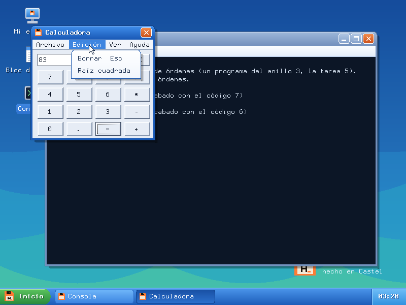
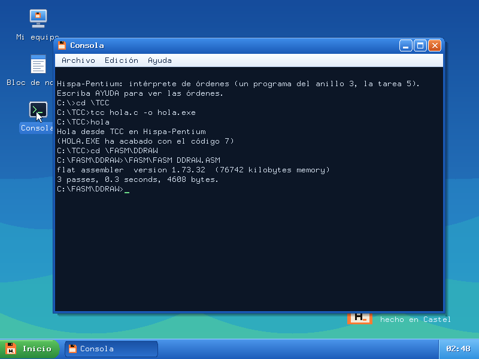
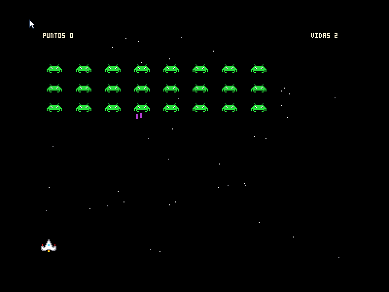
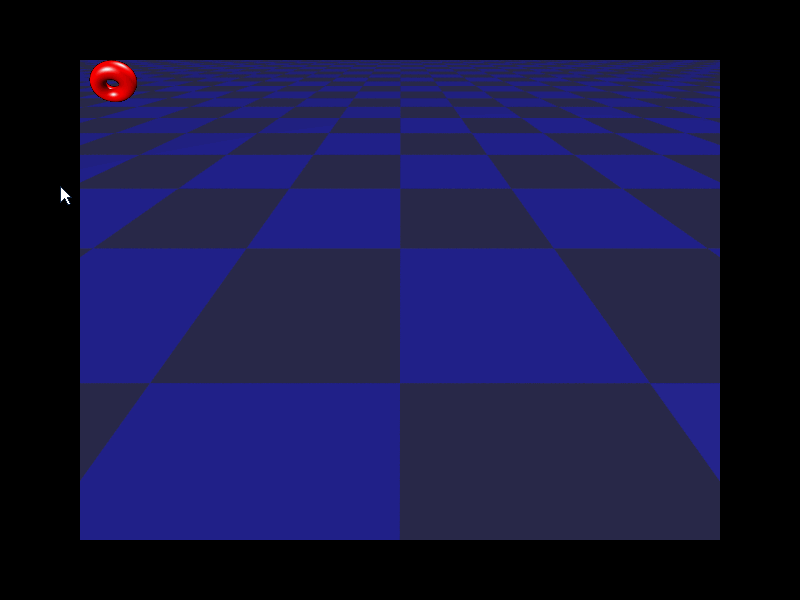

# Hispa-Pentium: los programas de Windows de 32 bits y DirectX (WIN32.BIN)

*Encargo de Carlos (21/11/2026): «DirectX y lo que necesitemos para estar a la
altura de un sistema operativo». Lo hecho en la rama `pentium-win32`. El
resumen, en [../PENTIUM.md](../PENTIUM.md), sección 14 ter.
Copyright (C) 2026 Carlos Sanz y contribuidores. GPL-2.0 o posterior.*

| | |
|---|---|
|  |  |
|  |  |
|  |  |

## Qué hay

En Hispa-Pentium un `.EXE` de Windows de 32 bits (PE de 386) **se abre como
cualquier programa**: escribiendo su nombre en la Consola (o en el intérprete de
órdenes), con dos clics en Mi equipo o desde un acceso del menú Inicio. Lo corre
`WIN32.BIN`. Lo que se ha probado:

- **Consola**: los de las pruebas de HW32 (PEHOLA, HOLAC, K32PRUE con lo que da
  Windows 98, una DLL propia); **NASM 2.16** (MinGW), **TCC 0.9.27** (compila un
  programa de C que luego corre ahí mismo) y **FASM 1.73**.
- **Ventanas**: los de `\HISPA32` de Hispa-486 (HOLA32, AVISO32, CALC32, MENU32,
  CTL32) y **FASMW**, el entorno del flat assembler: su editor propio, menús,
  aceleradores, pestañas y barra de estado (COMCTL32), el cuadro de abrir,
  ensamblar en «otro hilo» con su barra de progreso; y el `.EXE` que hace.
- **DirectX**: **«Naves»** (DirectDraw a pantalla completa con su paleta,
  DirectInput con el teclado, DirectSound en silencio): se juega a 50 cuadros
  por segundo en QEMU; y el **ejemplo DDRAW del flat assembler** (ensamblado en
  Hispa-Pentium con FASM).
- **La red**: **WSOCK32/WS2_32** (Winsock 1.1 de cliente: TCP con y sin bloqueo,
  `select`, UDP, el DNS) sobre el servicio de red (`RED.BIN`): REDPRUE baja
  400 KB por HTTP con la suma bien.

## La arquitectura, y por qué

**El problema.** Un `.EXE` de Windows espera estar en su `ImageBase`, casi
siempre `0x400000`, y la mayoría no trae reubicados (`/FIXED`): hay que ponerlo
ahí. En Hispa-Pentium, de `0` a `0x3FFFFFFF` está la identidad (la memoria de
verdad, del núcleo) y los programas van de `0x40000000` a `0xBFFFFFFF`.

**Lo elegido: segmentos con base, como HW32.** Igual que HW32 de Hispa-486 (que
corre los programas con selectores de DPMI de base «bloque − ImageBase»), en
Pentium un programa de Windows corre con **sus propios segmentos del anillo 3,
de base `0x40000000`** (`cpu.cas`: código `0x33`, datos `0x3B`, la TEB `0x43`):
su dirección `0x400000` es la `0x40400000` de verdad, dentro de su espacio de
direcciones. Las direcciones del programa van de `0` a `0x7FFFFFFF` (el límite
del segmento), como en Windows. Lo que hubo que tocar en el núcleo es poco y
está todo marcado `[WIN32]`:

- **Las interrupciones** (`ccastel.py` y `compilador/sent.cas`, los dos
  compiladores: tienen que dar el mismo ensamblador): al entrar ponen los DS y ES
  planos de siempre (`0x23`); al volver, los del programa si su CS es el de Win32
  (`0x3B`), sin guardar nada más en el marco (se sabe por el CS que apiló el
  procesador: el marco de las tareas no cambia).
- **La pila con base** (`usuario.cas`, `semilla.cas`): por dónde va la pila de
  un programa de Windows, en direcciones de verdad (para la pila que crece).
- **Las llamadas 180 a 182** (`win32.cas`, módulo nuevo): poner y quitar páginas
  en cualquier sitio de la zona del programa (VirtualAlloc, la imagen donde la
  quiere), el mapa de las teclas pulsadas (DirectInput y las de pulsar y soltar
  de Windows, que el núcleo no daba: `consola.cas` las apunta) y las ventanas
  (hacerlas sin marco o a pantalla completa —`V_COMPLETA`, que puede ser la
  activa: `ventanas.cas`—, colocarlas, traerlas delante, dónde están, el ratón).
- **El coprocesador de cada tarea** (`tareas.cas`): FNSAVE y FRSTOR al cambiar
  de una tarea del anillo 3 a otra. Los programas de Windows usan el x87; sin
  esto, dos a la vez se pisaban los registros.
- **Los `.EXE` se lanzan solos** (`usuario.cas`, `carga_de`): si un programa
  empieza por «MZ», el núcleo carga `WIN32.BIN` (de la unidad del sistema o de su
  `\HISPA`) con la ruta del `.EXE` delante de sus argumentos, y la tarea lleva el
  nombre del `.EXE`. Así valen la Consola, Mi equipo, los accesos y `lanzar`.
  `ORDENES.BIN` busca también `NOMBRE.EXE` (`uordenes.cas`) y Mi equipo los
  abre (`uequipo.cas`).
- `uinstala.cas`: INSTALAR admite más archivos y carpetas (las de Win32).

Se descartó **mapear la imagen en `0x400000` de verdad** (quitando la identidad
de ese trozo en el espacio del programa): el núcleo toca los marcos por su
dirección física desde cualquier espacio, y los módulos del cargador están por
ahí; habría que haber apartado decenas de megas y vigilado todo el núcleo.
También se descartó **rehacer HW32 dentro de HVPRUN** (el USER32 y el GDI32 de
Hispa-486 son parte de Hispa Ventanas, en ensamblador de 16/32 bits con DPMI):
las ventanas de Windows habrían sido ventanas de Hispa Ventanas dentro de una
sola de Pentium, y habría hecho falta un LDT y guardar todos los segmentos en el
cambio de tarea.

**WIN32.BIN** (`castel/nucleo32/win32/`) es un programa del anillo 3 (cabecera
`HPU3`) hecho en C con `gcc -m32`, como `TLS.BIN` y `ACPI.BIN`, pero **enlazado
para la dirección 0 de los segmentos de Win32** (`pentium.ld`): lo primero que
hace (`entrada.asm`) es saltar a su segmento de código (`jmp 0x33:...`) y poner
los de datos, la pila y FS. Desde ahí, él, las DLL y el programa comparten las
mismas direcciones: sus funciones son las de KERNEL32, USER32... (un `.EXE` las
llama directamente), y al núcleo se le dan las direcciones de verdad (`LIN`,
`sys.c`). Lo hace `win32/hacer.sh`.

| Archivo | Qué |
|---|---|
| `entrada.asm`, `pentium.ld` | la cabecera, el paso a los segmentos de Win32 |
| `principal.c` | el arranque: la TEB y la PEB (en `0x7FBF0000`), el entorno (`\WIN32\ENTORNO.TXT` añade variables), la línea de órdenes, la carpeta de las DLL, la pila del programa (la que pide su cabecera, de su zona) y la entrada; TLS de la imagen |
| `cargador.c` | el cargador de PE: secciones, reubicados, importaciones (por nombre y por número), las DLL de fuera (de la carpeta del programa, de `\WIN32` o de la de trabajo) con sus `DllMain`, las de dentro (KERNEL32, USER32, GDI32, COMDLG32, ADVAPI32, SHELL32, WSOCK32, WS2_32, VERSION, WINSPOOL), los nombres de la UCRT (`api-ms-win-crt-*` a `UCRT.DLL`), los reenvíos, y un trampolín que dice «falta la función X (DLL)» |
| `monton.c` | las zonas (VirtualAlloc: `0x30000000` en adelante; la imagen; la pila) y el montón (HeapAlloc, malloc de MSVCRT, GlobalAlloc...: bloques con cabecera, cajas por tamaño, los vecinos se juntan; HeapSize da lo pedido) |
| `kernel32.c`, `archivos.c`, `k32.h` | KERNEL32 (unas 330 funciones), como el de Windows 98: archivos y carpetas con los números de error de Win32, búsquedas con nombres largos, la consola (la llamada 1 y las teclas), la hora (FILETIME), los módulos, los recursos, los `.INI`, los átomos, el entorno, los procesos (CreateProcess lanza y espera), los hilos como HW32 (uno: CreateThread corre el hilo entero), las letras (la 1252, Unicode y la del núcleo) |
| `user32.c`, `controles.c`, `menus.c`, `dialogos.c`, `recursos.c`, `ventanas.h` | USER32 (unas 400): ventanas, clases, mensajes, el pintado, el teclado y el ratón, el foco, los temporizadores, el cursor de texto, el portapapeles (el del sistema), las barras de desplazamiento; BUTTON, STATIC, EDIT, LISTBOX, COMBOBOX y SCROLLBAR; los menús; los cuadros de plantilla y MessageBox; iconos, cursores, mapas de bits, aceleradores y DrawText |
| `gdi32.c` | GDI32 (unas 200): DC, plumas, brochas, letras, mapas de bits y secciones DIB de 1 a 32 bits, regiones, paletas, BitBlt/StretchBlt con las ROP, StretchDIBits, el texto |
| `dx.c` | `HispaDXPantalla`, `HispaDXEntrada`, `HispaDXSonido` y `HispaDXTic`: lo que piden las DLL de DirectX de Hispa-486 |
| `comdlg32.c` | el cuadro de abrir y guardar (hecho con los controles de USER32) |
| `red.c` | WSOCK32 y WS2_32 sobre el servicio de red |
| `otros.c` | ADVAPI32 (el registro: «no está»), SHELL32 (ShellExecute lanza), VERSION, WINSPOOL |
| `hazdatos.py`, `hazexp.py` | la letra de 8x16 (de `letra.cas`) y las tablas de letras; las tablas de lo que exporta cada DLL de dentro (de las funciones `API(...)` de cada archivo) |
| `disco.sh` | el disco de las pruebas |

**Las ventanas.** Cada ventana de primer nivel de Windows es **una ventana de
Hispa-Pentium** (su botón en la barra de tareas, moverla, cambiarle el tamaño,
minimizar, maximizar, cerrar: todo lo del núcleo). Si tiene título, el título y
el marco son los del núcleo; si no (`WS_POPUP`), es una ventana sin marco
(`V_COMPLETA`). Lo de dentro es un **lienzo de 32 bits de WIN32.BIN** donde se
pintan ella (su barra de menús, sus barras de desplazamiento) y todas sus hijas
(los controles); lo que cambia se le da al núcleo como un mapa de puntos (la
llamada 34) cada vez que el programa pide un mensaje. Los cuadros de diálogo y
MessageBox son ventanas aparte (modales: la de debajo no recibe nada). Los
menús que cuelgan de la barra y TrackPopupMenu son el **menú emergente del
núcleo** (la llamada 39), con las marcas y los submenús uno detrás de otro. La
letra es la de 8x16 del sistema (la de Hispa Ventanas), agrandada si se pide
grande; en los cuadros, una unidad de plantilla son 2 puntos.

**El teclado.** El núcleo da las letras (con el teclado español y los acentos)
como sucesos: son los `WM_CHAR`. Las teclas (`WM_KEYDOWN`/`WM_KEYUP`, también las
que se pulsan y se sueltan entre dos miradas, Alt y las demás que el núcleo no
mandaba) salen del mapa de la llamada 181; `TranslateMessage` no hace falta.
`ToAscii` usa las mismas tablas que el núcleo.

**DirectX.** Las DLL son las de Hispa-486 **sin tocar** (DDRAW, DSOUND, DINPUT,
OLE32), menos WINMM, que toma la hora de `GetTickCount` (no hay tics de la BIOS
que corran solos: `w32/dx/winmm.c`, `HISPA_PENTIUM`). A pantalla completa, la
ventana del juego pasa a ser una del núcleo sin marco, encima de todo y del
tamaño de la pantalla; su lienzo es el «marco lineal» donde DDRAW pinta (el
modo del juego, agrandado y en el centro, como en Hispa-486), y en cada vuelta
de mensajes se le da al núcleo lo que ha cambiado (la caja del juego). DirectInput
lee el mapa de las teclas. **DirectSound suena en silencio**: una tarjeta de
mentira de 8 bits a 22.050 Hz por la que el tiempo pasa como si sonara (los
juegos siguen igual), hasta que Hispa-Pentium tenga sonido.

## Cómo se usa

- En la Consola: `\HISPA32\NAVES` (o `NAVES` desde esa carpeta). Los de consola
  escriben en la Consola. Los de ventanas abren la suya (la Consola los espera:
  vuelve cuando se cierran).
- En Mi equipo, dos clics en un `.EXE`.
- En el menú Inicio, **Naves** (el acceso que pone el paquete `win32`).
- `HISPA32=TRAZA` en `\WIN32\ENTORNO.TXT` (una variable por línea): lo que hace
  WIN32.BIN sale por el puerto serie; `TRAZA2`, además, cada llamada a las DLL de
  dentro con sus argumentos; `TRAZA3`, también las de las DLL de fuera.

## En el disco

- `\HISPA\WIN32.BIN` (en la memoria USB y en el CD, en la raíz).
- `\WIN32\`: `MSVCRT.DLL`, `UCRT.DLL`, `COMCTL32.DLL`, `WINMM.DLL`, `DDRAW.DLL`,
  `DSOUND.DLL`, `DINPUT.DLL`, `OLE32.DLL`.
- `\HISPA32\`: `CALC32.EXE`, `HOLA32.EXE`, `CTL32.EXE`, `MENU32.EXE`,
  `AVISO32.EXE`, `NAVES.EXE` y `NAVES.ICP` (su icono); el acceso, en
  `\HISPA\MENU\NAVES.MNU` (`\MENU` en la memoria USB).
- **Los paquetes** (`tools/hpq.py`): `win32` 1.0, nuevo (todo lo de arriba;
  necesita `base >= 0.8.2`); `base` pasa a la 0.8.2 (el núcleo y `ORDENES.BIN`)
  y `equipo` a la 0.8.2 (`EQUIPO.BIN`). INSTALAR los instala con el sistema.

## Lo que falta

- **Hilos de verdad**: como en HW32, `CreateThread` corre el hilo entero antes de
  volver (vale para los que lanzan un trabajo y esperan, como FASMW); un hilo
  que no acaba nunca cuelga el programa. Hacen falta varias tareas por espacio
  de direcciones en el núcleo.
- **SEH**: un fallo del programa lo acaba (el núcleo lo dice); no se le pasa a
  sus manejadores de excepciones.
- Escuchar en la red (`listen`, `accept`): el servicio de red no lo da aún. HTTPS
  de los programas de Windows (HSPTLS.DLL de Hispa-486 usa la pila TCP/IP propia
  de su WSOCK32): habría que darles el servicio TLS. Por eso **NAVEGA2.EXE**
  (NetSurf para Hispa-486) aún no corre aquí.
- La letra es una sola (8x16, agrandada); los tamaños pequeños salen igual de
  grandes, así que algunos cuadros quedan más anchos que en Windows.
- Las listas desplegables y los menús son el emergente del núcleo: caben unos
  256 octetos de texto (las listas muy largas se cortan).
- El registro (ADVAPI32) dice siempre «no está»; los programas que guardan ahí
  sus ajustes los pierden al acabar (los `.INI` sí van).
- Direct3D, como en Hispa-486: no (DirectDraw 1 a 7 sí).
- El sonido, cuando Hispa-Pentium lo tenga: `HispaDXSonido` (dx.c) es lo único
  que hay que cambiar.

## Las pruebas

`castel/pruebas.sh`, parte 18 (`SOLO=win32 ./pruebas.sh`; también en `SOLO=32`
y `SOLO=08`): los de consola en el intérprete de órdenes; los de ventanas en el
escritorio, mirando las capturas; Naves desde Mi equipo, jugando; el ejemplo
DDRAW y FASMW si están los de otros (`tests/thirdparty/fetch_win32.sh`); y
REDPRUE contra el servidor HTTP de aquí.
