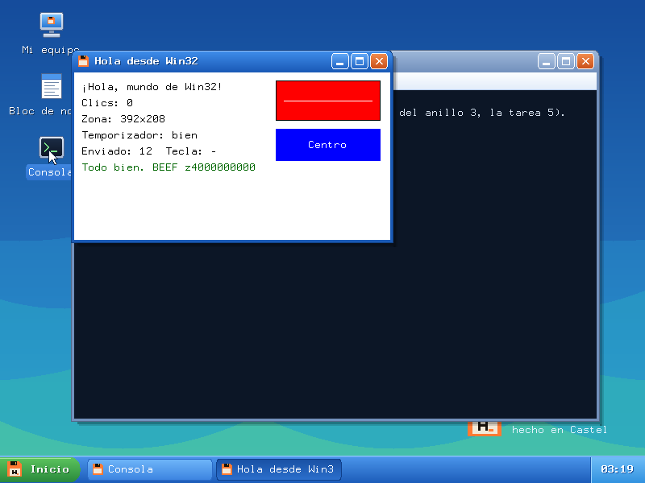
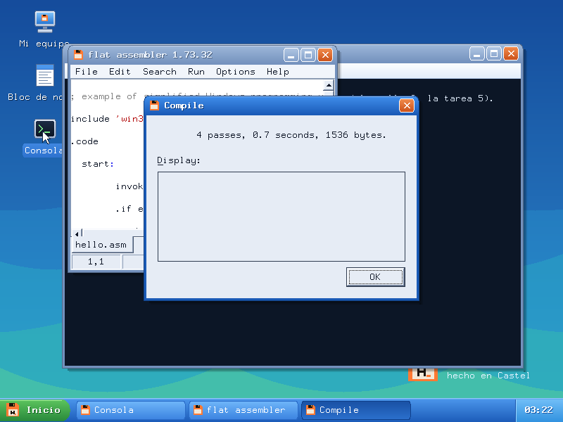

# Hispa-Pentium: los programas de Windows de 32 bits y DirectX (WIN32.BIN)

*Encargo de Carlos (21/11/2026): «DirectX y lo que necesitemos para estar a la
altura de un sistema operativo». Lo hecho en la rama `pentium-win32`. El
resumen, en [../PENTIUM.md](../PENTIUM.md), sección 14 ter.
Copyright (C) 2026 Carlos Sanz y contribuidores. GPL-2.0 o posterior.*

| | |
|---|---|
|  |  |
|  |  |
|  |  |

## Qué hay

En Hispa-Pentium un `.EXE` de Windows de 32 bits (PE de 386) **se abre como
cualquier programa**: escribiendo su nombre en la Consola (o en el intérprete de
órdenes) o con dos clics en Mi equipo. Lo corre
`WIN32.BIN`. Lo que se ha probado:

- **Consola**: los de las pruebas de HW32 (PEHOLA, HOLAC, K32PRUE con lo que da
  Windows 98, una DLL propia); **NASM 2.16** (MinGW), **TCC 0.9.27** (compila un
  programa de C que luego corre ahí mismo) y **FASM 1.73**.
- **Ventanas**: los de `\HISPA32` de Hispa-486 (HOLA32, AVISO32, CALC32, MENU32,
  CTL32) y **FASMW**, el entorno del flat assembler: su editor propio, menús,
  aceleradores, pestañas y barra de estado (COMCTL32), el cuadro de abrir,
  ensamblar en «otro hilo» con su barra de progreso; y el `.EXE` que hace.
- **DirectX**: **«Naves»** (DirectDraw a pantalla completa con su paleta,
  DirectInput con el teclado, DirectSound: desde el 21/11 suena, con la rama pentium-sonido): se juega a 50 cuadros
  por segundo en QEMU; y el **ejemplo DDRAW del flat assembler** (ensamblado en
  Hispa-Pentium con FASM).
- **La red**: **WSOCK32/WS2_32** (Winsock 1.1 de cliente: TCP con y sin bloqueo,
  `select`, UDP, el DNS) sobre el servicio de red (`RED.BIN`): REDPRUE baja
  400 KB por HTTP con la suma bien.

## La arquitectura, y por qué

**El problema.** Un `.EXE` de Windows espera estar en su `ImageBase`, casi
siempre `0x400000`, y la mayoría no trae reubicados (`/FIXED`): hay que ponerlo
ahí. En Hispa-Pentium, de `0` a `0x3FFFFFFF` está la identidad (la memoria de
verdad, del núcleo) y los programas van de `0x40000000` a `0xBFFFFFFF`.

**Lo elegido: segmentos con base, como HW32.** Igual que HW32 de Hispa-486 (que
corre los programas con selectores de DPMI de base «bloque − ImageBase»), en
Pentium un programa de Windows corre con **sus propios segmentos del anillo 3,
de base `0x40000000`** (`cpu.cas`: código `0x33`, datos `0x3B`, la TEB `0x43`):
su dirección `0x400000` es la `0x40400000` de verdad, dentro de su espacio de
direcciones. Las direcciones del programa van de `0` a `0x7FFFFFFF` (el límite
del segmento), como en Windows. Lo que hubo que tocar en el núcleo es poco y
está todo marcado `[WIN32]`:

- **Las interrupciones** (`ccastel.py` y `compilador/sent.cas`, los dos
  compiladores: tienen que dar el mismo ensamblador): al entrar ponen los DS y ES
  planos de siempre (`0x23`); al volver, los del programa si su CS es el de Win32
  (`0x3B`), sin guardar nada más en el marco (se sabe por el CS que apiló el
  procesador: el marco de las tareas no cambia).
- **La pila con base** (`usuario.cas`, `semilla.cas`): por dónde va la pila de
  un programa de Windows, en direcciones de verdad (para la pila que crece).
- **Las llamadas 180 a 182** (`win32.cas`, módulo nuevo): poner y quitar páginas
  en cualquier sitio de la zona del programa (VirtualAlloc, la imagen donde la
  quiere), el mapa de las teclas pulsadas (DirectInput y las de pulsar y soltar
  de Windows, que el núcleo no daba: `consola.cas` las apunta) y las ventanas
  (hacerlas sin marco o a pantalla completa —`V_COMPLETA`, que puede ser la
  activa: `ventanas.cas`—, colocarlas, traerlas delante, dónde están, el ratón).
- **El coprocesador de cada tarea** (`tareas.cas`): FNSAVE y FRSTOR al cambiar
  de una tarea del anillo 3 a otra. Los programas de Windows usan el x87; sin
  esto, dos a la vez se pisaban los registros.
- **Los `.EXE` se lanzan solos** (`usuario.cas`, `carga_de`): si un programa
  empieza por «MZ», el núcleo carga `WIN32.BIN` (de la unidad del sistema o de su
  `\HISPA`) con la ruta del `.EXE` delante de sus argumentos, y la tarea lleva el
  nombre del `.EXE`. Así valen la Consola, Mi equipo, los accesos y `lanzar`.
  `ORDENES.BIN` busca también `NOMBRE.EXE` (`uordenes.cas`) y Mi equipo los
  abre (`uequipo.cas`).
- `uinstala.cas`: INSTALAR admite más archivos y carpetas (las de Win32).

Se descartó **mapear la imagen en `0x400000` de verdad** (quitando la identidad
de ese trozo en el espacio del programa): el núcleo toca los marcos por su
dirección física desde cualquier espacio, y los módulos del cargador están por
ahí; habría que haber apartado decenas de megas y vigilado todo el núcleo.
También se descartó **rehacer HW32 dentro de HVPRUN** (el USER32 y el GDI32 de
Hispa-486 son parte de Hispa Ventanas, en ensamblador de 16/32 bits con DPMI):
las ventanas de Windows habrían sido ventanas de Hispa Ventanas dentro de una
sola de Pentium, y habría hecho falta un LDT y guardar todos los segmentos en el
cambio de tarea.

**WIN32.BIN** (`castel/nucleo32/win32/`) es un programa del anillo 3 (cabecera
`HPU3`) hecho en C con `gcc -m32`, como `TLS.BIN` y `ACPI.BIN`, pero **enlazado
para la dirección 0 de los segmentos de Win32** (`pentium.ld`): lo primero que
hace (`entrada.asm`) es saltar a su segmento de código (`jmp 0x33:...`) y poner
los de datos, la pila y FS. Desde ahí, él, las DLL y el programa comparten las
mismas direcciones: sus funciones son las de KERNEL32, USER32... (un `.EXE` las
llama directamente), y al núcleo se le dan las direcciones de verdad (`LIN`,
`sys.c`). Lo hace `win32/hacer.sh`.

| Archivo | Qué |
|---|---|
| `entrada.asm`, `pentium.ld` | la cabecera, el paso a los segmentos de Win32 |
| `principal.c` | el arranque: la TEB y la PEB (en `0x7FBF0000`), el entorno (`\WIN32\ENTORNO.TXT` añade variables), la línea de órdenes, la carpeta de las DLL, la pila del programa (la que pide su cabecera, de su zona) y la entrada; TLS de la imagen |
| `cargador.c` | el cargador de PE: secciones, reubicados, importaciones (por nombre y por número), las DLL de fuera (de la carpeta del programa, de `\WIN32` o de la de trabajo) con sus `DllMain`, las de dentro (KERNEL32, USER32, GDI32, COMDLG32, ADVAPI32, SHELL32, WSOCK32, WS2_32, VERSION, WINSPOOL), los nombres de la UCRT (`api-ms-win-crt-*` a `UCRT.DLL`), los reenvíos, y un trampolín que dice «falta la función X (DLL)» |
| `monton.c` | las zonas (VirtualAlloc: `0x30000000` en adelante; la imagen; la pila) y el montón (HeapAlloc, malloc de MSVCRT, GlobalAlloc...: bloques con cabecera, cajas por tamaño, los vecinos se juntan; HeapSize da lo pedido) |
| `kernel32.c`, `archivos.c`, `k32.h` | KERNEL32 (unas 330 funciones), como el de Windows 98: archivos y carpetas con los números de error de Win32, búsquedas con nombres largos, la consola (la llamada 1 y las teclas), la hora (FILETIME), los módulos, los recursos, los `.INI`, los átomos, el entorno, los procesos (CreateProcess lanza y espera), los hilos como HW32 (uno: CreateThread corre el hilo entero), las letras (la 1252, Unicode y la del núcleo) |
| `user32.c`, `controles.c`, `menus.c`, `dialogos.c`, `recursos.c`, `ventanas.h` | USER32 (unas 400): ventanas, clases, mensajes, el pintado, el teclado y el ratón, el foco, los temporizadores, el cursor de texto, el portapapeles (el del sistema), las barras de desplazamiento; BUTTON, STATIC, EDIT, LISTBOX, COMBOBOX y SCROLLBAR; los menús; los cuadros de plantilla y MessageBox; iconos, cursores, mapas de bits, aceleradores y DrawText |
| `gdi32.c` | GDI32 (unas 200): DC, plumas, brochas, letras, mapas de bits y secciones DIB de 1 a 32 bits, regiones, paletas, BitBlt/StretchBlt con las ROP, StretchDIBits, el texto |
| `dx.c` | `HispaDXPantalla`, `HispaDXEntrada`, `HispaDXSonido` y `HispaDXTic`: lo que piden las DLL de DirectX de Hispa-486 |
| `comdlg32.c` | el cuadro de abrir y guardar (hecho con los controles de USER32) |
| `red.c` | WSOCK32 y WS2_32 sobre el servicio de red |
| `otros.c` | ADVAPI32 (lo que no es del registro), SHELL32 (ShellExecute lanza), VERSION, WINSPOOL |
| `diagnostico.c` | (JUEGOS) lo que falta: el registro de WIN32 (`\USUARIOS\<usuario>\WIN32.LOG`), el aviso de la función que falta y `WIN32 COMPRUEBA` |
| `hilos.c` | (JUEGOS) los hilos de verdad, el cerrojo grande (`gc_puente`), CRITICAL_SECTION, eventos, mutex, semáforos, las esperas, TLS |
| `seh.c` | (JUEGOS) SEH: el despachador de las excepciones, `RaiseException`, `RtlUnwind`, el filtro final, `IsBad*Ptr` |
| `registro.c` | (JUEGOS) el registro (ADVAPI32: HKCU, HKLM, HKCR) en archivos de texto |
| `juegos.sh` | (JUEGOS) los programas de prueba de `tests/juegos/` |
| `hazdatos.py`, `hazexp.py` | la letra de 8x16 (de `letra.cas`) y las tablas de letras; las tablas de lo que exporta cada DLL de dentro (de las funciones `API(...)` de cada archivo) |
| `disco.sh` | el disco de las pruebas |

**Las ventanas.** Cada ventana de primer nivel de Windows es **una ventana de
Hispa-Pentium** (su botón en la barra de tareas, moverla, cambiarle el tamaño,
minimizar, maximizar, cerrar: todo lo del núcleo). Si tiene título, el título y
el marco son los del núcleo; si no (`WS_POPUP`), es una ventana sin marco
(`V_COMPLETA`). Lo de dentro es un **lienzo de 32 bits de WIN32.BIN** donde se
pintan ella (su barra de menús, sus barras de desplazamiento) y todas sus hijas
(los controles); lo que cambia se le da al núcleo como un mapa de puntos (la
llamada 34) cada vez que el programa pide un mensaje. Los cuadros de diálogo y
MessageBox son ventanas aparte (modales: la de debajo no recibe nada). Los
menús que cuelgan de la barra y TrackPopupMenu son el **menú emergente del
núcleo** (la llamada 39), con las marcas y los submenús uno detrás de otro. La
letra es la de 8x16 del sistema (la de Hispa Ventanas), agrandada si se pide
grande; en los cuadros, una unidad de plantilla son 2 puntos.

**El teclado.** El núcleo da las letras (con el teclado español y los acentos)
como sucesos: son los `WM_CHAR`. Las teclas (`WM_KEYDOWN`/`WM_KEYUP`, también las
que se pulsan y se sueltan entre dos miradas, Alt y las demás que el núcleo no
mandaba) salen del mapa de la llamada 181; `TranslateMessage` no hace falta.
`ToAscii` usa las mismas tablas que el núcleo.

**DirectX.** Las DLL son las de Hispa-486 **sin tocar** (DDRAW, DSOUND, DINPUT,
OLE32), menos WINMM, que toma la hora de `GetTickCount` (no hay tics de la BIOS
que corran solos: `w32/dx/winmm.c`, `HISPA_PENTIUM`). A pantalla completa, la
ventana del juego pasa a ser una del núcleo sin marco, encima de todo y del
tamaño de la pantalla; su lienzo es el «marco lineal» donde DDRAW pinta (el
modo del juego, agrandado y en el centro, como en Hispa-486), y en cada vuelta
de mensajes se le da al núcleo lo que ha cambiado (la caja del juego). DirectInput
lee el mapa de las teclas. **DirectSound y WinMM suenan** (SONIDO, 21/11):
`HispaDXSonido` les da un canal del sonido de Hispa-Pentium (48 kHz, 16 bits,
estéreo; docs/PENTIUM.md §14 sexies); sin tarjeta, la de antes: una de
mentira de 8 bits a 22.050 Hz por la que el tiempo pasa como si sonara (los
juegos siguen igual).

## Cómo se usa

- En la Consola: `\HISPA32\NAVES` (o `NAVES` desde esa carpeta). Los de consola
  escriben en la Consola. Los de ventanas abren la suya (la Consola los espera:
  vuelve cuando se cierran).
- En Mi equipo, dos clics en un `.EXE`.
- En el menú Inicio, de momento, no: un acceso más alarga el menú y movía lo
  que miran las pruebas de los demás (y las de otras ramas). `win32/hacer.sh`
  ya sabe hacer el de Naves (`NAVES.MNU` y su icono `NAVES.ICP`, de
  `hazicono.py`) con su cuarto argumento: cuando se quiera, basta con
  añadirlo al paquete.
- `HISPA32=TRAZA` en `\WIN32\ENTORNO.TXT` (una variable por línea): lo que hace
  WIN32.BIN sale por el puerto serie; `TRAZA2`, además, cada llamada a las DLL de
  dentro con sus argumentos; `TRAZA3`, también las de las DLL de fuera.

## En el disco

- `\HISPA\WIN32.BIN` (en la memoria USB y en el CD, en la raíz).
- `\WIN32\`: `MSVCRT.DLL`, `UCRT.DLL`, `COMCTL32.DLL`, `WINMM.DLL`, `DDRAW.DLL`,
  `DSOUND.DLL`, `DINPUT.DLL`, `OLE32.DLL` y (OpenGL, `win32` 1.1) `OPENGL32.DLL` y
  `GLU32.DLL`.
- `\HISPA32\`: `CALC32.EXE`, `HOLA32.EXE`, `CTL32.EXE`, `MENU32.EXE`,
  `AVISO32.EXE`, `NAVES.EXE`, `GLPRUEBA.EXE` y `ENGRANA.EXE`.
- **Los paquetes** (`tools/hpq.py`): `win32` 1.0, nuevo (todo lo de arriba;
  necesita `base >= 0.8.2`); `base` pasa a la 0.8.2 (el núcleo y `ORDENES.BIN`)
  y `equipo` a la 0.8.2 (`EQUIPO.BIN`). INSTALAR los instala con el sistema.

## Lo que falta

- ~~Hilos de verdad~~ y ~~SEH~~: hechos (22/11/2026, «Lo que pide un juego»).
- Escuchar en la red (`listen`, `accept`): el servicio de red no lo da aún. HTTPS
  de los programas de Windows (HSPTLS.DLL de Hispa-486 usa la pila TCP/IP propia
  de su WSOCK32): habría que darles el servicio TLS. Por eso **NAVEGA2.EXE**
  (NetSurf para Hispa-486) aún no corre aquí.
- La letra es una sola (8x16, agrandada); los tamaños pequeños salen igual de
  grandes, así que algunos cuadros quedan más anchos que en Windows.
- Las listas desplegables y los menús son el emergente del núcleo: caben unos
  256 octetos de texto (las listas muy largas se cortan).
- ~~El registro~~: hecho (22/11/2026: en `\USUARIOS`).
- C++: `__CxxFrameHandler` no destruye los objetos al deshacer y un `throw` acaba
  el programa («una excepción de C++ que nadie recoge»); MIDI; las prioridades
  de los hilos (se guardan; el núcleo reparte igual).
- Direct3D, como en Hispa-486: no (DirectDraw 1 a 7 sí). **OpenGL 1.1, sí**
  (21/11/2026, rama `opengl`): `OPENGL32.DLL` y `GLU32.DLL` de HispaGL en `\WIN32`,
  GLPRUEBA y ENGRANA en `\HISPA32`; el puente de GDI32 en `dx.c` y
  `ChangeDisplaySettingsA` en `user32.c` ([../486/OPENGL.md](../486/OPENGL.md)).
- El sonido, cuando Hispa-Pentium lo tenga: `HispaDXSonido` (dx.c) es lo único
  que hay que cambiar.

## Lo que pide un juego (JUEGOS)

*22/11/2026, rama `win32-juegos`. Carlos probó su Half-Life 1 (su copia, del
CD) en la 0.8.5 y no arrancaba: lo esperado, faltaban piezas. Lo que pide un
juego de 1998-2000 (Win32, Visual C++ 6, OpenGL o el programa dibujando con
DirectDraw), según la documentación pública de Win32 y del SDK de los mods,
hecho y probado con programas propios (`tests/juegos/`, la parte 33 de las
pruebas), sin el juego: no se ha bajado ni copiado nada de él.*

**Lo primero: saber qué falta.** Si un programa llama a una función que aún no
hay, sale un cuadro: «Falta la función `WINMM.DLL!mixerOpen` · HL.EXE la ha
llamado (desde `HW.DLL+0x1234`) y Hispa-Pentium aún no la tiene · Queda
apuntado en `C:\USUARIOS\CARLOS\WIN32.LOG`. Mándenos una foto de este aviso.»
En ese archivo (de texto, con la fecha, la hora y el programa) va también lo que
cada `.EXE` y `.DLL` importa y no hay (aunque no lo llame), las DLL que no se
encuentran, lo que se pide por `GetProcAddress` y no está, y las excepciones que
nadie recoge (con los registros). Y sin ejecutar nada:

```
WIN32 COMPRUEBA HL.EXE
WIN32 COMPRUEBA C:\JUEGOS\HALFLIFE        (todos los .EXE y .DLL, con sus carpetas)
```

dice, por cada archivo, sus DLL y sus funciones, cuáles faltan
(`falta WINMM.DLL!mixerOpen`, `FALTA LA DLL A3D.DLL`) y el total; las DLL de
fuera que piden (de su carpeta o de `\WIN32`) se miran también.

**Los hilos de verdad.** Un hilo es una tarea más del núcleo en el mismo espacio
de direcciones (`tareas.cas`, `crear_hilo`; la llamada 183): lleva el mismo
número de tarea que su proceso (así sus archivos, sus ventanas, su sonido y su
red son los del proceso) y uno suyo de hilo (`GetCurrentThreadId`). Cada uno
tiene su TEB (su pila, su cadena de SEH, sus TLS): en cada cambio de tarea el
núcleo pone su base en el descriptor 0x43 y vuelve a cargar FS. El proceso, al
acabar, acaba antes sus hilos y espera a que acaben (`acaba_hilos`); si un hilo
pide acabar el proceso (`ExitProcess`), se acaba el proceso con su código; un
fallo en un hilo acaba el proceso entero. Para esperar, la 184 (dormir mientras
en una dirección del programa haya un valor, con tiempo o sin fin) y la 185
(despertar a los que esperan ahí), como un «futex». `MAX_TAREAS`, de 16 a 32.

WIN32.BIN no está hecho para varios hilos a la vez (sus listas de ventanas, el
montón, los objetos...): lo guarda **un cerrojo grande**. Cada función que se
exporta entra por un trampolín (lo hace `hazexp.py`; `gc_puente`, en
`hilos.c`) que lo toma, apunta la vuelta en una pila de cada hilo y lo suelta
al volver; las que esperan (dormir, esperar un objeto o una tecla, un menú, la
red, el CD) lo sueltan entero mientras esperan. Si el programa sale de una de
las nuestras sin volver (un `longjmp`, un `__except` por encima), lo apuntado
por debajo de la pila de ahora se suelta en la siguiente llamada. Sin
cerrojo: las de las CRITICAL_SECTION (un entero de tres estados y la 184/185,
sin llamar al núcleo si nadie espera), `Interlocked*` (atómicas de verdad),
TLS y unas pocas más. Los objetos (eventos —también `PulseEvent`—, mutex
—recursivos, con nombre, abandonados—, semáforos, hilos y procesos) esperan
todos en un mismo contador de cambios, así que `WaitForMultipleObjects` vale
con uno o con todos. `CREATE_SUSPENDED` y `ResumeThread`, `TerminateThread`,
`GetExitCodeThread`, las prioridades (se guardan), `TlsAlloc` en cada TEB y
`__declspec(thread)` (cada hilo, su copia de la plantilla de la imagen, y sus
funciones TLS con `DLL_THREAD_ATTACH`/`DETACH`, como `DllMain`). Con un núcleo
de antes (sin la 183), lo de siempre: un hilo corre entero al crearlo.

**SEH.** Si el procesador no puede seguir con un programa de Windows (dividir
por cero, `ud2`, protección general, fallo de página) y su proceso ha dado su
despachador (la 183, 2), el núcleo no lo acaba: le deja en su pila lo que ha
pasado (el vector, el código de error, la dirección del fallo y los registros)
y lo manda al despachador (`win32.cas`, `a_su_despachador`). `seh.c` hace lo de
Windows: el `EXCEPTION_RECORD` (`ACCESS_VIOLATION` con si leía o escribía y
dónde, `INT_DIVIDE_BY_ZERO`, `ILLEGAL_INSTRUCTION`, `PRIV_INSTRUCTION`,
`BREAKPOINT`, `STACK_OVERFLOW`) y el `CONTEXT` (con la coma flotante), la
cadena de FS:[0] (solo los marcos que están en la pila, como Windows), y, si
uno dice que se siga, vuelve a donde diga el contexto (que el manejador puede
cambiar). `RaiseException` entra por el mismo sitio; `RtlUnwind` avisa y quita
los marcos de encima. Si nadie la quiere, el filtro de
`SetUnhandledExceptionFilter`, y si no, un aviso claro («HL.EXE ha fallado:
EXCEPTION_ACCESS_VIOLATION (un puntero que no vale) en HW.DLL+0x1234, al leer
de 0x00000010») y al registro. En MSVCRT, el `__try/__except` y el
`__try/__finally` de Visual C++ 6: `_except_handler3` (la tabla de ámbitos, los
filtros y los bloques con el EBP de la función, `[EBP-14h]` y `[EBP-18h]`),
`_local_unwind2`, `_global_unwind2`; y `longjmp` repone la cadena. **El puntero
nulo**: WIN32.BIN se enlaza desde 64 K (`pentium.ld`) y al empezar quita esas
primeras páginas (la 183, 9): leer o escribir en 0 falla, como en Windows (antes
caía en la cabecera de WIN32.BIN).

**El registro** (`registro.c`, ADVAPI32): un árbol en memoria que se lee al
primer uso y se guarda, si ha cambiado, al cerrar una clave, con `RegFlushKey`
y al acabar. HKEY_CURRENT_USER en `\USUARIOS\<usuario>\REGISTRO.REG` y
HKEY_LOCAL_MACHINE en `\USUARIOS\EQUIPO.REG` (de la unidad del sistema, fuera
de la zona protegida); HKEY_CLASSES_ROOT es `HKLM\Software\Classes`. De texto,
como los `.REG` de REGEDIT4 (se pueden mirar con el Bloc de notas). De fábrica,
lo que miran algunos instaladores (la versión de Windows 98, `ProgramFilesDir`,
DirectX 7). Las de siempre en A y en W: abrir, crear (con lo que dice si es
nueva), poner y leer (DWORD, texto, binario, el valor sin nombre; el búfer corto
da `ERROR_MORE_DATA` con lo que hace falta), enumerar, `RegQueryInfoKey`,
borrar valores y claves.

**MSVCRT de VC6** (`w32/msvcrt.c`, también la de Hispa-486): lo que pide un
programa de Visual C++ 6 enlazado con MSVCRT.DLL: `_adjust_fdiv`, `_ftol` y las
`_CIpow`, `_CIsqrt`... del compilador (con la pila del x87), new y delete de C++
(`??2@YAPAXI@Z`...), `_purecall`, `_findfirst`, `_splitpath`/`_makepath`,
`_getdrive`, `_ftime`, `_strdate`, `_beginthread(ex)`, `_ecvt`/`_fcvt`, las
`_mbs...` (con la 1252, de un octeto), las de Unicode (`wcs...`, `swprintf`),
`__wgetmainargs` y unas 140 más. Lo de antes, probado: el texto y lo binario de
stdio, `sprintf` con coma flotante, `qsort`, `atexit`, `__getmainargs`,
`_initterm`, `_acmdln` (de donde saca el arranque de VC6 el `lpCmdLine` de
`WinMain`).

**Lo de un juego en su ventana.** `SetCursorPos` lleva la flecha de verdad
(182, 8: solo si la ventana activa es suya): los motores que miran con el
ratón la vuelven al centro en cada vuelta y miden lo que se ha movido.
`ClipCursor` la deja en su recuadro; `ShowCursor(FALSE)` la esconde mientras su
ventana está delante (182, 10). Con una ventana a pantalla completa (DirectDraw
o OpenGL con `ChangeDisplaySettings`), para el programa la pantalla es la de su
modo: `GetCursorPos`, `SetCursorPos`, los `WM_MOUSEMOVE`, `GetSystemMetrics`,
`GetClientRect` y `GetWindowRect` van en 640 x 480 (o lo que sea) aunque se vea
agrandada en el centro. DirectInput toma lo que se ha movido el ratón de verdad
(182, 9: sin topar con el borde ni perder puntos al pasar al modo).
`QueryPerformanceCounter` da microsegundos (1 MHz) con los tics del núcleo y,
entre tic y tic, el TSC (con su ritmo medido en los tics de antes): no se va
aunque el TSC no corra como el reloj (QEMU, el ahorro de energía), y
`timeGetTime` sale de él. `LoadLibrary("valve\\cl_dlls\\client.dll")`: desde la
carpeta de trabajo y, si no está, desde la del `.EXE`; una DLL sin `.reloc`
(pero sin la marca de quitados) se pone donde quepa.

**UDP** (`red.c`): `bind` abre ya el puerto (un servidor recibe desde que lo
pide), `recvfrom` con bloqueo espera lo que haga falta y sin él dice
`WSAEWOULDBLOCK` al momento (RED.BIN contesta «no hay» sin esperar a la vuelta
de su reloj: `rpila.cas`), un datagrama se guarda entero con quién lo manda (para
`select` y `FIONREAD`), `WSAEADDRINUSE`, `WSAEMSGSIZE`, la difusión, y
`gethostbyname` del propio equipo da su IP sin el DNS. Mientras espera al
servicio de red, el cerrojo grande se suelta.

**El sonido** (`w32/dx/winmm.c`, `HISPA_PENTIUM`): con hilos de verdad, la
mezcla tiene su hilo (cada 10 ms): un búfer de DirectSound en bucle sigue
sonando aunque el programa pase un rato sin pedir mensajes (cargando un nivel),
y los búferes de waveOut vuelven hechos y avisan (función, evento o ventana)
como en Windows. **El CD de sonido** por MCI (`mciSendString` y
`mciSendCommand`, el «cdaudio» de los juegos: open, `set time format`
tmsf/msf/milliseconds, status —pistas, lo que dura cada una, por dónde va, el
modo, si hay disco, de qué es cada pista—, play from/to con `notify`
—`MM_MCINOTIFY` a la ventana, con lo que los juegos repiten la pista—, stop,
pause, resume, seek, close): las pistas (READ TOC) y sus muestras en crudo (READ
CD, 2352 octetos por sector) del lector (`cdrom.cas`, la llamada 134 del núcleo, la del CD de música del
Reproductor: en la rama era la 186, y al juntar la 0.8.7 se quedó una sola), a un
anillo de 4 s que suena como una voz más y que un hilo va llenando por delante.
Una pista de datos no se toca (como Windows). En QEMU no hay CD de música: allí
se prueba sin disco; con uno de verdad, falta probarlo en el lector de Carlos.

**Lo que falta** para un juego así, que se sepa: lo de C++ (si un juego lanza
excepciones de C++, acaba con «una excepción de C++ que nadie recoge»), MIDI,
Direct3D (los juegos de entonces con OpenGL o por programa no lo necesitan), y
lo que vaya diciendo `WIN32 COMPRUEBA` y `WIN32.LOG` con el juego de verdad.

## Las pruebas

`castel/pruebas.sh`, parte 18 (`SOLO=win32 ./pruebas.sh`; también en `SOLO=32`
y `SOLO=08`): los de consola en el intérprete de órdenes; los de ventanas en el
escritorio, mirando las capturas; Naves desde Mi equipo, jugando; el ejemplo
DDRAW y FASMW si están los de otros (`tests/thirdparty/fetch_win32.sh`); y
REDPRUE contra el servidor HTTP de aquí.

(JUEGOS) La parte 33 (`SOLO=juegos`): los programas de `tests/juegos/`
(`nucleo32/win32/juegos.sh`: gcc -m32 -march=i586 y `tools/elf2pe.py`, con
MSVCRT.DLL; los PE son como los de MinGW): FALTA, SINDLL y `WIN32 COMPRUEBA`
(con `WIN32.LOG`), HILOS, SEH, REG (dos veces, y los `.REG` del disco con
mtools), CRT, JUEGOV en el escritorio (moviendo el ratón de QEMU: más que la
pantalla, volviendo al centro y con DirectInput), REDUDP (contra
`tests/juegos/eco_udp.py`, de cliente y de servidor por un puerto de QEMU) y
SONJ (grabando lo que suena: DirectSound 3,5 s sin un corte con 2 s sin llamar
a nada, waveOut, el CD por MCI sin disco).
